# Module 01 — Fundamentals

**What you'll master:** The load-bearing primitives every system design answer rests on — how to scale, how bytes move across the wire, how clients talk to services, how data is stored and sharded, and how to do the capacity math out loud in an interview. By the end you should be able to derive QPS, storage, and bandwidth from a DAU number on a whiteboard, defend a sharding strategy under hotspot questions, explain why p99 tail latency — not the average — is what kills you at scale, and — just as important — *deliver* all of it the way a Staff Engineer does: deciding instead of enumerating, controlling altitude, and earmarking the hard parts early.

> This is Module 1 of the course. Siblings: [Distributed Systems](02-distributed-systems.md) · [Caching](03-caching.md) · [Load Balancing](05-load-balancing.md) · [Databases](06-databases.md) · [Staff-Level Execution](20-staff-execution.md).

## Table of Contents

- [In the Room — Staff-Level Delivery](#in-the-room--staff-level-delivery)
- [The Canonical Web Request Lifecycle](#the-canonical-web-request-lifecycle)
- [1. Scalability](#1-scalability)
  - [1.1 Vertical vs Horizontal Scaling](#11-vertical-vs-horizontal-scaling)
  - [1.2 Bottleneck Analysis: Amdahl & the Universal Scalability Law](#12-bottleneck-analysis-amdahl--the-universal-scalability-law)
  - [1.3 Throughput vs Latency & Tail Latency](#13-throughput-vs-latency--tail-latency)
  - [1.4 Performance Metrics & Little's Law](#14-performance-metrics--littles-law)
  - [1.5 Capacity Planning: A Worked Example](#15-capacity-planning-a-worked-example)
- [2. Networking](#2-networking)
  - [2.1 TCP/IP](#21-tcpip)
  - [2.2 UDP](#22-udp)
  - [2.3 HTTP / HTTPS / HTTP-2 / HTTP-3 + QUIC](#23-http--https--http2--http3--quic)
  - [2.4 TLS/SSL](#24-tlsssl)
  - [2.5 DNS](#25-dns)
  - [2.6 CDN](#26-cdn)
  - [2.7 Reverse Proxy vs Forward Proxy](#27-reverse-proxy-vs-forward-proxy)
  - [2.8 Load Balancer Intro: L4 vs L7](#28-load-balancer-intro-l4-vs-l7)
- [3. APIs](#3-apis)
  - [3.1 REST](#31-rest)
  - [3.2 GraphQL](#32-graphql)
  - [3.3 gRPC](#33-grpc)
  - [3.4 WebSockets & Server-Sent Events](#34-websockets--server-sent-events)
  - [3.5 API Gateway](#35-api-gateway)
  - [3.6 API Style Decision Table](#36-api-style-decision-table)
- [4. Data Storage Taxonomy](#4-data-storage-taxonomy)
- [5. Database Design](#5-database-design)
  - [5.1 Schema Design & Normalization vs Denormalization](#51-schema-design--normalization-vs-denormalization)
  - [5.2 Indexing](#52-indexing)
  - [5.3 Partitioning](#53-partitioning)
  - [5.4 Sharding (with QPS math)](#54-sharding-with-qps-math)
  - [5.5 Replication](#55-replication)
- [Interview Cheat-Sheet](#interview-cheat-sheet)
- [Common Interview Questions](#common-interview-questions)

---

## In the Room — Staff-Level Delivery

Fundamentals are where most candidates *lose* a staff interview before they ever get to the hard design — not by being wrong, but by **operating like a senior engineer instead of a staff one**: explaining TCP from first principles, listing five API styles without choosing, reciting normal forms nobody asked about. The grader is watching *how you reason*, not whether you can recite. This section is the meta-layer; the body sections apply it in-line. Cross-reference [Staff-Level Execution](20-staff-execution.md) for the full playbook.

### The 1–3 decisions to make decisively

Everything in this module reduces to a handful of forks. State each as **`<choice> because <one requirement>; revisit if <trigger>`** — never trail off into "it depends."

1. **Scale the stateless tier out, the stateful core up — then replicate, then shard, in that order.** "I scale the app tier horizontally from day one because it's disposable; I keep the DB on one big primary because a single Postgres box does tens of thousands of QPS and TBs; I add read replicas when reads saturate the primary, and I shard *only* when writes or dataset size exceed one node — revisit the moment write QPS approaches ~single-node ceiling or the dataset passes the largest instance."
2. **Match the API style to the traffic shape, don't pick one platform-wide.** "REST/GraphQL north-south at the edge, gRPC east-west internally, SSE/WebSocket for push — because north-south wants cacheability and browser reach while east-west wants protobuf efficiency and streaming; revisit if a single client type dominates and a uniform style cuts operational surface."
3. **Pick the shard key to match the highest-volume access pattern, and treat it as irreversible.** "I shard on `user_id` because 90% of reads are user-scoped and that keeps them single-shard; revisit only via a planned online migration because the shard key is the one decision you can't cheaply walk back."

### Altitude control — what to name-and-move-on vs deep-dive

The single biggest tell. **Name the settled ground in one clause and move; spend your minutes on the risk crux.**

| Name-and-move-on (settled / basic) | Deep-dive (the risk crux) |
|---|---|
| TCP 3-way handshake, what a B-tree is, what REST is | **Tail latency under fan-out** — the math that breaks SLOs |
| "DNS resolves names to IPs, cached by TTL" | **Shard key selection + hotspots** — the irreversible call |
| Normal forms 1NF–BCNF (name them, move) | **Replication lag + read-your-own-writes** — the bug that bites prod |
| "TLS gives confidentiality/integrity/auth" | **The capacity math + locating the binding constraint** |
| "gRPC uses protobuf over HTTP/2" | **Connection state at scale** (WebSocket fan-out, FD budgets) |

If you catch yourself explaining *what a thing is* for more than a sentence on settled ground, you're rabbit-holing. The crux of this module is always **where the load concentrates and what breaks first** — point there fast.

### The YAGNI default + the trigger to add complexity

Start simple and **earn every layer**. The default architecture for almost any new system is: *one stateless app tier behind a load balancer, one primary DB, a cache in front of it.* That's it.

- "I'm deliberately **not sharding yet** because a single primary handles the projected write load — I'll add it when write QPS crosses ~80% of single-node ceiling."
- "I'm deliberately **not adding a message queue yet** because nothing requires async decoupling — I'll add it when a write path has work that can tolerate eventual completion."
- "I'm deliberately **not reaching for GraphQL** because one client with stable data needs is happy with REST — I'll add it when client data needs diverge across web/iOS/Android."
- "I'm deliberately **not running multi-region active-active yet** because my availability SLO tolerates a regional failover — I'll add it when RTO drops below failover time."

Every layer you add unprompted is a layer the interviewer assumes you'll over-build in production.

### Top anti-patterns for *this* topic

1. **Explaining basics as if just learned.** Walking through the TCP handshake byte-by-byte, defining what an index is. Name it, move.
2. **Option-listing without choosing.** "You could use REST or GraphQL or gRPC…" then stopping. Always land the plane: choose, justify in one clause, give the revisit trigger.
3. **Reporting averages.** Saying "average latency is 50 ms" in a capacity discussion. Instant junior tell — talk in p99/p999.
4. **Over-engineering the cold start.** Sharding, multi-region, CQRS, event sourcing for a system with no stated scale requiring them. Earn it.
5. **Uniform thoroughness.** Giving DNS the same airtime as the shard key. Risk-weight: the shard key can sink the design; DNS can't.
6. **False humility / hedging.** "I'm not sure but maybe…" on settled ground. On fundamentals, decide.

### Experience hooks — war-stories to cite

Real operational detail is the fastest credibility signal. Drop these (drawn from real-time chat-infra-style work — adapt to your own):

- **The retry storm / metastable failure.** "We had a dependency hit p999, clients retried unbounded, and the retries became the load — a metastable failure that didn't recover until we shed traffic. That's why I put retry budgets and load shedding in from the start." (Use in [tail latency](#13-throughput-vs-latency--tail-latency).)
- **The WebSocket fan-out wall.** "Running millions of concurrent chat connections, the app tier stops being stateless — a connection pins to a node, deploys cause reconnect storms, and you need a Redis/Kafka pub-sub backplane to fan messages across nodes. That breaks the 'disposable app tier' assumption everywhere else in the design." (Use in [WebSockets](#34-websockets--server-sent-events).)
- **The expired-cert 3am page.** "An intermediate cert expired and took down a whole region's TLS. Now I mandate automated rotation (ACME/cert-manager) and alert on cert age." (Use in [TLS](#24-tlsssl).)
- **The celebrity hotspot.** "One celebrity user's fan-out concentrated writes on a single shard. We sub-sharded that key rather than re-architecting." (Use in [sharding](#54-sharding-with-qps-math).)
- **The read-your-own-writes bug.** "Users posted a message, the reload hit a lagging replica, and the message 'vanished.' We pinned the writing user's reads to the leader for a few seconds." (Use in [replication](#55-replication).)
- **The compaction I/O spike.** "An LSM store's background compaction caused periodic p99 spikes and space amplification that nearly filled disks mid-incident." (Use in [indexing](#52-indexing).)

---

## The Canonical Web Request Lifecycle

Anchor every design discussion to this path. When an interviewer says "walk me through what happens when a user opens the app," this is the spine of the answer. **Altitude cue:** walk the boxes *once, fast* — the boxes are settled ground. The staff move is to immediately overlay a **latency budget** and point at the dominating hop. Don't narrate each box as a discovery.

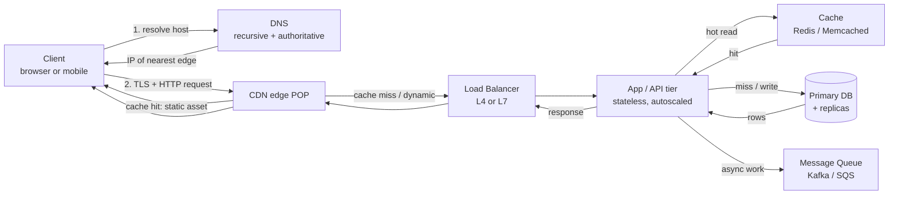

| Hop | Typical added latency (same region) | What can go wrong |
|---|---|---|
| DNS resolution | 0–50 ms (0 if cached) | Cold cache, low TTL thrash, resolver outage |
| TLS handshake | 1 RTT (TLS 1.3) or 2 RTT (1.2) | No session resumption → full handshake each time |
| CDN edge | 5–30 ms on hit | Cache miss storm, bad `Cache-Control` |
| Load balancer | < 1 ms | Uneven hashing, connection limits |
| App tier | 1–10 ms compute | GC pauses, lock contention |
| Cache | 0.2–1 ms | Cold cache after deploy, hot-key |
| DB | 0.1–2 ms (NVMe point read), +0.5–2 ms cross-AZ RTT | Lock waits, missing index, replication lag |

**Worked latency-budget overlay.** Suppose the SLO is **200 ms p99** for a feed load. Budget: DNS 0 (cached), TLS 0 (keep-alive reuse), CDN miss 10 ms, LB 1 ms, app 8 ms, cache miss → DB 15 ms, serialization + egress 20 ms. That sums to ~54 ms — you have **~146 ms of headroom**. Now the staff question: *what eats the headroom?* A cross-region replica read adds 80 ms; a cold cache after deploy turns a 1 ms hit into a 15 ms DB read on every request; a GC pause adds 50–200 ms to p99 specifically. The budget tells you the design is fine *until* one of those fires — so you design the mitigations (keep-alive, cache warming, replica locality) for exactly those.

> **Staff-level insight:** A junior answer lists these boxes. A staff answer assigns a *latency budget* to each hop and identifies which hop dominates the p99. If your SLO is 200 ms p99 and the DB is 30 ms p99, you have headroom; if cross-region replication adds 80 ms, your design is wrong before you write a line of code. Lead with the budget, not the boxes. **Earmark early:** say out loud "the risk in this path is the DB hop and the cold-cache case — that's where I'll spend time," so the interviewer knows you're triaging, not reciting.

---

## 1. Scalability

> **Altitude for this section:** Vertical-vs-horizontal and the metrics definitions are settled ground — name them and move. **Deep-dive the crux:** USL retrograde scaling, tail latency under fan-out, and the capacity math (locating the binding constraint). That's where staff signal lives.

### 1.1 Vertical vs Horizontal Scaling

**Definition.** *Vertical scaling (scale-up)* means making one machine bigger — more cores, more RAM, faster disk. *Horizontal scaling (scale-out)* means adding more machines and distributing load across them.

**How it works.** Scale-up is bounded by the largest box you can buy (today on the order of ~900 vCPUs / ~32 TB RAM on AWS `u7i` high-memory instances — don't quote a specific vCPU count you can't defend; the point is "one very large box, one failure domain") and gives you a single failure domain. Scale-out requires that work be *partitionable* and ideally *stateless* at the tier you're scaling, plus a layer (load balancer, shard router, consistent hash ring) to spread requests.

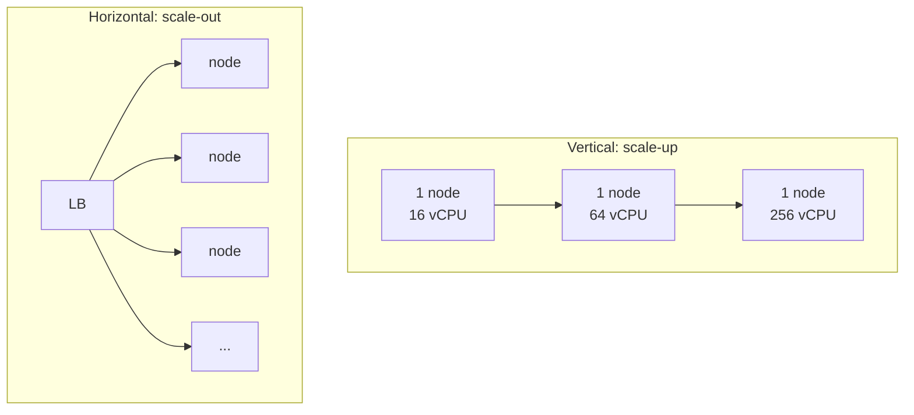

| Dimension | Vertical (scale-up) | Horizontal (scale-out) |
|---|---|---|
| Ceiling | Hard (biggest instance) | Effectively unbounded |
| Failure domain | Single node = SPOF | Many nodes, graceful degradation |
| Complexity | Low (no distribution) | High (coordination, consistency) |
| Cost curve | Super-linear at the top end | Near-linear (commodity HW) |
| State handling | Trivial | Needs partitioning/replication |
| Downtime to resize | Often a reboot | Rolling, zero-downtime |
| Elasticity | Slow (resize event) | Fast (autoscaling groups) |
| Best for | Stateful DBs early on, simplicity | Stateless web/app tiers, large scale |

**The decision (decisive form).** *Scale the stateless tier out from day one because nodes are disposable and elasticity is free; scale the stateful core up first because one big primary is dramatically simpler than a distributed one; revisit toward scale-out (replicas → shards) the moment a single primary can't hold the write rate or dataset.* This isn't a coin flip — the table above justifies it, and you state it as a default + trigger, not a menu.

**Real-world.** Postgres/MySQL primaries are usually scaled *up* first (it's far simpler than sharding) then scaled *out* via read replicas, then finally sharded. Stateless web tiers (Node, Go, JVM services behind an ALB) are scaled *out* from day one. Cassandra/DynamoDB are designed to *only* scale out — there is no "big primary" to grow.

**The cost crossover (a number to cite).** Scale-up cost is roughly *super-linear*: the top-end instance often costs 3–5x the per-core price of a mid instance because you're paying for scarce silicon and the single-vendor premium. Scale-out on commodity nodes is near-linear until coordination overhead (next section) bends the curve. The crossover is *why* you scale up the simple-but-bounded core and out the cheap-but-coordinated shell.

**Pitfalls.**
- Treating "add a replica" as horizontal scaling for *writes* — replicas scale reads, not writes. Writes still funnel to one primary. (This is the single most common scaling confusion in interviews.)
- Scaling out a tier that holds session state in local memory (sticky sessions become a correctness bug on node loss — see [WebSockets](#34-websockets--server-sent-events) for the stateful-connection version of this).
- Forgetting that scaling out moves the bottleneck *downstream* — 10x app servers just slams the DB 10x harder. You haven't scaled the system, you've relocated the fire.
- Vertical resize requiring a reboot/failover window you didn't plan for (and on a stateful primary, that's a write-availability gap).

> **Staff-level insight:** The real question isn't "scale up or out" — it's "what is the *unit of scaling* and is it stateless?" Push state down to a small number of well-understood stores (DB, cache) and make everything above it horizontally scalable and disposable. The art is shrinking the stateful core, not scaling the stateless shell. **Anti-pattern to inoculate against:** reflexively answering "horizontal, obviously" — that signals you haven't felt how much complexity sharding buys you. The mature answer leads with "up first for the stateful core, out for the stateless tier," and names the trigger to escalate.

### 1.2 Bottleneck Analysis: Amdahl & the Universal Scalability Law

**Definition.** A bottleneck is the single resource that saturates first and caps throughput. The classic four are **CPU, memory, disk I/O, network**; the fifth — and the one that bites at scale — is **lock/coordination contention**.

**How to find it.** Use the **USE method**: for every resource check **U**tilization, **S**aturation, **E**rrors. CPU at 95% → CPU bound. Disk queue depth climbing → I/O bound. Threads blocked on a mutex → contention bound. Network at line rate → network bound. The discipline is *measure before optimizing* — the bottleneck is almost never where intuition says.

**Amdahl's Law** caps speedup from parallelism by the serial fraction `s`:

```
Speedup(N) = 1 / ( s + (1 - s)/N )
```

If 5% of work is serial (`s = 0.05`), the max speedup is `1/0.05 = 20x` no matter how many cores you add. Even with infinite parallelism, the serial 5% is a wall.

**Universal Scalability Law (USL)** is Amdahl plus a *crosstalk/coherency* penalty `κ` — and this is the one that explains why systems get *slower* past a point:

```
Throughput(N) = N / ( 1 + α(N-1) + κ·N·(N-1) )
```

- `α` = contention (serialization, like Amdahl's `s`)
- `κ` = coherency cost (nodes coordinating: cache coherence, lock handoffs, gossip, distributed-lock chatter)

When `κ > 0`, throughput rises, peaks, then **declines** — adding nodes *hurts*. This is **retrograde scalability**, and it's the single most useful thing to name that distinguishes someone who's operated distributed systems from someone who's read about them.

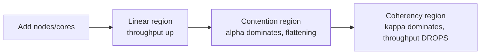

**Worked USL example.** Take `α = 0.03`, `κ = 0.0001`. Throughput climbs, but the `κ·N·(N-1)` term grows quadratically. The peak occurs near `N* = sqrt((1-α)/κ) ≈ sqrt(0.97/0.0001) ≈ 98` nodes. Past ~98 nodes, **adding capacity reduces total throughput** — every new node spends more time coordinating than working. The fix is never "more nodes"; it's *reducing `κ`* — shard the contended resource so nodes stop talking to each other.

| Bottleneck | Symptom | Typical fix |
|---|---|---|
| CPU | High util, low I/O wait | Profile hot path, scale out, async, vectorize |
| Memory | Swapping, GC thrash | Cache sizing, off-heap, bigger box, fix leaks |
| Disk I/O | High await/queue depth | SSD/NVMe, batching, better indexes, sequential writes |
| Network | Line-rate saturation, retransmits | Compression, locality, larger payloads less often |
| Lock contention | Idle CPU but low throughput, p99 spikes | Reduce critical section, sharded locks, lock-free, optimistic concurrency |
| Coherency (κ) | Throughput *drops* as you add nodes | Shard the contended resource, kill global counters/locks, reduce gossip |

**Where the technical risk concentrates:** the bottom two rows. CPU/memory/disk/network are solvable with money (bigger/more hardware). Contention and coherency are *architectural* — you can't buy your way out, and they're where a design quietly fails at 10x.

**Pitfalls.**
- Optimizing the wrong resource because you never measured (the bottleneck is rarely where intuition says).
- Adding nodes to a `κ`-heavy system (chatty distributed locks, global counters, single hot row) and watching it get *slower*.
- Ignoring that a single shared mutex turns a 64-core box into an effectively 1-core box for that path (Amdahl with `s` near 1).
- A global auto-increment ID or a single "stats" row that every write touches — a textbook `α`/`κ` source.

> **Staff-level insight:** Quote USL, not just Amdahl. Saying "past ~N nodes coherency cost dominates and throughput goes *retrograde*" signals you've operated real distributed systems where adding capacity made things worse. The fix is almost always reducing coordination — sharding the contended resource so nodes stop talking to each other — not buying more hardware. **War-story to cite:** a global counter or single hot partition that turned scale-out into scale-*down* until it was sharded.

### 1.3 Throughput vs Latency & Tail Latency

**Definition.** *Latency* = time for one request. *Throughput* = requests completed per unit time. They are not inverses; a system can have high throughput *and* high latency (deep queues), or low throughput *and* low latency (idle). **The relationship is governed by Little's Law and by queueing:** as utilization `ρ` approaches 1, latency rises *hyperbolically* (`W ∝ 1/(1-ρ)`), so a system at 90% utilization has ~10x the queue wait of one at 50%. This is why you never run hot tiers above ~70–80% utilization — the last 20% of capacity costs you the tail.

**Tail latency** is the latency distribution's percentiles: **p50** (median), **p95**, **p99**, **p999**, **p9999**. The average is nearly useless — it hides the tail that users actually feel. *This is the deep-dive crux of the scalability section; spend time here.*

**Why the tail matters: fan-out amplification.** If one user request fans out to 100 backend calls and you need *all* of them, your request latency ≈ the *slowest* of 100 — i.e. roughly the backend's p99. A 1-in-100 slow event at the leaf becomes a near-certainty at the root.

```
P(request hits a slow leaf) = 1 - (1 - p)^F
```
For per-call p99 slowness (`p = 0.01`) and fan-out `F = 100`: `1 - 0.99^100 ≈ 63%`. **Two-thirds of root requests are slow** even though each leaf is fast 99% of the time. At `F = 500`: `1 - 0.99^500 ≈ 99.3%` — the tail is now your *median*. This is the single most important number in the whole module for a high-fan-out product (search, feed, chat fan-out).

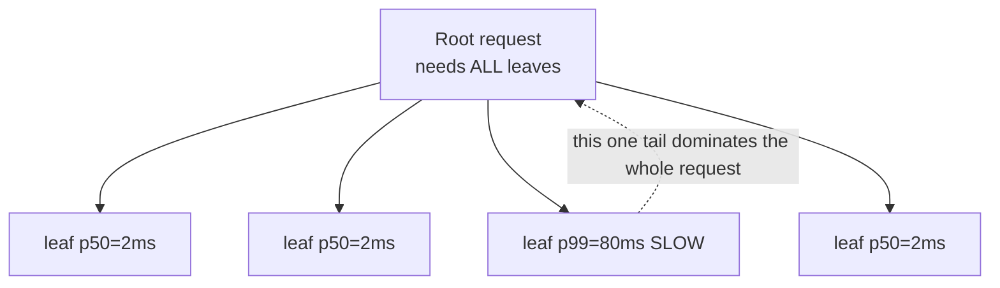

| Metric | What it tells you | Interview rule of thumb |
|---|---|---|
| p50 | Typical experience | Useful, but never optimize *only* this |
| p95 | Most users' worst case | SLO floor for many services |
| p99 | The tail that generates support tickets | Common SLO target |
| p999 | Whales, retries, cache misses, GC pauses | Matters at high fan-out / high QPS |
| p9999 | Rare, but at 1M QPS that's 100 req/s of pain | Matters for very high QPS / strict SLOs |

**What lives in the tail (so you can attack it):** GC/JIT pauses, cold caches after deploy, lock contention, TCP retransmits, noisy-neighbor CPU steal, occasional slow disk reads, head-of-line blocking, and a hot key/partition. Each is a separate mitigation.

**Mitigations for tail latency:**
- **Hedged requests** — send to 2 replicas after a short delay, take the first response. Cuts p99 dramatically for a small extra load (send the hedge only after the p95 deadline so cost stays ~5%).
- **Tied requests** — send to two, and the moment one *starts* executing it cancels the other (Google's trick to avoid double work).
- **Timeouts + retries with budgets** — bound the wait, but cap total retry attempts so retries can't become the load.
- **Backpressure / load shedding** — reject early when overloaded rather than queueing into a latency cliff.
- **Isolating slow tenants** — separate pools/bulkheads so one slow tenant doesn't poison shared capacity.
- **Reducing fan-out** — denormalize, batch, or cache so you need 10 leaves not 100. The cheapest tail fix is *not fanning out*.

**Pitfalls.**
- Reporting averages in a design — instant junior tell.
- Setting timeouts above your SLO (a 1 s timeout under a 200 ms SLO is meaningless — it can never fire in time to help).
- Unbounded retries amplifying a tail event into a **retry storm / metastable failure** — the system stays down even after the trigger clears because retries are now the load.
- Running tiers at >80% utilization and being surprised the tail explodes (queueing theory, not bad luck).

> **Staff-level insight:** Tail latency is a *systems* property, not a code property. At 100x fan-out, p999 of a dependency becomes p50 of your product. The defensive moves — hedged/tied requests, fan-out reduction, isolating the slow path — are what Google's **"The Tail at Scale"** (Dean & Barroso) is about. Naming that paper *and* the fan-out math is a strong senior signal. **War-story to cite:** the metastable failure where unbounded retries became the load and only load-shedding broke the spiral — that's why retry budgets and shedding go in from the start, not after the first incident.

### 1.4 Performance Metrics & Little's Law

**Definitions.**
- **QPS/RPS** — queries/requests per second (throughput).
- **Concurrency** — number of in-flight requests at an instant.
- **Utilization `ρ`** — fraction of capacity in use; latency blows up as `ρ → 1`.
- **Little's Law** — the iron link between throughput, concurrency, and latency:

```
L = λ × W
```
- `L` = average number of in-flight requests (concurrency)
- `λ` = arrival rate (QPS)
- `W` = average time in system (latency)

**Why it's load-bearing.** It lets you size thread pools, connection pools, and capacity from any two of the three — *on the whiteboard, in real time*. Example: 10,000 QPS at 50 ms average latency → `L = 10000 × 0.05 = 500` concurrent requests in flight. So you need ~500 worker slots / connections, not 10,000. Deriving this live is a top capacity-interview signal.

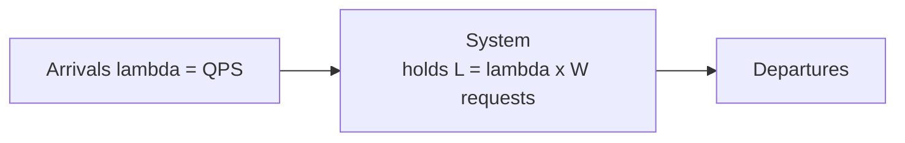

| Quantity | Formula | Use it to size... |
|---|---|---|
| Concurrency `L` | `λ × W` | Thread/connection pool depth |
| Required QPS `λ` | `L / W` | Whether a pool can sustain target load |
| Latency `W` | `L / λ` | Implied latency given pool + load |
| Threads needed | `QPS × latency_sec` | CPU-bound vs I/O-bound pool sizing |
| DB connections | `QPS × db_time_sec` | Connection-pool depth (the usual culprit) |

**Worked pool-sizing example.** A service does 4,000 QPS; each request spends 20 ms in the DB. DB connections needed = `4000 × 0.02 = 80`. If your pool is 40, half your requests *queue* for a connection, `W` rises, and Little's Law now reports a *larger* `L` — a feedback loop that ends in a latency cliff. Conversely, a 1,000-connection pool against a DB that can only run 100 concurrent queries just moves the queue into the DB and adds context-switch overhead. **Size the pool to the bottleneck's real concurrency, not to QPS.**

**Pitfalls.**
- Using *average* latency in Little's Law when the workload is bimodal — it under-provisions for the tail. Size pools against a high percentile when the tail is heavy.
- Confusing concurrency with QPS in capacity asks ("how many connections to the DB?" is an `L` question, not a `λ` question).
- A connection pool smaller than `L` silently queues requests → latency balloons, and now your `W` is wrong (the spiral above).
- Forgetting that Little's Law assumes a *stable* system (arrivals = departures over the interval); during an overload it doesn't hold because the queue is growing unboundedly — that's your signal you're shedding, not serving.

> **Staff-level insight:** Little's Law is the single most useful equation in a capacity interview because it's load-, scheduling-, and distribution-independent — it holds for *any* stable system. Use it to derive pool sizes on the spot and to explain why a too-small pool causes a latency cliff: when `L_demand > pool`, requests queue, `W` rises, and you spiral. Pair it with the queueing fact that latency `∝ 1/(1-ρ)` to explain *why you never run a tier hot*. That combination — Little's Law plus utilization-driven tail — is a clean staff-level demonstration.

### 1.5 Capacity Planning: A Worked Example

**The interview move:** DAU → QPS → cores → storage → bandwidth, with aggressive rounding and stated assumptions. Say the assumptions *out loud* — that's the skill being tested. **The grade is not the number; it's whether you locate the binding constraint and name what you'd measure.**

**Scenario: a social feed service, 100M DAU.**

**Step 1 — DAU to average QPS.**
- Assume each user makes ~50 requests/day (feed loads, scrolls, likes).
- Total = `100M × 50 = 5B requests/day`.
- Seconds/day ≈ `86,400 ≈ 100k` (round up — say this out loud).
- Average QPS = `5B / 100k = 50,000 QPS`.

**Step 2 — Peak QPS.** Traffic isn't flat. Apply a **peak factor of 2–3x** (some use 5x for spiky consumer apps with a daily prime-time spike).
- Peak ≈ `50k × 3 = 150,000 QPS`.

**Step 3 — Read/write split.** Feeds are read-heavy, say **100:1**.
- Reads ≈ `~148k QPS`, Writes ≈ `~1.5k QPS`.

**Step 4 — App servers (cores).** Suppose a server handles **1,000 QPS** comfortably (CPU-bound, 10 ms/req → Little's Law: 10 concurrent on ~10 cores).
- Servers for peak = `150k / 1k = 150 servers`. Add headroom + N+2 redundancy → ~**200 servers**.

**Step 5 — Storage/year.**
- Writes = 1.5k/s × 100k s/day = `150M writes/day`.
- Each post ≈ 1 KB metadata.
- Per day = `150M × 1 KB = 150 GB/day`.
- Per year = `150 GB × 365 ≈ 55 TB/year` (before replication).
- With 3x replication → `~165 TB/year`. Add indexes/overhead → call it **~250 TB/year**.

**Step 6 — Bandwidth.**
- Read response ≈ 5 KB. Egress = `148k QPS × 5 KB ≈ 740 MB/s ≈ 6 Gbps` peak.
- This is where a **CDN** earns its keep — offload static/media so origin egress stays sane.

**Step 7 — Cache sizing.** Cache the hot working set. If 20% of users generate 80% of reads and a user's hot data is ~10 KB:
- Hot users = 20M × 10 KB = `200 GB`. A handful of cache nodes (e.g. 5 × 64 GB) covers it.
- **Cache hit ratio target:** at 95% hit ratio, origin reads drop from 148k QPS to ~7.4k QPS — *that single number* decides whether the DB tier is 6 shards or 1 primary + replicas. Compute it explicitly.

**Step 8 — Sanity-check the binding constraint.** Reads (148k QPS, 6 Gbps egress) dominate everything. Writes (1.5k QPS) fit on a *single* primary — so **you do not shard for this workload**; you cache hard and add read replicas. Saying "I'm deliberately not sharding because writes fit on one node" here is a stronger signal than producing a shard count.

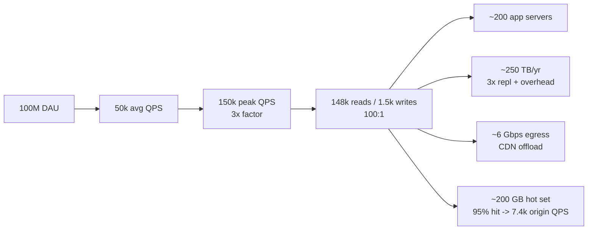

| Input assumption | Value used | Why it's defensible |
|---|---|---|
| Requests/user/day | 50 | Typical engaged consumer app |
| Seconds/day | 100k | 86,400 rounded for mental math |
| Peak factor | 3x | Consumer traffic isn't flat |
| Read:write | 100:1 | Feeds are read-dominated |
| QPS/server | 1,000 | Mid-tier service, 10 ms/req |
| Bytes/post | 1 KB | Text + metadata, media on CDN |
| Cache hit ratio | 95% | Hot-set fits in RAM, Zipfian access |
| Replication | 3x | Standard durability |

> **Staff-level insight:** Interviewers don't grade the exact number — they grade whether you *state assumptions, round aggressively, and locate the binding constraint*. Here the binding constraint is **read bandwidth/QPS**, which immediately motivates caching + CDN + read replicas — and explicitly *rules out* sharding (writes fit on one node). End the estimate by saying which number you'd want to *measure* before committing capital (the real requests/user and the real cache hit ratio) — that's the difference between a guess and a plan. **Anti-pattern:** producing a shard count the workload doesn't justify, just to show you can shard.

---

## 2. Networking

> **Altitude for this section:** Most of networking is settled ground for an experienced engineer — name the handshakes, the records, the proxy directions, and *move*. The two things worth real airtime: **HOL blocking across the protocol stack** (why HTTP/3 exists) and **where to terminate TLS at scale** (a CPU/ops decision, not a crypto one). Everything else is name-and-move-on.

### 2.1 TCP/IP

**Definition.** TCP is a connection-oriented, reliable, ordered, byte-stream transport over IP. It guarantees delivery and order via sequence numbers, ACKs, and retransmission. *(Name-and-move-on territory — don't narrate the handshake as a discovery.)*

**How it works.**
- **3-way handshake** to open: SYN → SYN-ACK → ACK (1 RTT before data can flow).
- **Flow control** via the receiver's advertised *window* (don't overrun a slow receiver).
- **Congestion control** via algorithms (CUBIC default on Linux, **BBR** increasingly — Google/YouTube run BBR for higher throughput on lossy links) using *slow start* and *congestion avoidance* (don't overrun the *network*).
- **Reliability** via sequence numbers + cumulative/selective ACKs (SACK) + retransmit timeouts (RTO).
- **4-way handshake** to close (FIN/ACK each direction), leaving the initiator in TIME_WAIT (2×MSL) to absorb stray segments.

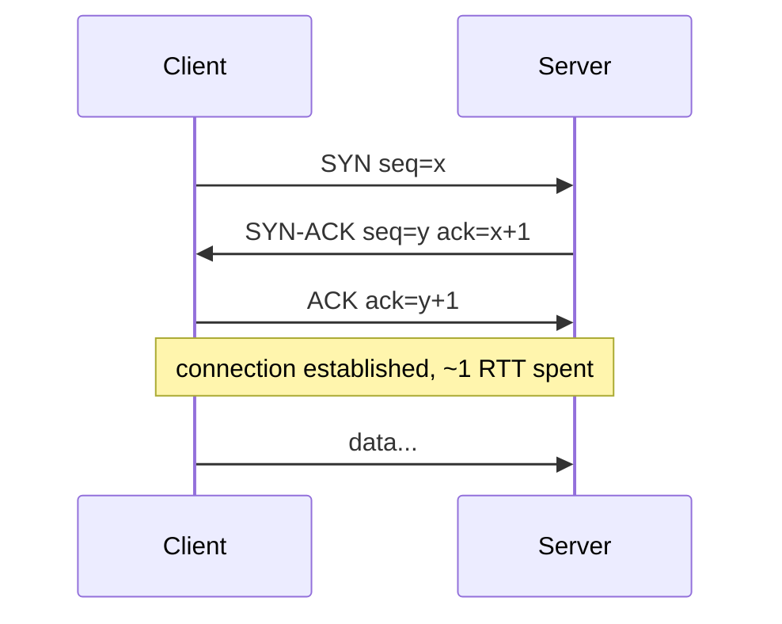

**Head-of-line (HOL) blocking — the deep-dive.** Because TCP delivers bytes *in order*, one lost segment stalls *everything* behind it until retransmitted — even logically independent streams multiplexed on that connection. This is exactly why HTTP/2's stream multiplexing still suffers HOL blocking, and why HTTP/3 moved to QUIC over UDP. **The staff point: HOL blocking is a property of the *transport layer*, and you can only fix it by changing the transport, not the application protocol on top.**

| Property | TCP | UDP |
|---|---|---|
| Connection | Yes (handshake) | No |
| Reliability/order | Guaranteed | None (app's job) |
| Flow/congestion control | Built-in | None |
| Header overhead | 20+ bytes | 8 bytes |
| HOL blocking | Yes | No |
| Use when | Correctness matters | Latency > completeness |

**Pitfalls.** Nagle's algorithm + delayed ACK interacting to add 40 ms (disable Nagle with `TCP_NODELAY` for latency-sensitive RPC); not tuning TIME_WAIT for high connection churn (ephemeral port exhaustion); assuming connection setup is free in a chatty microservice mesh — **use keep-alive / connection pooling** (a fresh TCP+TLS handshake per call can dwarf the actual work). For a real-time chat backend this is acute: a million short-lived connections will exhaust ports and CPU long before they exhaust bandwidth.

> **Staff-level insight:** The interview-relevant fact is *HOL blocking is a property of the transport, not the application*. HTTP/2 fixed application-layer HOL but inherited transport-layer HOL from TCP; only switching the transport (QUIC/UDP with per-stream delivery) actually fixes it. Knowing *which layer* a problem lives at is the mark of depth — and lets you say "I'm not going to explain the handshake; the part that matters here is the transport HOL, because that's what bounds our multiplexed latency."

### 2.2 UDP

**Definition.** A connectionless, unreliable datagram transport — fire and forget, 8-byte header, no handshake, no ordering, no retransmission.

**When/why.** Use UDP when *stale data is worthless* and you'd rather skip a lost packet than wait for it: real-time voice/video (WebRTC, VoIP), live game state, DNS (small, one-shot), QUIC (which builds its *own* reliability on top), and high-rate telemetry/metrics where occasional loss is fine. **The decision is semantic, not "for speed":** *choose UDP because a late packet is a defect for this data, not because it's faster.*

| Use case | Why UDP |
|---|---|
| Video/voice (WebRTC) | A retransmitted frame arrives too late to play |
| Online gaming | Latest position > every position |
| DNS | One small request/response, app retries |
| QUIC/HTTP-3 | Reliability done per-stream above UDP |
| Metrics (StatsD) | Lossy is acceptable, throughput matters |

**Pitfalls.** No congestion control means a UDP flood can starve TCP flows sharing the link (be a good citizen — QUIC re-implements congestion control for this reason); firewalls/NATs handle UDP less gracefully (NAT mappings time out fast, so you need keep-alive pings for long-lived UDP); you must build retransmission/ordering yourself if you actually need them — and if you find yourself doing that, you probably wanted TCP (or QUIC).

> **Staff-level insight:** "Use UDP for speed" is a junior framing. The real reason is *semantic*: for real-time media, a late packet is a *defect*, so reliability is a misfeature. QUIC is the nuanced example — it chose UDP not to be unreliable but to *control its own* reliability and congestion in userspace, escaping kernel TCP and per-connection HOL blocking. That distinction (selective reliability per stream) is the senior nuance.

### 2.3 HTTP / HTTPS / HTTP-2 / HTTP-3 + QUIC

**HTTP/1.1** — text protocol, one request per connection at a time; pipelining was broken in practice, so browsers open ~6 parallel connections per host. Head-of-line blocking at the application layer.

**HTTPS** — HTTP over TLS. Adds the TLS handshake (see [TLS](#24-tlsssl)) and encrypts the channel.

**HTTP/2** — binary framing with **multiplexing** (many streams over one TCP connection), **header compression (HPACK)**, server push (largely deprecated — Chrome removed it), and stream prioritization. Fixes *application-layer* HOL blocking — but a single TCP packet loss still stalls *all* streams (transport HOL).

**HTTP/3 + QUIC** — runs over **UDP**. QUIC implements streams, reliability, and congestion control in userspace with *independent per-stream delivery*, so a loss in one stream doesn't block others — finally killing HOL blocking. Combines transport + TLS 1.3 handshake into **1-RTT** connection setup, and **0-RTT** resumption for returning clients. Header compression is **QPACK** (HPACK adapted to avoid HOL on the header stream).

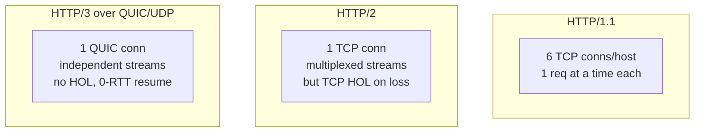

| Feature | HTTP/1.1 | HTTP/2 | HTTP/3 (QUIC) |
|---|---|---|---|
| Transport | TCP | TCP | UDP |
| Multiplexing | No (6 conns) | Yes | Yes |
| HOL blocking | App + transport | Transport only | None |
| Header compression | None | HPACK | QPACK |
| Handshake RTTs | TCP+TLS (2–3) | TCP+TLS (2–3) | 1 (0 on resume) |
| Connection migration | No | No | Yes (survives IP change) |

**The decision (decisive form).** *Serve HTTP/3 at the edge for a mobile-heavy product because connection migration and 0-RTT are real product-latency wins on flaky cellular; keep HTTP/2 as the fallback because some middleboxes mangle UDP; use plain HTTP/1.1 only where simplicity trumps everything (internal debug endpoints). Revisit if your traffic is desktop/datacenter-bound where the QUIC wins shrink.*

**Real-world.** Most CDNs (Cloudflare, Fastly, CloudFront) and Google/Meta serve HTTP/3. Mobile especially benefits: QUIC **connection migration** keeps a session alive when a phone switches from Wi-Fi to cellular (the connection ID, not the 4-tuple, identifies it) — for a chat app this means no dropped session when a user walks out of the house.

**Pitfalls.** HTTP/2 over a lossy link can be *worse* than HTTP/1.1's parallel connections due to TCP HOL; some middleboxes block/mangle UDP, breaking HTTP/3 (clients fall back to H2 via Alt-Svc); 0-RTT data is replayable, so it must be idempotent (never put a non-idempotent mutation in early data).

> **Staff-level insight:** The throughline across all three is **head-of-line blocking and handshake RTTs**. H2 solved app-layer HOL; H3/QUIC solved transport HOL *and* cut setup to 0–1 RTT. For a mobile-heavy product, lead with QUIC's connection migration and 0-RTT — that's a product-latency win an interviewer for a consumer company will reward. Don't recite the version history; *pick* H3-at-edge-with-H2-fallback and justify it in one clause.

### 2.4 TLS/SSL

**Definition.** TLS provides confidentiality, integrity, and authentication for a connection. "SSL" is the deprecated predecessor; everyone means TLS. *(Name the three properties and move — the deep-dive is termination and resumption at scale.)*

**How it works (TLS 1.3, the modern default).**
1. ClientHello (offers ciphers, key share).
2. ServerHello (picks cipher, sends key share + certificate).
3. Both derive the shared secret (ECDHE); client verifies cert chain to a trusted CA.
4. Encrypted application data — all in **1 RTT**. **0-RTT** resumption lets a returning client send data immediately using a pre-shared key (TLS 1.2 needed 2 RTT).

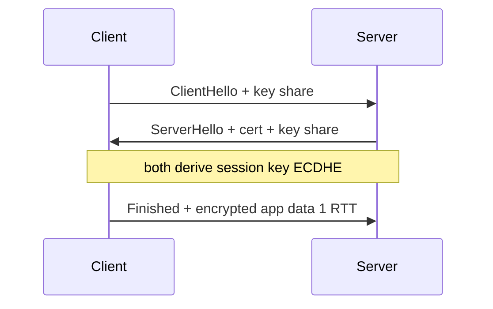

**Session resumption** — reuse a prior session (session IDs / session tickets / PSK) to skip the full handshake. Critical at scale: full handshakes are CPU-heavy (asymmetric crypto, ~hundreds of µs of CPU each). At 150k new connections/sec, the difference between full and resumed handshakes is the difference between a CPU-bound fleet and a comfortable one.

**mTLS (mutual TLS)** — both client *and* server present certificates. The default for service-to-service auth in zero-trust meshes (Istio, Linkerd, SPIFFE/SPIRE). Cost: certificate rotation/PKI at scale.

**Where to terminate — the decision.**
- **At the edge/CDN** — offloads crypto, enables caching + DDoS scrubbing; the CDN sees plaintext.
- **At the load balancer** — offloads app CPU, centralizes certs; the internal hop is plaintext unless re-encrypted.
- **At the app / end-to-end** — required for strict compliance or zero-trust; per-service cert management and more CPU.
- **mTLS everywhere** — zero-trust identity on every hop; PKI complexity.

| Termination point | Pro | Con |
|---|---|---|
| Edge / CDN | Simplest, caching, DDoS scrubbing | CDN sees plaintext |
| Load balancer | Offloads app CPU, central certs | Internal hop unencrypted unless re-encrypted |
| App server | True end-to-end | Per-service cert mgmt, more CPU |
| mTLS everywhere | Zero-trust, strong identity | Cert rotation/PKI complexity |

*Decisive default:* **terminate at the LB/edge and re-encrypt to the app inside the trust boundary because it offloads handshake CPU while keeping the internal hop encrypted; escalate to mTLS-everywhere only when a compliance/zero-trust requirement names it.*

**Pitfalls.** Expired/mis-chained certs (a top outage cause — automate with ACME/cert-manager and alert on cert age); no session resumption → CPU melts under handshake load; 0-RTT replay attacks on non-idempotent requests; terminating at the LB then forgetting the internal hop is plaintext.

> **Staff-level insight:** At scale, TLS is a *CPU and operations* problem, not a crypto problem. The two levers are **session resumption** (don't pay full handshake every time) and **where you terminate** (push crypto off app cores onto the LB/edge, or mandate mTLS for zero-trust). Mentioning automated cert rotation (ACME/cert-manager) shows you've felt the 3am expired-cert page — **war-story:** an expired intermediate that took down a region's TLS until rotation was automated and cert-age alerting added.

### 2.5 DNS

**Definition.** DNS maps human names to IP addresses (and more) via a hierarchical, cached, distributed database. *(Settled ground — one sentence, then go straight to the TTL/failover trade-off, which is the only part with design consequences.)*

**Resolution path.** Stub resolver → recursive resolver (ISP/8.8.8.8) → root → TLD (`.com`) → authoritative nameserver → answer, cached at each level by **TTL**.

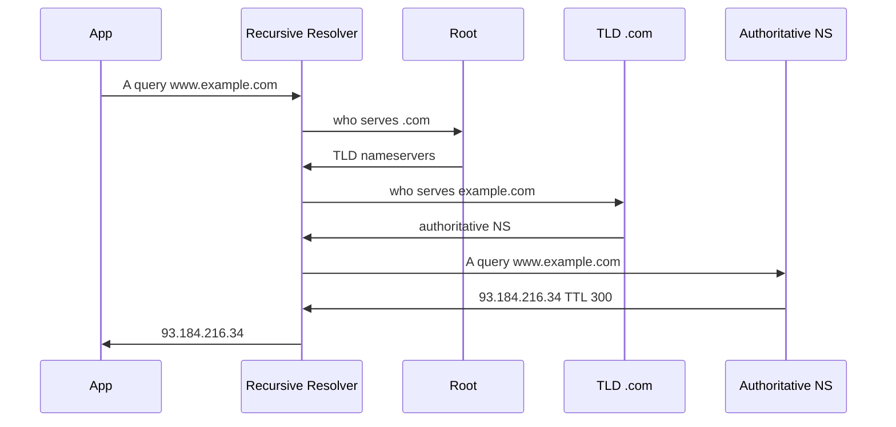

| Record | Purpose |
|---|---|
| A / AAAA | Name → IPv4 / IPv6 |
| CNAME | Alias to another name |
| MX | Mail servers |
| TXT | SPF/DKIM, domain verification |
| NS | Delegation to nameservers |
| SOA | Zone authority/metadata |

**TTL trade-off — the design lever.** Low TTL (e.g. 60 s) = fast failover/changes but more query load and resolver dependence; high TTL (e.g. 86,400 s) = great cache hit rate but slow to change. **Lower TTLs *before* a planned migration**, then raise them back after.

**GeoDNS / DNS-based LB.** The authoritative server returns *different* IPs based on the resolver's location or health (route users to the nearest/healthiest region). Coarse-grained (resolver, not client, geography) but the cheapest global traffic steering. Route 53, NS1, Akamai do weighted/latency/geo routing.

**Pitfalls.** Relying on DNS for *fast* failover (clients/resolvers ignore TTL, cache stale records for minutes — even hours via browser pinning); negative caching of NXDOMAIN; the 2016 Dyn DDoS showed DNS as a single point of failure — use multiple providers; GeoDNS routes by *resolver* IP, which can be far from the user (corporate or public resolver in another country).

> **Staff-level insight:** DNS is global, free-ish traffic steering — but it's *eventually consistent with an unpredictable propagation lag* because clients and middleboxes honor TTLs inconsistently. So DNS is great for coarse region selection and bad for sub-minute failover; for fast failover you want **anycast + health-checked LBs** (see [Load Balancing](05-load-balancing.md)), with DNS just getting users to the nearest edge. Say that trade-off in one breath and move — DNS doesn't earn more airtime than the shard key does.

### 2.6 CDN

**Definition.** A geographically distributed network of edge caches (POPs) that serve content close to users, reducing latency, origin load, and bandwidth cost.

**How it works.**
- **Pull (origin-pull)** — edge fetches from origin on first miss, then caches per `Cache-Control`/`Expires`. Lazy, self-healing, the common default.
- **Push** — you proactively upload content to the CDN. Good for large, predictable assets (video libraries, releases) you want warm before traffic arrives.

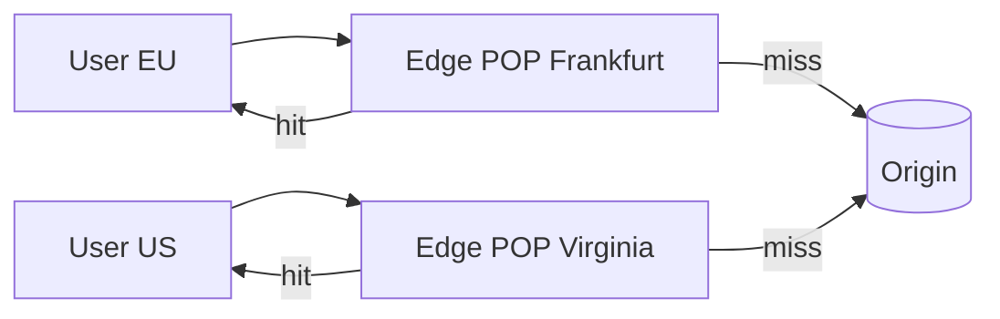

| | Pull | Push |
|---|---|---|
| Population | On first request (lazy) | Pre-uploaded (eager) |
| Best for | Long-tail, dynamic-ish | Large known assets, launches |
| Origin load | Spike on cold/miss | Predictable |
| Staleness control | TTL + purge | You control |

*Decisive default:* **origin-pull because it's self-healing and zero-maintenance for the long tail; switch to push only for large predictable launch assets you must have warm before a traffic spike.**

**Cache control & invalidation.** `Cache-Control: max-age`, `s-maxage`, `stale-while-revalidate`, `ETag`/`If-None-Match` for revalidation. Invalidation is the hard part: **purge by URL/tag**, or use **versioned/content-hashed URLs** (`app.a1b2c3.js`) so a new deploy is a new key — *cache-busting beats cache-purging.*

**Pitfalls.** Caching personalized/auth'd responses by accident (leak user data across users via a shared cache key — a real CVE class; key on the auth context or mark `Cache-Control: private`); thundering herd on cache expiry (use `stale-while-revalidate` + request coalescing); purge propagation lag; `Vary` headers exploding cache cardinality (every distinct header value is a separate cache entry).

> **Staff-level insight:** "Invalidation is one of the two hard problems." Senior answer: *avoid* invalidation via immutable, content-hashed URLs for static assets, and use short TTL + `stale-while-revalidate` for semi-dynamic content so users get instant (slightly stale) responses while the edge refreshes in the background. Also note CDNs now do *more than caching* — TLS termination, WAF/DDoS scrubbing, edge compute (Workers/Lambda@Edge) — so the CDN is increasingly your real front door, not just an asset cache.

### 2.7 Reverse Proxy vs Forward Proxy

**Definition.** A **forward proxy** sits in front of *clients* and represents them to the internet (egress control, anonymity, corporate filtering). A **reverse proxy** sits in front of *servers* and represents them to clients (ingress: TLS termination, LB, caching, WAF, routing). *(One-line distinction, then the architectural point.)*

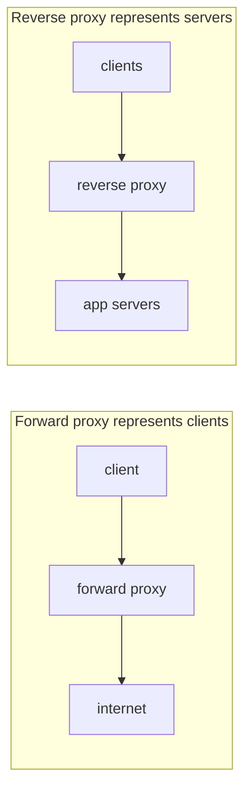

| | Forward proxy | Reverse proxy |
|---|---|---|
| Sits in front of | Clients | Servers |
| Hides | Client identity from server | Server topology from client |
| Typical jobs | Egress filtering, caching, anonymity | TLS term, LB, caching, WAF, routing |
| Examples | Squid, corporate proxy, VPN egress | NGINX, Envoy, HAProxy, ALB, Cloudflare |

**Real-world.** NGINX/Envoy/HAProxy are reverse proxies; Envoy is the data plane of service meshes (the sidecar). API gateways and CDNs are specialized reverse proxies. Load balancers are reverse proxies focused on distribution — see [Load Balancing](05-load-balancing.md).

> **Staff-level insight:** The distinction is *whom it represents* — same machinery, opposite direction. In a system design, the reverse proxy is the natural home for cross-cutting concerns (TLS, auth, rate limiting, retries, observability) so app code stays clean. **Pushing those concerns to the edge/proxy/sidecar is a recurring staff-level architectural move** — name it once and the interviewer knows you think in layers, not endpoints.

### 2.8 Load Balancer Intro: L4 vs L7

**Definition.** A load balancer distributes incoming requests across a pool of backends for scale and availability. It operates at **L4 (transport)** — routing by IP/port, blind to content — or **L7 (application)** — routing by HTTP path/header/cookie, terminating TLS, doing content-aware work. *(Full treatment lives in [Load Balancing](05-load-balancing.md); here, name the L4/L7 split and the one staff-level gotcha.)*

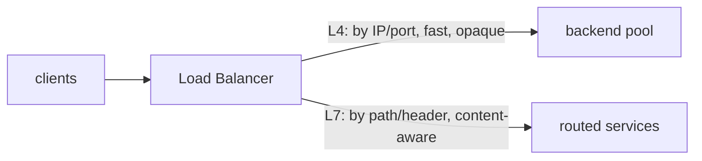

| | L4 (transport) | L7 (application) |
|---|---|---|
| Routes by | IP, port, connection | HTTP path, header, cookie, method |
| TLS | Pass-through | Terminates (or re-encrypts) |
| Throughput | Higher (less work/packet) | Lower (parses requests) |
| Capabilities | Raw distribution | Path routing, retries, rate limit, sticky |
| Examples | AWS NLB, IPVS, Maglev | AWS ALB, NGINX, Envoy, HAProxy |

**Algorithms (name them, move):** round-robin, weighted, least-connections, least-response-time, consistent-hash (for cache/affinity). Health checks eject bad backends.

**The staff-level gotcha — L4 LBs break gRPC and long-lived connections.** A single long-lived HTTP/2 (gRPC) connection carries *all* RPCs; an L4 LB pins that connection to one backend, so all RPCs land on one node regardless of load. **You need an L7 LB (or client-side LB) that balances per-request/per-stream, not per-connection.** Same problem with WebSockets and any persistent connection. *Decisive form:* **use L7 for HTTP/gRPC/WebSocket because per-request balancing is the only thing that actually spreads load on multiplexed connections; use L4 only for raw TCP/UDP throughput where content-awareness buys nothing.**

> **Staff-level insight:** "L4 vs L7" is a settled comparison — the part that earns signal is naming that **L4 load balancing silently breaks gRPC and WebSocket fan-out** because it balances connections, not requests. That single gotcha (also see [gRPC](#33-grpc) and [WebSockets](#34-websockets--server-sent-events)) shows you've actually operated persistent-connection systems, not just read the table. Defer the rest to [Load Balancing](05-load-balancing.md) rather than rabbit-holing here.

---

## 3. APIs

> **Altitude for this section:** Don't define each style from scratch — name what each is in a clause. The signal is in **matching style to traffic shape** (a decision, not a list) and in the operational gotchas: idempotency keys, N+1, gRPC-breaks-L4-LB, and connection state for WebSockets. Those are the deep-dives.

### 3.1 REST

**Definition.** REST is an architectural style: resources identified by URLs, manipulated with HTTP verbs, stateless requests, standard status codes. *(One line — REST is settled ground for everyone in the room.)*

**Richardson Maturity Model** — how "RESTful" an API is (name the levels, don't lecture):
- **L0** — single endpoint, RPC-over-HTTP (one URL, POST everything).
- **L1** — resources (distinct URLs per noun).
- **L2** — HTTP verbs + status codes (GET/POST/PUT/DELETE, 200/201/404...). *Most "REST" APIs live here, and that's fine.*
- **L3** — HATEOAS (responses embed links to next actions). Rare in practice; rarely worth chasing.

**Idempotency — the deep-dive.** GET/PUT/DELETE are idempotent; POST is not. For safe retries on POST (payments!), require an **`Idempotency-Key`** header — the server dedupes by key so a retried "charge" runs once. Implementation: store the key + response in a fast store (Redis) with a TTL; on a duplicate key, replay the stored response instead of re-executing. *This is the topic to raise unprompted — it signals you've shipped money-moving systems.*

**Pagination.** **Offset** (`?page=3`) is simple but slow and inconsistent on changing data (items shift between pages as rows insert/delete). **Cursor/keyset** (`?after=<opaque>`) is stable and O(1) at depth — prefer it for large/active datasets. *Decisive form:* **cursor pagination by default because offset degrades and drifts on large active tables; use offset only for small static admin lists.**

**Versioning.** URL (`/v2/...`), header (`Accept: application/vnd.api.v2`), or query param. *Decisive form:* **URL versioning because it's explicit, cache-friendly, and trivially routable; revisit toward header versioning only if you need fine-grained content negotiation.**

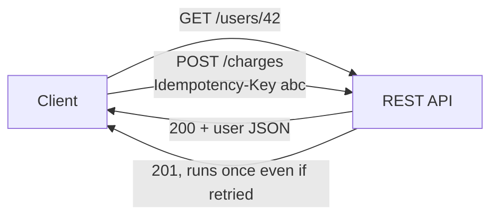

| Concern | Good practice | Pitfall |
|---|---|---|
| Idempotency | Idempotency-Key on POST | Double-charging on retry |
| Pagination | Cursor/keyset | Offset on huge tables → slow + drift |
| Versioning | /v2 in URL | Breaking changes with no version |
| Errors | Consistent error schema + status codes | 200 with `{"error":...}` body |
| Rate limits | `429` + `Retry-After` + headers | Silent throttling clients can't adapt to |

**Pitfalls.** Returning 200 for errors (clients can't branch on status); chatty designs forcing N calls (drives clients to GraphQL/BFF); unbounded list endpoints with no pagination; over-fetching fixed-shape payloads on bandwidth-constrained mobile.

> **Staff-level insight:** Most production "REST" is pragmatically L2 and that's *fine* — chasing L3 HATEOAS is rarely worth it. The genuinely senior topics are **idempotency keys for safe retries** and **cursor pagination for scale/consistency**. Bring those up unprompted; they show you've shipped payment and feed systems, not CRUD demos. *Don't* recite the Richardson levels as if teaching — name them and pivot to the two things that matter.

### 3.2 GraphQL

**Definition.** A query language where the *client* specifies exactly the fields it needs from a typed schema, hitting a single endpoint. Solves over-fetching (REST returns too much) and under-fetching (REST needs N round-trips).

**How it works.** One POST `/graphql`; the server resolves a tree of fields via *resolvers*. A typed schema (SDL) gives strong contracts and great tooling (introspection, codegen).

**The N+1 problem — the deep-dive.** Resolving a list then a sub-field per item naively issues 1 + N DB queries (fetch 50 posts, then 1 author query per post = 51 queries). **Fix: DataLoader** — batch and cache per-request so it becomes 1 + 1. Without DataLoader, GraphQL on a relational DB is a latency bomb at scale.

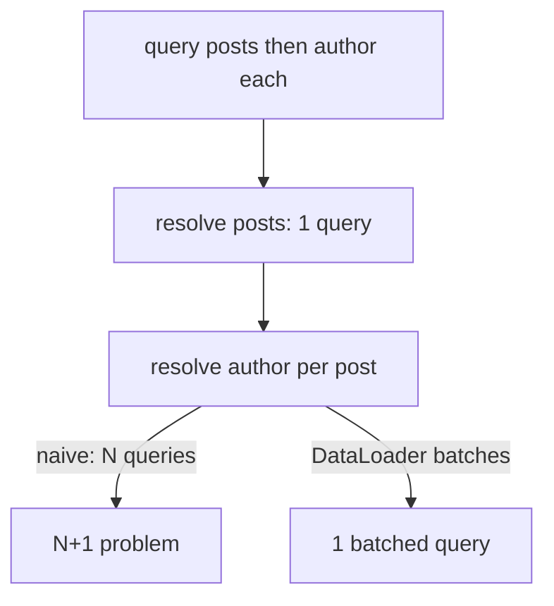

| | GraphQL strength | Watch out |
|---|---|---|
| Fetching | No over/under-fetch, client-driven | N+1 without DataLoader |
| Schema | Strong types, introspection | Schema becomes a coupling magnet |
| Caching | Field-level, flexible | HTTP/CDN caching is hard (POST, dynamic) |
| Security | Single endpoint | Arbitrarily expensive queries → need depth/cost limits |

**Persisted queries.** Clients register query hashes ahead of time and send the *hash*, not the text — smaller payloads, allowlist-able (blocks arbitrary expensive queries), and **CDN-cacheable via GET**. This is how you reclaim HTTP caching for GraphQL.

**When NOT to use GraphQL.** Simple CRUD/internal services (REST is less overhead); when you rely heavily on HTTP/CDN caching; file uploads/streaming; when query-cost governance is more work than the flexibility is worth. *Decisive form:* **reach for GraphQL as a BFF when client data needs diverge across web/iOS/Android over many backends; otherwise stay REST because the cost-governance and caching tax isn't worth it for a single client.**

**Pitfalls.** N+1 explosions; clients crafting pathological deep/expensive queries (need depth limiting + cost analysis + timeouts); losing the simplicity of HTTP caching; schema sprawl with no ownership; error handling (GraphQL returns 200 with an `errors` array — clients must inspect the body, not the status).

> **Staff-level insight:** GraphQL shines as a **BFF / aggregation layer** for heterogeneous clients (web + iOS + Android with different data needs) over many backend services — Netflix and GitHub use it exactly there. The senior failure mode is putting GraphQL directly on a single SQL DB and getting N+1 + uncacheable + uncapped-cost problems. Pair it with DataLoader, persisted queries, and a cost limiter, or don't pick it. State the *guardrails* in the same breath as the choice — that's the staff move.

### 3.3 gRPC

**Definition.** A high-performance RPC framework using **Protocol Buffers** (compact binary, schema-first) over **HTTP/2**, with code generation and four call types. *(One line — then the two operational catches, which are the signal.)*

**How it works.** Define services/messages in `.proto`; codegen produces typed client + server stubs. Protobuf is ~3–10x smaller and far faster to (de)serialize than JSON; HTTP/2 gives multiplexing and **streaming**: unary, server-streaming, client-streaming, and bidirectional.

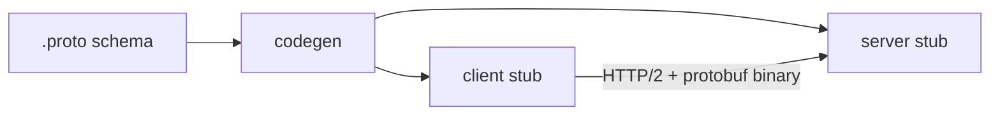

| | gRPC | REST/JSON |
|---|---|---|
| Payload | Protobuf binary (small/fast) | JSON text (human-readable) |
| Transport | HTTP/2 (multiplexed) | Usually HTTP/1.1 |
| Streaming | Bidirectional, native | SSE/WebSocket bolt-ons |
| Contract | Strict `.proto`, codegen | OpenAPI optional |
| Browser support | Needs gRPC-Web proxy | Native |
| Best for | Internal service-to-service, low latency | Public APIs, browser clients |

**The decision (decisive form).** *gRPC for east-west internal traffic because protobuf efficiency, strict contracts, and native streaming matter at mesh scale; REST/GraphQL at the north-south edge because browsers and public consumers need it. Revisit only if your internal call volume is so low the codegen/tooling overhead isn't repaid.*

**Two staff-level catches (the deep-dive):**
1. **L4 load balancing breaks gRPC** — one long-lived HTTP/2 connection carries all RPCs, so an L4 LB pins them to one backend. Use an L7 LB or client-side LB that balances per-request. (Same gotcha as [§2.8](#28-load-balancer-intro-l4-vs-l7).)
2. **Schema evolution rules** — never reuse or renumber a protobuf field number; add new fields with new numbers and keep old ones reserved. Breaking this silently corrupts deserialization across versions.

**Pitfalls.** Browsers can't speak gRPC directly (gRPC-Web/Envoy translation); harder to debug than curl-able JSON (use `grpcurl`); load-balancing long-lived HTTP/2 needs stream awareness; protobuf's permissiveness means a missing field is a default value, not an error — easy to mask bugs.

> **Staff-level insight:** gRPC is the default for internal mesh traffic at scale (Google, most cloud-natives) precisely because of protobuf efficiency, strict contracts, and streaming. The two catches that separate staff from senior: **L4 LB pins all RPCs to one backend** (need L7/client-side LB), and **put REST/GraphQL at the edge, gRPC behind it** — the gateway translates external JSON to internal protobuf. Lead with those, not with "protobuf is faster."

### 3.4 WebSockets & Server-Sent Events

**WebSockets** — full-duplex, persistent TCP connection (upgraded from HTTP via `101 Switching Protocols`). Both sides push anytime. For chat, multiplayer, collaborative editing, live trading.

**Server-Sent Events (SSE)** — server→client *one-way* stream over a normal long-lived HTTP response (`text/event-stream`). Auto-reconnect and event IDs (`Last-Event-ID`) built in. Great for feeds, notifications, dashboards, LLM token streaming.

**Long-polling** — client request hangs until data or timeout, then re-requests. Fallback when neither is available.

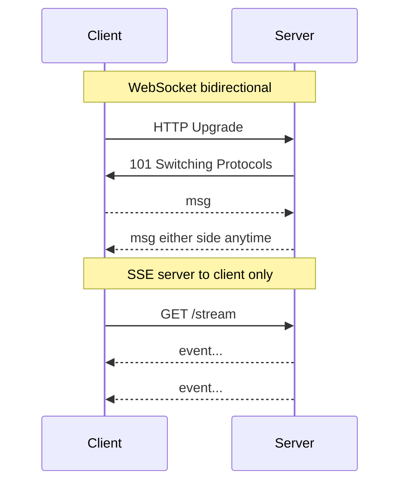

| | WebSocket | SSE | Long-poll |
|---|---|---|---|
| Direction | Bidirectional | Server→client | Client-initiated |
| Protocol | ws:// over TCP | Plain HTTP | Plain HTTP |
| Auto-reconnect | Manual | Built-in | Manual |
| Proxy/firewall friendliness | Sometimes blocked | Excellent (just HTTP) | Excellent |
| Browser limit | High | ~6 per domain (HTTP/1.1), high on H2 | High |
| Best for | Chat, games, collab | Feeds, notifications, LLM streams | Fallback |
| Overhead | Lowest per-message | Low | High (repeated headers) |

**The decision (decisive form).** *SSE for one-way push because it's just HTTP — proxy-friendly, auto-reconnecting, far simpler to operate; WebSockets only when you genuinely need low-latency bidirectional (chat, games, collab). Revisit toward WebSocket the moment client→server messaging becomes hot enough that a separate POST per message is the bottleneck.*

**The connection-state deep-dive (the real cost at scale).** Both hold open connections, which **breaks the stateless-app-tier assumption** you rely on everywhere else:
- A connection **pins to one server** → load balancing needs affinity, and a node loss drops every connection on it.
- **Deploys cause reconnect storms** — rolling a fleet of N nodes reconnects millions of clients in a thundering herd; you need staggered draining and client backoff/jitter.
- **Fan-out needs a backplane** — to deliver a message to a user connected to a *different* node, you need a pub-sub backplane (Redis Pub/Sub, Kafka, or a dedicated routing layer).
- **Budget FDs and memory** — 1M concurrent connections at ~10–50 KB/conn of kernel + app buffers is 10–50 GB of RAM *just to hold idle sockets*, plus file-descriptor limit tuning (`ulimit`, `somaxconn`).

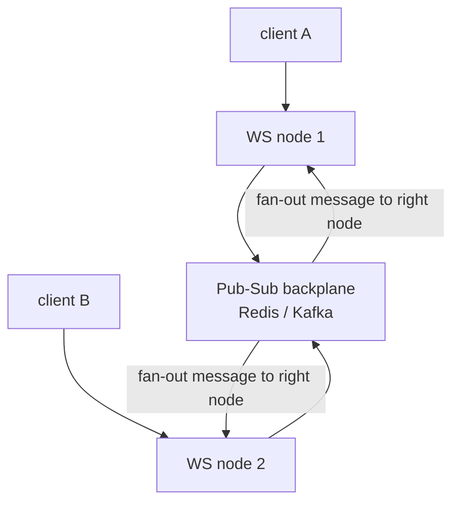

**Pitfalls.** WebSockets are *stateful* — they complicate LB, deploys, and autoscaling; need sticky/affinity + a backplane. SSE is unidirectional (pair with a normal POST for client→server). Both exhaust FDs/memory before bandwidth at high connection counts.

> **Staff-level insight:** Default to **SSE for one-way push** because it's "just HTTP." Reach for WebSockets only when you genuinely need *low-latency bidirectional*. The real cost of either is **connection state at scale**: 1M concurrent connections needs a fan-out backplane and careful FD/memory budgeting, and breaks the "stateless app tier" assumption you rely on elsewhere. **War-story to cite:** running millions of chat connections where deploys triggered reconnect storms and a Redis/Kafka backplane was mandatory to fan messages across nodes — that operational reality is exactly the signal a real-time-infra interviewer wants.

### 3.5 API Gateway

**Definition.** A reverse proxy that is the single managed entry point for clients to a fleet of backend services, handling cross-cutting concerns so services don't have to.

**Responsibilities:** routing/composition, authn/authz (validate JWT/OAuth, API keys), **rate limiting & quotas**, request/response transformation, protocol translation (REST↔gRPC), TLS termination, caching, **observability** (logging, tracing, metrics), and circuit breaking.

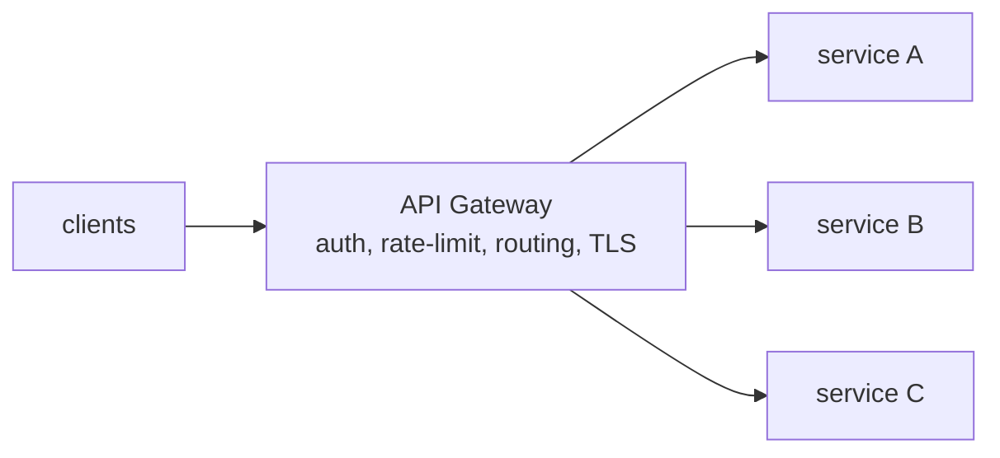

| Concern | Why at the gateway |
|---|---|
| AuthN/Z | Validate once at the edge, not per service |
| Rate limiting | Protect the whole fleet centrally |
| Routing/versioning | Single contract for clients |
| Protocol translation | External REST → internal gRPC |
| Observability | One choke point for tracing/metrics |

**Pitfalls.** The gateway becomes a SPOF and a deployment bottleneck if it holds business logic; latency tax on every call; team contention over a shared config. A per-client **BFF** (Backend-for-Frontend) often complements it for client-specific shaping.

> **Staff-level insight:** Keep the gateway *thin and generic* — auth, rate limiting, routing, observability — and push business/aggregation logic into BFFs or services. The anti-pattern is a "smart pipe" gateway that grows business rules and becomes a release bottleneck every team queues behind. Examples: Kong, Apigee, AWS API Gateway, Envoy-based gateways. *Decisive form:* **thin gateway for cross-cutting concerns + per-client BFFs for shaping; revisit toward more gateway logic only if a concern is genuinely universal and stateless.**

### 3.6 API Style Decision Table

| If you need... | Choose | Why |
|---|---|---|
| Public, cacheable, browser-friendly CRUD | **REST** | Simplest, HTTP caching, ubiquitous |
| Many clients with divergent data needs over many services | **GraphQL (BFF)** | Eliminates over/under-fetch, one round-trip |
| Internal low-latency service-to-service | **gRPC** | Protobuf + HTTP/2 + streaming + contracts |
| Real-time bidirectional (chat, games) | **WebSocket** | Full-duplex persistent connection |
| One-way server push (feeds, notifications, LLM stream) | **SSE** | Just HTTP, auto-reconnect, simple |
| Legacy/firewalled fallback | **Long-poll** | Works everywhere |

> **Staff-level insight:** These aren't mutually exclusive — mature systems run **REST/GraphQL at the edge, gRPC internally, and SSE/WebSocket for push**, all behind one gateway. Picking a *single* API style for a whole platform is a junior tell; matching the style to the *traffic shape* (north-south vs east-west, request-response vs streaming) is the senior move. Say "I'd mix these by traffic shape" rather than defending one — that's the decisive-not-enumerating pattern applied to APIs.

---

## 4. Data Storage Taxonomy

**The framing:** there is no "best database" — only the right *data model + access pattern + consistency need*. Pick by how you *read and write*, not by hype. **Altitude cue:** don't enumerate six databases neutrally — pick the store for the stated access pattern, justify in a clause, and name that polyglot persistence is normal.

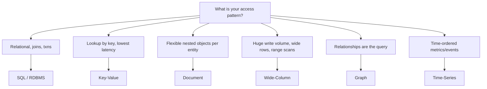

| Model | Data shape | Killer use case | Avoid when | Examples |
|---|---|---|---|---|
| **SQL / Relational** | Tables, rows, strict schema | Transactions, joins, integrity (orders, ledgers) | Massive horizontal write scale, schema churn | Postgres, MySQL, Aurora, Spanner, CockroachDB |
| **Key-Value** | `key → opaque value` | Sessions, caches, feature flags, lowest-latency lookups | Querying by value, relationships | Redis, DynamoDB, Memcached, Riak |
| **Document** | JSON-like nested docs | Catalogs, user profiles, content with varied shape | Multi-document transactions, heavy joins | MongoDB, Couchbase, Firestore |
| **Wide-Column** | Rows with dynamic columns, partition+clustering keys | Massive writes, time/event data, range scans (messaging, IoT) | Ad-hoc joins, strong cross-row txns | Cassandra, ScyllaDB, HBase, Bigtable |
| **Graph** | Nodes + edges + properties | Social graph, fraud rings, recommendations, knowledge graphs | Simple tabular data, huge bulk scans | Neo4j, Neptune, JanusGraph, TigerGraph |
| **Time-Series** | `(metric, timestamp) → value`, append-mostly | Metrics, monitoring, sensor/IoT, financial ticks | Random updates, relational queries | InfluxDB, TimescaleDB, Prometheus, ClickHouse |

**SQL vs NoSQL in one breath:** SQL gives you joins, strong schemas, and ACID transactions on a typically single-writer node — superb for correctness, harder to scale writes. NoSQL trades joins/strict schema (and often strong consistency) for *horizontal write scalability*, flexible schema, and tunable consistency — superb for scale, riskier for invariants.

**A chat-infra-flavored polyglot example (use this concretely):** a messaging product legitimately runs **Postgres** for user/account/billing (transactions, integrity), **Cassandra/ScyllaDB** for the message timeline (massive append writes, partition by conversation, clustering by time — a textbook wide-column fit), **Redis** for presence/sessions and the WebSocket fan-out backplane, **Elasticsearch** for message search, and a **TSDB** (Prometheus/ClickHouse) for delivery metrics. Each choice is justified by its access pattern — and you pay the operational cost of running five stores.

**Pitfalls.** Picking NoSQL "for scale" when you have 1 TB and need transactions (a single Postgres box handles that fine — *don't shard your way out of a problem you don't have*); modeling relational data in a document store then needing joins; ignoring that most NoSQL forces you to *model around the query* up front (no rescue-by-join later); using a general DB for time-series and drowning in write amplification.

> **Staff-level insight:** Choose the store by **access pattern and consistency requirement**, and remember **polyglot persistence** is normal: one product legitimately uses Postgres (orders), Redis (sessions/cache), Cassandra (activity feed/messages), Elasticsearch (search), and a TSDB (metrics). The senior skill is justifying *each* choice against its access pattern and naming the *operational* cost of running five datastores — not forcing everything into one. Also: **"NoSQL = schemaless" is a myth**; you still have a schema, it just lives in your *application code and query design* instead of the DDL. Say that — it inoculates against the most common NoSQL misconception.

---

## 5. Database Design

> **Altitude for this section:** Normal forms are a name-and-move (1NF–BCNF in one breath). The genuine staff-level deep-dives are: **the read-vs-write amplification trade in indexing (B-tree vs LSM)**, **shard key selection + hotspots** (the irreversible decision), and **replication lag + read-your-own-writes** (the bug that bites every read-replica architecture). Spend your minutes there.

### 5.1 Schema Design & Normalization vs Denormalization

**Normalization** organizes data to eliminate redundancy; each fact lives in exactly one place. *(Name the forms, don't lecture them.)*
- **1NF** — atomic values, no repeating groups.
- **2NF** — 1NF + no partial dependency on part of a composite key.
- **3NF** — 2NF + no transitive dependency (non-key depends only on the key).
- **BCNF** — stricter 3NF; every determinant is a candidate key.

**Denormalization** deliberately duplicates data to avoid joins and speed reads — trading write complexity and consistency risk for read performance.

```mermaid
erDiagram
    USER ||--o{ ORDER : places
    ORDER ||--|{ ORDER_ITEM : contains
    PRODUCT ||--o{ ORDER_ITEM : referenced_by
    USER {
        int id PK
        string email
    }
    ORDER {
        int id PK
        int user_id FK
        datetime created_at
    }
    ORDER_ITEM {
        int order_id FK
        int product_id FK
        int qty
    }
```

| | Normalized | Denormalized |
|---|---|---|
| Redundancy | Minimal | Intentional duplication |
| Reads | Need joins (slower) | Fast, single-row/doc |
| Writes | One place to update | Update many copies |
| Consistency | Easy (single source) | Risk of drift |
| Best for | OLTP, write-heavy, integrity | Read-heavy, denormal feeds, NoSQL |

**The decision (decisive form).** *Normalize the OLTP write path because integrity and single-source-of-truth matter for correctness; denormalize the hot read path (feed, timeline) because joins don't survive at read scale — but own the consistency cost of every duplicate with an explicit update mechanism (event-driven sync, materialized view, or write fan-out). Revisit when a duplicate's staleness becomes user-visible.*

**Worked example — feed denormalization.** A normalized feed joins `posts × users × likes × follows` at read time — fine at 1k QPS, fatal at 148k QPS (from §1.5). The fix: **fan-out-on-write** — when a user posts, write a denormalized copy into each follower's timeline (precomputed read). The consistency cost: a profile-name change must propagate to N denormalized copies; you accept eventual consistency on the display name, or store an ID and hydrate hot fields from cache. *This is the read-vs-write trade made concrete.*

**Pitfalls.** Over-normalizing an OLAP/read-heavy path into 6-way joins; denormalizing without an update strategy → stale duplicates; storing computed aggregates with no recompute path; fan-out-on-write for a celebrity with 100M followers (a single post = 100M writes — hybrid with fan-out-on-read for celebrities).

> **Staff-level insight:** Normalize until it hurts (reads too slow / joins too wide), then denormalize until it works — and *own the consistency cost* of every duplicate with a clear update path (event-driven sync, materialized views, or write fan-out). In NoSQL this inverts: you **denormalize by default** and model around the read query because there are no joins to save you. State explicitly: denormalization is a *read-vs-write* trade, and you're choosing which side to pay on — then name the propagation mechanism. That last clause is what turns "denormalize" from a buzzword into a plan.

### 5.2 Indexing

**Definition.** An index is an auxiliary data structure that turns an O(N) table scan into an O(log N) (B-tree) or O(1)-ish (hash) lookup — at the cost of extra storage and slower writes (every write maintains every index). *(That's the definition — the signal is the read-vs-write amplification trade below.)*

**Structures.**
- **B-tree / B+tree** — sorted, balanced; supports equality *and* range/ordering/prefix queries. In-place updates. The RDBMS default.
- **Hash** — O(1) equality only; no ranges, no ordering. Niche.
- **LSM-tree (Log-Structured Merge)** — buffer writes in memory (memtable), flush to sorted immutable files (SSTables), compact in background. Write-optimized (sequential appends); reads check multiple levels + bloom filters. Powers Cassandra, RocksDB, LevelDB, Bigtable.

**Composite & covering indexes.** A composite index `(a, b, c)` serves queries filtering on a leftmost prefix (`a`, or `a,b`, or `a,b,c`) — *order matters*. A **covering index** includes every column a query needs, so the engine answers from the index alone without touching the table (index-only scan — a big win for hot read paths).

```mermaid
flowchart TB
    subgraph BT["B-tree read and range optimized"]
        ROOT["root"] --> L1["leaf sorted keys"]
        ROOT --> L2["leaf sorted keys"]
    end
    subgraph LSM["LSM-tree write optimized"]
        MEM["memtable RAM"] -->|"flush"| SS1["SSTable L0"]
        SS1 -->|"compact"| SS2["SSTable L1..."]
    end
```

| Structure | Read | Write | Range queries | Used by |
|---|---|---|---|---|
| B+tree | Fast (log N) | Moderate (in-place) | Yes | Postgres, MySQL/InnoDB |
| Hash | O(1) equality | Fast | No | Memory tables, some KV |
| LSM | Slower (multi-level, bloom) | Very fast (append) | Yes (sorted) | Cassandra, RocksDB, Bigtable |

**When indexes hurt.** Every index is paid for on **every write** (insert/update/delete must maintain it). Over-indexing a write-heavy table tanks write throughput and bloats storage. Low-cardinality columns (boolean, status with 3 values) barely help — the optimizer often prefers a scan. Unused indexes are pure cost (storage + write tax + planner confusion).

**The decision (decisive form).** *B-tree for balanced OLTP because in-place updates and range queries fit transactional reads; LSM for write-heavy append workloads (message timelines, event logs, metrics) because sequential appends absorb write volume a B-tree can't — revisit if a write-heavy store's read latency or compaction I/O becomes the bottleneck.*

**Pitfalls.** Index on `(a,b)` won't serve a query filtering only on `b` (not a leftmost prefix); functions on indexed columns (`WHERE lower(email)=...`) defeat the index unless it's a functional/expression index; the optimizer ignoring an index due to stale statistics (run `ANALYZE`); write amplification from too many indexes; **LSM compaction** causing periodic I/O spikes and space amplification (transient 2x disk usage mid-compaction).

> **Staff-level insight:** The framing is **read amplification vs write amplification**. B-trees optimize reads and do in-place updates (write amplification, random I/O); LSM-trees optimize writes via sequential appends but pay on reads (check multiple SSTables, run compaction). That's *exactly* why write-heavy stores (Cassandra, RocksDB) are LSM and balanced OLTP (Postgres) is B-tree. Naming this trade — and that **compaction is LSM's hidden ops cost** (I/O spikes, space amplification, tail-latency jitter) — is a strong signal. **War-story:** an LSM compaction storm that spiked p99 and nearly filled disks mid-incident — that's why you monitor compaction backlog and size disks for amplification.

### 5.3 Partitioning

**Definition.** Splitting one logical table into multiple physical pieces. **Vertical** partitioning splits *columns* (hot columns in one table, cold/large blobs in another). **Horizontal** partitioning splits *rows* (each partition holds a subset of rows) — the basis of sharding.

**Horizontal strategies.**
- **Range** — partition by value ranges (dates, A–M / N–Z). Great for range scans/time; prone to hotspots (newest range gets all writes).
- **Hash** — partition by `hash(key) % N`. Even distribution; loses range-scan locality; `% N` makes resharding painful (consistent hashing fixes this — the ring + vnode + bounded-load mechanics are worked in [Load Balancing §6.5](05-load-balancing.md), and applied in [Cassandra's ring, Databases §3](06-databases.md)).
- **List** — explicit value→partition mapping (e.g. by region/country). Good for data-residency and known categories.

```mermaid
flowchart TB
    T["Logical table"] --> R["Range by date<br/>2024-Q1, Q2, Q3..."]
    T --> H["Hash hash id mod N<br/>even spread"]
    T --> L["List by region<br/>EU, US, APAC"]
```

| Strategy | Distribution | Range queries | Resharding | Hotspot risk |
|---|---|---|---|---|
| Range | Can be uneven | Excellent | Moderate | High (sequential keys) |
| Hash | Even | Poor | Hard (`%N`) / easy (consistent hash) | Low |
| List | Manual | N/A | Manual | Depends on category skew |

**The decision (decisive form).** *Partition by the dimension you query and write by: hash when access is point-lookup and you need even spread; range when range/time scans dominate and you can mitigate the newest-partition hotspot; list when data-residency or known categories drive it. Revisit if the distribution skews or the query pattern shifts.*

**Pitfalls.** Range partitioning on a monotonically increasing key (timestamp, auto-increment ID) → every write hits the last partition (hotspot — the single most common partitioning mistake); choosing hash then needing range scans; uneven list partitions (one region is 80% of traffic).

> **Staff-level insight:** Partition by the dimension you *query and write* by. The classic trap is range-partitioning on time/sequential IDs, which concentrates all current writes on the newest partition — a guaranteed hotspot. Mitigate with hashed or composite keys (e.g. `hash(user) + time` so a chat timeline spreads writes across partitions while a single conversation's reads stay scoped). Partitioning ≈ sharding within one node/cluster; sharding ≈ partitioning *across* nodes — say that link so the next section follows naturally.

### 5.4 Sharding (with QPS math)

**Definition.** Horizontal partitioning *across independent database nodes*, each owning a subset of data, to scale **writes** and storage beyond a single machine. The **shard key** determines which node owns a row. **This is the highest-risk decision in the whole module — earmark it early and spend time here.**

**Routing approaches.**
- **Algorithmic** — `shard = hash(key) % N` (or consistent hashing). No lookup, but rebalancing is hard with `% N`.
- **Directory-based** — a lookup service maps key→shard. Flexible (move ranges freely, rebalance hotspots) but the directory is a dependency and potential SPOF/bottleneck (cache it, replicate it).

```mermaid
flowchart LR
    APP["App"] --> ROUTER["Shard router<br/>hash user_id or directory"]
    ROUTER --> S0[("Shard 0")]
    ROUTER --> S1[("Shard 1")]
    ROUTER --> S2[("Shard 2")]
    ROUTER --> S3[("Shard 3")]
```

**Worked sharding example.**
Target write load: **30,000 writes/sec**, dataset **6 TB**, growing.
- A single Postgres node comfortably sustains ~**5,000 writes/sec** and you want each shard ≤ **1.5 TB** for fast backups/recovery.
- Shards needed by *write* throughput: `30,000 / 5,000 = 6 shards`.
- Shards needed by *storage*: `6 TB / 1.5 TB = 4 shards`.
- Take the max + headroom → **8 shards** (power of two eases future splits).
- Per shard: `30,000 / 8 ≈ 3,750 writes/sec` and `~0.75 TB` — both within budget.
- Add **2 read replicas/shard** for reads and HA → 24 nodes total.
- When growth doubles writes to 60k/sec, **split each shard in two** (8→16); a power-of-two scheme + consistent hashing minimizes data movement.

| Routing | Pro | Con |
|---|---|---|
| Algorithmic (`%N`) | No lookup hop, simple | Resharding moves most data |
| Consistent hashing | Minimal movement on resize | Slightly more complex, virtual nodes |
| Directory-based | Move/rebalance freely, fix hotspots | Extra hop + SPOF (must cache/replicate) |

**Shard key selection — the whole game (decisive form).** *Shard on the key that matches your highest-volume access pattern so most queries hit one shard and avoid scatter-gather — for a chat product that's `conversation_id` (or `user_id`); revisit only via a planned online migration because the shard key is effectively irreversible.*
- High cardinality + even access → avoids hotspots.
- Aligns with the dominant query so you avoid scatter-gather across all shards.
- Bad keys: low cardinality (country), monotonic (timestamp/auto-id → all new writes on one shard), or celebrity keys (one user = 30% of traffic).

**Pitfalls.** **Hotspots/celebrity problem** (Justin Bieber's follower writes); **cross-shard queries/joins/transactions** become scatter-gather or distributed txns (slow, complex — design the data model to avoid them); **resharding** is operationally brutal (online migration, dual-writes, backfill, cutover, verification); picking a key you can't change later.

> **Staff-level insight:** Shard key choice is *irreversible-ish* and dominates everything — pick the key that matches your highest-volume access pattern so most queries hit **one** shard (no scatter-gather), then use **consistent hashing** to make future resharding cheap. For the celebrity hotspot, *split the hot key* (sub-shard a popular user's/conversation's data) rather than re-architecting. And always say: **shard last** — exhaust vertical scaling, read replicas, and caching first, because sharding permanently complicates joins, transactions, and operations. **War-story:** a celebrity whose fan-out concentrated writes on one shard, fixed by sub-sharding that key rather than reshaping the cluster. See [Databases](06-databases.md) and [Distributed Systems](02-distributed-systems.md) for consistency implications.

### 5.5 Replication

**Definition.** Keeping copies of data on multiple nodes for **read scaling**, **high availability**, and **disaster recovery / locality**.

**Topologies.**
- **Leader-follower (primary-replica)** — all writes to one leader, which streams its log to read-only followers. Simple, strong-ish; the leader is a write bottleneck + failover point.
- **Multi-leader** — multiple nodes accept writes (e.g. per-region). Great for write locality/offline, but **write conflicts** require resolution (LWW, CRDTs, app logic).
- **Leaderless (Dynamo-style)** — any replica takes reads/writes; use **quorums** (`W + R > N`) for consistency, with read-repair and hinted handoff. Cassandra, DynamoDB.

**Sync vs async.**
- **Synchronous** — leader waits for follower ack before confirming → no data loss on failover, but higher latency and the follower's availability gates writes.
- **Asynchronous** — leader confirms immediately, replicates in background → fast, but a leader crash can **lose unacked writes**, and followers serve **stale reads** (replication lag).

```mermaid
flowchart TB
    subgraph LF["Leader-follower"]
        W["writes"] --> LEAD["Leader"]
        LEAD -->|"async or sync log"| F1["Follower reads"]
        LEAD --> F2["Follower reads"]
    end
    subgraph QR["Leaderless quorum N=3 W=2 R=2"]
        CLI["client"] --> N1["replica"]
        CLI --> N2["replica"]
        CLI --> N3["replica"]
    end
```

| Topology | Writes | Consistency | Failure handling | Examples |
|---|---|---|---|---|
| Leader-follower | One leader | Strong on leader, stale on async followers | Leader failover (gap risk) | Postgres, MySQL, Redis |
| Multi-leader | Many | Conflict resolution needed | High write availability | CouchDB, multi-region MySQL |
| Leaderless | Any replica | Tunable via quorum | No special leader to fail | Cassandra, DynamoDB |

**The decision (decisive form).** *Leader-follower with semi-sync replication by default because it scales reads, gives HA, and bounds data loss to one nearby sync follower while keeping latency low; reach for leaderless quorums only when you need always-on writes across regions and can tolerate tunable consistency; reach for multi-leader only when write locality/offline is a hard requirement and you've designed conflict resolution. Revisit when the leader's write throughput saturates (→ shard) or when a region must accept writes during a partition (→ leaderless/multi-leader).*

**Replication lag — the deep-dive.** The delay before a write appears on followers. Causes the classic **read-your-own-writes** bug: user posts a comment (to leader), reloads (hits a lagging follower), comment is gone. Fixes: read from leader for that user briefly (sticky), causal/monotonic-read guarantees, or session-pinned reads. **This is the bug that bites every read-replica architecture in production — name it unprompted.**

**Pitfalls.** Async failover losing committed-looking writes; routing latency-sensitive reads to a lagging replica; multi-leader conflicts silently resolved by last-write-wins (data loss); treating replicas as a write-scaling solution (they don't scale writes — that's sharding).

> **Staff-level insight:** Replication is fundamentally a **durability-vs-latency** and **consistency-vs-availability** dial (this is the CAP/PACELC conversation — see [Distributed Systems](02-distributed-systems.md)). Most real systems run **semi-synchronous**: replicate to *one* nearby follower synchronously (bounds data loss) and the rest async (keeps latency low). Always name **replication lag** and **read-your-own-writes** unprompted, and propose a concrete mitigation (sticky reads to leader for the writing user) — that's the bug that bites every read-replica architecture in production. **War-story:** users posting a message and the reload hitting a lagging replica so the message "vanished," fixed by pinning the writer's reads to the leader for a few seconds.

---

## Interview Cheat-Sheet

**Latency numbers to know (orders of magnitude):**

| Operation | Time |
|---|---|
| L1 cache reference | ~1 ns |
| Branch mispredict | ~3 ns |
| L2 cache reference | ~4 ns |
| Mutex lock/unlock | ~17 ns |
| Main memory reference | ~100 ns |
| Compress 1 KB (Zippy) | ~2 µs |
| Sequential 1 MB from memory | ~10 µs |
| NVMe SSD random read (4K) | ~20 µs (SATA SSD ~50–100 µs) |
| Sequential 1 MB from NVMe SSD | ~100–250 µs |
| Datacenter round trip | ~100–500 µs (modern 100 GbE fabric ~100 µs; ~0.5 ms is the older figure) |
| Disk (HDD) seek | ~10 ms (rarely on the hot path in 2026) |
| Sequential 1 MB from HDD | ~10 ms |
| S3 / object-store GET (first byte) | ~20–100 ms |
| Cross-region round trip (US↔EU) | ~80–150 ms |

**Capacity rules of thumb:**
- Seconds/day ≈ **100k** (86,400 rounded up).
- Peak factor: **2–3x** average (5x for spiky consumer).
- 1M writes/day ≈ **~12 writes/sec**; multiply for storage.
- Little's Law: **concurrency = QPS × latency_sec**; **DB connections = QPS × db_time_sec**.
- Latency blows up as utilization → 1 (`W ∝ 1/(1-ρ)`): never run hot tiers above ~70–80%.
- 1 commodity server ≈ **1–10k QPS** depending on work.
- Single Postgres primary ≈ **~5k writes/sec, tens of k reads/sec, low-TB**: shard only past this.
- Fan-out tail: `P(slow root) = 1 - (1-p)^F`; p99 leaf × F=100 → ~63% slow roots.

**Quick facts (decisive form):**
- Scale stateless out from day one; scale stateful core up → replicas → shard, in that order; shard *last*.
- USL: past a point, coordination cost (`κ`) makes adding nodes **retrograde** — reduce coordination, don't add hardware.
- TCP = reliable/ordered + HOL blocking; UDP = fast/lossy (semantic choice, not speed).
- HTTP/2 fixes app-layer HOL; HTTP/3 (QUIC/UDP) fixes transport HOL + 0-RTT + connection migration → H3-at-edge with H2 fallback.
- TLS 1.3 = 1-RTT (0-RTT resume). Use session resumption; terminate at edge/LB, re-encrypt internally; mTLS only when compliance names it.
- DNS TTL: low = fast change/high load; coarse failover only (clients ignore TTLs) → anycast+LB for fast failover.
- CDN: origin-pull default; immutable content-hashed URLs beat purging; short TTL + stale-while-revalidate for semi-dynamic.
- L4 LB breaks gRPC/WebSocket (pins connection) → use L7/client-side LB.
- REST = idempotency keys + cursor pagination; GraphQL (BFF) = DataLoader + persisted queries + cost limits; gRPC = internal protobuf/HTTP2.
- SSE for one-way push (just HTTP); WebSocket for bidirectional (stateful, needs backplane + FD/memory budget).
- B-tree = read/range optimized (in-place); LSM = write optimized (compaction is the hidden cost).
- Shard key matches dominant query → avoid scatter-gather; consistent hashing for cheap resharding; sub-shard celebrity keys.
- Replicas scale reads, not writes; semi-sync default; name replication lag + read-your-own-writes unprompted.
- Normalize for writes/integrity, denormalize for hot reads (own the propagation/consistency cost).
- Polyglot persistence is normal; "NoSQL = schemaless" is a myth (schema lives in app/query design).

**Delivery reminders (the meta-skill being graded):**
- Decide, don't enumerate: `<choice> because <requirement>; revisit if <trigger>`.
- Control altitude: name settled ground in a clause; deep-dive only the risk crux.
- Earmark the hard parts early: "the risk here is the shard key / the cold-cache tail / replication lag."
- Talk percentiles, never averages.
- Say "I'm deliberately not adding X yet because nothing requires it."

---

## Common Interview Questions

**1. How do you size capacity for a 100M DAU service?**
Walk DAU → requests/day (× requests-per-user) → average QPS (÷ ~100k s/day) → peak QPS (× 2–3) → split read/write → derive servers (peak QPS ÷ per-server QPS, + N+2), storage/year (writes/day × bytes × 365 × replication × overhead), and bandwidth (peak read QPS × response size). State every assumption, round aggressively. **Decide:** the binding constraint here is read bandwidth/QPS, so I cache hard + add a CDN + read replicas, and I'm *deliberately not sharding* because writes (1.5k/s) fit on one primary — revisit that if measured write QPS approaches single-node ceiling. End by naming the two numbers I'd measure before committing capital: real requests/user and real cache hit ratio. See [§1.5](#15-capacity-planning-a-worked-example).

**2. Why does tail latency matter more than average?**
Because users feel the tail, and **fan-out amplification** makes rare slowness common: with fan-out 100 and per-call p99 slowness, ~63% of root requests are slow (`1 − 0.99^100`); at F=500 it's ~99%. The average hides this entirely — reporting it is the junior tell. **Decide:** I mitigate with hedged/tied requests, tight timeouts + retry *budgets*, load shedding, and reducing fan-out (denormalize/batch) — revisit toward hedging once the tail, not the median, owns the SLO. Cite Google's "The Tail at Scale."

**3. Vertical or horizontal scaling — how do you decide?**
Reframe: "What's the unit of scaling and is it stateless?" **Decide:** scale the stateless app tier *out* from day one because it's disposable; scale the stateful core *up* first for simplicity, then add read replicas, then shard only when forced — revisit toward sharding when write QPS or dataset exceeds one node. Note scaling out just moves the bottleneck downstream (10x app servers → 10x DB load), and per USL, past a point coordination cost makes adding nodes *retrograde* — the fix is reducing coordination, not buying hardware.

**4. SQL vs NoSQL — when do you pick NoSQL?**
Pick by **access pattern + consistency need**, not scale hype. **Decide:** NoSQL when writes/throughput exceed a single primary, schema is fluid, and I can model around the query (no joins); stay SQL for transactions, joins, and integrity under ~single-node limits — revisit when a measured write rate crosses the primary's ceiling. A Postgres box handles TBs and tens of k QPS, so I won't shard a 1 TB transactional dataset. Mention **polyglot persistence** — real systems run several stores, each justified by its access pattern, and you pay the operational cost of each.

**5. How do you choose a shard key, and what goes wrong?**
**Decide:** shard on the key matching the dominant access pattern so most reads hit one shard and avoid scatter-gather (e.g. `conversation_id` for chat) — treat it as irreversible, revisit only via a planned online migration. Failure modes: low-cardinality keys, monotonic keys (timestamp/auto-id → write hotspot on the newest shard), and celebrity keys (one user dominates). Use **consistent hashing** for cheap resharding; for hotspots, **sub-shard the hot key** rather than re-architect. And shard *last* — after vertical scaling, replicas, and caching — because it permanently complicates joins/transactions/ops. See [§5.4](#54-sharding-with-qps-math).

**6. Walk me through what happens when a user loads your app.**
Use the [request lifecycle](#the-canonical-web-request-lifecycle): DNS (cached, TTL) → TLS (1-RTT, session resume) → CDN edge (hit serves static; miss/dynamic forwards) → load balancer (L4/L7) → stateless app tier → cache (Redis) on hit, else DB (primary for writes, replica for reads) → optionally enqueue async work → response back up. I walk the boxes *once, fast* — they're settled — then overlay a **latency budget per hop** and call out which dominates p99 against the SLO. The risk in this path is the DB hop and the cold-cache case; that's where I'd spend time.

**7. HTTP/2 vs HTTP/3 — what actually changed and why care?**
H2 added multiplexing + HPACK over one TCP connection, fixing *application-layer* HOL — but a single TCP packet loss still stalls all streams (*transport* HOL). H3 runs over **QUIC/UDP** with independent per-stream delivery (no HOL), combined TLS 1.3 handshake (1-RTT, 0-RTT resume), and **connection migration** (survives Wi-Fi↔cellular). **Decide:** for a mobile-heavy product I serve H3 at the edge with H2 fallback because migration + 0-RTT are real cellular latency wins, and some middleboxes mangle UDP — revisit if traffic is desktop/datacenter-bound where the QUIC wins shrink.

**8. REST vs GraphQL vs gRPC — how do you choose?**
Match the **traffic shape**, don't pick one platform-wide. **Decide:** REST for public/cacheable/browser CRUD; GraphQL as a **BFF** when many clients have divergent data needs over many services (with DataLoader, persisted queries, cost limits); gRPC for internal low-latency service-to-service (protobuf/HTTP2/streaming, but breaks L4 LB and needs gRPC-Web for browsers). They coexist: REST/GraphQL at the edge, gRPC internally, SSE/WebSocket for push, all behind one thin gateway — revisit toward a uniform style only if one client type dominates.

**9. Explain replication lag and the read-your-own-writes problem.**
With async leader-follower replication, a write committed on the leader hasn't yet reached followers; a user who writes then immediately reads from a lagging follower sees stale/missing data. **Decide:** route that user's reads to the leader briefly (sticky) — or use causal/monotonic-read guarantees — revisit toward stronger guarantees only if the staleness window becomes user-visible elsewhere. Tie it to the broader **durability-vs-latency** dial: most systems run semi-sync (one sync follower bounds data loss, rest async keeps latency low). See [§5.5](#55-replication).

**10. When do indexes hurt, and what's the B-tree vs LSM trade-off?**
Every index is maintained on **every write**, so over-indexing a write-heavy table tanks write throughput and bloats storage; low-cardinality/unused indexes are pure cost; functions on indexed columns defeat them. **Decide:** B-tree for balanced OLTP (in-place, range queries), LSM for write-heavy append workloads (timelines, logs, metrics) because sequential appends absorb volume a B-tree can't — revisit if the LSM store's read latency or compaction I/O becomes the bottleneck. The structural trade is **read vs write amplification**, and **compaction** is LSM's hidden ops cost (I/O spikes, space amplification). That's why Cassandra/RocksDB are LSM and Postgres is B-tree. See [§5.2](#52-indexing).

**11. (Meta) You've got 40 minutes and this whole module's worth of ground — how do you not drown the interview in fundamentals?**
Altitude control. I name settled ground in a clause and move — the handshake, the normal forms, what REST is — and I *earmark the risk crux early*: "the parts that can sink this design are the shard key, the tail under fan-out, and replication lag; that's where I'll spend time." I decide instead of enumerate (`choice because requirement; revisit if trigger`), I talk percentiles not averages, and I say out loud what I'm *deliberately not building yet*. Uniform thoroughness — giving DNS the same airtime as the shard key — is the failure mode I'm actively avoiding. See [Staff-Level Execution](20-staff-execution.md).

**12. (Meta) An interviewer pushes back: "Why not just shard from the start / add a queue / go multi-region?" How do you respond without caving or digging in?**
I anchor to YAGNI with a trigger, not to ego. "I'm deliberately not sharding yet because a single primary handles the projected write load; the cost of sharding is permanent — scatter-gather, distributed transactions, brutal resharding — so I add it when write QPS crosses ~80% of single-node ceiling, and here's how I'd execute that migration when it's earned." That shows I know *how* to do the complex thing (credibility) while choosing not to *yet* (judgment). If they reveal a requirement I missed — say a hard write-locality SLA — I update the decision on the spot and name the new trigger. Decisiveness plus willingness to revisit on new requirements is the signal, not stubbornness.
