# Module 2 — Distributed Systems

**What you'll master:** The conceptual backbone every Staff/Director-level system design rests on — consistency models, CAP/PACELC, consensus (Raft/Paxos), distributed transactions (2PC/Saga), fault tolerance, replication, conflict resolution (CRDTs, vector clocks), and clocks. You'll learn not just the definitions but the *trade-offs*, *real numbers*, *real operational war stories*, and the exact framing to use when an interviewer pushes on "what happens during a network partition?" or "is your distributed lock actually safe?" — and crucially, **how to deliver those answers like a Staff engineer**: decisively, at the right altitude, earmarking the risky parts up front.

> This module is the conceptual floor for nearly every other module. If you internalize the decision rules here, the rest of the course becomes "applying these trade-offs to a specific problem."

---

## Table of Contents

- [In the Room — Staff-Level Delivery](#in-the-room--staff-level-delivery)
- [1. Consistency Models](#1-consistency-models)
  - [1.1 ACID](#11-acid)
  - [1.2 Isolation Levels & Anomalies](#12-isolation-levels--anomalies)
  - [1.3 BASE](#13-base)
  - [1.4 Strong Consistency: Linearizability vs Sequential](#14-strong-consistency-linearizability-vs-sequential)
  - [1.5 Eventual & Session Consistency](#15-eventual--session-consistency)
  - [1.6 Quorum (R+W>N)](#16-quorum-rwn)
  - [1.7 The Consistency Spectrum](#17-the-consistency-spectrum)
- [2. CAP Theorem & PACELC](#2-cap-theorem--pacelc)
- [3. Consensus](#3-consensus)
  - [3.1 Why Consensus Is Hard (FLP)](#31-why-consensus-is-hard-flp)
  - [3.2 Raft](#32-raft)
  - [3.3 Paxos](#33-paxos)
  - [3.4 Leader Election, Split-Brain, Fencing](#34-leader-election-split-brain-fencing)
  - [3.5 Distributed Locks](#35-distributed-locks)
- [4. Distributed Transactions](#4-distributed-transactions)
  - [4.1 Two-Phase Commit (2PC)](#41-two-phase-commit-2pc)
  - [4.2 Three-Phase Commit (3PC)](#42-three-phase-commit-3pc)
  - [4.3 Saga Pattern](#43-saga-pattern)
  - [4.4 Idempotency & Outbox](#44-idempotency--outbox)
- [5. Fault Tolerance](#5-fault-tolerance)
  - [5.1 Retries: Backoff, Jitter, Budgets](#51-retries-backoff-jitter-budgets)
  - [5.2 Circuit Breakers](#52-circuit-breakers)
  - [5.3 Bulkheads](#53-bulkheads)
  - [5.4 Failover & Disaster Recovery](#54-failover--disaster-recovery)
- [6. Distributed Data](#6-distributed-data)
  - [6.1 Replication & Concurrent-Write Conflicts](#61-replication--concurrent-write-conflicts)
  - [6.2 Geo-Replication](#62-geo-replication)
  - [6.3 Conflict Resolution: LWW, Vector Clocks, CRDTs](#63-conflict-resolution-lww-vector-clocks-crdts)
- [7. Clocks: Physical, Logical, Hybrid](#7-clocks-physical-logical-hybrid)
- [8. The 8 Fallacies of Distributed Computing](#8-the-8-fallacies-of-distributed-computing)
- [Interview Cheat-Sheet](#interview-cheat-sheet)
- [Common Interview Questions](#common-interview-questions)

> Cross-links: [Fundamentals](01-fundamentals.md) · [Databases](06-databases.md) · [Messaging](04-messaging-event-driven.md) · [Reliability](11-reliability.md) · [Staff-Level Execution](20-staff-execution.md)

---

## In the Room — Staff-Level Delivery

Distributed systems is the topic where interviewers most aggressively probe **how you think**, not what you've memorized. The trap is that the material *rewards* encyclopedic knowledge, so candidates reflexively dump it — and that reads as junior. A Staff engineer treats every concept here as a **lever attached to a requirement**, picks the setting decisively, and names the trigger that would change the decision. This section is the meta-frame; the rest of the module gives you the ammunition. See [Staff-Level Execution](20-staff-execution.md) for the full delivery playbook.

### Decisions to make decisively (don't enumerate — choose)

| Decision | Default stance (state it, then defend) | The requirement that flips it |
|---|---|---|
| **Consistency model per dataset** | "Eventual for the timeline/feed; strong for money and uniqueness. Consistency is a per-operation choice, not a per-system one." | A read where staleness is *user-visibly wrong* (your own message missing) → add read-your-writes; a cross-row invariant → serializable/consensus. |
| **CP vs AP** | "AP with causal+session guarantees for the chat/social path; CP for the ledger, locks, and config." | If a stale read can cause **money loss or a safety violation**, go CP for *that* path. |
| **Reach for consensus at all?** | "No, unless I need a single agreed value/order: leader election, config, locks, membership. Otherwise I avoid the coordination tax." | "Two writers could corrupt shared state" or "I need linearizable order" → now consensus earns its cost. |
| **2PC vs Saga across services** | "Saga — services are independent failure domains; I will not couple their availability with a blocking coordinator." | Single org, single tightly-coupled stack, low scale, true atomicity required → XA/2PC is acceptable. |
| **Distributed lock safety** | "Fencing token validated at the resource. The lock gives liveness; the *resource* gives safety." | Efficiency-only (dedup work) → a plain Redis lock is fine; don't over-build. |
| **Conflict resolution** | "CRDTs for collaborative/chat/presence; vector clocks when I need detection + business merge; LWW only where dropping a write is acceptable." | Need a global invariant (balance ≥ 0) → CRDTs can't; escalate to consensus. |
| **Clock for ordering** | "HLC — causality plus near-wall-clock, constant size, no special hardware." | You own GPS/atomic clocks and need global external consistency → TrueTime. Never raw `NOW()` for ordering. |

The pattern for every one: **"<choice> because <one requirement>; I'd revisit if <trigger>."** Never close on "it depends" — that's the single biggest down-level signal in this topic.

### Altitude control — name-and-move-on vs deep-dive the risk crux

- **Name-and-move-on (one sentence each):** what ACID stands for, the four isolation levels in the abstract, the definitions of C/A/P, "Raft is a leader-based consensus log." These are table stakes. Spending three minutes re-deriving ACID signals you can't find the altitude.
- **Deep-dive (where the risk and the signal live):** *write skew under snapshot isolation*; *what actually happens to in-doubt participants when a 2PC coordinator dies*; *why a distributed lock is unsafe without fencing*; *how a partitioned old leader serves stale reads*; *retry storms turning a brownout into a metastable outage*; *CRDT metadata growth / GC*. When you hit one of these, slow down and go deep — this is what's being graded.

A clean tell of seniority: **"I'll name the basics quickly and spend our time on the part that actually bites — the partition behavior."**

### YAGNI default + the complexity trigger

Default to the *least* coordination that meets the requirement, and say so out loud:

> "I'm deliberately **not** reaching for consensus / 2PC / linearizability here yet, because nothing in the requirements demands a single global order. A single-leader DB with async read replicas plus an idempotency key covers this. The moment we need <multi-region active-active writes / a hard cross-row invariant / leader election>, I'll add the coordination — and pay its latency and operational cost knowingly."

Naming the thing you're *not* building, and the trigger that would make you build it, is a stronger signal than building it.

### Top anti-patterns for this topic (avoid these specifically)

1. **Reaching for 2PC/consensus reflexively** for any "transaction across services." Push back on yourself out loud: it couples availability and holds locks across the network.
2. **Claiming "exactly-once delivery."** It doesn't exist on the wire. Say "**at-least-once delivery + idempotent processing = effectively-once**." Claiming exactly-once is an instant tell.
3. **Treating a distributed lock as safe** without fencing. Time is unreliable; a paused holder can act after its lease.
4. **Saying a system is "CA."** If it's distributed, P isn't optional — you choose C or A *during a partition*.
5. **Using wall-clock time for ordering / LWW / lease expiry.** Clock skew and NTP step-backs silently corrupt this.
6. **Conflating ACID-C with CAP-C.** Different C's; say so explicitly when CAP comes up.
7. **Option-listing without choosing** ("we could use Raft or Paxos or…") and then trailing off. Choose, then give the trigger.
8. **Uniform thoroughness** — explaining backoff for two minutes while glossing over the partition behavior that's the actual risk.

### Experience hooks (cite operational reality, not just theory)

These are the kinds of lines that land as "this person has actually run this in production." Adapt to your own scars (e.g., real-time chat infra):

- *"On our chat infra we treated message ordering as a per-conversation causal problem — sequence per room, not a global order — because global ordering across all rooms would have meant a consensus round-trip on every message at fan-out we couldn't afford."*
- *"We got burned by a retry storm once: a downstream slowed to ~2s, every layer retried, and load tripled into a metastable state that didn't recover until we shed load. After that we put retry budgets and full jitter everywhere and made the breaker open on p99 latency, not just errors."*
- *"We learned the hard way that Postgres `REPEATABLE READ` is snapshot isolation and lets write skew through — a double-booking bug — and fixed it with `SELECT … FOR UPDATE` to materialize the conflict."*
- *"For at-least-once delivery we deduped on a message idempotency key at the consumer; presence and reactions we modeled as CRDTs so concurrent updates from multiple devices just merged."*

> **Staff-level insight:** The interviewer is building a mental model of *how you'd behave as their peer on a design review*. Every time you choose, weight by risk, earmark a hard part early, or say "I'm not adding X yet," you reinforce "this person can be trusted to own ambiguous distributed problems." The knowledge below is necessary but not sufficient — the *delivery* is what gets you the level.

---

## 1. Consistency Models

A consistency model is a **contract between a data store and its clients** about what values a read is allowed to return given a history of writes. Stronger models are easier to reason about but cost latency and availability; weaker models scale and survive partitions but push correctness burden onto the application.

> **Altitude cue:** In a real interview, name the model you're choosing and *why* in one sentence ("eventual for the feed, strong for the wallet"), then move on. Only deep-dive a specific model when the interviewer pushes on a failure mode (write skew, stale read, conflict). The encyclopedic table below is your *reference*, not your *script*.

### 1.1 ACID

**Definition.** ACID is the set of guarantees a *single-node* (or carefully coordinated) transactional database provides. It is about **transactions**, not about distribution.

| Letter | Property | What it really means | Failure it prevents |
|---|---|---|---|
| **A** | Atomicity | All operations in a transaction commit or none do; rollback on failure. | Partial writes (e.g., debit without credit). |
| **C** | Consistency | Transaction moves DB from one valid state to another, respecting constraints/invariants. | Broken invariants (FK, unique, CHECK). *App + DB co-responsibility.* |
| **I** | Isolation | Concurrent transactions appear to run serially (degree depends on isolation level). | Race conditions / interleaving anomalies. |
| **D** | Durability | Once committed, survives crashes (WAL/fsync, replication). | Data loss on power failure. |

**How it works.** Atomicity and Durability are typically implemented via a **write-ahead log (WAL)**: changes are appended to a durable log (fsync'd) before the data pages are updated, so recovery can redo committed and undo uncommitted transactions. Isolation is implemented via **locking (2PL)** or **MVCC (multi-version concurrency control)**.

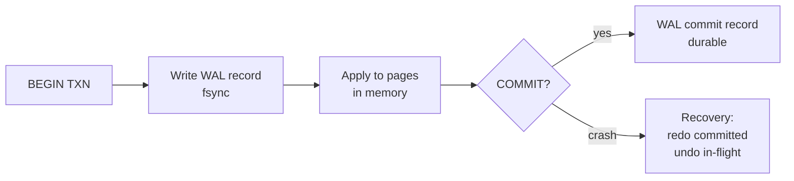

**Durability has degrees (a real operational dial).** "Durable" is not binary — it's where you set `fsync` / replication acks:

| Durability setting | Survives | Risk | Example |
|---|---|---|---|
| Buffered, no fsync | process crash, **not** power loss | data loss on power/kernel crash | `innodb_flush_log_at_trx_commit=0`, Redis no-AOF |
| fsync per commit | power loss on that node | none locally; slower (disk-bound) | Postgres default, `=1` InnoDB |
| fsync + sync replica ack | loss of the whole node | +RTT latency per commit | Postgres `synchronous_commit=remote_apply` |
| fsync + quorum ack | loss of a minority of nodes | +quorum RTT | Spanner/CockroachDB commit |

> **Staff-level insight:** The "C" in ACID and the "C" in CAP are **different C's**. ACID-C is invariant preservation within a transaction; CAP-C is linearizability across replicas. Conflating them is a classic interview tell. Say this explicitly when CAP comes up: *"To be precise, the C I'm trading in CAP is linearizability, not ACID's invariant-C."*

> **Staff-level insight (durability):** "Did the write survive?" is really "survive *what failure*, and what latency did you pay for it?" Naming the `fsync`/replication-ack dial — and choosing "quorum ack for the ledger, async for the feed" — signals you've actually tuned a database under a latency SLA.

**Pitfall:** "Consistency" in ACID is the weakest letter — the DB only enforces *declared* constraints; most business invariants live in application code. Don't lean on ACID-C to protect a business rule you never expressed as a constraint.

---

### 1.2 Isolation Levels & Anomalies

Isolation is a **dial**, not a boolean. The SQL standard defines four levels by which anomalies they forbid; real databases often implement **snapshot isolation (SI)**, which doesn't map cleanly onto the standard.

**The anomalies:**

| Anomaly | Description | Example |
|---|---|---|
| **Dirty read** | Read a value written by an uncommitted txn. | Read balance mid-transfer that later rolls back. |
| **Dirty write** | Overwrite a value written by an uncommitted txn. | T2 overwrites a value T1 has written but not yet committed; if T1 rolls back, the DB is left in an inconsistent/impossible state. |
| **Non-repeatable read** | Re-read a row, get a different value (another txn committed an update). | Sum a row twice, get different answers. |
| **Phantom read** | Re-run a *range query*, get new rows (another txn inserted matching rows). | `COUNT(*) WHERE status='open'` changes mid-txn. |
| **Write skew** | Two txns read overlapping data, make disjoint writes, both commit, breaking an invariant across rows. | Two on-call doctors both go off-shift; invariant "≥1 on-call" violated. |
| **Lost update** | Two txns read-modify-write the same row; one overwrites the other. | Concurrent `counter = counter + 1`. |
| **Read skew** | Read two related rows at different points; they're mutually inconsistent. | Read account A (before transfer) and B (after) → totals don't add up. |

**Isolation levels (SQL standard + snapshot):**

| Level | Dirty read | Non-repeatable | Phantom | Lost update | Write skew | Typical impl |
|---|---|---|---|---|---|---|
| Read Uncommitted | possible | possible | possible | possible | possible | rarely used |
| Read Committed | **prevented** | possible | possible | possible | possible | Postgres/Oracle default |
| Repeatable Read | prevented | **prevented** | possible* | possible‡ | possible | MySQL InnoDB default |
| **Snapshot Isolation** | prevented | prevented | prevented† | prevented | **possible** | Postgres "Repeatable Read", Oracle |
| Serializable | prevented | prevented | prevented | prevented | **prevented** | SSI (Postgres), 2PL (others) |

\* MySQL RR uses next-key locking and actually blocks many phantoms and lost updates. † SI prevents phantoms but **not write skew** — this is the key gotcha. ‡ Standard ANSI Repeatable Read does **not** prevent lost update for a plain read-modify-write; only MySQL InnoDB's **locking reads** (`SELECT ... FOR UPDATE`) / next-key locks block specific cases.

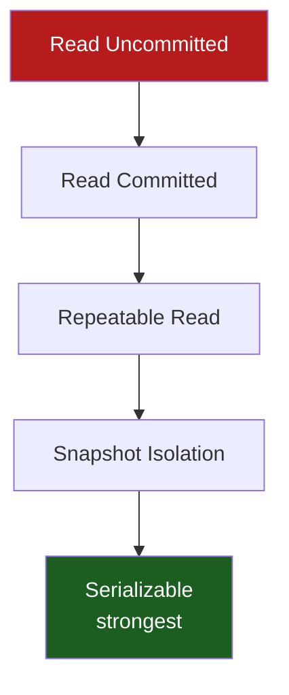

**Decisive default:** *"Read Committed by default (it's the Postgres default for a reason — cheap, no surprises for single-row updates); escalate to `SELECT … FOR UPDATE` for read-modify-write on a row, and to `SERIALIZABLE` only for genuine cross-row invariants. I don't run everything Serializable — the abort/retry rate under contention isn't worth it when 95% of transactions don't need it."* That's a choice with a trigger, not a shrug.

**Worked example — write skew (the on-call doctors):**

```
Invariant: at least 1 doctor on call.
Initial: Alice on_call=true, Bob on_call=true.

T1 (Alice): SELECT count(*) WHERE on_call=true  -> 2 (ok, can go off)
T2 (Bob):   SELECT count(*) WHERE on_call=true  -> 2 (ok, can go off)   [same snapshot]
T1: UPDATE Alice SET on_call=false   COMMIT
T2: UPDATE Bob   SET on_call=false   COMMIT
Result: 0 on call. Invariant VIOLATED.
```

Under SI both transactions read the same snapshot (count=2), each writes a *different* row, so there's no write-write conflict to detect — both commit. **Fix:** `SERIALIZABLE` (SSI detects the read-write dependency cycle and aborts one) or materialize the conflict with `SELECT … FOR UPDATE` on the rows both transactions depend on.

> **Staff-level insight:** When someone says "Serializable," ask *how* — **Serializable Snapshot Isolation (SSI)** (Postgres) is optimistic: it lets txns run on snapshots and aborts on detected conflicts (great read throughput, **retry storms under contention** — you must handle `40001` serialization-failure retries in app code). **Strict 2PL** (older SQL Server/DB2) is pessimistic: locks block, no retries, but reduced concurrency and deadlock risk. The choice changes your retry and latency story. *"Postgres SSI here because reads dominate and conflicts are rare; if contention were high I'd reconsider, because SSI degrades into a retry storm exactly when you're busiest."*

**Pitfall — write skew is invisible at SI.** Postgres `REPEATABLE READ` is actually SI and *will* allow write skew. **This is a real bug I've shipped:** a "REPEATABLE READ" booking flow let two users book the same slot because each saw it free in its snapshot. If you need to enforce a cross-row invariant (booking overlaps, balance ≥ 0 across accounts, ≥1 on-call), use `SERIALIZABLE` or `SELECT … FOR UPDATE` to materialize the conflict. **Earmark this early:** if the design has any "exactly one of N" or "no overlap" invariant, flag SI write-skew as a risk before the interviewer finds it.

---

### 1.3 BASE

**Definition.** BASE — **B**asically **A**vailable, **S**oft state, **E**ventually consistent — is the philosophical opposite of ACID, popularized for NoSQL/Dynamo-style systems that prioritize availability and partition tolerance.

| Term | Meaning |
|---|---|
| Basically Available | System always responds (possibly stale or "best effort"). |
| Soft state | State may change over time even without input (due to async convergence). |
| Eventually consistent | Given no new writes, all replicas converge to the same value. |

**Real-world:** DynamoDB (default), Cassandra, Riak, S3 (now strongly consistent read-after-write for all operations since Dec 2020; historically eventual for overwrites/deletes), DNS (TTL-bounded eventual).

> **Staff-level insight:** BASE vs ACID is not binary, and saying "we're a BASE system" is a weak answer. Modern systems are **tunable**: Cassandra lets you pick consistency per query (`ONE`, `QUORUM`, `ALL`); DynamoDB offers eventually-consistent (cheaper, 0.5 RCU) vs strongly-consistent reads (1 RCU). The Staff answer is *"eventual for the feed timeline and strong for the wallet balance"* — **consistency is a per-operation decision, not a per-system one.** State the split explicitly; that's the senior move.

---

### 1.4 Strong Consistency: Linearizability vs Sequential

These are the two main "strong" models and engineers routinely conflate them.

- **Linearizability (atomic consistency):** There exists a single, total order of all operations consistent with **real-time** ordering. If write W completes before read R *begins* (wall-clock), R must see W or later. It's the "as if there's one copy of the data" guarantee. This is **CAP-Consistency**.
- **Sequential consistency:** There exists *some* total order consistent with each client's **program order**, but **not necessarily real-time**. A read can return a stale value as long as everyone agrees on the same order.

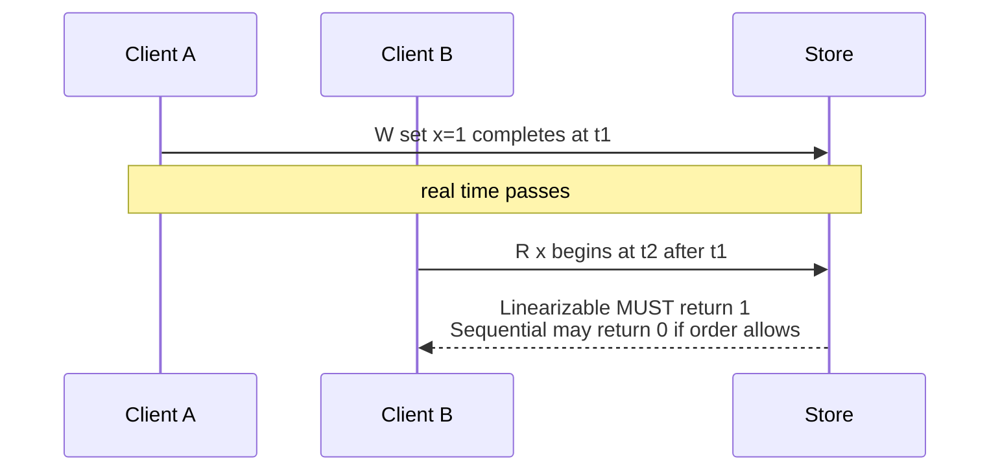

| Model | Respects real-time? | Single global order? | Cost | Example |
|---|---|---|---|---|
| Linearizable | **Yes** | Yes | Highest (consensus per op) | etcd, ZooKeeper, Spanner reads |
| Sequential | No | Yes | Medium | Some caches, older shared-memory CPUs |
| Causal | No (only causal) | No | Low | COPS, MongoDB causal sessions |
| Eventual | No | No | Lowest | Dynamo, Cassandra ONE |

> **Staff-level insight:** Linearizability is **per-object** (a register). It does *not* give you multi-object transactions — for that you need linearizability **+** serializability = **strict serializability** (what Spanner/CockroachDB provide). If an interviewer asks for "strong consistency on a bank transfer across two accounts," linearizability alone is insufficient — say "I need strict serializability there, not just a linearizable register." That precision is a level-defining distinction.

**Pitfall:** Linearizability is expensive because every operation must coordinate (at least a quorum round-trip). You cannot have a linearizable system that also tolerates partitions while staying available — that's CAP. So **don't promise linearizability on a path that also needs to stay up during a partition**; you'll be caught.

---

### 1.5 Eventual & Session Consistency

**Eventual consistency** guarantees only convergence. That's often too weak for UX, so we layer **session guarantees** on top — these are the cheap, high-leverage fixes for the most jarring user-visible bugs:

| Guarantee | Definition | UX problem it fixes |
|---|---|---|
| **Read-your-writes** (read-after-write) | A client always sees its own prior writes. | You post a comment and don't see it. |
| **Monotonic reads** | Once you've seen value v, you never see an *older* value. | Refresh shows a comment, refresh again it's gone. |
| **Monotonic writes** | Your writes are applied in the order you issued them. | Two edits applied out of order. |
| **Writes-follow-reads** (causal) | If you read X then write Y, anyone seeing Y sees X. | Reply appears before the message it replies to. |
| **Causal consistency** | Operations causally related are seen by all in the same order; concurrent ops may differ. | Strongest "cheap" model; preserves cause→effect. |

**How read-your-writes is implemented:** route the user's reads to the primary for N seconds after a write; or pin to a replica that has applied the write (track a version/LSN the client carries, often called a **causality token / read-your-writes timestamp**); or use **sticky sessions**.

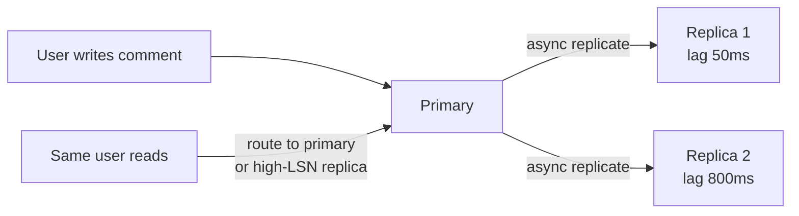

> **Staff-level insight:** **Causal consistency is the sweet spot** for chat, social, and collaborative apps: it's the strongest model that stays available under partition (per CAP). Name-drop **COPS** and **MongoDB causal-consistent sessions**. The mechanism is propagating **dependency metadata** (vector clocks / "happens-before" tags) with each write so replicas apply in causal order. **Experience hook:** *on chat infra, "your own message must appear instantly" is read-your-writes, and "a reply never precedes its parent" is writes-follow-reads — I'd implement both with a per-session causality token rather than forcing global strong consistency, which would cost a coordination round-trip per message.*

**Decisive default:** *"Eventual + read-your-writes + monotonic reads. Those three session guarantees kill ~90% of the 'where did my update go' UX bugs at near-zero coordination cost. I add full causal consistency only if cross-user ordering (reply-before-message) is showing up as a real complaint."* YAGNI in action.

---

### 1.6 Quorum (R+W>N)

**Definition.** In a leaderless/Dynamo-style system with **N** replicas, a write must be acknowledged by **W** replicas and a read must query **R** replicas. If **R + W > N**, the read set and write set overlap by at least one replica, so a read is guaranteed to see the latest acknowledged write — **strong (quorum) consistency**.

**Worked examples (N=3):**

| Config | R | W | R+W>N? | Property | Use case |
|---|---|---|---|---|---|
| Read-heavy strong | 3 | 1 | 3+1>3 ✅ | Fast writes, slow/strong reads | Rarely-changing config |
| Balanced strong | 2 | 2 | 2+2>3 ✅ | Survives 1 node down, strong | **Default sweet spot** |
| Write-heavy strong | 1 | 3 | 1+3>3 ✅ | Fast reads, all-replica writes | Read-dominated, can't lose writes |
| Eventual | 1 | 1 | 1+1>3 ❌ | Fast, may read stale | Metrics, likes |

With **N=5, W=3, R=3**: tolerates **2** node failures while staying strongly consistent; quorum overlap = 3+3−5 = 1 replica guaranteed shared. With **N=5, W=4, R=2**: write-availability drops (need 4 of 5 up to write) but reads are cheap — a deliberate read-optimized tuning.

**Worked durability/latency math:** with `W=QUORUM` on N=3, a write must reach 2 of 3 replicas. If one replica is in another AZ at +1ms and the third at +1ms, write latency ≈ the **2nd-fastest** ack (not the slowest) — quorum gives you tail-latency insulation against the single slowest replica. That's a real reason QUORUM beats ALL: `ALL` is hostage to your slowest/most-GC-prone node.

**Sloppy quorum + hinted handoff (Dynamo):** during a partition, writes go to the *first W reachable healthy nodes* (not necessarily the "home" replicas), storing a hint to deliver later. This boosts availability but **breaks the R+W>N guarantee** — you can read stale data. Trade made knowingly: Dynamo chose availability over the quorum overlap guarantee during partitions.

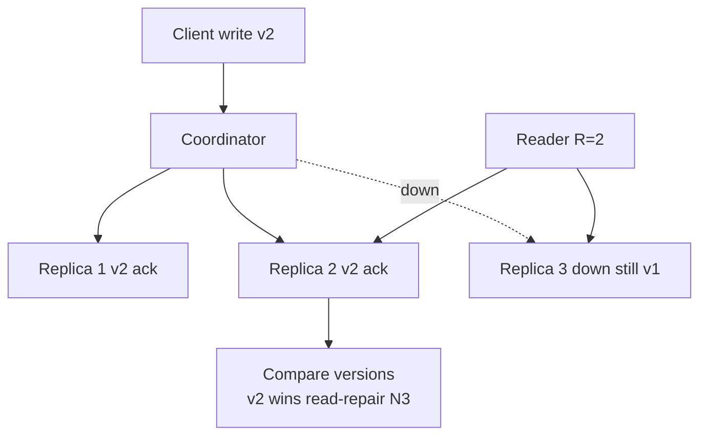

> **Staff-level insight:** Quorum gives you a *guarantee about overlap*, not about *recency of every replica*. After a quorum read you still must **resolve conflicts** (highest version wins via vector clock / timestamp) and trigger **read repair** + **anti-entropy (Merkle trees)** to heal divergence. R+W>N is necessary but not sufficient for a clean answer — say "quorum gives overlap; I still need read-repair and a conflict-resolution rule."

**Pitfall:** R+W>N guarantees the read set overlaps the write set on at least one replica, but it does **NOT** give linearizability and does not even guarantee monotonic reads (a later read against a different replica set can return an older version) without read-repair / extra mechanisms — see Kleppmann's analysis of quorum's edge cases like read-during-write. Dynamo explicitly chose *not* to be linearizable. **Don't claim quorum = strong/linearizable;** it's "strong-ish" and the gap is exactly where a sharp interviewer probes.

---

### 1.7 The Consistency Spectrum

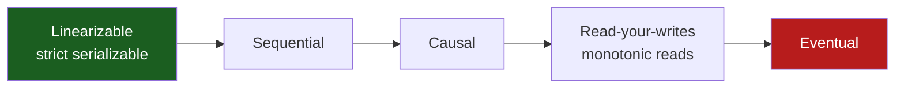

| ← Stronger | | | | Weaker → |
|---|---|---|---|---|
| Linearizable | Sequential | Causal | Session (RYW) | Eventual |
| Highest latency/coord | | | | Lowest latency |
| Lowest availability under partition | | | | Highest availability |
| etcd/Spanner | shared mem | chat/social | user sessions | likes/metrics |

> **Staff-level insight:** The single most important sentence to internalize: **"Causal consistency is the strongest model achievable in an always-available, partition-tolerant system."** Everything stronger requires sacrificing availability under partition (CAP). This one line, delivered at the right moment, does more for your level than reciting the whole table.

---

## 2. CAP Theorem & PACELC

**Precise definitions (Gilbert & Lynch formalization):**

- **C (Consistency)** = **Linearizability**. Every read sees the most recent completed write (real-time order). *Not* ACID-C.
- **A (Availability)** = **every non-failing node returns a non-error response** in finite time (even if stale). Note: a single working node responding still counts.
- **P (Partition tolerance)** = the system keeps operating despite arbitrary message loss/delay between nodes (a network partition).

**The theorem:** During a network **partition**, you cannot have both C and A. You must choose:
- **CP:** refuse/block requests on the minority side to preserve consistency (sacrifice availability).
- **AP:** keep serving on both sides, accept divergence, reconcile later (sacrifice consistency).

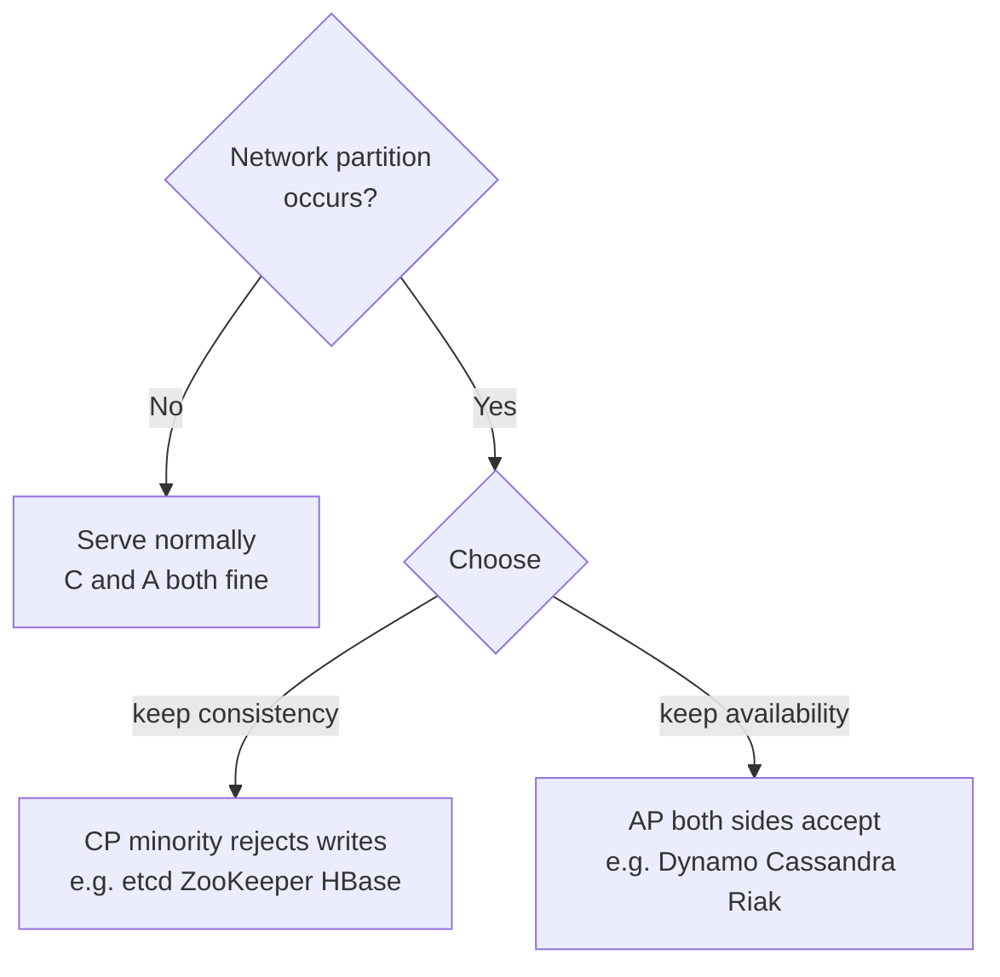

**Common misunderstandings (say these in the interview):**

1. **"You pick 2 of 3" is wrong.** P is not optional in a real network — partitions *will* happen. So you're really choosing **C vs A, and only during a partition**. The "2 of 3" framing implies CA systems exist; a "CA" system is just a non-distributed (single-node) DB.
2. **It's not a global, permanent setting.** A system can be CP for some operations and AP for others.
3. **Availability in CAP is binary and theoretical** (any response in finite time), not your 99.99% SLA.
4. **Latency is invisible in CAP** — which is why PACELC matters.

**PACELC (Abadi) — the better model:**

> **If Partition (P): choose Availability (A) or Consistency (C); Else (E, normal operation): choose Latency (L) or Consistency (C).**

PACELC adds the crucial insight that even with **no partition**, replicated systems trade **latency vs consistency** on every request (waiting for a quorum/sync replica costs latency).

| System | CAP | PACELC | Notes |
|---|---|---|---|
| **DynamoDB** | AP* | **PA/EL** | Tunable; default eventual, can choose strong reads |
| **Cassandra** | AP | **PA/EL** | Tunable per-query (ONE..ALL) |
| **Riak** | AP | PA/EL | Dynamo-style |
| **Cosmos DB** | tunable | tunable | 5 consistency levels (strong, bounded-staleness, session, consistent-prefix, eventual) |
| **MongoDB** | CP | **PC/EC** | Majority write/read concern: a minority partition can't elect a primary, so it sacrifices availability; default majority write = EC; can relax read concern |
| **HBase** | CP | PC/EC | Strong, single-region |
| **etcd / ZooKeeper** | CP | **PC/EC** | Raft/Zab, linearizable |
| **Spanner** | CP | **PC/EC** | TrueTime; linearizable, pays latency |
| **CockroachDB** | CP | PC/EC | Raft per range, serializable |
| **PostgreSQL (sync repl)** | CP | PC/EC | Single-leader |
| **PostgreSQL (async repl)** | CP (leader) | PC/**EL** | Async = lower latency, replica lag |

\* DynamoDB is CP-ish for strongly-consistent reads but designed AP by lineage.

> **Staff-level insight:** Lead with **PACELC**, not CAP — it signals seniority instantly. The line: *"Partitions are rare but the latency-vs-consistency trade-off is paid on every single request, so PACELC's 'else' clause is where 99.9% of the real engineering decisions live."* Spanner is the famous **PC/EC** example: it chose consistency *and* pays the latency (TrueTime commit-wait of ~7ms median), accepting that to stay linearizable globally. **Decisive close:** *"For the chat path I'm PA/EL — available and low-latency, reconcile with CRDTs; for the ledger I'm PC/EC. Same company, two PACELC postures, chosen per dataset."*

**Pitfall:** Claiming a system is "CA." If it's distributed and tolerates partitions (every real one does), CA is not a coherent choice. Single-node Postgres is "CA" only because it has no partition to tolerate. Saying "CA" is a fast down-level.

---

## 3. Consensus

Consensus = getting a set of distributed nodes to **agree on a single value** (or an ordered log of values) despite failures. It underpins leader election, distributed locks, config stores, replicated state machines, and strongly-consistent databases.

> **YAGNI gate (say this before you reach for consensus):** *"Do I actually need a single agreed value or order here? If it's just replication for read scaling, no. Consensus earns its latency only when correctness depends on everyone agreeing — leader election, locks, membership, a linearizable log."* Reaching for Raft/Paxos when the requirement doesn't demand it is a top over-engineering anti-pattern in this topic.

### 3.1 Why Consensus Is Hard (FLP)

**FLP Impossibility (Fischer, Lynch, Paterson, 1985):** In an **asynchronous** system (no bound on message delay), with **even one** crash-faulty process, there is **no deterministic algorithm** that *guarantees* consensus in bounded time.

**Intuition:** Without timing bounds, you cannot distinguish a **slow node** from a **dead node**. So you can never be *certain* it's safe to proceed without it — there's always an execution where the protocol stalls forever at a critical "is it dead or just slow?" decision point.

**How real systems escape FLP:** They don't violate it — they **sidestep** it:
- **Partial synchrony** (Raft/Paxos): assume the network is *eventually* timely. Use **timeouts** + **randomization** to make livelock vanishingly unlikely (you sacrifice *guaranteed* termination, keep *probabilistic* termination — always preserving safety).
- **Randomization** (Ben-Or): coin flips break symmetry.
- **Failure detectors** (Chandra-Toueg): an abstraction (◊S) that's "eventually accurate" is enough to solve consensus — formalizes "timeouts are good enough in practice."

> **Staff-level insight:** FLP is about **liveness, not safety**. Raft/Paxos are **always safe** (never two conflicting decisions) but only **eventually live** (a pathological network can delay them indefinitely — e.g., perfectly-timed elections causing repeated split votes). The honest framing: *"consensus protocols guarantee we never decide wrong, but cannot guarantee we always decide fast — that's why we tune randomized timeouts."* Stating "FLP is a liveness result, not a safety one" is a precise, senior thing to say.

**Note on Byzantine vs crash faults:** Raft/Paxos assume **crash-stop / fail-stop** (nodes stop, don't lie). Tolerating *malicious/arbitrary* (Byzantine) faults needs **BFT** protocols (PBFT, Tendermint, HotStuff) and a `3f+1` quorum to tolerate `f` Byzantine nodes (vs `2f+1` for crash faults). You'll almost never need BFT inside a trusted datacenter — name it and move on unless the domain is blockchain/multi-org trust.

---

### 3.2 Raft

**Definition.** Raft is a consensus algorithm designed for **understandability**, used to maintain a **replicated log** (replicated state machine). One node is **leader**; clients write to it; it replicates entries to **followers**; once a majority persist an entry, it's **committed**.

**Three sub-problems:** (1) leader election, (2) log replication, (3) safety.

**Key concepts:**
- **Terms:** logical clock — a monotonically increasing integer; each term has at most one leader. Used to detect stale leaders.
- **Roles:** Follower → Candidate → Leader.
- **Election:** a follower that hears nothing for a **randomized election timeout (150–300ms)** becomes a candidate, increments its term, votes for itself, and requests votes. Majority → leader. Randomization avoids repeated split votes.
- **Log replication:** leader appends to its log, sends `AppendEntries` RPCs (also the heartbeat when empty); entry is **committed** once stored on a **majority**; leader then applies to its state machine and tells followers via `commitIndex`.
- **Safety (Log Matching + Leader Completeness):** a candidate can only win if its log is at least as up-to-date as the voter's, guaranteeing a new leader has all committed entries.
- **Membership changes:** done via **joint consensus** (a two-phase config where old+new majorities both must agree) so you never split into two disjoint majorities mid-change.

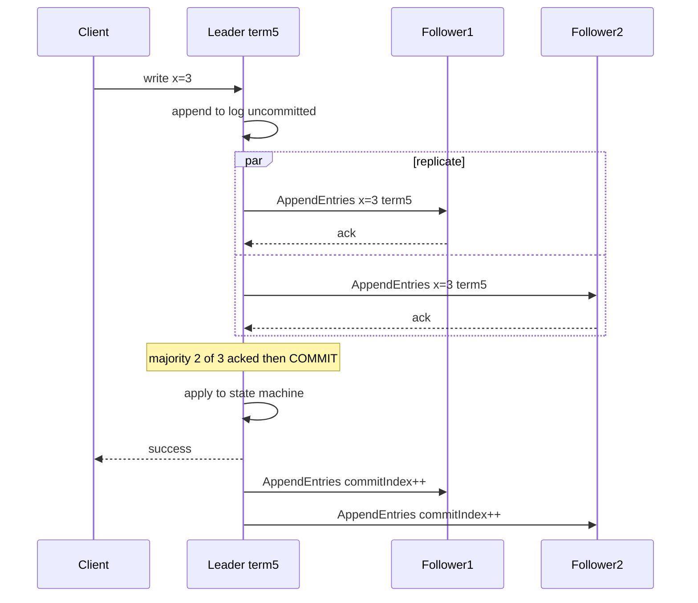

**Leader election flow:**

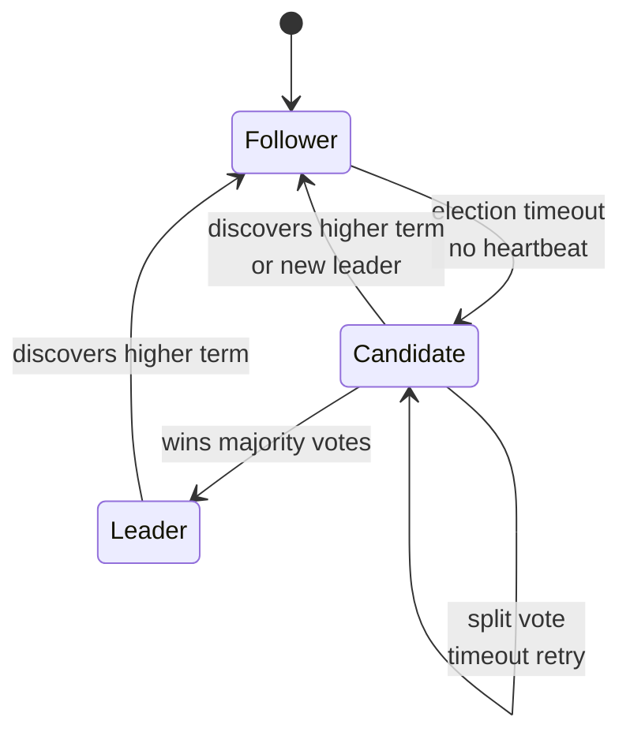

**Real-world:** etcd (Kubernetes' brain), Consul, CockroachDB (Raft per data range), TiKV, RethinkDB, MongoDB's replication (Raft-like protocol), Kafka's KRaft mode (which **replaced** ZooKeeper — removed entirely in Kafka 4.0, 2025).

| | Pros | Cons |
|---|---|---|
| Raft | Understandable, strong leader simplifies reasoning, well-documented, many libs | Strong leader = write bottleneck; leader change = brief unavailability (election ~1–2s tuned, or sub-second with pre-vote/fast paths) |

> **Staff-level insight:** Raft needs a **majority (⌊N/2⌋+1)** to make progress, so cluster sizes are **odd (3, 5, 7)**. 3 nodes tolerate 1 failure; 5 tolerate 2. Going beyond 5–7 *hurts* — more nodes means more replication fan-out per commit with diminishing fault-tolerance benefit (every commit waits for a *majority* to ack, and a bigger majority is slower). For geo-distribution, you place voters to control quorum latency, or use **learners/witnesses** (non-voting replicas) to add read capacity / break ties without slowing commits. **Decisive default:** *"5 voters across 3 AZs for production — tolerates an AZ loss plus a node; I wouldn't go to 7 unless fault-tolerance requirements specifically demanded it, because I'd be paying commit latency for marginal safety."*

**Pitfall (deep-dive — this is the risk crux):** A partitioned old leader may keep serving **stale reads** if it doesn't realize it lost leadership (its lease/heartbeats stopped landing but it hasn't stepped down yet). Naive "read from leader" is **not** linearizable. Mitigations: **leader leases** (leader serves reads only while it holds a time-bounded lease, relying on bounded clock drift) or **ReadIndex** (confirm leadership with a quorum heartbeat round before serving the read — safe, costs one round-trip). Earmark this early when you propose Raft for linearizable reads: *"reads need ReadIndex or a lease, otherwise a partitioned ex-leader serves stale data."*

---

### 3.3 Paxos

**Definition.** Paxos (Lamport) is the original proven-correct consensus algorithm. **Basic (single-decree) Paxos** agrees on **one** value via roles: **Proposers**, **Acceptors**, **Learners**.

**Basic idea (two phases):**
1. **Prepare/Promise:** proposer picks proposal number `n`, asks acceptors to "promise" not to accept anything < `n`. If majority promise (returning any value they've already accepted), proceed.
2. **Accept/Accepted:** proposer asks acceptors to accept value `v` (the highest-numbered already-accepted value if one exists, else its own). Majority accept ⇒ chosen.

**Multi-Paxos:** Running full two-phase Paxos per log entry is expensive. Multi-Paxos elects a **stable leader** that skips Phase 1 for subsequent entries (amortizing it), making steady-state cost one round-trip — essentially what Raft formalizes.

**Why it's hard:** The paper ("The Part-Time Parliament") is notoriously opaque; the spec leaves leader election, log management, and membership changes as exercises, so every production "Paxos" (Chubby, Spanner) is a custom, hard-to-verify variant.

| | Paxos | Raft |
|---|---|---|
| Goal | Agree on value(s) | Same (replicated log) |
| Leader | Optional (multi-Paxos adds one) | Mandatory, central |
| Understandability | Notoriously hard | Designed for clarity |
| Log holes | Paxos may **choose** entries out of order (gaps allowed in the log), but a replica still cannot **apply** past a gap — execution is in-order once gaps fill | **No holes** (strict contiguity) — Raft forbids gaps entirely |
| Membership change | Underspecified | Built-in (joint consensus) |
| Production | Chubby, Spanner, Megastore | etcd, Consul, CockroachDB, TiKV, KRaft |

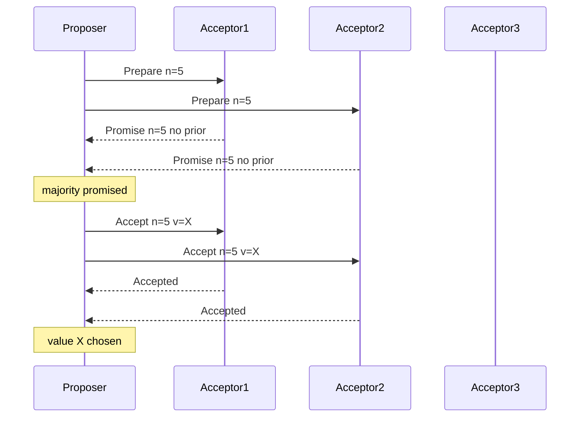

> **Staff-level insight:** The interview-winning summary: *"Raft and multi-Paxos are equivalent in power and fault model; Raft trades a tiny bit of flexibility (no log holes, mandatory leader) for vastly better understandability and operational tooling. I'd reach for Raft via etcd/Consul unless I had a specific reason — like an existing Chubby/Paxos investment — to use Paxos."* That's a decision plus a trigger. Mention **EPaxos** if pushed on leaderless/geo: it removes the single-leader bottleneck for low-latency multi-region writes by committing commuting commands in parallel (no designated leader), at the cost of a much more complex conflict-detection protocol. Also **Flexible Paxos**: quorums for phase 1 and phase 2 only need to *intersect*, not both be majorities — lets you trade read vs write quorum sizes.

---

### 3.4 Leader Election, Split-Brain, Fencing

**Leader election** picks one coordinator among peers. Done via consensus (Raft/Zab), or a lock service (ZooKeeper ephemeral nodes, etcd lease).

**Split-brain:** a partition causes **two nodes to both believe they're leader**, each accepting writes → divergence/corruption. The root cause is usually a leader that *was* elected, got partitioned, and **doesn't know it's been superseded**.

**Defenses:**
1. **Quorum-based election:** a leader must hold a majority; the minority side cannot elect a new one *and* the old leader on the minority side can't get quorum to commit. (Even number of nodes risks a 50/50 tie — use odd counts or a **witness/tiebreaker** in a 3rd zone.)
2. **Fencing tokens:** the lock/leader service hands out a **monotonically increasing token** with each leadership grant. Every write to the protected resource includes the token; the resource (DB, storage) **rejects any write with a token lower than the highest it has seen**. This neutralizes a stale leader even if it's slow/paused (GC, VM pause) and acts after losing leadership.

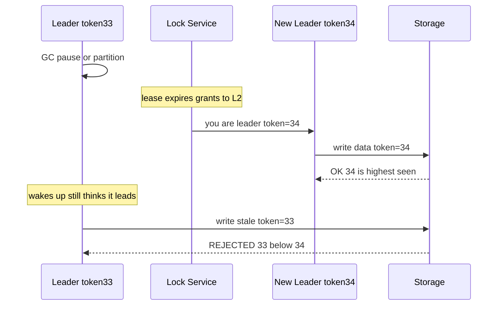

> **Staff-level insight:** **Fencing tokens are the answer to "how do you make a distributed lock actually safe?"** A lock alone is never safe because the holder can be paused (stop-the-world GC, hypervisor pause, network delay) past its lease without knowing. Safety requires the *protected resource itself* to enforce token monotonicity. If the resource can't check tokens, your lock is advisory at best. This is Kleppmann's core critique of Redlock. **Deliver it as:** *"the lock gives me uniqueness and liveness; safety comes from the resource rejecting stale fencing tokens — those are two different jobs."*

---

### 3.5 Distributed Locks

**Definition.** A distributed lock provides **mutual exclusion** across processes/machines. Two distinct purposes (with very different safety bars) — **separating these is the whole game**:
- **Efficiency:** avoid doing duplicate work (occasional double-work is fine). A simple lock is OK.
- **Correctness:** prevent data corruption (double-spend, conflicting writes). Here you **must** have fencing tokens; a lock alone is insufficient.

**Implementations:**

| System | Mechanism | Fencing token? | Notes |
|---|---|---|---|
| **ZooKeeper** | Ephemeral sequential znodes; lock = lowest sequence; watch predecessor | **Yes** (zxid / czxid is monotonic) | Battle-tested; session/heartbeat based |
| **etcd** | Lease + key; revision number is monotonic | **Yes** (mod_revision) | Raft-backed, linearizable |
| **Chubby** (Google) | Paxos-backed lock service + lease | **Yes** (sequencer) | Inspired ZooKeeper |
| **Redis Redlock** | Acquire lock on majority of N independent Redis nodes within validity time | **No** (by default) | Controversial — see below |
| **Single Redis SETNX + TTL** | `SET key val NX PX ttl` | No | Simple, not safe under failover |
| **DB row lock** (`SELECT … FOR UPDATE`) | Pessimistic row lock in a transaction | N/A (held in txn) | Safe within one DB; doesn't span services |

**Lease-based locks:** a lock is granted for a bounded **lease** (e.g., 10s). The holder must **renew (heartbeat)** before expiry. If it dies/partitions, the lease expires and the lock is reclaimable — this prevents permanent deadlock from a dead holder. The danger: a paused holder can exceed its lease while *believing* it still holds the lock (→ need fencing).

**The Redlock debate (must-know — interviewers love this):**
- **Redlock** (Antirez/Redis) acquires the lock on a **majority of N independent Redis masters** within a time window; tolerates minority failures without replication.
- **Martin Kleppmann's critique:** (1) It relies on **bounded clocks and pauses** — a GC pause or clock jump breaks safety; (2) it provides **no fencing token**, so it can't be safe for correctness-critical use; (3) timing assumptions make it unsuitable as the *only* correctness mechanism.
- **Antirez's rebuttal:** Redlock's safety rests on relative time/timeouts (monotonic, not wall-clock), and fencing can be layered on; for many real uses it's adequate.
- **Resolution / Staff answer:** For **efficiency** locks, single-instance Redis or Redlock is fine. For **correctness**, use a **consensus-backed store (etcd/ZooKeeper) with fencing tokens**, and have the protected resource validate the token. Don't bet money/data integrity on Redlock alone.

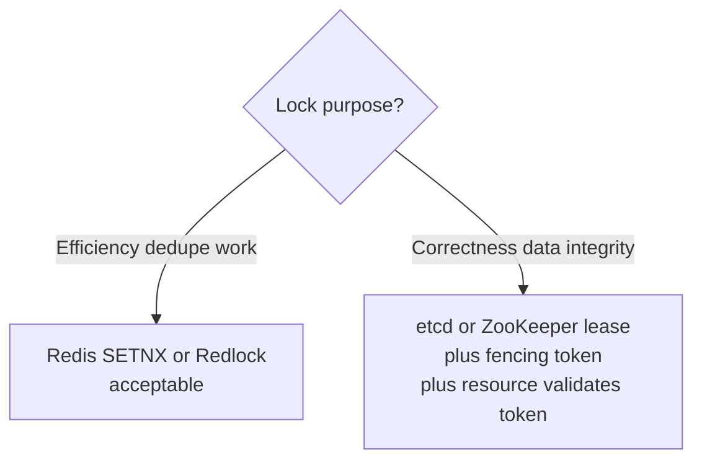

> **Staff-level insight:** The question "is a distributed lock safe?" is a trap that tests whether you understand that **time is not reliable in distributed systems**. The correct stance: *"No lock is safe on its own because the holder can be paused arbitrarily. Safety comes from fencing tokens enforced at the resource. The lock service just provides liveness and uniqueness; the resource provides safety."* And the YAGNI counterpoint: *"but if this is just deduping a cron job, I'll use a plain Redis lock and not over-engineer — fencing is for correctness-critical paths only."* Showing you scale the solution to the requirement is itself the senior signal.

---

## 4. Distributed Transactions

A transaction spanning **multiple services or shards** that must be atomic. Hard because there's **no shared memory, partial failures are normal, and there's no global clock**. You're coordinating independent failure domains over an unreliable network.

**Why it's hard:**
- Any participant can crash mid-protocol.
- The coordinator can crash, leaving participants **in doubt** (locked, waiting).
- Network can drop/delay/reorder messages.
- You can't roll back side effects in external systems (emails sent, money moved).

> **Earmark early:** the moment a design says "this needs to be atomic across services," call out the trade-off before going further: *"That's a distributed transaction — I want to flag now that I'll prefer a Saga over 2PC, because 2PC couples availability and blocks on coordinator failure. Let me note where the hard part is: compensations and isolation."* That front-loaded framing is exactly the Staff move.

### 4.1 Two-Phase Commit (2PC)

**Definition.** A blocking atomic-commit protocol. A **coordinator** drives two phases across **participants**: **Phase 1 (prepare/vote)** and **Phase 2 (commit/abort)**.

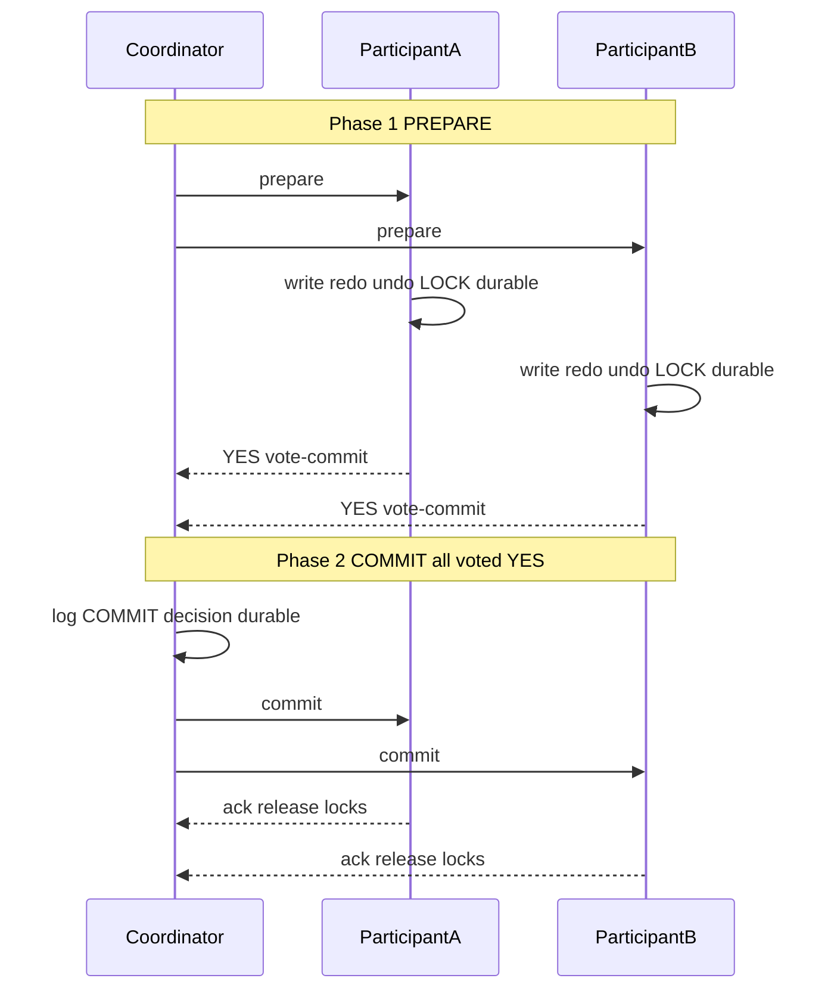

**The blocking problem (the crux — deep-dive this):** Between voting YES (Phase 1) and receiving the decision (Phase 2), a participant is **in-doubt**: it has locked resources and *cannot unilaterally decide* — it must wait for the coordinator. If the **coordinator crashes** after some participants voted YES but before broadcasting the decision, those participants **block indefinitely**, holding locks. Every other transaction that touches those locked rows now also stalls — the failure **fans out**. This is 2PC's fatal flaw, and it's the thing to articulate, not the happy path.

**Failure handling:**
- Participant crashes in Phase 1 (before YES) → coordinator times out → **abort**.
- Coordinator crashes after deciding → on recovery, reads its **durable decision log** and resends. (Coordinator must be durable + ideally HA / consensus-replicated.)
- Coordinator crashes *before* deciding → participants block until it recovers (or operator intervention / heuristic resolution, which can violate atomicity).

> **Staff-level insight:** 2PC gives **atomicity** but couples availability to the *least available participant and the coordinator* — overall availability ≈ product of all participants'. It holds **locks across network round-trips**, killing throughput under contention, and it does **not** scale across services. In modern microservices, prefer **Saga**. 2PC still has a place **within a single org's tightly-coupled stack** (XA transactions; a DB + message broker, though even there the outbox pattern is usually better), not across team/service boundaries.

**Pitfall:** People propose 2PC for microservice transactions reflexively. Push back: it introduces a synchronous coupling and a blocking coordinator — antithetical to service autonomy. If you find yourself reaching for it, say *"I could 2PC this, but I won't — here's why, and here's the Saga instead."*

### 4.2 Three-Phase Commit (3PC)

**Definition.** Adds a **pre-commit** phase between vote and commit to make the protocol **non-blocking** under the assumption of bounded delays and fail-stop (no partitions).

Phases: **CanCommit → PreCommit → DoCommit**. The extra phase ensures that if the coordinator dies, participants can use timeouts to safely reach a consistent decision (a participant in PreCommit knows everyone voted YES, so it can commit on timeout).

**Why it's rarely used:** It assumes a **synchronous network with bounded delays and no partitions** — false in practice. Under a real network partition, 3PC can still produce **inconsistent decisions** (split-brain commit). It also adds a round-trip (latency). Real systems use **consensus (Paxos/Raft) for atomic commit** instead (e.g., **Paxos Commit**), which is partition-safe.

| | 2PC | 3PC |
|---|---|---|
| Phases | 2 | 3 |
| Blocking | Yes (coordinator failure) | No (under bounded delay) |
| Partition-safe | No | **No** (can diverge) |
| Latency | Lower | Higher (extra round-trip) |
| Real use | XA, in-org | Almost never |

> **Staff-level insight:** Don't propose 3PC in an interview as a serious solution — it signals book-knowledge without practical depth. The modern answer to 2PC's blocking is to make the **commit decision itself consensus-replicated** (Paxos/Raft-backed coordinator, as in Spanner/CockroachDB), not 3PC. If asked about 3PC, the right answer is *"I know what it is, but I wouldn't use it — its assumptions don't hold under partition; I'd consensus-replicate the coordinator instead."*

### 4.3 Saga Pattern

**Definition.** A saga is a sequence of **local transactions**, each in its own service, where each step has a **compensating transaction** that semantically undoes it. Instead of one atomic distributed transaction, you get **eventual atomicity** via forward steps + compensations on failure. No global locks; **isolation is sacrificed** (intermediate states are visible).

**Two coordination styles:**

**Orchestration** — a central **orchestrator** tells each service what to do and triggers compensations.

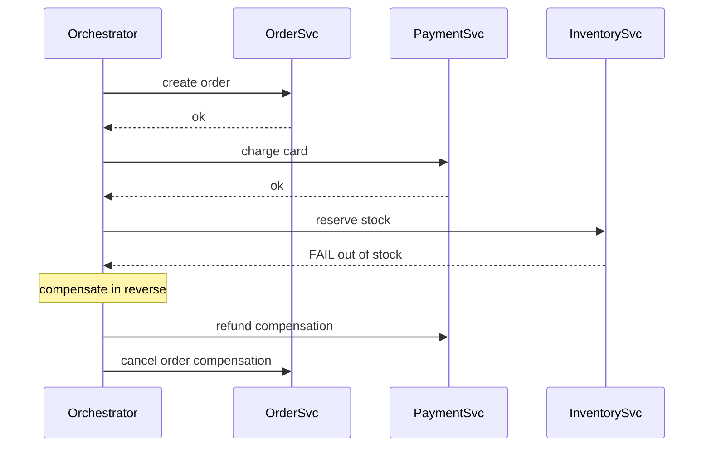

**Choreography** — no central brain; each service **emits events** and others react. Looser coupling, but flow is implicit and harder to trace.

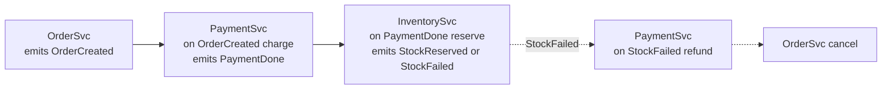

| | Orchestration | Choreography |
|---|---|---|
| Control | Central orchestrator | Distributed via events |
| Coupling | Higher (orchestrator knows all) | Lower (services know events) |
| Visibility | Easy to trace/monitor | Hard (flow is emergent) |
| Complexity locus | Orchestrator | Spread across services |
| Risk | Orchestrator = SPOF (make it HA) | Cyclic dependencies, hard debugging |
| Best for | Complex flows, many steps | Simple flows, ≤4 services |

**Decisive default:** *"Orchestration for anything with more than ~3 steps or where I need to see/operate the flow (payments, fulfillment) — a durable orchestrator like Temporal/Cadence/AWS Step Functions makes the state machine explicit and auditable. Choreography only for genuinely simple, loosely-coupled reactions, because the implicit flow gets unobservable fast."* Name the trigger: *"if I can't draw the flow on a whiteboard from the code, choreography has become a liability — switch to orchestration."*

**Compensating transactions** must be: **idempotent** (may be retried), **commutative-ish/order-tolerant**, and **semantic** (you can't "un-send" an email — you send a correction). Design the business process to allow compensation (e.g., reserve-then-confirm instead of commit-then-undo). Some steps are **pivot** (the point of no return, e.g., the charge) — split steps into *compensatable* (before pivot, can undo), *pivot*, and *retriable* (after pivot, must eventually succeed, only retry-forward).

| | 2PC | Saga |
|---|---|---|
| Atomicity | True atomic (all-or-nothing) | Eventual (forward + compensate) |
| Isolation | Yes (locks) | **No** (intermediate states visible) |
| Locks held | Across whole txn | Only within each local txn |
| Blocking | Coordinator can block | Non-blocking |
| Scales across services | Poorly | **Well** |
| Latency | Sync, lock-bound | Async, looser |
| Complexity | Protocol-level | App-level (must write compensations) |
| Use when | Single org, strong atomicity, low scale | Microservices, long-running, high scale |

> **Staff-level insight:** Sagas trade **isolation** for **availability and scale**. Because intermediate states are visible (an order exists before payment confirms), you must design for **semantic locks** (mark order "pending"), handle the **lack of isolation** (a user might see a half-completed flow — surface "pending" states in the UX deliberately), and make every step + compensation **idempotent**. Always pair sagas with **idempotency keys** and an **outbox** for reliable event publishing — otherwise a crash between "commit local txn" and "publish event" silently breaks the saga. **Earmark the hard part:** *"the risk in a Saga isn't the happy path — it's the compensations and the visible intermediate state; that's where I'd spend design time."*

### 4.4 Idempotency & Outbox

**Idempotency:** an operation that, applied multiple times, yields the same result as once. Essential because **retries are inevitable** (at-least-once delivery). Implement via an **idempotency key**: client sends a unique key per logical operation; server stores `(key → result)` and returns the stored result on replay instead of re-executing. Store the key in the **same transaction** as the effect (or you've just recreated the dual-write problem). Give keys a TTL sized to your max retry window.

**The dual-write problem:** A service that must both **update its DB** and **publish an event** cannot do both atomically (DB and broker are separate systems). A crash between them loses the event (or double-publishes). 2PC across DB+broker is fragile and couples their availability.

**Transactional Outbox pattern:** Within the **same local DB transaction** that updates business state, insert a row into an **`outbox` table**. A separate **relay/poller** (or CDC reading the WAL, e.g., **Debezium**) reads the outbox and publishes to the broker, marking rows sent. Atomic because both writes are in one DB transaction; the relay provides **at-least-once** delivery (consumers must dedupe via idempotency keys).

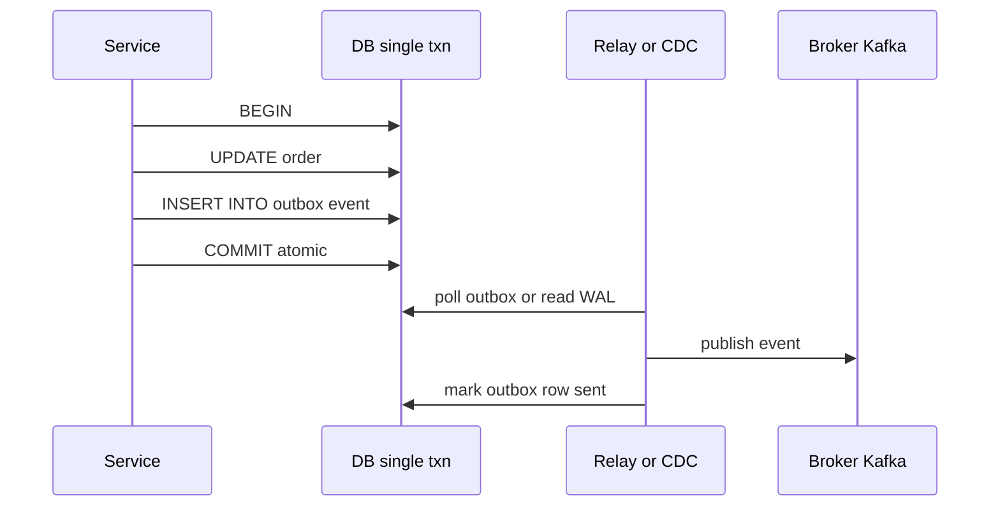

> **Staff-level insight:** The outbox pattern is *the* standard answer to "how do you reliably publish events from a microservice?" Mention **CDC via Debezium reading the WAL** as the scalable variant (no polling load, captures every change, lower latency). Pair with **consumer-side idempotency** (dedupe by event ID) because outbox guarantees **at-least-once**, not exactly-once. **Say the magic phrase:** *"there is no exactly-once on the wire — I get effectively-once by combining at-least-once delivery with idempotent consumers."* Claiming raw exactly-once is a tell; this phrasing is the cure. See [Messaging](04-messaging-event-driven.md) for delivery semantics.

---

## 5. Fault Tolerance

> **Altitude note:** the resilience patterns (retry, breaker, bulkhead, timeout) are individually simple — name them quickly. The Staff signal is in (a) how they *interact* (stacked retries, metastable failure) and (b) the *numbers* you tune them to. Don't spend three minutes explaining what a circuit breaker is; spend it on why the breaker should trip on p99 latency, not just error rate.

### 5.1 Retries: Backoff, Jitter, Budgets

**Retries** mask transient failures (a dropped packet, a momentary overload). But naive retries **amplify outages**: when a service is struggling, everyone retrying simultaneously creates a **retry storm** that pushes it further down.

**Techniques:**
- **Exponential backoff:** wait `base * 2^attempt` (e.g., 100ms, 200ms, 400ms, 800ms), capped at a max. Spreads load over time.
- **Jitter:** add randomness so clients don't retry in lockstep (the **thundering herd**). AWS's recommended **"full jitter"**: `sleep = random(0, min(cap, base * 2^attempt))`. Without jitter, synchronized clients re-collide on every retry wave. (Variants: "equal jitter" `= half + random(half)`; "decorrelated jitter" `= min(cap, random(base, prev*3))`.)
- **Retry budgets / token bucket:** cap retries to a fraction (e.g., **≤10–20%**) of total requests. When the budget is exhausted, fail fast instead of retrying — prevents retries from doubling/tripling load during an outage. (Used in **gRPC/Finagle/Envoy**.)
- **Retry only idempotent / safe operations**, and only on **retriable** errors (timeouts, 503, 429) — never on 400/409. Honor `Retry-After` when present.
- **Avoid retries at every layer** (client → gateway → service → DB). Stacked retries multiply: 3 layers × 3 retries = up to 27× load. Retry at **one** layer, ideally the edge or where you have the most context.

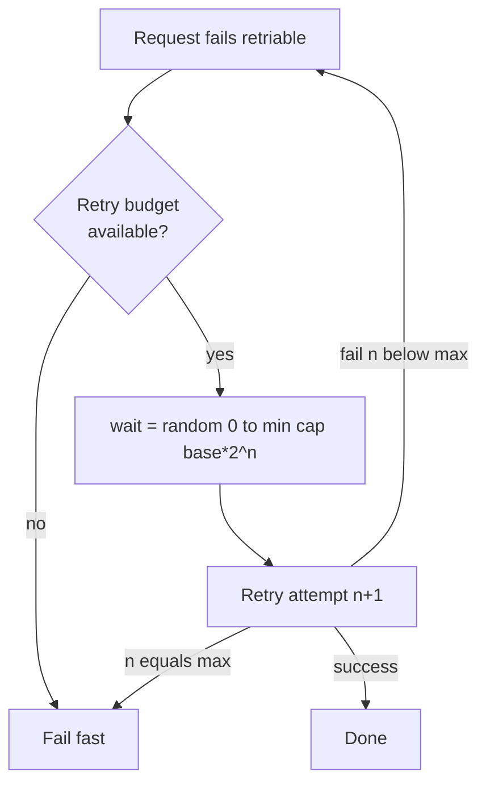

| Strategy | Pros | Cons |
|---|---|---|
| Fixed interval | Simple | Synchronized storms |
| Exponential backoff | Spreads load | Still synchronized without jitter |
| Backoff + full jitter | De-correlates clients | Slightly higher tail latency |
| + Retry budget | Caps amplification | Needs shared accounting |

> **Staff-level insight:** The number that matters: **retries can multiply load by the retry count at *every* layer**. In a healthy system retries are <1% of traffic; during an outage they can become the *majority* — turning a brownout into a full outage (**metastable failure**: the system stays down even after the original trigger is gone, because retry load is now self-sustaining). Always pair retries with **backoff + jitter + a budget + circuit breaker**, and prefer **idempotency keys** so retries are safe. **Experience hook:** *this is the exact shape of a real outage — a 2s downstream slowdown, every layer retrying, load triples, and it doesn't recover until you shed load. After that we capped retries at 20% and made the breaker latency-aware.* This is a top reason large outages cascade.

### 5.2 Circuit Breakers

**Definition.** A circuit breaker monitors calls to a dependency and **trips open** when failures exceed a threshold, **failing fast** (returning an error/fallback immediately) instead of waiting on a doomed call. It gives the failing dependency room to recover and protects the caller's resources (threads, connections).

**State machine:**

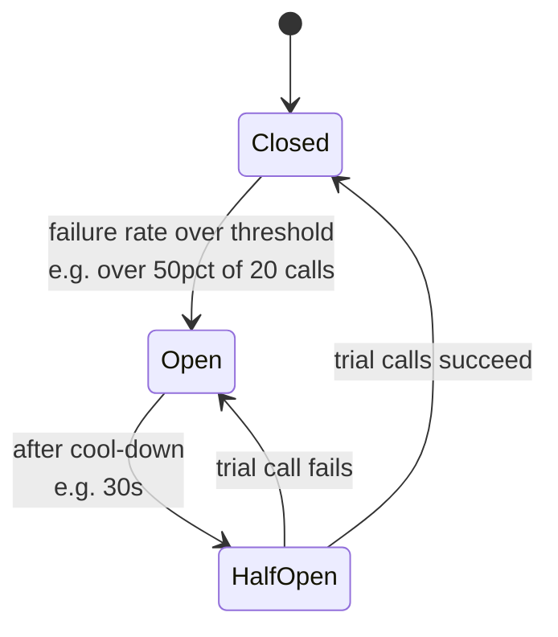

| State | Behavior |
|---|---|
| **Closed** | Normal; requests pass through; failures counted. |
| **Open** | Trip! Requests fail immediately (fallback). Timer running. |
| **Half-Open** | After cool-down, allow a few **trial** requests. Success → Closed; failure → Open again. |

**Real-world:** Netflix **Hystrix** (deprecated, hugely influential), **Resilience4j** (its successor), **Envoy/Istio** outlier detection, **Polly** (.NET), gRPC built-in.

> **Staff-level insight:** Circuit breakers convert **slow failures into fast failures** — critical because the real killer is **thread/connection-pool exhaustion**: callers blocked on timeouts to a dead dependency pile up until the *caller* itself falls over (cascading failure). Tune three things: **error threshold** (e.g., 50%), **volume threshold** (don't trip on 1 of 2 calls — require a min sample like 20), and **cool-down**. **Trip on latency, not just errors** — a dependency that's slow but returning 200s is often more dangerous than one returning 500s, because the slow one silently consumes your threads. Always pair with a **fallback** (cached data, default, degraded response) so opening the breaker degrades gracefully rather than erroring.

**Pitfall:** Setting the volume threshold too low causes flapping on low-traffic services. Setting cool-down too short hammers a recovering dependency. A breaker that only watches error rate misses the slow-success failure mode entirely.

### 5.3 Bulkheads

**Definition.** Named after ship compartments: **isolate resources** so a failure in one part can't sink the whole ship. Partition thread pools / connection pools / instances **per dependency or per tenant** so that one slow dependency exhausts only *its* pool, not all of them.

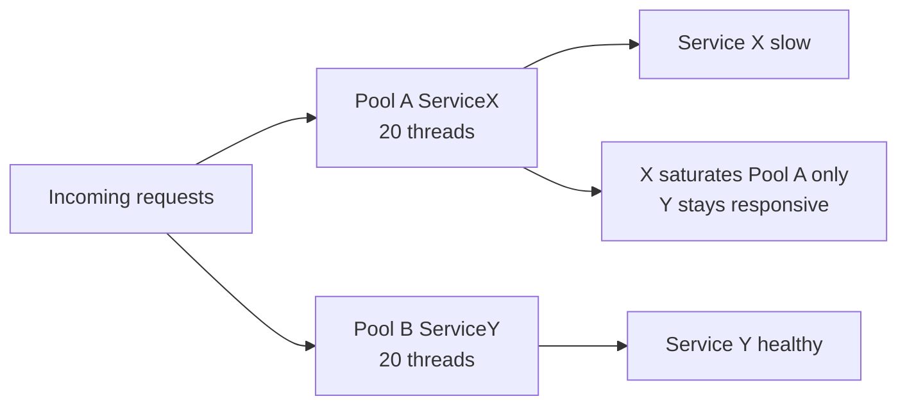

| Bulkhead type | Isolates |
|---|---|
| Thread-pool per dependency | A slow downstream can't starve others |
| Connection-pool partitioning | DB/HTTP connections reserved per use |
| Per-tenant quotas | Noisy neighbor can't starve others (multi-tenant) |
| Separate instances/clusters | Blast-radius isolation (cell-based arch) |

**Real-world:** Resilience4j Bulkhead, Hystrix thread pools, AWS **cell-based architecture** (shuffle sharding), Kubernetes resource limits/namespaces.

> **Staff-level insight:** Bulkheads + circuit breakers + timeouts are the **three-legged stool** of resilience: timeouts bound how long you wait, circuit breakers stop hammering the dead, bulkheads contain the blast radius. At scale, combine with **shuffle sharding** so any single bad actor or failure affects only a small, randomized subset of customers — AWS uses this for noisy-neighbor isolation. *The math: with N customers shuffle-sharded across buckets, the probability that two specific tenants share ALL their nodes drops combinatorially, so one abusive tenant degrades only a tiny, mostly-non-overlapping slice.*

### 5.4 Failover & Disaster Recovery

**Failover** = automatically switching to a standby when the primary fails.

| Mode | How | Pros | Cons |
|---|---|---|---|
| **Active-Passive** | Standby idle/warm, takes over on failure | Simpler, no write conflicts | Wasted capacity; failover lag; standby may be stale |
| **Active-Active** | All nodes serve traffic | Full utilization, low failover time, geo-local | **Write conflicts** to resolve; harder consistency |

**Split-brain in failover:** the classic danger — the "failed" primary wasn't actually dead (just partitioned/slow), and now **two primaries accept writes**. Prevent with: **quorum-based failover decisions** (a majority must agree the primary is down), **fencing** (STONITH — "Shoot The Other Node In The Head" — forcibly power-off the old primary), and **witness/tiebreaker nodes** in a 3rd zone for even-node clusters.

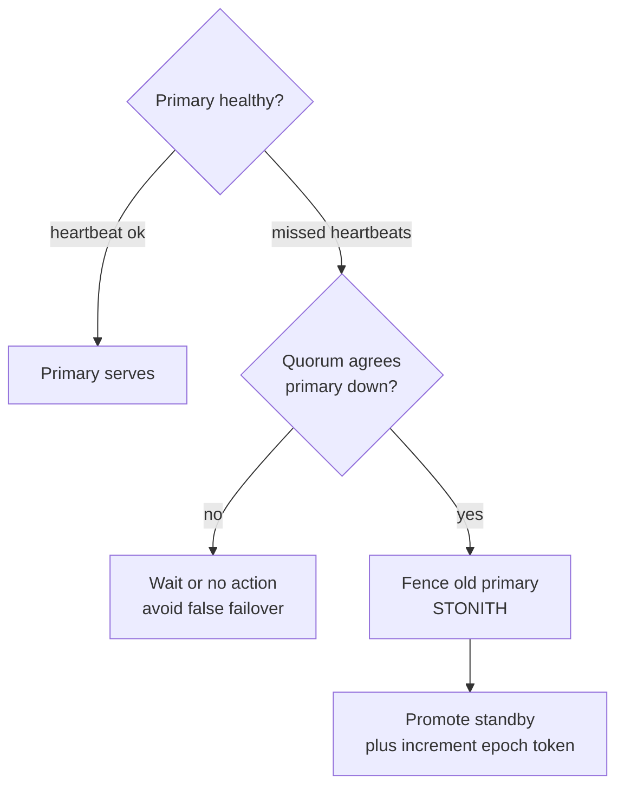

**Disaster Recovery (RTO/RPO):**
- **RTO (Recovery Time Objective):** max acceptable downtime (how fast you recover).
- **RPO (Recovery Point Objective):** max acceptable data loss (how much recent data you can lose).

| DR strategy | RTO | RPO | Cost |
|---|---|---|---|
| Backup & restore | hours | hours | $ |
| Pilot light | ~10s of min | minutes | $$ |
| Warm standby | minutes | seconds | $$$ |
| Active-active multi-region | ~seconds | ~0 | $$$$ |

> **Staff-level insight:** RTO and RPO are **business decisions priced in dollars**, not engineering defaults — a payment ledger demands RPO≈0 (synchronous replication, pay the latency), a recommendation cache tolerates hours. Synchronous cross-region replication gives RPO≈0 but adds tens of ms to every write; async gives low latency but RPO = replication lag. **Make the trade explicit and ask the interviewer for the number:** *"What's the acceptable data loss on this dataset? If it's zero I'm paying cross-region sync latency; if it's seconds I'll go async and save the latency."* Asking for RTO/RPO targets is itself a senior move — engineers guess, Staff engineers source the requirement. Full DR/reliability depth is in [Reliability](11-reliability.md).

---

## 6. Distributed Data

### 6.1 Replication & Concurrent-Write Conflicts

**Replication** keeps copies of data on multiple nodes for **availability, read scaling, and locality**. (Recap from [Fundamentals](01-fundamentals.md) and detailed in [Databases](06-databases.md).)

| Model | Description | Conflict risk |
|---|---|---|
| **Single-leader** | All writes to leader, replicated to followers | None on write (leader serializes); read staleness on followers |
| **Multi-leader** | Multiple leaders accept writes (e.g., per region) | **Yes** — concurrent writes to same key in different leaders |
| **Leaderless** (Dynamo) | Any replica accepts writes; quorum reads/writes | **Yes** — concurrent writes; resolved at read |

**Concurrent-write conflict:** in multi-leader or leaderless systems, two clients write the same key "at the same time" (no happens-before relationship between them). Both are valid; the system must **detect** (via version vectors) and **resolve** (LWW, app merge, CRDT) the conflict. Single-leader avoids this by serializing all writes through one node — at the cost of that node being a write bottleneck and a failover point.

**Decisive default:** *"Single-leader with async read replicas is my default — it sidesteps write conflicts entirely and covers the vast majority of read-heavy workloads. I go multi-leader or leaderless only when I need multi-region low-latency writes or write availability under partition — and then I accept that I now own a conflict-resolution strategy."* That's YAGNI plus a named trigger: don't take on conflict resolution until a requirement forces multi-writer.

### 6.2 Geo-Replication

**Definition.** Replicating data across **geographic regions** for low-latency local reads/writes, disaster survival, and **data-residency compliance** (GDPR, data sovereignty).

**Key trade-offs:**
- **Speed of light:** cross-region RTT is ~**60–150ms** (e.g., US-East ↔ EU ~80ms, US ↔ Asia ~150ms+). Any synchronous cross-region coordination pays this on every operation. This is a *physical* floor — no amount of engineering removes it.
- **Synchronous geo-replication** (strong, RPO≈0) = every write waits for a remote ack → +100ms latency. **Asynchronous** = fast local writes, but RPO = lag and possible conflicts/loss on failover.
- **Data residency:** EU user data must stay in EU; achieved via **region-pinned/sharded** data (partition by user region) rather than global replication.

```mermaid
flowchart LR
  subgraph US["US-East"]
    UW["Write local"] --> UDB["US replica"]
  end
  subgraph EU["EU-West"]
    EW["Write local"] --> EDB["EU replica"]
  end
  UDB <-->|async replicate ~80ms<br/>conflicts possible| EDB
```

| Approach | Latency | Consistency | Residency |
|---|---|---|---|
| Single global region | High for far users | Strong | Hard (one location) |
| Multi-region async (multi-leader) | Low local | Eventual + conflicts | Flexible |
| Multi-region sync (Spanner/quorum) | +RTT per write | Strong | Quorum placement controls |
| Region-pinned sharding | Low local | Strong within region | **Compliant** |

> **Staff-level insight:** For global apps the dominant pattern is **partition by geography / shard-per-region with a "home region" per user**, giving local-latency strong consistency for that user's data while replicating asynchronously for DR and cross-region reads. Spanner achieves global strong consistency but pays **TrueTime commit-wait latency**; most teams instead accept **regional strong + cross-region eventual**. **Always raise data residency** for any global design — it's a senior signal and often a hard legal constraint that *dictates* the sharding key before any performance consideration. **Experience hook:** *for chat, conversations have a natural home region; we pinned a room's authoritative copy to one region and replicated read-only elsewhere, rather than trying to make every region a writer.*

### 6.3 Conflict Resolution: LWW, Vector Clocks, CRDTs

When concurrent writes diverge, you must reconcile. Options, weakest to strongest:

**1. Last-Write-Wins (LWW):** attach a timestamp; highest timestamp wins. Simple but **silently drops data** and depends on clock sync (clock skew → wrong winner). Used by Cassandra (per-column timestamp).

**2. Vector clocks / version vectors:** detect whether two versions are **causally ordered** (one happened-before the other → keep newer) or **concurrent** (conflict → surface to app / merge). Each node keeps a counter; the vector `[A:n, B:m, ...]` captures causal history.

**Vector clock worked example** (nodes A, B; key `cart`):

| Step | Event | Vector clock |
|---|---|---|
| 1 | A writes `[milk]` | `{A:1}` |
| 2 | B reads `{A:1}`, adds `eggs` → `[milk, eggs]` | `{A:1, B:1}` |
| 3 | A (didn't see B) reads `{A:1}`, adds `bread` → `[milk, bread]` | `{A:2}` |
| 4 | Read finds `{A:1,B:1}` and `{A:2}` — **neither dominates** (concurrent) | **conflict** |
| 5 | App merges siblings → `[milk, eggs, bread]` | `{A:2, B:1}` |

**Comparison rule:** VC1 ≤ VC2 iff every component of VC1 ≤ corresponding component of VC2. If neither ≤ the other → **concurrent (conflict)**. In step 4, `{A:1,B:1}` vs `{A:2}`: A says 2>1 (favors second) but B says 1>0 (favors first) → neither dominates → concurrent.

```mermaid
flowchart TD
  W0["A:1 milk"] --> WB["B adds eggs<br/>A:1 B:1"]
  W0 --> WA["A adds bread<br/>A:2"]
  WB --> CONF["Read concurrent siblings<br/>A:1 B:1 vs A:2"]
  WA --> CONF
  CONF --> MERGE["App merge to A:2 B:1<br/>milk eggs bread"]
```

> **Note:** A **version vector** tracks per-replica versions of a single object (replica IDs); a **vector clock** tracks causal order of events/processes. Dynamo's shopping cart famously used them to surface siblings and merge — and famously this surfaced the "deleted item comes back" anomaly when a merge re-added a removed item, which is exactly why **OR-Set CRDTs** (which track removes properly) are the better modern answer.

**3. CRDTs (Conflict-free Replicated Data Types):** data structures mathematically designed so that **concurrent updates always merge deterministically without conflict**, regardless of order — they **always converge** (Strong Eventual Consistency). No coordination needed for writes.

Two flavors:
- **State-based (CvRDT):** replicas exchange full state; merge via a **commutative, associative, idempotent** join (a least-upper-bound in a lattice). Robust to message loss/dup/reorder.
- **Operation-based (CmRDT):** replicas broadcast operations; ops must be **commutative** and delivered reliably, in causal order, and applied once (deduplicated/idempotent). Note that exactly-once *delivery* doesn't exist on the wire — this is reliable delivery plus dedup/idempotent apply — and this stronger delivery requirement is exactly why CmRDTs are operationally heavier than state-based CvRDTs. Less bandwidth, stronger delivery requirements.

Common CRDTs:

| CRDT | Use | Merge rule |
|---|---|---|
| **G-Counter** | Increment-only counter | Per-node counts; merge = max per node, sum = total |
| **PN-Counter** | Inc/dec counter | Two G-Counters (P − N) |
| **G-Set** | Grow-only set | Union |
| **OR-Set** (Observed-Remove) | Add/remove set | Tag each add with unique id; remove only observed tags |
| **LWW-Register** | Single value | Highest timestamp wins (LWW, with caveats) |
| **MV-Register** | Single value, keep conflicts | Keeps concurrent values as siblings |
| **RGA / WOOT / Logoot / Treedoc** | Sequence/text | Position identifiers for ordered insert |

**Why CRDTs matter for collaborative & chat systems:** They let many users edit **offline / concurrently** (Google-Docs-style editing, chat reactions, presence, shared cursors) and merge **automatically** without a central coordinator or conflict dialogs. They guarantee convergence with **no consensus on the write path** → low latency, offline-capable, partition-tolerant.

**Real-world:** **Redis** (CRDTs in Redis Enterprise Active-Active), **Riak** (built-in CRDT types), **Automerge / Yjs** (collaborative editors, the modern OT alternative), **Figma** (multiplayer), **Apple Notes**, **Azure Cosmos DB** (conflict resolution), **SoundCloud's Roshi** (LWW-element-set for streams).

```mermaid
flowchart LR
  subgraph R1["Replica 1 offline edit"]
    A1["counter +3"]
  end
  subgraph R2["Replica 2 offline edit"]
    A2["counter +5"]
  end
  A1 --> M["Merge commutative<br/>max-per-node then sum<br/>= 8"]
  A2 --> M
  M --> CONV["Both converge to 8<br/>no conflict any order"]
```

| Strategy | Detects conflicts | Resolves automatically | Data loss | Coordination | Best for |
|---|---|---|---|---|---|
| **LWW** | No | Yes (by timestamp) | **Yes (drops loser)** | None | Caches, tolerant data, clock-synced |
| **Vector clocks** | **Yes** | No (app merges) | No (surfaces siblings) | None on write | Shopping carts, app-defined merge |
| **CRDTs** | N/A (no conflict) | **Yes (deterministic)** | No | None on write | Collaborative editing, chat, counters, presence |
| **Consensus (Raft)** | Prevents | Serializes | No | **Per write** | Strong consistency, ledgers |

> **Staff-level insight:** The decision tree: need **strong consistency / no concurrent writes**? → single-leader/consensus. Tolerate eventual but want **automatic convergence with no central coordinator** (collaborative, offline, multi-region active-active)? → **CRDTs**. Need to **detect** conflicts and apply **business-specific merge**? → **vector clocks + app logic**. Only acceptable to **silently drop** a write? → **LWW**. For a **chat/collaborative** design, CRDTs (or OT for rich text) is the marquee answer — explain the convergence property and the offline/latency win, and note the cost: **metadata growth** (tombstones in OR-Set, position ids) that needs garbage collection. **Experience hook:** *on chat, reactions and presence are OR-Sets/LWW-registers per element; message *bodies* are immutable so they don't conflict at all — and immutability is the cheapest conflict-resolution strategy of all, so I look for it first.*

**Pitfall:** CRDTs guarantee **convergence**, not **correctness of intent**. A G-Counter can't enforce "balance ≥ 0" across replicas (you can't reject a decrement you can't see) — invariants requiring global agreement still need consensus. Also, CRDT metadata grows unbounded without GC (tombstones). **Earmark both early** if you propose CRDTs: *"convergence is free, but global invariants and tombstone GC are the two things that'll bite — let me address them."*

---

## 7. Clocks: Physical, Logical, Hybrid

Time is the hardest illusion in distributed systems: there is **no global "now."** Clocks drift, NTP corrects with jumps, and you cannot order events by wall-clock reliably.

> **Anti-pattern to call out (yours or theirs):** using `System.currentTimeMillis()` / DB `NOW()` for ordering, LWW, or lease expiry across machines. If you catch yourself or the interviewer leaning on wall-clock for correctness, flag it: *"I won't order by wall-clock — clock skew and NTP step-backs make that silently wrong; I'll use logical/hybrid clocks or fencing tokens."*

**Physical clocks:** wall-clock time from quartz/NTP. Problems: **clock skew** (machines disagree by ms–seconds), **drift**, NTP **step adjustments** (clock can jump backward!), VM pauses, **leap seconds**. **Never use physical timestamps to determine causal order or for correctness** (e.g., LWW can pick the wrong winner; a leader can wrongly "expire" a lease).

**Logical clocks** capture **causality** (happens-before, →), not real time:

- **Lamport clocks:** each process keeps a counter `L`; increment on every event; on send, attach `L`; on receive, `L = max(L, received) + 1`. Guarantees: if `a → b` then `L(a) < L(b)`. **But the converse is false** — `L(a) < L(b)` does *not* imply causality (could be concurrent). Gives a **total order** (tiebreak by node id) but **can't detect concurrency**.

- **Vector clocks:** vector of per-process counters. Captures full causality: `a → b` **iff** `VC(a) < VC(b)`; **incomparable ⇒ concurrent**. Can **detect concurrency** (used for conflict detection, §6.3). Cost: **O(N) size** — grows with number of nodes (mitigate with version vectors / pruning / dotted version vectors).

```mermaid
sequenceDiagram
  participant P1 as P1
  participant P2 as P2
  P1->>P1: event L=1
  P1->>P2: msg L=2
  P2->>P2: receive L=max 0 2 plus 1 = 3
  P2->>P2: event L=4
  Note over P1,P2: Lamport orders via counters<br/>vector clock would also flag<br/>any concurrent P1 P2 events
```

**TrueTime (Google Spanner):** exposes time as an **interval** `[earliest, latest]` with a bounded uncertainty **ε** (epsilon), guaranteed by **GPS + atomic clocks** in every datacenter (ε typically ~1–7ms). To commit, Spanner does **commit-wait**: it waits out the uncertainty (`2ε`, ~average 7ms+) so that timestamps **never overlap across transactions** → globally consistent, externally-consistent (linearizable) ordering using *physical* time. The trick: it doesn't pretend clocks are perfect — it **quantifies and waits out** the error.

**HLC (Hybrid Logical Clocks):** combine physical time (so timestamps are close to wall-clock and meaningful to humans/queries) with a logical component (so causality is respected even when physical clocks are skewed). An HLC timestamp = `(physical_time, logical_counter)`; on receive it takes `max` and bumps the counter, never going backward. Gives **causality + near-real-time**, with **bounded size (constant, not O(N))** — unlike vector clocks. Used by **CockroachDB**, **MongoDB**, **YugabyteDB**.

```mermaid
flowchart TD
  PHY["Physical clock real time but skewed<br/>can jump backward"] --> PROB["Unreliable for ordering"]
  LAM["Lamport clock causal total order<br/>no concurrency detect"] --> SMALL["O(1) size"]
  VEC["Vector clock full causality<br/>detects concurrency"] --> BIG["O(N) size"]
  TT["TrueTime physical plus bounded epsilon<br/>commit-wait"] --> HW["needs GPS atomic HW"]
  HLC["HLC physical plus logical<br/>causality plus near-real-time"] --> BEST["O(1) no special HW"]
```

| Clock | Captures causality? | Detects concurrency? | Real-time meaning? | Size | Needs special HW? |
|---|---|---|---|---|---|
| Physical (NTP) | No | No | Yes (skewed, can jump) | O(1) | No |
| Lamport | Partial (one-way) | **No** | No | O(1) | No |
| Vector | **Yes (full)** | **Yes** | No | **O(N)** | No |
| TrueTime | Yes (via real time) | via interval | Yes (bounded ε) | O(1) | **Yes (GPS+atomic)** |
| HLC | **Yes** | partial | **Yes (near)** | O(1) | No |

> **Staff-level insight:** The senior progression to articulate: *"Wall-clock time is unreliable for ordering, so we use logical clocks. Lamport gives a cheap total order but can't tell causal from concurrent; vector clocks can, but cost O(N) and don't relate to real time. Spanner's TrueTime solves it with hardware + commit-wait to bound uncertainty; HLC gives most of the benefit (causality + near-wall-clock, constant size) without GPS hardware, which is why CockroachDB and MongoDB use it."* **Decisive close:** *"For most systems I reach for HLC — it's the pragmatic default; TrueTime only if I own the hardware and need global external consistency."* Mentioning HLC vs TrueTime distinguishes Staff from senior.

**Pitfall:** Using `System.currentTimeMillis()` (or DB `NOW()`) for LWW conflict resolution, lease expiry, or ordering across machines. Clock skew/jumps make this silently incorrect. Use logical/hybrid clocks or fencing tokens instead. **Subtle one to know:** even Spanner's correctness depends on TrueTime's ε bound *actually* holding — if a clock's error exceeds ε, external consistency breaks, which is why they invest so heavily in clock infrastructure and will halt a node whose uncertainty grows too large.

---

## 8. The 8 Fallacies of Distributed Computing

False assumptions engineers make (Deutsch & Gosling, Sun Microsystems) that cause distributed systems to fail. Stating these signals maturity — but **don't recite all eight as a list**; that's the rabbit-hole. Pick the two or three relevant to the design in front of you and connect each to a concrete defense.

| # | Fallacy | Reality & mitigation |
|---|---|---|
| 1 | **The network is reliable** | Packets drop; connections fail. → retries (with backoff/jitter), idempotency, timeouts, circuit breakers. |
| 2 | **Latency is zero** | Cross-region RTT ~80–150ms; even intra-DC ~0.5ms. → batch, cache, co-locate, async, minimize round-trips (chatty APIs kill you). |
| 3 | **Bandwidth is infinite** | Finite & costly. → compression, pagination, avoid over-fetching, backpressure. |
| 4 | **The network is secure** | Threats everywhere. → TLS, mTLS, authn/authz, zero-trust, encryption at rest. |
| 5 | **Topology doesn't change** | Nodes/IPs come and go (autoscaling, k8s). → service discovery, no hardcoded IPs, health checks. |
| 6 | **There is one administrator** | Many teams/clouds/configs. → IaC, automation, clear ownership, observability. |
| 7 | **Transport cost is zero** | Serialization/marshalling + bandwidth cost CPU & money. → efficient formats (protobuf/Avro), measure egress. |
| 8 | **The network is homogeneous** | Mixed protocols/versions/hardware. → standard protocols, schema evolution, versioned APIs. |

```mermaid
mindmap
  root((8 Fallacies))
    Network reliable
    Latency zero
    Bandwidth infinite
    Network secure
    Topology static
    One admin
    Transport free
    Homogeneous
```

> **Staff-level insight:** These map directly to design defenses. When asked "what could go wrong?", don't list — walk the *relevant* fallacies and attach a defense to each: *unreliable network* → timeouts/retries/circuit breakers; *non-zero latency* → caching/co-location/async; *changing topology* → service discovery. Treating partial failure as the **normal case, not the exception**, is the defining mindset of distributed-systems engineering — say that sentence; it's the thesis of the whole module.

---

## Interview Cheat-Sheet

- **Delivery over recall:** for every concept, *choose* ("<X> because <requirement>; revisit if <trigger>"), control altitude (name basics, deep-dive the risk crux), and earmark the hard part early. Never close on "it depends."
- **ACID-C ≠ CAP-C.** ACID-C = invariants in a txn; CAP-C = linearizability across replicas.
- **Snapshot Isolation prevents phantoms but NOT write skew.** Use Serializable or `SELECT … FOR UPDATE` for cross-row invariants. (Real bug: SI booking double-book.)
- **CAP:** P is mandatory in real systems → you choose **C or A only during a partition**. "CA" = single-node only.
- **Lead with PACELC:** Partition → A/C; **Else → Latency/Consistency** (paid on *every* request). Different datasets can take different PACELC postures in one system.
- **DB map:** etcd/ZK/Spanner/CockroachDB = **CP/PC-EC**; Dynamo/Cassandra/Riak = **AP/PA-EL**; MongoDB = **CP / PC-EC** under its modern default majority concerns (tunable toward PA-EL with `w:1`/local reads).
- **FLP:** no guaranteed consensus in async with 1 failure → escape via timeouts + randomization. Affects **liveness, not safety**.
- **Reach for consensus only when you need a single agreed value/order** (leader election, locks, config, membership, linearizable log) — not for plain replication.
- **Raft:** strong leader, terms, majority quorum (odd clusters: 3→tol 1, 5→tol 2), randomized election timeout (150–300ms). Equivalent to multi-Paxos, more understandable. Linearizable reads need **ReadIndex/lease** (naive leader read is stale-prone).
- **Quorum:** `R + W > N` for overlap (e.g., N=3, R=2, W=2). Sloppy quorum breaks this for availability. Quorum ≠ linearizable.
- **Distributed locks need fencing tokens** (monotonic, validated at the resource) to be *safe*. Redlock alone isn't safe for correctness. Lock = liveness/uniqueness; resource token check = safety. Use a plain lock for efficiency-only.
- **2PC** = atomic but **blocking** (coordinator failure freezes in-doubt participants, locks fan out). **Saga** = scalable, non-atomic (forward + compensate), sacrifices isolation. **3PC** is impractical (not partition-safe) — consensus-replicate the coordinator instead.
- **No exactly-once on the wire** → at-least-once + idempotent consumers = **effectively-once**.
- **Outbox pattern** solves dual-write; CDC (Debezium) is the scalable variant; consumers dedupe (at-least-once).
- **Resilience trio:** timeout + circuit breaker (closed/open/half-open, trip on **latency** too) + bulkhead. Add backoff + **jitter** + **retry budget** to prevent retry storms / **metastable** failure.
- **RTO** = downtime tolerated; **RPO** = data loss tolerated. Both are dollar-priced business decisions — ask for the number.
- **Conflict resolution:** LWW (drops data) < vector clocks (detect, app-merge) < **CRDTs** (auto-converge, no coordination — the answer for collaborative/chat). Immutable data = no conflict at all (look for it first).
- **Clocks:** physical = unreliable for ordering; Lamport = order, no concurrency detect; vector = full causality, O(N); **TrueTime** = HW + commit-wait; **HLC** = causality + near-real-time, O(1) (CockroachDB/MongoDB) — the pragmatic default.

---

## Common Interview Questions

**1. "Explain CAP and why a 'CA' system doesn't really exist."**
> CAP says under a network partition you can't have both linearizable consistency and availability. Since partitions are unavoidable in a real distributed system, P isn't optional — so you're really choosing C vs A *during a partition*. A "CA" system is just a single-node database with nothing to partition. The better model is PACELC: even with no partition, you trade latency vs consistency on every request — which is where most real decisions live. Spanner is PC/EC (chooses consistency, pays TrueTime latency); Dynamo is PA/EL. **In a real design I'd pick per-dataset: AP/EL for the chat feed, CP/EC for the ledger — same system, two postures.**

**2. "Is a distributed lock safe? How would you build a safe one?"**
> No lock is safe on its own, because the holder can be paused arbitrarily (GC, VM pause, network delay) past its lease without knowing it lost the lock — then two clients act concurrently. The lock service provides *liveness and uniqueness*; *safety* must come from **fencing tokens**: the lock service issues a monotonically increasing token per grant, every write carries it, and the protected resource rejects any token lower than the max it has seen. That's why Redlock alone is unsafe for correctness — it provides no fencing. For correctness-critical locks I'd use etcd/ZooKeeper (consensus-backed, monotonic revisions) plus token validation at the resource. **But I'd scale to the requirement: if it's just deduping a cron job, a plain Redis lock is fine — I won't over-build fencing where occasional double-work is harmless.**

**3. "Walk me through 2PC and its failure modes. When would you use Saga instead?"**
> 2PC: coordinator sends prepare; participants durably persist and lock, vote yes/no; if all yes, coordinator logs commit and broadcasts commit. The fatal flaw is **blocking**: a participant that voted yes is in-doubt and holds locks until it hears the decision — if the coordinator crashes between phases, it blocks indefinitely and those locks fan out to stall other transactions. 2PC also couples availability to every participant and holds locks across round-trips. I'd use 2PC only within a tightly-coupled single-org stack (XA). **For microservices I'd use a Saga** — and I'd flag up front that the hard part is compensations and visible intermediate state, not the happy path. Orchestrated (Temporal/Step Functions) for complex flows so it's traceable; choreography only for simple loosely-coupled reactions. Sagas scale and don't block but sacrifice isolation and need idempotent steps + compensations, an outbox for reliable publishing, and idempotency keys.

**4. "Design conflict resolution for a collaborative editor / chat app."**
> Concurrent offline edits must merge without a central coordinator, so I'd use **CRDTs** (a sequence CRDT like RGA, or Yjs/Automerge for text; OR-Sets for reactions/membership; PN-Counters for counts). CRDTs are designed so concurrent ops merge deterministically and always converge (Strong Eventual Consistency) — no consensus on the write path means low latency, offline support, and partition tolerance. **First, though, I'd look for what I can make immutable** — message bodies don't change, so they never conflict; that's the cheapest strategy. The CRDT cost I'd earmark early: metadata growth (tombstones, position ids) needing GC, and they guarantee convergence not intent (can't enforce a global invariant like balance ≥ 0). If I needed conflict *detection* with business-specific merge I'd use vector clocks + app logic; LWW only where silently dropping a write is acceptable.

**5. "How do you prevent retry storms / cascading failures?"**
> Retries multiply load at every layer, so during an outage they can become the majority of traffic and tip a brownout into a full outage (metastable failure — it stays down even after the trigger clears). Defenses: **exponential backoff with full jitter** to de-correlate clients; a **retry budget** (cap retries to ~10–20% of traffic, fail fast beyond it); retry **only idempotent ops on retriable errors**; retry at **one layer**, not stacked. Combine with **circuit breakers** that trip on **latency, not just errors** (a slow-but-200 dependency silently eats your threads), **timeouts** to bound waiting, and **bulkheads** to isolate thread/connection pools per dependency. Idempotency keys make retries safe. **I've seen this exact failure — a 2s downstream slowdown, every layer retrying, load tripling — so I treat retry budgets and latency-aware breakers as non-negotiable, not nice-to-haves.**

**6. "Why is consensus hard? What does Raft guarantee?"**
> FLP says in a fully asynchronous system with even one crash failure, no deterministic protocol can *guarantee* consensus terminates — because you can't distinguish a slow node from a dead one. Real systems escape this via partial synchrony: timeouts plus randomization, sacrificing *guaranteed* liveness for *probabilistic* liveness while always preserving safety. Raft maintains a replicated log via a strong leader: randomized election timeouts pick one leader per term; entries commit once a **majority** persists them; the up-to-date-log voting rule guarantees a new leader has all committed entries. It's **always safe** (never two conflicting commits) and **eventually live**. Use odd clusters (3 tolerates 1, 5 tolerates 2). It's equivalent to multi-Paxos but far more understandable. **One thing I'd flag: linearizable reads need ReadIndex or a leader lease — a naive read from the leader can be stale if it's been partitioned out.**

**7. "Eventual consistency is too weak for our UX. What's the strongest model we can still have while staying available under partition?"**
> **Causal consistency.** It preserves cause→effect ordering (a reply never appears before the message it answers) while concurrent operations may be ordered differently per replica — and crucially it's the strongest model achievable in an always-available, partition-tolerant system (anything stronger violates CAP). Implement by propagating dependency metadata (vector clocks / happens-before tags) so replicas apply writes in causal order. **But I'd start cheaper:** read-your-writes (route to primary or a high-LSN replica after a write) and monotonic reads fix ~90% of the jarring UX bugs at near-zero cost, and I'd only add full causal consistency if cross-user ordering shows up as a real complaint. Spanner/etcd give linearizability but require sacrificing availability under partition.

**8. "How does Spanner give global strong consistency, and what does it cost?"**
> Spanner uses **TrueTime**: GPS + atomic clocks in every datacenter expose time as an interval `[earliest, latest]` with a bounded uncertainty ε (~1–7ms) instead of a single value. On commit it does **commit-wait** — it waits out the uncertainty (~2ε) before releasing, guaranteeing transaction timestamps never overlap, which yields external consistency (linearizability) using physical time globally. The cost is **latency**: every commit pays the commit-wait (~7ms median) plus cross-region quorum (Paxos per shard). It's the canonical PC/EC system — chooses consistency and pays latency even without partitions. **Most teams without GPS hardware shouldn't reach for this** — they approximate the causality benefits with **HLC** (CockroachDB, MongoDB): physical + logical timestamp, constant size, no special hardware. I'd default to HLC and only consider TrueTime if I owned the clock infrastructure and genuinely needed global external consistency.

**9. "How do you reliably publish an event when you commit a DB change?" (dual-write)**
> You can't atomically write to a DB and a broker — separate systems, and a crash between them loses or duplicates the event. The **transactional outbox**: in the *same* local DB transaction that updates business state, insert the event into an `outbox` table (atomic). A separate relay — ideally **CDC reading the WAL (Debezium)** rather than polling — publishes outbox rows to the broker and marks them sent. This guarantees **at-least-once** delivery, so consumers must dedupe via idempotency keys / event IDs. **I'd say it plainly: there's no exactly-once on the wire — at-least-once plus idempotent consumers gives effectively-once.** It avoids fragile 2PC across DB and broker and is the standard microservices pattern.

**10. "Compare LWW, vector clocks, and CRDTs — when each?"**
> LWW attaches a timestamp and keeps the latest — simple but silently drops the losing write and depends on clock sync; use only for caches/tolerant data. Vector clocks *detect* whether two versions are causally ordered or concurrent (incomparable vectors = conflict) and surface siblings for **application-specific merge** (Dynamo's cart); use when you need conflict detection plus custom merge logic — and remember Dynamo's "deleted item resurrects" anomaly, which OR-Sets fix. CRDTs are data structures engineered so concurrent updates **always merge deterministically and converge** with no coordination and no data loss — the right answer for collaborative editing, chat, counters, presence, and active-active multi-region. The CRDT trade-off I'd earmark: unbounded metadata (tombstones) needing GC, and they can't enforce global invariants (e.g., non-negative balance), which still require consensus.

**11. (Meta/delivery) "You've got a transaction spanning three services. Talk me through how you'd approach the design out loud."**
> First I'd state the decision and why before diving in: *"This is a distributed transaction; I'll use a Saga rather than 2PC because these are independent failure domains and I won't couple their availability with a blocking coordinator — I'd only 2PC this if it were one tightly-coupled stack with a hard atomicity bar."* Then I'd **earmark the hard part up front**: "the risk here isn't the happy path, it's the compensations and the visible intermediate state, so that's where I'll spend our time." I'd pick orchestration for traceability, name the idempotency + outbox requirements, and call out the one invariant I'm worried about (e.g., double-charge) and how the pivot step handles it. The point I'm making to you: I lead with the decision and the trigger, control altitude to the risky part, and avoid listing every option — that's how I'd run this on a real design review.

**12. (Meta/delivery) "When would you NOT reach for consensus or strong consistency?"**
> Most of the time, honestly — and saying so is the senior move. I default to the least coordination that meets the requirement: a single-leader DB with async read replicas, session guarantees (read-your-writes, monotonic reads), and idempotency keys covers the large majority of real workloads without any consensus on the write path. I reach for consensus only when correctness *depends* on a single agreed value or order — leader election, distributed locks, membership, a linearizable log — and for strong consistency only on the specific data where staleness is user-visibly wrong or unsafe (money, uniqueness). **The anti-pattern I actively avoid is reaching for Raft/2PC/linearizability reflexively;** I name what I'm deliberately *not* building and the trigger that would make me build it. Paying the coordination tax you don't need is over-engineering, and it shows up as latency and operational burden in production.

---

> **Continue to:** [Databases](06-databases.md) for storage internals, sharding, and replication mechanics · [Messaging](04-messaging-event-driven.md) for delivery semantics and event-driven patterns · [Reliability](11-reliability.md) for deep DR, SLOs, and chaos engineering · [Staff-Level Execution](20-staff-execution.md) for the full delivery playbook · back to [Fundamentals](01-fundamentals.md).
