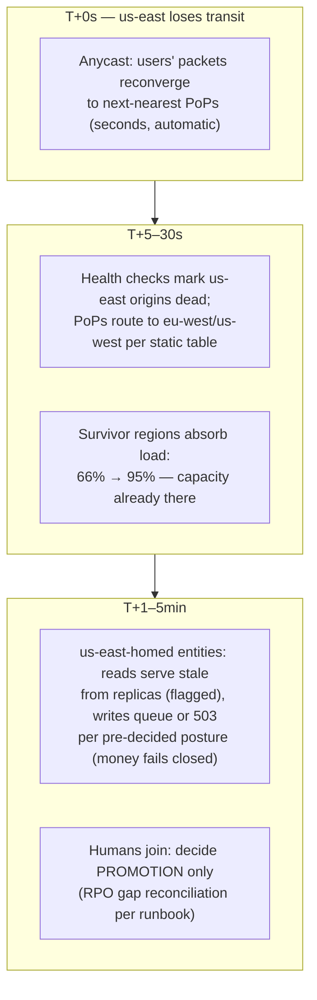

# Module 02b — Multi-Region Deployment & Static Stability

> Companion to [02 — Distributed Systems](02-distributed-systems.md) (which owns the theory: consistency models, consensus) and [28 — Designing for Failure](28-designing-for-failure.md) (which owns failure mechanics). This module is the **pragmatic multi-region round**: which write topology you actually pick, what replication lag does to your users, and whether your system keeps serving when a fiber cut takes a region offline *and nobody is allowed to make a decision*. That last property has a name — **static stability** — and it's the phrase that marks an L6 answer.
> Cross-links: [05 — Load Balancing](05-load-balancing.md) · [25 — Internet/Networking](25-internet-networking.md) (BGP/anycast mechanics) · [11 — Reliability](11-reliability.md) (RTO/RPO) · the view-count multi-region doc and [13b](13b-data-compliance-privacy.md) (when the *law* forces regions).

## What you'll master

- The **multi-region write ladder** — single-writer → active-passive → region-homed active-active → true multi-master — and the conflict-surface rule that picks the rung.
- **Replication lag as a product problem**: RPO honesty, monotonic sessions, read-your-writes across regions.
- **LWW vs CRDTs vs consensus** in one decision paragraph each, with the data-loss caveat people forget to say.
- **Anycast + edge PoPs** in enough depth to defend, and **static stability**: pre-scaled capacity, no control-plane on the failover path, and the fiber-cut drill minute by minute.

## 1. First, demand the requirement (the EM opening move)

"Multi-region" is a cost, not a virtue. It buys exactly three things: **latency** (serve users near them), **survival** (region loss ≠ product loss), **law** (residency — [13b](13b-data-compliance-privacy.md)). Ask which one is being bought and to what number — **RTO** (how long down) and **RPO** (how much data lost) — because the topology follows from the numbers: RPO=0 across regions costs you synchronous quorum latency on every write; RPO=seconds is async replication; RTO=minutes-with-a-human is active-passive; RTO≈0 demands the traffic *already* be flowing everywhere. Writing "active-active" on the board before extracting RTO/RPO is the L5 tell.

## 2. The write-topology ladder (climb only as the conflict surface forces you)

| Rung | Topology | RPO / RTO | Conflict story | Pick when |
|---|---|---|---|---|
| 1 | **Single-writer region, global reads** (replicas everywhere) | RPO seconds on region loss; RTO = promotion | none — one writer | write volume tolerates one region's latency; most products live here longer than they admit |
| 2 | **Active-passive** (warm standby, async WAL shipping) | RPO = replication lag (seconds); RTO = detection + promotion (minutes) | none until failover; **split-brain risk at promotion** — fence the old primary (quorum lease / STONITH) before the new one takes writes | survival is the goal and minutes of RTO are acceptable |
| 3 | **Region-homed active-active** — every region takes writes, but each *entity* (user, order, board) is homed to exactly one region; cross-region only for cross-entity features | RPO ≈ 0 for homed entities (their region didn't fail); failed region's entities: as rung 2 | none by construction — same-entity writes serialize in the home region | the Google/most-hyperscaler default: global product, partitioned truth. Flash-sale stock and [leaderboards](../Deep%20Dives/28-distributed-leaderboard.md) live here: *split it, don't replicate it* |
| 4 | **True multi-master** (same row writable everywhere) | RPO 0-ish; RTO ≈ 0 | **you own conflicts now** — §3 | only when the same entity genuinely must accept writes in ≥2 regions with the network down: collaborative docs, shopping carts, presence. Rare. Say it's rare |

The rule that compresses the ladder: **conflicts are created by topology, not resolved by it — so choose the topology that makes your conflicts impossible before choosing machinery to resolve them.** Region-homing makes same-entity conflicts *unrepresentable* (the same trick as the allocation gate, at continental scale).

## 3. When you must merge: LWW vs CRDT vs consensus

- **LWW (last-writer-wins):** trivially cheap, and *silently discards a concurrent write* — that's a data-loss policy wearing a tie-breaker's clothes. Acceptable for idempotent latest-state fields (presence, "last seen," device settings); indefensible for counters, carts, money. Also: "last" by whose clock? Skewed wall clocks reorder reality — hybrid logical clocks reduce, never eliminate, the lie. Say the caveat *before* the interviewer does.
- **CRDTs:** state that merges by math — G-counters (the view-count package's per-region vectors), PN-counters, OR-sets (the cart that unions adds and tracks removes), LWW-registers as a *labeled* choice. Buy: convergence without coordination. Bill: every operation must be commutative — "reserve exactly one of S units" is *not* mergeable and no CRDT will make it so (allocation goes to rung 3 homing; merging is for state that tolerates union).
- **Consensus/synchronous quorum (Spanner-class):** external consistency across regions by paying cross-region RTT on the write path (and TrueTime-style bounded clocks to make timestamps mean something). Buy it for the tiny set of rows that are *global invariants* — account balances, allocation counters, config — and keep 99% of traffic off it. "Spanner for the invariants, homing for the rest" is a defensible hybrid sentence.

**Lag as a product surface:** async replication means a user routed cross-region can read the past. The fixes are session machinery, not topology: **read-your-writes** = pin the session to the home region (or read-at-LSN) after a write; **monotonic reads** = high-water-mark token so a rerouted session never sees time go backwards — the view-count trick, third appearance in your prep. Quote lag SLOs (p99 < 1–2 s cross-continent) and alert on them; lag is an SLI, not a surprise.

> **Staff & EM insight #1:** L5 picks a topology by name ("we'll do active-active with CRDTs"). L6 derives it: RTO/RPO first, then *shrink the conflict surface by homing*, then match each remaining data class to LWW/CRDT/consensus by what its semantics tolerate — usually ending with a boring hybrid and an explicit list of what's on the expensive path. The EM overlay: every rung up the ladder roughly doubles infra cost and *more* than doubles operational complexity (failover drills, lag dashboards, conflict triage) — the EM's job is making the product state its RTO/RPO in writing before engineering buys rung 4.

## 4. Edge routing & static stability

### 4.1 The edge layer

**Anycast:** the same IP prefix BGP-announced from every PoP; the internet routes each user to the topologically nearest one. Failover is *automatic and decision-free* — a PoP withdraws its announcement (or just dies) and routes reconverge in seconds, no DNS wait. Caveats to name: BGP is not load-aware (a PoP can be near and overloaded — pair anycast with PoP-level shedding), and route flaps reset long-lived TCP connections (terminate TLS at the PoP, keep client-facing connections short or QUIC, use stable *unicast* for the PoP→origin leg). Contrast: **DNS-based failover** obeys TTLs that resolvers ignore at their leisure — minutes-to-hours of misrouted stragglers; anycast is why the edge doesn't wait for DNS. ([25](25-internet-networking.md) has the packet-level detail.)

**PoPs** terminate TLS (RTT savings on the handshake alone), cache (the stock bit, [CS-29's hot prefixes](../Deep%20Dives/29-typeahead-autocomplete.md)), absorb DDoS, and speak warm long-lived connections to origin regions. **The edge is stateless by decree** — any PoP can vanish without ceremony; state lives in regions.

### 4.2 Static stability — the property, precisely

> A system is **statically stable** when it continues operating correctly through a failure *without any control-plane action* — no scaling decision, no config push, no leader election on the critical path, no human. The failover consumes only decisions made, and capacity provisioned, **before** the failure.

The three commitments that make it true:

1. **Pre-provisioned survivor capacity.** With 3 active regions, each runs ≤ 66% so any one region's death is absorbed *by capacity that already exists* (N+1 sizing: survivors ≤ 100% post-failover). Autoscaling is not a failover plan — during a region loss the autoscaler faces a cold-start stampede exactly when the cloud's control plane is having its worst day too. The +50% idle-looking headroom **is the insurance premium**; it has a dollar figure and the EM defends it by name.
2. **No control-plane dependency on the failover path.** The data plane's failover moves are pre-positioned: anycast reconvergence (automatic), health-check-driven removal of the dead region from server-side routing tables (local decision, pre-agreed), clients retrying against a *static* list of regional endpoints. Nothing waits on a deploy pipeline, a config service, a DNS push, or a meeting. ([33](33-design-deployment-system.md) applies the same rule to the deploy system itself.)
3. **Failover requires zero new decisions.** Data-topology answers (who's primary now? — rung 2's promotion + fencing; nothing — rung 3's homed survivors keep serving their own entities, and the dead region's entities degrade *read-only from replicas* until promotion) are decided, documented, and **game-dayed** in peacetime. An untested failover path fails; this is an observation, not a risk.

### 4.3 The fiber-cut drill (narrate it in the room)

The tell of the whole module: in that narration, **the humans show up at minute 3 to make exactly one pre-scoped decision (promote or wait), and everything before it happened by physics and pre-provisioned configuration.** If your story has a human doing capacity math at T+30 s, it's not statically stable.

> **Staff & EM insight #2:** L5 says "deploy to three regions behind a global load balancer." L6 says *static stability* and means the three commitments: survivor capacity pre-bought, no control plane on the failover path, zero new decisions at failure time — then proves it by narrating the fiber cut with timestamps. The EM overlay: the game-day calendar is a management artifact (quarterly region-evacuation drills, measured RTO vs the promise), and the headroom line item survives budget review *because* it's framed as the premium on a policy with a written RTO — cut the headroom, rewrite the RTO, tell the customers. That's the sentence that ends the debate.

## Interview Cheat-Sheet

**30-second version:** extract RTO/RPO first — the topology is arithmetic · ladder: single-writer → active-passive (async + fenced promotion) → **region-homed active-active** (the default: conflicts unrepresentable by homing) → true multi-master only for genuinely merge-tolerant state (LWW = labeled data loss; CRDTs for commutative state; Spanner-class quorum for the few global invariants) · lag is a session problem: read-your-writes pinning + monotonic tokens, lag as an SLI · edge: anycast (decision-free reconvergence, not load-aware, resets long conns) + stateless PoPs · **static stability**: ≤ 66% utilization for N+1, no control-plane on the failover path, zero new decisions at failure — narrate the fiber cut with timestamps and one human decision (promotion) at minute 3.

| Probe | Answer |
|---|---|
| "Active-active or active-passive?" | Wrong first question — RTO/RPO first; then home entities to regions so the same row never takes concurrent cross-region writes; true multi-master only for merge-tolerant state |
| "How do you resolve conflicts?" | By not having them (homing). Residual: CRDTs where semantics commute, LWW only where losing a concurrent write is acceptable *and labeled*, consensus for the invariant rows |
| "Region fails — walk me through it" | Anycast reconverges in seconds; static routing tables fail to survivors; survivors absorb because they ran at 66%; homed entities of the dead region go stale-read/queued per posture; one human decision: promotion, with fencing |
| "Why so much idle capacity?" | It's not idle, it's the RTO insurance premium — cut it and we rewrite the RTO and tell customers |
| "DNS failover?" | TTLs are advisory to resolvers — minutes-to-hours of stragglers; anycast withdraws a route and the internet reconverges without asking anyone |

**Say-verbatim:**
- *"Conflicts are created by topology, not resolved by it — I home each entity to one region so same-entity conflicts are unrepresentable, then merge only what genuinely commutes."*
- *"LWW is a data-loss policy wearing a tie-breaker's clothes — fine for presence, indefensible for money, and I'll label which fields get it."*
- *"Static stability means the failover consumes only decisions and capacity provisioned before the failure — the human shows up at minute three to make exactly one pre-scoped call."*
- *"Each region runs at two-thirds so that losing one is a capacity non-event — that headroom is the premium on the RTO we promised, and it has a number."*
