# Module 3 — Caching

> The definitive caching reference for Staff / Senior EM / Director system-design interviews.

## What you'll master

Caching is where good system-design candidates separate themselves from great ones. Anyone can say "add a cache." A Staff Engineer reasons about *which* cache, *which* pattern, *what consistency contract* it provides, and *how it fails under load* — stampedes, hot keys, avalanche, penetration — and can defend a write-ordering scheme against a skeptical interviewer.

By the end of this module you will be able to:

- Map **every cache layer** in a request path (browser → CDN → app → distributed → DB buffer pool) and quote realistic hit latencies.
- Choose and defend a **cache pattern** (cache-aside, read/write-through, write-back, write-around, refresh-ahead) on consistency, latency, complexity, and data-loss axes.
- Pick the right **eviction policy** (LRU, LFU, FIFO, TTL, ARC, W-TinyLFU) and explain Redis `maxmemory-policy`.
- Handle the **hard problems**: invalidation, stampede/dogpile, hot keys, penetration, avalanche, and cache↔DB consistency (the delete-vs-update debate, double-delete, Facebook leases).
- Compare **Redis vs Memcached** at depth and justify which to use.
- **Size a cache** with working-set + hit-ratio math and compute DB load reduction from QPS and hit rate.

Cross-references: [Fundamentals](01-fundamentals.md) · [Distributed Systems](02-distributed-systems.md) · [Load Balancing](05-load-balancing.md) · [Databases](06-databases.md) · [Staff-Level Execution](20-staff-execution.md)

---

## Table of Contents

0. [In the Room — Staff-Level Delivery](#in-the-room--staff-level-delivery)
1. [Why Cache At All](#1-why-cache-at-all)
2. [Cache Layers & Types](#2-cache-layers--types)
   - [2.1 Browser Cache](#21-browser-cache)
   - [2.2 CDN / Edge Cache](#22-cdn--edge-cache)
   - [2.3 Application / In-Process Cache](#23-application--in-process-cache)
   - [2.4 Distributed Cache](#24-distributed-cache)
   - [2.5 Database Cache](#25-database-cache)
3. [Cache Patterns](#3-cache-patterns)
   - [3.1 Cache-Aside](#31-cache-aside-lazy-loading)
   - [3.2 Read-Through](#32-read-through)
   - [3.3 Write-Through](#33-write-through)
   - [3.4 Write-Back](#34-write-back-write-behind)
   - [3.5 Write-Around](#35-write-around)
   - [3.6 Refresh-Ahead](#36-refresh-ahead)
   - [3.7 Pattern Comparison](#37-pattern-comparison)
4. [Eviction Policies](#4-eviction-policies)
5. [Cache Challenges — The Interview Meat](#5-cache-challenges--the-interview-meat)
   - [5.1 Cache Invalidation](#51-cache-invalidation)
   - [5.2 Cache Stampede / Thundering Herd / Dogpile](#52-cache-stampede--thundering-herd--dogpile)
   - [5.3 Hot Keys / Celebrity Problem](#53-hot-keys--celebrity-problem)
   - [5.4 Cache Penetration](#54-cache-penetration)
   - [5.5 Cache Avalanche](#55-cache-avalanche)
   - [5.6 Cache ↔ DB Consistency](#56-cache--db-consistency)
6. [Technologies — Redis vs Memcached](#6-technologies--redis-vs-memcached)
7. [Sizing a Cache](#7-sizing-a-cache)
8. [Interview Cheat-Sheet](#interview-cheat-sheet)
9. [Common Interview Questions](#common-interview-questions)

---

## In the Room — Staff-Level Delivery

> This module's center of gravity. Everything below is reference depth; *this* section is how you spend the 45 minutes. Read this first, internalize the decisions, and let the rest be the material you reach into when the interviewer pushes. Cross-link: [Staff-Level Execution](20-staff-execution.md).

On a real-time chat platform — where caching presence, conversation metadata, unread counts, and message fan-out is daily work — the bar is not "do you know what a cache is." The bar is: **do you make defensible decisions fast, name the one risk that actually matters, and not rabbit-hole on the parts that don't.** Caching is a topic where junior candidates over-explain "RAM is faster than disk" for five minutes and never reach the part that's hard. Don't be that candidate.

### Decisions to make decisively (state these as positions, not menus)

| Decision | Default position (say this) | One-line justification | Revisit trigger |
|----------|-----------------------------|------------------------|-----------------|
| **Which pattern** | **Cache-aside + Redis** | Fails safe — cache down degrades to a slow DB read, not an outage; caches only what's read | Read-after-write on the same keys → add write-through; high-volume counters → write-back; write-heavy/read-light → write-around |
| **What to cache** | The **hot read working set** — the 20% of keys serving 80% of reads (e.g. presence, conversation list, hot channel metadata) | Caching the long tail wastes RAM and churns the hot set; cache pollution lowers hit ratio | A specific endpoint shows up as a DB-CPU hotspot in the trace |
| **TTL strategy** | **Short-to-medium TTL with jitter** as the backstop, *plus* explicit delete-on-write for freshness | Pure explicit invalidation always misses an out-of-band writer; pure TTL is stale; defense-in-depth survives both | Data that's effectively immutable → long TTL + versioned keys; strict freshness → shorter TTL + CDC |
| **Consistency stance** | **Bounded eventual consistency** — "stale up to TTL T, sub-second race window under concurrent writes" | Two systems can't be cheaply strongly consistent; stating the contract beats claiming "consistent" | A correctness-critical read (balance, entitlement) → don't cache it, or read-through the DB on that path |
| **Engine** | **Redis** | You almost always end up wanting a data structure, persistence, or HA — and one engine is less to operate | Pure ephemeral string blobs at extreme multicore throughput with zero ops → Memcached is defensible |
| **Write path for cache+DB** | **DB-first, then delete the cache** | Delete leaves no stale value; DB-first stops a reader repopulating from old state | Narrow residual race matters → double-delete or versioned keys |

The meta-skill: every one of those is phrased as **"<choice> because <one requirement>; revisit if <trigger>."** Never end an answer on "it depends." "It depends" is the audible sound of a candidate who won't commit. Commit, then name the condition that would change your mind — *that's* what "it depends" was trying to be.

### Altitude — name-and-move-on vs deep-dive

**Name and move on (10 seconds each, do not elaborate unless asked):**
- RAM is faster than disk / why caches work (temporal + Pareto locality). One sentence.
- The cache layers (browser → CDN → L1 → L2 → buffer pool). List them, quote rough latencies, move on.
- LRU basics, cache-aside basics. Everyone knows these; lingering signals you think they're the interesting part.
- Redis vs Memcached feature checklist. Land on "Redis, default" and move; don't recite the whole table.

**Deep-dive — this is the risk crux, spend your minutes here:**
- **Invalidation / cache↔DB consistency** (§5.1, §5.6) — delete-vs-update, DB-first ordering, the read-write race, double-delete, versioned keys, leases, CDC. This is *the* hard part of caching.
- **Stampede / thundering herd** (§5.2) — single-flight, probabilistic early expiration, stale-while-revalidate, and the cold-start variant with no stale value.
- **Hot keys** (§5.3) — L1 tier for hot reads, sharded counters for hot writes, and *why more nodes don't help one slot*.

If you find yourself three minutes into explaining ETags and you haven't said "cache invalidation race," you've mis-allocated. Earmark the crux out loud early: *"The interesting part of any caching design isn't the happy path — it's invalidation under concurrent writes and what happens on a stampede or a cold start. Let me make sure I get to those."* That single sentence tells the interviewer you know where the bodies are buried.

### YAGNI default + trigger

State what you're deliberately **not** doing and why — this is a seniority tell, because it shows you're sizing the solution to the requirement, not pattern-matching to the most impressive thing you've read.

- *"I'm not reaching for leases or CDC-driven invalidation yet — nothing here requires catching every out-of-band writer. DB-first-then-delete plus a TTL backstop is correct for this scale. I'd add CDC the day a second service starts writing this table directly."*
- *"I'm not adding an L1 in-process tier on day one — I have no hot-key problem yet. I'd add it the moment a single key (a celebrity profile, a viral channel) shows up as a hot slot in metrics."*
- *"I'm not turning on Redis persistence for this cache — it's a pure look-aside cache and the DB is the source of truth; AOF would just add fsync latency and ops surface. I'd revisit if Redis becomes a store of record."*
- *"I'm not building a multi-region cache invalidation bus until we're actually multi-region; today the replication-lag term in my staleness budget is zero."*

### Top anti-patterns (the ones that fail caching rounds)

1. **Caching before measuring.** Reaching for Redis when the DB buffer pool is undersized and thrashing, or when there's no evidence of a read bottleneck. The senior move is "what does the trace say is slow?" first. Adding a cache adds a consistency problem and a failure mode — you don't take that on speculatively.
2. **Write-back without a durability conversation.** Proposing write-behind for lowest write latency and never saying the word "data loss." If you say write-back, you must in the same breath name what's lost on a crash and why that's acceptable (or back it with AOF/Kafka).
3. **Ignoring stampede / hot keys / cold start.** Designing only the steady-state happy path. The interviewer *will* ask "the key expires and 10k requests arrive — now what?" or "what happens when Redis restarts?" If you haven't pre-loaded single-flight and warm-up, you look like you've only run caches in a tutorial.
4. **Claiming strong consistency between cache and DB.** Instant credibility loss. They're two systems; you offer *bounded* staleness and you state the bound.
5. **Option-listing without choosing.** Reciting six patterns and six eviction policies without landing on one is the most common failure. Decide, justify in one clause, move.
6. **Uniform thoroughness.** Treating "what's an ETag" with the same depth as "the cache-DB consistency race." Risk-weight your minutes.

### Experience hooks (cite real operational scars — adapt to your own)

These are the lines that make an answer sound *lived*, not studied. Pick the ones true for you:

- *"On our chat platform, presence is the textbook write-back case — presence flaps constantly, nobody cares if a status is 2 seconds stale, and the DB could never take per-flap writes. We buffer in Redis and flush aggregates. The day we treated presence as strongly consistent we'd have melted the DB."*
- *"We got burned by avalanche once — a deploy warm-loaded a cache with one uniform TTL and the whole set expired in the same second; the DB fell over. Now every TTL has ±15% jitter, full stop, and there's a concurrency limiter between the app and the DB."*
- *"The nastiest production bug I've debugged was a stale cache from the read-write race — a slow read straddled a write and wrote the old value back. TTL bounded the blast radius to 30 seconds, which is exactly why I never ship explicit invalidation without a TTL backstop."*
- *"A viral channel is our celebrity-key problem — one channel's metadata hashing to one Redis slot. The fix that actually worked was a short-TTL L1 Caffeine tier on every app node; it self-selects the hot keys and the Redis slot stops being the bottleneck. More Redis nodes did nothing, because the load was on one slot."*
- *"We learned the hard way that `KEYS *` on a single-threaded Redis blocks the whole server — it caused a latency spike across every tenant. `SCAN` only on the hot path now."*

---

## 1. Why Cache At All

**Definition.** A cache is a high-speed data layer that stores a subset of data — usually transient — so future requests are served faster than re-fetching from the system of record. Caching trades **memory and consistency** for **latency and throughput**.

**How it works.** Caches exploit two empirical truths:

- **Temporal locality** — recently accessed data is likely to be accessed again soon.
- **Spatial / Pareto locality** — a small fraction of keys (often ~20%) serves the large majority (~80%) of traffic. This is *the* reason caches work.

The economic argument: raw RAM (~100 ns) is ~5 orders of magnitude faster than a raw disk read (~10 ms), and far cheaper to scale for *reads* than horizontally sharding a primary database. A cache absorbs read load so the DB can be sized for writes + cache misses only.

**The latency ladder (Jeff Dean's numbers, rounded — know these cold).** This is the *why* in concrete terms:

| Operation | Latency | Relative |
|-----------|---------|----------|
| L1 CPU cache reference | ~1 ns | 1× |
| Main memory (RAM) reference | ~100 ns | 100× |
| In-process cache hit (Caffeine, on-heap) | 100 ns – 1 µs | ~1,000× |
| Redis GET, same-AZ (network RTT-bound) | 0.2 – 1 ms | ~1,000,000× |
| SSD random read | ~150 µs | ~150,000× |
| Round trip within a datacenter | ~0.5 ms | — |
| DB query hitting buffer pool (RAM) | 0.1 – 1 ms | — |
| DB query hitting disk (SSD) | 5 – 20 ms | ~10,000,000× |
| Cross-region round trip | 50 – 150 ms | — |

The takeaway you state out loud: *a Redis hit (~0.2-1 ms) is ~10-50× faster than a disk-bound DB read (~5-20 ms), and a local L1 hit is another ~1000× faster than Redis — which is exactly why the L1+L2 tiering in §2.3 matters for the hottest keys.*

> **Decision — when to reach for a cache.** Cache **read-heavy data with a skewed access distribution and tolerance for bounded staleness**, *after* you've confirmed the read path is actually the bottleneck (check the trace / DB CPU first). Do **not** cache speculatively: a cache adds a consistency problem and a failure mode, so it must pay for itself. Revisit toward *no cache* if the working set is uniform (no Pareto skew → low hit ratio → mostly miss-latency anyway) or the data demands strong consistency (then read the source of truth).

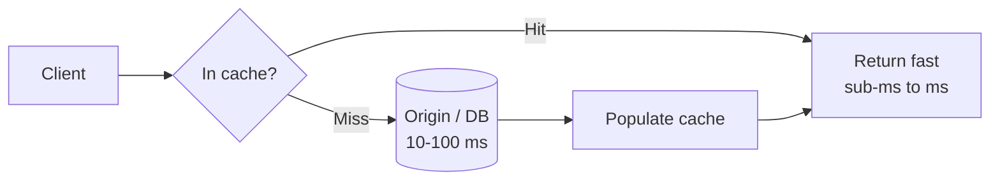

| Win | Cost / risk |
|-----|-------------|
| Lower read latency (p99 especially) | Stale data — weaker consistency |
| Higher read throughput | Added moving part — operational complexity |
| Reduced DB load and cost | Invalidation is hard |
| Smooths traffic spikes | Cold-start / warm-up problems |
| Cheaper than scaling primary DB reads | Cache failure can stampede the DB |

> **Staff-level insight:** Never frame a cache as "free performance." In an interview, state the contract explicitly: *"This cache gives me eventual consistency with a bounded staleness window of T seconds, and I'm accepting that to cut p99 read latency from 40 ms to 1 ms and reduce DB read QPS by ~90%."* The number AND the consistency cost together signal seniority. Also flag the failure mode early: a cache layer that the DB cannot survive losing is a latent outage, not an optimization.

---

## 2. Cache Layers & Types

A real request passes through *several* caches. Each layer that absorbs the request shields everything behind it. The art is pushing cache hits as far toward the client as the consistency requirements allow — the cheapest, fastest hit is the one closest to the user.

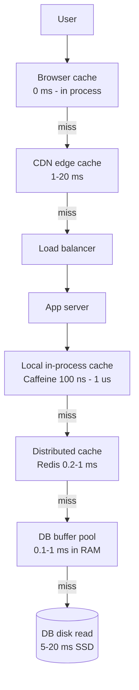

| Layer | Scope | Typical hit latency | Backing tech | Invalidation control |
|-------|-------|--------------------|--------------|----------------------|
| Browser | Single user | ~0 ms (local) | HTTP cache | Cache-Control / ETag |
| CDN / edge | All users near a POP | 1–20 ms | CloudFront, Fastly, Cloudflare | TTL, surrogate keys, purge API |
| In-process (L1) | Single app instance | 100 ns – 1 µs | Caffeine, Guava | Manual / TTL |
| Distributed (L2) | All app instances | 0.2 – 1 ms | Redis, Memcached | Explicit / TTL |
| DB buffer pool | DB cluster | 0.1 – 1 ms | InnoDB pool, PG shared_buffers | Automatic (engine) |
| DB disk | DB cluster | 5 – 20 ms (SSD) | — | — |

> **Staff-level insight:** Latency numbers cited above are the ones interviewers expect you to *roughly* know (Jeff Dean's "Numbers Every Engineer Should Know"). The strategic point: each layer should have a *clear ownership of a staleness budget*. If your CDN TTL is 60 s and your Redis TTL is 30 s, the effective worst-case staleness is the *sum* down the chain, not the min. Candidates who miss compounding staleness across layers get caught.

### 2.1 Browser Cache

**Definition.** The HTTP cache built into every browser (and intermediary proxies), governed by response headers. The fastest possible cache — zero network.

**How it works.** The server sends caching directives; the browser stores the response and on subsequent requests either serves it directly (fresh) or revalidates (stale).

- `Cache-Control: max-age=3600` — fresh for 3600 s, no network call.
- `Cache-Control: public` vs `private` — `private` forbids shared (CDN/proxy) caching; `public` allows it.
- `Cache-Control: no-cache` — store but **must revalidate** before use (not "don't cache").
- `Cache-Control: no-store` — never store (sensitive data).
- `Cache-Control: immutable` — never revalidate during freshness, even on reload. Used for content-hashed assets like `app.4f9a2.js`.
- `ETag` — opaque content fingerprint. Client sends `If-None-Match: <etag>`; server replies `304 Not Modified` (no body) if unchanged.
- `Last-Modified` / `If-Modified-Since` — coarser, timestamp-based revalidation.
- `Vary: Accept-Encoding` — cache key includes named request headers.

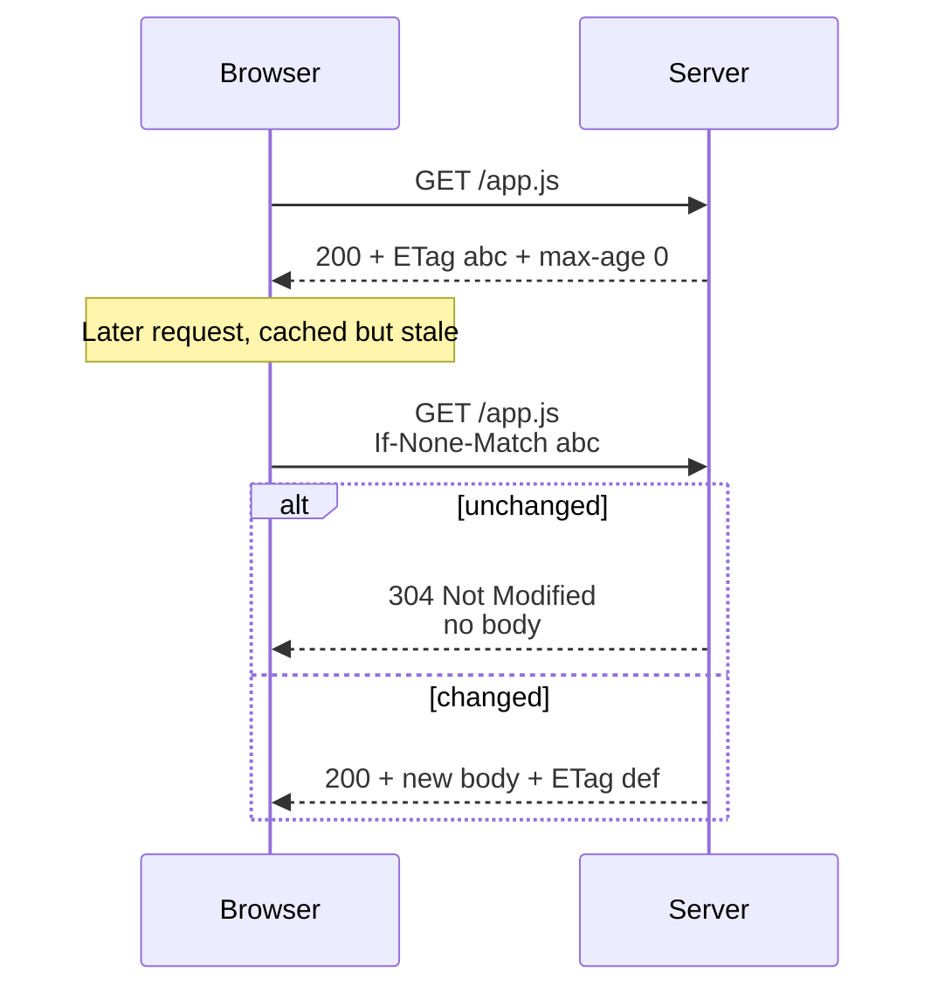

| Directive | Meaning | Use case |
|-----------|---------|----------|
| `max-age=N` | Fresh for N seconds | Static assets |
| `s-maxage=N` | Like max-age but for shared caches | CDN-specific TTL |
| `no-cache` | Store but revalidate every time | HTML that changes |
| `no-store` | Never store | Banking, PII |
| `immutable` | Skip revalidation while fresh | Hashed bundles |
| `stale-while-revalidate=N` | Serve stale up to N s while refreshing in bg | Smooth UX |

**Pitfalls.** Caching HTML with a long `max-age` strands users on old deploys. The fix is the **cache-busting pattern**: HTML is `no-cache`, but it references content-hashed asset URLs (`app.<hash>.js`) that are `immutable, max-age=31536000`. New deploy → new HTML → new hashes → guaranteed fresh assets, no purge needed.

> **Staff-level insight:** The hashed-asset + `no-cache` HTML pattern is the single most important browser-caching answer. It gives you "infinite cache for 99% of bytes, instant invalidation for the 1% pointer file." Mention it unprompted when asked about static-asset delivery.

### 2.2 CDN / Edge Cache

**Definition.** A geographically distributed network of edge servers (Points of Presence) that cache content close to users, cutting RTT and offloading the origin.

**How it works.** Two population models:

- **Pull (origin-pull):** edge fetches from origin on first miss, then caches per TTL. Lazy, simple, self-healing. Default for most CDNs.
- **Push:** you proactively upload/replicate content to edges (or a CDN ingest). Good for large files you *know* will be hot (video, game patches) and want warm before launch.

Key controls:

- **TTL** — `Cache-Control: s-maxage` or CDN config sets edge freshness.
- **Surrogate keys / cache tags** (Fastly `Surrogate-Key`, Cloudflare Cache-Tag): tag responses, then purge *by tag* — e.g. purge all pages tagged `product-123` on a single update. This is the killer feature for dynamic content at the edge.
- **Tiered caching / shield POPs** — a mid-tier edge in front of origin so only one POP misses to origin, not all of them (avalanche control).
- **Cache key normalization** — strip tracking query params so `?utm_source=x` variants share one cache entry.

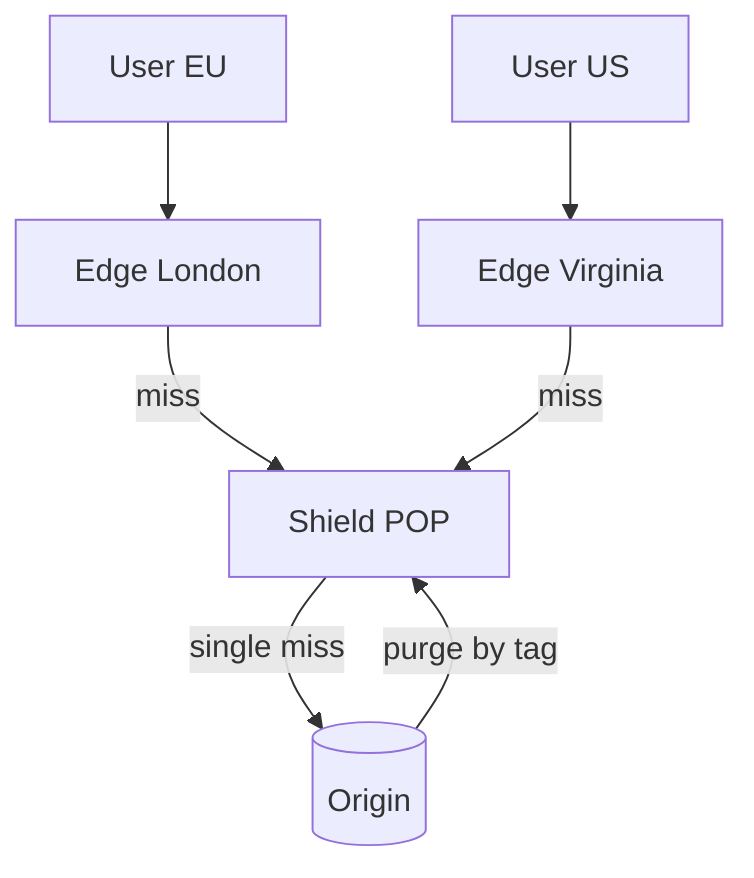

| Aspect | Pull CDN | Push CDN |
|--------|----------|----------|
| Population | On first miss | Proactive upload |
| Cold start | First user pays origin RTT | Pre-warmed |
| Best for | General web, dynamic-ish | Large static, predictable hot files |
| Ops effort | Low | Higher (manage distribution) |
| Storage cost | Pay for what's hit | Pay to store everywhere |

**Pitfalls.** Caching personalized or auth'd responses at a shared edge → user A sees user B's data (a classic, severe bug — happens when `Cache-Control: private` is missing or `Vary: Cookie` is misconfigured). Purge latency (seconds to minutes) means CDN is not for strong consistency. Cache key explosion from un-normalized query strings tanks hit ratio.

> **Staff-level insight:** Surrogate keys turn the CDN from a static-only cache into a viable cache for dynamic API responses, because you can do *event-driven, targeted invalidation* instead of relying on TTL. Saying "I'd tag product responses with a surrogate key and purge by tag on the product-updated event" demonstrates you understand edge caching of dynamic content — a Staff-level differentiator.

### 2.3 Application / In-Process Cache

**Definition.** A cache living **inside** the application process heap (L1). No network hop — just a memory read.

**How it works.** A concurrent map with eviction (size/TTL). **Caffeine** (Java) is the modern standard — it uses **W-TinyLFU** admission for near-optimal hit ratios; Guava Cache is its predecessor (LRU-based). In Go it's `ristretto`/`bigcache`; in Node, an LRU map.

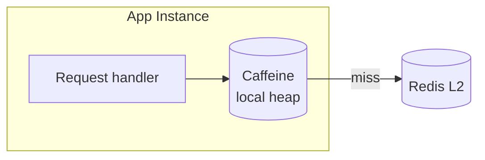

| Property | In-process (L1) | Distributed (L2) |
|----------|-----------------|------------------|
| Latency | 100 ns – 1 µs | 0.2 – 1 ms |
| Shared across instances | No | Yes |
| Consistency across nodes | Hard (each node differs) | Single source |
| Capacity | Bounded by heap | Scales out |
| Survives deploy/restart | No | Yes |
| GC pressure | Yes (on-heap) | No |

**Pitfalls.** **Per-node divergence** — 50 app instances each hold a slightly different version of a key; invalidation must fan out (pub/sub) or you accept TTL-bounded staleness. Large on-heap caches cause GC pauses (use off-heap or size carefully). Cold on every deploy.

> **Staff-level insight:** The most powerful real-world pattern is the **near-cache / two-tier** design: a small L1 (Caffeine, ~ms-short TTL) in front of a large L2 (Redis). The L1 absorbs **hot keys** locally (solving the celebrity problem — see §5.3) and shaves the Redis network hop off the hottest 1% of traffic, while the L2 keeps capacity and a shared source of truth. Propose L1+L2 explicitly; it signals you've run caches at scale, not just read about them.

### 2.4 Distributed Cache

**Definition.** A standalone cache cluster (Redis, Memcached) shared by all app instances — the canonical "the cache" (L2).

**How it works.** Keys are partitioned across nodes via **consistent hashing** (Memcached client-side; Redis Cluster via 16384 hash slots). App talks to it over the network. Provides a single, shared, consistent (within the cache) view that all instances see.

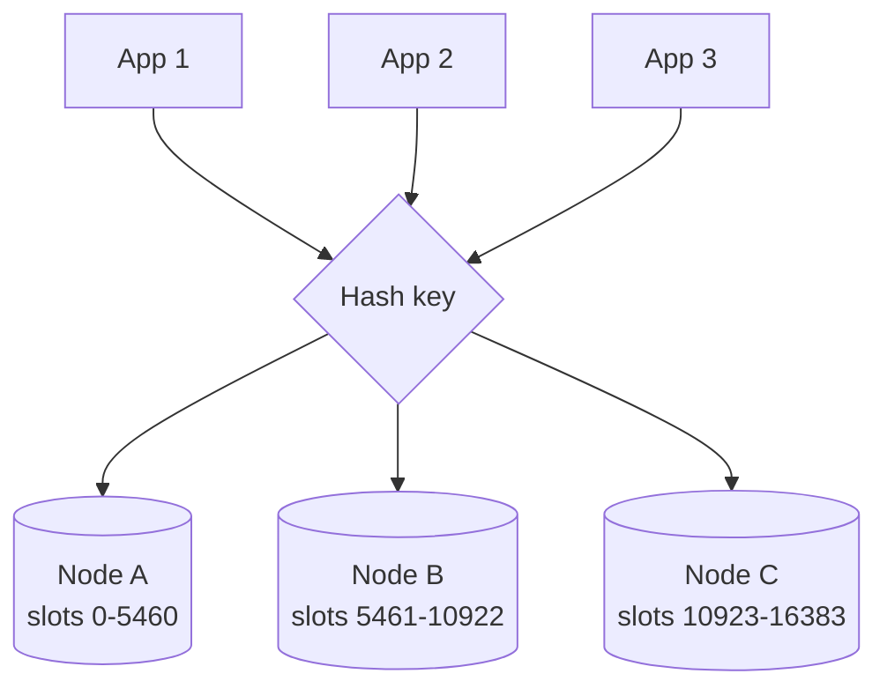

| Concern | How it's handled |
|---------|------------------|
| Partitioning | Consistent hashing / hash slots |
| Scaling | Add nodes, resharding moves slots |
| HA | Replicas + failover (Sentinel / Cluster) |
| Consistency | Single shared view, async replication lag |
| Network cost | Sub-ms within a datacenter/AZ |

**Pitfalls.** Cross-AZ latency if cache isn't AZ-local. Resharding moves keys and causes transient misses. A single hot slot becomes a hot *node* (see §5.3). The cache becomes a hard dependency — losing it can stampede the DB.

> **Staff-level insight:** Treat the distributed cache as a *capacity tier with a failure budget*, not as infallible. Always answer the question "what happens when Redis is down?" — your design must degrade (serve from DB with a concurrency limiter / circuit breaker, or serve stale from L1) rather than collapse. See [Distributed Systems](02-distributed-systems.md) for failover and consistent-hashing details, and [Load Balancing](05-load-balancing.md) for how clients route to nodes.

### 2.5 Database Cache

**Definition.** Caching that lives inside the database engine itself — the most-overlooked layer.

**How it works.**

- **Buffer pool / page cache** (InnoDB `buffer_pool`, PostgreSQL `shared_buffers` + OS page cache): caches data/index *pages* in RAM. A "DB read" that hits the buffer pool is a RAM read (~µs), not a disk read. Sizing the buffer pool to fit the working set is often the single biggest DB perf lever.
- **Query cache:** caches full result sets keyed by query text. MySQL's query cache was **removed in 8.0** because its coarse, whole-table invalidation made it a concurrency bottleneck — a cautionary tale about cache invalidation granularity.
- **Materialized views:** precomputed, *persisted* query results, refreshed on schedule or on commit. A cache that is also a queryable table. Great for expensive aggregations/joins.
- **Prepared-statement / plan cache:** caches query execution plans (not data).

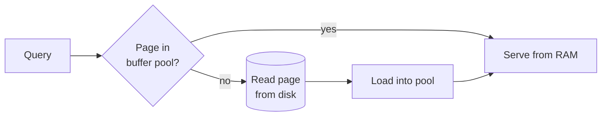

| DB cache | Stores | Invalidation | Notes |
|----------|--------|--------------|-------|
| Buffer pool | Data/index pages | LRU-ish, automatic | Size to working set |
| Query cache | Result sets | On any table write | Removed in MySQL 8.0 |
| Materialized view | Precomputed rows | Manual / scheduled / incremental | Can be stale by design |
| Plan cache | Execution plans | On stats change | Avoids re-planning |

**Pitfalls.** People bolt on Redis while the DB buffer pool is undersized and thrashing to disk — fix the cheap, automatic cache first. Materialized views can be stale and refreshing them can be expensive (full vs incremental/concurrent refresh). MySQL query cache shows how naive invalidation kills concurrency.

> **Staff-level insight:** Before adding an external cache, ask "is the DB's own buffer pool sized to hold the working set?" Often the highest-ROI, lowest-risk caching move is increasing `innodb_buffer_pool_size`. Bringing this up shows you reach for the simplest layer first — a hallmark of senior judgment. See [Databases](06-databases.md) for buffer-pool tuning and materialized-view refresh strategies.

---

## 3. Cache Patterns

The pattern defines **who reads/writes the cache and the DB, and in what order** — which determines your consistency guarantees and failure modes. Read patterns (how misses are filled) and write patterns (how writes propagate) are largely orthogonal and combine.

> **Decision — default to cache-aside + Redis, because it fails safe.** If the interviewer asks "which pattern" with no further constraint, lead with cache-aside: a cache outage degrades to a slow-but-correct DB read instead of an outage, and you cache only what's actually read. Then *segment by data class* and override the default where a requirement demands it (read-after-write → write-through; counters → write-back; write-heavy/read-light → write-around). Don't enumerate all six and stop — pick the default, then name the overrides and their triggers. The segmentation is the senior answer; see §3.7.

### 3.1 Cache-Aside (Lazy Loading)

**Definition.** The application is in charge. On read: check cache; on miss, load from DB and populate cache. On write: update DB and invalidate (or update) the cache. The cache is "aside" the data flow — it doesn't talk to the DB itself.

**How it works.**

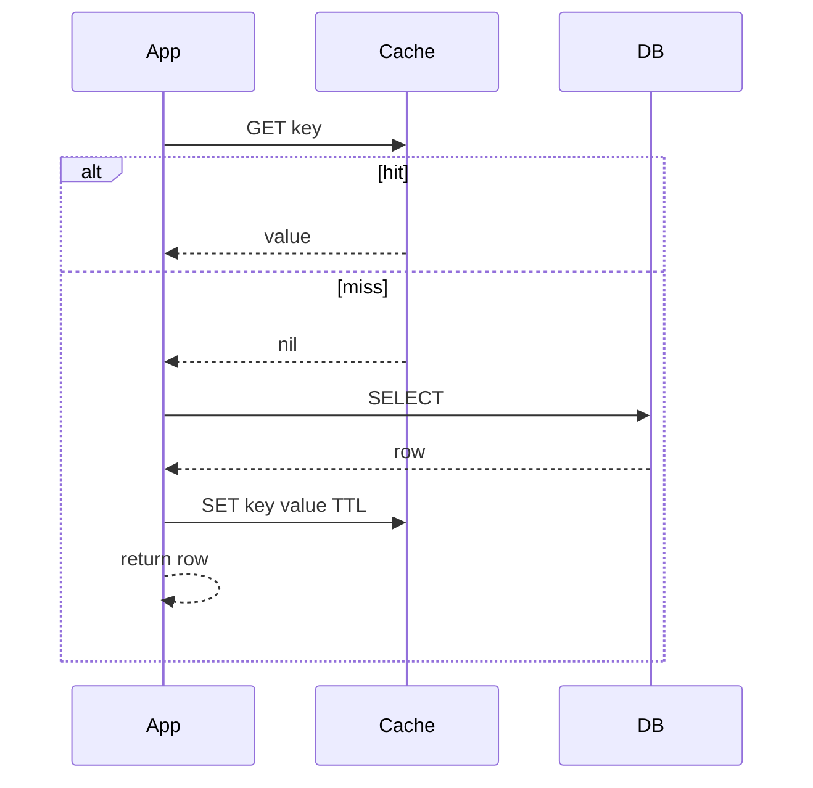

Pseudocode:

```text
read(key):
    v = cache.get(key)
    if v is not None:
        return v                 # hit
    v = db.query(key)            # miss
    if v is None:
        cache.set(key, NEGATIVE_SENTINEL, short_ttl)   # negative cache (see 5.4)
        return None
    cache.set(key, v, ttl + jitter)                     # jitter (see 5.5)
    return v

write(key, value):
    db.update(key, value)        # write DB first
    cache.delete(key)            # then invalidate (delete > update; see 5.6)
```

| Pros | Cons |
|------|------|
| Only requested data is cached (memory-efficient) | First read is always a miss (cold latency) |
| Cache failure ≠ outage (read DB directly) | App must manage consistency |
| Simple, ubiquitous | Race: read-miss + concurrent write → stale write-back |

**Pitfalls.** The stale-population race: thread A reads (miss), then a write updates DB and deletes the (absent) cache entry, then thread A's slow `SET` writes the *old* value back — now cache is stale until TTL. Mitigations: short TTL, versioned keys, or leases (§5.6). Also cold-start misses and stampede on popular keys (§5.2).

> **Staff-level insight:** Cache-aside is the default for a reason — it fails safe (cache down → degraded but working) and caches only what's used. The subtle bug interviewers probe is the **read-modify-write race**, which is *why* the canonical write step is **delete, not update** (a delete forces the next reader to reload fresh from the DB, shrinking the stale window). If you can draw that race, you're ahead of most candidates.

### 3.2 Read-Through

**Definition.** The cache itself knows how to load from the DB on a miss. The app only ever talks to the cache; the cache library/provider fetches from the backing store transparently.

**How it works.** App calls `cache.get(key)`; on miss, the cache's loader function queries the DB, stores, and returns. Caffeine's `LoadingCache` and many cache providers implement this.

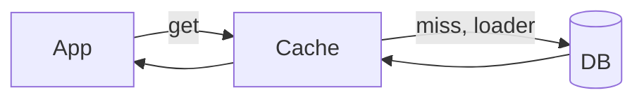

| Pros | Cons |
|------|------|
| App code is clean — no DB plumbing in read path | Cache is now a hard dependency |
| Loader centralizes logic, easy stampede control | Coupling: cache must know data model |
| Pairs with built-in single-flight | First read still a miss |

**Pitfalls.** Same cold-miss issue as cache-aside. Centralizing the loader is actually an advantage: it's the natural place to put **single-flight** dedup (§5.2). Downside: the cache provider must understand your schema, increasing coupling.

> **Staff-level insight:** Read-through vs cache-aside is mostly *where the load logic lives*, not a consistency difference. The real win of read-through is that a `LoadingCache` gives you **automatic request coalescing for free** — multiple concurrent misses for the same key trigger exactly one DB load. Frame it that way rather than as a different caching philosophy.

### 3.3 Write-Through

**Definition.** Every write goes to the cache *and* the DB synchronously before acknowledging the client. Cache and DB are updated together in the write path.

**How it works.** `write(k,v)` → cache.set(k,v) → db.write(k,v) → ack (or DB-first, then cache). Read path is then always a hit for written data.

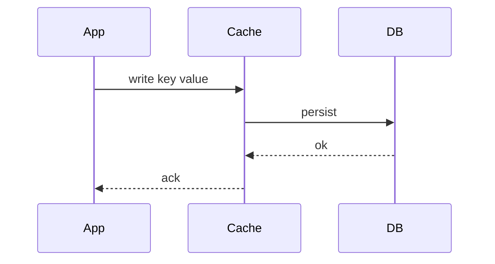

| Pros | Cons |
|------|------|
| Cache always fresh for written keys | Higher write latency (two hops) |
| Read-after-write consistency | Caches data that may never be read (waste) |
| Simple mental model | Atomicity: cache+DB write can partially fail |

**Pitfalls.** Two-system atomicity — if the DB write fails after the cache write (or vice versa), you have divergence; you need ordering + idempotency. Writes pay latency for data that may never be read (combine with write-around for write-heavy, read-rarely data).

> **Staff-level insight:** Write-through alone is rarely worth it because it pollutes the cache with write-only data. Its sweet spot is **write-through + read-through together** for read-after-write-heavy workloads (e.g., a user editing their own profile and immediately viewing it). Always pair it; standalone write-through is an anti-pattern for write-heavy keys.

### 3.4 Write-Back (Write-Behind)

**Definition.** Writes go to the cache and are acknowledged immediately; the cache asynchronously flushes to the DB later (batched/coalesced).

**How it works.** Write hits cache → ack → a background flusher persists to DB (often batching many writes, coalescing repeated writes to the same key).

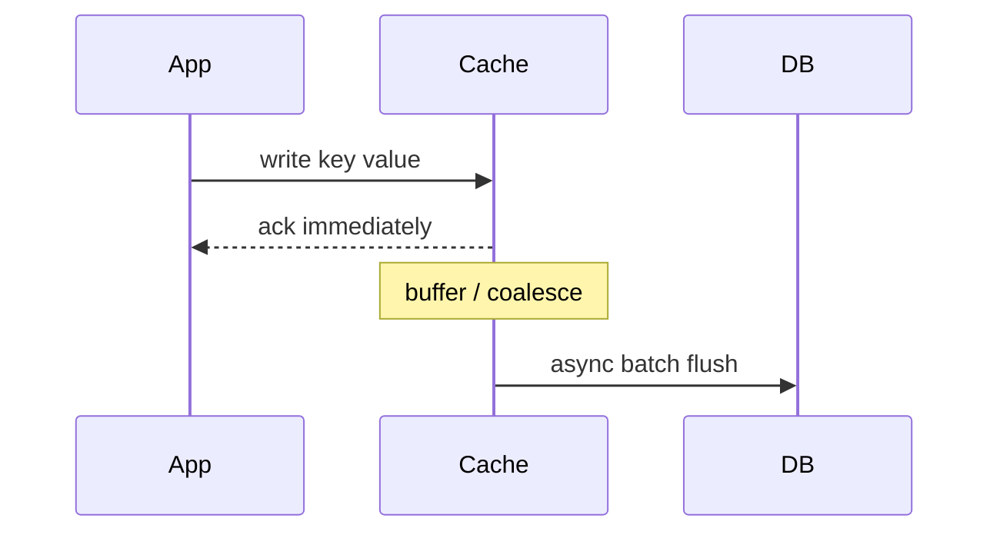

| Pros | Cons |
|------|------|
| Lowest write latency | **Data loss if cache dies before flush** |
| Absorbs write bursts, coalesces hot writes | Complex (durability, ordering, retries) |
| Fewer DB writes (batching) | DB temporarily stale / inconsistent |

**Pitfalls.** **Durability risk is the headline** — an un-flushed write vanishes if the cache node fails. Use only where loss is tolerable (view counts, metrics, like counts) or where the cache is itself durable (Redis AOF `appendfsync everysec`, or a durable log/queue as the buffer). Ordering across coalesced writes and crash recovery add real complexity.

> **Staff-level insight:** Write-back is how you handle **counter-heavy / high-write-volume** features (video views, impressions, rate counters) — buffer increments in Redis, flush aggregates to the DB every few seconds. The interview move is to *name the durability trade explicitly*: "I accept up to N seconds of potential counter loss on a cache crash, in exchange for handling 100k increments/sec the DB couldn't take." If loss is unacceptable, you don't use write-back — you use a durable WAL/Kafka in front. Knowing where the line is = Staff signal.

### 3.5 Write-Around

**Definition.** Writes go **only to the DB**, bypassing the cache. The cache is populated lazily on read (cache-aside read path).

**How it works.** `write(k,v)` → db only (optionally delete cache key to avoid stale). Reads fill the cache on demand.

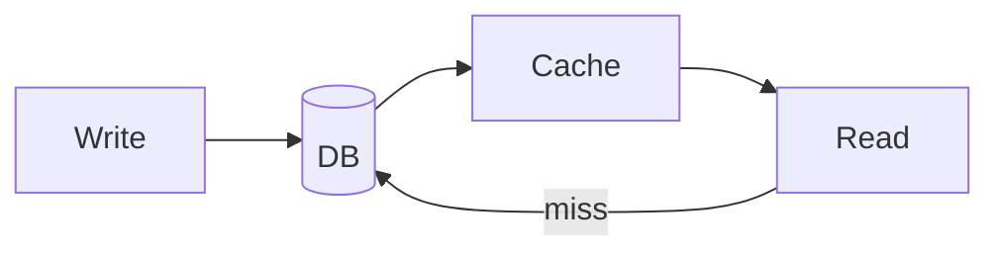

| Pros | Cons |
|------|------|
| Avoids caching write-once / rarely-read data | First read after write is a miss |
| Cache holds only actually-read data | Possible read-after-write staleness window |
| Good for write-heavy, read-light | Must still invalidate on write |

**Pitfalls.** Recently written keys are missing → if read soon after, a miss (and possibly a stale entry if you didn't invalidate). Best for logs, audit trails, and ingest workloads written far more than read.

> **Staff-level insight:** Write-around is the right default for **write-heavy data with poor read locality** — caching every write would just churn the cache and evict genuinely hot keys. The phrase "I'd use write-around so my cache isn't polluted by write-once data, protecting hit ratio for the actually-hot working set" shows you think about cache *pollution*, not just hits.

### 3.6 Refresh-Ahead

**Definition.** The cache proactively reloads "hot" entries *before* they expire, so popular keys never incur a user-facing miss.

**How it works.** When a hot key is read and it's within, say, the last X% of its TTL, the cache asynchronously refreshes it from the DB while still serving the current value. (Caffeine's `refreshAfterWrite`.)

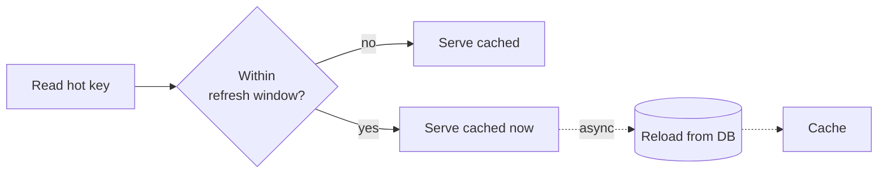

| Pros | Cons |
|------|------|
| Hot keys never miss → smooth p99 | Wasted refreshes for keys that won't be re-read |
| Hides DB latency from users | Predicts the future imperfectly |
| Reduces stampede risk on expiry | Extra background load |

**Pitfalls.** Refreshing keys that won't be read again wastes DB work. Prediction is heuristic. It only helps *hot* keys; cold keys still miss. It overlaps conceptually with stale-while-revalidate (§5.2).

> **Staff-level insight:** Refresh-ahead and **probabilistic early expiration** (§5.2) are two angles on the same idea: refresh *before* the wall of expiry to avoid a synchronized miss. Refresh-ahead is time-window-triggered; probabilistic recompute is randomized per request. For a small set of known-hot keys (homepage, trending), refresh-ahead is clean; for a large keyspace, probabilistic expiration scales better.

### 3.7 Pattern Comparison

| Pattern | Consistency | Read latency | Write latency | Complexity | Data-loss risk | Use when |
|---------|-------------|--------------|---------------|------------|----------------|----------|
| **Cache-aside** | Eventual (TTL/invalidate) | Miss = slow, hit = fast | Normal (DB + invalidate) | Low | None | Default; read-heavy, general purpose |
| **Read-through** | Eventual | Miss = slow, hit = fast | Normal | Medium | None | Want clean app code + coalescing |
| **Write-through** | Read-after-write strong | Fast (always hit) | High (cache + DB sync) | Medium | None | Read-after-write on same keys |
| **Write-back** | Weak / eventual | Fast | **Lowest** | High | **High** (un-flushed) | High write volume, loss-tolerant (counters) |
| **Write-around** | Eventual | Miss after write | Normal (DB only) | Low | None | Write-heavy, read-light; avoid pollution |
| **Refresh-ahead** | Eventual, fewer misses | Fast on hot keys | Normal | Medium | None | Small known-hot keyset, smooth p99 |

> **Staff-level insight:** Patterns compose. A mature design is often "**cache-aside reads (with read-through coalescing) + write-around for ingest + write-back for counters + refresh-ahead for the trending set**." When asked "which pattern," resist picking one globally — segment by data class (hot config, user-owned records, counters, write-once logs) and assign the right pattern to each. That segmentation *is* the senior answer.

---

## 4. Eviction Policies

**Definition.** When a cache hits its memory limit, the eviction policy decides which entry to remove. TTL (expiration) is orthogonal — it removes entries by *age* regardless of memory pressure; eviction kicks in under *capacity* pressure.

> **Decision — `allkeys-lru` for a pure Redis cache; W-TinyLFU (Caffeine) for an in-process cache; because the workload is skewed and scan-prone.** That's the whole answer for 90% of cases. Name LRU/LFU/FIFO to show you know the family, then land on the choice and *why* (everything must be evictable in a pure cache; admission filtering resists scan pollution in-process). Revisit toward `allkeys-lfu` if popularity is stable and long-lived (sessions, config), or `volatile-*` only if Redis doubles as a cache + a persistent store you must protect. Don't litigate the full table unless pushed.

**How it works (the main families).**

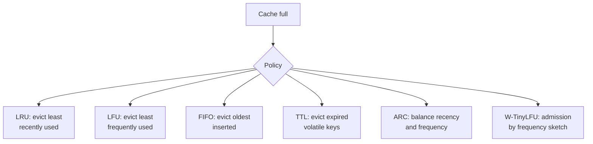

| Policy | Evicts | Strength | Weakness | When to use |
|--------|--------|----------|----------|-------------|
| **LRU** | Least recently used | Great for temporal locality | A scan/burst pollutes & evicts hot data | General default |
| **LFU** | Least frequently used | Keeps long-term-popular items | Slow to adapt; old hot stays "sticky" | Stable, skewed popularity |
| **FIFO** | Oldest inserted | Trivial, cheap | Ignores access pattern | Rarely ideal; simple buffers |
| **TTL** | Expired entries | Bounds staleness | Mass expiry → avalanche (§5.5) | Time-sensitive data + jitter |
| **ARC** | Adaptive recency+frequency | Self-tuning, scan-resistant | Patented heritage; complex | Storage/page caches (ZFS) |
| **W-TinyLFU** | Admission via freq sketch | Near-optimal hit ratio, scan-resistant, tiny metadata | More complex | Caffeine, modern in-process |

**Detail on the modern winners:**

- **ARC (Adaptive Replacement Cache):** maintains two LRU lists — recently-used-once (recency) and used-more-than-once (frequency) — plus "ghost" lists of recently evicted keys, and *adaptively* shifts the boundary based on which ghost list gets hits. Scan-resistant. Famous in ZFS.
- **W-TinyLFU (Window TinyLFU):** the algorithm behind **Caffeine**. A small **LRU window** admits new items; a **TinyLFU frequency sketch** (Count-Min Sketch with aging) decides whether a candidate is more valuable than the eviction victim before *admitting* it. This **admission policy** (not just eviction) prevents one-hit-wonders from polluting the cache. Delivers hit ratios close to the theoretical optimum (Belady's) with tiny memory overhead.

**How Redis `maxmemory-policy` works.** When Redis reaches `maxmemory`, it evicts per the configured policy:

| Policy | Behavior |
|--------|----------|
| `noeviction` | Reject writes with an error (reads still work) |
| `allkeys-lru` | Approx-LRU over **all** keys |
| `allkeys-lfu` | Approx-LFU over all keys (Redis 4.0+) |
| `allkeys-random` | Random key over all keys |
| `volatile-lru` | Approx-LRU over keys **with a TTL set** |
| `volatile-lfu` | Approx-LFU over keys with a TTL |
| `volatile-ttl` | Evict keys with nearest expiry first |
| `volatile-random` | Random among keys with a TTL |

Redis uses **approximate** LRU/LFU — it samples N keys (`maxmemory-samples`, default 5) and evicts the best among the sample, rather than maintaining a perfect global order, to save memory and CPU. LFU uses a logarithmic counter with time-based decay.

**Pitfalls.** `volatile-*` policies evict **only keys with a TTL** — if you store keys without TTLs and use `volatile-lru`, Redis can hit `maxmemory` with nothing evictable and start erroring writes. LRU is vulnerable to scan pollution (a batch job reading millions of keys once evicts your hot set). FIFO almost never matches access patterns.

> **Staff-level insight:** Two high-leverage points. (1) For a *cache* (not a mixed store), use `allkeys-lru` or `allkeys-lfu` so everything is evictable; reserve `volatile-*` for when Redis doubles as a cache + a persistent store and you must protect the persistent keys. (2) If you can choose the engine, **W-TinyLFU (Caffeine) beats LRU meaningfully on skewed workloads** because its admission filter resists scan pollution and one-hit-wonders — citing that, and ARC's scan-resistance, shows you know eviction beyond "use LRU."

---

## 5. Cache Challenges — The Interview Meat

This is where interviews are won. Each subsection is a named failure mode with concrete mitigations.

### 5.1 Cache Invalidation

> "There are only two hard things in Computer Science: cache invalidation and naming things." — Phil Karlton

**Definition.** Keeping cached data correct (or acceptably stale) as the source of truth changes. The hard part: *knowing* what to invalidate, *when*, across *all* cache layers and nodes, without races.

**How it works — the strategy menu:**

| Strategy | Mechanism | Pros | Cons |
|----------|-----------|------|------|
| **TTL / time-based** | Entry expires after T | Dead simple, self-healing, no write-path coupling | Stale for up to T; mass expiry risk (§5.5) |
| **Explicit invalidation** | Delete/update on write | Fresh fast | Must catch every write path; races; misses async writers |
| **Write-through** | Update cache on write | Always fresh for written keys | Two-system atomicity (§3.3) |
| **Versioned keys** | Key embeds a version, e.g. `user:42:v7` | No delete needed; old versions age out; atomic switch | Keyspace grows; need version source |
| **Event-driven** | Subscribe to change stream (CDC/Debezium, outbox) | Decoupled, catches all writers | Pipeline complexity, lag |

**Versioned (immutable) keys** are underrated: instead of mutating `user:42`, you write `user:42:v8` and bump a pointer `user:42:ver=8`. Readers fetch the version then the value. Updates are atomic (just bump the version), old entries simply expire — no delete race, no partial invalidation. Same idea as content-hashed asset URLs in the browser (§2.1).

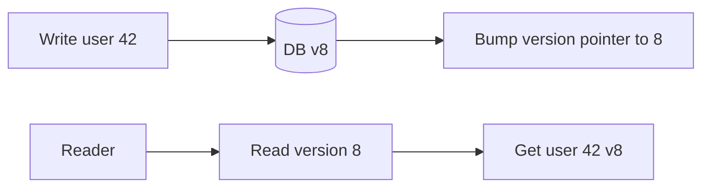

**Pitfalls.** Forgetting a write path (a batch job or another service mutating the DB directly) leaves stale cache forever under explicit invalidation — TTL is the safety net. Multi-layer invalidation must propagate (purge CDN + delete Redis + invalidate L1 via pub/sub). Across nodes, L1 caches need a fan-out signal.

> **Staff-level insight:** The robust real-world answer is **defense in depth: explicit invalidation for freshness + a (jittered) TTL as a backstop for the writes you inevitably miss + versioned keys for the data that mutates often**. Pure explicit invalidation is brittle (something always writes the DB out-of-band); pure TTL is stale. Saying "I never rely on explicit invalidation alone — I always keep a TTL backstop" is a sign you've been burned in production, which is exactly what they want to hear.

### 5.2 Cache Stampede / Thundering Herd / Dogpile

**Definition.** A popular key expires (or the cache restarts cold), and a flood of concurrent requests all miss simultaneously and hammer the DB to recompute the *same* value — potentially overwhelming the origin. Also called dogpile or thundering herd.

**The problem:**

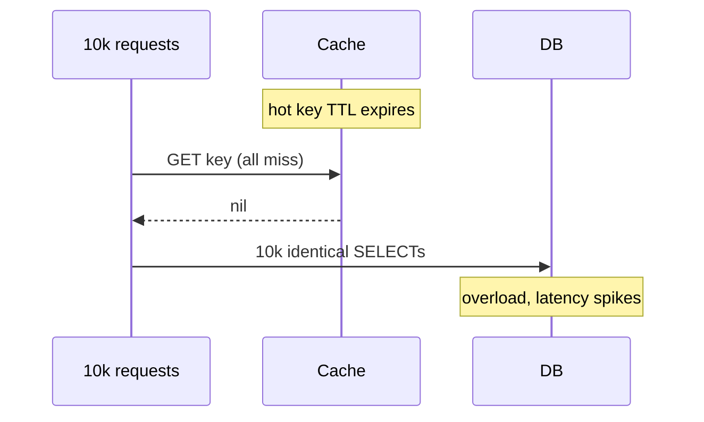

**Mitigations (combine them):**

1. **Locking / single-flight (mutex):** the first miss acquires a lock (e.g. `SET lock NX EX`), recomputes, and populates; others wait briefly or serve stale. Go's `singleflight`, or a per-key Redis lock. Reduces N DB calls to 1.
2. **Request coalescing:** in-process dedup so concurrent identical misses share one in-flight load (built into read-through `LoadingCache`). Same idea, in-process.
3. **Probabilistic early expiration (XFetch):** each reader, as TTL approaches, *probabilistically* decides to recompute early — so exactly one (statistically) refreshes before the hard expiry, and the herd never synchronizes. The recompute probability rises as expiry nears: recompute if `now - delta*beta*ln(rand()) >= expiry`.
4. **Stale-while-revalidate:** serve the *stale* value immediately and refresh asynchronously in the background. No user waits on the DB; only one refresh runs.

**Single-flight in detail (the workhorse).** The first miss takes a per-key lock; everyone else either blocks briefly on the same in-flight computation or serves stale. Two flavors:

- **In-process coalescing** (Go `golang.org/x/sync/singleflight`, Caffeine `AsyncLoadingCache`) dedups *within one node*. With N app nodes you still get up to N concurrent DB loads — usually fine, and free.
- **Cross-node distributed lock** (`SET lock:key token NX PX 5000`) dedups *across the whole fleet* down to exactly one DB load. You need it only when even N loads would hurt (a genuinely expensive recompute). The lock **must** carry a TTL/PX so a crashed holder can't wedge the key forever, and release must be a check-token-then-delete Lua script so you don't delete someone else's lock after your own expired.

```text
get_or_compute(key):
    v, soft_expiry = cache.get_with_meta(key)
    if v is present and now < soft_expiry:
        return v                                  # fresh, fast path
    if v is present:                              # stale-but-present
        if try_lock(key, ttl=5s):                 # one winner refreshes
            spawn: refresh_and_store(key)         # async, non-blocking
        return v                                  # serve stale, never block
    # hard miss, no stale value to serve (cold start)
    if try_lock(key, ttl=5s):
        v = db.load(key); cache.set(key, v, ttl+jitter); unlock(key)
        return v
    else:
        wait_or_retry_with_backoff()              # waiters don't stampede DB
```

The **soft TTL < hard TTL** trick is what makes stale-while-revalidate work: the *logical* freshness deadline (soft) fires first and triggers an async refresh while the value is still physically present (hard TTL not yet reached). If you only have one TTL, there's nothing stale to serve at expiry.

**Probabilistic early expiration — the math, worked.** From the "Optimal Probabilistic Cache Stampede Prevention" paper. Store, alongside the value, the time `delta` the last recompute *took* and the `expiry`. On each read, recompute eagerly if:

```
now − delta × beta × ln(random())   ≥   expiry        (random() in (0,1], beta ≥ 1, default 1)
```

Because `ln(random())` is negative, the left side is `now + (positive gap)`. As `now` approaches `expiry`, more and more readers cross the threshold, so the *probability of an early recompute rises smoothly toward 1* before the hard expiry — and it's keyed off how expensive the recompute was (`delta`), so costly keys refresh earlier with more margin. Net effect: a single reader (statistically) refreshes ahead of the wall, no lock or coordination needed, and the synchronized-expiry spike *never forms*. Tune `beta` up to refresh more aggressively (earlier) for very hot/expensive keys. This is the most elegant answer in the whole module — it converts a coordination problem into a per-request coin flip.

**The fix (single-flight + stale-while-revalidate):**

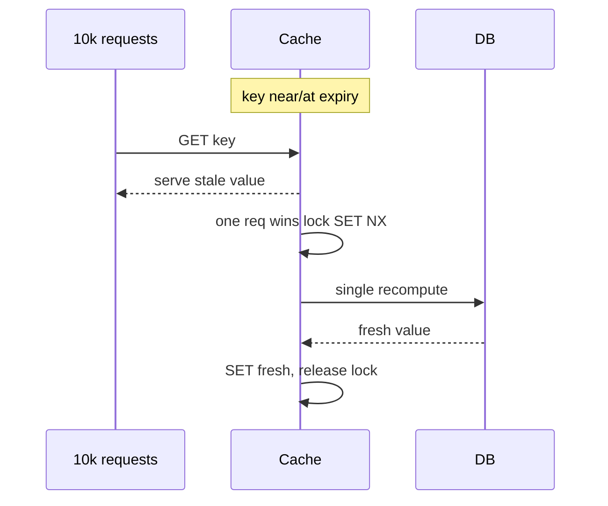

| Mitigation | Stops herd? | Adds latency? | Complexity | Note |
|------------|-------------|---------------|------------|------|
| Per-key lock / single-flight | Yes | Waiters block briefly | Medium | Watch lock deadlock/TTL |
| Request coalescing | Yes (in-process) | Minimal | Low (built-in) | Per node only |
| Probabilistic early expiry | Yes (avoids sync) | No | Low | Elegant, no coordination |
| Stale-while-revalidate | Yes | No (serves stale) | Medium | Needs a stale value to exist |

**Pitfalls.** Locking can deadlock or starve if the lock holder dies (set a lock TTL!). Stale-while-revalidate needs the stale copy to still exist (use a logical "soft TTL" < physical TTL). Cold-cache restart is the worst stampede — there is no stale value to serve, so plan cache warming.

> **Staff-level insight:** The most elegant answer that impresses interviewers is **probabilistic early recomputation** — it requires no locks, no coordination, and statistically guarantees a single early refresh, eliminating the synchronized expiry entirely. Pair it with **stale-while-revalidate** so no request ever blocks on the DB. And always mention the **cold-start** case (whole cache cluster restarts) — that's the stampede with no stale value to fall back on, requiring warm-up / gradual ramp / a concurrency limiter in front of the DB. Naming the cold-start variant separates strong candidates.

### 5.3 Hot Keys / Celebrity Problem

**Definition.** A single key gets a disproportionate share of traffic (a celebrity's profile, a viral tweet, a flash-sale SKU). Because that key hashes to **one** cache node, that node becomes a hotspot/bottleneck — adding more nodes doesn't help, because the load is concentrated on one slot.

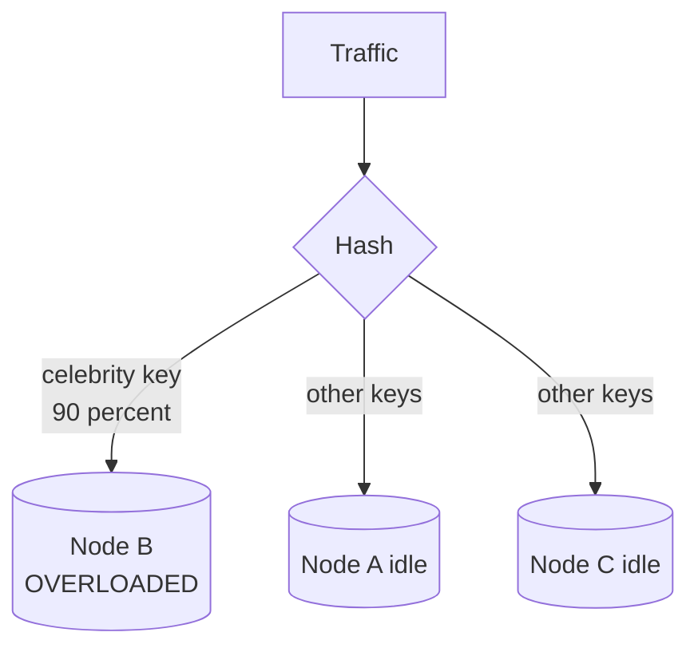

**Mitigations:**

1. **Local L1 cache tier:** cache the hot key in-process on every app server (Caffeine, short TTL). The hottest keys are served from local heap; the distributed node sees almost no traffic for them. **This is the single most effective fix** for read hot keys — and it auto-targets exactly the hot keys (they're the ones in every L1).
2. **Key replication / splitting:** store N copies under `celebrity:1 ... celebrity:N` spread across nodes; readers pick a random replica → load divides by N across nodes.
3. **Consistent hashing with replicas / read replicas:** replicate the hot node and load-balance reads across replicas.
4. **Detection:** Redis `--hotkeys` / LFU sampling, or client-side counters, to *find* hot keys before promoting them to a special tier.

| Mitigation | Best for | Cost |
|------------|----------|------|
| Local L1 per app node | Read hot keys (most common) | Slight staleness, per-node copies |
| Key replication (`key:1..N`) | Extreme read concentration | Write fan-out to N copies |
| Read replicas of node | General hot node | Infra cost |
| Hot-key detection | Knowing where to act | Monitoring effort |

**Pitfalls.** Replication multiplies write cost (must update all N copies, or accept inconsistency between them). Hot *write* keys (a single counter everyone increments) are harder — that needs sharded counters (write to `counter:shard:rand`, sum on read) or write-back aggregation (§3.4). L1 staleness must be acceptable.

> **Staff-level insight:** Distinguish **hot reads** from **hot writes** — interviewers love this. Hot reads → **L1 local cache tier** (it self-selects the hot keys and removes the network hop). Hot writes → **sharded counters** (split one logical counter into K physical keys to spread write load, sum on read). Stating both, and noting that "more cache nodes won't help a single hot key because it lives on one slot," demonstrates you understand the partitioning physics. See [Load Balancing](05-load-balancing.md) for replica routing.

### 5.4 Cache Penetration

**Definition.** Requests for keys that **don't exist** in the cache *or* the DB. Every such request misses the cache and hits the DB (which also returns nothing). An attacker (or buggy client) querying random non-existent IDs can bypass the cache entirely and overload the DB.

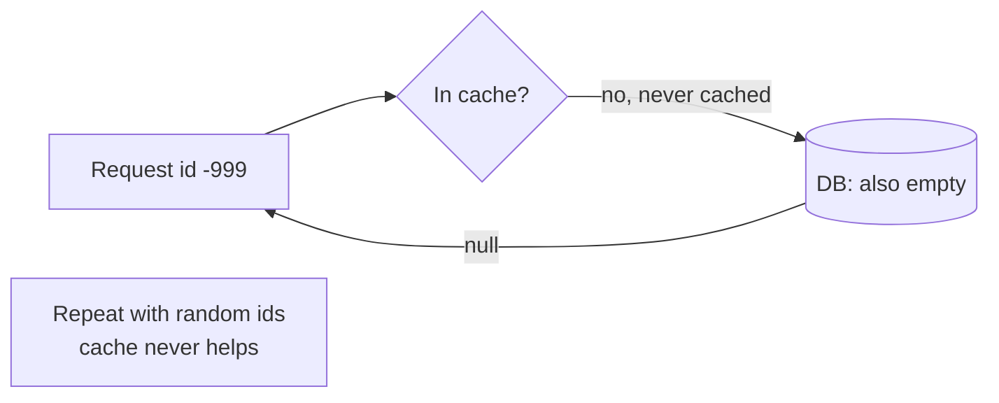

**Mitigations:**

1. **Negative caching:** cache the *absence* — store a sentinel (`NULL`/tombstone) with a **short** TTL so repeated lookups for the same missing key hit the cache, not the DB.
2. **Bloom filter (or cuckoo filter):** a probabilistic set of all *existing* keys in front of the cache. "Definitely not present" → short-circuit and return empty without touching cache or DB. No false negatives (never wrongly says "absent"), small false-positive rate (occasionally lets a non-existent key through — harmless).
3. **Input validation:** reject obviously invalid IDs (out of range, wrong format) before they reach the cache.

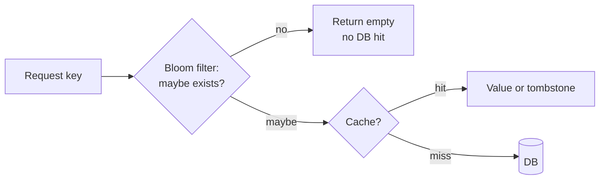

| Mitigation | Stops | Cost |
|------------|-------|------|
| Negative caching (short TTL) | Repeated same-missing-key | Memory for tombstones |
| Bloom filter | Random non-existent keys | Filter maintenance, false positives |
| Input validation | Malformed IDs | Cheap |

**Pitfalls.** Negative-cache TTL must be **short** — if a key is created shortly after a negative cache, you'd serve "not found" for the whole TTL (read-after-create staleness). Bloom filters must be kept in sync as keys are added (and standard bloom filters don't support deletion — use a cuckoo filter or rebuild). Tombstones for many distinct missing keys can themselves consume memory.

> **Staff-level insight:** Penetration is the **security-flavored** cache failure — it's the one an *attacker* exploits, so framing it as a DoS-mitigation concern earns points. The combo answer: **input validation first, bloom filter for large existence checks, short-TTL negative caching as the catch-all**. Note the read-after-create gotcha with negative caching to show you've thought past the happy path.

### 5.5 Cache Avalanche

**Definition.** A large number of cache entries expire at (nearly) the same time — or the whole cache layer fails — causing a sudden flood of misses that overwhelms the DB. Stampede is *one key*; avalanche is *mass simultaneous expiry* or total cache loss.

```mermaid
flowchart TD
    T[All keys set with<br/>same TTL at startup] --> E[All expire together]
    E --> M[Mass simultaneous miss]
    M --> DB[(DB overwhelmed)]
```

**Mitigations:**

1. **Jittered / randomized TTL:** `ttl = base + random(0, spread)` so expirations spread out instead of synchronizing. The cheapest, highest-value fix.
2. **Avoid synchronized population:** don't bulk-load the whole cache with identical TTLs (e.g., after a deploy/warm-up) — stagger.
3. **Multi-level cache (L1 + L2):** an L1 absorbs misses while L2 repopulates.
4. **High availability for the cache:** replicas + failover (Sentinel / Cluster) so a node loss isn't a total wipe; cross-AZ replicas.
5. **Circuit breaker / DB concurrency limiter:** cap concurrent DB queries during a miss storm so the DB degrades gracefully instead of collapsing.
6. **Cache warming:** pre-populate hot keys before taking traffic (and ramp traffic gradually after a cold start).

| Cause | Fix |
|-------|-----|
| Synchronized TTL expiry | **TTL jitter** |
| Bulk same-TTL load | Stagger population |
| Cache node/cluster down | Replicas, failover, circuit breaker |
| Cold restart | Warming + gradual ramp |

**Pitfalls.** Even with jitter, a *cluster-wide failure* wipes everything — you need a fallback (circuit breaker + DB rate limit, or serve degraded/static content). Warming a huge keyspace is expensive; warm only the hot set. Failover itself causes a brief miss spike.

> **Staff-level insight:** **TTL jitter is the one-line fix every interviewer wants to hear** — "I never set a fixed TTL; I add ±10-20% randomization so expirations don't synchronize." But the deeper answer addresses *total cache failure*: the DB must survive losing the cache. That means a **concurrency limiter / circuit breaker between app and DB** so a cache-down event caps DB load instead of melting it. Stampede ≈ one hot key (fix: single-flight/probabilistic); avalanche ≈ many keys at once (fix: jitter + DB protection). Drawing that distinction cleanly is a strong signal.

### 5.6 Cache ↔ DB Consistency

**Definition.** When both a cache and a DB hold the same data, concurrent reads and writes can interleave to leave the cache holding a *stale* value indefinitely. This is the deepest caching topic and the one that most cleanly separates Staff candidates.

**The core race — why "update the cache on write" is dangerous.** Two concurrent writers (or a reader + writer) can interleave so the cache ends up with the older value:

```mermaid
sequenceDiagram
    participant W1 as Writer A (value=1)
    participant W2 as Writer B (value=2)
    participant Cache
    participant DB
    W1->>DB: write 1
    W2->>DB: write 2
    W2->>Cache: set cache 2
    W1->>Cache: set cache 1
    Note over Cache,DB: DB has 2, cache has 1 (STALE forever)
```

**The "delete vs update" debate.**

- **Update the cache on write:** prone to the interleaving above; also computes/writes a value that may never be read.
- **Delete (invalidate) the cache on write:** the next reader reloads fresh from the DB. Far more robust — there's no stale value to leave behind, just a miss. **Consensus: prefer delete over update.**

**Write ordering — DB first or cache first?**

- **Cache-first then DB:** if the DB write fails after the cache delete, a concurrent reader can repopulate the cache from the *old* DB value → stale. Bad.
- **DB-first then delete cache (Cache-Aside standard):** write DB, then delete cache. Safer, but still has a *narrow* race: a reader that missed *before* the write can write its stale value back *after* the delete.

**The read-write race that survives DB-first-then-delete:**

```mermaid
sequenceDiagram
    participant R as Reader
    participant W as Writer
    participant Cache
    participant DB
    R->>Cache: GET (miss)
    R->>DB: read old value
    W->>DB: write new value
    W->>Cache: delete key
    R->>Cache: set OLD value
    Note over Cache: stale until TTL
```

This race is **rare** (requires a read-miss to straddle a write with the slow SET landing last), but real.

**Mitigations, in increasing strength:**

1. **TTL backstop:** bounds the staleness to T even if a race leaves a stale entry. Always have this.
2. **Double-delete (delayed delete):** delete the cache, do the DB write, then delete the cache *again* after a short delay (longer than a typical read). The second delete cleans up any stale value a straddling reader wrote back. Common in MySQL+Redis stacks.
3. **Delete-after-replication-lag:** in primary/replica DBs, a reader hitting a replica can read stale; delay the second delete past replication lag.
4. **Versioned keys:** writes bump a version; readers fetch by version → no stale value can win (the old version key is simply not read). Sidesteps the race entirely (§5.1).
5. **CDC / change-data-capture invalidation:** invalidate the cache from the DB's replication log (Debezium/binlog) so invalidation is driven by *committed* writes, catching every writer including out-of-band ones.
6. **Leases (the famous Facebook approach):** see below.

**The Facebook "leases" approach (from the "Scaling Memcache at Facebook" paper).** Facebook's memcache solves *both* stampede and the stale-set race with **leases**:

- On a cache miss, memcache hands the client a **lease token** (a 64-bit id) and only that client is permitted to set the value.
- **Stale-set prevention:** if the key is *invalidated* (deleted) before the client sets it, the lease is voided — so a slow reader's stale write-back is *rejected*. This kills the read-write race above.
- **Thundering-herd prevention:** memcache issues a lease at most once every few seconds per key; other concurrent missers are told to **wait and retry** (and can be served a slightly stale value) instead of all stampeding the DB.

```mermaid
sequenceDiagram
    participant C as Client
    participant MC as Memcache
    participant DB
    C->>MC: GET (miss)
    MC-->>C: miss + lease token L
    C->>DB: read value
    Note over MC: meanwhile a write invalidates key, voids L
    C->>MC: SET value with lease L
    MC-->>C: REJECTED (lease invalid)
    Note over MC: stale value not stored
```

**Double-delete on a timeline (so you can draw it).** The point of the *second*, delayed delete is to clean up a stale value that a straddling reader may write back *after* the first delete:

```text
t0   Writer: DELETE cache[k]                     (first delete)
t0   Reader (started earlier): db.read(k) → OLD  (its miss predates the write)
t1   Writer: db.write(k, NEW)
t2   Reader: cache.set(k, OLD)                    (stale write-back lands HERE)
t3   Writer: sleep(d), then DELETE cache[k]       (second delete cleans it up)
```

Pick the delay `d` longer than a typical slow read (and, with primary/replica DBs, longer than **replication lag**, because a reader hitting a lagging replica reads OLD even after the primary commit). Common values are a few hundred ms to a couple of seconds. The cost is two cache ops per write and a scheduled task; the benefit is closing the residual race without leases. It's the pragmatic mid-tier between "TTL only" and "full leases/CDC."

**CDC / outbox-driven invalidation (the scale answer).** Instead of trusting application code to invalidate on every write path, drive invalidation from the database's own committed-write log:

- **Binlog/WAL CDC (Debezium):** tail MySQL binlog / Postgres WAL, emit a change event per committed row, a consumer deletes the matching cache key(s). Because it reads the *replication log*, it catches **every** writer — including batch jobs and other services that mutate the DB directly and would silently bypass app-level invalidation. The price is an async pipeline (Kafka + connector) and added invalidation **lag** (tens of ms to seconds) you must fold into the staleness budget.
- **Transactional outbox:** the write transaction also inserts an "invalidate key K" row into an outbox table in the *same* commit; a relay publishes those rows. This makes invalidation atomic with the write (no dual-write gap) without parsing the binlog.

```mermaid
flowchart LR
    APP[Writer commits] --> DB[(DB)]
    DB --> LOG[Binlog / WAL]
    LOG --> CDC[Debezium connector]
    CDC --> K[Kafka topic]
    K --> CON[Invalidator consumer]
    CON --> DEL[DELETE cache key]
```

| Approach | Stops stampede? | Stops stale-set race? | Catches out-of-band writers? | Complexity |
|----------|-----------------|----------------------|------------------------------|------------|
| TTL only | No | Bounds it | Yes (eventually, via expiry) | Trivial |
| Delete-on-write + TTL | No | Mostly (narrow race) | No (app-path only) | Low |
| Double-delete | No | Yes (delayed cleanup) | No (app-path only) | Medium |
| Versioned keys | N/A | Yes (no stale wins) | No (writer must bump version) | Medium |
| CDC / outbox invalidation | No | Catches all writers | **Yes** | High |
| **Leases (FB)** | **Yes** | **Yes** | No (set-path guard only) | High |

> **Decision — DB-first, delete-not-update, with a jittered TTL backstop, because that's correct at almost every scale and adds zero infrastructure.** Add **double-delete or versioned keys** *only* if the narrow read-write race is shown to bite (measure stale-read incidents first). Add **CDC/outbox** *only* when a second writer touches the DB out-of-band (the trigger), and **leases** *only* at Facebook-scale read concentration where you need stale-set prevention *and* stampede control in one mechanism. Earmark this as the risk crux out loud, and **state the contract** — "eventual, bounded by TTL T, sub-second race window" — never "consistent." YAGNI applies hard here: most candidates over-engineer to CDC/leases when DB-first-then-delete-plus-TTL is the right-sized answer.

**Pitfalls.** Many stacks naively "update cache on write" and ship the interleaving bug. Cross-region adds replication lag to the staleness budget. Distributed locks for consistency (e.g., Redlock) have correctness caveats under clock skew/pauses (§6) — don't lean on them for *correctness*-critical invalidation. "Cache + DB" is inherently a two-system consistency problem; you choose a bounded-staleness contract, not perfect consistency.

> **Staff-level insight:** This is the topic to over-prepare. The chain to recite: **(1) delete, don't update** (no stale value left behind); **(2) DB-first, then delete** (avoid repopulation from old DB state); **(3) keep a TTL backstop** (bounds the residual race); **(4) for the narrow read-write race, use double-delete or versioned keys**; **(5) at extreme scale, leases** (Facebook's answer — solves stale-set *and* stampede together) **or CDC-driven invalidation** (catches every writer). Critically, **state the consistency contract you're offering** ("eventual, bounded by TTL of T seconds, with a sub-second race window under concurrent write") rather than claiming "consistent." Candidates who claim a cache is strongly consistent with the DB lose credibility instantly.

---

## 6. Technologies — Redis vs Memcached

The two dominant in-memory caches. Memcached is the minimalist multithreaded key-value cache; Redis is a rich data-structure server that is single-threaded for *command execution* (with optional I/O threads for network read/write since v6). **2026 landscape note:** after Redis relicensed away from BSD to a dual RSALv2/SSPLv1 source-available model (2024), the Linux Foundation forked the last open-source release as **Valkey** (BSD, 2024), now backed by AWS, Google, and others; Valkey is the drop-in OSS continuation of the Redis API, so "Redis" below refers to the engine/protocol family that Valkey also implements.

> **Decision — Redis, because you almost always end up needing a data structure, persistence, or HA, and one engine is less to operate.** Lead with that, then concede Memcached's one genuine edge (pure multithreaded simple-KV throughput on big boxes with zero ops surface) so you don't sound dogmatic. Revisit toward Memcached only for a *pure ephemeral string cache* at extreme throughput where you'll truly never want structures/persistence/replication. Don't recite the whole comparison table aloud — land the choice, name the one Memcached edge, and raise the two Redis caveats (O(N) commands block the single-threaded core; Redlock isn't safe for correctness) unprompted, because *those* are the staff-level signals.

```mermaid
flowchart TD
    subgraph Redis
      RT[Single-threaded core<br/>I/O threads optional] --> DS[Rich data structures]
      RT --> PERS[Persistence RDB AOF]
      RT --> REPL[Replication and Cluster]
    end
    subgraph Memcached
      MT[Multithreaded] --> SLAB[Slab allocator]
      MT --> KV[Plain key-value strings]
    end
```

**Redis deep-dive (the parts interviewers probe):**

- **Data structures:** strings, hashes, lists, sets, sorted sets (ZSET — leaderboards/rate-limiting), bitmaps, HyperLogLog (cardinality estimation), geospatial, **Streams** (append-only log with consumer groups — a lightweight Kafka-lite). The data structures are *the* reason to choose Redis.
- **Persistence:** **RDB** = point-in-time binary snapshots (compact, fast restart, but can lose data since the last snapshot); **AOF** = append-only log of every write (`appendfsync` = `always`/`everysec`/`no`; `everysec` is the common durability/perf balance, ≤1 s loss). Can run both. This is what lets Redis be a durable store *and* a cache.
- **Replication:** async primary→replica; replicas serve reads. Async means a failover can lose un-replicated writes (don't treat Redis as a strongly-consistent store of record).
- **Redis Cluster:** data sharded across **16384 hash slots**; each node owns a slot range; clients are redirected (`MOVED`/`ASK`) to the right node; resharding migrates slots. `{}` **hash tags** force related keys into the same slot for multi-key ops/transactions.
- **Sentinel:** HA *without* clustering — monitors a primary, runs leader election, promotes a replica on failure, updates clients. (Cluster has its own failover; Sentinel is for non-clustered HA.)
- **Lua scripting & functions:** run server-side scripts **atomically** (single-threaded core → no interleaving) for read-modify-write logic, atomic rate limiters, conditional sets.
- **Pipelining:** batch many commands in one round trip → massive throughput gain by amortizing network RTT.
- **Pub/Sub & Streams:** fire-and-forget messaging (pub/sub) vs durable, replayable log with consumer groups (Streams).
- **Redlock caveat:** the multi-node distributed-lock algorithm is **controversial** (Kleppmann's critique): under GC pauses, clock skew, or network delays it can grant a lock to two clients. **Do not use Redlock for correctness-critical mutual exclusion** — only as a best-effort efficiency lock (e.g., to dedup work). For correctness, use a fencing-token-backed mechanism. (See [Distributed Systems](02-distributed-systems.md) on locks and fencing tokens.)

**Memcached deep-dive:**

- **Multithreaded:** scales across CPU cores natively on a single node — can beat single-core Redis on raw throughput for simple GET/SET on big boxes.
- **Slab allocator:** memory pre-divided into fixed-size **slab classes** to eliminate fragmentation; downside is **slab calcification** (memory assigned to one size class can't easily serve another) and per-class waste.
- **Simplicity:** plain string key→value, LRU eviction, no persistence, no replication, no data structures. Less to break, less to tune, predictable.

| Dimension | Redis | Memcached |
|-----------|-------|-----------|
| Threading | Single-threaded core (+ optional I/O threads) | Multithreaded |
| Data types | Rich (lists, sets, ZSET, streams, HLL...) | Strings only |
| Persistence | RDB + AOF (optional) | None |
| Replication / HA | Replicas, Sentinel, Cluster | None native (client-side sharding) |
| Clustering | Built-in (16384 slots) | Client-side consistent hashing |
| Eviction | Many `maxmemory-policy` options | LRU only |
| Atomic ops / scripting | Lua, transactions, atomic commands | CAS, limited |
| Pub/Sub, Streams, queues | Yes | No |
| Memory efficiency | Good; some overhead | Slab allocator, efficient for uniform sizes |
| Raw throughput (simple KV) | Very high | Very high (multicore edge on big nodes) |
| Operational simplicity | More features = more to manage | Minimal, predictable |

**When to use which:**

- **Redis** — when you need data structures (leaderboards, rate limiters, queues, sets), persistence, replication/HA, pub/sub, atomic server-side logic, or a cache that's also a lightweight datastore. **Default choice today** for most systems.
- **Memcached** — when you want a *pure, simple, multithreaded* look-aside cache for ephemeral string blobs at very high throughput, with minimal ops surface, and you don't need persistence/replication/structures (e.g., classic session/object cache, Facebook-style memcache tier).

> **Staff-level insight:** Two points score well. (1) Redis's single-threaded core is a *feature for correctness*: commands and Lua scripts execute atomically with no locks — but it also means **one expensive command (`KEYS *`, a big `SORT`) blocks the whole server**, so you must avoid O(N) commands on the hot path (use `SCAN`, not `KEYS`). (2) Proactively raise the **Redlock caveat** — saying "I'd use Redis for caching and best-effort locks, but for correctness-critical mutual exclusion I'd use fencing tokens, because Redlock isn't safe under pauses and clock skew" is exactly the nuance that flags a Staff-level understanding of distributed systems, not just caching.

---

## 7. Sizing a Cache

**Definition.** Choosing cache memory and topology from the **working set** (distinct hot data accessed in a window), the target **hit ratio**, and item size — then validating against cost.

**How it works — the reasoning chain:**

1. **Estimate the working set.** Distinct items accessed in your hot window × average item size. Exploit the **80/20 (Pareto)** rule: ~20% of keys serve ~80% of requests, so you often cache far less than the full dataset and still get a high hit ratio.
2. **Pick a target hit ratio** and find the cache size on the hit-ratio curve (hit ratio rises with size but with diminishing returns — the last few percent cost disproportionate memory).
3. **Add overhead** — data-structure/metadata overhead (Redis ~tens of bytes/key), replication factor, and headroom (don't run at 100% of `maxmemory`; leave ~25% for fragmentation/bursts/COW during RDB save).
4. **Cost it** — compare cache RAM cost vs the DB capacity it offloads.

**Hit-ratio & DB-load math (memorize this).** Effective backend (DB) load:

```
DB_QPS = total_QPS × (1 − hit_ratio)
DB_load_reduction = hit_ratio
```

**Worked example.** A read endpoint serves **100,000 QPS** with a **95% cache hit rate**:

- Cache absorbs: 100,000 × 0.95 = **95,000 QPS**.
- DB sees: 100,000 × (1 − 0.95) = **5,000 QPS** → a **20× reduction** in DB read load.
- Improve the hit rate from 95% → 99%: DB QPS drops from 5,000 → **1,000** — a **5× further** DB reduction from a *4-point* hit-rate gain. This is the crucial intuition: **near the top of the curve, small hit-ratio gains yield large backend savings** (because backend load ∝ *miss* rate, and going 95%→99% cuts the miss rate from 5% to 1%, i.e. 5×).

**Average latency with a cache:**

```
avg_latency = hit_ratio × cache_latency + (1 − hit_ratio) × miss_latency
```
At 95% hit, cache 1 ms, miss 40 ms: `0.95×1 + 0.05×40 = 0.95 + 2.0 = 2.95 ms` avg — vs 40 ms uncached.

**Memory sizing example.** 50M hot items × 2 KB each = 100 GB working set. With Redis per-key overhead and a replica, budget ~100 GB × ~1.3 (overhead) × 2 (replica) ≈ **260 GB**, then keep ~25% headroom → provision ~**320 GB** across the cluster (so shard across several nodes, e.g. 5–6 × 64 GB).

**Per-key overhead — why the ×1.3 isn't optional.** A Redis string entry is not just your bytes. There's the `robj` header, the SDS string overhead, the dict (hash-table) entry and bucket, and key-name bytes — on the order of **~50–90 bytes per key** before your value. For small values this dominates: caching 100M tiny 20-byte presence flags is *mostly metadata*, not data. Two consequences you should state: (1) for many small fields under one logical entity, a Redis **hash** (`HSET`) is far more memory-efficient than N separate string keys, because it amortizes the per-key overhead — and small hashes use a compact `listpack` encoding; (2) for huge keyspaces of tiny values, the overhead multiplier is closer to ×2–3, not ×1.3 — measure with `MEMORY USAGE key` and `INFO memory` rather than guessing.

**Worked example — real-time chat.** Suppose 5M concurrent users, and you cache: presence (1 small field/user), the conversation list (≈40 conversation IDs + unread counts per user, ~4 KB), and hot channel metadata (200k active channels × ~1 KB).

- *Presence:* 5M × ~80 B (mostly overhead) ≈ 0.4 GB — store as hashes/bitmaps, not 5M string keys, or it balloons. Pattern: **write-back** (presence flaps; flush aggregates; bounded loss acceptable).
- *Conversation lists:* 5M × 4 KB ≈ 20 GB working set. Pattern: **cache-aside**, invalidate the owner's list key on a new message. Hot read.
- *Channel metadata:* 200k × 1 KB ≈ 0.2 GB, but a viral channel is a **hot key** → short-TTL L1 tier (§5.3).
- Apply overhead ×1.3 and a replica ×2 → ~(20.6 GB × 1.3 × 2) ≈ 54 GB, +25% headroom ≈ **~68 GB provisioned**, sharded across 2–3 nodes with room to grow.

The deliverable in the room isn't the exact GB — it's the *reasoning chain* and the per-class pattern assignment. State the working set, the overhead and replica multipliers, the headroom, and which pattern each data class gets.

```mermaid
flowchart TD
    A[Total QPS] --> B[× miss rate = DB QPS]
    C[Working set bytes] --> D[× overhead × replicas]
    D --> E[+ 25 percent headroom]
    E --> F[Provisioned cache RAM]
    B --> G[Size DB for misses + writes]
```

| Input | Symbol | How to get it |
|-------|--------|---------------|
| Total read QPS | Q | Traffic estimate |
| Hit ratio | h | Measured / target from curve |
| DB QPS after cache | Q×(1−h) | Drives DB sizing |
| Working set | W | Distinct hot items × item size |
| Provisioned RAM | W × overhead × replicas × headroom | Cluster size |

**Pitfalls.** Chasing 99.9% hit ratio is usually not worth the RAM (diminishing returns — the long tail of cold keys is huge). Forgetting metadata/overhead and replica copies under-provisions by 2–3×. Forgetting COW headroom during RDB snapshot can OOM a node. Sizing for *average* QPS ignores spikes — size for peak + a margin. The DB must still be sized to survive a **0% hit ratio** (cache-down) scenario at safe-degraded levels.

> **Staff-level insight:** The number that wins the sizing question is recognizing that **backend load is proportional to the *miss* rate, not the hit rate** — so the meaningful metric to optimize is "1 − hit ratio," and improvements compound near the top (95%→99% is a 5× DB win, far bigger than 80%→84%). Then close the loop on *resilience*: "I size the cache for the working set with headroom, but I also size the DB to survive a full cache failure at a degraded-but-alive level, with a concurrency limiter so a cold cache can't take the DB down." Sizing for the *failure* case, not just the happy path, is the senior move.

---

## Interview Cheat-Sheet

**Layers (push hits toward the user):** Browser (0 ms) → CDN edge (1–20 ms) → L1 in-process Caffeine (µs) → L2 distributed Redis (sub-ms) → DB buffer pool (µs in RAM) → disk (5–20 ms SSD). Staleness *compounds* down the chain.

**Browser:** `no-cache` HTML + content-hashed `immutable` assets = infinite cache + instant invalidation. `no-cache` ≠ no-store. ETag → 304.

**CDN:** pull (lazy) vs push (pre-warm); **surrogate keys** enable targeted purge of dynamic content; shield POPs prevent origin avalanche; never edge-cache personalized responses without `private`/`Vary`.

**Patterns:** Cache-aside = default (fails safe). Read-through = clean code + coalescing. Write-through = read-after-write (pair with read-through). Write-back = lowest write latency, **data-loss risk** (counters). Write-around = write-heavy, avoid pollution. Refresh-ahead = smooth p99 on hot keys. **Segment data by class and assign patterns.**

**Eviction:** LRU default; LFU for stable skew; **W-TinyLFU (Caffeine)** beats LRU on skewed/scan workloads via admission filter; ARC scan-resistant. Redis: `allkeys-lru/lfu` for pure cache; `volatile-*` only protects no-TTL keys. Approximate LRU/LFU via sampling.

**Write consistency chain:** **delete don't update → DB-first then delete → TTL backstop → double-delete or versioned keys for the race → leases / CDC at scale.** State the bounded-staleness contract; never claim "strongly consistent with DB."

**Stampede:** single-flight/lock + **probabilistic early expiration** + **stale-while-revalidate**. Cold-start is the worst (no stale value) → warm + ramp.

**Hot keys:** hot *reads* → L1 local tier (self-selects hot keys); hot *writes* → sharded counters. More nodes don't fix one hot slot.

**Penetration:** negative caching (short TTL) + bloom filter + input validation.

**Avalanche:** **TTL jitter** + DB concurrency limiter/circuit breaker + cache HA + warming.

**Redis vs Memcached:** Redis = data structures, persistence, HA, scripting (default). Memcached = simple, multithreaded, pure cache. Avoid O(N) Redis commands (`KEYS`); single-threaded core blocks. **Redlock not safe for correctness** — use fencing tokens.

**Sizing:** `DB_QPS = QPS × (1 − hit)`. Backend load ∝ **miss rate**; 95%→99% = 5× DB reduction. Provision `working_set × overhead × replicas × headroom`. Size DB to survive cache-down.

---

## Common Interview Questions

**Q1. "Why is `delete` preferred over `update` when invalidating cache on a write?"**
Updating the cache directly is vulnerable to a write-write interleaving where a slow writer's `SET` lands *after* a newer writer's, leaving the cache stale indefinitely; it also caches values that may never be read. Deleting leaves no stale value behind — the next read simply reloads fresh from the DB. The canonical order is **DB-first, then delete cache**: writing the DB first prevents a concurrent reader from repopulating the cache from an old DB state. A narrow read-miss-straddling-a-write race remains, handled with a TTL backstop plus double-delete or versioned keys.

**Q2. "Walk me through cache stampede and how you'd prevent it."**
A hot key expires (or the cache restarts cold) and thousands of concurrent requests all miss and hit the DB with the same query, overloading it. Prevention, layered: **single-flight / per-key lock** (one recompute, others wait — with a lock TTL to avoid deadlock), **request coalescing** (built into read-through caches), **probabilistic early expiration** (each reader randomly recomputes as TTL nears, so one refreshes early and the herd never synchronizes — no locks needed), and **stale-while-revalidate** (serve the stale value, refresh async, so no request blocks). The worst case is **cold-start** with no stale value to serve — that needs cache warming, gradual traffic ramp, and a DB concurrency limiter.

**Q3. "Stampede vs avalanche — what's the difference and the fixes?"**
**Stampede** is concentrated on *one* (hot) key expiring → fix with single-flight / probabilistic expiry / stale-while-revalidate. **Avalanche** is *mass simultaneous* expiry (or total cache failure) → fix with **TTL jitter** (so expirations spread), staggered population, cache HA/replicas, and a **DB circuit breaker / concurrency limiter** so the DB survives losing the cache. Both ultimately require the database to degrade gracefully, not collapse, when the cache can't shield it.

**Q4. "A celebrity's profile gets 90% of reads to one key — how do you handle it?"**
That key hashes to a single node, so adding cache nodes doesn't help — the load is on one slot. For hot **reads**, add an **L1 in-process cache** (Caffeine) on every app server with a short TTL: the hottest keys serve from local heap and the distributed node barely sees them, and L1 auto-selects exactly the hot keys. Alternatively, **replicate the key** as `celebrity:1..N` across nodes and read a random replica. For hot **writes** (a single shared counter), use **sharded counters** — write to `counter:shard:{rand}` and sum on read — or write-back aggregation. Distinguishing hot reads from hot writes is the key insight.

**Q5. "How do you keep cache and DB consistent? Can you make them strongly consistent?"**
You generally *can't* make two systems strongly consistent cheaply — you offer **bounded eventual consistency** and state the contract: stale up to TTL T, with a sub-second race window under concurrent writes. The robust scheme: delete (not update) the cache, DB-first then delete, with a jittered TTL backstop. For the residual read-write race, use **double-delete** (delete again after a short delay to clean up a stale write-back) or **versioned keys** (writes bump a version; old version is never read). At extreme scale, **CDC-driven invalidation** (invalidate from the DB binlog so every writer is caught, including out-of-band jobs) or **Facebook-style leases** (the lease is voided on invalidation, so a slow reader's stale `SET` is rejected — solving stale-set *and* stampede together).

**Q6. "Redis or Memcached for a session/object cache, and why?"**
If it's a *pure, ephemeral* string cache needing maximum simple-KV throughput with minimal ops, **Memcached** (multithreaded, slab allocator, dead simple) is defensible. But **Redis is the modern default**: you almost always eventually want data structures (rate limiters via ZSET, queues, sets), persistence (AOF `everysec` for ≤1 s loss), replication/HA (Sentinel/Cluster), or atomic Lua. Caveats I'd raise unprompted: Redis's single-threaded core means **avoid O(N) commands** (`KEYS`, big `SORT`) on the hot path (use `SCAN`), and **don't use Redlock for correctness-critical locking** — under GC pauses and clock skew it can grant a lock twice; use fencing tokens instead.

**Q7. "Cache penetration — someone queries random non-existent IDs. What happens and how do you defend?"**
Every request misses the cache *and* the DB (nothing to cache), so the cache provides no protection and the DB takes the full load — a viable DoS vector. Defenses: **input validation** to reject malformed/out-of-range IDs cheaply; a **bloom filter** of existing keys to short-circuit "definitely absent" lookups before touching cache or DB; and **negative caching** (store a tombstone with a *short* TTL) so repeated lookups for the same missing key hit the cache. Keep the negative TTL short to avoid read-after-create staleness, and keep the bloom filter in sync as keys are added.

**Q8. "Given 200k read QPS and a 90% hit rate, what's the DB load, and what does pushing to 99% buy you?"**
DB QPS = 200,000 × (1 − 0.90) = **20,000 QPS**. At 99%: 200,000 × 0.01 = **2,000 QPS** — a **10× reduction** from a 9-point hit-rate gain, because backend load is proportional to the **miss rate** (10% → 1% is 10×). This is why the metric to optimize is `1 − hit_ratio`, and why small hit-rate gains near the top of the curve produce outsized DB savings. I'd still size the DB to survive a cache-down (0% hit) scenario at a safe-degraded level behind a concurrency limiter.

**Q9. "When would you use write-back, and what's the risk?"**
Write-back (write to cache, ack, async-flush to DB) gives the **lowest write latency** and coalesces writes — ideal for **high-volume counters** (video views, impressions, rate counters) the DB couldn't absorb directly. The risk is **durability**: un-flushed writes are lost if the cache node dies. I'd use it only where bounded loss is acceptable (and quantify it: "up to N seconds of counter loss on a crash"), or back the buffer with something durable (Redis AOF, or a Kafka/WAL in front). If loss is unacceptable, I don't use write-back — that's the line.

**Q10. "Why do we cache at all instead of just scaling the database?"**
Raw RAM (~100 ns) is ~5 orders of magnitude faster than a raw disk read (~10 ms), and far cheaper to scale for *reads* than sharding a primary. Caches exploit temporal and Pareto (80/20) locality — a small hot set serves most traffic — so a modest cache absorbs the bulk of read QPS, letting the DB be sized for writes + misses. The trade is consistency (bounded staleness) and a new failure mode (the cache becoming a hard dependency). The senior framing is to state both the win (p99 and DB-QPS reduction with numbers) and the cost (the staleness contract and a degradation plan for cache failure) in the same breath.

**Q11. "What happens when Redis goes down — walk me through it."**
This is the resilience probe, and the answer that fails is "everything breaks." The cache is a *capacity tier with a failure budget*, so the system must degrade, not collapse. With cache-aside, a Redis outage means reads fall through to the DB — but a cold/absent cache at full traffic is a stampede waiting to happen, so you put a **concurrency limiter / circuit breaker between app and DB** that caps in-flight queries (excess requests fail fast or serve a slightly degraded response) so the DB survives a 0% hit ratio. You also keep a small **L1 in-process tier** so the hottest keys still serve locally even with Redis gone. On recovery, **warm gradually and ramp traffic** rather than slamming a cold cluster. And critically — the DB was *sized* for the cache-down case (Q8), not just the happy path. Naming the limiter and the cold-start ramp is the whole point.

**Q12. (Meta/delivery) "We've got 20 minutes and you've covered cache layers and patterns — where would you spend the rest, and what would you explicitly skip?"**
I'd spend it on the **risk crux: cache↔DB consistency under concurrent writes, stampede, and hot keys** — those are where designs actually fail and where I can show judgment, not recall. I'd explicitly *skip* re-explaining ETags, LRU mechanics, and the full Redis-vs-Memcached table — those are name-and-move-on basics; lingering on them signals I think the easy parts are the interesting parts. Concretely: I'd nail down the write path (DB-first, delete-not-update, TTL backstop, and whether the residual race justifies double-delete/versioned keys here), then the stampede story (single-flight + probabilistic early expiration + stale-while-revalidate, plus the cold-start variant), then hot keys (L1 for reads, sharded counters for writes). And I'd state what I'm *not* building — no CDC, no leases — until a requirement triggers it. (This answer itself demonstrates altitude control and YAGNI, which is exactly what a meta-question is fishing for.)

**Q13. (Meta/delivery) "You said 'use a cache here' — convince me you're not just pattern-matching."**
Fair challenge — a cache is only justified if the read path is the proven bottleneck and the data is skewed and staleness-tolerant. So first: what does the trace say? If DB CPU is fine or the buffer pool is undersized, I fix the cheaper layer first — that's higher ROI and lower risk than bolting on Redis with a new consistency problem and failure mode. If reads *are* the bottleneck and the access distribution is Pareto-skewed, then yes, cache-aside + Redis, and I'll state the contract (bounded staleness T) and the degradation plan (DB sized for cache-down behind a limiter) in the same breath. If the workload were uniform with no hot set, I'd *not* cache — the hit ratio would be poor and I'd mostly pay miss latency plus complexity. The willingness to say "no cache" when the requirement doesn't support one is the actual signal here.
