# Module 4 — Messaging & Event-Driven Systems

> The definitive reference for queues, pub/sub, event sourcing, CQRS, Kafka, and delivery guarantees — written for Staff / Senior EM / Director system-design interviews.

## What you'll master

By the end of this module you will be able to walk into a Staff-level interview and *drive* the messaging conversation: choose between a queue, a stream, and an event log from first principles; explain why "exactly-once" is a marketing phrase that really means "exactly-once *processing*"; design partition keys that preserve per-entity ordering while still scaling horizontally; reason about Dead Letter Queues, retry/backoff, visibility timeouts, and poison messages; and articulate the transactional-outbox + CDC pattern as the canonical answer to the dual-write problem. You'll be fluent in Kafka internals (ISR, leader/follower, log compaction, consumer-group rebalancing, idempotent producers, transactions) and able to contrast Kafka, Pulsar, Kinesis, RabbitMQ, and SQS/SNS with real numbers and trade-offs.

This module pairs tightly with [Distributed Systems](02-distributed-systems.md) (consensus, replication, consistency), [Microservices](10-microservices.md) (service decoupling, sagas), [Data Processing](16-data-processing.md) (stream processing, windowing), [Architecture Patterns](15-architecture-patterns.md) (EDA as an architectural style), and [Staff-Level Execution](20-staff-execution.md) (how to *deliver* these answers in the room).

---

## Table of Contents

1. [Why Messaging? The Decoupling Argument](#1-why-messaging-the-decoupling-argument)
2. [Message Queues vs Pub/Sub Fundamentals](#2-message-queues-vs-pubsub-fundamentals)
3. [Dead Letter Queues & Poison Messages](#3-dead-letter-queues--poison-messages)
4. [Retry Queues, Backoff & Delay Queues](#4-retry-queues-backoff--delay-queues)
5. [Visibility Timeout & Competing Consumers](#5-visibility-timeout--competing-consumers)
6. [Event-Driven Architecture Patterns](#6-event-driven-architecture-patterns)
7. [Event Sourcing](#7-event-sourcing)
8. [CQRS](#8-cqrs)
9. [Event Sourcing + CQRS Together](#9-event-sourcing--cqrs-together)
10. [Apache Kafka — Deep Dive](#10-apache-kafka--deep-dive)
11. [Apache Pulsar](#11-apache-pulsar)
12. [AWS Kinesis](#12-aws-kinesis)
13. [Streaming Platform Comparison](#13-streaming-platform-comparison)
14. [Delivery Guarantees](#14-delivery-guarantees)
15. [Ordering Guarantees & Partition-Key Design](#15-ordering-guarantees--partition-key-design)
16. [The Dual-Write Problem & Transactional Outbox + CDC](#16-the-dual-write-problem--transactional-outbox--cdc)
17. [Idempotent Consumers & Effective-Once](#17-idempotent-consumers--effective-once)
18. [Backpressure](#18-backpressure)
19. [Fan-out: On Write vs On Read](#19-fan-out-on-write-vs-on-read)
20. [Decision Guide: Queue vs Stream vs Log](#20-decision-guide-queue-vs-stream-vs-log)
21. [Interview Cheat-Sheet](#interview-cheat-sheet)
22. [Common Interview Questions](#common-interview-questions)

---

## In the Room — Staff-Level Delivery

> Read this section first and keep it loaded the whole interview. The technical depth below is the *floor*; this is the *delivery layer* that turns depth into a Staff signal. See [Staff-Level Execution](20-staff-execution.md) for the cross-cutting playbook. The governing principle: **signal, don't solve**. You are not graded on enumerating every option — you're graded on making defensible decisions fast and spending your minutes on the part that actually carries risk.

### Decisions to make decisively (don't enumerate — decide)

Messaging interviews drown candidates in optionality. The Staff move is to commit with a one-line rationale and a revisit trigger. Format: **`<choice> because <requirement>; revisit if <trigger>`.** Never say "it depends" and stop there — "it depends" is only acceptable if you immediately name *what it depends on* and then pick.

**Broker default decision tree** — internalize this so you can answer "what messaging tech?" in fifteen seconds:

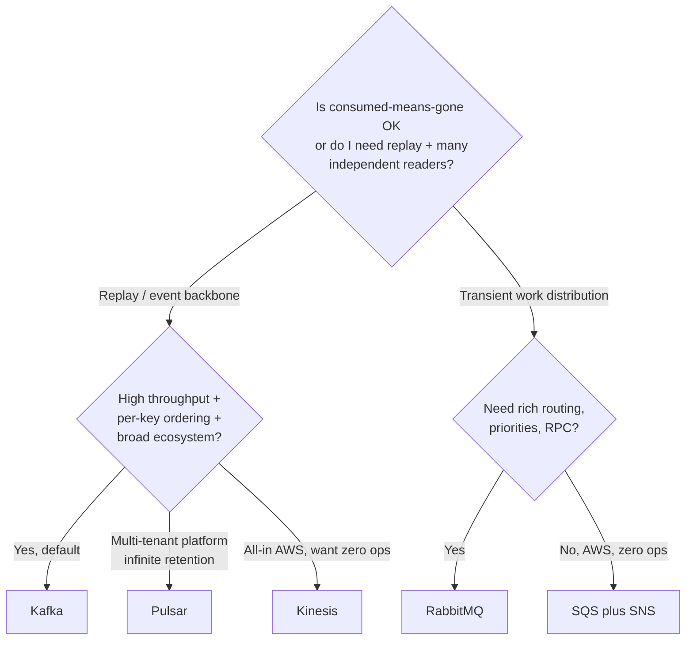

| Decision | Default (state it like this) | Revisit trigger |
|---|---|---|
| Queue vs stream | "Kafka because I need replay and multiple independent consumer groups at their own offset" OR "SQS because it's transient work distribution and consumed-means-gone is fine" | Replay requirement appears, or fan-out to N teams emerges, or throughput crosses ~10k msg/s sustained |
| Kafka vs SQS vs RabbitMQ | "**SQS** for a simple AWS task queue; **RabbitMQ** for rich routing / priorities / request-reply; **Kafka** for a replayable multi-consumer event backbone." Pick one out loud. | Routing complexity grows (→ RabbitMQ), replay/ordering needed (→ Kafka), ops burden unacceptable (→ managed SQS/Kinesis) |
| Delivery guarantee | "**At-least-once delivery + idempotent consumers** — effective-once. I do *not* claim exactly-once delivery." | True in-Kafka exactly-once *processing* is needed end-to-end with no external sink → Kafka EOS transactions |
| Partition key | "Partition by the **entity whose events must stay ordered** — `userId` / `accountId` / `conversationId` — high-cardinality, evenly distributed." | A celebrity/hot key emerges → split with composite key where order tolerance allows |
| Fan-out timing | "**Hybrid**: fan-out on write for the common case, fan-out on read for high-fan-out outliers, merged at read." | Fan-out is uniformly tiny (pure write) or uniformly huge (pure read) |
| Dual-write | "**Transactional outbox + CDC (Debezium)** — never a bare publish-after-commit, never 2PC." | Always the default; revisit only if the service emits no events |

### Altitude — name-and-move-on vs deep-dive

Uniform thoroughness is an anti-signal. Spend ~80% of your air on the risk crux and dispatch the basics in a sentence.

**Name-and-move-on (one sentence each, don't lecture):** what a queue is, what pub/sub is, that DLQs catch poison messages, that backoff should have jitter, that visibility timeout makes SQS at-least-once, that CQRS splits read/write models. The interviewer knows these. Saying "standard DLQ after max-receives, alarm on depth, redrive after fix — moving on" *shows* you know them without burning minutes.

**Deep-dive — this is where the points are.** The risk crux of every messaging design is the triangle: **ordering + exactly-once + the dual-write problem.** These three are where real systems leak data, and where most candidates hand-wave. When you reach them, slow down, draw the failure window, and walk the mechanism (outbox row in the same transaction; idempotency key atomic with the side effect; partition-key remap breaking historical ordering). If you deep-dive exactly one thing in this module, deep-dive the dual-write → outbox → CDC → idempotent-consumer chain, because it's the backbone of every reliable event-driven service.

### YAGNI defaults (say the trade-out loud)

Stating what you're *deliberately not* building is a strong Staff signal — it shows you see the option and are choosing scope on purpose.

- "I'm **deliberately not** reaching for event sourcing here — this is CRUD with no audit/replay requirement; it would tax every future schema change. Trigger to revisit: a hard audit or time-travel requirement."
- "I'm **deliberately not** pursuing true exactly-once *delivery* — it's impossible across a network anyway. At-least-once + idempotency is correct and simpler."
- "I'm **deliberately not** enforcing global ordering — per-entity ordering by partition key is enough and global ordering caps me at one partition's throughput."
- "I'm **deliberately not** standing up Kafka for this — it's a job queue; SQS does it with zero ops. Trigger: replay or multi-team consumption appears."
- "I'm **deliberately not** adding CQRS to this screen — one model is fine until reads and writes diverge in shape or scale."

### Top anti-patterns that tank the signal

These are the specific landmines interviewers plant. Stepping on any one of them undoes a lot of good work:

1. **Claiming "exactly-once delivery."** It doesn't exist across a network (Two Generals). Say "effective-once" or "exactly-once *processing within Kafka*." This is the single most-probed misconception.
2. **Dual-write without an outbox.** "I write the DB then publish to Kafka" is wrong 100% of the time — name the crash window and reach for the transactional outbox + CDC immediately.
3. **Global ordering when you don't need it.** Funneling everything through one partition to get total order destroys throughput. Push back: "Do you need *global* order or *per-entity* order?" — it's almost always per-entity.
4. **Using Kafka as a job queue** (fighting head-of-line blocking, hand-rolling DLQs) or **SQS as an event backbone** (no replay, no ordering). Tool-mismatch surfaces as pain six months later.
5. **Retrying everything** without classifying retryable vs terminal — turns one bad request into a self-inflicted DoS on your own downstream.
6. **Recording the dedup key in a separate transaction** from the side effect — you just moved the race, you didn't close it.

### Experience hooks (drop these to sound like you've operated this, not read it)

Cite operational reality — it's the difference between "I read the docs" and "I've been paged for this." Tuned for a real-time chat infra background:

- "On our chat platform I partition the message stream by `conversationId` so a room's messages stay strictly ordered while millions of rooms parallelize — and I size partitions at ~2–3x peak consumer count up front because re-partitioning remaps `hash(key) % n` and silently breaks per-room ordering mid-stream."
- "We learned the hard way that a single poison message in Kafka head-of-line-blocks an entire partition — at chat scale that's an entire shard of conversations frozen. We now skip-to-dead-letter-topic and commit the offset, with a tiered retry-topic ladder for transient failures."
- "Every consumer in our pipeline is idempotent on a `messageId` unique constraint written *in the same transaction* as the side effect — because at-least-once redelivery is not an edge case at our volume, it's a Tuesday."
- "Our presence/typing fan-out is hybrid: push to active subscribers, pull-on-read for huge channels — pure fan-out-on-write melts on a 1M-member broadcast channel."
- "We monitor consumer lag as our backpressure signal and autoscale consumers with a hard ceiling, because the real bottleneck is always the stateful store behind the consumer, not the consumer count."

---

## 1. Why Messaging? The Decoupling Argument

**Definition.** Asynchronous messaging is the practice of having producers write messages to an intermediary (a broker) rather than calling consumers directly, so that producers and consumers are decoupled in *time*, *space*, and *throughput*.

**How it works.** Without messaging, Service A calls Service B synchronously. A is now coupled to B's availability, latency, and capacity. If B is down, A fails. If B is slow, A is slow. If B can handle 1k rps and A bursts to 10k rps, B falls over. Introduce a broker between them and:

- **Temporal decoupling** — B doesn't need to be up when A produces.
- **Load leveling** — the queue absorbs bursts; B drains at its own pace.
- **Spatial decoupling** — A doesn't need to know B's address or even that B exists.

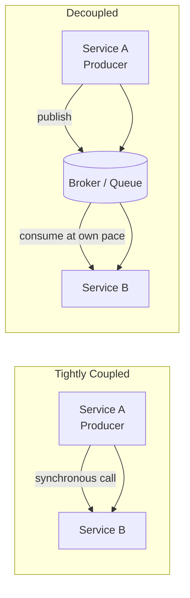

| Dimension | Synchronous RPC | Asynchronous Messaging |
|---|---|---|
| Coupling | Tight (time + space) | Loose |
| Failure blast radius | Cascades upstream | Contained at broker |
| Latency profile | End-to-end visible | Producer fast, consumer eventual |
| Backpressure | Caller must handle | Queue absorbs |
| Consistency | Easy (immediate read) | Eventual |
| Debuggability | Stack trace end-to-end | Distributed tracing required |

**Real tech.** RabbitMQ, ActiveMQ, AWS SQS/SNS, Google Pub/Sub, Kafka, Pulsar, Kinesis, NATS, Redis Streams.

**Pitfalls.** Async is not free: you trade immediate consistency for eventual consistency, you must handle duplicates and out-of-order delivery, and you lose the simple stack trace. Teams that "just add a queue" without a plan for DLQs, idempotency, and observability create silent data-loss bugs.

**Altitude cue.** This is name-and-move-on territory. State the decoupling argument in two sentences and the eventual-consistency commitment, then move — do not lecture an interviewer on what a queue is.

> **Staff-level insight:** Messaging is not a performance optimization — it is an *architectural commitment to eventual consistency*. The interviewer wants to hear you say "the moment I introduce a broker, every downstream read is potentially stale and every consumer must be idempotent." If you can't accept those two consequences, you don't actually want async. The decisive framing: "I introduce a broker *because* I need temporal decoupling and load-leveling for bursty traffic; I accept eventual consistency and mandatory idempotency as the price; I revisit if the workload turns out to need read-your-write strong consistency, in which case I keep the call synchronous."

---

## 2. Message Queues vs Pub/Sub Fundamentals

**Definition.**
- **Point-to-point (queue):** each message is delivered to *exactly one* consumer out of a pool. Work distribution.
- **Publish/subscribe (topic):** each message is delivered to *every* subscriber. Event broadcast / fan-out.

**How it works.** In a queue, N competing consumers each pull messages; the broker ensures a given message goes to one of them. In pub/sub, the broker copies (logically or physically) each message to every subscriber's own delivery channel.

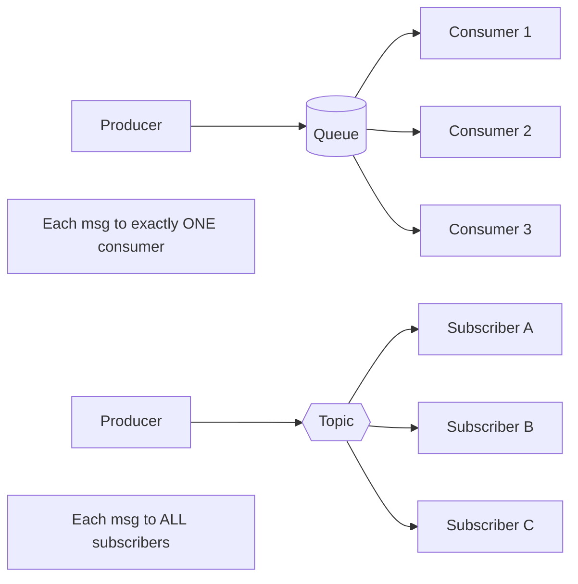

| Aspect | Point-to-Point Queue | Pub/Sub Topic |
|---|---|---|
| Delivery | One consumer per message | All subscribers get a copy |
| Purpose | Work/task distribution | Event broadcast, fan-out |
| Coupling | Producer knows a queue exists | Producer knows nothing of subscribers |
| Scaling consumers | Add consumers → throughput up | Add subscribers → more copies |
| Example | SQS, RabbitMQ queue | SNS, Kafka topic, Google Pub/Sub |

**Hybrid model.** Kafka unifies both: a *topic* is pub/sub, but a *consumer group* makes consumers compete (point-to-point) within the group, while different groups each get the full stream (pub/sub). This is why "is Kafka a queue or pub/sub?" is a trick question — it's both, depending on consumer-group configuration.

**Real tech.** RabbitMQ exchanges (direct = queue-ish, fanout/topic = pub/sub). SNS→SQS fan-out is the classic AWS pub/sub-to-queue bridge. Kafka consumer groups.

**Pitfalls.** Mixing semantics: people put pub/sub fan-out logic on a single SQS queue and wonder why only one service sees the message. The SNS→SQS fanout pattern exists precisely to give each consumer its own durable queue.

> **Staff-level insight:** The most common production scaling pattern is **SNS (fan-out) → multiple SQS queues (one per consumer) → competing consumers within each queue**. This gives you broadcast at the topic level and load-balanced work distribution at the queue level, plus per-consumer DLQs and independent retry policies. Name this pattern unprompted — it signals you've actually wired fan-out on AWS, not just read about it. Decisive framing: "SNS→SQS fan-out because each downstream needs its own durable buffer, retry policy, and DLQ; revisit toward Kafka if those consumers also need replay or to read at their own historical offset."

---

## 3. Dead Letter Queues & Poison Messages

**Definition.** A **Dead Letter Queue (DLQ)** is a separate queue where messages are routed after they fail processing a configured number of times (or expire). A **poison message** is one that can never be successfully processed (malformed payload, references deleted data, triggers a bug) and would otherwise be retried forever, blocking the queue.

**How it works.** Each message carries a *receive count* / *delivery attempt* counter. When it exceeds `maxReceiveCount`, the broker moves it to the DLQ instead of redelivering. The DLQ is itself a normal queue you can inspect, alert on, and replay from.

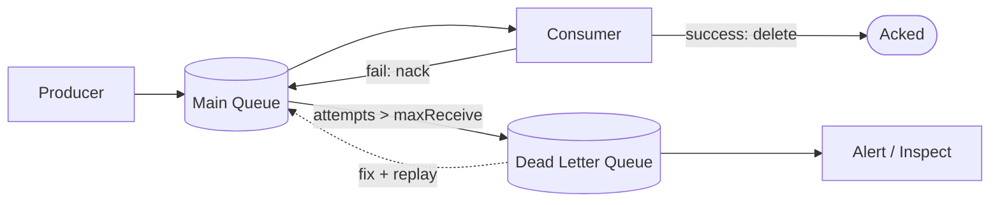

| Trigger to DLQ | Description | Typical config |
|---|---|---|
| Max receives exceeded | Failed N times | SQS `maxReceiveCount` (e.g. 5) |
| TTL expired | Message too old | RabbitMQ message-TTL |
| Queue length limit | Overflow | RabbitMQ max-length |
| Explicit reject | Consumer rejects without requeue | `basic.reject requeue=false` |

**Replay strategy.** A DLQ is useless if you never drain it. Standard ops: (1) alarm when DLQ depth > 0, (2) triage — is it a bad message or a bad deploy?, (3) if a bad deploy, fix and *redrive* the whole DLQ back to the main queue (SQS has a native redrive); (4) if genuinely poison, dump to cold storage / dead-message table for forensic analysis and drop.

**Real tech.** SQS native DLQ with redrive policy. RabbitMQ dead-letter exchange (DLX). Kafka has no built-in DLQ — you implement it: catch the exception, produce the failed record to a `<topic>.DLT` topic (Spring Kafka does this automatically), and keep the offset moving so one bad record doesn't block the partition.

**Pitfalls.**
- **No DLQ alarm** → messages silently rot; you discover data loss weeks later.
- **In Kafka, a poison message blocks the entire partition** because offsets are sequential — if you keep retrying record at offset 42, you never reach 43. You *must* either skip-to-DLT or you halt the whole partition.
- **Infinite retry without max** → poison message becomes a permanent CPU/throughput sink (a "retry storm").

**Risk concentration flag.** The Kafka DLQ story is *not* the same as the SQS one, and conflating them is a classic miss. This is a mini-deep-dive spot: SQS retries one message independently; Kafka offsets are a high-water mark over an ordered partition, so one poison record is head-of-line blocking. Spend the extra thirty seconds here.

> **Staff-level insight:** In Kafka the DLQ problem is fundamentally different from SQS. SQS retries one message independently; Kafka's offset commit is a high-water mark over an *ordered* partition. A single poison record creates **head-of-line blocking** for everything behind it. The Staff answer is: wrap the consumer in a try/catch, on non-retryable errors produce to a dead-letter *topic* and commit the offset to move on, and on retryable errors use a tiered retry-topic pattern (e.g. retry-5s, retry-1m, retry-30m) rather than blocking the main partition. Operational hook: at chat scale a frozen partition is a whole shard of conversations stuck — so "skip-to-DLT and alarm on DLT depth" is not optional hygiene, it's availability.

---

## 4. Retry Queues, Backoff & Delay Queues

**Definition.** A **retry queue** holds messages that failed transiently and should be re-attempted after a delay. **Backoff** increases the delay between attempts (linear, exponential, with jitter). A **delay queue** is a queue whose messages only become visible after a set time.

**How it works.** On a transient failure (downstream 503, lock timeout), you don't want to hammer immediately. You re-publish the message to a delay/retry queue with an increasing visibility delay. After `maxAttempts`, it goes to the DLQ.

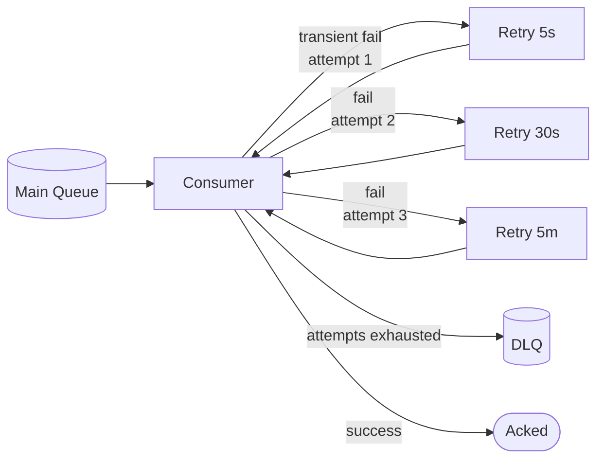

| Strategy | Formula (attempt n) | Use when |
|---|---|---|
| Fixed | `delay = k` | Predictable transient faults |
| Linear | `delay = k * n` | Mild congestion |
| Exponential | `delay = base * 2^n` | Overloaded downstream (most common) |
| Exponential + jitter | `random(0, base * 2^n)` | Avoid thundering herd / synchronized retries |

**Jitter matters.** If 10,000 consumers all back off `2^n` deterministically, they retry in lockstep and re-hammer the downstream at the same instant. Add full jitter (`sleep = random(0, cap)`) — this is the AWS-recommended pattern and prevents synchronized retry storms.

**Real tech.** SQS supports per-message `DelaySeconds` (max 15 min) and per-queue delay. RabbitMQ implements delay via per-message TTL + DLX, or the `rabbitmq-delayed-message-exchange` plugin. Kafka uses tiered retry topics (Spring Kafka `@RetryableTopic`).

**Pitfalls.**
- SQS max delay is **15 minutes** — for longer backoff you need tiered queues or an external scheduler.
- Retrying *non-idempotent* operations multiplies side effects (double charges). Retry only after you've made the consumer idempotent (see §17).
- Retrying a non-retryable error (validation failure) wastes capacity — classify errors into retryable vs terminal *before* deciding to retry.

> **Staff-level insight:** The error taxonomy is the senior signal. Before any retry logic, classify failures: **retryable** (timeout, 503, throttle) → backoff + retry; **terminal** (400, validation, auth) → straight to DLQ, never retry. Blindly retrying everything turns a single bad request into a denial-of-service against your own downstream. Always pair exponential backoff with **full jitter** and a hard `maxAttempts`. Decisive framing: "Exponential backoff with full jitter, max 5 attempts, terminal errors skip straight to the DLQ — because a 400 will never succeed and retrying it just burns downstream capacity." Name-and-move-on on the backoff math; the *signal* is the retryable/terminal classification.

---

## 5. Visibility Timeout & Competing Consumers

**Definition.**
- **Visibility timeout:** when a consumer receives a message, the broker hides it from other consumers for a configured window. If the consumer acks within that window, the message is deleted; if not, it reappears for redelivery.
- **Competing consumers:** multiple consumers pull from the same queue; the broker hands each message to exactly one, distributing load.

**How it works.** SQS doesn't delete on receive — it makes the message *invisible*. The consumer must explicitly `DeleteMessage` after processing. If the consumer crashes mid-process, the timeout expires and the message becomes visible again → at-least-once delivery. This is the mechanism that gives queues their crash-safety.

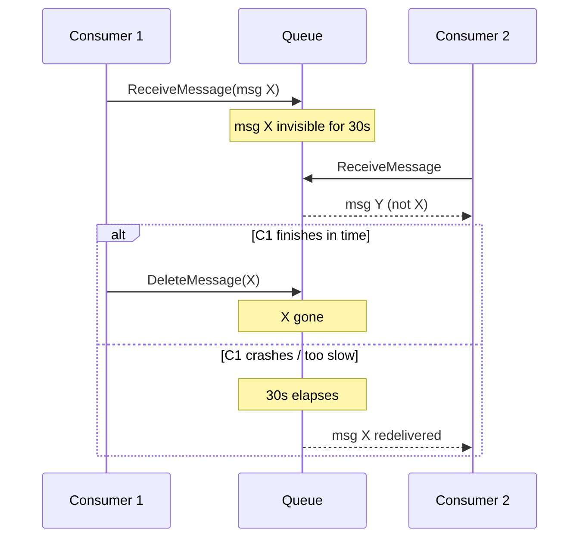

| Concern | Too short visibility timeout | Too long visibility timeout |
|---|---|---|
| Effect | Message redelivered while still processing → duplicates | Crashed consumer's message stuck invisible for ages |
| Symptom | Double-processing | Slow recovery, throughput dips |
| Fix | Set > p99 processing time; use heartbeat extension | Set close to actual processing time |

**Heartbeating / extension.** For long jobs, extend the visibility timeout periodically (`ChangeMessageVisibility`) so the message stays hidden while work is genuinely in progress, rather than setting one huge static timeout.

**Real tech.** SQS visibility timeout (default 30s, max 12h). RabbitMQ uses explicit ack with `prefetch` (QoS) to limit unacked messages per consumer. Kafka has no visibility timeout — it uses offset commits + consumer-group session timeout + `max.poll.interval.ms`.

**Pitfalls.**
- Setting visibility timeout shorter than processing time is the #1 cause of duplicate processing in SQS systems.
- `prefetch` too high in RabbitMQ → one consumer grabs a huge batch and others starve, defeating load balancing.

> **Staff-level insight:** Visibility timeout is *why* SQS is at-least-once and never exactly-once. The message is only deleted on explicit ack; any crash between "did the work" and "ack" causes redelivery. This is correct behavior — it guarantees no message is lost — but it *forces* idempotent consumers. The interview-grade statement: "I set visibility timeout to roughly 2-3x my p99 processing latency, extend it via heartbeat for long jobs, and make the consumer idempotent so redelivery is harmless." Name-and-move-on: the mechanism is simple; the *only* thing worth dwelling on is that it's the structural reason at-least-once is the floor — which sets up the delivery-guarantees deep-dive.

---

## 6. Event-Driven Architecture Patterns

**Definition.** Event-Driven Architecture (EDA) is a style where components communicate by producing and reacting to events. There are three distinct flavors, often conflated — knowing the difference is a strong senior signal.

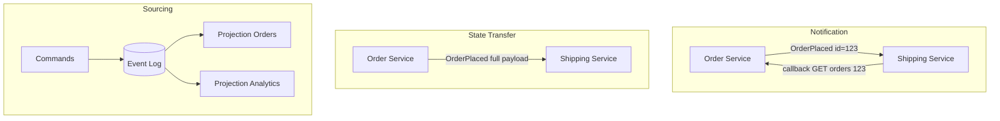

| Pattern | What the event carries | Coupling | Pros | Cons | Example |
|---|---|---|---|---|---|
| **Event Notification** | Minimal: "something happened" + ID | Consumer calls back for data | Small events, source owns data | Chatty callbacks, temporal coupling | `OrderPlaced{id}` then REST fetch |
| **Event-Carried State Transfer** | Full state snapshot | Decoupled reads, no callback | Consumer is autonomous, can be offline | Large events, stale duplication, schema coupling | `OrderPlaced{full order}` |
| **Event Sourcing** | Every state change as an immutable event; log *is* the truth | Fully decoupled, replayable | Audit, time-travel, rebuild | Complexity, schema evolution, eventual consistency | Append to event store, project state |

**How to choose.**
- **Notification** when events are frequent and payloads large — keep events tiny, let consumers fetch on demand. Risk: source becomes a synchronous dependency again.
- **State transfer** when consumers must operate autonomously (e.g., offline, or you want to eliminate the callback). Trades network chatter for data duplication and staleness.
- **Sourcing** when you need a full audit trail, temporal queries, or the ability to rebuild any projection. Highest power, highest complexity.

**Real tech.** Most production systems are **state-transfer** for inter-service events (the event carries enough to act) with **notification** where payloads are huge. True event sourcing is rarer and usually scoped to one bounded context.

**Pitfalls.** Event-carried state transfer creates *distributed data duplication* — every consumer now holds a stale copy and you've coupled to the event's schema. Notification re-introduces synchronous coupling via the callback. Pick deliberately.

> **Staff-level insight:** The interviewer is testing whether you treat "event-driven" as one thing. It isn't. Say: "I default to event-carried state transfer for service-to-service so consumers stay autonomous, fall back to notification when the payload is too large to broadcast, and reserve full event sourcing for bounded contexts that genuinely need audit/replay — because event sourcing taxes every future schema change." That single sentence — a default plus two named triggers — is the whole signal. YAGNI hook: "I'm deliberately not reaching for event sourcing as the default flavor; state transfer covers most inter-service needs without the immutability tax."

---

## 7. Event Sourcing

**Definition.** Instead of storing the *current state* of an entity, you store the full ordered sequence of *events* that produced it. Current state is a left-fold (reduction) over the event log. The log is the single source of truth; state is derived.

**How it works.** A `BankAccount` isn't a row with `balance=100`. It's: `AccountOpened`, `Deposited(100)`, `Withdrew(30)`, `Deposited(30)`. Current balance = replay all events = 100. To get state you load events for the aggregate and fold them. Because logs grow unbounded, you periodically take a **snapshot** (materialized state at version N) and only replay events after the snapshot.

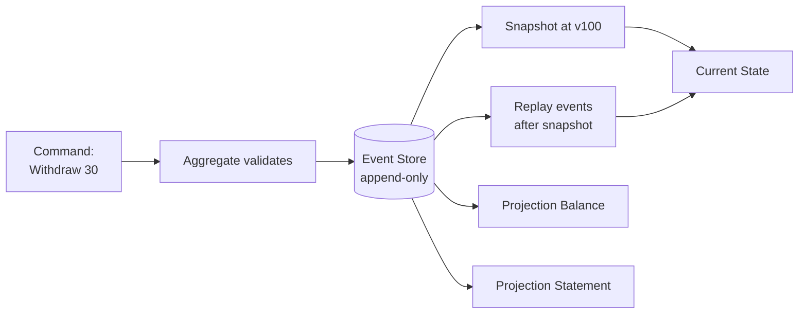

| Aspect | Pros | Cons / When it bites |
|---|---|---|
| Audit | Complete history, "why is the balance X?" answerable | Storage grows forever |
| Debugging | Replay to reproduce any bug | Replaying huge logs is slow without snapshots |
| Temporal queries | "What was state on date D?" | Querying current state requires projection |
| Flexibility | Build new read models from history | Schema/event evolution is hard — old events are immutable |
| Corrections | No destructive updates; append compensating event | Can't just "fix a row"; GDPR delete is painful |

**When it bites you.**
- **Event schema evolution** — you can never change a published event; you must version (`OrderPlacedV2`) and handle upcasting for old events forever.
- **GDPR / right-to-be-forgotten** — events are immutable, so deleting personal data means crypto-shredding (encrypt PII per-user, throw away the key) or rewriting the log.
- **Large aggregates** — folding millions of events is slow; snapshots are mandatory, not optional (snapshot every ~100–500 events as a rule of thumb, then replay only the tail).

**Real tech.** EventStoreDB (purpose-built), Axon Framework, Kafka used as an event log, Marten (Postgres-backed). Common in banking, trading, and order systems.

**Pitfalls.** Teams adopt event sourcing for CRUD apps that never need audit or replay, and drown in complexity. It is a *specialized* pattern, not a default.

> **Staff-level insight:** Event sourcing's killer feature isn't audit — it's that you can build a *brand-new read model from history*. A year after launch, product wants a new analytics view; with event sourcing you replay the log and materialize it, no backfill migration needed. But be honest about the tax: every event is immutable forever, so schema evolution and GDPR deletion become first-class engineering problems. I scope it to one bounded context, never the whole system. YAGNI framing in the room: "I'm deliberately *not* event-sourcing this — there's no audit/replay/time-travel requirement, and the immutability + GDPR tax isn't worth it. Trigger to revisit: a regulatory audit trail or a need to rebuild arbitrary read models from history."

---

## 8. CQRS

**Definition.** Command Query Responsibility Segregation: separate the **write model** (commands that change state) from the **read model** (queries). They use different data models, often different stores, kept in sync asynchronously — which makes the read side **eventually consistent** with the write side.

**How it works.** Commands go through a write model optimized for validation and consistency (normalized, transactional). After a write, an event/update propagates to one or more read models — denormalized, query-optimized projections (a search index, a wide table, a cache) tailored to specific query shapes.

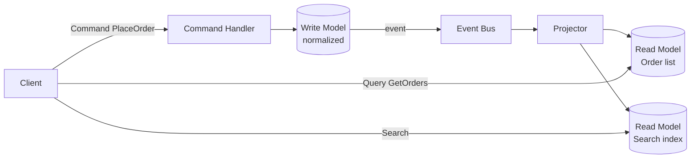

| Aspect | Without CQRS | With CQRS |
|---|---|---|
| Model | One model for reads + writes | Separate optimized models |
| Scaling | Reads + writes share store | Scale read replicas independently |
| Read perf | Joins at query time | Pre-computed denormalized views |
| Consistency | Strong (read your write) | Eventual (read lag) |
| Complexity | Low | High — sync, projections, lag handling |

**Eventual consistency between models.** After a command succeeds, the read model may not reflect it yet (the projector hasn't processed the event). This is the classic "I placed an order but it's not in my order list" bug. Mitigations: read-your-writes via session stickiness to the write model for the requesting user, optimistic UI, or version tokens the client polls on.

**Real tech.** A normalized Postgres write store + Elasticsearch read index. DynamoDB writes + DynamoDB Streams → materialized GSIs / cache. Any "write to SQL, project to search/cache" pipeline is CQRS whether or not it's named.

**Pitfalls.** Applying CQRS to a simple CRUD screen adds two models and an async pipeline for no benefit. The read-lag UX problem is underestimated constantly.

> **Staff-level insight:** CQRS is justified when read and write workloads have *genuinely divergent shapes or scale* — e.g., writes are simple inserts but reads need complex aggregations across millions of rows, or reads outnumber writes 1000:1. The hardest part is never the split; it's managing the **eventual consistency window** the user experiences. I always design the read-your-writes story explicitly (sticky read to write model, or client-side version polling) before adopting CQRS. Decisive framing: "CQRS *because* reads and writes diverge in shape and scale; I'm deliberately not adding it for symmetric CRUD. The risk crux I'll design for is the read-lag window, with sticky read-your-writes for the acting user."

---

## 9. Event Sourcing + CQRS Together

**Definition.** Event sourcing and CQRS are independent patterns that compose exceptionally well: event sourcing gives you the authoritative event log (write side), and CQRS uses that log to build many specialized read models (projections) on the read side.

**How it works.** Commands validate against the aggregate and append events to the event store (event sourcing). Those same events are consumed by projectors that build denormalized read models (CQRS). The event log is both the write model's source of truth *and* the feed that hydrates every read model.

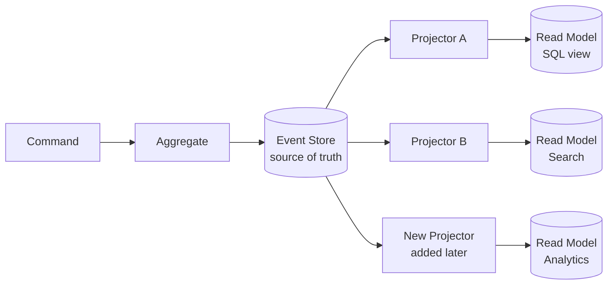

| Combination | Description | Fit |
|---|---|---|
| CQRS only | Separate read/write models, write side is state-based | Most common; pragmatic |
| Event Sourcing only | Event log, derive single current-state view | Rare; you usually want projections |
| ES + CQRS | Log is write truth + feeds many read models | Powerful, complex; banking/trading |

**Why they pair.** Event sourcing produces a stream of events as a natural byproduct; CQRS *needs* a stream of changes to keep read models in sync. The event store *is* the change feed. Adding a new read model is just attaching a new projector and replaying history.

**Pitfalls.** Adopting both at once on a green-field project triples your unknowns. Start with CQRS (state-based writes) and only add event sourcing if you discover you need replay/audit.

> **Staff-level insight:** They're orthogonal but synergistic. The trap is thinking you *must* use both. The pragmatic Staff move: CQRS first (it solves a real read/write scale problem), event sourcing only when the business demands audit/replay. When you do combine them, the event store doubles as the CQRS sync mechanism — which is elegant — but you now carry the schema-evolution and GDPR taxes of event sourcing *plus* the consistency-window taxes of CQRS simultaneously. Budget for both. The one-liner that lands: "CQRS and event sourcing are orthogonal; I adopt CQRS for the read/write scale split and only add event sourcing when audit/replay is a hard requirement — I refuse to pay both taxes by default."

---

## 10. Apache Kafka — Deep Dive

> **This is the load-bearing section of the module.** If the interview goes deep anywhere, it goes deep here. Know it cold: partitions, offsets, consumer groups, ISR, leader/follower, log compaction, idempotent producer, transactions, EOS. The risk crux inside Kafka is **ordering vs scalability (partition key)** and **exactly-once being a Kafka-internal property only** — slow down on those two.

**Definition.** Kafka is a distributed, partitioned, replicated **commit log**. Producers append records to topics; records are durably stored and ordered within a partition; consumers read at their own pace by tracking offsets. It is not a queue — it's a replayable log.

### 10.1 Core anatomy

- **Topic** — a named stream of records (e.g., `orders`).
- **Partition** — a topic is split into ordered, append-only partitions. Partition = unit of parallelism and the *only* unit of ordering.
- **Offset** — a monotonically increasing ID of a record within a partition. Consumers commit offsets to track progress.
- **Broker** — a Kafka server holding partitions.
- **Consumer group** — a set of consumers that *share* a topic's partitions; each partition is consumed by exactly one consumer in the group.

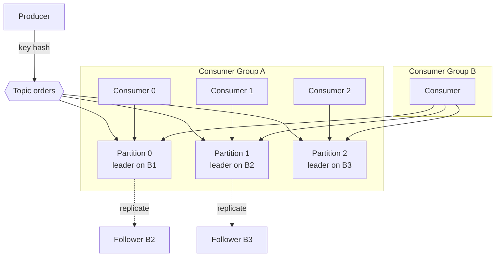

### 10.2 Partitions, offsets, ordering

Ordering is guaranteed **only within a partition**. Records with the same key always land in the same partition (`partition = hash(key) % numPartitions`), so all events for one entity are strictly ordered. Across partitions there is no global order. This is the single most important Kafka fact: **you trade global ordering for horizontal scalability, and you recover per-entity ordering via the partition key.**

Sizing intuition: a single partition handles on the order of tens of MB/s and tens of thousands of records/s depending on record size and hardware; you scale by adding partitions, with max useful consumer parallelism per group capped at the partition count. A topic with 12 partitions can be consumed by at most 12 consumers in one group; a 13th sits idle.

### 10.3 Consumer groups & rebalancing

Within a group, partitions are distributed among consumers — at most one consumer per partition (so max useful parallelism = partition count). When a consumer joins/leaves or fails (misses `session.timeout.ms` heartbeats or exceeds `max.poll.interval.ms`), the group **rebalances**: partitions are reassigned.

- **Eager rebalancing** (old): stop-the-world — all consumers revoke everything, then reassign. Causes consumption pauses.
- **Cooperative/incremental rebalancing** (`CooperativeStickyAssignor`): only the moving partitions are revoked; others keep consuming. Preferred.
- **Static membership** (`group.instance.id`): a consumer that restarts keeps its assignment, avoiding rebalances on rolling deploys.

**Operational edge cases worth naming:** a consumer that does heavy per-record work can blow past `max.poll.interval.ms` and get kicked from the group (looks like a "phantom" rebalance) — fix by reducing `max.poll.records` or moving work off the poll thread. **KRaft** (Kafka's own Raft) is now the *only* metadata mode — **ZooKeeper was removed entirely in Kafka 4.0 (March 2025)**. Being current in 2026 means naming KRaft as the default and, one level deeper, **KIP-848** (the new broker-driven consumer-group protocol that removes stop-the-world rebalances, default in 4.x) and **KIP-932 "Queues for Kafka"** (share groups — multiple consumers per partition with per-record acks, closing the classic "Kafka isn't a work queue" gap). A bare "KRaft replaced ZooKeeper" line now reads as slightly dated; pair it with 848/932.

### 10.4 Replication: ISR, leader/follower

Each partition has one **leader** and N-1 **followers** across brokers (`replication.factor`, usually 3). All reads/writes go to the leader; followers replicate. The **In-Sync Replica (ISR)** set is the replicas caught up to the leader.

- `acks=0` — fire and forget (may lose data).
- `acks=1` — leader ack only (loses data if leader dies before followers replicate).
- `acks=all` (`acks=-1`) — leader waits for all ISR. Combined with `min.insync.replicas=2`, a write is only accepted if at least 2 replicas have it → survives one broker loss with no data loss.

If a leader dies, a follower in ISR is promoted. `unclean.leader.election.enable=false` (default) refuses to promote an out-of-sync replica, preferring availability loss over data loss.

| Setting | Guarantee | Cost |
|---|---|---|
| `acks=1` | Fast, weak durability | Data loss on leader failure |
| `acks=all` + `min.insync.replicas=2`, RF=3 | No loss on single broker failure | Higher latency |
| `unclean.leader.election.enable=true` | Higher availability | Possible data loss |

### 10.5 Log compaction & retention

Two cleanup policies:
- **Retention** (`cleanup.policy=delete`) — drop records older than `retention.ms` (default 7 days) or beyond `retention.bytes`. Time/size-based.
- **Compaction** (`cleanup.policy=compact`) — retain at least the *latest* value per key, garbage-collecting older versions. Turns the topic into a changelog / latest-state table. A tombstone (key with null value) deletes the key. This is how Kafka Streams stores state and how you keep a compacted "current state per entity" topic indefinitely.

You can combine both (`compact,delete`) to keep the latest value per key *and* age out very old keys — common for a user-profile changelog.

### 10.6 Exactly-once semantics (EOS)

Kafka's exactly-once is **exactly-once *processing*** within Kafka, built from three pieces:

1. **Idempotent producer** (`enable.idempotence=true`, default in modern Kafka) — each producer gets a PID; records carry sequence numbers per partition so the broker dedups retries. Eliminates duplicates from producer-side retries.
2. **Transactions** (`transactional.id`) — a producer can atomically write to multiple partitions/topics *and* commit consumer offsets in one transaction. Either all-or-nothing.
3. **Read-committed consumers** (`isolation.level=read_committed`) — only see records from committed transactions.

Together these give the **consume → transform → produce** loop (Kafka Streams' `processing.guarantee=exactly_once_v2`) effectively-once semantics: the input offset commit and the output records are one atomic transaction.

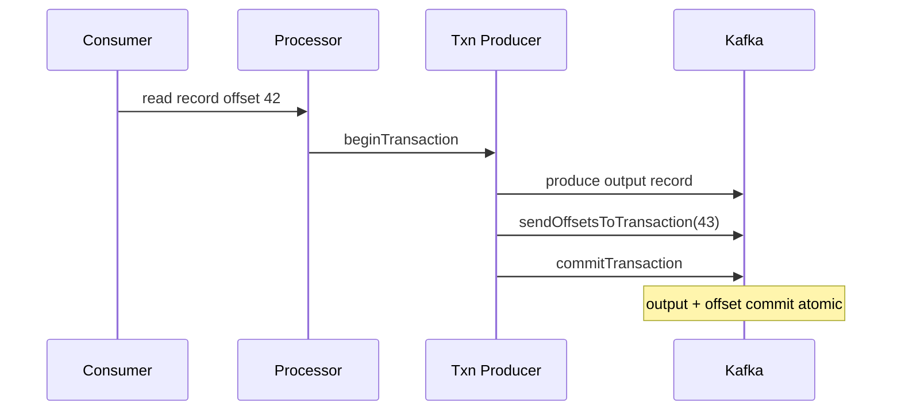

**Crucial caveat (the risk crux — slow down here):** EOS is exactly-once *only within the Kafka boundary*. The moment you write to an external DB or call an external API, you're back to at-least-once for that side effect — and you need idempotency there. Say this explicitly; it's the #1 misconception interviewers probe. EOS also costs throughput (transaction coordination overhead) — don't reach for it reflexively; reach for at-least-once + idempotent sink first.

### 10.7 Partition-key choice

The partition key is your most consequential design decision:
- Same key → same partition → ordered, but also → a **hot partition** if one key is disproportionately busy (celebrity problem).
- Null key → round-robin (or sticky) distribution → great balance, no ordering.
- Too few partitions → limited consumer parallelism. Too many (thousands per broker) → more open file handles, longer rebalances, more leader elections, higher end-to-end latency.

| Kafka concept | One-liner |
|---|---|
| Partition | Unit of ordering and parallelism |
| Offset | Per-partition consumer position |
| Consumer group | Competing consumers sharing partitions |
| ISR | Replicas caught up to leader |
| `acks=all` + `min.insync.replicas` | No-loss durability knob |
| Compaction | Keep latest value per key |
| Idempotent producer | Dedup producer retries |
| Transactions | Atomic multi-partition + offset commit |

**Pitfalls.** Choosing partition count too low (can only increase, and increasing re-shuffles key→partition mapping, breaking ordering). Consumer lag from a slow consumer in a group stalls one partition. Treating EOS as covering external systems.

> **Staff-level insight:** Three things separate a senior Kafka answer. (1) **Partition count is a one-way door for ordering** — you can add partitions but it remaps `hash(key) % n`, so historical per-key ordering breaks; pick generously up front (often 2-3x current consumer count). (2) **EOS is a Kafka-internal property** — cross the boundary to a database and you're at-least-once, so idempotency at the sink is non-negotiable. (3) Durability is the triad `acks=all` + `min.insync.replicas=2` + RF=3 + `unclean.leader.election.enable=false`; quote all four or you don't really know the failure model. Experience hook: "On our chat infra I partition by `conversationId` and over-provision partitions at 2–3x peak consumer count precisely because re-partitioning silently breaks per-room ordering — I've seen that bug, and you find it in production, never in review."

---

## 11. Apache Pulsar

**Definition.** Apache Pulsar is a distributed pub/sub + queue messaging system with a **two-layer architecture**: stateless serving brokers separated from the storage layer (Apache BookKeeper "bookies"). This separation is its defining differentiator from Kafka.

**How it works.** Producers send to brokers; brokers write to BookKeeper, where a topic is stored as a sequence of **segments** (ledgers) striped across bookies. Because storage is decoupled from serving, you can scale brokers and storage independently, and a broker failure doesn't require moving data — any broker can serve any topic. **Tiered storage** offloads cold segments to S3/GCS transparently, giving effectively infinite retention cheaply.

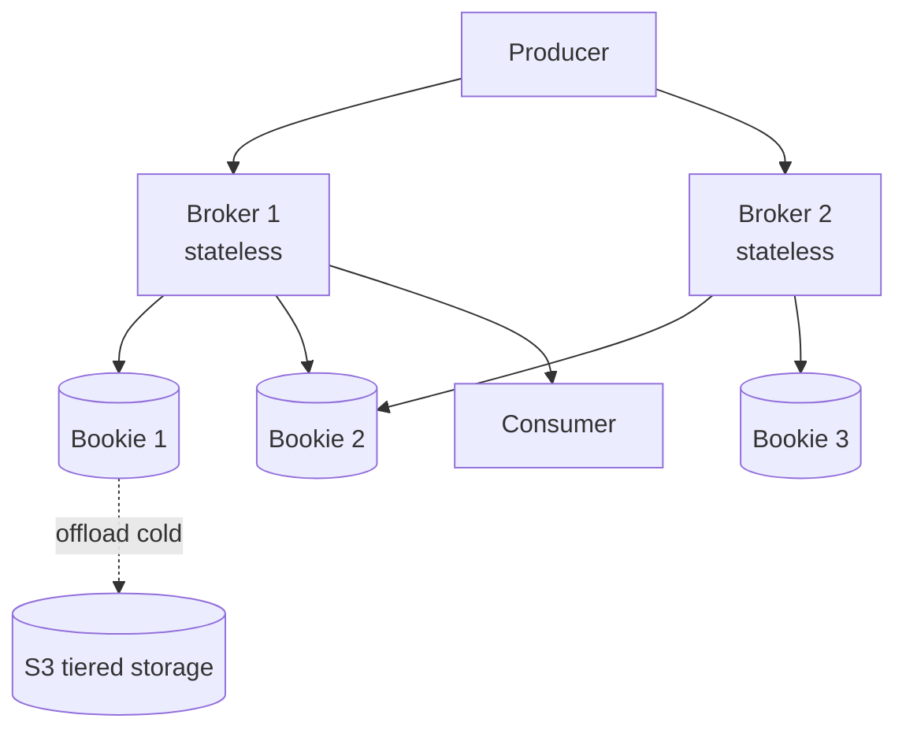

**Subscription modes** (more flexible than Kafka): *Exclusive*, *Failover*, *Shared* (queue-like round-robin, multiple consumers per partition — no Kafka equivalent), *Key_Shared* (ordering per key + multiple consumers). **Multi-tenancy** is first-class: tenants → namespaces → topics with per-namespace quotas, auth, and isolation — built for a shared platform serving many teams.

| Dimension | Kafka | Pulsar |
|---|---|---|
| Architecture | Broker = compute + storage | Broker (compute) + BookKeeper (storage) separated |
| Scaling storage | Add brokers, rebalance partitions | Add bookies independently, no rebalance |
| Consumers per partition | One per group historically; **many via KIP-932 share groups** (4.x) | Many (Shared subscription) |
| Multi-tenancy | Bolt-on (quotas, ACLs) | Native (tenant/namespace) |
| Tiered storage | **GA since Kafka 3.9 (late 2024, KIP-405)** | Native, mature |
| Geo-replication | MirrorMaker 2 | Built-in |
| Ecosystem maturity | Vast | Smaller |

**Pitfalls.** More moving parts (brokers + bookies + ZooKeeper/etcd) = higher operational complexity for small deployments. Smaller ecosystem and community than Kafka.

> **Staff-level insight:** Pulsar's architectural bet — separating compute (brokers) from storage (bookies) — is its whole pitch: independent scaling, instant broker failover (no data movement), and cheap infinite retention via tiered storage. Choose it when you need true multi-tenancy at platform scale or queue-style Shared subscriptions Kafka can't do natively. Choose Kafka when ecosystem maturity, hiring pool, and operational simplicity outweigh those features — which, honestly, is most of the time. Decisive framing: "Kafka by default; Pulsar *because* I need native multi-tenancy across many teams or Shared (queue-style) subscriptions with many consumers per partition. I'm deliberately not paying Pulsar's extra operational surface unless one of those is a hard requirement."

---

## 12. AWS Kinesis

**Definition.** Amazon Kinesis Data Streams is a managed, Kafka-like streaming service. A stream is divided into **shards**; each shard is an ordered sequence with fixed capacity (1 MB/s or 1000 records/s in, 2 MB/s out).

**How it works.** Records are written with a **partition key** that hashes to a shard (analogous to Kafka partitions). Ordering is per-shard. Consumers read via the Kinesis Client Library (KCL), which checkpoints progress in a DynamoDB table (analogous to consumer offsets). Throughput scales by *resharding* (split/merge shards). **Enhanced fan-out** gives each consumer a dedicated 2 MB/s pipe (push, ~70ms latency) instead of sharing the shard's read capacity.

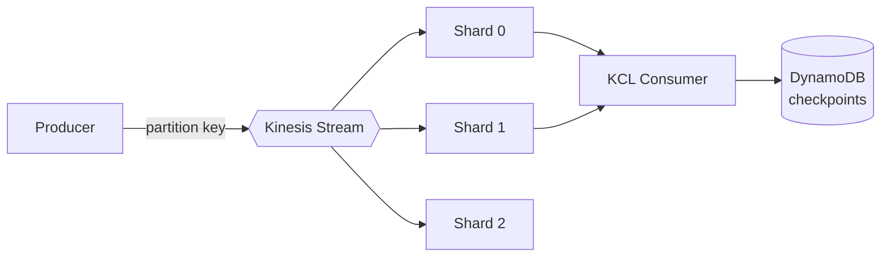

| Dimension | Kafka | Kinesis |
|---|---|---|
| Ops | Self/managed (MSK) | Fully managed, no servers |
| Unit | Partition | Shard |
| Scaling | Add partitions | Reshard (split/merge) |
| Retention | Configurable, unlimited | 24h default, up to 365 days |
| Throughput | Disk-bound, very high | 1 MB/s per shard, quota-bound |
| Offset store | Kafka `__consumer_offsets` | DynamoDB (via KCL) |
| Cost model | Infra | Per shard-hour + PUT payload units |
| Ecosystem | Huge, portable | AWS-locked |

**Pitfalls.** Per-shard hard limits (1 MB/s) mean hot partition keys throttle quickly — you'll hit `ProvisionedThroughputExceeded`. Resharding is operationally clunkier than Kafka partition changes. 24-hour default retention surprises people. KCL's DynamoDB checkpoint table can itself become a throttling bottleneck. (Kinesis On-Demand mode auto-scales shards and removes some of this pain at higher cost — name it if asked about the hot-shard problem.)

> **Staff-level insight:** Kinesis is "Kafka without the ops, with AWS lock-in and harder limits." The shard capacity ceiling (1 MB/s) is the gotcha — a hot key throttles a whole shard, and unlike Kafka you can't just add partitions cheaply; you reshard. Pick Kinesis when you're all-in on AWS and value zero operational burden over raw throughput and portability. Pick MSK or self-managed Kafka when throughput, retention flexibility, or multi-cloud portability matter. Decisive framing: "Kinesis *because* we're all-in on AWS and want zero streaming ops; I'm explicitly accepting the 1 MB/s-per-shard ceiling and AWS lock-in. Revisit toward MSK/Kafka if throughput, long retention, or portability becomes a requirement."

---

## 13. Streaming Platform Comparison

> Keep this table in your head — being able to draw it from memory and then *decide* off it is the whole point. Don't read it aloud row by row; reference it and commit.

| Feature | Kafka | Pulsar | Kinesis | RabbitMQ | SQS / SNS |
|---|---|---|---|---|---|
| Model | Distributed log | Log + queue (2-layer) | Managed log | Broker (AMQP) queue + pub/sub | Managed queue / pub/sub |
| Ordering | Per partition | Per partition / Key_Shared | Per shard | Ordering preserved only with a single consumer; multiple competing consumers parallelize but sacrifice strict order | FIFO queue only |
| Replay | Yes (retention) | Yes (tiered, infinite) | Yes (up to 365d) | Classic queues no (consumed = gone); **RabbitMQ Streams (3.9+) are replayable logs** | No |
| Throughput | Very high (millions/s) | Very high | High (shard-limited) | Classic/quorum queues ~10s–100s k/s; **Streams ~1M/s** | High (managed) |
| Delivery | At-least / EOS (Kafka-internal) | At-least / effectively-once | At-least-once | At-least-once | At-least-once (FIFO: exactly-once *processing* within a 5-minute dedup window via MessageDeduplicationId; still at-least-once outside it) |
| Fan-out | Consumer groups | Subscriptions | Enhanced fan-out | Exchanges | SNS → SQS |
| Ops burden | High (self) / med (MSK) | High | None | Medium | None |
| Best for | Event streaming, replay, log | Multi-tenant platform, infinite retention | AWS-native streaming | Complex routing, RPC, task queues | Simple decoupling on AWS |
| Latency | Low (~ms) | Low | Enhanced fan-out ~70ms (push, per-consumer); standard shared consumers via GetRecords polling ~200ms+ | Very low (~µs-ms) | ~10s ms |

**Quick selection heuristics (decide, don't list):**
- **Need replay / many independent consumers / event stream as source of truth** → Kafka (or Pulsar for multi-tenant + infinite retention).
- **Need complex routing, priorities, request/reply, or per-message ack semantics** → RabbitMQ. *If probed on HA:* use **quorum queues** (Raft-replicated, the modern default) — classic mirrored queues were deprecated and removed in RabbitMQ 4.0; pair with **publisher confirms** for durability. Reach for **RabbitMQ Streams** when you need Kafka-like replay without leaving the RabbitMQ ecosystem.
- **On AWS, want zero ops, simple decoupling / task queue** → SQS (+ SNS for fan-out).
- **On AWS, want managed streaming with replay** → Kinesis.

> **Staff-level insight:** The decisive axis is **"do I need to replay the stream and have multiple independent consumers read it at their own pace?"** If yes → a log (Kafka/Pulsar/Kinesis). If it's transient work distribution where consumed-means-gone is fine, and you want rich routing or per-message control → a broker queue (RabbitMQ/SQS). Don't pick Kafka for a job-queue; don't pick SQS for an event-sourcing backbone. The mismatch shows up as either operational pain or missing capabilities six months later. In the room, answer the "which tech?" question in one breath using the decision tree from the *In the Room* section, then move on — interviewers reward the decisive pick, not the comparison recital.

---

## 14. Delivery Guarantees

> The risk crux of the whole module lives here and in §15–16. This is where you slow down, draw the failure windows, and earn the Staff signal. The one-line trap to never step on: **never claim exactly-once delivery.**

**Definition.** The contract for how many times a message may be processed in the presence of failures.

### 14.1 At-most-once

Message is delivered zero or one time. The consumer acks/commits *before* processing — if it crashes after committing but before doing the work, the message is lost. No duplicates, possible loss.

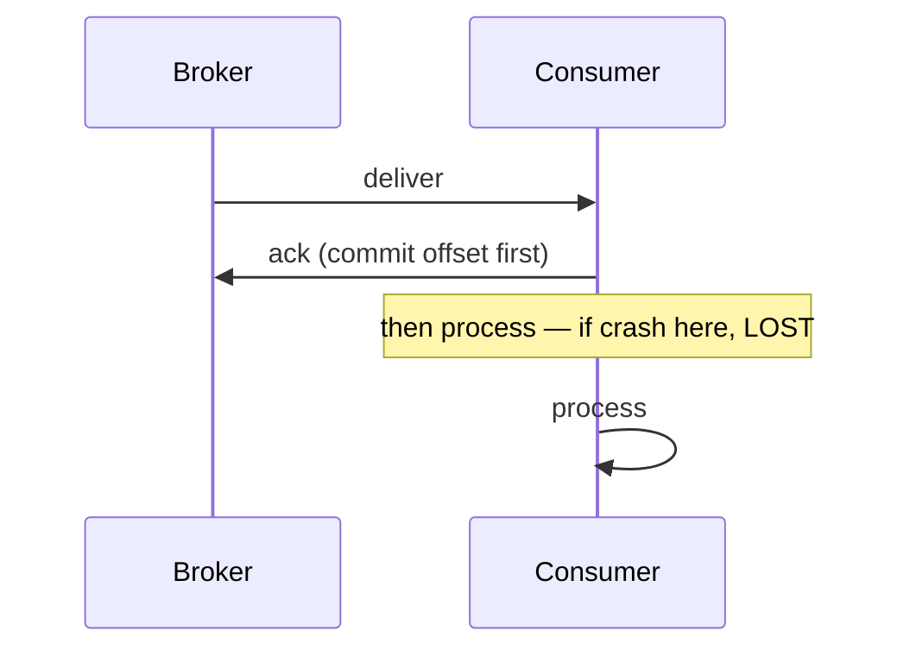

### 14.2 At-least-once

Message is delivered one or more times. The consumer processes *then* acks — if it crashes after processing but before acking, the message is redelivered → duplicate. No loss, possible duplicates. **This is the default and most common guarantee** (SQS, Kafka, Kinesis, RabbitMQ).

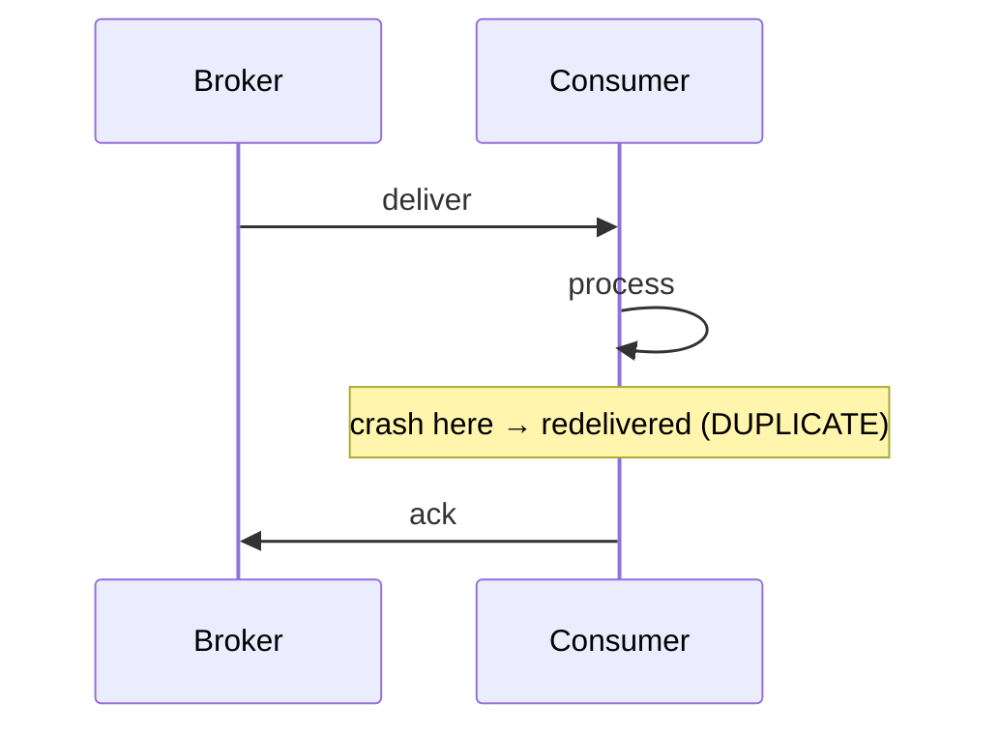

### 14.3 Exactly-once

Each message affects the system's state exactly once. In a pure messaging sense, true exactly-once *delivery* over a network is impossible (the Two Generals problem). What systems actually provide is **exactly-once *processing*** within a closed boundary (e.g., Kafka EOS), or **effective-once** via at-least-once delivery + idempotent processing + dedup.

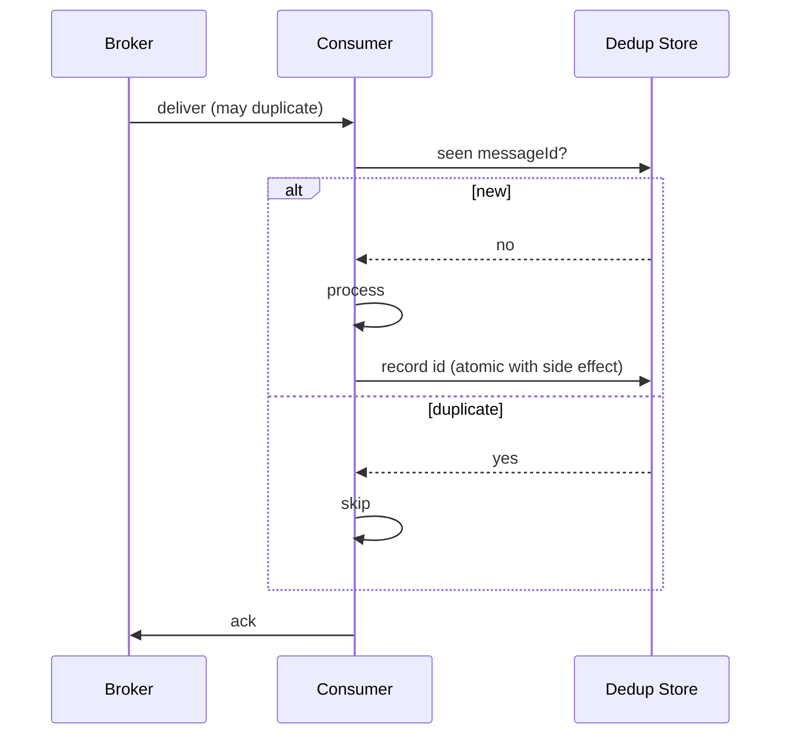

| Guarantee | Mechanism | Failure outcome | Cost / Complexity | Real example |
|---|---|---|---|---|
| At-most-once | Ack before process | May lose | Lowest | Metrics, fire-hose telemetry |
| At-least-once | Process before ack | May duplicate | Low; requires idempotent consumer | SQS, Kafka default, Kinesis |
| Exactly-once (processing) | Transactions / idempotent producer | Neither lose nor dup (within boundary) | High; bounded scope | Kafka Streams EOS |
| Effective-once | At-least-once + dedup store | Neither (app-enforced) | Medium; dedup store + idempotency keys | Stripe idempotency keys |

**Why "exactly-once is a lie" (and the precise truth).** You cannot guarantee a network message is *delivered* exactly once — the ack can be lost, forcing a choice between resend (dup) or not (loss). So no system delivers exactly once. What they do: (a) Kafka makes *processing* exactly-once within Kafka via atomic offset+output transactions; (b) everyone else achieves *effective*-once by accepting at-least-once delivery and making the *processing* idempotent so duplicates are no-ops.

**Choosing the guarantee (decide):** at-most-once *because* the data is high-volume and lossy-tolerant (metrics, telemetry); at-least-once + idempotent consumer *because* it's the correct, simple default for everything that matters; Kafka EOS *only because* I have a closed consume-transform-produce loop entirely inside Kafka with no external sink. Revisit trigger for EOS: an external DB/API enters the picture → drop back to at-least-once + idempotency at the sink.

> **Staff-level insight:** When an interviewer asks for exactly-once, the senior answer is: "Exactly-once *delivery* is impossible across a network — Two Generals. What I build is *effective-once*: at-least-once delivery plus an idempotency key the consumer dedups on, where the dedup-record write and the side effect are atomic (same DB transaction). Kafka's EOS gives true exactly-once but only *within Kafka* — the instant I write to Postgres or call Stripe, I'm back to at-least-once and lean on idempotency keys." That answer signals you understand the theory *and* the practical pattern. Anti-pattern to avoid out loud: do not say "I'll just turn on exactly-once" without scoping it to the Kafka boundary — that's the tell of someone who's only read the feature list.

---

## 15. Ordering Guarantees & Partition-Key Design

**Definition.** Ordering is the guarantee about the sequence in which messages are processed relative to the order they were produced.

**Global ordering** (total order across all messages) requires funneling everything through a single serialization point — one partition, one consumer. This caps throughput at one partition's capacity and removes parallelism. It's expensive and rarely necessary.

**Partition/key ordering** guarantees order *within* a key while allowing different keys to be processed in parallel across partitions. This is the scalable sweet spot: `partition = hash(key) % numPartitions` puts all of one entity's events on one partition, strictly ordered.

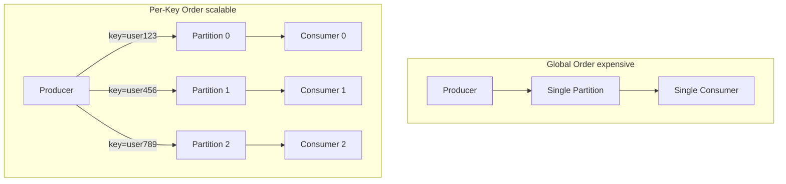

| Ordering scope | Throughput | Use when |
|---|---|---|
| Global / total | Capped at 1 partition | Rare: ledger requiring strict global sequence |
| Per-partition / per-key | Scales with partition count | Per-entity ordering (per user, per account, per order) |
| None | Maximum | Independent events (analytics, logs) |

**Designing the partition key.** Choose a key at the granularity at which order matters:
- Per-user actions → key = `userId`. All of a user's events ordered; users parallelized.
- Per-account ledger → key = `accountId`.
- Per-order lifecycle → key = `orderId`.
- Per-conversation chat messages → key = `conversationId`. (The canonical real-time-chat choice: a room is strictly ordered, millions of rooms parallelize.)

The key must be (1) the entity whose events must stay ordered, and (2) high-cardinality and evenly distributed to avoid hot partitions. If one key is a "celebrity" (a viral user, a 1M-member broadcast channel), it overwhelms one partition — mitigate by splitting that key's traffic with a composite key (`conversationId#bucket`) where order tolerance allows, or accept the hotspot for that entity.

**Out-of-order handling.** Across partitions, or when you genuinely can't preserve order, design consumers to be order-tolerant:
- **Sequence numbers / versions** — attach a monotonic version; the consumer ignores events older than the latest applied (last-write-wins by version).
- **Buffering / reordering window** — hold events briefly and reorder by timestamp (stream-processing watermarks; see [Data Processing](16-data-processing.md)).
- **Idempotent, commutative operations** — design state updates so order doesn't matter (e.g., set absolute state rather than apply deltas).

**Pitfalls.** Increasing Kafka partitions remaps `hash(key) % n` and **breaks historical per-key ordering** mid-stream — plan partition count up front. Choosing too coarse a key (e.g., `country`) creates hot partitions; too fine (e.g., a UUID per event) gives no useful ordering.

> **Staff-level insight:** "Do you need *global* ordering, or *per-entity* ordering?" — push back on this immediately, because global ordering is almost never the real requirement and it destroys scalability. The right key is the smallest entity whose events must stay ordered, chosen for high cardinality. And remember partition count is effectively immutable for ordering purposes — over-provision it. When you can't preserve order, make operations idempotent and version-stamped so out-of-order arrival is a no-op rather than a bug. Anti-pattern: enforcing global order when per-entity is all that's needed — it's the most common over-engineering trap in this whole module, and it caps your throughput at a single partition for no business reason.

---

## 16. The Dual-Write Problem & Transactional Outbox + CDC

> **The single most important pattern in the module for reliable event-driven services.** If you internalize one thing for the interview, make it this chain: dual-write is broken → 2PC is wrong → transactional outbox → CDC via Debezium → at-least-once → idempotent consumers. Deep-dive it.

**Definition.** The **dual-write problem**: a service must atomically (1) update its database and (2) publish an event, but these are two separate systems with no shared transaction. If it writes the DB then crashes before publishing (or vice versa), state and events diverge — lost events or phantom events.

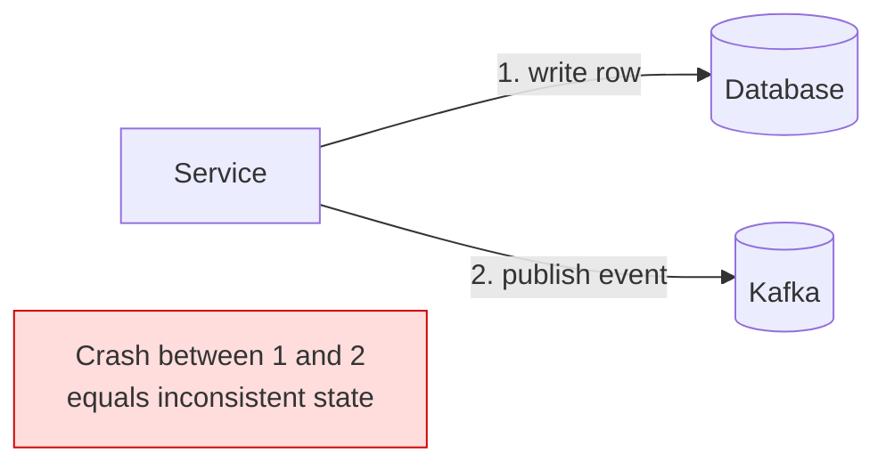

**Why "just use a 2PC / XA transaction" is wrong:** distributed transactions across a DB and a broker are slow, poorly supported, reduce availability, and most brokers (Kafka) don't support XA well. Avoid 2PC.

**The Transactional Outbox pattern.** Write the business row *and* an event row into an `outbox` table in the **same local DB transaction** — now atomic. A separate process reads the outbox and publishes to Kafka, marking rows as sent. The DB transaction guarantees the event is recorded iff the business change committed.

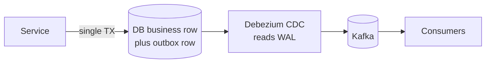

**Two ways to relay the outbox:**
1. **Polling publisher** — a worker `SELECT`s unsent outbox rows, publishes, marks sent. Simple, but adds DB load and latency.
2. **CDC (Change Data Capture)** — a tool like **Debezium** tails the database's transaction log (Postgres WAL, MySQL binlog) and streams committed changes to Kafka. No polling, low latency, no app-side relay. This is the modern standard.

| Approach | Atomicity | Latency | Ops | Notes |
|---|---|---|---|---|
| Dual write (naive) | None | Low | Low | Broken — don't |
| 2PC / XA | Yes | High | High | Avoid; poor broker support |
| Outbox + polling | Yes | Medium | Low | Simple, DB-load |
| Outbox + CDC (Debezium) | Yes | Low | Medium | Industry standard |

**Delivery semantics.** Outbox + CDC gives **at-least-once** publishing (the relay may republish after a crash before marking sent / before committing CDC offset). So consumers must still be idempotent. Ordering is preserved per-key if the outbox carries a key and Debezium routes by it.

**Pitfalls.** Forgetting that CDC is at-least-once → duplicate events downstream. Outbox table growth → need a cleanup/archival job. Schema coupling between CDC events and consumers — prefer publishing explicit domain events from the outbox rather than raw table-change events.

> **Staff-level insight:** The dual-write problem is *the* event-driven gotcha, and "just publish after the DB commit" is the wrong answer 100% of the time because of the crash window. The canonical Staff answer: **transactional outbox** (business row + event row in one local transaction) **relayed by CDC via Debezium** off the WAL/binlog. It's at-least-once, so pair it with idempotent consumers. This single pattern is the backbone of reliable event-driven microservices and you should reach for it whenever a service both persists state and emits events. See also sagas in [Microservices](10-microservices.md). Decisive close: "Outbox + Debezium *because* it's atomic without 2PC and crash-safe; I'm deliberately not using bare publish-after-commit or XA. It's at-least-once, so every consumer is idempotent — non-negotiable."

---

## 17. Idempotent Consumers & Effective-Once

> Pairs directly with §16. If the dual-write/outbox is the producer-side answer to reliability, idempotent consumers are the consumer-side answer. Together they are the reliability backbone — and the make-or-break detail in both is **atomicity**.

**Definition.** An **idempotent consumer** produces the same end state no matter how many times it processes the same message. This is what makes at-least-once delivery safe.

**How it works.** Each message carries a stable **idempotency key** (a business ID, a producer-assigned UUID, or `topic-partition-offset`). The consumer records processed keys in a dedup store and skips duplicates. Critically, the dedup-record write and the side effect must be **atomic** — otherwise a crash between them reintroduces the bug.

```mermaid
flowchart LR
    M[Message<br/>idempotencyKey=K] --> C[Consumer]
    C --> Tx{Single DB Transaction}
    Tx --> A[Apply side effect]
    Tx --> B[INSERT K into processed_keys<br/>unique constraint]
    B -->|duplicate key violation| Skip[No-op, ack]
```

**Techniques:**
- **Dedup table with unique constraint** — `INSERT idempotency_key`; a unique-violation means "already processed," skip. Same transaction as the side effect.
- **Natural idempotency** — design the operation to be inherently idempotent: `SET status='shipped'` (idempotent) instead of `increment shipped_count` (not). Upserts over inserts. Absolute values over deltas.
- **Conditional writes** — `UPDATE ... WHERE version = expected` (optimistic concurrency); a stale duplicate fails the condition.
- **Idempotency keys at API boundaries** — Stripe's model: client sends `Idempotency-Key` header; the server returns the cached prior response for a repeat.

| Technique | Best for | Caveat |
|---|---|---|
| Dedup table | General-purpose | Needs cleanup/TTL; must be atomic with side effect |
| Natural idempotency | State machines, upserts | Not always possible (counters, deltas) |
| Conditional/versioned write | Optimistic concurrency | Requires version column |
| API idempotency key | External calls (payments) | Provider must support it |

**Pitfalls.** Recording the dedup key in a *separate* transaction from the side effect (crash window). Unbounded dedup table growth (add a TTL / partition by time). Choosing a non-stable key (e.g., timestamp) so the "same" message gets different keys.

> **Staff-level insight:** Idempotency is the universal antidote to at-least-once delivery, and the make-or-break detail is **atomicity**: the side effect and the dedup-record write must be in one transaction, or you've just moved the race. When the side effect is *external* (a charge, an email), you can't share a transaction — so push idempotency to that boundary (Stripe idempotency keys, dedup before send). "Make the consumer idempotent" is the single phrase you'll repeat most in messaging interviews; back it with *how* (unique-constraint dedup, atomic with the effect) and you sound Staff, not junior. Experience hook: "Every consumer in our chat pipeline dedups on a `messageId` unique constraint written in the same transaction as the side effect — because at our volume, at-least-once redelivery isn't an edge case, it's constant."

---

## 18. Backpressure

**Definition.** Backpressure is the mechanism by which a slow consumer signals upstream to slow down, preventing unbounded queue growth, memory exhaustion, and cascading failure.

**How it works.** When consumption can't keep up with production, something must give: buffer (bounded, then block/drop), slow the producer, shed load, or scale consumers. Queues *absorb* bursts but a sustained imbalance means the queue grows without bound — backpressure is how you handle the sustained case.

```mermaid
flowchart LR
    P[Producer] --> Q[(Bounded Queue)]
    Q --> C[Slow Consumer]
    Q -->|queue full| Sig[Backpressure signal]
    Sig -->|block / drop / throttle| P
    Q -.->|lag metric| AS[Autoscaler]
    AS -->|add| C
```

**Strategies:**
- **Bounded buffers** — cap queue size; when full, block the producer (push back) or reject.
- **Pull-based consumption** — consumers fetch at their own rate (Kafka, Reactive Streams). The consumer *requests* N items; the producer never overwhelms it. This is inherent backpressure.
- **Load shedding** — drop low-priority messages / sample when overloaded (telemetry).
- **Rate limiting / throttling** — producer-side caps.
- **Autoscaling on lag** — scale consumers when queue depth / consumer-lag crosses a threshold (KEDA scales on Kafka lag).

| Strategy | Effect | Trade-off |
|---|---|---|
| Block producer | No loss, propagates slowdown | Upstream latency / coupling |
| Drop / shed | Stays responsive | Data loss (acceptable for metrics) |
| Pull-based | Consumer-paced, natural | Requires pull protocol |
| Autoscale on lag | Absorbs load | Cost, scaling lag, downstream limits |

**Kafka's model.** Kafka is pull-based: consumers poll, so they inherently can't be overwhelmed at the protocol level — the "backpressure" surfaces as growing *consumer lag* (offset distance behind the log end). You monitor lag and scale consumers or partitions in response. The log itself is the buffer, bounded only by retention.

**Pitfalls.** Unbounded in-memory queues (the classic OOM crash). Pushing backpressure all the way to a user-facing request without a timeout. Autoscaling consumers past a downstream's capacity (you just moved the bottleneck and may overwhelm the database).

> **Staff-level insight:** Backpressure is about *where the pain surfaces*. Push-based systems must explicitly propagate it or they OOM; pull-based systems (Kafka, Reactive Streams) get it for free and convert it into observable lag. The Staff framing: "I monitor consumer lag as my backpressure signal and autoscale consumers on it — but with a hard ceiling, because scaling consumers without checking the downstream database just relocates the bottleneck and can take *it* down." Always trace backpressure to the *true* constraint, usually a stateful store. This is also the right altitude to *not* rabbit-hole: name the lag-as-signal + ceiling pattern, cite the downstream-DB trap, and move on unless the interviewer digs in.

---

## 19. Fan-out: On Write vs On Read

**Definition.** Fan-out is delivering one event/item to many recipients. The core architectural choice — classically the Twitter timeline problem — is *when* to do the expensive work:
- **Fan-out on write** (push): when a producer writes, immediately push into every recipient's materialized view. Reads are cheap; writes are expensive.
- **Fan-out on read** (pull): store once; assemble each recipient's view at read time. Writes cheap; reads expensive.

```mermaid
flowchart TB
    subgraph Fan-out on Write push
      U1[User posts] --> W[Write path]
      W --> F1[Follower 1 feed]
      W --> F2[Follower 2 feed]
      W --> F3[Follower N feed]
      R1[Follower reads own feed cheap]
    end
    subgraph Fan-out on Read pull
      U2[User posts] --> Store[(Single store)]
      Read[Follower reads] --> Merge[Query plus merge at read costly]
      Merge --> Store
    end
```

| Aspect | Fan-out on Write | Fan-out on Read |
|---|---|---|
| Write cost | High (N inserts) | Low (1 insert) |
| Read cost | Low (pre-materialized) | High (query + merge) |
| Storage | High (duplicated per recipient) | Low |
| Best for | Read-heavy, modest fan-out | Write-heavy or huge fan-out (celebrities) |
| Latency | Fast reads | Fast writes |
| Problem | Celebrity with 100M followers = 100M writes | Hot read for popular content |

**Hybrid (the real-world answer).** Twitter/Instagram use a hybrid: fan-out on write for normal users (cheap reads), but fan-out on **read** for celebrities (avoid the 100M-write storm). A follower's timeline = pre-materialized feed (from normal accounts) **merged at read time** with pulled posts from the few celebrities they follow.

**Real tech.** Redis sorted-sets per user feed (fan-out on write). The "celebrity problem" is the canonical reason pure fan-out-on-write fails at scale. In real-time chat, the same shape appears as message/presence fan-out to channel members: push to a normal room, pull-on-read for a giant broadcast channel.

**Pitfalls.** Pure fan-out-on-write dies on celebrities (write amplification + thundering herd on a viral post). Pure fan-out-on-read dies under read-heavy traffic (every timeline view re-queries and merges). Neither extreme survives real scale.

> **Staff-level insight:** This is the canonical "design a news feed" question and the *only* correct answer is **hybrid**. Fan-out on write for the common case (reads dominate, fan-out is bounded), fan-out on read for high-fan-out outliers (celebrities), merged at read time. Stating the celebrity write-amplification problem unprompted — "fanning a celebrity's post to 100M follower feeds is 100M writes per tweet" — is what separates the Staff answer from "just push to all followers." Decisive framing: "Hybrid fan-out because pure push melts on celebrities and pure pull melts on read-heavy timelines; the threshold (follower count) at which I flip from push to pull is the one tunable I'd instrument."

---

## 20. Decision Guide: Queue vs Stream vs Log

**Definition.** Three overlapping but distinct abstractions:
- **Queue** — transient work distribution; consumed = gone; one consumer per message. (SQS, RabbitMQ)
- **Stream / Log** — durable, ordered, *replayable* record; many independent consumers read at own offset; consumed ≠ gone. (Kafka, Kinesis, Pulsar)
- (A "stream" colloquially is a log read continuously.)

```mermaid
flowchart TD
    Q{Need to replay or<br/>multiple independent consumers?}
    Q -->|No, transient work| QU[Queue<br/>SQS / RabbitMQ]
    Q -->|Yes, durable plus replay| LOG[Log / Stream<br/>Kafka / Pulsar / Kinesis]
    QU --> Q2{Complex routing /<br/>priorities / RPC?}
    Q2 -->|Yes| RMQ[RabbitMQ]
    Q2 -->|No, AWS, simple| SQS[SQS plus SNS]
    LOG --> L2{Multi-tenant plus<br/>infinite retention?}
    L2 -->|Yes| PUL[Pulsar]
    L2 -->|No, AWS-native| KIN[Kinesis]
    L2 -->|No, portable, ecosystem| KAF[Kafka]
```

| If you need... | Choose |
|---|---|
| Simple decoupling, task queue, AWS, zero ops | **SQS** (+ SNS fan-out) |
| Complex routing, priorities, per-message ack, request/reply | **RabbitMQ** |
| Replay, event sourcing backbone, many consumers, high throughput | **Kafka** |
| Multi-tenant platform, infinite cheap retention, queue + log modes | **Pulsar** |
| Managed streaming, all-in on AWS | **Kinesis** |

**Kafka vs SQS vs RabbitMQ — the three-way:**
- **Kafka** — you need a durable, replayable *log* that multiple teams consume independently, with high throughput and ordering per key. Overkill for a simple job queue.
- **SQS** — you want a dead-simple, fully managed work queue on AWS. No replay, no ordering (unless FIFO), no complex routing — but zero ops and near-infinite scale.
- **RabbitMQ** — you need smart broker-side routing (topic/header exchanges), message priorities, per-message TTL, request/reply, or low-latency task distribution with rich ack semantics.

**Pitfalls.** Using Kafka as a job queue (you fight head-of-line blocking, retries, and DLQ-by-hand). Using SQS as an event-sourcing store (no replay, no ordering across messages). Using RabbitMQ for million-msg/s replayable streams (wrong tool, throughput ceiling).

> **Staff-level insight:** The one-question filter is: **"Is consumed-means-gone acceptable, or do I need replay and multiple independent readers?"** Gone-is-fine + work distribution → queue (SQS/RabbitMQ). Need replay / event backbone / independent consumers at own pace → log (Kafka/Pulsar/Kinesis). Get this wrong and you either bolt replay onto a queue (painful) or run a heavyweight log to do a queue's job (wasteful). Then layer the secondary axis: AWS-managed-simplicity (SQS/Kinesis) vs routing-richness (RabbitMQ) vs ecosystem-and-portability (Kafka) vs multi-tenancy (Pulsar). In the room, lead with the one-question filter, commit to a tech, give the revisit trigger — that sequence is the whole Staff signal compressed into one move.

---

## Interview Cheat-Sheet

**One-liners to deploy:**
- "Messaging is a commitment to eventual consistency and idempotent consumers, not a perf trick."
- "Queue = consumed-means-gone, one consumer per message. Log = durable, replayable, many independent consumers."
- "SNS → SQS fan-out gives broadcast at the topic and competing consumers per queue."
- "DLQ after `maxReceiveCount`; in Kafka a poison message causes head-of-line blocking — skip to a dead-letter topic and commit the offset."
- "Exponential backoff **with full jitter** and a hard max attempts; classify errors retryable vs terminal first."
- "Visibility timeout is why SQS is at-least-once — message deleted only on explicit ack."
- "Kafka ordering is per-partition only; same key → same partition → ordered. Partition count is a one-way door for ordering — over-provision."
- "Durability triad: `acks=all` + `min.insync.replicas=2` + RF=3 + `unclean.leader.election.enable=false`."
- "Kafka EOS is exactly-once *processing within Kafka*. Cross to a DB/API → at-least-once → need idempotency."
- "Exactly-once delivery is impossible (Two Generals). I build *effective-once*: at-least-once + idempotency key, dedup atomic with the side effect."
- "Dual-write problem → transactional outbox + CDC (Debezium) off the WAL/binlog. At-least-once, so idempotent consumers."
- "Backpressure = monitor consumer lag, autoscale consumers with a ceiling so I don't overwhelm the downstream DB."
- "News feed fan-out = hybrid: on-write for normal users, on-read for celebrities, merge at read time."

**Delivery one-liners (the meta-signal):**
- "I'll commit to a default and give you the trigger to revisit, rather than list options — `<choice> because <requirement>; revisit if <trigger>`."
- "I'm deliberately *not* adding event sourcing / global ordering / EOS here — here's the trigger that would change my mind."
- "The risk crux of this design is the ordering + exactly-once + dual-write triangle; that's where I'll spend my time, and I'll name-and-move-on the queue/DLQ basics."

**Default architecture for an event-driven microservice:** local DB write + outbox row in one transaction → Debezium CDC → Kafka (partition by entity ID) → idempotent consumers (unique-constraint dedup atomic with side effect) → DLQ/dead-letter topic with tiered retry-topic backoff → monitor consumer lag.

---

## Common Interview Questions

> Answered in a decisive Staff voice: pick, justify in one line, name the trigger to revisit. Notice the *delivery* — none of these enumerate options without choosing.

**Q1. Design a system that reliably emits an event whenever an order is created. What's the failure mode of the naive approach?**
The naive approach writes the order row then publishes to Kafka — two systems, no shared transaction (the **dual-write problem**). A crash between the two diverges DB state and the event stream. Don't use 2PC (slow, poor Kafka support). Use the **transactional outbox**: insert the order and an `outbox` event row in one local DB transaction (atomic), then relay the outbox to Kafka via **CDC (Debezium)** tailing the WAL. This is at-least-once, so make consumers idempotent. Partition by `orderId` to keep per-order events ordered. I'm deliberately not reaching for XA or a bare publish-after-commit — both have crash windows or availability costs the outbox avoids.

**Q2. What does "exactly-once" actually mean, and how do you achieve it?**
True exactly-once *delivery* over a network is impossible — the Two Generals problem; an ack can be lost, forcing a choice between duplicate or loss. Systems provide either (a) exactly-once *processing within a boundary* — Kafka EOS uses an idempotent producer plus transactions so the input offset commit and output records are atomic, but *only within Kafka*; or (b) **effective-once** — accept at-least-once delivery and make processing idempotent via an idempotency key, where the dedup-record write is atomic with the side effect. The moment you write to an external DB or call an external API, you're at-least-once and rely on idempotency. State this distinction explicitly — it's the trap. I'd never claim "exactly-once delivery" in a design review.

**Q3. How does Kafka guarantee ordering, and how do you scale while preserving it?**
Ordering is guaranteed **only within a partition**. `partition = hash(key) % numPartitions`, so all events for one key land on one partition, strictly ordered, while different keys parallelize across partitions/consumers. To scale per-entity ordering, choose the partition key as the entity whose order matters (`userId`, `accountId`, `conversationId`) — high-cardinality and evenly distributed to avoid hot partitions. Caveat: increasing partition count remaps the hash and breaks historical per-key ordering, so over-provision partition count up front (often 2-3x current consumer count). Global ordering needs a single partition — a throughput bottleneck rarely worth it, so I'd push back on whether global ordering is actually required.

**Q4. A consumer in your Kafka group hits a malformed message it can never process. What happens and what do you do?**
Because offsets are a sequential high-water mark over an ordered partition, retrying the poison record forever causes **head-of-line blocking** — you never advance to subsequent records, stalling the whole partition. Wrap the consumer in try/catch and classify: **terminal errors** (validation/parse) → produce the record to a dead-letter *topic* and commit the offset to move on; **retryable errors** (timeout, downstream 503) → tiered retry-topic pattern (retry-5s, retry-1m, retry-30m) with backoff and jitter, then dead-letter after max attempts. Alarm on dead-letter-topic depth. Never block the main partition on a single bad record — at scale a frozen partition is a whole shard of traffic stuck.

**Q5. Design the Twitter/Instagram timeline. How do you fan out?**
Pure **fan-out on write** (push each post into every follower's materialized feed) gives cheap reads but dies on celebrities — one post to 100M followers = 100M writes (write amplification + thundering herd). Pure **fan-out on read** (store once, merge at read) gives cheap writes but expensive reads under heavy traffic. The correct answer is **hybrid**: fan-out on write for normal users (bounded fan-out, read-heavy), fan-out on read for celebrities (avoid the write storm), and a follower's timeline = pre-materialized feed merged at read time with pulled celebrity posts. Store feeds in Redis sorted sets keyed by user. The one tunable I'd instrument is the follower-count threshold where I flip a user from push to pull.

**Q6. When would you choose RabbitMQ over Kafka, and vice versa?**
**RabbitMQ** when you need smart broker-side routing (topic/header exchanges), message priorities, per-message TTL, request/reply, or low-latency task distribution with rich per-message ack semantics — it's a *broker*. **Kafka** when you need a durable, replayable *log* consumed independently by many teams, high throughput (millions/s), and per-key ordering — an event backbone / event-sourcing store. The filter: consumed-means-gone work distribution with rich routing → RabbitMQ; replay + multiple independent consumers + ordering → Kafka. Using Kafka as a simple job queue means fighting head-of-line blocking and hand-rolling DLQs; using RabbitMQ for replayable million-msg/s streams hits its throughput ceiling. I commit to one based on the replay question and move on.

**Q7. Explain Kafka's durability model. How do you guarantee no data loss on a broker failure?**
Each partition has a leader and followers (`replication.factor`, typically 3); the **ISR** is the set of replicas caught up to the leader. Set the producer `acks=all` so a write is acked only when all in-sync replicas have it, and `min.insync.replicas=2` so a write is rejected unless at least 2 replicas hold it — surviving one broker loss with no loss. Keep `unclean.leader.election.enable=false` so Kafka refuses to promote an out-of-sync replica (preferring brief unavailability over data loss). The full durability statement is the quad: `acks=all` + `min.insync.replicas=2` + RF=3 + `unclean.leader.election.enable=false`. Quoting all four signals you actually know the failure model, not just the headline knob.

**Q8. Your consumers can't keep up and the queue is growing. Walk me through your response.**
This is backpressure. First, distinguish a burst (queues absorb it; transient lag is fine) from a sustained imbalance (lag grows unbounded → must act). Monitor **consumer lag** as the signal. Options: scale consumers horizontally (up to partition count in Kafka — beyond that, add partitions); optimize per-message processing; batch; or shed/sample low-priority load. Critically, **autoscale consumers with a hard ceiling** — scaling consumers without checking the downstream store just relocates the bottleneck and can take the database down. For push-based systems use bounded buffers and propagate backpressure (block/throttle producer) rather than risk OOM. Always trace backpressure to the true constraint — usually a stateful store.

**Q9. Compare event notification, event-carried state transfer, and event sourcing.**
**Event notification** — the event is minimal ("OrderPlaced{id}"); consumers call back for details. Small events but re-introduces synchronous coupling via the callback. **Event-carried state transfer** — the event carries full state; consumers act autonomously with no callback, at the cost of larger events, data duplication, staleness, and schema coupling. **Event sourcing** — every state change is an immutable event and the log *is* the source of truth; supports audit, replay, and building new read models from history, but taxes every schema change (events are immutable forever) and complicates GDPR deletion. Default to state transfer for service-to-service, notification when payloads are huge, event sourcing only for bounded contexts that genuinely need audit/replay.

**Q10. What's the relationship between Event Sourcing and CQRS — do you need both?**
They're **orthogonal but synergistic**. CQRS separates the write model from query-optimized read models, kept in sync asynchronously (eventually consistent). Event sourcing stores state as an event log that is the source of truth. They compose because event sourcing naturally emits a change stream, which is exactly what CQRS needs to hydrate read models — the event store *is* the sync mechanism, and adding a new read model is just attaching a projector and replaying history. But you don't need both: adopt **CQRS first** (it solves real read/write scale divergence), and add event sourcing only when the business demands audit/replay. Combining them stacks event sourcing's schema-evolution/GDPR taxes onto CQRS's consistency-window taxes simultaneously — budget for both.

**Q11. (Meta / delivery) You're 25 minutes into a messaging design and the interviewer hasn't steered. Where do you spend your remaining time, and what do you skip?**
I skip the basics fast — what a queue is, DLQ hygiene, backoff-with-jitter — because over-explaining those is an anti-signal; I name them in a sentence and move. I spend my remaining time on the **risk crux**: ordering (partition-key choice and the one-way-door remap), exactly-once (effective-once via idempotency, and the Kafka-boundary caveat), and the dual-write problem (outbox + CDC). Those three are where real systems lose or duplicate data, so that's where Staff judgment shows. I'll also explicitly call out what I'm *not* building — no event sourcing, no global ordering — with the trigger that would change my mind. Concretely: I'd say "let me lock the delivery and ordering story before we tour the rest," draw the outbox + idempotent-consumer chain, and only then return to breadth.

**Q12. (Meta / delivery) An interviewer pushes for "exactly-once" and won't accept "it's impossible." How do you handle it?**
I don't argue semantics; I reframe to the thing they actually want — *no duplicated side effects* — and commit to the design that delivers it. "Exactly-once *delivery* is impossible across a network, but exactly-once *effect* is absolutely achievable: at-least-once delivery plus an idempotency key, with the dedup write atomic with the side effect. If the whole loop lives inside Kafka, I can use EOS transactions for true exactly-once processing — but the instant there's an external DB or API, I'm back to idempotency at that sink." That gives them the guarantee they care about, names the boundary precisely, and shows I understand both the theory and the production pattern — which is the real thing being tested.

---

*Continue to: [Distributed Systems](02-distributed-systems.md) · [Microservices](10-microservices.md) · [Data Processing](16-data-processing.md) · [Architecture Patterns](15-architecture-patterns.md) · [Staff-Level Execution](20-staff-execution.md)*
