# Module 5 — Load Balancing

> The art of spreading traffic across machines so that no single one melts, requests find a healthy home, and the whole thing keeps working when a region catches fire.

## What you'll master

By the end of this module you'll be able to design the **full request path** — from a user's DNS lookup all the way to a service-mesh sidecar — and reason about every load-balancing decision a Staff engineer is expected to defend in an interview:

- When to reach for **Layer 4** vs **Layer 7**, and what you give up at each layer.
- The **algorithm zoo** — and why *power-of-two-choices* and *consistent hashing* are the two ideas that actually matter at scale.
- **Consistent hashing** deeply enough to whiteboard the ring, virtual nodes, and the remap math under node churn.
- **Anycast + BGP**: how a single IP routes a user to the nearest PoP, and why that's the backbone of every CDN and DNS provider.
- **Global traffic steering** (GeoDNS, latency-based, weighted, failover) and multi-region failover patterns.
- How the LB relates to **reverse proxies, API gateways, and service meshes**, and how to make the LB itself not a single point of failure.
- How hyperscalers scale L4 to terabits: **DSR, ECMP, Google Maglev, Facebook Katran (XDP/eBPF)**.
- The one area worth real depth here: **load-balancing stateful, long-lived WebSocket connections** — the hardest LB problem in real-time chat infra, and the one most engineers get wrong.

This is meant to be the *definitive* reference. Read it once for breadth, then re-read the consistent-hashing and anycast sections until you can draw them from memory.

Cross-links: [Fundamentals](01-fundamentals.md) · [Distributed Systems](02-distributed-systems.md) · [Caching](03-caching.md) · [Reliability](11-reliability.md) · [Staff-Level Execution](20-staff-execution.md)

---

## Table of Contents

1. [Why Load Balancing Exists](#1-why-load-balancing-exists)
2. [In the Room — Staff-Level Delivery](#in-the-room--staff-level-delivery)
3. [Layer 4 vs Layer 7](#3-layer-4-vs-layer-7)
4. [GSLB vs Local LB](#4-gslb-vs-local-lb)
5. [Hardware vs Software vs Cloud LBs](#5-hardware-vs-software-vs-cloud-lbs)
6. [Algorithms](#6-algorithms)
   - [Round Robin & Weighted](#61-round-robin--weighted-round-robin)
   - [Least Connections & Least Response Time](#62-least-connections--least-response-time)
   - [Power of Two Choices](#63-power-of-two-choices-the-best-cheap-trick)
   - [Hash-Based: IP / Source Hash](#64-hash-based-ip--source-hash)
   - [Consistent Hashing (DEEP)](#65-consistent-hashing-deep)
   - [Maglev & Rendezvous Hashing](#66-maglev--rendezvous-hashing)
   - [Algorithm Cheat Table](#67-algorithm-cheat-table)
7. [Health Checks & Resilience](#7-health-checks--resilience)
8. [Global Load Balancing & Anycast](#8-global-load-balancing--anycast)
9. [The Full Request Path / Architecture](#9-the-full-request-path--architecture)
10. [Load-Balancing Stateful WebSocket Connections (Deep Dive)](#10-load-balancing-stateful-websocket-connections-deep-dive)
11. [Scaling the Load Balancer Itself](#11-scaling-the-load-balancer-itself)
12. [Interview Cheat-Sheet](#interview-cheat-sheet)
13. [Common Interview Questions](#common-interview-questions)

---

## 1. Why Load Balancing Exists

**Definition.** A load balancer (LB) is a traffic cop sitting between clients and a pool of backend servers. It distributes incoming requests so that (a) no single server is overwhelmed, (b) failed servers are bypassed, and (c) the pool can scale horizontally without clients knowing how many servers exist.

It buys you four things at once:

| Property | What it means |
|---|---|
| **Scalability** | Add servers to the pool → capacity grows. Clients hit one stable VIP. |
| **Availability** | Health checks route around dead nodes; a node death is invisible to users. |
| **Abstraction** | One virtual IP (VIP) / hostname hides N changing backends. |
| **Operability** | Drain a node for deploys, do blue/green and canary, terminate TLS centrally. |

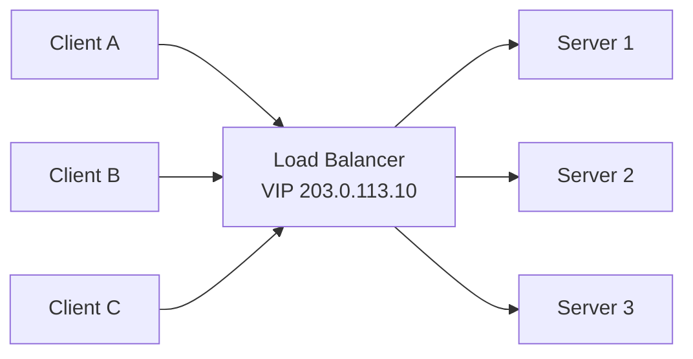

> **Staff-level insight:** Load balancing is fundamentally a *placement* problem under incomplete information. The LB never knows the true cost of a request before it routes it, and its view of backend load is always stale by one RTT. Every algorithm in section 6 is a different bet on how to act under that staleness. The best engineers talk about LBs in terms of *what information the LB has and how fresh it is* — not just "round robin vs least connections."

---

## In the Room — Staff-Level Delivery

This section is the lens. Everything below it is the material; this is *how a Staff engineer wields it under interview time pressure*. The signal you're sending is **judgment**, not encyclopedic recall. Most candidates lose points here not by being wrong but by spending five minutes explaining round robin while the actual hard part — the stateful connection layer, the data tier, the failover model — goes untouched.

### Decisions to make decisively

A Staff engineer states a default and a revisit-trigger. They never say "it depends" and stop there. Use this shape: **"&lt;choice&gt; because &lt;requirement&gt;; revisit if &lt;trigger&gt;."**

| Decision | Decisive default | Revisit trigger |
|---|---|---|
| **L4 vs L7** | L7 (ALB/Envoy) because nearly every web/API service routes on path or host and wants TLS termination + retries. | Drop to L4/NLB if it's raw TCP/UDP throughput (DB proxy, Kafka front, game server) or you need DSR for response-heavy traffic, or you front an L7 fleet. |
| **Default algorithm** | **Power-of-two-choices** (or least-connections behind a single LB) because it adapts to request cost with zero coordination. | Round robin only for genuinely uniform, short requests; consistent hashing when you need locality/affinity. |
| **When consistent hashing is required** | Use it when a key must reliably reach the *same* node: cache sharding, session/connection affinity, stateful partitioning. | If backends are stateless and fungible, do *not* reach for it — P2C is simpler and balances load better. |
| **Sticky sessions** | **Avoid.** Make backends stateless; push state to Redis/JWT. | Only accept stickiness for inherently stateful long-lived protocols (WebSocket), and even then prefer consistent-hash routing over cookie pinning. |
| **LB redundancy** | Cloud-managed LB (already a fleet) or ECMP/anycast tier. Never a single box. | VRRP/keepalived pair is acceptable only at small on-prem scale. |
| **Global routing** | Anycast (BGP-fast failover) for edge; GeoDNS latency/geo policy for app-region steering. | Geolocation policy when data-residency/compliance forces it. |

### Altitude — where to spend your minutes

**LB is usually a name-and-move-on box in a system design.** "Requests hit an L7 load balancer that terminates TLS and routes by path; it's a managed fleet so it's not a SPOF" — that's *one sentence*, and for most designs that's the correct altitude. Drawing the round-robin pointer on the whiteboard is an anti-signal.

**Deep-dive only when the LB *is* the problem.** There are exactly three situations where load balancing earns real airtime, and you should recognize them instantly:

1. **Stateful, long-lived connections** — WebSocket/gRPC-stream/SSE fan-out. This is real-time chat infrastructure. See §10. This is where you *slow down*.
2. **Consistent hashing** — when the design needs sharded caches, partitioned state, or connection affinity. See §6.5.
3. **Global routing / multi-region failover** — anycast vs GeoDNS, RTO/RPO, and the fact that the *data* tier is the real hard part. See §8.

Everything else — RR vs WRR, NAT vs DSR mechanics, the F5-vs-HAProxy table — is name-and-move-on unless the interviewer explicitly digs.

### YAGNI default + trigger

**Default to the managed cloud LB and stateless backends.** Do not propose Maglev, Katran, eBPF/XDP, custom ECMP fabrics, or hand-rolled consistent-hash rings *unless the scale forces it*. **Trigger to go deeper:** you're past the point where a single managed L7 tier or DSR-less L4 can carry the packet rate (tens of millions of pps, terabits), *or* the interviewer explicitly asks "how would you build the LB itself at hyperscale." Bringing up Katran for a 10k-RPS service is over-engineering and reads as pattern-matching, not judgment.

### Top anti-patterns (these cost you the level)

| Anti-pattern | Why it's a down-level signal | The fix |
|---|---|---|
| **Sticky sessions by default** | Says you reach for affinity instead of fixing statefulness. Breaks autoscaling, draining, rebalancing. | Stateless backends + shared store / JWT. Stickiness only for WS, via consistent hash. |
| **Ignoring the LB as a SPOF** | You drew one LB box and moved on — you haven't operated systems. | A *tier* (ECMP/anycast/managed fleet), never a box. |
| **Over-explaining round robin** | Burns minutes on the trivial 20% while the hard 80% (state, data, failover) goes untouched. | Name it in one line, move to the crux. |
| **Reflexively reaching for an ALB** | Heavier tool by reflex when L4 was correct. | Ask "do I need to route on request content?" If no, L4. |
| **"It depends"** without choosing | False humility; you didn't answer. | State a default and a trigger. |
| **Uniform thoroughness** | Same depth on everything = no judgment shown. | Risk-weight: deep on the crux, shallow on the rote. |

### Experience hooks (cite real operational scars)

These are the lines that mark you as someone who has *run* this, not just read it. The first one is bread-and-butter for real-time infra.

- *"Load-balancing WebSocket connections is the one place sticky-ness is unavoidable — the connection IS the state. We use consistent-hash routing on a connection key so a reconnect lands back on the node that holds the user's subscriptions, and we engineer for graceful connection migration on deploy because L7 draining a fleet of 100k+ live sockets means a reconnect storm if you're not careful."*
- *"We learned the hard way that a deep health check hitting the shared session store turned one Redis blip into a fleet-wide ejection — the LB marked everything unhealthy at once. We split liveness from readiness and floored ejection so we never drop below 50% of the pool."*
- *"DNS failover sounds clean until a region dies and clients keep hammering the dead IP for the full TTL because resolvers ignore your 30s TTL. That incident is why I default to anycast for fast failover and treat GeoDNS as coarse steering, not a failover mechanism."*
- *"Adding a fresh node to a hot pool crushed it — cold caches, empty connection pools — and it flapped. Slow-start ramping fixed it; now new nodes warm up over 60s before taking full share."*

> Cross-link: this lens is the module-specific instance of the general playbook in [Staff-Level Execution](20-staff-execution.md) — signal over solution, decide-don't-enumerate, altitude control, risk-weighting.

---

## 3. Layer 4 vs Layer 7

The single most important distinction. It maps to the OSI layer the LB makes decisions at. **Altitude note:** state your choice and reason in one breath (L7 default, L4 for raw throughput) — only unpack the NAT/DSR internals below if the interviewer probes the packet path or you're in the hyperscale L4 discussion (§11).

### Layer 4 (Transport — TCP/UDP)

**How it works.** The L4 LB makes a forwarding decision using only the *connection 5-tuple*: `(src IP, src port, dst IP, dst port, protocol)`. It never parses the HTTP request. It either rewrites packet headers (**NAT mode**) or forwards them untouched and lets the backend reply directly to the client (**DSR — Direct Server Return**). Once a connection is pinned to a backend, every packet of that connection goes to the same backend (connection affinity via a flow table or stateless hash).

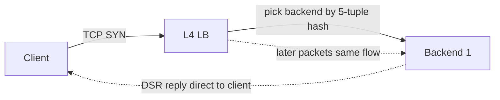

- **NAT mode:** LB rewrites dst IP to backend, rewrites src IP on the return path. Return traffic flows back through the LB. Simple, but LB is on both paths (bottleneck).
- **DSR mode:** LB only rewrites the dst MAC (L2) or encapsulates; backend replies *directly* to the client using the VIP as source. Return traffic bypasses the LB. Asymmetric and *much* higher throughput because responses (usually the bulk of bytes) skip the LB.

### Layer 7 (Application — HTTP/gRPC/etc.)

**How it works.** The L7 LB **terminates** the client TCP/TLS connection, parses the application request (HTTP method, path, headers, cookies, gRPC service), makes a content-based routing decision, then opens a *separate* connection to the backend. It's effectively a reverse proxy.

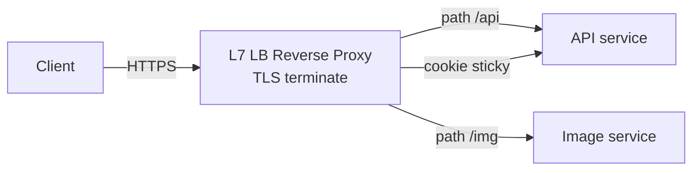

L7 unlocks: path/host routing, header & cookie routing, TLS termination, request rewriting, retries, rate limiting, request buffering, HTTP/2 ↔ HTTP/1.1 translation, response compression, WAF.

### Detailed Comparison

| Dimension | Layer 4 | Layer 7 |
|---|---|---|
| Decision input | 5-tuple only | Full app request (path, headers, cookies, body) |
| Inspects payload? | No | Yes |
| TLS | Pass-through (or TLS in NLB) | Terminates TLS (sees plaintext) |
| Routing | Connection-based, can't route by URL | Content-based: path/host/header/cookie |
| Throughput | Very high (millions of pps, can do DSR) | Lower; proxy + parse overhead per request |
| Latency added | Microseconds | Hundreds of µs to low ms |
| Connection model | Single end-to-end TCP connection | Two connections (client↔LB, LB↔backend) |
| Sees real client IP | Yes (until NAT) | Needs `X-Forwarded-For` / PROXY protocol |
| Retries / circuit-break | No (connection-level only) | Yes (request-level) |
| HTTP/2, gRPC, WebSocket awareness | No (passes bytes through) | Yes (can multiplex, route, upgrade) |
| Stickiness | By source IP / flow hash | By cookie (precise) |
| Cost / complexity | Lower | Higher (CPU for parse + TLS) |
| Examples | AWS NLB, IPVS/LVS, Maglev, Katran | AWS ALB, Nginx, HAProxy, Envoy, Traefik |

### Where each sits

A common, very interview-friendly pattern is **L4 in front of L7**: a stateless L4 layer (cheap, fast, handles DDoS volumetric traffic and spreads to many L7 instances) fronting a fleet of L7 proxies that do the smart routing. Hyperscalers do exactly this — Maglev (L4) in front of GFE (L7) at Google; Katran (L4) in front of proxygen (L7) at Meta.

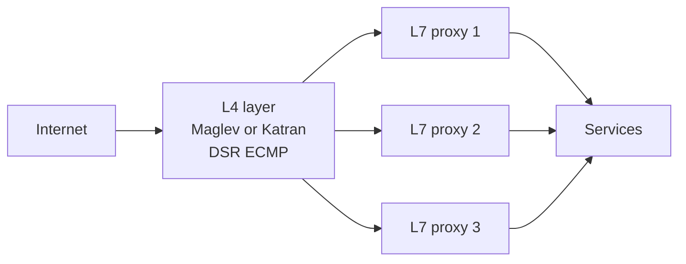

**A WebSocket-specific subtlety (earmark — this is a hard part):** L4 happily carries a WebSocket connection because to it a WS connection is just a long-lived TCP flow pinned by 5-tuple. An L7 proxy must explicitly *understand the HTTP Upgrade handshake* (`Connection: Upgrade`, `Upgrade: websocket`) and then switch into transparent byte-tunnel mode for the lifetime of the socket. Misconfigured L7 proxies that buffer or apply idle timeouts will silently kill long-lived sockets. This is why some real-time fleets put **L4 (NLB) in front of the WebSocket tier** to avoid L7 idle-timeout and buffering hazards, and do the smart routing one layer in. (Full treatment in §10.)

> **Staff-level insight:** "Use L7" is not a free lunch. L7 termination means the LB now holds *state* per request, must parse untrusted input (attack surface), and doubles your connection count. For a service that's pure TCP throughput — a database proxy, a Kafka front, a gaming UDP server — L4 with DSR is the right answer, and saying "I'd put an ALB in front" reveals you reached for the heavier tool reflexively. The discriminating question to ask yourself: *do I need to route on the content of the request?* If no, stay at L4.

### The gRPC / HTTP-2 trap (a near-guaranteed 2026 probe — get this right)

There is one place where "L4 for raw throughput" is exactly *wrong*, and it's the most common load-balancing gotcha at Google/Uber/Stripe: **gRPC (and any HTTP/2 service) multiplexes many requests over a few long-lived connections.** An L4 LB balances *connections*, not requests — so once a client opens its handful of HTTP/2 connections, **every subsequent request rides those same pinned connections to the same 2–3 backends**, and the rest of your fleet sits idle. Scaling out does nothing; the new pods get no traffic. This is why "I'll put an NLB in front of my gRPC services" is a trap answer.

The fixes, in order of how they'll be probed:
- **L7 / per-request balancing.** An HTTP/2-aware proxy (Envoy, or an L7 mesh sidecar) load-balances individual *streams*, not connections — so requests spread even over one connection. This is the default correct answer.
- **Client-side / lookaside balancing (xDS).** gRPC clients can balance themselves: a control plane (xDS / gRFC A27, or the older `grpclb`) pushes the backend list, and the client round-robins requests across its own subchannels — no proxy hop. This is what large gRPC fleets actually run.
- **Connection recycling.** Even with L7, set `MAX_CONNECTION_AGE` (+ grace) on the server so long-lived HTTP/2 connections periodically drain and re-resolve — otherwise a scale-out event never rebalances existing clients onto the new backends.
- **The Kubernetes footgun to name:** a default `ClusterIP` Service balances via **kube-proxy at L4 (iptables/IPVS)** — so in-cluster gRPC hits exactly this pinning problem. The fixes are a **headless Service** (client sees all pod IPs and balances itself) or a real mesh/L7 proxy. Saying this unprompted is a strong signal.

One-line version for the room: *"gRPC is HTTP/2, so L4 pins it to a few backends — I balance per-request at L7 or with client-side xDS, and recycle connections with MAX_CONNECTION_AGE so scale-out actually rebalances."*

---

## 4. GSLB vs Local LB

**Definition.** *Local* load balancing distributes traffic across servers within a single data center / region. **GSLB (Global Server Load Balancing)** distributes traffic across *multiple geographic locations* — picking which region/PoP a user goes to before local LB even sees them.

| | Local LB | GSLB |
|---|---|---|
| Scope | One DC / AZ / region | Across regions & continents |
| Mechanism | L4/L7 proxy, VIP | DNS-based steering, Anycast, health of whole sites |
| Decides | Which *server* | Which *site/region* |
| Failure domain | Server / rack | Region / DC / submarine cable |
| Latency goal | Even spread | Nearest healthy region |
| Reaction time | Health-check time (sub-second to seconds) | DNS TTL time (tens of seconds to minutes) |
| Examples | Nginx, Envoy, NLB | Route 53, NS1, Akamai GTM, Cloudflare, GCP Global LB |

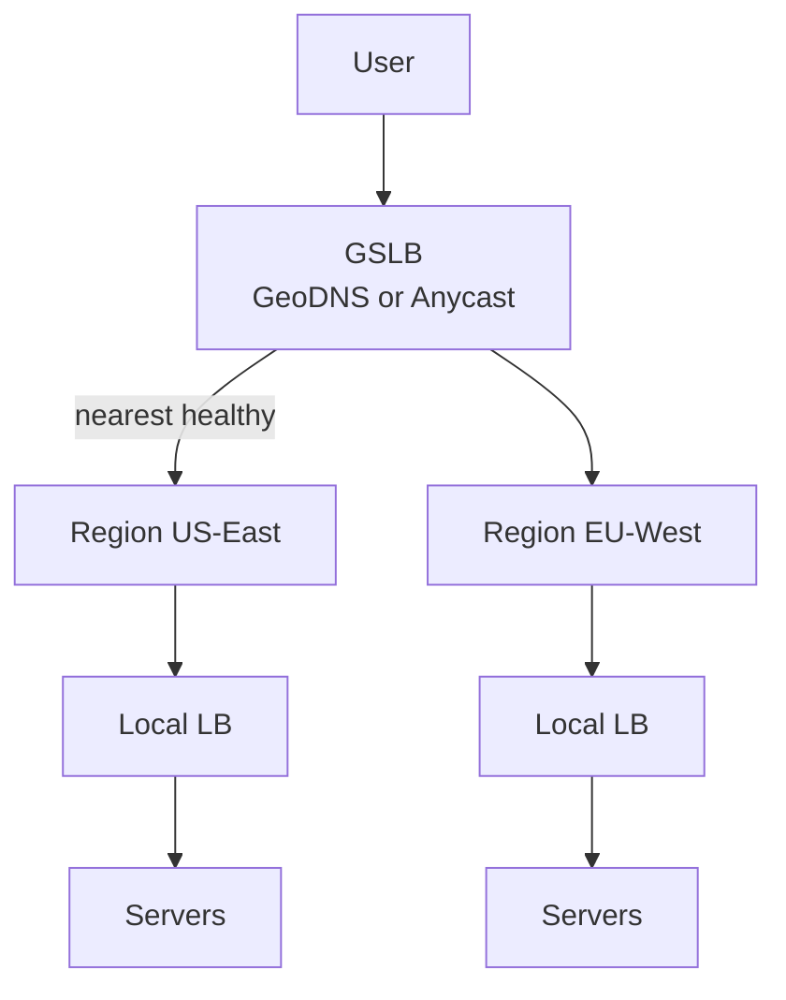

> **Staff-level insight:** GSLB and local LB operate on completely different control loops and timescales. GSLB reacts in *DNS TTL time* (tens of seconds to minutes — slow, coarse, and at the mercy of resolver caching), while local LB reacts in *health-check time* (sub-second to seconds, precise). A classic incident: a region goes down, GSLB flips the DNS record, but clients keep hitting the dead region for the full TTL because resolvers and the OS cache the old answer. This is why anycast (BGP-time failover, see §8) is preferred over GeoDNS for fast global failover. **Decisive stance:** use GeoDNS for *steering* (which region should a healthy user prefer), and anycast or in-region health logic for *failover* (which region is actually up right now). Don't conflate the two.

---

## 5. Hardware vs Software vs Cloud LBs

**Altitude note:** this is a name-and-move-on table. In a design, say "managed cloud LB" and move on unless you're in a regulated on-prem context or the interviewer asks about the build-vs-buy tradeoff.

| Category | Examples | Pros | Cons | When |
|---|---|---|---|---|
| **Hardware appliance** | F5 BIG-IP, Citrix NetScaler, A10 | Line-rate throughput, dedicated ASIC/SSL offload, mature WAF | $$$$ (six figures), slow to scale, lock-in, ops-heavy | Regulated enterprises, on-prem, fixed huge throughput |
| **Software (host)** | HAProxy, Nginx, Envoy, Traefik, IPVS/LVS | Cheap, flexible, GitOps-able, runs on commodity HW | You operate it, you scale it | Self-managed clusters, k8s ingress, mesh data plane |
| **Cloud managed** | AWS ALB/NLB/GWLB, GCP LB, Azure LB/App Gateway | Zero ops, auto-scale, integrated w/ cloud | Per-LCU cost, less control, vendor coupling | Default for cloud-native apps |

### The software contenders

- **HAProxy** — the workhorse L4/L7 TCP/HTTP LB. Extremely fast, rock-solid, great for raw proxying. Less of a config-via-API story. Strong WebSocket support and tunable timeouts make it a common real-time-tier choice.
- **Nginx** — reverse proxy + web server + L7 LB. Ubiquitous, great for static + proxy + simple routing. Watch `proxy_read_timeout` for long-lived WS.
- **Envoy** — modern L7 proxy built for **dynamic** config (xDS API), observability (stats/tracing baked in), HTTP/2 & gRPC first-class. The data plane of Istio/most service meshes and of cloud-native API gateways. If you only learn one, learn Envoy. Ships `ring_hash`, `maglev`, and P2C LB policies out of the box.

### Cloud LB families (know these cold for AWS-flavored interviews)

| AWS | Layer | Notes |
|---|---|---|
| **NLB** (Network LB) | L4 | Millions of pps, ultra-low latency, static IP / Elastic IP, preserves client IP, TLS passthrough or termination, can do flow-hash stickiness. Common choice in front of WebSocket fleets. |
| **ALB** (Application LB) | L7 | HTTP/HTTPS/gRPC/WebSocket, path & host routing, target groups, WAF integration, OIDC auth. Note its **idle timeout** (default 60s) kills quiet WebSockets — tune it or send heartbeats. |
| **GWLB** (Gateway LB) | L3/4 | Transparent insertion of virtual appliances (firewalls/IDS) via GENEVE encap |
| **CLB** (Classic, legacy) | L4/L7 | Deprecated; don't propose for new designs |

GCP's **Global External HTTP(S) LB** is the standout: a single global *anycast* VIP fronting backends in many regions — one IP, automatically routes users to the nearest healthy backend. AWS has no true single-IP global L7 equivalent (you use Route 53 / Global Accelerator on top of regional ALBs). **AWS Global Accelerator** is AWS's anycast-IP front for sending users to the nearest region over the AWS backbone.

> **Staff-level insight:** The interview-distinguishing point about GCP's global LB vs AWS's model is *where the global decision lives*. GCP makes it in the network (anycast VIP + Maglev), so failover is BGP-fast and there's one IP. AWS makes it in DNS (Route 53) unless you add Global Accelerator. When someone designs "a global app on AWS" and just says "ALB," push them: an ALB is regional. You need Route 53 latency/geo routing or Global Accelerator on top. Naming the regional-vs-global boundary correctly is a senior signal.

---

## 6. Algorithms

The LB's brain. Each algorithm is a different policy for picking a backend given (possibly stale) load information.

**Altitude note — read this before reading the subsections.** Only three of these earn airtime in a real interview: **power-of-two-choices** (the default at scale), **consistent hashing** (when you need affinity/sharding), and **least-connections** (the adaptive single-LB default). Round robin, weighted RR, and IP hash are name-and-move-on. Maglev and rendezvous come up only in the hyperscale-L4 or cache-sharding discussion. Spend your minutes accordingly.

### 6.1 Round Robin & Weighted Round Robin

**Round Robin (RR).** Hand out requests cyclically: backend 1, 2, 3, 1, 2, 3… Stateless, trivially fair *if* all servers are identical and all requests cost the same.

**Weighted Round Robin (WRR).** Assign each backend a weight; a backend with weight 3 gets 3× the requests of a weight-1 backend. Used when servers have different capacity (mixed instance types) or for gradual rollout (send 5% to canary).

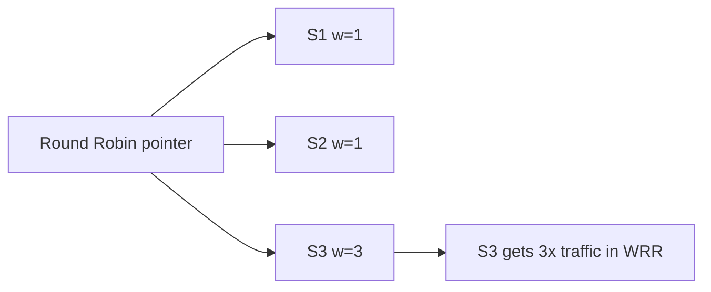

| | Round Robin | Weighted RR |
|---|---|---|
| State needed | A counter | Counter + weights |
| Good when | Homogeneous servers, uniform requests | Heterogeneous capacity, canary |
| Blind to | Actual server load, request cost | Same |

**Pitfall:** RR is blind to request cost. One backend can get all the "expensive" requests by bad luck and fall over while others idle. RR also interacts badly with long-lived connections (WebSocket/gRPC) — a server that comes up after the others stays underloaded forever because RR distributes *new connections*, not active load. (This is exactly the trap in the WebSocket fleet of §10: balancing connection *counts* via RR does not balance *active load*, because a node with the same number of sockets can be carrying 10× the message throughput.)

> **Staff-level insight:** Round robin's hidden failure mode at scale is **synchronized retry storms** and **the "new node gets crushed"** problem. When you add a fresh node to a busy pool, RR/least-conn will dump a flood of new connections onto it before it's warm (cold caches, JIT not warmed, connection pools empty), causing it to time out and get marked unhealthy — a flap loop. That's what *slow start* (§7) exists to fix. Mentioning slow start unprompted here is a strong signal.

### 6.2 Least Connections & Least Response Time

**Least Connections.** Route to the backend with the fewest *active* connections. Adapts to request cost: a backend stuck on slow requests accumulates connections and gets fewer new ones. Great for long-lived/variable-duration workloads. **Decisive note:** behind a *single* LB this is the right adaptive default. Across a *fleet* of LBs it breaks (see the herd pitfall) — use P2C instead.

**Least Response Time.** Route to the backend with the lowest (active connections × EWMA response time), i.e., factor in measured latency, not just connection count. Even more adaptive; more state.

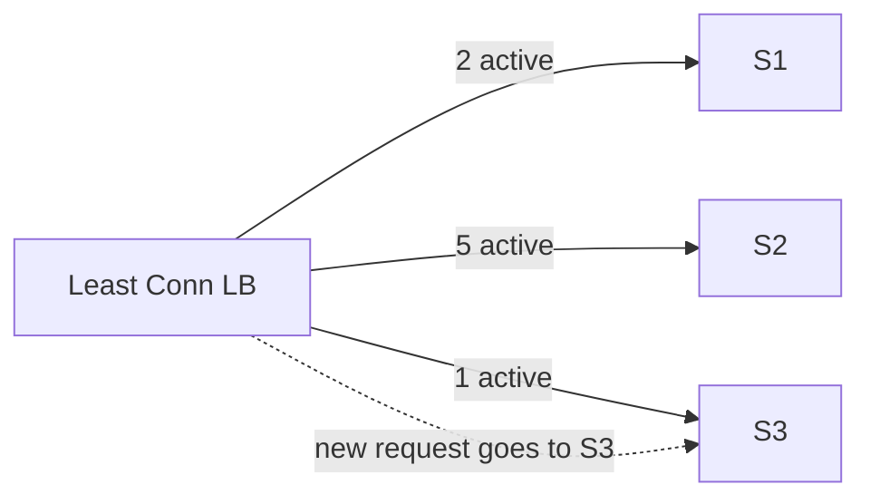

| | Least Connections | Least Response Time |
|---|---|---|
| Signal | Active conn count | Conn count + latency EWMA |
| Adapts to | Slow backends | Slow *and* high-latency backends |
| State / cost | Per-backend counter | Counter + latency tracking |
| Best for | Variable request durations | Latency-sensitive, mixed workloads |

**Pitfall — the herd problem:** In a *distributed* LB tier (many LB instances each tracking their own view of "least connections"), every LB independently thinks the same backend is least-loaded and they all pile onto it simultaneously. Global "least connections" requires shared state that's expensive and stale. This is precisely the gap that power-of-two-choices closes.

> **Staff-level insight:** "Least connections" sounds optimal but it requires the LB to *know* every backend's connection count — easy with one LB, impossible to do accurately across a fleet of LBs without synchronization. The real-world answer at scale isn't perfect global least-connections; it's **power-of-two-choices**, which gets ~95% of the benefit with *zero* coordination. Knowing this is the line between a textbook answer and a practitioner's answer.

### 6.3 Power of Two Choices (the best cheap trick)

**Definition.** Instead of picking the globally least-loaded backend (needs global state) or a random backend (ignores load), pick **two backends at random and send to the less loaded of the two.**

**Why it's so good.** This is the famous *"power of two choices"* result (Mitzenmacher / Azar-Broder-Karlin-Upfal). With pure random placement, the maximum load on any server grows like `log n / log log n` above average. With *d* random choices, max load ≈ ln ln n / ln d + Θ(1) — for d=2 that's roughly log₂ ln n, i.e. doubly-logarithmic, vs ln n / ln ln n for pure random. The big win is going from 1 to 2 choices; more than 2 gives diminishing returns. Two is the sweet spot: almost all the benefit, almost no cost.

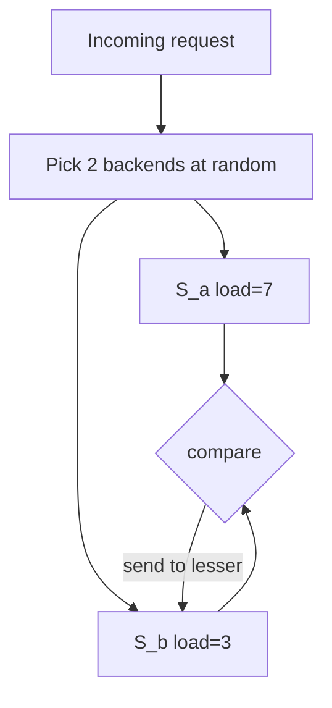

| Strategy | Coordination needed | Max load vs average | Cost |
|---|---|---|---|
| Pure random | None | ~ log n / log log n | O(1) |
| **Power of two choices** | None | ~ log log n | O(1), two reads |
| Global least-loaded | Full global state | ~ 1 (optimal) | Expensive/stale |

Real use: **Nginx** `random two least_conn`; in **Envoy** P2C is the mechanism behind its `LEAST_REQUEST` policy (its actual *default* policy is round-robin — quote this correctly), and P2C is the de-facto choice for distributed LB tiers and service meshes because it needs no shared state.

> **Staff-level insight:** P2C is one of the highest leverage-to-complexity ideas in all of systems design. The reason it works isn't magic — it's that the *worst* outcome of random (everyone independently picking the same hot node) is broken by giving each decision a second, independent sample. In an interview, if you can explain *why* two choices is exponentially better than one but three is barely better than two, you've demonstrated genuine depth. Also note: P2C degrades gracefully with stale load info, which is exactly why meshes love it. **This is the algorithm to name as your default** when an interviewer asks "what load-balancing algorithm would you use" for a stateless fleet at scale.

### 6.4 Hash-Based: IP / Source Hash

**Definition.** Compute `hash(client_IP) mod N` (or hash a header/cookie) to pick a backend. The same client deterministically lands on the same backend — this gives **stateless session affinity** without storing any mapping.

**Pitfall — the modulo catastrophe.** `hash(key) mod N` looks innocent but is a trap: when `N` changes (you add or remove one server), *almost every key remaps* to a different server. With N→N+1, roughly `N/(N+1)` of all keys move. For a cache fronted by such a hash, adding one node invalidates ~the whole cache → thundering herd to the origin. This is the exact problem consistent hashing solves.

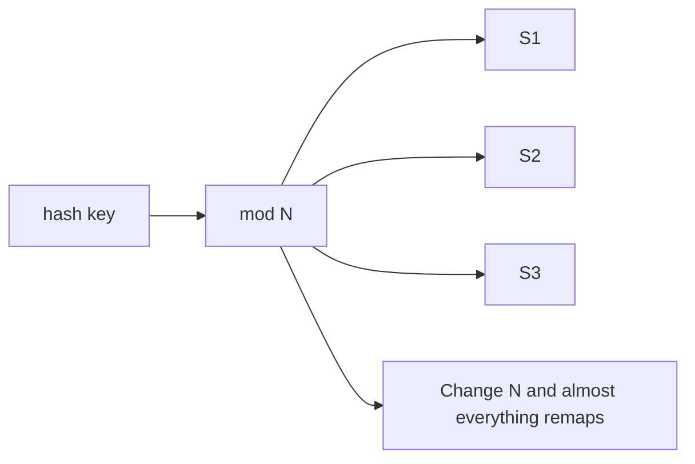

> **Staff-level insight:** Source-IP hash for stickiness has a subtle real-world bug: large populations of clients sit behind a *single NAT/proxy IP* (corporate networks, mobile carriers, CGNAT). Those thousands of users all hash to one backend → severe imbalance. So "hash the IP" doesn't even reliably give you balance, let alone stickiness for individual users. Cookie-based affinity (L7) is the correct tool when you genuinely need stickiness — and for WebSocket fleets, consistent-hash on a stable connection key (user ID), *not* source IP, is what you want (§10).

### 6.5 Consistent Hashing (DEEP)

This is the most important algorithm in distributed systems load balancing. Master it. **This is a deep-dive section — when sharding, partitioning, or affinity comes up, this is where you slow down and whiteboard.**

#### The problem it solves

With `hash(key) mod N`, changing `N` remaps almost all keys. We want a hashing scheme where **adding or removing one node only remaps `K/N` keys** (the keys that node owns), leaving everything else untouched. That's consistent hashing.

#### How it works: the ring

1. Map the output of the hash function onto a **circular keyspace** — imagine a ring numbered `0 .. 2^32 - 1`, wrapping around.
2. **Place each server** on the ring by hashing its identifier: `hash(server_id)`.
3. **Place each key** on the ring by hashing the key: `hash(key)`.
4. To find a key's owner, walk **clockwise** from the key's position until you hit the first server. That server owns the key.

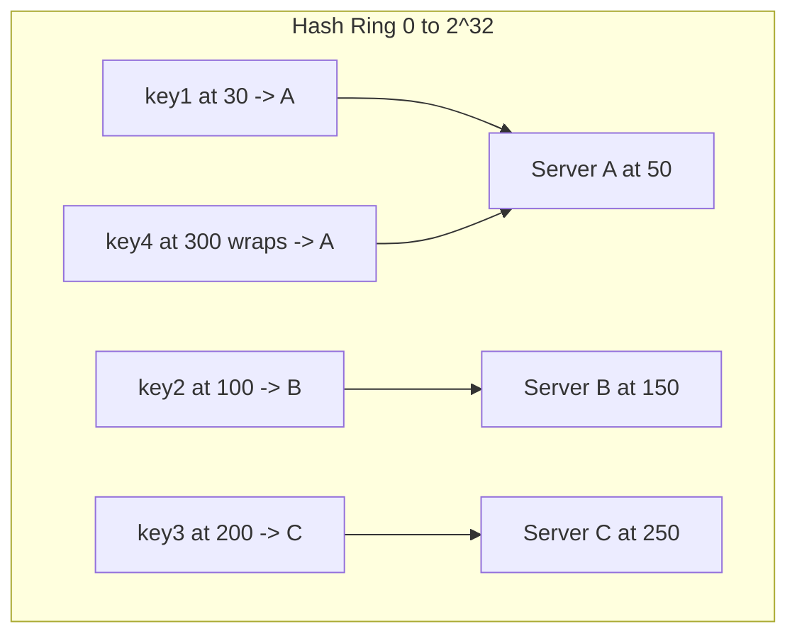

Keys 0–50 → A, 51–150 → B, 151–250 → C, 251–2^32 → wraps to A. Each server owns the arc *between the previous server and itself*.

#### Why it minimizes remap

When you **add server D** at position 200 (between B and C):

- Only keys in the arc `(150, 200]` — formerly owned by C — now move to D.
- **Every other key stays put.** A's keys, B's keys, and C's keys outside that arc are untouched.

When you **remove server B**:

- Only B's keys (the arc it owned) move to the next clockwise server (C). Nothing else moves.

In both cases only **~K/N keys** move (where K = total keys, N = nodes), versus *almost all K* with naive modulo.

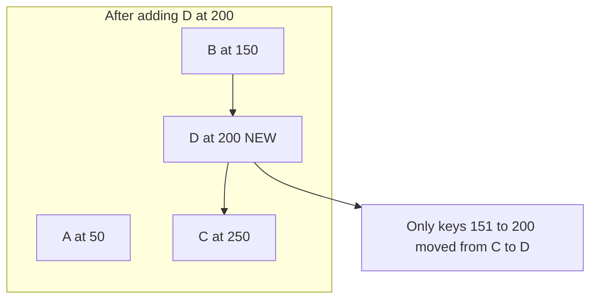

#### Worked example (numbers) — expanded

Say 1,000,000 cached keys, 4 nodes (~250k keys each), and a hash space of `2^32`.

**Step-by-step for adding a 5th node:**

1. Before: 4 nodes own ~25% of the ring each (with vnodes, evenly). 1,000,000 keys / 4 ≈ 250,000 keys/node.
2. The 5th node is placed at many vnode positions. It carves out arcs from the *existing* nodes — collectively it should end up owning ~1/5 of the ring (200,000 keys).
3. Those ~200,000 keys are the *only* ones that move. They migrate from whichever node previously owned each arc to the new node. The other ~800,000 keys never move.
4. Compare to naive `mod 4 → mod 5`: a key at index `h` moves unless `h mod 4 == h mod 5`, which is true for only ~1/5 of keys — so ~800,000 keys move. **The inverse of consistent hashing.**

| Action | Naive `mod N` keys remapped | Consistent hashing keys remapped |
|---|---|---|
| Add 5th node | ~800,000 (≈ 4/5 of all) | ~200,000 (the new node's share) |
| Remove 1 node | ~750,000 | ~250,000 (just that node's keys) |
| Replace 1 node (remove+add same position) | ~all | ~250,000 once (or near-zero if same ring position reused) |

Consistent hashing turns a cache-wide invalidation into a localized one-node reshuffle. **Why this matters operationally:** with naive hashing, a single autoscaling event during a traffic spike triggers an ~80% cache miss rate → the origin gets hit by 5× its normal read load *at the worst possible moment*. That's a self-inflicted outage. Consistent hashing caps the blast radius at one node's share.

#### Virtual nodes (the crucial refinement)

**Problem:** With only one point per server, the arcs are uneven (random placement → some servers own huge arcs, some tiny). One server can own 3× the keys of another. Also, when a server dies, *all* its load dumps onto exactly one neighbor.

**Solution: virtual nodes (vnodes).** Place each physical server at **many** points on the ring (e.g., 100–200 vnodes per server, via `hash(server_id + "#" + i)`). Now:

- Load smooths out (law of large numbers → arcs even out; with ~100–200 vnodes the imbalance drops to a few percent).
- When a server dies, its many small arcs scatter their load across **many** neighbors, not one.
- Weighting is trivial: give a bigger server *more* vnodes.

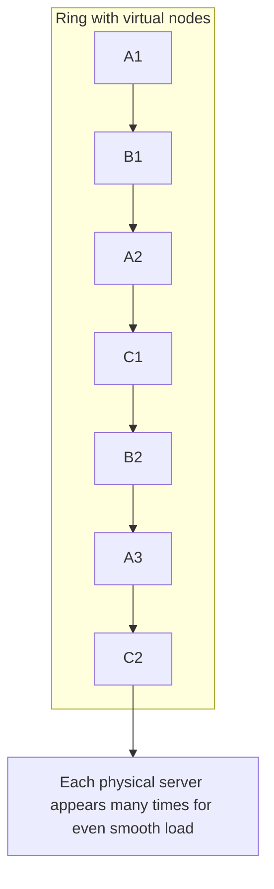

| | Plain consistent hashing | With virtual nodes |
|---|---|---|
| Load balance | Uneven (up to ~2-3x skew) | Even (~few % skew) |
| Failure redistribution | All to one neighbor | Spread across many |
| Weighting | Hard | Easy (more vnodes = more load) |
| Memory | N points | N × vnodes points |

#### Where it's used (name-drop these)

- **Caches:** Memcached client rings, Twemproxy. (Redis Cluster is *not* consistent hashing — it uses fixed CRC16(key) mod 16384 hash-slot sharding with explicit slot-to-node assignment, an alternative to consistent hashing.)
- **Databases / sharding:** Amazon DynamoDB & Apache Cassandra (Dynamo-style partitioning), Riak, ScyllaDB.
- **CDNs:** mapping objects → cache nodes at a PoP.
- **Service discovery / LB:** Envoy `ring_hash` and `maglev` policies for sticky-but-resilient routing.
- **Stateful connection routing:** mapping a user/connection key → the chat node that holds their live WebSocket and subscriptions (see §10) — so a reconnect lands back on the right node and node churn only disrupts ~K/N connections.

> **Staff-level insight:** The two failure modes interviewers probe are (1) *hot keys* — consistent hashing balances *keyspace*, not *load*; one viral key still pins one node regardless of vnodes (mitigate with key splitting, replication of hot keys, or a small per-LB cache). In a chat system this is the *celebrity/megachannel* problem: one channel with 5M subscribers can't live on one node — you shard the fan-out. And (2) *bounded loads* — vanilla consistent hashing can still overload a node if traffic is skewed; **consistent hashing with bounded loads** (used by Google's cloud LB / popularized by Vimeo's engineering blog) caps each node at `(1+ε)` × average and overflows clockwise. Bringing up "consistent hashing doesn't balance *load*, only *keys*, and here's how bounded-loads fixes it" is a top-tier answer.

### 6.6 Maglev & Rendezvous Hashing

**Maglev hashing** (Google) — a *consistent-hashing-like* scheme designed for L4 LBs that prioritizes two things: (1) near-perfect even distribution and (2) minimal disruption when backends change, computed as a **fixed-size lookup table** (e.g., 65537 entries) rather than a ring walk. The table is cheap to look up per packet (O(1) array index) — essential at millions of packets/sec. Trade-off vs ring hashing: Maglev gives *better balance* but allows *slightly more disruption* than ideal consistent hashing on changes. Envoy ships a `maglev` policy.

**Rendezvous (Highest Random Weight, HRW) hashing** — for each key, compute `hash(key, node)` for *every* node and pick the node with the highest score. Adding/removing a node only affects keys whose top choice was that node. No ring, no vnodes, naturally weighted, dead simple to implement. Downside: O(N) per lookup (fine for small N like CDN tiers or a handful of replicas).

| | Consistent (ring) | Maglev | Rendezvous (HRW) |
|---|---|---|---|
| Lookup cost | O(log V) ring search | O(1) table | O(N) |
| Balance quality | Good w/ vnodes | Excellent | Excellent |
| Disruption on change | Minimal | Small (slightly > ring) | Minimal |
| Best for | Caches, sharding | L4 packet LBs at line rate | Small N, replica selection |

> **Staff-level insight:** The reason Google built Maglev hashing instead of using a classic ring is *per-packet performance at line rate*. A ring walk is a logarithmic search; at 10M+ pps you want a single array index. Maglev trades a hair of consistency for a lookup table that fits in cache. This is a recurring theme: at the L4 packet layer, **the constant factor of the lookup dominates** the asymptotics — you optimize for cache-friendly O(1), not theoretical minimal-disruption.

### 6.7 Algorithm Cheat Table

| Algorithm | State | Balances by | Sticky? | Best when | Avoid when |
|---|---|---|---|---|---|
| Round Robin | counter | request count | no | homogeneous, uniform cost | variable cost, long-lived conns |
| Weighted RR | counter+weights | weighted count | no | heterogeneous capacity, canary | dynamic load shifts |
| Least Connections | conn counts | active conns | no | variable durations, single LB | distributed LB (herd) |
| Least Response Time | conns+latency | conns × latency | no | latency-sensitive | need simplicity |
| Power of Two Choices | none | sampled load | no | distributed LB / mesh, at scale | tiny pools |
| Source/IP Hash | none | hash of IP | yes (coarse) | cheap affinity | NAT'd clients, churn |
| Consistent Hashing | ring | hash of key | yes | caches, sharding, CDN, WS routing | hot keys (needs bounded loads) |
| Maglev | lookup table | hash of flow | yes (flow) | L4 LB at line rate | small N |
| Rendezvous (HRW) | none | max hash score | yes | small N, replica pick | large N |

**One-line default to memorize:** *Stateless fleet → P2C. Need affinity/sharding → consistent hashing with vnodes. Single LB, variable durations → least-connections. Everything else is a special case.*

---

## 7. Health Checks & Resilience

A load balancer is only as good as its picture of which backends are alive. **This section punches above its weight in interviews** because the failure modes here (health-check-induced outages, sticky-session traps, draining) are exactly the operational scars that distinguish someone who has run systems.

### Active vs Passive health checks

| | Active | Passive (outlier detection) |
|---|---|---|
| How | LB *probes* each backend periodically (`GET /healthz`, TCP connect) | LB *observes real traffic* — counts errors/timeouts on live requests |
| Detects | Backend down, slow, bad version | Backend serving errors / latency to *real* requests |
| Latency to detect | Probe interval (e.g., every 5s) | As fast as errors arrive |
| Cost | Extra probe traffic | Free (rides on real traffic) |
| Blind spot | "Healthy probe, broken endpoint" | Needs real traffic to learn |
| Best practice | **Use both** | **Use both** |

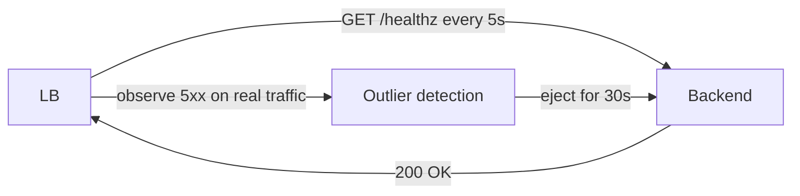

**Outlier detection** (Envoy term): a *passive* mechanism that ejects a backend from the pool when it returns too many consecutive 5xx / gateway errors / timeouts, then *re-admits* it after a cooldown (with exponential backoff for repeat offenders). This catches "passes /healthz but actually broken" cases active probing misses.

**Health-check design pitfalls:**
- **Deep vs shallow checks.** A health check that hits the DB on every probe means one DB blip marks *every* backend unhealthy at once → total outage. Keep liveness checks shallow; use separate readiness logic.
- **Cascading failure via health checks.** If a dependency is slow, deep health checks fail across the fleet simultaneously → LB has *zero* healthy backends → it may fail open (send to all) or fail closed (drop all). Decide which on purpose. **Decisive stance: fail open** when all backends are "unhealthy" — a fleet-wide health failure is almost always a *check* problem (shared dependency) rather than a real fleet death, and sending traffic to maybe-degraded backends beats dropping 100%.
- **Flapping.** Thresholds too tight → nodes oscillate in/out. Use `N` consecutive successes to re-add, `M` consecutive failures to remove (hysteresis).

### Connection draining / graceful shutdown

When you remove a backend (deploy, scale-in), **don't kill in-flight requests.** *Draining* = stop sending it *new* connections but let existing ones finish, up to a timeout (e.g., 30–300s). The backend should: fail its readiness probe → LB stops new traffic → finish in-flight → then terminate. In Kubernetes this is `preStop` hook + `terminationGracePeriodSeconds`; in ALB it's "deregistration delay."

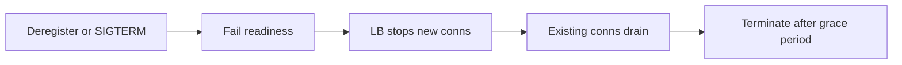

**Earmark — draining a WebSocket fleet is genuinely hard.** Draining assumes connections *finish* on their own within a grace window. WebSockets don't — they're meant to live for hours. You can't wait out a 4-hour socket on every deploy. So the real strategy is *graceful connection migration*: signal clients to reconnect (server sends a close frame with a "please reconnect" code), spread the reconnects over a window to avoid a thundering herd, and rely on consistent-hash routing so reconnects redistribute sanely. See §10.

### Sticky sessions / session affinity (and why to avoid)

**Definition.** Pin a given client to the same backend across requests — via cookie (L7, `Set-Cookie: AWSALB=...`) or source-IP hash (L4).

**Why people want it:** in-memory session state on the server; warm per-user caches.

**Why to avoid it:**
- **Uneven load** — heavy users pin to specific nodes; you can't rebalance.
- **Lost sessions on deploy / node death** — that user's state is gone.
- **Breaks autoscaling** — new nodes don't get existing sticky traffic; old nodes can't drain cleanly.
- **It's a band-aid for statefulness.** The right fix is to make backends *stateless* — push session state to a shared store ([Caching](03-caching.md): Redis/Memcached) or a signed token (JWT). Then *any* backend can serve *any* request and you can use the best LB algorithm freely.

| Approach | Affinity | Resilient to node loss | Scales | Verdict |
|---|---|---|---|---|
| Sticky sessions (cookie/IP) | yes | no | poorly | avoid; legacy |
| Stateless + shared session store | n/a | yes | yes | preferred |
| Stateless + JWT/token | n/a | yes | yes | preferred for auth |
| Consistent-hash routing on conn key | yes (graceful) | partial (K/N on churn) | yes | the *right* affinity for stateful WS |

**Decisive stance:** avoid sticky sessions as a default. The *only* legitimate case is an inherently stateful, long-lived protocol where the connection itself is the state — and even there, prefer **consistent-hash routing on a stable connection key** over cookie/IP pinning, because consistent hashing degrades gracefully under churn (K/N affected) whereas cookie pinning loses state hard on node death.

### Slow start

When a backend first joins (or rejoins after being unhealthy), ramp its traffic up *gradually* over a window (e.g., 30–60s) instead of giving it a full share instantly. This lets caches warm, connection pools fill, and JIT compile before it takes full load — preventing the "new node gets crushed and flaps" failure from §6.1. Supported in Envoy (`slow_start_config`), Nginx Plus, HAProxy (`slowstart`).

> **Staff-level insight:** The most dangerous interaction in this whole module is **deep health checks + shared dependency + aggressive ejection**. When a shared DB hiccups, every backend's deep health check fails simultaneously, the LB ejects the *entire* fleet, and now you have a full outage caused by a *minor* DB blip — the health-check system amplified a small problem into a catastrophe. Senior answer: health checks must distinguish *liveness* (is the process up?) from *readiness/dependency health*, fail-open when "all backends unhealthy," and use outlier detection with a floor (never eject below X% of the pool — Envoy's `healthy_panic_threshold`, often 50%). This is a real scar to cite, not a textbook caveat.

---

## 8. Global Load Balancing & Anycast

Getting users to the *right region* before any local LB runs. Two big mechanisms: **GeoDNS** and **Anycast**. **This is a deep-dive section when the design is multi-region** — and remember the recurring theme: the LB part is the easy 20%, the data tier is the hard 80%.

### GeoDNS / Geo routing

The DNS resolver returns *different IPs depending on where the query comes from*. A user in Frankfurt resolving `app.example.com` gets the EU region's IP; a user in Virginia gets the US IP.

- **How:** authoritative DNS (Route 53, NS1, Cloudflare) inspects the resolver's IP (or EDNS Client Subnet) and applies a *routing policy* to choose the answer.
- **Weakness:** DNS is cached at OS, browser, and resolver — failover is bounded by **TTL** (and many resolvers ignore low TTLs). It sees the *resolver's* location, not the user's (unless EDNS Client Subnet is supported).

### DNS routing policies (Route 53 vocabulary — know these)

| Policy | Behavior | Use case |
|---|---|---|
| **Simple** | One record, one answer | Single region |
| **Weighted** | Split traffic by percentage | Canary, A/B, gradual region migration |
| **Latency-based** | Send to region with lowest measured latency *from the resolver* | Global low-latency apps |
| **Geolocation** | Route by user's continent/country | Data residency, localized content, compliance |
| **Geoproximity** | Route by geographic distance, with a "bias" knob | Tune region pull |
| **Failover** | Primary → secondary when primary health check fails | Active-passive DR |
| **Multivalue** | Return multiple healthy IPs, client picks | Poor-man's LB + health-aware DNS |

### Anycast (the powerful one)

**Definition.** **The same IP address is announced from many locations** (PoPs) via **BGP**. The internet's routing fabric naturally delivers each user's packets to the *topologically nearest* PoP announcing that prefix. One IP, served from dozens of cities.

**How it works:**
1. Each PoP runs a router that **BGP-advertises** the same prefix (e.g., `203.0.113.0/24`) to its upstream ISPs.
2. Anycast routes each client to the PoP chosen by its network's BGP policy (usually but not always the topologically nearest); AS-path length is only a secondary tiebreaker after policy (LOCAL_PREF). It lands at that policy-chosen PoP for each user.
3. If a PoP goes down, it **stops advertising** the prefix; BGP reconverges and routes those users to the next-nearest PoP — **automatically, in seconds, with no DNS change.**

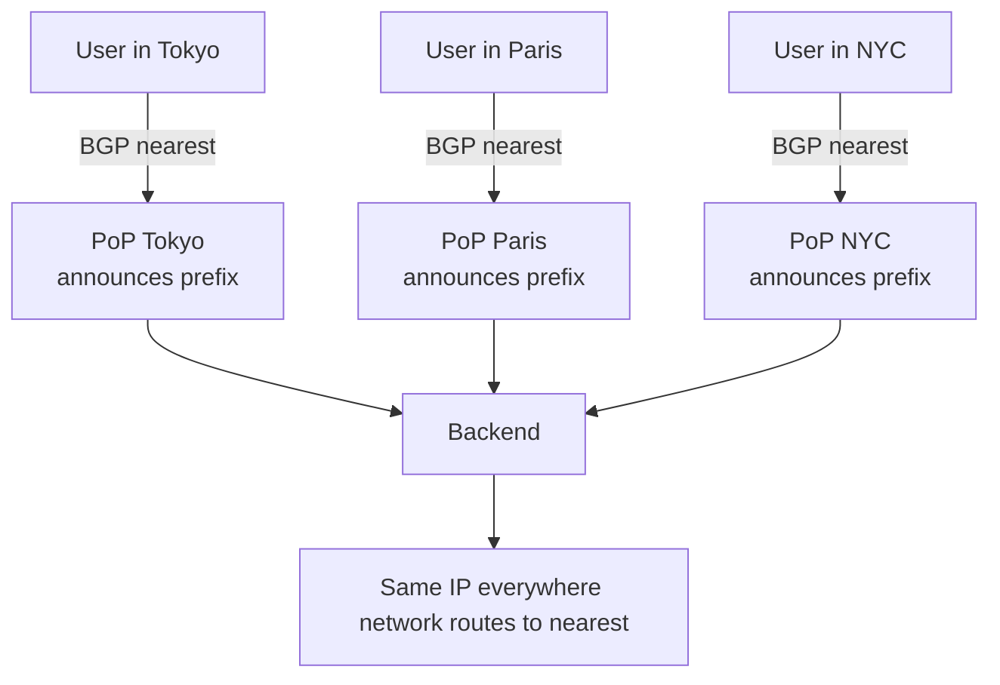

**Anycast vs GeoDNS:**

| | GeoDNS | Anycast |
|---|---|---|
| Decision point | DNS resolution | IP routing (BGP) |
| Failover speed | TTL-bound (slow, resolver-cached) | BGP reconvergence (seconds) |
| Sees user location | Resolver's IP (approx) | True network topology |
| Granularity | Per-record | Per-prefix |
| Stable IP? | Multiple IPs | **One IP** |
| Hard parts | TTL/caching | BGP ops, TCP session pinning |
| Used by | App-level region steering | CDNs, DNS roots, DDoS scrubbing |

**Why anycast is the backbone of CDNs and DNS:** Cloudflare, Google Public DNS (8.8.8.8), and the DNS root servers all use anycast so that one IP serves the whole world from the nearest edge — instant locality and instant failover.

**Anycast caveat (TCP) — earmark, this is the crux of the anycast discussion:** Because routing can shift mid-connection (BGP reconverges, route flaps), a long-lived TCP/TLS session could in theory get re-routed to a *different* PoP that has no state for it → reset. In practice routes are stable enough for short HTTP connections; CDNs handle long sessions carefully (e.g., per-PoP connection state sync, or steering long sessions to a stable unicast IP after handshake). UDP (DNS, QUIC) is naturally tolerant. **This is exactly why anycast is great for stateless edge entry but you do NOT terminate long-lived WebSockets directly on a raw anycast IP** without a stability strategy — relevant to real-time chat (§10).

### Multi-region failover patterns

| Pattern | RTO/RPO | Cost | Notes |
|---|---|---|---|
| **Active-passive** | Minutes (DNS/health failover) | Low (idle standby) | Simple DR; standby may be cold |
| **Active-active** | Near-zero | High (run everything ×N) | Real load balancing across regions; needs data replication strategy |
| **Pilot light / warm standby** | Tens of min | Medium | Minimal standby, scale up on failover |

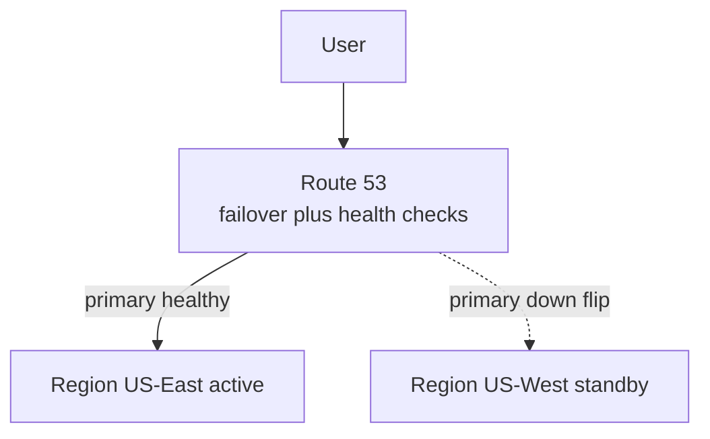

> **Staff-level insight:** The hard part of multi-region is *never the load balancer* — it's the **data**. Active-active means you must answer: how does data replicate across regions, and what's your consistency model? (See [Distributed Systems](02-distributed-systems.md).) Async replication → you accept data loss (RPO > 0) on failover. Sync replication → cross-region latency on every write. Most "global active-active" designs are actually *regionally sharded* (each user's home region owns their data) precisely to avoid cross-region write coordination. If an interviewer asks for a global design and you only talk about Route 53 + anycast, you've answered the *easy 20%*. The data layer is the other 80% — **risk-weight your time there.**

---

## 9. The Full Request Path / Architecture

Putting it together — every hop a request takes from the user's keyboard to your business logic. **Altitude note:** in a design you draw this once at a high level and name each hop in a sentence. Don't narrate all eight hops in detail unless asked — point at the one that's the crux of *this* design.

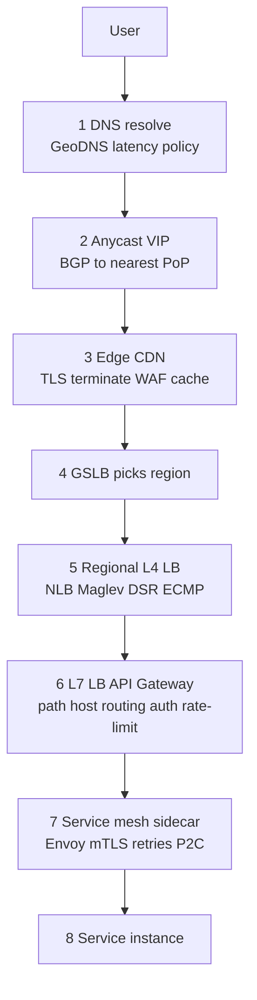

### How the LB relates to its neighbors

These four terms overlap and interviewers love to probe the boundaries:

| Component | Primary job | Layer | Lives where |
|---|---|---|---|
| **Load balancer** | Distribute traffic across backends | L4 or L7 | Edge, regional, internal |
| **Reverse proxy** | Front-end for backends: TLS, caching, buffering, routing | L7 | Edge / in front of services |
| **API gateway** | *Per-API* concerns: authn/z, rate limiting, quotas, API key mgmt, request transformation, billing, schema validation | L7 | North-south edge of your API |
| **Service mesh** | *Service-to-service* (east-west): mTLS, retries, circuit-breaking, P2C LB, observability — via sidecar proxies | L7 | Sidecar next to every pod |

- An **L7 load balancer** *is* a reverse proxy doing balancing. The terms blur.
- An **API gateway** is an L7 reverse proxy + LB *plus* API-management features. It's a superset for *north-south* (client→service) traffic.
- A **service mesh** moves LB *into the data plane between services* (east-west). Each sidecar does client-side load balancing (often P2C/ring-hash), so there's *no central LB hop* between services. (Deep dive in **Module 10 — Networking / Service Mesh / API Gateway**.)

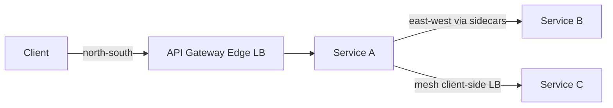

### "The load balancer is a single point of failure"

If all traffic funnels through one LB box, that box's failure = total outage. Solutions, in increasing sophistication:

| Solution | How it works | Failover speed |
|---|---|---|
| **Redundant LB pair + VIP (keepalived/VRRP)** | Two LBs share a virtual IP; standby takes over the VIP via VRRP if primary dies | ~1–3s |
| **Active-active LBs + ECMP** | Router spreads traffic across *N* LB instances using Equal-Cost Multi-Path routing; any can die | sub-second |
| **DNS failover / multivalue** | Multiple LB IPs in DNS, health-checked | TTL-bound (slow) |
| **Anycast VIP** | Same LB VIP from many nodes; BGP routes around a dead one | seconds (BGP) |
| **Cloud managed LB** | Provider runs a *fleet* behind the scenes; the "LB" is already HA | transparent |

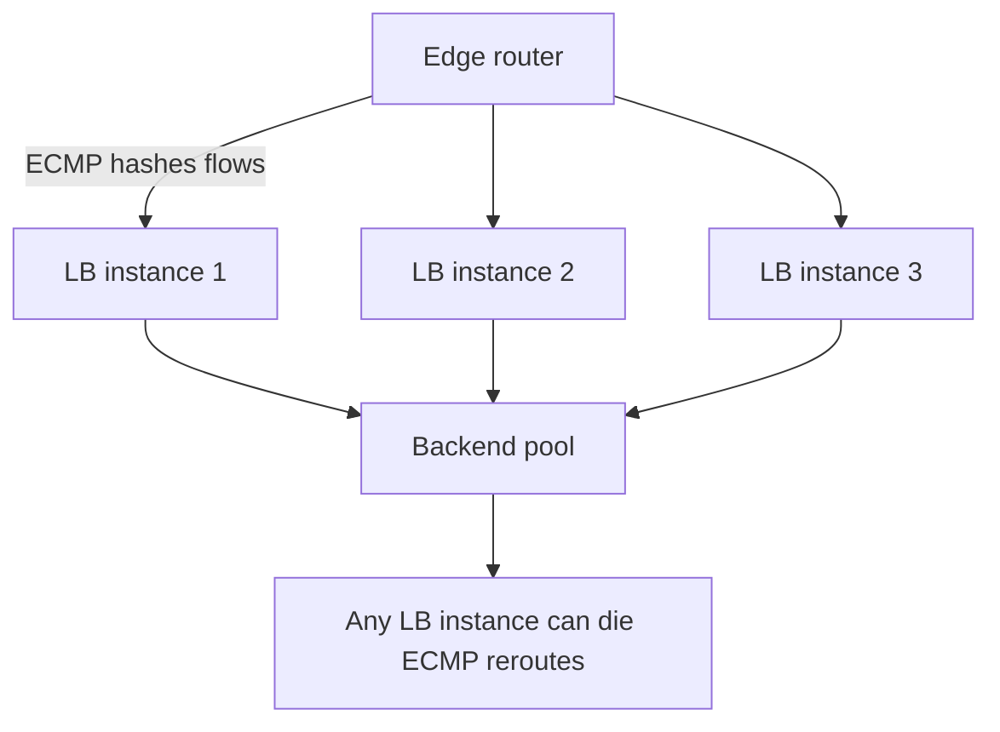

> **Staff-level insight:** The phrase "the LB is a SPOF" is a trap that reveals whether someone has operated systems. A *single* LB box is a SPOF; a *load-balancing tier* never should be. The real engineering question is *how the LB tier itself stays redundant without itself needing a load balancer* (turtles all the way down). The answer is **ECMP at the router** (the network fabric spreads flows across many stateless L4 LBs) or **anycast** (BGP spreads across many) — both push the redundancy *down into the network*, which has no single point. VRRP/keepalived is the small-scale answer; ECMP/anycast is the hyperscale answer. **Decisive default for an interview:** "managed cloud LB, which is already a fleet — so the LB tier is not a SPOF; here's how I'd reason about it if we ran our own." Then only go to ECMP/anycast if pushed.

---

## 10. Load-Balancing Stateful WebSocket Connections (Deep Dive)

> This is the hardest load-balancing problem in real-time infrastructure, and the one most directly relevant to chat/messaging systems. It is the place to demonstrate that you've *operated* a connection fleet, not just read about LBs. **Slow down here.** When an interview touches real-time, presence, fan-out, or "millions of concurrent connections," this section is the crux.

### Why WebSockets break the normal LB model

Every assumption a stateless HTTP LB makes is false for WebSockets:

| HTTP assumption | WebSocket reality |
|---|---|
| Requests are short; connections recycle in ms | Connections live for **minutes to hours** |
| Any backend can serve any request | The connection *is* server-side state (subscriptions, presence, buffers) |
| Draining = wait for in-flight to finish | Sockets never "finish" — you must *migrate* them |
| Balance request count → balance load | A node with N sockets may carry 10× the *message* load of a peer with N sockets |
| Health = endpoint returns 200 | Health = the node can still push messages on existing sockets |

The connection holds: the user's subscriptions (which channels/rooms they're in), presence state, an outbound message queue/buffer, and often a back-reference for routing inbound fan-out. Killing the connection loses none of the durable data (that's in the DB/Redis), but it forces a reconnect — and **a fleet-wide reconnect is a self-inflicted DDoS** if you're not careful.

### The layered architecture that actually works

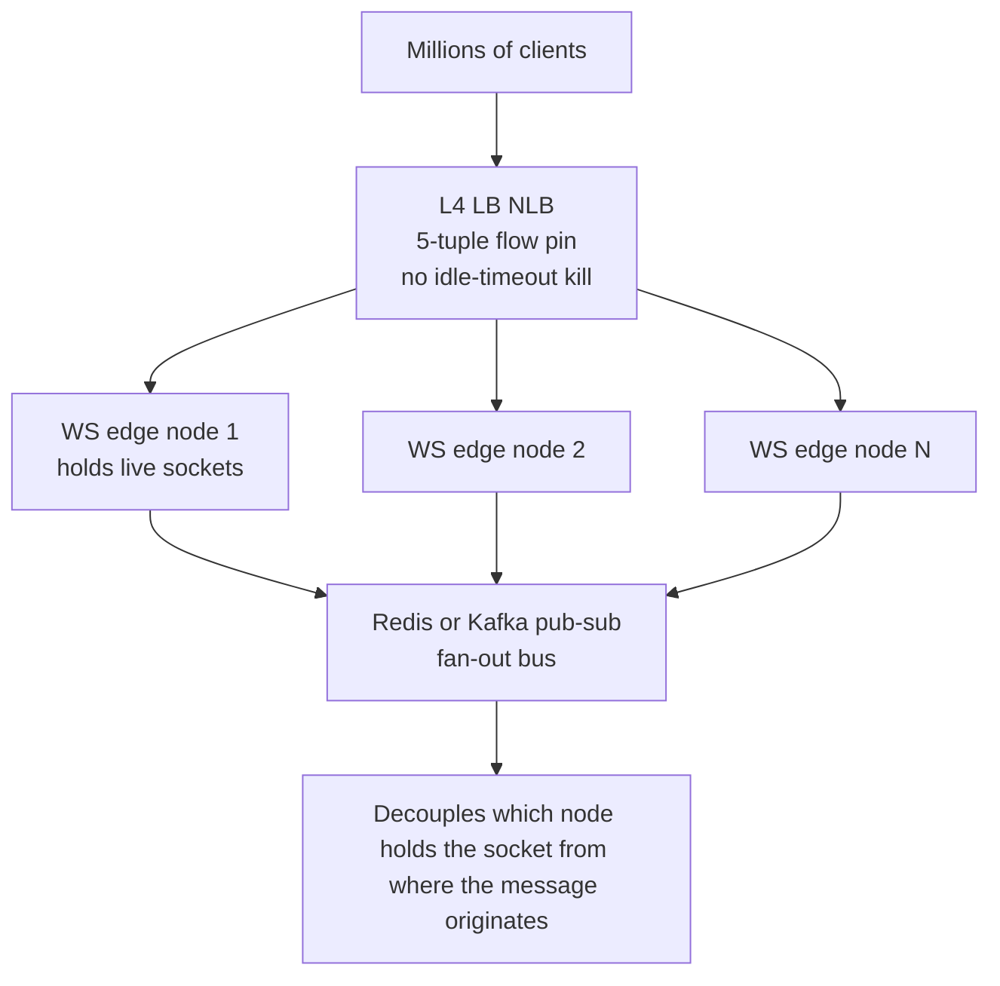

**Decisive design choices and why:**

1. **L4 in front, not L7, for the socket tier.** *Choice:* terminate TLS at the edge, then use an L4 LB (NLB) to spread raw TCP flows to WS nodes — *because* L7 proxies add idle-timeout and buffering hazards that silently kill long-lived sockets, and you don't need content routing once the socket is established. *Revisit if:* you need per-message L7 routing or path-based multiplexing at the LB itself (rare).

2. **Decouple connection ownership from message origin via a pub/sub bus.** The node holding user A's socket is almost never the node that *processes* the message A should receive. So the inbound write goes to a fan-out bus (Redis pub/sub, Kafka, or a custom router), and every edge node subscribes to the channels its connected users care about. *This is the key architectural move* — it means the LB does NOT need to route inbound messages to "the right node"; the bus does. The LB only has to keep the socket alive and balanced.

3. **Stickiness is unavoidable here — embrace it correctly.** The socket *is* the state, so by definition a given live connection is pinned to one node for its lifetime (that's just TCP). The real question is **what happens on reconnect**. *Choice:* route reconnects via **consistent hashing on a stable connection key (user ID)**, not source IP and not a cookie — *because* it makes reconnects deterministic and degrades gracefully (only K/N connections shift when a node is added/removed), and source-IP buckets entire CGNAT/mobile-carrier populations onto one node. *Revisit if:* you have true session migration (state handoff) that makes any-node reconnect cheap — then plain P2C is fine.

4. **Balance on the right signal.** *Choice:* balance on **active message throughput / CPU**, not raw connection count — *because* connection count is a terrible proxy for load when one socket in a busy channel does 1000× the work of an idle one. Feed real load (or at least subscription-weighted counts) into the balancing decision.

### The reconnect storm — the single biggest operational hazard

When you deploy the WS tier, or a node dies, every socket on the affected nodes reconnects *at once*. With 100k sockets per node and 50 nodes, a rolling deploy that cycles nodes naively produces waves of 100k simultaneous reconnects — each doing TLS handshake + auth + subscription re-establishment. This can:

- Saturate the auth service and session store (every reconnect re-authenticates).
- Trigger the "new node gets crushed" flap (§6.1) — use **slow start**.
- Cascade if reconnect logic has no jitter (synchronized retry).

**Mitigations (cite these as operational practice):**

- **Spread reconnects:** server sends a graceful close with a "reconnect after random delay in [0, W]" hint; clients jitter. Never let 100k clients reconnect in the same 100ms.
- **Drain slowly:** cycle WS nodes a few at a time, not the whole fleet; respect a per-node connection budget for incoming reconnects.
- **Slow-start new nodes:** ramp them up over 30–60s so they warm before taking full socket load.
- **Make reconnect cheap:** resumable sessions (a session token that lets a reconnect skip full re-auth and rehydrate subscriptions from a cached snapshot) so the storm is survivable.
- **Backpressure at the LB / edge:** cap accept rate so a storm degrades gracefully instead of melting the auth tier.

```mermaid
flowchart LR
    Deploy[Rolling deploy of WS node] --> Close[Send graceful close<br/>with jittered reconnect hint]
    Close --> Jitter[Clients reconnect spread over window]
    Jitter --> CHash[Consistent-hash route to new node]
    CHash --> Slow[New node slow-starts]
    Slow --> Resume[Resumable session skips full re-auth]
```

### Health checks for a connection fleet

Standard `GET /healthz` tells you the process is up, not that it can still *push* on its 100k open sockets. Add signals: can it reach the pub/sub bus? Is its outbound buffer backing up? Is event-loop lag within bounds? And critically — **floor your ejection** (never eject so many WS nodes at once that survivors get a reconnect flood they can't absorb). Ejecting a WS node isn't free like ejecting a stateless API node; it forces a reconnect storm. Eject conservatively.

> **Staff-level insight:** The whole trick of scaling a real-time fleet is to **make the connection node as stateless as possible despite holding a stateful connection.** Durable state (messages, membership, presence-of-record) lives in the DB and a fan-out bus; the connection node holds only *soft* state (the live socket + a subscription set it can rebuild from the bus). Then a lost node is "just" a reconnect, not data loss, and the LB's only jobs are (a) keep sockets alive without L7 timeout hazards, (b) route reconnects deterministically via consistent hashing, and (c) balance on real load, not connection count. If you can articulate "the LB doesn't route messages — the pub/sub bus does; the LB only balances connections and routes reconnects," you've shown you understand why this problem is *not* a normal LB problem.

---

## 11. Scaling the Load Balancer Itself

How do you load-balance terabits per second? You make the L4 layer **stateless, horizontally scalable, and let the network spread flows.** **YAGNI gate:** this section is for the hyperscale case or when the interviewer explicitly asks "how would you build the LB itself." Do not volunteer Maglev/Katran for a normal app — name "managed LB fleet" and move on.

### DSR (Direct Server Return) — recap with scale lens

In DSR the LB only handles the *ingress* path (small SYN/request packets); responses (the bulk of bytes) go *directly* from backend to client, bypassing the LB. Since responses are typically 10–100× the request size, DSR can increase LB capacity by an order of magnitude. It's the prerequisite for cheap L4 scaling.

### ECMP at the edge

Routers support **Equal-Cost Multi-Path**: when multiple equal-cost next-hops exist (multiple L4 LB instances announcing the same VIP), the router hashes each *flow's* 5-tuple to pick a next-hop. This:
- Spreads connections across *all* L4 LB instances with **zero coordination**.
- Keeps a flow pinned to one LB (consistent hash on 5-tuple) so TCP state stays put.
- Lets you scale the L4 tier by just adding more instances announcing the VIP.

The subtle problem: if an L4 LB instance dies, ECMP rehashes and some surviving flows land on a *different* L4 LB that has no flow-table entry for them. This is why hyperscale L4 LBs use **consistent hashing (Maglev) for backend selection** — so even after an ECMP reshuffle, a packet for an existing flow still picks the *same backend*, keeping the connection alive.

```mermaid
flowchart TB
    Net[Internet] --> Router[Edge router<br/>ECMP on 5-tuple]
    Router --> M1[Maglev L4 LB 1]
    Router --> M2[Maglev L4 LB 2]
    Router --> M3[Maglev L4 LB 3]
    M1 -->|Maglev hash same backend| B[Backend pool]
    M2 -->|consistent even after ECMP reshuffle| B
    M3 --> B
    B -. DSR direct reply .-> Net
```

### How hyperscalers do L4

| System | Org | Tech | Key ideas |
|---|---|---|---|
| **Maglev** | Google | Userspace L4 LB on commodity servers | ECMP from routers → Maglev fleet; **Maglev hashing** for consistent backend selection; kernel-bypass (packet steering) for throughput; ~10 Gbps+ per machine, scales linearly |
| **Katran** | Meta | **XDP / eBPF** in the Linux kernel | Runs in the NIC driver path (XDP) before the kernel networking stack → enormous pps; consistent hashing (Maglev-style) for backend choice; DSR via encapsulation |
| **GLB** | GitHub | iptables + haproxy, then proxy | Two-tier: stateless director (consistent hash) + stateful proxy; "GLB" director uses consistent hashing so backend changes don't reset connections |
| **Cloudflare Unimog** | Cloudflare | eBPF-based | Edge L4 LB that re-routes flows between machines in a PoP while keeping connections alive |

**Why XDP/eBPF matters:** XDP (eXpress Data Path) lets you run packet-processing code *in the NIC driver*, before `sk_buff` allocation and the full kernel stack. This skips most of the per-packet overhead, enabling tens of millions of packets per second per box on commodity hardware — a software L4 LB that rivals a hardware appliance, at a fraction of the cost, fully programmable.

> **Staff-level insight:** The whole architecture of hyperscale L4 is a layered defense against *state*. Routers (ECMP) are stateless. The L4 LB tier is *nearly* stateless — it uses **consistent hashing on the 5-tuple to pick a backend** so that even when the LB fleet or backend pool changes, *existing connections still resolve to the same backend without a shared flow table*. State only truly lives at the backend. Pushing state as far down as possible is what lets the upper tiers be infinitely, cheaply replicated. If you can articulate "ECMP is stateless, Maglev-hash keeps backend selection consistent so we don't need a synchronized flow table, and DSR keeps the response path off the LB" — you've described how Google and Meta actually move the internet. **Notice this is the same principle as the WebSocket fleet (§10): push state down, keep the routing layer stateless and consistent-hash-driven.**

---

## Interview Cheat-Sheet

**Delivery first (the lens):** LB is *name-and-move-on* in most designs — one sentence ("managed L7 LB, TLS-terminating, path-routed, it's a fleet so not a SPOF") and move to the crux. Deep-dive *only* when LB is the problem: **stateful WebSocket connections**, **consistent hashing**, **global routing/failover**. State defaults with triggers; never "it depends." See [Staff-Level Execution](20-staff-execution.md).

**Layer choice:** L4 = fast, 5-tuple, DSR, no payload, use for raw TCP/UDP throughput. L7 = terminate + parse, content routing, TLS, retries — use when you route on request content. Default L7; drop to L4 for raw throughput or in front of an L7 fleet. Common pattern: **L4 in front of L7**.

**Algorithms — the 3 that matter:**
- **Power of two choices** — random 2, pick lesser. Exponentially better than random, zero coordination. **Default for meshes/distributed stateless LB.**
- **Consistent hashing** — ring + virtual nodes; adding/removing a node remaps only K/N keys. For caches, sharding, CDN, WS reconnect routing. *Balances keys, not load* → hot keys still a problem → bounded-loads variant.
- **Least connections / least response time** — adaptive single-LB default; needs accurate per-backend state (hard across an LB fleet → use P2C there).

**Consistent hashing in one breath:** hash keys and servers onto a ring; key → first server clockwise; add a node → only its arc moves; **virtual nodes** even out load + spread failure; Maglev = O(1) table version for L4.

**Anycast in one breath:** same IP announced via BGP from many PoPs; network routes each user to nearest PoP; PoP failure = stop announcing = BGP reroutes in seconds; one IP, global, fast failover; backbone of CDNs and 8.8.8.8. Caveat: long-lived TCP can shift mid-connection → don't terminate raw WebSockets on bare anycast without a stability plan.

**Global steering (Route 53):** simple / weighted / latency / geolocation / geoproximity / failover / multivalue. DNS failover is TTL-bound and slow (use for *steering*); anycast is BGP-fast (use for *failover*). The hard 80% is the **data tier**, not the LB.

**Health/resilience:** active probes + passive outlier detection (use both); shallow liveness vs deep readiness (deep checks on shared deps cause fleet-wide outage → **fail open**, floor ejection); connection draining on shutdown; slow start for new nodes; **avoid sticky sessions** — make backends stateless (shared session store / JWT); the only legit stickiness is consistent-hash routing for stateful WS.

**WebSockets (the real-time crux):** L4 in front (no L7 idle-timeout kill); decouple socket ownership from message origin via **pub/sub bus** (LB doesn't route messages); consistent-hash reconnects on user ID; balance on throughput not conn count; the #1 hazard is the **reconnect storm** → jitter + slow-start + resumable sessions; eject WS nodes conservatively.

**LB not a SPOF:** VRRP/keepalived (small scale), ECMP / anycast (hyperscale), cloud LB is already a fleet. Default: managed fleet.

**Hyperscale L4 (YAGNI unless asked):** DSR (response bypasses LB) + ECMP (stateless flow spread) + Maglev-hash (consistent backend selection without a shared flow table). Google Maglev, Meta Katran (XDP/eBPF).

**Relationships:** L7 LB ⊆ reverse proxy ⊆ API gateway (north-south) ; service mesh = LB pushed into sidecars (east-west). → Module 10.

---

## Common Interview Questions

**Q1. When would you choose L4 over L7, and what do you lose?**
*A:* Default to L7 because almost every web/API service routes on path or host and wants TLS termination plus request-level retries. Choose **L4 when you don't need to route on request content and you want maximum throughput / minimum latency** — raw TCP/UDP services, database proxies, Kafka byte streams, WebSocket fleets (to dodge L7 idle-timeout/buffering hazards), or a stateless front tier that fans out to L7. **Explicit exception — do NOT put bare L4 in front of gRPC:** gRPC is HTTP/2, so L4 pins its multiplexed requests to a few backends (see the gRPC/HTTP-2 trap in §3) — use L7 per-request balancing or client-side xDS there. L4 lets you use **DSR** (responses bypass the LB → ~10× capacity) and stateless ECMP scaling. You lose: content-based routing (path/host/cookie), TLS termination & inspection, request-level retries/circuit-breaking, HTTP/2-gRPC awareness, WAF. The practitioner's answer is the **L4-in-front-of-L7** pattern: L4 absorbs volume and spreads to many L7 proxies that do smart routing. Don't reflexively reach for an ALB when you don't need to read the request.

**Q2. Explain consistent hashing and why it beats `hash mod N`.**
*A:* `hash(key) mod N` remaps ~`N/(N+1)` of all keys when N changes — catastrophic for a cache (adding one node invalidates almost everything → origin thundering herd; with 1M keys and 4→5 nodes, ~800k keys move). Consistent hashing maps both keys and servers onto a circular keyspace; a key is owned by the first server clockwise. Adding/removing a node only moves the keys in *that node's arc* — about K/N keys (~200k in the example) — leaving everything else untouched. **Virtual nodes** (100–200 points per physical server) even out the otherwise-lumpy arcs and spread a failed node's load across many neighbors instead of one. Caveat: it balances the *keyspace*, not *load* — a hot key still pins one node. Fix with key splitting/replication or **consistent hashing with bounded loads** (cap each node at (1+ε)× average, overflow clockwise). I'd reach for it specifically when a key must reliably reach the same node — cache sharding, partitioned state, or WebSocket reconnect routing — and *not* for a fungible stateless fleet, where P2C balances better.

**Q3. What is power-of-two-choices and why is it so effective?**
*A:* Pick two backends at random and route to the less loaded of the two. Pure random gives max load ~`log n / log log n` above average; two choices drops it to ~`log log n` — an *exponential* improvement — yet needs *zero* coordination (no global load state). Three choices barely helps, so two is the sweet spot. It's the default in Envoy/Nginx and across service meshes precisely because "true least-connections" is impossible to compute accurately across a fleet of LBs, while P2C gets ~95% of the benefit by breaking the "everyone independently picks the same hot node" failure with a second independent sample. It also degrades gracefully with stale load info. **This is my default algorithm for a stateless fleet at scale.**

**Q4. How does anycast route a user to the nearest data center, and how does it fail over?**
*A:* The same IP prefix is BGP-advertised from many PoPs. Anycast routes each client to the PoP chosen by its network's BGP policy (usually but not always the topologically nearest); AS-path length is only a secondary tiebreaker after policy (LOCAL_PREF). So users land at the policy-chosen PoP — all sharing one IP. Failover is in the *network*: a dead PoP stops advertising the prefix, BGP reconverges in seconds, and those users route to the next-nearest PoP — no DNS change, no TTL wait. That's why CDNs, DDoS scrubbers, and public DNS (8.8.8.8) use it. Caveat: routes can shift mid-connection, so long-lived TCP/TLS can in theory get reset; anycast shines for stateless/short-lived (HTTP, DNS, QUIC) traffic, and I would *not* terminate raw WebSockets on bare anycast without a session-stability strategy. Contrast with GeoDNS, whose failover is TTL-bound and resolver-cached (slow, coarse) — so I use GeoDNS for *steering* and anycast for *fast failover*.

**Q5. Design global traffic management for a multi-region app. What are the pieces?**
*A:* (1) **DNS layer** — Route 53 latency-based or geolocation routing (geolocation if data-residency/compliance matters), with health checks + failover policy. (2) **Anycast / Global Accelerator** for fast BGP-time failover and edge entry. (3) **CDN/edge** for TLS termination, WAF, static caching. (4) **Regional L4 + L7 LBs** inside each region. (5) Crucially, the **data tier** — the LB part is the easy 20%; the hard part is replication & consistency across regions. Most "active-active" is really *regionally sharded* (each user's home region owns their data) to avoid cross-region write coordination; otherwise you choose async replication (RPO > 0, possible data loss on failover) or sync (cross-region write latency). Pick active-passive (cheap, minutes RTO), warm standby, or active-active (expensive, near-zero RTO) per the business RTO/RPO. I'd spend most of the interview on the data tier, because that's where the actual risk concentrates.

**Q6. Active vs passive health checks — and how do health checks cause outages?**
*A:* Active = LB probes backends periodically (catches "process down" but can miss subtle breakage and lags by the probe interval). Passive = outlier detection observes errors/timeouts on *real* traffic (instant, free, catches "passes /healthz but broken"). Use both. The outage trap: a **deep health check that hits a shared dependency** (DB/Redis) means one blip fails *every* backend's check simultaneously → LB ejects the entire fleet → total outage from a minor blip. I've been burned by exactly this — a Redis hiccup that the deep check turned into a fleet-wide ejection. Fix: shallow *liveness* (is the process up?) separate from *readiness*; **fail open** when all backends are unhealthy; and floor your ejection (Envoy's `healthy_panic_threshold`) so you never eject below ~50% of the pool.

**Q7. Why avoid sticky sessions, and what do you do instead?**
*A:* Stickiness pins a client to one backend (cookie or IP hash). It causes uneven load (you can't rebalance), loses sessions on deploy/node death, breaks clean draining and autoscaling, and IP-hash buckets entire NAT'd populations onto one node. It's a band-aid for *server-side state*. The fix is to make backends **stateless**: push session state to a shared store (Redis/Memcached — see [Caching](03-caching.md)) or use a self-contained signed token (JWT). Then any backend serves any request and you're free to use the optimal LB algorithm. Reach for stickiness only for genuinely stateful protocols (WebSocket, where the connection *is* the state) — and even then, prefer **consistent-hash routing on a stable connection key** over cookie/IP pinning, because consistent hashing degrades gracefully under churn while cookie pinning loses state hard on node death.

**Q8. The load balancer is a single point of failure — solve it.**
*A:* A single LB box is a SPOF; a load-balancing *tier* should never be. My default in a design is a **managed cloud LB, which is already a hidden fleet**. If we run our own: small scale → a redundant pair sharing a VIP via **VRRP/keepalived** (standby takes the VIP in ~1–3s); hyperscale → push redundancy into the network — **ECMP** at the router spreads flows across N stateless L4 LBs (any can die, no coordination), or **anycast** spreads across many PoPs via BGP. The key insight is avoiding "turtles all the way down": you don't load-balance the load balancers with *another* LB — you let the network fabric (ECMP/BGP), which has no single point, do it. To keep connections alive when an L4 instance dies, use **consistent-hash (Maglev) backend selection** so a reshuffled flow still picks its original backend.

**Q9. How do Google and Meta build L4 load balancers that handle terabits?**
*A:* Three layered ideas, all about minimizing state. (1) **ECMP** from edge routers spreads flows across a fleet of commodity L4 LB boxes — stateless. (2) Each L4 box uses **Maglev/consistent hashing on the 5-tuple** to choose a backend, so even when the LB fleet or backend pool changes, an existing flow still maps to the same backend *without a synchronized flow table*. (3) **DSR** sends backend responses directly to clients, bypassing the LB (responses are the bulk of bytes → ~10× throughput). Google's **Maglev** runs in userspace with kernel-bypass packet steering; Meta's **Katran** runs in the kernel via **XDP/eBPF** (NIC driver path, before the full network stack) for tens of millions of pps per box. State lives only at the backend; everything above is cheaply replicable. (I'd only go here if asked to build the LB itself — for a normal app it's "managed fleet, move on.")

**Q10. Compare consistent hashing, Maglev hashing, and rendezvous hashing.**
*A:* All three minimize disruption when nodes change, differing in lookup cost and balance. **Consistent (ring)**: O(log V) ring search, good balance with virtual nodes, minimal disruption — best for caches/sharding/connection routing. **Maglev**: precomputes a fixed-size lookup table (e.g., 65537 entries) for O(1) per-packet lookup and *excellent* balance, at the cost of slightly more disruption than ideal — built for L4 LBs at line rate where the constant factor of the lookup dominates. **Rendezvous (HRW)**: compute `hash(key, node)` for every node, pick the max; dead-simple, naturally weighted, minimal disruption, but O(N) per lookup — great for small N (replica selection, CDN tiers). The meta-point: at the packet layer you optimize for cache-friendly O(1) (Maglev); at the application layer you optimize for minimal remap and easy weighting (ring + vnodes).

**Q11. How would you load-balance millions of concurrent WebSocket connections for a chat system?**
*A:* This is where the normal LB model breaks, so I'd structure the answer around *what's different*. Sockets live for hours and the connection *is* server-side state, so (1) I'd put an **L4 LB (NLB) in front** of the socket tier — TLS terminated at the edge, then raw flows spread to WS nodes — to avoid L7 idle-timeout and buffering hazards. (2) I'd **decouple connection ownership from message origin** with a pub/sub bus (Redis/Kafka): the node holding a user's socket subscribes to the channels that user cares about, so the *LB never routes messages* — the bus does. (3) For reconnects I'd use **consistent hashing on user ID**, not source IP (which buckets CGNAT populations) and not cookies (which lose state hard) — so reconnects are deterministic and node churn only disturbs K/N connections. (4) I'd **balance on message throughput / CPU**, not connection count, because one busy socket can be 1000× the load of an idle one. The single biggest hazard is the **reconnect storm** on deploy or node death — 100k sockets reconnecting at once can DDoS the auth/session tier — so I'd mitigate with jittered reconnect hints, slow rolling drains, slow-start on new nodes, and resumable sessions so a reconnect skips full re-auth. And I'd eject WS nodes conservatively, because ejecting one isn't free — it forces a reconnect storm.

**Q12 (meta/delivery). An interviewer gives you a chat-system design. They draw the LB box. How much time do you spend on load balancing, and where?**
*A:* For most of the system the LB is one sentence: "clients hit a managed L7 LB that terminates TLS and routes by path; it's a fleet, so not a SPOF." I'd spend *almost no* time there — over-explaining round robin or NAT-vs-DSR is an anti-signal. I'd spend my LB minutes on the part that's actually hard for *this* system: the **WebSocket connection tier** — L4 fronting, pub/sub decoupling, consistent-hash reconnects, the reconnect-storm hazard, and balancing on real load. That's the risk crux. The judgment being tested is whether I can tell the rote 20% from the load-bearing 80% and put my time where the failure modes live — name the basics and move on, deep-dive the crux.

**Q13 (meta/delivery). How do you decide between two load-balancing approaches when you genuinely could justify either?**
*A:* I state a default and a revisit trigger rather than enumerating tradeoffs and stopping — "&lt;choice&gt; because &lt;requirement&gt;; revisit if &lt;trigger&gt;." For example: "Stateless backends with P2C, because the fleet is fungible and P2C needs no coordination; revisit to consistent hashing if we introduce per-node state or cache locality that makes affinity worth the churn cost." Saying "it depends" and listing options without choosing is the thing that reads as junior. The point isn't that there's one right answer — it's demonstrating I can commit to one under stated assumptions and name what would change my mind.

---

*Next: **Module 10 — Networking, Service Mesh & API Gateways** picks up the east-west story (sidecars, xDS, mTLS) and **Module 11 — Reliability** ([Reliability](11-reliability.md)) covers circuit breaking, retries, and graceful degradation that ride on top of the LB tier. For the cross-cutting delivery playbook, see [Staff-Level Execution](20-staff-execution.md).*
