# Module 6 — Database Deep Dive

> Engines, internals, and the operational reality behind "just use Postgres" vs "we sharded DynamoDB."
>
> **This is the only database module you need to study.** It is written to take a 12+-year real-time-infrastructure engineer from "I know databases" to "I can run a Staff/Principal database deep-dive and *drive* it." Read it once, end to end, then use the cheat-sheet and the three frameworks as recall anchors.

## What you'll master

By the end of this module you'll be able to walk into a Staff/Principal interview and reason about databases the way the people who *build* them do — not just "SQL is ACID, NoSQL scales." Specifically:

- **Storage engine internals**: B-Tree vs LSM-Tree, write/read/space amplification, compaction, WAL, MVCC (Postgres vs InnoDB), buffer pools — the layer most candidates can't go below.
- **The major engines**: PostgreSQL, MySQL/InnoDB, MongoDB, Cassandra, DynamoDB — what each is *actually* good at and where it bites.
- **Distributed DB mechanics**: read replicas & replication lag, multi-leader conflict resolution, sharding strategies, secondary indexes in sharded systems.
- **Index & query optimization**: index types, EXPLAIN plans, N+1, when indexes *hurt*.
- **NewSQL / distributed SQL**: Spanner, CockroachDB, Vitess, YugabyteDB.
- **Reusable interview frameworks**: SQL vs NoSQL decision, "what's your shard key?", "design for 1 billion users."
- **A staff-level delivery lens**: how to *carry* this knowledge in the room — decide instead of enumerate, control altitude, flag where the risk actually concentrates.

Cross-links: [Fundamentals](01-fundamentals.md) · [Distributed Systems](02-distributed-systems.md) · [Caching](03-caching.md) · [Search](07-search.md) · [Staff-Level Execution](20-staff-execution.md)

---

## Table of Contents

1. [In the Room — Staff-Level Delivery](#in-the-room--staff-level-delivery)
2. [Storage Engine Internals](#1-storage-engine-internals)
   - [1.1 B-Tree vs LSM-Tree](#11-b-tree-vs-lsm-tree)
   - [1.2 Write-Ahead Log & Durability](#12-write-ahead-log--durability)
   - [1.3 MVCC: Postgres vs InnoDB](#13-mvcc-postgres-vs-innodb)
   - [1.4 Pages & Buffer Pool](#14-pages--buffer-pool)
3. [SQL Engines](#2-sql-engines)
   - [2.1 PostgreSQL](#21-postgresql)
   - [2.2 MySQL / InnoDB](#22-mysql--innodb)
4. [NoSQL Engines](#3-nosql-engines)
   - [3.1 MongoDB](#31-mongodb)
   - [3.2 Cassandra](#32-cassandra)
   - [3.3 DynamoDB](#33-dynamodb)
   - [3.4 NoSQL Comparison](#34-nosql-comparison)
5. [Core Distributed-DB Concepts](#4-core-distributed-db-concepts)
   - [4.1 Read Replicas & Replication Lag](#41-read-replicas--replication-lag)
   - [4.2 Multi-Leader / Multi-Master](#42-multi-leader--multi-master)
   - [4.3 Sharding Strategies](#43-sharding-strategies)
   - [4.4 Partitioning vs Sharding](#44-partitioning-vs-sharding)
   - [4.5 Secondary Indexes in Sharded Systems](#45-secondary-indexes-in-sharded-systems)
6. [Indexes & Query Optimization](#5-indexes--query-optimization)
7. [NewSQL / Distributed SQL](#6-newsql--distributed-sql)
8. [Interview Frameworks](#7-interview-frameworks)
   - [7.1 SQL vs NoSQL Decision Framework](#71-sql-vs-nosql-decision-framework)
   - [7.2 Sharding Strategy Framework](#72-sharding-strategy-framework)
   - [7.3 Designing for 1 Billion Users](#73-designing-for-1-billion-users--1b-rows)
9. [Interview Cheat-Sheet](#interview-cheat-sheet)
10. [Common Interview Questions](#common-interview-questions)

---

## In the Room — Staff-Level Delivery

> Most candidates fail database rounds not on knowledge but on *delivery*: they enumerate options instead of choosing, rabbit-hole the `users` table schema, and say "it depends" without saying *on what*. This section is the lens. Everything below it is the ammunition. Cross-link: [Staff-Level Execution](20-staff-execution.md).

**The one-sentence philosophy: signal, not solution.** The interviewer cannot grade a database for you in 45 minutes. They are sampling for whether you'd make sound calls under real constraints with real blast radius. So every recommendation you make should carry its *reason* and its *reversal trigger*.

### Decisions to make decisively (with defaults)

Say these in this shape every time: **"`<choice>` because `<requirement>`; revisit if `<trigger>`."** Never "it depends" as a full stop — "it depends" is fine only as a *preface* to "...on X, and here X is Y, so I'd do Z."

| Decision | Your default answer | The trigger that changes it |
|---|---|---|
| **SQL vs NoSQL** | **Postgres until a requirement forces otherwise.** It gives ACID, joins, JSONB flexibility, and a clean migration path. | Proven write volume past a single node, hard zero-ops mandate, or aggregate-shaped data with no relational queries. |
| **When to shard at all** | **Don't.** Single primary + read replicas + cache + partitioning, in that order. | A single primary can't hold the **write volume** or the **dataset size** — e.g., sustained writes above what one node handles (roughly tens of thousands of write TPS for Postgres/InnoDB), or working set that no longer fits RAM after partitioning. |
| **Shard key** | **Shard by the entity that owns the access pattern** — `user_id` for per-user, `tenant_id` for B2B SaaS, `conversation_id` for chat. Hash it, over a fixed count of virtual shards. | A whale (giant tenant / celebrity user) overwhelms one shard → sub-shard the whale, or composite key. |
| **Consistency level** | **Strong for the system of record, eventual for derived/denormalized copies.** Per-write `w:majority` / `QUORUM` on the write path; relaxed reads where staleness is tolerable. | A specific read genuinely tolerates seconds of staleness (analytics, feeds) → drop to async replica / eventual. |
| **Engine for a high-write firehose** | **Cassandra (or Dynamo on AWS)** because LSM turns random writes into sequential IO. | If you also need ad-hoc queries or joins on that data → you wanted a warehouse / Postgres, not Cassandra. |

### Altitude — name-and-move-on vs deep-dive

Altitude is the single biggest tell. Spend your minutes where the *risk* is.

| Name-and-move-on (10 seconds, don't linger) | Deep-dive (this is where you earn the level) |
|---|---|
| The unremarkable schema fields — `id`, `name`, `email`, `created_at`. "Standard user table, nothing interesting here." | **The shard key** — cardinality, distribution, access alignment, hotspot risk. |
| That you'll add indexes on foreign keys. | **Hot partitions / hot shards** — what concentrates, and the write-sharding mitigation. |
| That writes go to a primary, reads can go to replicas. | **The consistency boundary** — exactly which reads tolerate staleness and which don't, and read-your-writes handling. |
| Connection pooling exists (PgBouncer). | **The resharding plan** — virtual shards, dual-write + backfill + cutover. |
| ACID stands for atomicity/consistency/isolation/durability. | **Storage-engine internals** when "why this DB?" comes up — B-Tree vs LSM, WAL, MVCC failure modes. |

> If you catch yourself drawing out a `users` table column by column, stop. That is the canonical rabbit hole. The columns are not the design; the **access patterns and the shard key** are.

### YAGNI default + the explicit trigger

State the lever ladder and the threshold, out loud:

> "Single primary plus read replicas until we're past roughly tens of thousands of write TPS or the working set stops fitting in RAM after partitioning. *Then* I shard — not before. Sharding buys write scale at the cost of permanent operational complexity: cross-shard joins, 2PC or sagas, rebalancing, and hot shards. I don't pay that tax until a single node forces me to."

Cheapest-first lever ladder: **index/query fix → cache → read replicas → partitioning → archive cold data → shard → distributed SQL.** Name where on this ladder the system is, and why you stop there.

### Top anti-patterns (the ways candidates lose this round)

1. **NoSQL-by-default hype.** "We'll use Mongo/Cassandra because it scales" without a write-volume number is a junior tell. Postgres scales enormously; NewSQL exists. Default relational, justify the move.
2. **Premature sharding.** Reaching for shards before exhausting replicas/cache/partitioning. Sharding is a last resort, not a flex.
3. **Rabbit-holing the user table.** Burning minutes on `VARCHAR(255)` vs `TEXT` while the shard key, hot partition, and consistency boundary go unaddressed.
4. **Option-listing without choosing.** "We could use Mongo, or Cassandra, or Dynamo, or Postgres..." then no decision. Enumerate at most to frame the trade-off, then *commit* with a reason and a trigger.
5. **Over-engineering.** Proposing Spanner / multi-leader active-active / CDC pipelines for a product that fits on one box with a replica. Over-engineering reads as inexperience, not sophistication.
6. **False humility / false certainty.** "I'm not sure but maybe..." undersells; "X is always right" oversells. State the call, own the trade-off, name the trigger.

### Experience hooks — cite real operational scars

Staff signal comes from having *felt* the failure, not just read about it. Weave in concrete, lived stories (these are the kinds of moments to anchor on):

- **The hot-partition story.** "We had a chat workload where one viral broadcast channel became a hot partition — a single Cassandra partition / Dynamo partition key took disproportionate traffic and capped throughput while the cluster sat idle. We fixed it with write-sharding: suffixing the partition key with a bucket derived from a hash, scatter-gathering on read. The lesson: the hot key is never the average key, and you design the mitigation *before* the celebrity shows up."
- **The resharding story.** "We outgrew a shard count and learned why `hash mod N` is an outage — changing N rehashes nearly everything. We'd have been fine if we'd started with a fixed number of virtual shards (e.g., 1024) mapped to physical nodes, so rebalancing moves whole logical shards instead of every key. Now I always pre-split."
- **The replication-lag story.** "Users reported 'my profile save didn't work' — the write committed on the primary but the immediate read hit a lagging replica. Classic read-your-writes violation. We pinned a user's reads to the primary for a few seconds after a write. Cheap fix, but you only think of it if you've operated replicas."
- **The vacuum/wraparound story** (Postgres): "A long-running idle-in-transaction session pinned old row versions, autovacuum fell behind, table bloated, and we flirted with XID wraparound. `idle_in_transaction_session_timeout` and autovacuum tuning are not optional at write-heavy scale."

> **Carry this lens through every section below.** The internals are the *why* behind the decisive answers. When the interviewer asks "why Cassandra?", you don't say "it scales" — you say "LSM converts random writes to sequential IO; we accept read and compaction amplification for ingest throughput; revisit if we need ad-hoc queries on this data."

---

## 1. Storage Engine Internals

> This is the highest-leverage section for a Staff interview. Anyone can say "Cassandra is write-optimized." Almost nobody can say *why* — "because it's LSM-based: writes are sequential appends to a memtable, no in-place page updates, so it trades read amplification for write throughput." That sentence alone separates a Senior from a Staff candidate.
>
> **Altitude note:** you don't lead with internals. You name-and-move-on the engine choice, then *drop to this altitude when challenged* — "why is it write-optimized?" That controlled descent is the signal. Earmark this whole section as a deep-dive crux you can reach for on demand.

### 1.1 B-Tree vs LSM-Tree

**Definition.** A *storage engine* is the component that physically lays out data on disk and serves reads/writes. The two dominant designs are **B-Trees** (update-in-place, read-optimized) and **Log-Structured Merge Trees** (append-only, write-optimized).

**How a B-Tree works.** Data lives in fixed-size **pages** (typically 4–16 KB) arranged as a balanced tree. A lookup walks from root → branch → leaf, doing O(log n) page reads. With a fanout of a few hundred keys per page, even a billion-row table is ~4 levels deep — so a point lookup is ~4 page reads, of which the top levels are almost always cached. Writes find the target leaf page and **mutate it in place** (after logging to the WAL). If a page fills, it **splits**. B-Trees keep keys sorted, so range scans are fast and reads are predictable. Used by Postgres, MySQL/InnoDB, SQLite, Oracle, SQL Server.

**How an LSM-Tree works.** Writes go to an in-memory sorted structure (the **memtable**, often a skip list) plus an append to a WAL for durability. When the memtable fills, it's flushed as an immutable, sorted file on disk: an **SSTable** (Sorted String Table). Reads must check the memtable, then SSTables newest-to-oldest (short-circuited by **Bloom filters** and per-SSTable sparse indexes). Background **compaction** merges SSTables, discarding overwritten/deleted keys. Used by Cassandra, RocksDB, LevelDB, ScyllaDB, HBase (DynamoDB is widely believed to be LSM-style, but AWS has never publicly confirmed its storage engine).

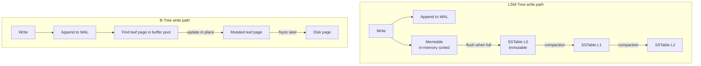

**Amplification — the core trade-off.** Three metrics define a storage engine's cost:

| Metric | Meaning | B-Tree | LSM-Tree |
|---|---|---|---|
| **Write amplification** | Bytes written to disk per byte of logical write | Moderate — WAL + page write, page may be rewritten for 1 row | High — every key rewritten multiple times across compaction levels |
| **Read amplification** | Disk reads per logical read | Low — O(log n), one path | Higher — check memtable + N SSTables; mitigated by Bloom filters |
| **Space amplification** | Disk used vs logical data size | ~1.3–1.5× — pages ~70% full (fragmentation), no compression by default | Workload/compaction-dependent — the engine's *weak* spot: under size-tiered it can exceed 2× (obsolete/tombstoned versions linger across levels), tight only under leveled |
| **Compression (separate axis)** | Footprint after block/columnar compression | Less compression-friendly by default | Compresses better — block/columnar compression typically shrinks the SSTable footprint |

> **Amplification math you can say out loud.** B-Tree: a 100-byte row update can dirty a whole 8 KB page *plus* a WAL record — call it ~80× write amplification for that single row in the worst case (most updates batch, so the amortized number is far lower, but the worst case is real and it's why random-PK inserts hurt). LSM under leveled compaction with a ~10× level multiplier and ~6 levels: a key is rewritten roughly once per level it traverses, so ~10–30× write amplification over its lifetime — but every one of those writes is *sequential*, which is why SSDs and even HDDs love it. The *type* of amplification differs, and it determines SSD wear and which workload wins.

**Compaction strategies (LSM).**
- **Size-tiered (STCS)** — merge SSTables of similar size. Write-friendly, **space-amplification spikes** (can need ~2× space transiently — plan disk headroom around this). Cassandra default for write-heavy.
- **Leveled (LCS)** — each level holds non-overlapping SSTables, ~10× the previous. Read-friendly and tight space, but **higher write amplification**. Good for read-heavy / update-heavy.
- **Time-windowed (TWCS)** — buckets by time window; ideal for time-series and TTL data (drop whole expired SSTables, no per-row tombstone scanning). This is the right choice for a chat/event message store with TTL.

**When each wins:**

| Workload | Winner | Why |
|---|---|---|
| Write-heavy ingest (logs, metrics, events, chat messages) | LSM | Sequential appends, no random page writes |
| Read-heavy with point lookups & range scans | B-Tree | Single path, predictable latency |
| Strong transactional / OLTP | B-Tree | In-place updates pair naturally with row locks + MVCC |
| Huge dataset, write throughput > read latency | LSM | Compaction amortizes; compression shrinks footprint |
| Predictable p99 latency required | B-Tree | LSM compaction causes latency jitter ("compaction storms") |

**Pitfalls.**
- **LSM read amplification** can crater latency if Bloom filters are undersized or too many SSTables accumulate (compaction falling behind). The symptom: read p99 climbs while writes stay fast.
- **Compaction storms** consume CPU/IO and spike p99 — schedule and throttle them. This is the classic "Cassandra p99 looks great until it doesn't" surprise.
- **B-Tree fragmentation** wastes space; right-only inserts (monotonic keys) cause page splits concentrated at one edge, creating a write hotspot.
- **Tombstones** in LSM (deletes are *writes* of a marker) accumulate; in Cassandra, querying across many tombstones triggers `TombstoneOverwhelmingException`. This is *the* reason you use TTL + TWCS rather than explicit deletes for expiring data.

> **Staff-level insight:** The B-Tree vs LSM choice is really a bet on your read:write ratio and your latency-vs-throughput priority. When asked "why Cassandra for our write-heavy event store?", the *engine* answer is: "LSM converts random writes into sequential IO and Bloom-filtered reads; we accept read and compaction amplification in exchange for ingest throughput and cheap compressed storage." That's a level above "Cassandra scales horizontally." **Decisive framing:** "LSM because the workload is write-dominated and append-shaped; revisit if read p99 jitter from compaction becomes the binding constraint, at which point leveled compaction or a B-Tree store enters the conversation."

---

### 1.2 Write-Ahead Log & Durability

**Definition.** The **Write-Ahead Log (WAL)** (Postgres), aka **redo log** (InnoDB) or **commit log** (Cassandra), is an append-only log written *before* any change is applied to the main data structure. It's the foundation of the **D** in ACID and of crash recovery.

**How it works.** The rule is **write-ahead**: a change must be durably logged before the corresponding data page is allowed to reach disk. On commit, the engine `fsync`s the WAL. The actual data pages can be written lazily (the buffer pool flushes dirty pages in the background). After a crash, recovery **replays** the WAL from the last checkpoint to redo committed changes and roll back uncommitted ones.

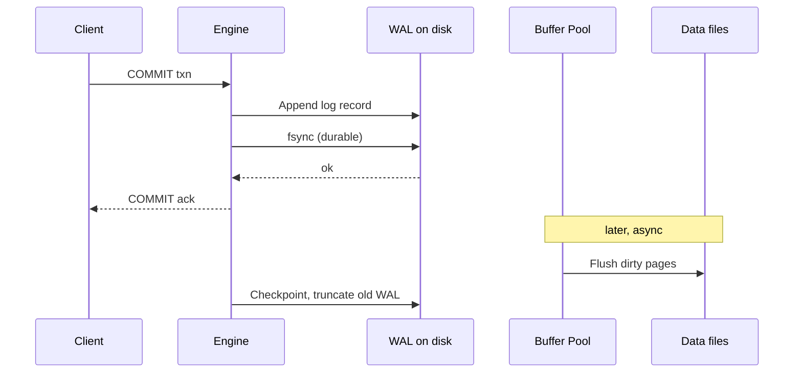

**Why it's faster than writing data pages directly.** Appending to the WAL is **sequential IO** (fast on both HDD and SSD); flushing random data pages is **random IO** (slow). The WAL batches durability into one sequential `fsync`, while expensive random page writes are deferred and coalesced. Concretely: a spinning disk does ~100–200 random IOPS but streams ~100+ MB/s sequentially; even on NVMe, sequential append beats scattered fsyncs. The WAL is how a database commits thousands of transactions per second on hardware that can only do a few hundred random writes per second.

**Group commit.** Many engines batch multiple transactions' WAL flushes into a single `fsync` to amortize the syscall cost — trading a tiny latency increase for big throughput gains. Under load this is *automatic*: the busier the system, the larger the batch, the better the per-commit efficiency.

| Aspect | WAL / redo log | Direct page write |
|---|---|---|
| IO pattern | Sequential append | Random |
| Commit latency | One sequential fsync | Multiple random fsyncs |
| Crash recovery | Replay from checkpoint | Pages may be torn / inconsistent |
| Replication | WAL/binlog streamed to replicas | N/A |

**Pitfalls.**
- **`fsync` lying** — many disk caches and some cloud volumes ack writes before they're durable; a power loss then loses "committed" data. This is the classic "Postgres lost my data" root cause. On cloud, know whether your volume honors fsync (most managed services do; raw instance-store often doesn't).
- **Durability knobs** — Postgres `synchronous_commit=off` and MySQL `innodb_flush_log_at_trx_commit=2` skip per-commit fsync for throughput, risking the last ~1s of transactions on crash. Know these trade-offs; interviewers probe them. The honest framing: "I'd keep full durability on the system of record and only relax it for data I can regenerate."
- **WAL bloat** — replication slots or stalled checkpoints prevent WAL truncation, filling the disk (a common Postgres outage). An abandoned logical-replication slot will silently grow the WAL until the disk is full and the primary stops accepting writes.

> **Staff-level insight:** The WAL isn't just durability — it's the *spine* of replication. Postgres streaming replication ships WAL records; MySQL ships the binlog; both physical and logical replication are "replay my write log." When you say "we'll add a read replica," you're really saying "stream the WAL/binlog to a second node and replay it" — which is exactly why **replication lag exists** (replay takes time) and why a long-running query on the primary can stall WAL recovery on the replica. This single mental model — *replication is log shipping* — connects WAL (1.2), MVCC long-txn pain (1.3), and read-replica lag (4.1) into one story.

---

### 1.3 MVCC: Postgres vs InnoDB

**Definition.** **Multi-Version Concurrency Control** lets readers and writers proceed without blocking each other by keeping **multiple versions** of each row. A reader sees a consistent snapshot as of its transaction start (or statement start), without taking read locks. "Readers don't block writers; writers don't block readers."

**How it works (general).** Each row version is tagged with transaction IDs (when it was created / deleted). A transaction's **snapshot** determines which versions are visible. Writes create a *new* version rather than overwriting. Old versions are kept until no active transaction can see them, then **garbage collected**.

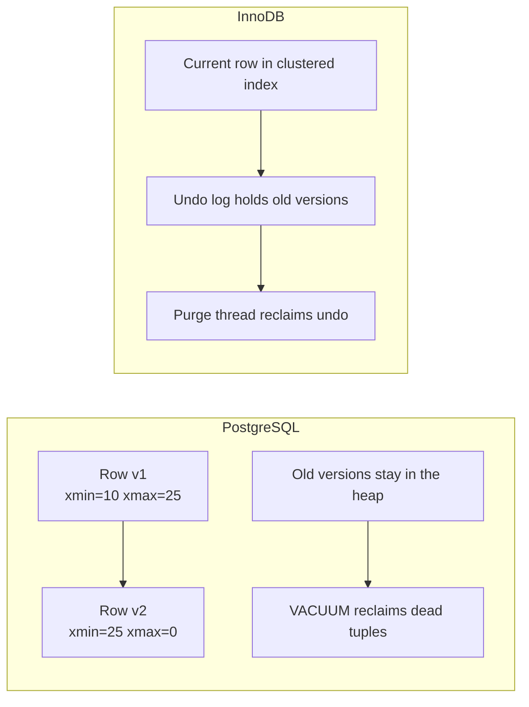

**Postgres approach.** New row versions are written **directly into the heap (table file)**. Each tuple has `xmin`/`xmax`. Updates = insert new tuple + mark old as expired. Dead tuples accumulate and are reclaimed by **VACUUM** (and `autovacuum`).
- **Pro:** rollback is instant (just don't make new versions visible); reads never touch a separate structure.
- **Con:** **table bloat** if vacuum can't keep up; **transaction ID wraparound** — a 32-bit XID counter that, if not vacuumed in time, can force the database into read-only protective shutdown. A genuine, famous Postgres operational risk (it has taken down Sentry, Mailchimp, and others publicly).

**InnoDB approach.** The current version lives in the clustered index; older versions are reconstructed from the **undo log** (rollback segments). A read at snapshot time walks the undo chain backward to find the visible version.
- **Pro:** the main table stays compact (no dead tuples in the index pages).
- **Con:** long-running transactions keep undo logs from being purged → **undo log / history list growth**, slowing everything; reconstructing old versions adds read cost.

| Aspect | PostgreSQL MVCC | InnoDB MVCC |
|---|---|---|
| Old versions stored | In the heap (table) | In undo log / rollback segment |
| Reclamation | VACUUM / autovacuum | Purge thread |
| Failure mode | Table bloat, XID wraparound | Undo log growth from long txns |
| Rollback cost | Cheap (versions discarded) | Apply undo records |
| Read of old snapshot | Direct heap read | Reconstruct via undo chain |
| Long-running query impact | Holds back vacuum → bloat | Holds back purge → history bloat |

**Pitfalls.**
- A single **idle-in-transaction** session can block vacuum/purge cluster-wide and cause bloat or undo growth — set `idle_in_transaction_session_timeout`. (This is the most common self-inflicted Postgres outage: an ORM or analytics job that opens a transaction and forgets to close it.)
- Postgres `UPDATE` of one column rewrites the whole tuple (unless HOT — Heap-Only Tuple — optimization applies), causing write amplification and index churn. Implication: an over-indexed, frequently-updated table is doubly taxed.
- **Isolation levels matter:** Postgres `REPEATABLE READ` is a true snapshot; its `SERIALIZABLE` uses SSI (Serializable Snapshot Isolation) and can abort transactions with `could not serialize` errors that the app must retry. If you propose `SERIALIZABLE`, you must also propose the retry loop.

> **Staff-level insight:** Both engines do MVCC, but the *garbage* lives in different places, so the failure modes differ — and that's the level of nuance interviewers reward. Postgres → bloat/vacuum/wraparound; InnoDB → undo/history-list growth. In both, **long-running read transactions are the enemy** because they pin old versions. If asked "what breaks Postgres at scale operationally?", the crisp answer is "autovacuum tuning, table bloat, and XID wraparound under high write churn — and the root cause is almost always a long-running or idle-in-transaction session pinning old tuples." That root-cause sentence is the Staff signal; "vacuum" alone is Senior.

---

### 1.4 Pages & Buffer Pool

**Definition.** Data is stored and cached in fixed-size **pages** (Postgres 8 KB, InnoDB 16 KB). The **buffer pool** (InnoDB) / **shared_buffers** (Postgres) is the in-memory cache of recently used pages — the database's most important cache.

**How it works.** All reads/writes go through pages in memory. A read that misses the buffer pool fetches the page from disk (a **page fault**). Writes mutate the in-memory page (marking it **dirty**) after WAL logging; dirty pages are flushed to disk later. Eviction uses an **LRU variant** (InnoDB uses a midpoint-insertion LRU to resist scan pollution; Postgres uses a clock-sweep algorithm).

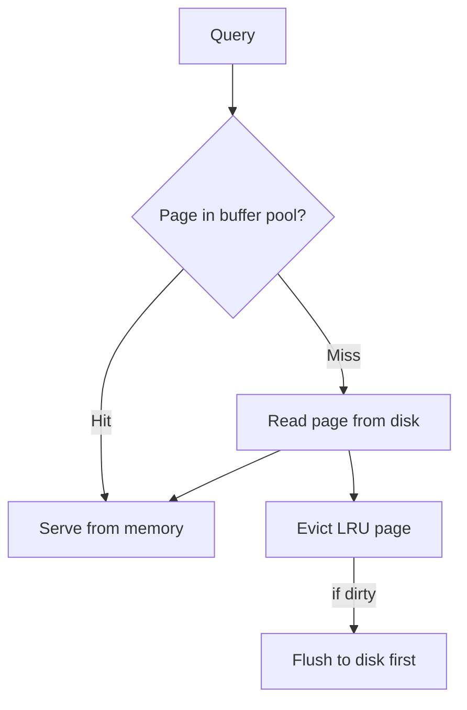

| Knob | PostgreSQL | InnoDB |
|---|---|---|
| Memory cache | `shared_buffers` (start ~25% RAM) | `innodb_buffer_pool_size` (60–80% RAM) |
| Page size | 8 KB | 16 KB |
| Eviction | Clock-sweep | Midpoint LRU |
| OS cache reliance | Heavy (double-buffers with OS page cache) | Minimal (uses O_DIRECT, manages its own) |

**Pitfalls.**
- **Buffer pool too small** → high disk read rate, latency cliff. The buffer-pool **hit ratio** is the first metric to check on a slow DB (target 99%+ for OLTP).
- **Large sequential scans** can evict your hot working set (scan pollution) — both engines mitigate this, but it still bites. A nightly analytics query that table-scans can cold-start your morning latency.
- Postgres **double buffering**: pages cached in both `shared_buffers` and the OS page cache wastes RAM, so you don't simply set `shared_buffers` to all RAM.

> **Staff-level insight:** "Is the working set in memory?" is the single most predictive question for OLTP database performance — and it is the *quantitative* anchor for the "when do I shard?" decision. A 200 GB database with a 32 GB hot set on 64 GB RAM flies; the same database with a 100 GB hot set thrashes. When sizing instances in an interview, explicitly reason about buffer-pool fit vs working-set size — and note that the moment the *hot set* (not the whole dataset) stops fitting in RAM even after partitioning out cold data, that's a genuine shard trigger. This is the operational instinct interviewers look for, and it's the bridge from internals to the 1-billion-users framework (7.3).

---

## 2. SQL Engines

> **Altitude:** name-and-move-on the fact that both are mature ACID engines. Deep-dive the two facts that actually drive design decisions: **Postgres = heap MVCC + extensions + the default**, **MySQL = clustered index (PK choice is load-bearing) + Vitess for sharding.** Don't recite feature lists; carry the two load-bearing facts.

### 2.1 PostgreSQL

**Definition.** An open-source, ACID, object-relational database known for correctness, rich types, and extensibility. The default "smart choice" for most new systems in the last decade.

**How it works / strengths.**
- **MVCC** in the heap (see 1.3), serializable isolation via SSI.
- **Rich types:** native `JSONB` (indexable binary JSON), arrays, `hstore`, ranges, geometric types, full-text search, `UUID`.
- **Extensions:** PostGIS (geospatial — best-in-class), `pg_trgm` (fuzzy search), TimescaleDB (time-series), `pgvector` (vector/embedding search for AI), `pg_stat_statements` (query profiling), Citus (distributed Postgres / sharding).
- **Indexes:** B-tree, Hash, **GIN** (JSONB, arrays, full-text), **GiST** (geospatial, ranges), **BRIN** (huge append-only tables), partial, expression, covering.
- **Replication:** **physical streaming** (WAL shipping, byte-exact replicas) and **logical** (decode WAL to row changes — enables selective replication, cross-version upgrades, CDC to Kafka via Debezium).
- **Partitioning:** declarative range/list/hash partitioning of large tables (prune partitions, drop old data cheaply).

**When it's the right default.** Mixed read/write OLTP, need for transactions and joins, evolving schema you want enforced, JSON flexibility *without* giving up SQL, geospatial, or "we don't know our access patterns yet." Single-node Postgres comfortably handles **tens of thousands of TPS** and **terabytes** before you need to shard. Concretely, a well-tuned Postgres on a large modern instance routinely serves **20–50K simple read QPS** and **5–20K write TPS** with the working set in RAM — which is more than most products ever reach. That headroom is *why* "Postgres until otherwise" is a defensible default, not a cop-out.

**Pitfalls.** Vacuum/bloat/XID wraparound (see 1.3); connection overhead (each connection is a process ~5–10 MB — use **PgBouncer** beyond ~a few hundred connections); horizontal write scaling requires extensions (Citus) or app-level sharding; replication is single-primary by default.

> **Staff-level insight:** The strongest default answer in a system design interview is **"Postgres until proven otherwise."** It buys you ACID, joins, JSONB flexibility, and a clear migration path (read replicas → partitioning → Citus → app sharding). Reaching for a NoSQL store *first* signals you're optimizing before you have a bottleneck. **State the threshold at which you'd move off it** — that's the part that converts a default into a Staff-level decision: "Postgres until sustained write TPS exceeds what a single primary handles or the working set won't fit RAM post-partitioning; then Citus or app-level sharding by the natural tenant key."

---

### 2.2 MySQL / InnoDB

**Definition.** The world's most deployed open-source RDBMS; InnoDB is its default ACID storage engine. Battle-tested at hyperscale (Facebook, YouTube, Shopify, Uber's early stack).

**How it works / key differences from Postgres.**
- **Clustered index:** the table *is* the primary-key B-tree — rows are stored physically ordered by PK in the leaf pages. Secondary indexes store the **PK as the pointer**, so a secondary lookup is two B-tree traversals (index → PK → row). Implication: **choose a small, monotonic PK** (auto-increment) or random PKs (UUIDv4) cause page splits and index bloat.
- **MVCC via undo logs** (see 1.3).
- **Replication:** asynchronous by default via **binlog** (statement / row / mixed format); semi-synchronous and Group Replication (multi-primary) available.
- **Sharding via Vitess:** the canonical horizontal-scaling layer (built at YouTube, used by Slack, GitHub, Square). Vitess transparently shards MySQL, routes queries, manages resharding, and presents a single logical database.

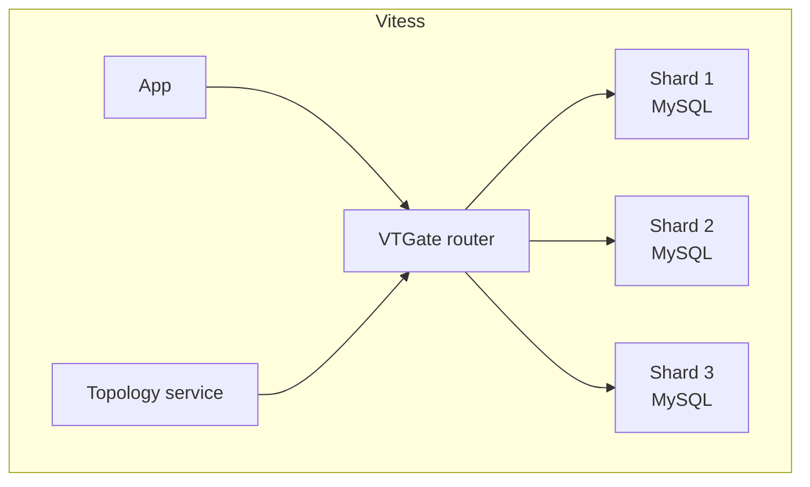

| Dimension | PostgreSQL | MySQL / InnoDB |
|---|---|---|
| Table storage | Heap + separate PK index | Clustered index (table is PK B-tree) |
| Secondary index lookup | Direct heap pointer (TID) | PK lookup (2 traversals) |
| MVCC garbage | Heap dead tuples → VACUUM | Undo log → purge |
| JSON | JSONB (binary, indexable) | JSON (functional indexes) |
| Geospatial | PostGIS (best in class) | Basic spatial |
| Extensions | Very rich | Limited |
| Horizontal sharding | Citus / app-level | Vitess (mature, transparent) |
| Replication | Streaming + logical (WAL) | Binlog (statement/row) |
| Connection model | Process per connection | Thread per connection (lighter) |
| Best fit | Complex queries, types, correctness | Simple high-volume OLTP, proven sharding via Vitess |

**Pitfalls.** Default isolation is `REPEATABLE READ` (vs Postgres `READ COMMITTED`) — gap locks can surprise you; historically lax (silent truncation in old/non-strict modes); replication can drift with statement-based binlog + non-deterministic queries (use row-based binlog to avoid this).

> **Staff-level insight:** The clustered-index design is the single most important MySQL fact. It makes PK lookups and range scans on the PK extremely fast, but makes **PK choice load-bearing**: a random UUID PK on a write-heavy table causes random insert positions, page splits, and buffer-pool churn. The fix — **UUIDv7 / ULID (time-ordered) or auto-increment** — is exactly the kind of concrete, experience-driven detail that lands at Staff level. **Decisive framing:** "MySQL/InnoDB with a time-ordered PK because the workload is high-volume simple OLTP and we want Vitess as the proven sharding path; revisit toward Postgres if we need rich types, JSONB, or PostGIS." And "we'd shard with Vitess" is a far stronger answer than hand-waving "we'll shard the database."

---

## 3. NoSQL Engines

> **Altitude + anti-pattern guard:** do not reach for these by default. Name the access pattern *first*, then the store. The deep-dive crux in every NoSQL discussion is the **shard/partition key** and the **hot-partition mitigation** — that's where you spend your minutes, not on document-vs-column trivia.

### 3.1 MongoDB

**Definition.** A distributed **document database**: data is BSON documents grouped in collections. Schema-flexible, with a rich query language and (since 4.0) multi-document ACID transactions.

**How it works.**
- **Document model:** store related data together (denormalized) — one read fetches a whole aggregate, avoiding joins. Default storage engine is **WiredTiger** (LSM-capable, B-tree by default, document-level concurrency, compression).
- **Replica set:** one **primary** + secondaries. Writes go to the primary, replicate via the **oplog** (a capped collection that is the logical operation log — MongoDB's binlog analog; WiredTiger has its own separate WAL, the journal). Automatic failover elects a new primary (Raft-like protocol).
- **Sharding:** collections are sharded by a **shard key**, distributed across shards as **chunks**; the `mongos` router directs queries; a config server tracks chunk locations. Balancer migrates chunks.
- **Read/write concerns (tunable consistency):**
  - *Write concern* `w:1` (primary only, fast, can lose data on failover) → `w:majority` (durable across failover).
  - *Read concern* `local` → `majority` (only majority-committed data) → `linearizable`.
  - *Read preference* `primary` (consistent) → `secondary` (scale reads, may be stale).

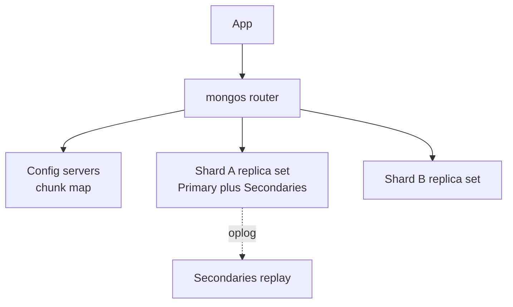

**When it shines.** Aggregate-oriented data (user profiles, product catalogs, CMS, event/IoT payloads), rapidly evolving schemas, developer velocity, "object maps cleanly to a document." Horizontal scaling built in.

**When it bites.** Cross-document transactions and joins (`$lookup`) work but fight the model — if you need them everywhere, you wanted a relational DB. **Shard key is permanent-ish and critical** — a bad one causes hot shards and jumbo chunks. Unbounded array growth and the 16 MB document limit (a chat message thread embedded as an array *will* eventually blow this — reference, don't embed, unbounded collections). `w:1` defaults have a data-loss reputation on failover — **set `w:majority` on the system of record.**

> **Staff-level insight:** MongoDB rewards **query-first, denormalized modeling** — embed what you read together, reference what grows unboundedly. The classic anti-pattern is treating it like a relational DB (normalize everything, then `$lookup` to rejoin). If your design needs joins and multi-entity transactions as the *common* path, that's a signal you chose the wrong tool. **The honest, decisive Staff answer:** "Mongo for aggregate-shaped data with evolving schemas and `w:majority` on the source of truth; Postgres if the relationships are the point. Default Postgres; choose Mongo only when the data is genuinely document-shaped."

---

### 3.2 Cassandra

**Definition.** A **Dynamo-style, wide-column, masterless** distributed database optimized for high write throughput, linear scalability, and multi-region availability. AP-leaning with tunable consistency. (ScyllaDB is a C++ rewrite with the same model and far better latency tail.)

**How it works.**
- **Ring + consistent hashing:** nodes form a ring; the partition key is hashed (Murmur3) to a token that maps to a node. Each node owns **virtual nodes (vnodes)** — token ranges — for even distribution and smooth rebalancing.
- **Replication:** the **replication factor (RF)** sets how many nodes hold each partition (e.g., RF=3). No master — any replica accepts writes; replicas reconciled via hinted handoff, read repair, and anti-entropy (Merkle trees).
- **Tunable consistency:** per-query consistency level (CL). **`R + W > RF`** guarantees strong consistency. Examples: `QUORUM` reads + `QUORUM` writes (2+2 > 3) → consistent; `ONE`/`ONE` → fast but eventually consistent. `LOCAL_QUORUM` keeps it within one datacenter (the multi-region default, to avoid cross-region latency on every quorum).
- **Storage:** **LSM-tree** — writes hit commit log + memtable, flush to SSTables, compaction merges (see 1.1). This is *why* Cassandra is write-optimized.

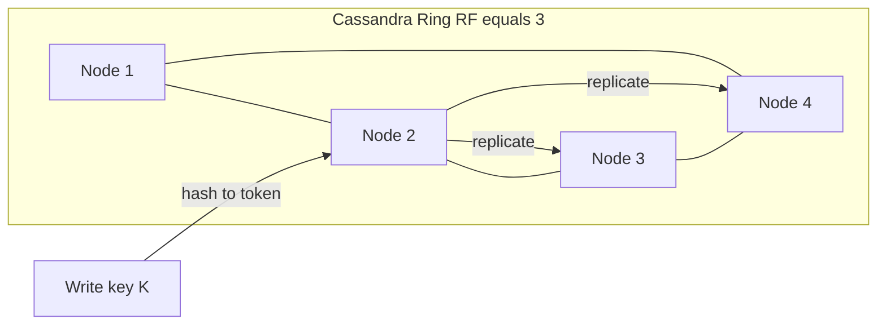

**Data modeling — query-first.** You design tables *per query*. The primary key is `(partition key, clustering key(s))`:
- **Partition key** decides which node stores the data (and must be hit on every read — no efficient cross-partition scans).
- **Clustering keys** sort rows *within* a partition (enables range scans and ordering on disk).

*Example — messages in a chat app.* Query: "get the latest messages for a conversation, paginated by time."

```sql
CREATE TABLE messages_by_conversation (
  conversation_id uuid,
  bucket          int,         -- time bucket to cap partition size
  message_id      timeuuid,
  sender_id       uuid,
  body            text,
  PRIMARY KEY ((conversation_id, bucket), message_id)
) WITH CLUSTERING ORDER BY (message_id DESC);
```
- Partition key `(conversation_id, bucket)` → all messages for a conversation+time-window live together on the same replicas; bucketing prevents unbounded partition growth.
- Clustering key `message_id` (a timeuuid), `DESC` → newest first, efficient time-range pagination.
- Need to also query "messages by a user"? **Create a second table** `messages_by_user` and write to both (no joins, denormalize on write).

> **Real-time-chat experience hook:** this exact schema is the heart of a real-time-chat message store. The two design decisions that matter are (1) the **bucket** — without it, a busy channel's partition grows unbounded and that node hot-spots and eventually OOMs; (2) **TTL + TWCS** for message retention, so expired messages drop as whole SSTables rather than leaving tombstones that you later scan through and trip `TombstoneOverwhelmingException`. Saying that unprompted signals you've operated this, not just read about it.

**Anti-patterns (interview gold).**
- **Unbounded partitions** (e.g., partition by `country`) → multi-GB partitions, hot nodes, OOM. Always bound partition size (bucketing). Target < 100 MB / < 100K rows per partition.
- **Low-cardinality partition key** → hotspots; one node does all the work.
- **Querying without the partition key** → forces `ALLOW FILTERING` = cluster-wide scan. Never in production.
- **Tombstone-heavy workloads** (frequent deletes / TTLs read together) → read latency and `TombstoneOverwhelmingException`.
- Using Cassandra for ad-hoc analytics or anything needing joins/transactions.

> **Staff-level insight:** Cassandra modeling is the inverse of relational: **you don't model entities, you model queries, and you denormalize across multiple tables, writing to all of them.** The two killer questions are "what's the partition key?" (decides distribution and the *only* efficient access path) and "is the partition bounded?" (decides whether you'll have hot nodes at scale). Demonstrating that you'd duplicate data across query-specific tables — and that disk is cheap but cross-partition scans are fatal — is exactly the Staff signal. **Decisive framing:** "Cassandra because the workload is write-heavy, append-shaped, and multi-region with `LOCAL_QUORUM`; revisit if we need ad-hoc queries, at which point the data belongs in a warehouse, not Cassandra."

---

### 3.3 DynamoDB

**Definition.** AWS's fully-managed, serverless key-value + document database. Single-digit-millisecond latency at any scale, with no servers to operate. The commercial realization of the Dynamo paper, hardened over a decade.

**How it works.**
- **Partitions:** data is auto-sharded into partitions (~10 GB / 3,000 RCU / 1,000 WCU each) by hashing the **partition key**. You don't manage partitions, but they govern the physics.
- **Keys:** **partition key** (hash, decides partition) + optional **sort key** (range within partition — enables `begins_with`, `between`, ordering). Together = primary key.
- **Indexes:**
  - **LSI (Local Secondary Index):** same partition key, different sort key; shares the partition's 10 GB limit; must be created at table creation; **strongly consistent reads possible**.
  - **GSI (Global Secondary Index):** different partition key entirely; own partitions and capacity; **eventually consistent only**; can add anytime. This is how you support alternate access patterns.
- **Capacity modes:** **Provisioned** (set RCU/WCU, cheaper for steady load, supports auto-scaling) vs **On-Demand** (pay per request, instant scaling, great for spiky/unknown load).
- **Adaptive capacity:** automatically shifts throughput to hot partitions and can isolate a hot key — mitigates but doesn't eliminate hot-partition problems.
- **DynamoDB Streams:** ordered change log (CDC) per item; powers triggers (Lambda), replication (global tables), and materialized views.

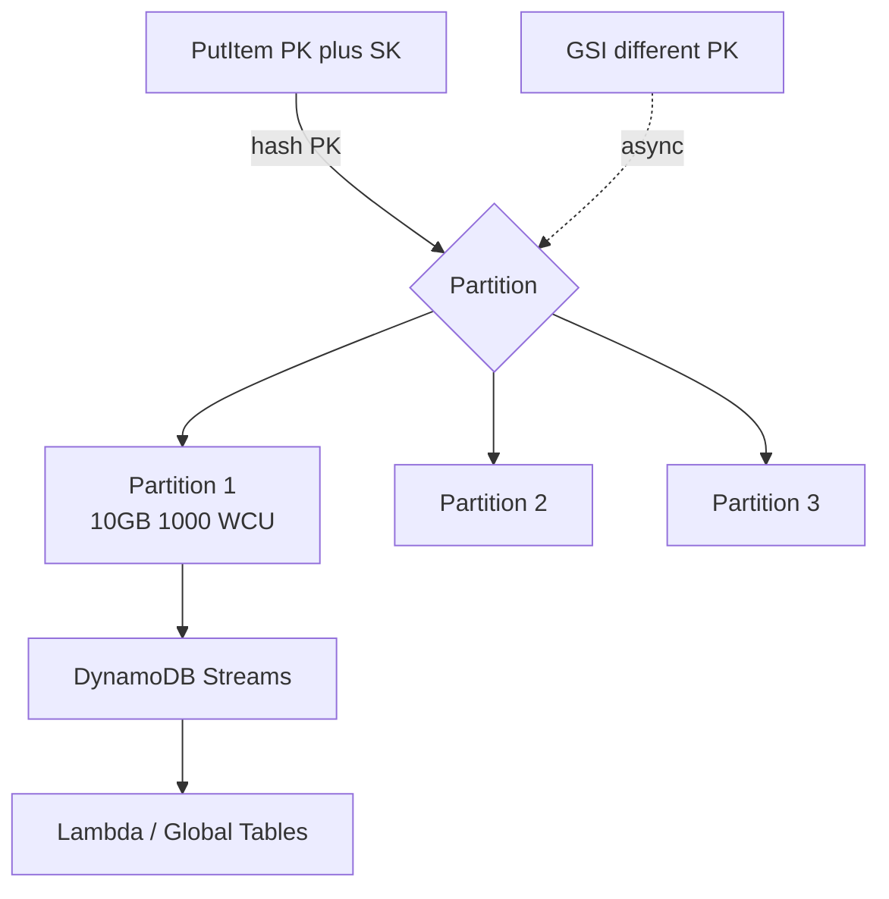

**Single-table design.** The DynamoDB power-user pattern: put *multiple entity types in one table*, overloading the partition/sort keys (e.g., `PK=USER#123`, `SK=PROFILE`, `SK=ORDER#456`) so a single query (`PK=USER#123`) returns a user and all their orders — pre-joined. Trades modeling complexity and rigidity for one-request access and predictable performance.

**Hot partition problem.** If one partition key gets disproportionate traffic (a celebrity user, a viral item), that partition's throughput caps you even if the table is under-utilized overall. Mitigations: **write sharding** (suffix the key with a random/calculated shard number, scatter-gather on read), choosing a higher-cardinality partition key, and adaptive capacity (automatic, partial).

| Concept | DynamoDB term | Notes |
|---|---|---|
| Shard key | Partition key | High cardinality, even access |
| Sort within shard | Sort key | Range queries, item collections |
| Alt access pattern | GSI | Eventually consistent, own capacity |
| Same-PK alt sort | LSI | Strongly consistent, set at create |
| Change feed | Streams | CDC, triggers, global tables |
| Scaling | On-demand / Provisioned + auto-scale | Spiky vs steady |

**Pitfalls.** No joins, no ad-hoc queries (you can only query by key/index), `Scan` is an anti-pattern (full-table, expensive). Hot partitions. Costs surprise you under heavy `Scan`/GSI projection. Modeling is up-front and unforgiving — get the access patterns right *first*.

> **Staff-level insight:** DynamoDB forces you to **enumerate every access pattern before you model**, because you can only query by keys and indexes — there's no "add a WHERE clause later." The Staff-level discussion is the trade-off: you get guaranteed single-digit-ms latency at unbounded scale and zero ops, in exchange for zero query flexibility. If access patterns are stable and known (shopping cart, session store, IoT, gaming leaderboards), it's unbeatable. If they're exploratory or analytical, it's a trap. **Always name the hot-partition / write-sharding mitigation unprompted** — it's the #1 DynamoDB failure at scale, and the single highest-value sentence you can say in a DynamoDB discussion.

---

### 3.4 NoSQL Comparison

| Dimension | MongoDB | Cassandra | DynamoDB |
|---|---|---|---|
| Model | Document (BSON) | Wide-column | Key-value / document |
| Topology | Replica set + sharding (primary-based) | Masterless ring (Dynamo) | Managed, serverless |
| Storage engine | WiredTiger (B-tree default) | LSM / SSTables | Not publicly disclosed (believed LSM-style) |
| Consistency | Tunable (read/write concern) | Tunable (R+W>RF) | Strong (PK) or eventual (GSI) |
| CAP lean | CP (primary writes) | AP (tunable) | CP-ish (managed) |
| Write optimization | Good | Excellent (LSM) | Excellent |
| Query flexibility | High (rich query lang, agg) | Low (must hit partition key) | Low (key/index only) |
| Transactions | Multi-doc ACID (4.0+) | Limited (LWT, single partition) | TransactWriteItems (limited) |
| Secondary indexes | Rich | Weak (avoid; use query tables) | GSI / LSI |
| Ops burden | Medium (self-managed) or Atlas | High | Zero (fully managed) |
| Sweet spot | Evolving aggregate data | Write-heavy, multi-region, time-series | Known patterns, any scale, no ops |
| Bites when | Joins/txns are the norm | Ad-hoc queries, joins | Exploratory/analytical queries |

> **Staff-level insight:** These three aren't interchangeable. Mongo optimizes **developer velocity and flexible aggregates**; Cassandra optimizes **write throughput and multi-region availability**; DynamoDB optimizes **operational simplicity at AWS scale**. The discriminating interview question isn't "which is best" but "given *these* access patterns, consistency needs, write volume, and ops budget, which fits?" **Name the access pattern, then the tool — and only after you've justified leaving Postgres behind.** Decisive default: "On AWS with known key-based patterns and a zero-ops mandate → DynamoDB. Write-heavy multi-region time-series → Cassandra. Document-shaped evolving data → Mongo. Anything relational or exploratory → back to Postgres."

---

## 4. Core Distributed-DB Concepts

### 4.1 Read Replicas & Replication Lag

**Definition.** A **read replica** is a copy of the primary that replays its write log (WAL/binlog) and serves read-only queries, scaling read throughput and offloading the primary.

**How it works.** Primary handles all writes; replicas replay the log asynchronously. Reads route to replicas (often via a proxy/load balancer or read-write split in the app). **Replication lag** is the delay between a write committing on the primary and being visible on a replica — typically milliseconds, but can spike to seconds/minutes under load, long transactions, or network issues.

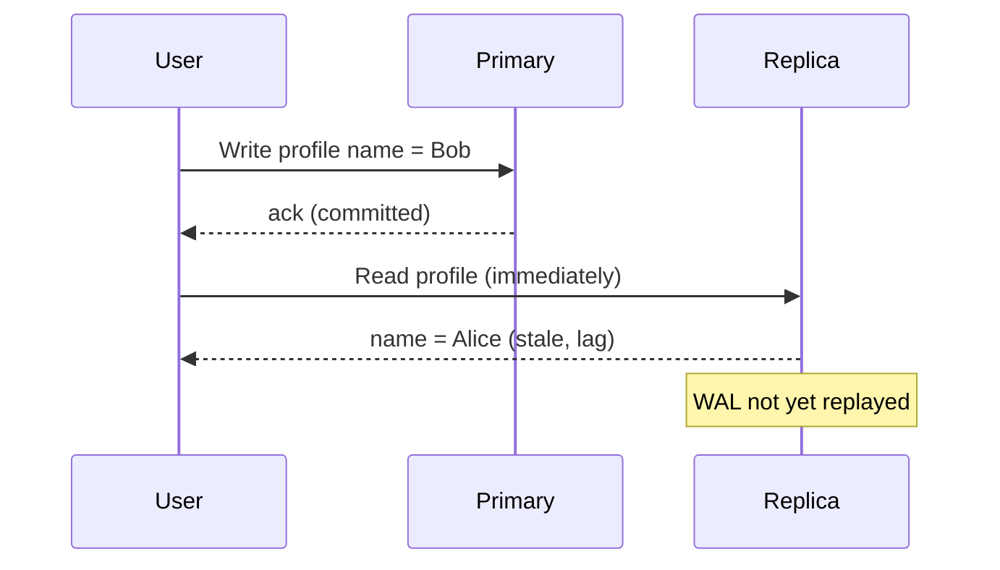

**The read-your-writes problem.** A user updates their profile, the write commits on the primary, then the immediate read hits a lagging replica and shows the *old* value — the user thinks the save failed. Fixes:
- **Read-after-write from primary:** route a user's reads to the primary for a short window after they write (sticky to primary).
- **Monotonic reads:** pin a session to one replica so it never goes backward in time.
- **Causal / version tracking:** the client passes the write's log position; the replica waits until it has caught up to it (or falls back to primary).
- **Semi-synchronous replication:** primary waits for ≥1 replica to ack before confirming the commit — bounds lag at the cost of write latency.

| Strategy | Guarantee | Cost |
|---|---|---|
| Read from primary always | Strong, simple | No read scaling |
| Read-your-writes (sticky after write) | User sees own writes | Routing complexity |
| Monotonic reads (session pinning) | No time travel backward | Uneven replica load |
| Causal (track log position) | Reads >= your write | Client/proxy complexity |
| Semi-sync replication | Bounded lag | Higher write latency |

**Pitfalls.** Replicas scale **reads, not writes** — the primary remains the write bottleneck. Routing analytics/long queries to replicas can stall replication (Postgres `hot_standby_feedback` vs query cancellation trade-off). Failover promotes a replica that may be behind → data loss window.

> **Staff-level insight:** "Add read replicas" is the right first lever for read-heavy systems, but always pair it with the **read-your-writes** answer — that single follow-up separates people who've operated replicas from people who've read about them. And be explicit and decisive: **replicas multiply read capacity and provide HA, but do nothing for write scaling — that's what sharding is for.** Default: "read replicas with read-your-writes routing (sticky-to-primary for a few seconds after a write); revisit toward sharding only when *writes*, not reads, become the bottleneck."

---

### 4.2 Multi-Leader / Multi-Master

**Definition.** A topology where **multiple nodes accept writes** (vs single-primary). Used for multi-region low-latency writes, offline-capable apps, and collaborative editing. The defining hard problem is **write conflict resolution**.

**How it works.** Each leader accepts local writes and asynchronously replicates to the others. When the same record is written concurrently in two regions, a conflict arises that must be resolved. Strategies:
- **Last-Write-Wins (LWW):** keep the write with the highest timestamp. Simple, but **silently loses data** and is sensitive to clock skew. (Cassandra resolves conflicts by cell-level LWW on write timestamps, but it is not "multi-master" in the concurrent-merge sense — it's symmetric replicas with per-partition-key timestamp-ordered writes and tunable quorum, not active-active conflict merge.)
- **Version vectors / vector clocks:** detect concurrent writes and surface both versions (siblings) to the app to merge (Dynamo/Riak).
- **CRDTs (Conflict-free Replicated Data Types):** data structures that merge deterministically without conflict (counters, sets, sequences) — used in Redis CRDT, collaborative editors, Riak.
- **Application-defined merge:** custom resolution (e.g., union of shopping carts).

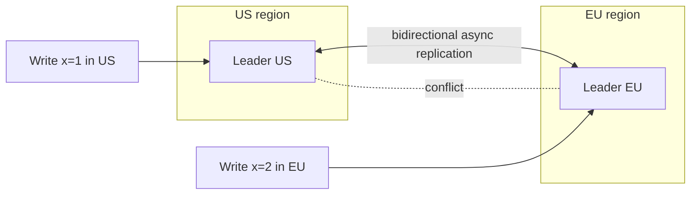

| Strategy | Conflict handling | Data loss risk |
|---|---|---|
| Last-Write-Wins | Newest timestamp wins | High (silent loss, clock skew) |
| Version vectors | Surface siblings to app | None (app must merge) |
| CRDT | Deterministic auto-merge | None (by construction) |
| Custom merge | App logic | Depends |

**Pitfalls.** Conflict resolution is genuinely hard and easy to get subtly wrong; LWW + clock skew loses writes silently; replication topologies (all-to-all, star, ring) have their own failure modes (ring loop can drop a node's updates). Most teams that *think* they need multi-master actually want a single-leader with read replicas plus a regional failover.

> **Staff-level insight:** Multi-leader is a "you'll know if you need it" architecture — multi-region active-active writes or offline-first apps — and the entire discussion lives in **conflict resolution**. The Staff move is to *avoid* it when you can: **prefer a single write leader with geo-partitioning (each record owned by one region) so concurrent conflicting writes never happen.** This is also the canonical over-engineering trap — proposing active-active for a product that has one region of users reads as inexperience. If you must do active-active, name CRDTs or version vectors over LWW, and explain LWW's silent data loss.

---

### 4.3 Sharding Strategies

**Definition.** **Sharding** (horizontal partitioning) splits a dataset across multiple independent nodes, each holding a subset, to scale **writes and storage** beyond a single machine. The **shard key** determines which shard a row lives on.

> **This is the deep-dive crux of the whole module.** The shard key is where risk concentrates and where Staff candidates are separated from Senior. Spend your minutes here, not on schema fields. Earmark it.

**Strategies:**

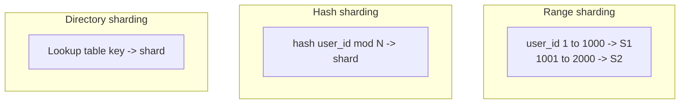

| Strategy | How | Pros | Cons |
|---|---|---|---|
| **Range** | Contiguous key ranges per shard | Efficient range scans; easy to add ranges | **Hotspots** (monotonic keys → newest shard gets all writes; e.g., time-ordered IDs) |
| **Hash** | `hash(key) mod N` (or hash ring) | Even distribution, no hotspots | No range scans; **resharding moves most data** with naive mod-N |
| **Consistent hashing** | Keys + nodes on a ring | Adding a node moves only `1/N` of keys | More complex; needs vnodes for balance |
| **Geo / entity** | Shard by region or tenant | Data locality, compliance (GDPR) | Skew if one region/tenant is huge |
| **Directory** | Lookup service maps key → shard | Maximum flexibility; rebalance freely | Lookup is a bottleneck/SPOF; extra hop |

**Choosing a shard key** (the most important decision):
1. **High cardinality** — enough distinct values to spread across all shards.
2. **Even distribution** — no value dominates (avoid `country`, `status`, boolean-ish keys).
3. **Aligns with access pattern** — most queries should hit one shard (avoid scatter-gather). E.g., shard by `user_id` if queries are per-user.
4. **Avoids monotonic hotspots** — don't range-shard on `created_at` or auto-increment ID (all new writes hit one shard). Hash it, or use a composite/bucketed key.

**Resharding / rebalancing.** Naive `hash mod N` means changing N rehashes nearly everything — an outage-grade migration. Solutions:
- **Consistent hashing** — only `~1/N` of keys move when adding a node.
- **Pre-split / fixed virtual shards** — create, say, 1024 logical shards mapped to physical nodes; rebalancing moves whole logical shards (no rehashing). Vitess, Citus, and Elasticsearch use this.
- **Online resharding** with dual writes + backfill + cutover (Vitess automates this).

**Cross-shard joins & transactions.** The hard part:
- **Cross-shard joins** — no single node has all the data. Options: denormalize so the join isn't needed; application-side join (fetch from each shard and merge — scatter-gather, slow); or keep related data co-located (shard by the same key).
- **Cross-shard transactions** — require **2-phase commit** (slow, blocking, failure-prone) or **sagas** (compensating transactions, eventual consistency). Best avoided: design so each transaction touches **one shard** (co-locate by tenant/user).

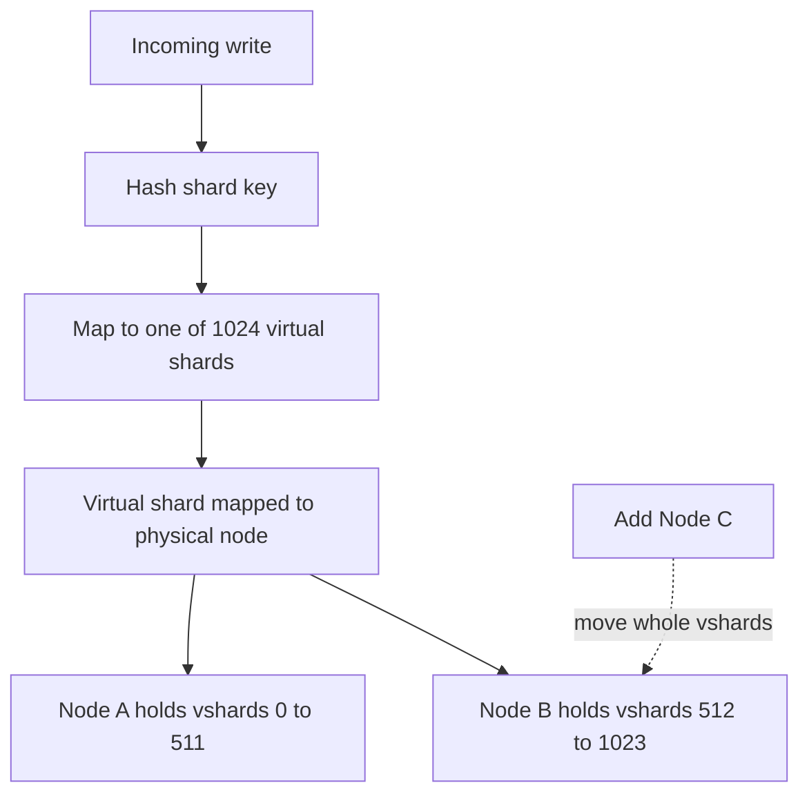

> **Worked example — chat at scale (real-time infra lens).** Shard the message store by `conversation_id` (hash, 1024 virtual shards). Why: a conversation's messages, read receipts, and reactions all co-locate → every "load this conversation" query is single-shard, and a "mark conversation read" transaction is single-shard (no 2PC). The whale risk is a giant public channel with millions of members — that one `conversation_id` becomes a hot shard. Mitigation: detect hot conversations and sub-shard them by a `(conversation_id, bucket)` composite, fanning writes across buckets and scatter-gathering reads only for those few hot conversations. This is the exact shape of the hot-partition story from the delivery section — and naming it unprompted is the Staff signal.

> **Staff-level insight:** 90% of sharding success is the shard key. State your reasoning explicitly: cardinality, distribution, access-pattern alignment, hotspot avoidance. The strongest answer adds: **"I'd use a fixed number of logical/virtual shards from day one so resharding moves whole shards instead of rehashing everything — and I'd choose the key so transactions stay single-shard, avoiding 2PC."** That's a Staff-grade answer that shows you've felt the pain of a bad shard key. And lead with *reluctance*: "first I'd confirm replicas + cache + partitioning are exhausted — sharding is the last lever, not the first."

---

**Vertical sharding (functional partitioning) — the step before horizontal sharding.** Instead of splitting one table's *rows* across nodes, move whole *tables or domains* onto separate database clusters: content on one, the social graph on another, votes and counters on a third. It's the right first move when a few tables take a disproportionate share of queries, because it relieves the hot instance without choosing a shard key or rewriting queries to route by key. The costs: joins across domains move into application code, and a transaction can no longer span them (use an [outbox or saga](../Deep%20Dives/15-pattern-multi-step-processes.md)). It also has a ceiling, since one domain can still outgrow a node, and that domain is the one you then shard horizontally. Order of operations: **cache and replicas → vertical partition by domain → horizontal shard the domain that still doesn't fit** (worked through in [57 — Quora](57-design-quora.md)).

### 4.4 Partitioning vs Sharding

**Definition / terminology.** People use these loosely; here's the precise distinction:
- **Partitioning** — splitting one table into pieces (partitions), usually **within a single database/node** (e.g., Postgres declarative partitioning of a 1B-row `events` table by month). Improves manageability, query pruning, and old-data dropping — but does **not** add machines.
- **Sharding** — distributing partitions **across multiple independent nodes/databases**. Sharding is "partitioning across machines."

They compose: you partition each shard's tables locally *and* shard across nodes.

| Aspect | Partitioning | Sharding |
|---|---|---|
| Scope | Within one DB/node | Across many nodes |
| Scales | Manageability, query pruning | Writes, storage, throughput |
| Coordination | None (one engine) | Router / coordinator needed |
| Cross-piece query | Single engine handles | App or coordinator merges |
| Example | Postgres range partition by month | Vitess MySQL across 64 nodes |

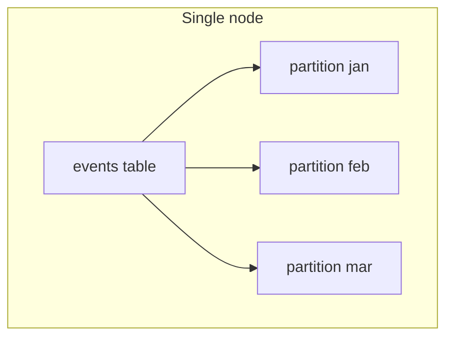

> **Staff-level insight:** Use the terms precisely — it signals depth. Partitioning is a *single-node manageability* tool (drop last month's partition instantly, prune scans); sharding is a *multi-node scaling* tool. **Many "we need to scale" problems are actually solved by partitioning + an index fix + a read replica**, not by the operational nightmare of sharding. Decisive default: **reach for partitioning first; shard only when a single node can't hold the write volume or data size.** This is the YAGNI gate — say it out loud before you ever draw a shard.

---

### 4.5 Secondary Indexes in Sharded Systems

**Definition.** In a sharded DB, a **secondary index** (on a non-shard-key column) is hard because the index entries don't naturally co-locate with the shard. Two designs:

- **Local (document-partitioned) index:** each shard indexes only its own data. Writes are cheap (update one shard's local index). **Reads must scatter-gather** across all shards (query every shard, merge results) because matching rows could be anywhere. Used by MongoDB, Elasticsearch (per-shard inverted index), Cassandra secondary indexes.
- **Global (term-partitioned) index:** the index itself is sharded by the indexed term, so a query hits only the shard holding that term — **reads are fast**, but **writes are expensive and distributed** (one row update may touch a different shard's index, often async → eventually consistent). DynamoDB GSI is essentially a global index (async, eventually consistent).

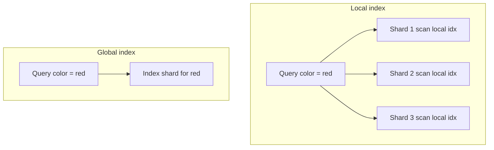

| Aspect | Local index | Global index |
|---|---|---|
| Partitioned by | Document (same shard as data) | Indexed term |
| Write cost | Cheap, local | Expensive, cross-shard, often async |
| Read cost | Scatter-gather all shards | Single shard |
| Consistency | Consistent with data | Often eventually consistent |
| Examples | Mongo, Elasticsearch, Cassandra | DynamoDB GSI |

> **Staff-level insight:** This is the trade-off behind DynamoDB's "GSIs are eventually consistent." A global index makes reads on alternate keys fast but pushes the cost to writes (cross-shard, async). A local index keeps writes cheap but makes those reads a scatter-gather. When you propose "we'll add a secondary access pattern in our sharded store," immediately address the fork: **local (cheap writes, fan-out reads) or global (fast reads, eventual consistency on writes)?** Naming this trade-off unprompted is a strong Staff signal — and the decisive default is "global/GSI for high-cardinality alternate lookups where eventual consistency is fine; local + scatter-gather only when shard count is small."

---

## 5. Indexes & Query Optimization

**Definition.** An **index** is an auxiliary data structure that speeds up lookups at the cost of storage and write overhead. Choosing and reading indexes correctly is the highest-ROI DB skill.

> **Altitude:** "I'll index the foreign keys and the columns I filter on" is name-and-move-on. The deep-dive worth your minutes is the **leftmost-prefix rule** (the #1 reason an index goes unused) and **EXPLAIN reading** (how you debug live). Don't over-explain what an index is.

**Index types:**

| Type | Structure | Best for | Notes |
|---|---|---|---|
| **B-tree** | Balanced tree | Equality + range (`=`, `<`, `>`, `BETWEEN`, `ORDER BY`, prefix `LIKE 'a%'`) | The default; supports sorting |
| **Hash** | Hash table | Exact equality only | No ranges; rarely worth it over B-tree |
| **GIN** (Postgres) | Inverted index | JSONB, arrays, full-text, multi-value | Slower writes |
| **GiST** (Postgres) | Generalized search tree | Geospatial, ranges, nearest-neighbor | PostGIS uses it |
| **BRIN** (Postgres) | Block range min/max | Huge, naturally-ordered tables (time-series) | Tiny index, great for append-only |
| **Bitmap** | Bitmaps per value | Low-cardinality columns, OLAP/analytics | Oracle/columnar; Postgres builds them on the fly |
| **Partial** | Index with `WHERE` | Index a subset (`WHERE status='active'`) | Smaller, faster, cheaper to maintain |
| **Covering** (`INCLUDE`) | Index holds extra columns | Index-only scans (no heap fetch) | Big latency win |
| **Composite** | Multi-column | Multi-predicate queries | **Leftmost prefix rule** ⬇ |

**Leftmost prefix rule.** A composite index `(a, b, c)` serves queries filtering on `a`, `a,b`, or `a,b,c` — but **not** `b` alone or `c` alone. The index is sorted by `a` first. So `WHERE a=1 AND b=2` uses it; `WHERE b=2` does not. **Column order is load-bearing**: put the equality/most-selective columns first, range columns last (a range predicate "stops" further columns from being used for seeking).

**Reading an EXPLAIN / query plan.** `EXPLAIN ANALYZE` shows the chosen plan and actual timings. Read it bottom-up. Watch for:
- **Seq Scan / Full Table Scan** on a large table where you expected an index → missing/unused index.
- **Index Scan** vs **Index Only Scan** (latter avoids the heap — faster; needs covering index).
- **Estimated vs actual rows** far apart → stale statistics (`ANALYZE` / `ANALYZE TABLE`) → bad plan.
- **Nested Loop** on large inputs (vs Hash/Merge Join) → can be catastrophic if the row estimate was wrong.
- **Sort** spilling to disk, **Hash** spilling → memory (`work_mem`) too low.
- **Rows Removed by Filter** high → the index didn't filter; predicate not sargable.

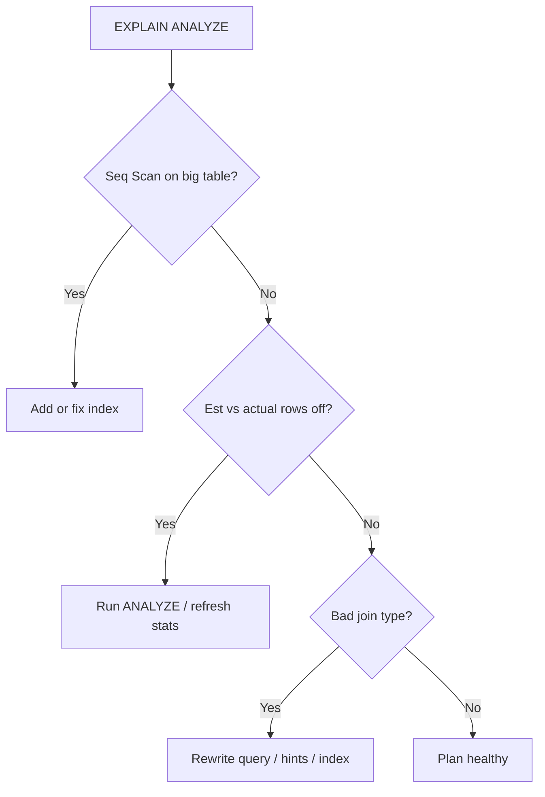

**Common slow-query causes.**
- **N+1 queries:** ORM loads a list (1 query), then a related entity per row (N queries). Fix with eager loading / `JOIN` / `IN (...)` batch / DataLoader. This is the single most common ORM-induced latency bug, and it hides in code review because each query is fast — it's the *count* that kills you.
- **Non-sargable predicates:** `WHERE LOWER(email)=...`, `WHERE col + 1 = 5`, leading wildcard `LIKE '%foo'`, implicit type casts — the function/cast prevents index use. Fix: expression index, or rewrite.
- **Missing / wrong-order composite index** (leftmost prefix violation).
- **Stale statistics** → planner picks a bad plan.
- **Over-fetching:** `SELECT *` defeats covering indexes; pull only needed columns.
- **Implicit cast** (querying a `VARCHAR` column with an integer literal) silently disables the index.

**When an index HURTS.**
- Every index **slows writes** (each INSERT/UPDATE/DELETE maintains all indexes) and consumes RAM/disk.
- **Low-cardinality** columns (boolean, status) — the planner often prefers a scan; the index is dead weight.
- **Over-indexing** — too many indexes bloat the buffer pool and write path; audit with `pg_stat_user_indexes` (unused indexes).
- **Write-heavy tables** — each extra index is a tax on every write; index only what you query.

> **Staff-level insight:** Indexing is a write-tax-for-read-speed trade. The Staff-level instinct: "indexes aren't free — each one taxes every write and the buffer pool, so I index for the queries that matter and drop the unused ones." When debugging a slow query live, the move is `EXPLAIN ANALYZE` → look for seq scans, row-estimate skew, and non-sargable predicates — *not* "add an index" reflexively. And know the leftmost-prefix rule cold: it's the single most common reason "I have an index but it's not being used."

---

## 6. NewSQL / Distributed SQL

**Definition.** **NewSQL / distributed SQL** databases provide **horizontal scale-out like NoSQL** while keeping **SQL, ACID transactions, and strong consistency**. They aim to end the "scale vs consistency" dichotomy.

> **Altitude + over-engineering guard:** name-and-move-on what these are. Do *not* reach for Spanner/Cockroach by default — that's the over-engineering trap. The deep-dive worth having is *why distributed transactions are hard* (TrueTime vs HLC) and the *specific* trigger that justifies the move. Earmark this as a "only when forced" tool.

**How they work.** Data is sharded automatically; consensus (Raft/Paxos) replicates each shard for consistency and HA; a distributed transaction protocol (often based on 2PC + MVCC) provides ACID across shards. The hard problem is **globally consistent transaction ordering**, solved differently per system.

| System | Origin | Key idea | Compatibility | Best for |
|---|---|---|---|---|
| **Google Spanner** | Google | **TrueTime** — GPS+atomic clocks give bounded clock uncertainty, enabling globally consistent external timestamps | SQL (Spanner dialect) | Global, strongly-consistent, multi-region (AdWords, GCP) |
| **CockroachDB** | OSS | Spanner-inspired but **no special hardware** — uses HLC (hybrid logical clocks) + Raft; survives node/region loss | PostgreSQL wire | Cloud-native, multi-region resilience, Postgres compat |
| **YugabyteDB** | OSS | Spanner-style storage (DocDB on RocksDB) + Postgres query layer (reuses PG code) | PostgreSQL (deep) | Postgres feature parity + horizontal scale |
| **Vitess** | YouTube | Sharding *middleware* over plain MySQL (not a new engine) | MySQL | Scaling existing MySQL transparently (Slack, GitHub) |
| **TiDB** | OSS (PingCAP) | Separate HTAP: TiKV (txn store) + TiFlash (columnar) | MySQL | Mixed OLTP+OLAP (HTAP) |

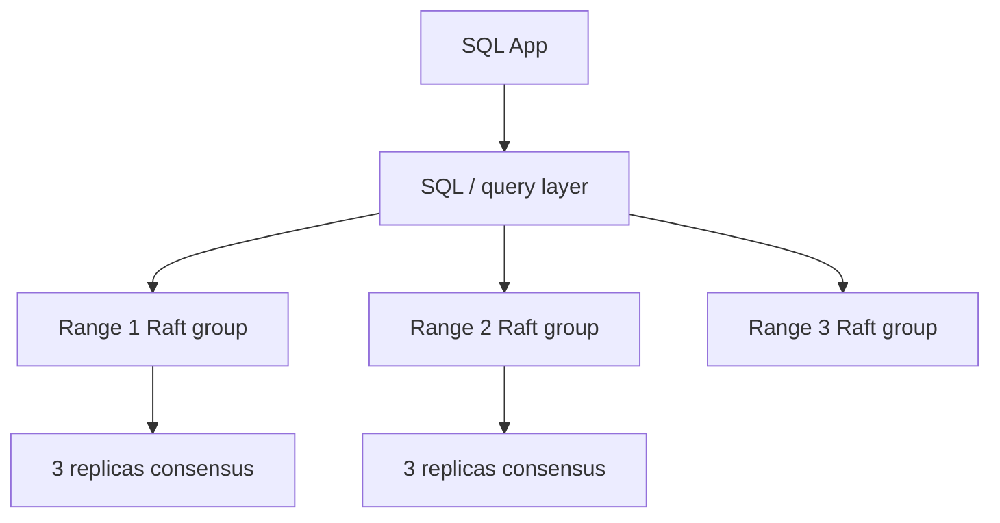

**TrueTime (the Spanner trick).** Spanner waits out the clock uncertainty interval (`commit-wait`) so that any transaction that started after another *truly* sees its effects — giving external consistency (linearizability) across the globe. The cost is a few milliseconds of commit-wait per transaction. Cockroach/Yugabyte approximate this without special hardware using **hybrid logical clocks** (accepting slightly weaker guarantees or occasional transaction restarts on clock-uncertainty windows).

**Trade-offs.** Distributed SQL is not free: cross-shard/cross-region transactions pay **latency** (consensus round-trips, commit-wait); single-node Postgres/MySQL is faster for workloads that fit on one box. Operational maturity and ecosystem are younger than vanilla Postgres/MySQL.

> **Staff-level insight:** Distributed SQL solves a real and specific pain: "I outgrew single-node Postgres writes but I refuse to give up transactions and joins." The honest framing in an interview: it removes the manual-sharding burden and gives horizontal write scale *with* ACID — at the cost of cross-region transaction latency and a younger ecosystem. **Don't reach for it by default** (single-node Postgres + replicas covers most companies forever); reach for it when you genuinely need transactional, multi-region, horizontally-scaled writes. **Decisive trigger:** "Distributed SQL when I need horizontal write scale AND cross-shard ACID AND I don't want to hand-build sharding — otherwise sharded Postgres/Vitess." Naming TrueTime and the HLC alternative shows you understand *why* it's hard.

---

## 7. Interview Frameworks

> These three frameworks are the reusable spine of any database round. Each is written to be *decisive*: it ends in a choice with a trigger, not a list. Memorize the shape, not the words.

### 7.1 SQL vs NoSQL Decision Framework

Don't answer "NoSQL scales better" — that's wrong and dated (Postgres scales enormously; NewSQL exists). Drive from **access patterns**, and **end in a default**:

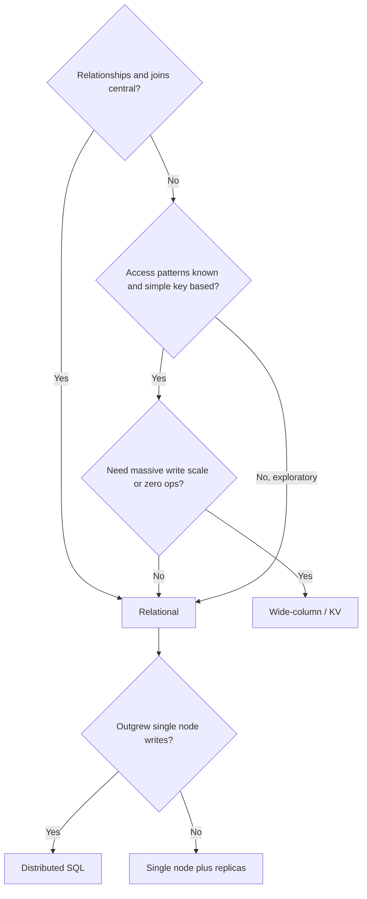

| Dimension | Favors SQL (Postgres/MySQL) | Favors NoSQL |
|---|---|---|
| **Access patterns** | Ad-hoc, exploratory, joins | Known, key-based, fixed |
| **Consistency** | Strong ACID, multi-row txns | Eventual OK, tunable |
| **Schema** | Enforced, relational integrity | Flexible, evolving, sparse |
| **Scale (writes)** | Up to single-node limit (huge) | Beyond single node, horizontal |
| **Query type** | Complex joins, aggregations | Simple lookups by key |
| **Relationships** | Many-to-many, referential | Aggregate / hierarchical |
| **Ops** | Self-manage (or RDS) | Managed options reduce ops (Dynamo) |

**The honest framing:** start with relational unless you have a *specific* reason not to (proven write volume beyond a single node, schema-less/aggregate data, zero-ops requirement, or extreme multi-region availability). "Use the right tool, and often that tool is Postgres" is a stronger answer than dogma either way. Also valid: **polyglot persistence** — Postgres for core transactional data, Redis for cache/sessions, Elasticsearch for search ([Search](07-search.md)), Cassandra/Dynamo for the high-write event firehose.

> **Staff-level insight:** The trap is treating it as a binary. Real systems are **polyglot**: a relational system of record + specialized stores per access pattern. The Staff answer names the data, its access pattern, and the store per slice — and crucially identifies the **system of record** (the source of truth) vs derived/denormalized copies. **The decisive default to say out loud: "Postgres as the system of record until a requirement forces otherwise; specialized stores bolted on per proven access pattern."** "NoSQL because scale" without a write-volume number is a junior tell — make them give you the number, or estimate it yourself.

---

### 7.2 Sharding Strategy Framework

A reusable, four-step answer for "how would you shard this?" — and note step 1 is **don't**:

1. **Do you even need to shard?** First exhaust: vertical scaling, read replicas, caching ([Caching](03-caching.md)), partitioning, archiving cold data. Sharding adds permanent operational complexity (cross-shard joins/txns, rebalancing, hot shards). Only shard when a single primary can't hold the **write volume or data size** (concretely: writes past what one node sustains, or hot working set that won't fit RAM after partitioning).
2. **Pick the shard key** — cardinality (many values), even distribution (no dominant value), **access-pattern alignment** (most queries hit one shard), and **no monotonic hotspot** (don't range-shard on time/auto-id). E.g., shard by `user_id` for a per-user workload; by `tenant_id` for B2B SaaS; by `conversation_id` for chat.
3. **Pick the strategy** — hash/consistent-hashing for even spread (default), range for range-scan-heavy (accept hotspot risk), geo for locality/compliance, directory for max flexibility. Use a **fixed number of virtual shards** (e.g., 1024) mapped to physical nodes so resharding moves whole shards.
4. **Handle the hard parts** — keep transactions single-shard (co-locate related data); for cross-shard reads, denormalize or scatter-gather; for resharding, dual-write + backfill + cutover (or let Vitess/Citus automate). Define hot-key mitigation (write sharding / key suffixing).

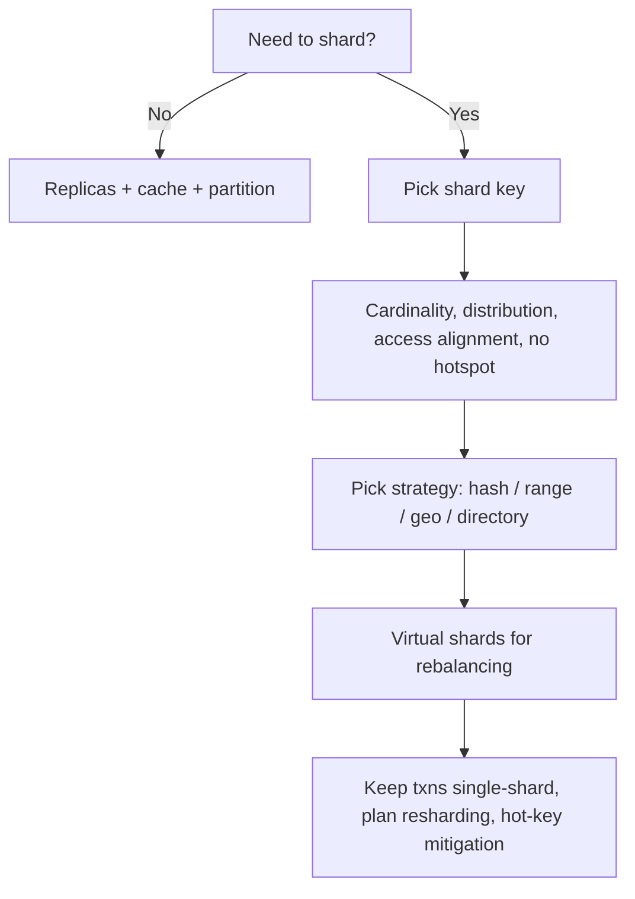

> **Staff-level insight:** The senior signal is *reluctance* to shard plus precision *when* you do. Lead with "have we exhausted replicas, caching, and partitioning?" then commit to a shard key with explicit reasoning, then proactively address the two things that kill shardings: **hot shards (bad key) and resharding pain (use virtual shards).** Mentioning that you'd keep transactions single-shard to avoid 2PC is the detail that lands. **Decisive close:** "Shard by `<entity>` over 1024 virtual shards, hash-distributed, single-shard transactions, write-sharding for the known whale; revisit count only by moving whole vshards, never rehashing."

---

### 7.3 Designing for 1 Billion Users / 1B Rows

A structured, repeatable answer when scale is thrown at you. **Estimate → Cache → Replicate → Shard → Async → Tier.**

1. **Estimate first (do the math out loud).** 1B users × ~2 KB/profile ≈ **2 TB** of profile data — that fits on one big node's disk but not its RAM. Then estimate QPS: 1B users, say 10% DAU = 100M, ~10 reads/day each = 1B reads/day ≈ **~12K read QPS average, ~50–100K peak**; writes maybe 1/10th. *Now you know which constraint binds* (often reads first → cache + replicas; later writes → shard).
2. **Cache the hot set** ([Caching](03-caching.md)). 80/20: most traffic hits a small fraction of users. A Redis layer absorbing 90% of reads cuts DB read load 10×. Cache-aside with sensible TTLs and read-your-writes handling.
3. **Read replicas for read scaling.** Route reads to replicas, writes to primary, with read-your-writes routing for the user's own data. Buys 5–10× read throughput.
4. **Shard for write scale & data size.** When the primary can't hold writes or the dataset exceeds one node, shard by `user_id` (hash, virtual shards). Per-user data co-locates → most queries single-shard. 1B users / 64 shards ≈ 16M users/shard ≈ ~30 GB each — comfortable.
5. **Async + queues for non-critical writes.** Push analytics, notifications, feed fan-out, search indexing to a message queue ([Distributed Systems](02-distributed-systems.md)); keep the synchronous write path lean. CDC (Dynamo Streams / Debezium on WAL) to update derived stores ([Search](07-search.md)).
6. **Tier cold data.** Most of 1B rows is rarely accessed. Partition by time/activity; move cold/inactive data to cheaper storage (S3, columnar warehouse, separate "archive" shards). Keeps the hot indexes small and in RAM.

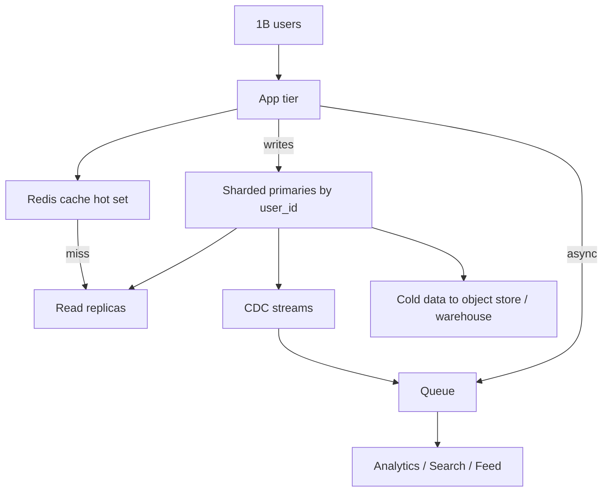

| Layer | Lever | Scales |
|---|---|---|
| Cache | Redis on hot set | Read latency + DB read load |
| Read replicas | Read/write split | Read throughput |
| Sharding | By user_id, virtual shards | Writes + storage |
| Async | Queues, CDC | Write path latency, decoupling |
| Tiering | Partition + archive cold data | Keeps hot set in RAM |

> **Staff-level insight:** The structure *is* the answer — and it must start with **estimation** so you attack the binding constraint, not a guess. The progression (cache → replicas → shard → async → tier) shows you reach for the cheapest, least-disruptive lever first and treat sharding as a last resort. Naming the **system of record** and which data is derived, plus "keep the hot working set in RAM" (callback to 1.4), demonstrates the operational depth that separates Staff from Senior. **The one-liner to land:** "Estimate first, then attack the binding constraint with the cheapest lever — I don't shard until the math says one node can't hold the writes or the hot set."

---

## Interview Cheat-Sheet

**Delivery (carry this in the room)**
- Default to **Postgres**; justify every move off it with a requirement + trigger.
- **Decide, don't enumerate**: "`<choice>` because `<requirement>`; revisit if `<trigger>`."
- **Altitude**: name-and-move-on the schema fields; deep-dive the **shard key, hot partitions, consistency boundary**.
- **Don't shard** until replicas + cache + partitioning are exhausted and one node can't hold writes/data.
- Top anti-patterns to avoid: NoSQL-by-default, premature sharding, rabbit-holing the user table, listing without choosing, over-engineering (Spanner/multi-leader for a one-region app).

**Storage engines**
- **B-Tree** = read-optimized, in-place updates, predictable latency (Postgres, InnoDB). **LSM-Tree** = write-optimized, append + compaction, jittery p99 (Cassandra, RocksDB, Dynamo).
- Amplification: B-tree → moderate write (~80× worst case on a single-row page dirty), low read; LSM → high write (~10–30× over compaction levels, but sequential), higher read (mitigated by Bloom filters), low space.
- **WAL** = write log before data pages → sequential IO durability + the spine of replication.
- **MVCC**: Postgres keeps old versions in heap (→ VACUUM, bloat, XID wraparound); InnoDB in undo log (→ purge, undo growth). Long-running txns hurt both; root cause is usually idle-in-transaction.
- **Buffer pool fit vs working set** is the #1 OLTP performance predictor *and* the quantitative shard trigger.

**Engines**
- **Postgres** = best default: ACID, JSONB, PostGIS, extensions, partitioning, logical replication; ~20–50K read QPS / 5–20K write TPS single-node. Move off it only with a reason.
- **MySQL/InnoDB** = clustered index (PK choice load-bearing → time-ordered PK), Vitess for sharding.
- **MongoDB** = documents, replica sets, oplog, query-first denormalized modeling, `w:majority` on source of truth.
- **Cassandra** = masterless ring, consistent hashing, tunable consistency (R+W>RF, LOCAL_QUORUM multi-region), LSM, query-first tables, *bounded* partitions, TTL+TWCS.
- **DynamoDB** = managed serverless, PK+SK, GSI (eventual)/LSI, single-table design, hot-partition + write-sharding.

**Distributed**
- Read replicas scale **reads not writes**; always handle **read-your-writes**.
- Multi-leader → conflict resolution (avoid LWW; prefer CRDT/version vectors; better yet, single-leader + geo-partition). Don't propose it for one-region apps.
- Shard key = cardinality + even distribution + access alignment + no monotonic hotspot. Virtual shards for resharding. Keep txns single-shard.
- Local index (cheap writes, scatter-gather reads) vs global index (fast reads, eventual/expensive writes = DynamoDB GSI).

**Indexes**
- Leftmost-prefix rule for composite indexes; equality cols first, range last.
- Non-sargable predicates (functions/casts/leading wildcard) kill index use.
- `EXPLAIN ANALYZE` → seq scans, est-vs-actual skew, bad joins. Fix N+1 with eager loading.
- Indexes tax every write — index for queries that matter, drop unused.

**NewSQL** — Spanner (TrueTime), CockroachDB/Yugabyte (HLC, Postgres-compat), Vitess (MySQL middleware), TiDB (HTAP). Horizontal scale + ACID, at cross-region latency cost. Only when forced.

---

## Common Interview Questions

> Answered in a **decisive Staff voice**: each lands a choice with a reason and (where relevant) a trigger — never "it depends" as a full stop.

**Q1. Why is Cassandra write-optimized but read-amplified, and Postgres the opposite?**
Cassandra uses an **LSM-tree**: writes are an append to the commit log + an in-memory memtable, then flushed as immutable sorted SSTables — purely sequential IO, no random page updates. Reads must check the memtable plus potentially many SSTables (mitigated by Bloom filters and sparse indexes), and compaction rewrites data repeatedly → read and write amplification. Postgres uses a **B-tree** with in-place page updates: a read is one O(log n) path (low read amplification), but each write may dirty a full page and go through the WAL. The choice is a bet on read:write ratio and latency-vs-throughput — LSM when writes dominate and you tolerate p99 jitter from compaction; B-tree when you need predictable read latency.

**Q2. How does MVCC differ between Postgres and InnoDB, and what breaks at scale?**
Both keep multiple row versions so readers don't block writers. Postgres writes new versions **into the heap** (tagged `xmin`/`xmax`) and reclaims dead tuples via **VACUUM** — failure modes are table **bloat** and **XID wraparound** if autovacuum can't keep up. InnoDB keeps the current row in the clustered index and **old versions in the undo log**, reclaimed by the purge thread — failure mode is **undo/history-list growth** from long-running transactions. In both, long-running read transactions pin old versions and are the operational enemy; the root cause is almost always an idle-in-transaction session, which is why I set `idle_in_transaction_session_timeout` on any write-heavy Postgres.

**Q3. We add read replicas. A user updates their profile and immediately sees the old value. What's happening and how do you fix it?**
Replication is asynchronous, so the immediate read hit a replica that hadn't replayed the WAL yet — **replication lag** causing a **read-your-writes** violation. Fix: route the user's reads to the **primary** for a short window after they write (sticky), which is the cheapest reliable answer; alternatives are pinning the session to one replica (**monotonic reads**) or tracking the write's log position and waiting for catch-up (**causal**). For tighter bounds, semi-synchronous replication, but that taxes write latency. And to be explicit: replicas scale reads only — writes still bottleneck on the primary, which is what sharding is for.

**Q4. How would you pick a shard key for a multi-tenant SaaS, and how do you avoid the pitfalls?**
Shard by **`tenant_id`** so each tenant's data co-locates on one shard → most queries and transactions are single-shard (no cross-shard joins or 2PC). Requirements: high cardinality (many tenants), even distribution — but watch for a **whale tenant** that overwhelms one shard (mitigate by sub-sharding that tenant on a secondary dimension, or isolating it on its own shard). Use **hash + a fixed number of virtual shards** (e.g., 1024) so adding nodes moves whole virtual shards instead of rehashing. Never range-shard on time/auto-increment (monotonic hotspot). Revisit only by moving whole vshards.

**Q5. Why are DynamoDB GSIs eventually consistent, and what's the hot-partition problem?**
A GSI is a **global (term-partitioned) secondary index**: it's sharded by a *different* partition key than the base table, so a single item write must also update an index entry that may live on a different partition — done **asynchronously**, hence eventual consistency. The **hot-partition problem**: throughput is per-partition, so if one partition key (a celebrity, a viral item) gets disproportionate traffic, it caps you even with the table under-utilized overall. Mitigate with **write sharding** (suffix the key with a shard number, scatter-gather on read), a higher-cardinality key, and adaptive capacity (automatic, partial). I design the write-sharding *before* the celebrity arrives, not after.

**Q6. SQL or NoSQL for a new product — how do you decide?**
Drive from **access patterns and constraints**, not dogma — and default to **relational (Postgres)** unless there's a specific reason. Relationships/joins/transactions and exploratory queries strongly favor SQL; known key-based access at write volumes beyond a single node, schema-less/aggregate data, or a zero-ops mandate favor NoSQL. Most systems are **polyglot**: a relational system of record plus specialized stores (Redis cache, Elasticsearch search, Cassandra/Dynamo for high-write firehoses). The senior tell is naming the data slice, its access pattern, and the right store per slice — and identifying the source of truth. "NoSQL because scale" without a write-volume number is a junior answer; make the number explicit.

**Q7. Design the data layer for a system with 1 billion users.**
**Estimate → cache → replicate → shard → async → tier.** First do the math (≈2 TB of profiles, ~50–100K peak read QPS) to find the binding constraint — usually reads first. Cache the hot set in Redis (80/20 → ~10× read reduction). Add read replicas with read-your-writes routing. When writes/data exceed one node, **shard by user_id** (hash, virtual shards) so per-user data co-locates → single-shard queries; 1B/64 shards ≈ 30 GB each. Offload non-critical writes (analytics, feed fan-out, search indexing) to **queues**; use CDC to update derived stores. **Tier cold data** to object storage/warehouse so the hot index stays in RAM. Reach for the cheapest lever first; treat sharding as a last resort — I don't shard until the math says one node can't hold the writes or hot set.

**Q8. I have an index on `(a, b, c)` but my query on `WHERE b = 5` doesn't use it. Why?**
The **leftmost-prefix rule**. A composite index is sorted by `a` first, then `b`, then `c`, so it can seek on `a`, `a,b`, or `a,b,c` — but a predicate on `b` alone has no contiguous range to seek (the index isn't ordered by `b` globally). Fix: reorder the index to lead with `b` if that's the common query, or add a separate index on `(b, ...)`. Also check the predicate is **sargable** — a function or cast on the column (`WHERE LOWER(b)=...`) also disables the index. I'd confirm with `EXPLAIN ANALYZE` rather than guess.

**Q9. When would you choose distributed SQL (Spanner/CockroachDB) over sharded Postgres?**
When you genuinely need **horizontal write scale AND ACID transactions AND strong consistency across regions** — and don't want to hand-build and operate sharding logic. Distributed SQL automates sharding, uses consensus (Raft/Paxos) per shard for HA, and provides cross-shard transactions; Spanner uses **TrueTime** (atomic/GPS clocks) for global external consistency, Cockroach/Yugabyte approximate it with **hybrid logical clocks** (no special hardware). The cost is **cross-region transaction latency** (consensus + commit-wait) and a younger ecosystem. For most companies, single-node Postgres + replicas + eventual sharding/Vitess is enough — I reach for distributed SQL only with a real transactional-multi-region-scale need, never by default.

**Q10. What's the difference between partitioning and sharding, and which do you reach for first?**
**Partitioning** splits one table into pieces **within a single node** (e.g., Postgres range-partition `events` by month) — it improves manageability and query pruning and lets you drop old data instantly, but adds no machines. **Sharding** distributes data **across multiple nodes** to scale writes and storage, requiring a router and introducing cross-shard joins/transactions. Reach for **partitioning first** (plus indexes, caching, replicas) — many "we need to scale" problems are solved without the operational cost of sharding. Shard only when a single node can't hold the write volume or data size.

**Q11 (meta/delivery). The interviewer says "just design the database schema for X" — how do you avoid the rabbit hole?**
I name-and-move-on the unremarkable parts ("standard user/profile fields — id, name, email, timestamps, nothing load-bearing") in one sentence, then immediately pivot to where the design actually lives: **access patterns, the shard/partition key, the hot-partition risk, and the consistency boundary.** The columns aren't the design; the access patterns and the key are. If I catch myself debating `VARCHAR(255)` vs `TEXT`, that's the signal I've dropped altitude — I pull back up to the decisions that have blast radius. Controlling altitude like this *is* the Staff signal.

**Q12 (meta/delivery). You're asked to choose a database and you genuinely could justify two. What do you say?**
I never stop at "it depends." I state the *axis* the decision turns on, resolve it with the requirement in front of me, and commit: "`<choice>` because `<requirement>`; I'd revisit toward `<alternative>` if `<trigger>`." For example: "Postgres because the access patterns are relational and exploratory and we're nowhere near single-node write limits; I'd revisit toward Cassandra if sustained write TPS pushes past one node and the data is append-shaped." Committing with a named trigger shows judgment; enumerating without choosing shows none.
