# Module 7 — Search Systems

> The definitive reference for designing full-text and semantic search at scale, for Staff Engineer / Senior EM / Director system-design interviews.

## What you'll master

Search is one of the most under-prepared topics in system design interviews, and one of the most discriminating. Anyone can say "use Elasticsearch," but a Staff candidate explains *why* an inverted index exists, what BM25 does that TF-IDF cannot, why segments are immutable, how to reindex 2 billion documents with zero downtime, and when **not** to use a search engine at all. This module takes you from the bit-level mechanics of a postings list up to a full hybrid (keyword + vector) product-search architecture.

By the end you will be able to:

- Build and reason about an **inverted index** from raw text, including the analysis chain (tokenize → normalize → stem → stop-word) and positional postings for phrase search.
- Explain and contrast **TF-IDF, BM25, vector space, and learning-to-rank**, and pick relevance metrics (NDCG/MAP/MRR) that match the product.
- Design a **two-stage retrieve-then-rank** pipeline and defend the latency/quality trade-off.
- Operate **Elasticsearch / OpenSearch / Solr** in production: shards, replicas, refresh/flush/merge, hot-warm-cold, aliases, zero-downtime reindex.
- Implement **autocomplete (FST/trie/edge n-grams), fuzzy search (Levenshtein/BK-tree/phonetic), faceting, highlighting, synonyms**.
- Combine **keyword + semantic search** with reciprocal rank fusion and know when a vector DB beats a search engine.

Cross-references: [Databases](06-databases.md) (why search is not your source of truth), [Caching](03-caching.md) (query result and filter caching), [AI Systems](17-ai-systems.md) (embeddings, vector DBs, RAG), [Data Processing](16-data-processing.md) (the indexing pipeline and CDC), [Staff-Level Execution](20-staff-execution.md) (how you're actually graded in the room).

---

## Table of Contents

1. [In the Room — Staff-Level Delivery](#in-the-room--staff-level-delivery)
2. [Search Fundamentals — The Inverted Index](#1-search-fundamentals--the-inverted-index)
   - [1.1 Tokenization, Normalization, Stemming, Stop Words](#11-tokenization-normalization-stemming-stop-words)
   - [1.2 Forward Index vs Inverted Index](#12-forward-index-vs-inverted-index)
   - [1.3 Postings Lists, Term Dictionary, Skip Lists](#13-postings-lists-term-dictionary-skip-lists)
   - [1.4 Query Execution — Boolean Retrieval](#14-query-execution--boolean-retrieval)
   - [1.5 Positional Indexes and Phrase Search](#15-positional-indexes-and-phrase-search)
3. [Ranking & Relevance](#2-ranking--relevance)
   - [2.1 TF-IDF](#21-tf-idf)
   - [2.2 BM25](#22-bm25)
   - [2.3 Vector Space Model](#23-vector-space-model)
   - [2.4 Learning-to-Rank](#24-learning-to-rank)
   - [2.5 Ranking Signals](#25-ranking-signals)
   - [2.6 Metrics — Precision/Recall, NDCG, MAP, MRR](#26-metrics--precisionrecall-ndcg-map-mrr)
   - [2.7 The Retrieve-then-Rank Pipeline](#27-the-retrieve-then-rank-pipeline)
4. [Technologies](#3-technologies)
   - [3.1 Elasticsearch and Lucene](#31-elasticsearch-and-lucene)
   - [3.2 OpenSearch — The Fork](#32-opensearch--the-fork)
   - [3.3 Apache Solr](#33-apache-solr)
   - [3.4 Comparison Table](#34-comparison-table)
5. [Search Features](#4-search-features)
   - [4.1 Full-Text Search & Relevance Tuning](#41-full-text-search--relevance-tuning)
   - [4.2 Autocomplete / Typeahead](#42-autocomplete--typeahead)
   - [4.3 Fuzzy Search](#43-fuzzy-search)
   - [4.4 Faceted Search & Filters](#44-faceted-search--filters)
   - [4.5 Highlighting](#45-highlighting)
   - [4.6 Synonyms](#46-synonyms)
   - [4.7 Spell Correction & "Did You Mean"](#47-spell-correction--did-you-mean)
6. [Scaling & Architecture](#5-scaling--architecture)
   - [5.1 The Indexing Pipeline](#51-the-indexing-pipeline)
   - [5.2 Index Path vs Query Path Separation](#52-index-path-vs-query-path-separation)
   - [5.3 Sharding & Replication](#53-sharding--replication)
   - [5.4 Hot-Warm-Cold Architecture](#54-hot-warm-cold-architecture)
   - [5.5 Zero-Downtime Reindexing with Aliases](#55-zero-downtime-reindexing-with-aliases)
   - [5.6 Updates, Immutable Segments, Search Lag](#56-updates-immutable-segments-search-lag)
   - [5.7 Capacity Planning](#57-capacity-planning)
   - [5.8 Tiered Indexes, Champion Lists & Early Termination](#58-tiered-indexes-champion-lists--early-termination)
7. [Modern Search — Semantic & Hybrid](#6-modern-search--semantic--hybrid)
8. [Worked Example — Design a Product Search System](#7-worked-example--design-a-product-search-system)
9. [Interview Cheat-Sheet](#interview-cheat-sheet)
10. [Common Interview Questions](#common-interview-questions)

---

## In the Room — Staff-Level Delivery

> Cross-link: [Staff-Level Execution](20-staff-execution.md). This section is the lens for everything below. The grader is not checking whether you know what an inverted index is — they assume you do. They are watching **how you operate**: do you make a call and move, do you spend your time on the part that's actually hard, do you avoid building a cathedral when a shed is required.

Search is unusually prone to two opposite failures in interviews. Juniors **under-reach** ("use Elasticsearch") and never explain a mechanism. Mid-levels **over-reach** — they reflexively reach for vector search, Kafka, and a re-ranker for a problem a Postgres `tsvector` would solve. The Staff signal is **calibration**: matching the machinery to the requirement, naming the crux early, and being explicit about what you are *not* building.

### Decisions to make decisively (state the choice, the one driving requirement, and the revisit-trigger)

- **DB index vs real search engine.** *Default to the database's own full-text index (Postgres `tsvector`/GIN, MySQL FULLTEXT) until relevance, scale, or features force a dedicated engine.* Trigger to move to ES/OpenSearch: you need real relevance ranking (BM25 + field boosts), faceting at scale, typo tolerance, autocomplete, or you've outgrown what a single primary can index. Say it out loud: "I'm starting with Postgres full-text because the corpus is under ~1M rows and there's no relevance requirement yet; I'll move to OpenSearch when we need faceting and ranked relevance — and I'll name that trigger now so we don't quietly couple to it."
- **Engine choice.** *Default Elasticsearch or OpenSearch because the ops experience and ecosystem dominate greenfield; pick OpenSearch specifically when Apache-2.0 licensing or AWS-native managed service matters.* Revisit toward Solr only for Apache-governance-mandated or deeply-customized enterprise/library search; toward Vespa when hybrid + LTR at massive scale is the whole product. Don't litigate relevance quality between them — they're all Lucene-class and rank near-identically.
- **Relevance vs simple match.** *Default to simple multi-field BM25 with field boosts and a phrase rescore; add ranking sophistication only when you have a judged dataset and a measured gap.* Trigger for LTR/cross-encoder: you have click/judgment data and BM25 + boosting has demonstrably plateaued on NDCG.
- **Keyword vs semantic vs hybrid.** *Default to keyword (BM25) + synonyms + good analyzers; go hybrid (BM25 + vector + RRF) when vocabulary-mismatch is a measured problem.* Trigger: synonym files are growing into thousands of hand-curated rules, or you have paraphrase/intent queries BM25 structurally can't match. *Do not* reach for vectors reflexively — they add an embedding pipeline, RAM-heavy ANN, model lifecycle, and a new silent-failure mode.

### Altitude — where to spend your words

**Name-and-move-on (basics — one sentence each, do not lecture):** what tokenization/stemming/stop-words are; that TF-IDF is the ancestor of BM25; that an inverted index maps term→docs. These are table stakes. Burning five minutes deriving TF-IDF is a classic anti-pattern — it signals you don't know what's hard.

**Deep-dive (the risk crux — this is where the grade lives):**
- **Ranking & relevance** — BM25 vs vectors as lexical-vs-semantic, the two-stage retrieve-then-rank split, click/position bias, and choosing NDCG vs MRR vs Recall@k *per stage*.
- **The indexing pipeline** — CDC/outbox from the source of truth, rebuildability, index/query separation. This is the single highest-signal diagram in a search design.
- **Autocomplete at scale** — latency-first, in-RAM FST/trie, prefix sharding, debounce + edge cache, as a *separate service*.
- **Consistency / search lag** — refresh interval, immutable segments, "why isn't my write showing up," and why high-churn fields (inventory) are hostile to the engine.

### YAGNI default + trigger

State this explicitly in the room: **"I'm deliberately starting with Postgres full-text / a simple inverted index, and I'm not adding Elasticsearch, vectors, or a re-ranker yet because nothing in the requirements forces them. Here are the exact triggers that would change that."** Then earmark the hard parts: "The part that will actually bite us is keeping the search index consistent with the source of truth and reindexing without downtime — I'll spend my time there."

### Top anti-patterns (call these out, then avoid them)

- **ES as the primary datastore.** The number-one architectural smell. ES is a *derived, rebuildable read model*, never the system of record. Litmus test you should say aloud: "Can I delete the whole cluster and rebuild from source? If not, durability is coupled to a search engine that was never designed for it."
- **Over-explaining TF-IDF / tokenization.** Name it, move on. Depth here is inversely correlated with seniority signal.
- **Reaching for vector search reflexively.** "Add embeddings" is not free. If BM25 + synonyms + analyzers haven't plateaued, vectors are over-engineering — the search equivalent of reaching for Elasticsearch when a `LIKE` query suffices.
- **Option-listing without choosing** ("we could do A, B, or C…") and ending on "it depends." Decide, name the requirement that drove it, name the trigger to revisit.
- **Uniform thoroughness.** Don't treat every sub-system with equal depth. Skim tokenization; go deep on the indexing pipeline and ranking.

### Experience hooks (cite real operational scars)

These are the kinds of concrete, lived details that separate "I read about search" from "I've run search in production." Drop them where relevant:
- "The #1 'search returns nothing' incident I've seen is an analyzer mismatch between writer and reader, not a ranking bug — my first debugging move is always to compare index-time and query-time analysis with `_analyze`."
- "We once put a live view-counter on the search document; merge pressure from the constant delete-and-reindex churn blew our p99 and CPU. We moved the counter to a KV store and annotated at serve time."
- "On a real-time chat product (large-scale chat message search), the binding constraint was *write amplification and search lag*, not query QPS — every edited/deleted message is a delete-tombstone, and refresh interval tuning plus driving indexing off the message log mattered far more than BM25 tuning."
- "Shard count is the day-1 decision people regret most — I size for 12 months because changing it means a full reindex."

> **Staff-level insight (meta):** The fastest way to fail a search design is to draw one box labeled "Elasticsearch." The fastest way to pass is to draw *two paths* (index path fed by CDC from the source of truth, query path serving from replicas), *two ranking stages* (cheap recall-y retrieval, expensive small re-rank), and an *alias* in front of the index — then narrate the trade-offs as you go. Everything below arms you to do exactly that.

---

## 1. Search Fundamentals — The Inverted Index

> **Altitude cue:** This whole section is *name-and-move-on* territory in a live interview — establish that you understand the mechanism in a few crisp sentences, then climb to ranking and architecture where the grade actually lives. It is written exhaustively here so you *own* the mechanism cold; do not transcribe all of it onto the whiteboard.

**Definition.** An *inverted index* is a data structure that maps each **term** to the list of **documents** (and positions) that contain it. It is "inverted" relative to the natural document→terms mapping. It is the single structure that makes "find documents containing X" sublinear instead of a full scan.

**Why it exists.** A naive approach scans every document for the query string: O(N × document_length). For a corpus of 100M documents that is impossible interactively. The inverted index turns lookup into a hash/tree probe of the term dictionary plus a sequential walk of one short postings list — typically microseconds. This is the same algorithmic move as a B-tree index on a database column ([Databases](06-databases.md)): trade write-time work and storage for sublinear reads.

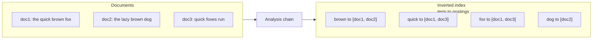

**Where the boundary really is (decision cue).** *Use a database full-text index until you need real relevance ranking, faceting at scale, typo tolerance, or autocomplete — then move to a Lucene-based engine.* Postgres `tsvector` + GIN gives you an inverted index inside your transactional store: no separate system to operate, no consistency lag, strong durability. You give up BM25-quality ranking, rich faceting, FST autocomplete, and horizontal scale. Say this trade-off out loud rather than defaulting to ES.

### 1.1 Tokenization, Normalization, Stemming, Stop Words

**How it works.** Before a term enters the index, raw text passes through an **analysis chain** (Lucene calls it an *analyzer* = character filters → tokenizer → token filters). The same chain runs at index time and at query time, which is the cardinal rule: *index and query analyzers must agree* or terms will never match.

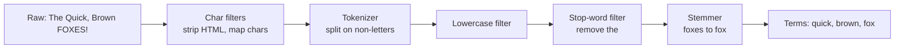

| Stage | What it does | Example | Trade-off / pitfall |
|---|---|---|---|
| **Character filter** | Pre-tokenize cleanup | strip HTML, é→e | Over-aggressive mapping loses meaning |
| **Tokenization** | Split text into tokens | "don't" → `don`, `t` or `don't` | CJK has no spaces; need n-gram/dictionary tokenizers |
| **Normalization** | Lowercase, ASCII-fold, Unicode NFC | "FOX"→"fox", "naïve"→"naive" | Folding "US"→"us" collides with stop word |
| **Stop words** | Drop high-frequency low-signal words | "the", "is", "a" | Breaks "to be or not to be" and "The Who"; **modern engines keep stop words** and let BM25 down-weight them |
| **Stemming** | Reduce to root form (rule-based) | "running","ran"→"run" | Over-stemming: "university"→"univers"="universe" |
| **Lemmatization** | Dictionary-based root | "better"→"good" | Slower, needs language model |

**Real tech.** Elasticsearch ships analyzers: `standard`, `english` (Porter stemmer + stop words), `keyword` (no analysis — exact match), `whitespace`, plus language-specific (`german`, `cjk`). Solr uses the same Lucene analyzers. `icu_tokenizer` for international text. Porter/Porter2 (Snowball) are the workhorse rule-based stemmers; `kstem`/`minimal_english` stem more conservatively (fewer false conflations); for languages with rich morphology (Finnish, Turkish, Arabic) you want Hunspell or language-specific lemmatizers, not Porter.

**Edge cases that bite in production.**
- **CJK and Thai** have no whitespace word boundaries — you need a dictionary/ICU tokenizer (`kuromoji` for Japanese, `nori` for Korean, `smartcn` for Chinese) or n-gram tokenization; the `standard` tokenizer silently produces garbage on them.
- **Compound words** (German `Donaudampfschifffahrtsgesellschaft`) need a decompounder or users can't find sub-terms.
- **Numbers, SKUs, emails, URLs, version strings** (`v1.2.3`, `model-X100`) get shredded by the default tokenizer — index them as `keyword` or with a custom pattern tokenizer.
- **Emoji and ZWJ sequences** in chat/social text — normalize deliberately or skin-tone-modified emoji fragment.

**Pitfalls.**
- **Mismatched analyzers** — indexing with `english` but querying with `keyword` returns nothing. This is the #1 "search returns no results" bug. Debug it with `_analyze` on both the index field and the query string and compare the emitted tokens.
- **Stemming destroys product names / codes** — index those as `keyword`.
- **Stop words and phrases** — `"to be or not to be"` becomes empty if you strip stop words. Use `english_possessive` carefully and prefer keeping stop words.

> **Staff-level insight:** Analysis is a *modeling* decision, not a config detail. The number-one cause of "bad search" in production is not the ranking algorithm — it is an analyzer mismatch between writers and readers, or aggressive stemming that conflates distinct entities. In an interview, when asked "search returns wrong results," your first hypothesis should be the analysis chain, not BM25 tuning — and your first *action* is `_analyze` on both sides. Always design separate sub-fields: a stemmed `text` field for recall and a `keyword`/`text.raw` field for exact match, sorting, and aggregations (multi-field mapping). **YAGNI note:** don't reach for custom analyzers, decompounders, or ICU plugins until your language/data actually requires them — for English product titles the `english` analyzer plus a `keyword` sub-field covers the vast majority of needs.

### 1.2 Forward Index vs Inverted Index

**Definition.**
- **Forward index**: `docID → list of terms` (i.e., the document itself, tokenized). Answers "what terms are in this doc?"
- **Inverted index**: `term → list of docIDs`. Answers "which docs contain this term?"

Search engines need **both**. The inverted index drives retrieval; the forward index (in Lucene: stored fields + **doc values**, a columnar per-document store) drives sorting, faceting, aggregations, highlighting, and retrieving the original content.

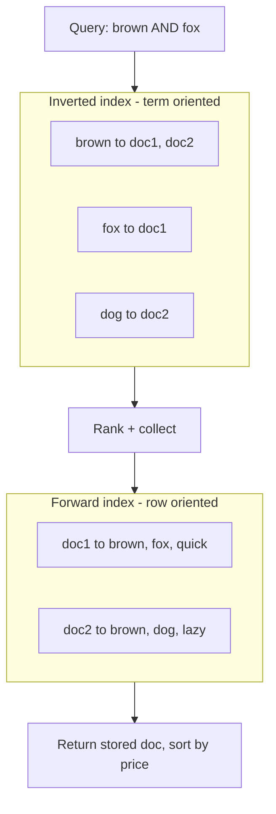

| Property | Forward index | Inverted index |
|---|---|---|
| Mapping | docID → terms | term → docIDs (postings) |
| Best at | "give me this doc / sort / facet" | "which docs match this term" |
| Lucene impl | stored fields, **doc values** (columnar) | term dictionary + postings |
| Used for | retrieval, sort, aggregations, highlighting | boolean retrieval, scoring |
| Build cost | trivial (it's the doc) | analysis + sort + merge |

> **Staff-level insight:** Google's original architecture used a **forward index sharded by document** and an **inverted index built by an inverter** — a classic MapReduce. The reason both exist: scoring needs the inverted index for *which* docs match, but sorting by price/date and computing facet counts needs **column-oriented doc values** (forward). Candidates who say "Elasticsearch is slow when I sort and aggregate on a `text` field" are missing that aggregations require `doc_values`, which are disabled on analyzed text — you must aggregate on a `keyword` sub-field. This is the single most common ES mapping mistake; flagging it pre-emptively is a strong signal.

### 1.3 Postings Lists, Term Dictionary, Skip Lists

**Term dictionary.** A sorted/structured map of every unique term to a pointer into the postings file. Lucene stores it as a **Finite State Transducer (FST)** — a compressed automaton giving prefix sharing (great for memory) and fast `term → posting offset` lookup. The FST is also what makes prefix/range/fuzzy term enumeration fast.

**Postings list.** For each term, the list of documents containing it, usually with: docIDs (delta-encoded + compressed), term frequencies, positions, and offsets. Stored sorted by docID so two lists can be merged with a linear scan.

**Compression (worth one sentence of depth — it's why search fits in RAM).** docIDs are stored as **deltas** (gaps between consecutive IDs), then packed with **Frame of Reference (FOR) / PForDelta** — Lucene's modern codec packs blocks of 128 docIDs with bit-packing and exceptions. Smaller postings = more of the index in page cache = faster. This is why sorting docs by a meaningful order before indexing (e.g., index-sorting) can shrink the index.

**Skip lists / skip pointers.** Inside a long postings list, periodic "skip" pointers let an AND-merge jump ahead (e.g., advance to docID ≥ 100000) without reading every entry — turning intersection from O(n+m) toward O((n+m)/skip + matches). Lucene's `PostingsEnum.advance()` is the API; it uses a multi-level skip structure.

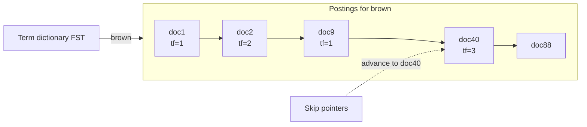

| Component | Role | Compression / structure | Trade-off |
|---|---|---|---|
| Term dictionary | term → postings offset | FST (prefix-shared automaton) | Memory-efficient; supports prefix/fuzzy |
| Postings (docs) | docIDs containing term | delta + PForDelta / FOR | Sorted by docID for merge |
| Term freq | count of term in doc | varint | Needed for BM25 |
| Skip list | jump ahead in postings | multi-level skip pointers | Speeds AND/phrase; useless for short lists |
| Positions | term offsets in doc | delta-encoded | Needed for phrase; doubles index size |

> **Staff-level insight:** The FST term dictionary is the unsung hero — it gives Lucene constant-ish memory growth as vocabulary explodes and is what makes wildcard, regex, and fuzzy *term enumeration* feasible. When an interviewer asks "how does fuzzy search not scan every term?", the answer is: a **Levenshtein automaton** is intersected with the FST, so you only walk terms within edit distance. Skip pointers matter when one term is rare (`AND`-ing a frequent and a rare term): you iterate the short list and `advance()` the long one — this is why **query order and term selectivity drive latency**. In the room, you mention FST + skip pointers in one sentence to prove you know the mechanism, then move up; you do not draw an FST.

### 1.4 Query Execution — Boolean Retrieval

**How it works.** A query is parsed into a boolean tree of term clauses. Retrieval = merging postings lists:

- **AND (intersection)**: walk both lists, output docIDs present in both. Iterate the **shortest** list and `advance()` the others (skip pointers).
- **OR (union)**: merge-sort all lists, output the union. A **priority queue / WAND** keeps only top-K by score.
- **NOT (difference)**: docs in left not in right.

Modern engines do **WAND / Block-Max WAND**: they skip documents that *cannot* enter the top-K based on max-possible scores, so OR queries don't fully materialize.

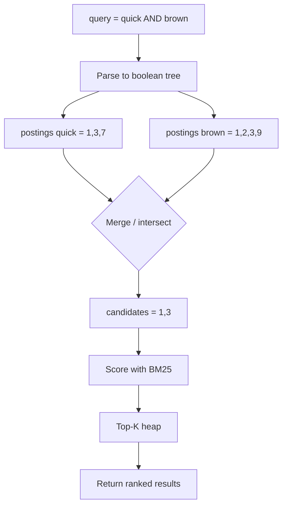

| Operator | Postings operation | Optimization | Cost driver |
|---|---|---|---|
| AND | intersection | iterate shortest, `advance()` others | rarest term length |
| OR | union | priority queue + WAND | sum of list lengths |
| NOT | difference | exclude set | right-side length |
| Phrase | positional intersection | position checks | positions size |

> **Staff-level insight:** Naive boolean retrieval scores every matching doc — fatal for a query like `the OR best` that matches half the corpus. **Block-Max WAND** is why production engines stay fast: each postings block stores its max score, so the scorer skips entire blocks that can't beat the current K-th best. In interviews, mentioning WAND/BMW signals you understand that *retrieval and ranking are interleaved*, not sequential, and that this is what bounds **tail latency** on broad queries. The practical lever you control: put the most selective (rarest) clause first and prefer `filter` context for non-scoring predicates so the scorer never touches them.

### 1.5 Positional Indexes and Phrase Search

**Definition.** A **positional index** stores, for each (term, doc), the *positions* (token offsets) where the term occurs. This is what enables phrase queries (`"brown fox"`) and proximity/slop queries (`"quick fox"~3`).

**How it works.** For phrase `"brown fox"`: retrieve postings for `brown` and `fox`, intersect on docID, then for each common doc verify that some position of `fox` = position of `brown` + 1. Slop relaxes the +1 to within N positions.

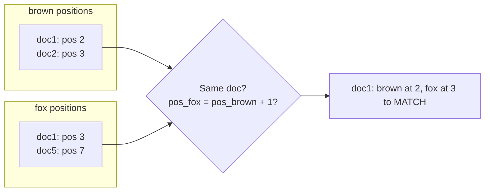

| Index type | Stores | Enables | Size cost |
|---|---|---|---|
| Docs-only | docIDs | boolean match | 1x |
| Freqs | docIDs + tf | BM25 scoring | ~1.2x |
| Positions | + token positions | phrase, slop, span | ~2x |
| Offsets | + char offsets | fast highlighting | ~2.5x |
| Shingles / n-grams | adjacent term pairs as one term | phrase without positions | larger vocab |

**Real tech.** Elasticsearch `index_options`: `docs`, `freqs`, `positions`, `offsets`. **Shingle** token filters pre-join word pairs ("brown fox" → single term) so common phrases match without runtime position checks — a latency-vs-storage trade for hot phrases.

**Pitfalls.** Positions roughly double index size and slow indexing; disable them on fields you'll never phrase-search. Highlighting on huge documents without offsets re-analyzes text at query time (slow) — store offsets or use the `fvh`/`unified` highlighter.

> **Staff-level insight:** Phrase search is the classic "recall vs cost" tension. For a search bar where most users type 2-3 words and expect them adjacent, the smart move is **shingle the top-frequency bigrams** at index time and fall back to positional intersection for the long tail — you trade index size for query CPU on the hot path. Director-level: this is the same principle as materializing a join — push cost to write time when read latency and read volume dominate. **YAGNI note:** most product search never needs phrase queries at all; default to positions-on for `text` bodies and don't build shingle pipelines until a measured phrase-latency problem appears.

---

## 2. Ranking & Relevance

> **Altitude cue:** This is a **deep-dive zone**. Retrieval finds *candidates*; ranking decides *order*. A Staff candidate keeps these strictly separate and spends real whiteboard time here — this is where relevance is won or lost and where graders probe hardest (position bias, two stages, metric choice). Decide decisively: *default to multi-field BM25 with field boosts; reach for LTR or vectors only when a judged dataset shows a measured gap.*

### 2.1 TF-IDF

**Intuition.** A term matters more in a document if it appears often there (**term frequency**) but matters less if it's common across the whole corpus (**inverse document frequency**). "the" is everywhere → near-zero IDF; "photosynthesis" is rare → high IDF.

**Formula.**
```
tf-idf(t, d) = tf(t, d) × idf(t)
idf(t) = log( N / df(t) )       (N = total docs, df = docs containing t)
score(q, d) = Σ_{t in q}  tf(t,d) × idf(t)
```

**Pitfalls.** Raw `tf` grows unboundedly (a 10,000-word doc matching a term 50 times scores absurdly high); no document-length normalization; IDF can be negative for very common terms. These flaws are exactly what BM25 fixes.

> **Staff-level insight:** TF-IDF is the *concept* you must be able to derive from first principles, but you'd never ship it. Knowing precisely *why* it fails — unbounded TF and no length normalization — is what lets you motivate BM25 in an interview rather than name-dropping it. **Altitude warning:** do *not* spend three minutes deriving TF-IDF on the board. One sentence — "TF-IDF, whose unbounded TF and missing length-norm BM25 fixes" — and move on. Over-explaining TF-IDF is a textbook seniority anti-signal.

### 2.2 BM25

**Definition.** **Okapi BM25** is a probabilistic ranking function and the default in Lucene/Elasticsearch/Solr since ES 5.0. It saturates term frequency and normalizes by document length.

**Formula.**
```
score(q,d) = Σ_{t in q} IDF(t) ·  ( tf · (k1 + 1) ) / ( tf + k1 · (1 - b + b · |d|/avgdl) )
IDF(t) = ln( (N - df + 0.5) / (df + 0.5) + 1 )
```

**Parameters.**

| Param | Default | Controls | Tuning |
|---|---|---|---|
| `k1` | 1.2 | TF saturation curve | Higher → TF matters more (long technical docs). 0 = binary match |
| `b` | 0.75 | length normalization strength | 1 = full normalization; 0 = ignore length (use for titles) |

**Why it beats TF-IDF:** TF **saturation** (the 11th occurrence adds almost nothing) and **length normalization** (`b·|d|/avgdl`) so a long document doesn't win just by being long.

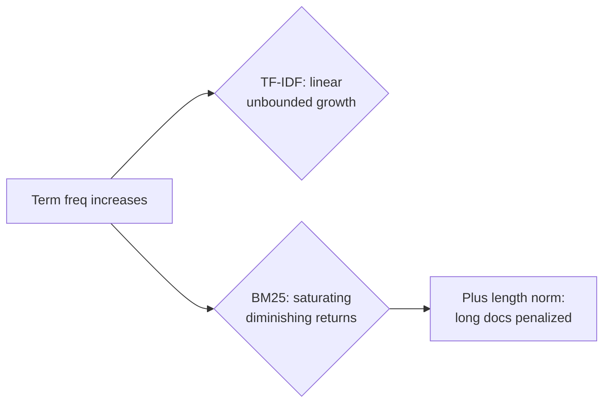

**Worked micro-example.** Two docs both contain "espresso." Doc A is a 20-word product title mentioning it once; Doc B is a 2,000-word blog mentioning it 30 times. TF-IDF hands the blog a massive score (30× the term). BM25 saturates the 30 occurrences (the 30th barely moves the needle past the 5th) *and* penalizes Doc B's length via `b·|d|/avgdl`, so the concise, on-topic title can win — which is what a shopper wants. That single example is worth more in an interview than the formula.

**BM25F (multi-field).** Real documents have fields (title, body, brand). **BM25F** computes a length-normalized, per-field-weighted term frequency *before* saturation, so a match in `title^3` counts more than the same match in `body`. ES approximates this with per-field BM25 + `multi_match` boosts; true BM25F (single saturation across fields) lives in Solr's `edismax` and Vespa.

**Real tech.** ES `similarity: BM25` is default; tune per-field (`title` with `b=0`, `body` with `b=0.75`). `BM25F` weights fields. Many shops never touch k1/b and instead fix relevance with boosting and analyzers.

> **Staff-level insight:** BM25 is "good enough" for the vast majority of search products; resist tuning k1/b before you've fixed analysis and field boosting. The highest-leverage knobs are usually **field weights** (`title^3 body^1`), **function-score** (freshness/popularity), and **synonyms** — not the BM25 constants. When you *do* tune, do it offline against a judged dataset with NDCG, never by eyeballing one query. Decisive default: *ship stock BM25 + field boosts + phrase rescore; touch k1/b last and only with a judged set.*

### 2.3 Vector Space Model

**Definition.** Represent documents and queries as vectors in a high-dimensional term space; relevance = **cosine similarity**. Classic VSM uses TF-IDF weighted term vectors; modern "vector search" uses **dense embeddings** from a neural model (covered in §6 and [AI Systems](17-ai-systems.md)).

```
cosine(q,d) = (q · d) / (|q| · |d|)
```

| Variant | Vector source | Dims | Captures |
|---|---|---|---|
| Classic VSM | TF-IDF term weights | = vocab size (sparse) | lexical overlap |
| Dense / semantic | neural embedding | 384–1536 (dense) | meaning, synonyms, intent |

**Pitfall.** Sparse VSM still only matches on shared *terms* — "car" and "automobile" are orthogonal. That gap is precisely what dense embeddings close, and why hybrid search exists.

> **Staff-level insight:** Frame BM25 vs dense vectors as **lexical vs semantic**, not old vs new. BM25 is unbeatable on exact terms, codes, names, and rare jargon (it never hallucinates a match); embeddings win on paraphrase and intent. The Staff answer is almost always *both* (hybrid), because each covers the other's failure mode — but you say so *after* establishing that you wouldn't add vectors until lexical search plateaus.

### 2.4 Learning-to-Rank

**Definition.** Replace a hand-tuned scoring formula with an **ML model** trained on judged or click data to order candidates. Applied as the *second stage* (re-ranking the top ~100–1000 from BM25), because running an ML model over the whole corpus is infeasible.

| Approach | Loss / unit | Example models | Pros / cons |
|---|---|---|---|
| **Pointwise** | predict relevance of one doc (regression/classification) | linear, GBDT | simple; ignores relative order |
| **Pairwise** | order doc_i before doc_j | RankNet, **LambdaMART** | optimizes ordering; pair explosion |
| **Listwise** | optimize the whole ranked list / NDCG directly | LambdaMART, ListNet, neural | best quality; most complex |

**Real tech.** Elasticsearch **Learning-to-Rank plugin** (XGBoost/RankLib models, `rescore` phase); Solr LTR module; Vespa native ranking expressions/ONNX; big tech uses GBDT (LambdaMART) then deep cross-encoders.


> **Staff-level insight:** LTR is a re-ranker, never a retriever — its cost model only works on a small candidate set. The hard part is not the model, it's the **training data and feature pipeline**: getting unbiased labels from clicks (position bias, presentation bias) and serving the exact same features online and offline (train/serve skew). In an interview, emphasize the **click model** (handling that users click position 1 regardless of relevance) and **offline/online feature parity** — that's where real systems break. Decisive default: *don't introduce LTR until you have judgment/click data and BM25 + boosting has plateaued on NDCG; it's a quality investment, not a starting point.*

### 2.5 Ranking Signals

Beyond text match, production ranking blends many signals, typically via **function-score** (multiplicative/additive boosts) or as LTR features.

| Signal | Source | How applied | Risk |
|---|---|---|---|
| **Text relevance** | BM25 | base score | — |
| **Freshness** | document timestamp | decay function (gauss/exp) | over-favoring new, low-quality |
| **Popularity** | views, purchases, links | log-scaled boost | rich-get-richer; cold start |
| **Personalization** | user history, location | per-user re-rank / features | filter bubble, privacy |
| **Quality** | spam score, ratings | demotion | gameable |
| **Click signals** | CTR, dwell, conversions | LTR feature / click model | position & presentation bias |

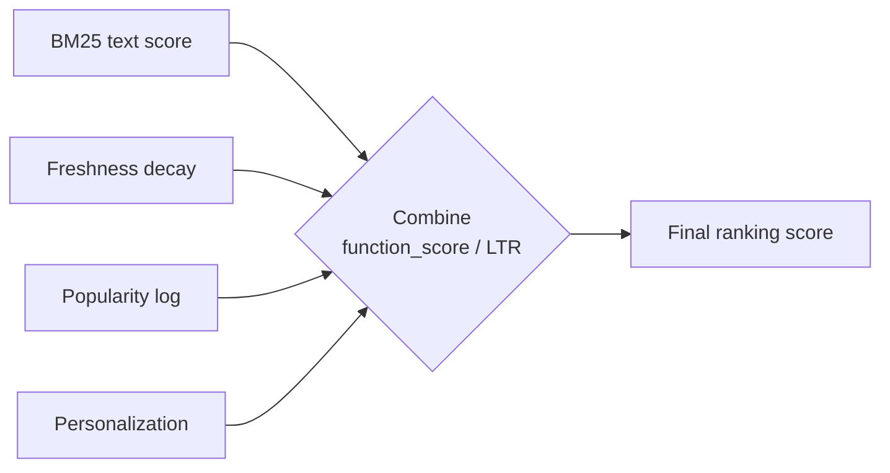

**Real tech.** ES `function_score` with `gauss` decay for recency, `field_value_factor` for popularity; rescore window for expensive personalization.

> **Staff-level insight:** Click signals are the most powerful *and* most dangerous. Raw CTR creates a feedback loop — top results get clicks because they're on top, not because they're best (position bias). Serious systems use **counterfactual / debiased learning** (inverse propensity weighting) or interleaving experiments. If you mention "we'll rank by CTR," a Staff interviewer will immediately probe position bias — **pre-empt it**: say "raw CTR is biased by position, so I'd debias with IPW or run interleaving, not rank on it directly." That one sentence flips a trap into a signal.

### 2.6 Metrics — Precision/Recall, NDCG, MAP, MRR

| Metric | Question it answers | When to use | Notes |
|---|---|---|---|
| **Precision@k** | of top-k, how many relevant? | result quality | ignores rank order within k |
| **Recall@k** | of all relevant, how many in top-k? | retrieval coverage | crucial for stage-1 retrieval |
| **MRR** (Mean Reciprocal Rank) | how high is the *first* relevant result? | known-item / "I'm Feeling Lucky", autocomplete | only first hit matters |
| **MAP** (Mean Avg Precision) | precision averaged over recall points | binary relevance, whole list | classic IR benchmark |
| **NDCG** | graded relevance, position-discounted | e-commerce, web (graded labels) | the gold standard for ranking |

```
DCG@k = Σ_{i=1..k}  rel_i / log2(i + 1)
NDCG@k = DCG@k / IDCG@k     (IDCG = DCG of the ideal ordering)
```

**Precision vs recall trade-off.** Tightening the query (more `AND`, exact match) raises precision, lowers recall; loosening (fuzzy, OR, synonyms) does the reverse. **Stage 1 optimizes recall** (don't lose the good doc); **stage 2 optimizes precision/NDCG** (order them right).

**Online vs offline.** The metrics above are **offline** (against a judged set). Online you measure the business: CTR, conversion, add-to-cart, zero-result rate, query reformulation rate, and you ship via **A/B tests or interleaving**. Offline NDCG is the fast iteration loop; online metrics are ground truth. Name both — graders want to know you don't ship relevance changes on offline numbers alone.

> **Staff-level insight:** Pick the metric that matches the *task*: MRR for autocomplete and navigational queries (one right answer near the top), NDCG for ranked browse/e-commerce (graded, position-weighted), Recall@1000 for the retrieval stage feeding a re-ranker. The mistake juniors make is optimizing a single global metric; Staff engineers instrument the **two stages separately** — recall for retrieval, NDCG for ranking — because a re-ranker can't fix a doc that retrieval never surfaced. And the **zero-result rate** is the cheapest high-value metric most teams ignore.

### 2.7 The Retrieve-then-Rank Pipeline

**Definition.** Search is two stages: a cheap, high-recall **retrieval** over the whole index, then an expensive, high-precision **re-rank** over a few hundred candidates. *This is the single most important diagram to draw in a search interview — earmark it early.*

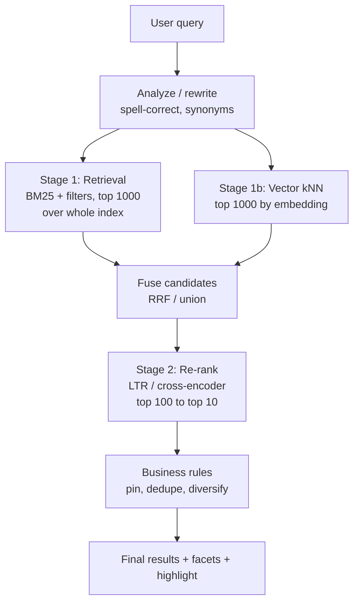

| Stage | Goal | Scope | Latency budget | Tech |
|---|---|---|---|---|
| Query understanding | rewrite, correct, expand | per query | 1–5 ms | spell, synonyms, intent classifier |
| Retrieval | high recall | whole index | 5–30 ms | BM25, vector kNN, filters |
| Fusion | merge lexical+vector | candidates | <1 ms | RRF |
| Re-rank | high precision / NDCG | top ~100–1000 | 10–50 ms | LambdaMART, cross-encoder |
| Business logic | pin/boost/dedupe/diversify | top ~50 | <5 ms | rules, MMR |

> **Staff-level insight:** The entire architecture of modern search is "make retrieval cheap and recall-y, make ranking expensive and small." This is why you can run a 100ms cross-encoder per query — you only run it on 100 docs, not 100M. When designing in an interview, *always* draw the two boxes; conflating them ("just run the ML model over everything") is the fastest way to fail the scalability question. The corollary graders love: **stage 1's job is recall** — if the right doc isn't in the top-1000 candidates, no re-ranker on earth recovers it, so you tune retrieval for Recall@1000 first, ranking second.

---

## 3. Technologies

> **Altitude cue:** Pick decisively and justify on *operational model*, not relevance. *Default ES/OpenSearch for greenfield because the ops experience and ecosystem win; OpenSearch when Apache-2.0 or AWS-native matters; Solr only for Apache-governance / deep enterprise customization.* They are all Lucene under the hood — do not waste time arguing one ranks better than another. The deep-dive worth your words here is the **Lucene segment lifecycle** (refresh/flush/merge) and **ES-is-not-a-database**, because those drive the consistency and durability decisions graders probe.

### 3.1 Elasticsearch and Lucene

**Definition.** **Apache Lucene** is the embedded Java search library that actually builds inverted indexes, scores, and stores segments. **Elasticsearch** is a distributed system *around* Lucene: it adds clustering, sharding, replication, a REST/JSON API, aggregations, and operational tooling. **You are always using Lucene** when you use ES, OpenSearch, or Solr.

**Lucene segment architecture.** A Lucene **index** is a set of immutable **segments**. Each segment is a self-contained mini-index (term dictionary, postings, doc values, stored fields, norms). New docs go into an in-memory buffer; a **refresh** writes a new searchable segment; segments are periodically **merged** into bigger ones; deletes are *tombstones* (a `.del` bitset) applied at merge time.

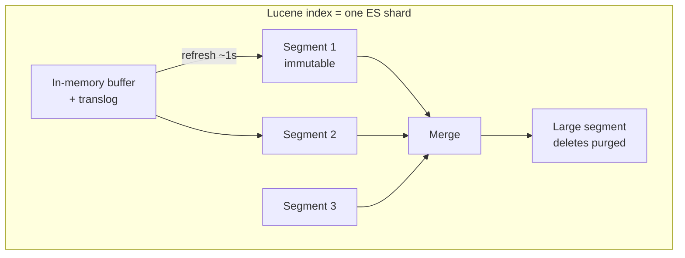

**The write path — refresh / flush / merge (must know cold):**

| Operation | What it does | Trigger | Effect |
|---|---|---|---|
| **Index buffer + translog** | doc written to memory + durable write-ahead log | every write | durable, *not yet searchable* |
| **Refresh** | flush buffer to a new in-memory/OS-cache segment | every 1s (default) | doc becomes **searchable** → near-real-time |
| **Flush** | fsync segments to disk, clear translog | translog size / 30 min | durability checkpoint |
| **Merge** | combine small segments, purge deletes | background, tiered policy | fewer/larger segments, reclaim space, faster search |

Why this matters for tail latency: more segments = more sub-searches per query (each segment is searched independently and merged). Merging trades background CPU/IO for fewer segments and faster, more predictable queries. Force-merging a read-only index down to one segment is a classic optimization for warm/cold time-series indices.

**ES cluster anatomy.**

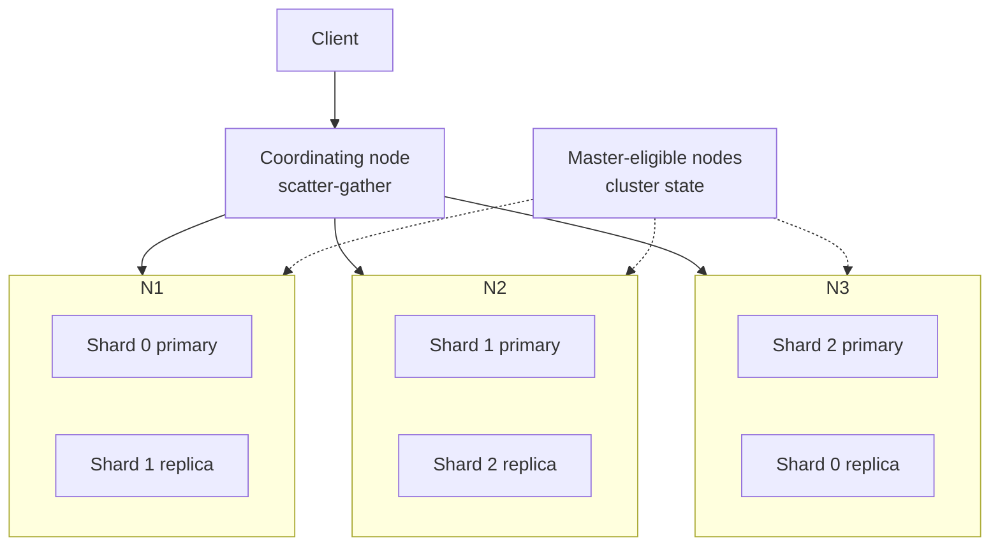

- **Index** → split into **primary shards** (fixed at creation) → each shard is a Lucene index → each has **replica shards** for HA and read throughput.
- **Coordinating node** scatter-gathers a query to one copy of every shard, merges top-K (the "query then fetch" two-phase: query phase returns docIDs+scores, fetch phase pulls documents).
- **Master node** manages cluster state (not in the data path). Quorum-based master election (ES 7+ uses a Raft-like protocol) prevents split-brain — historically a real data-loss source pre-7.0.
- **Mapping** = schema (field types, analyzers). **Near-real-time** = 1s refresh gap.
- **Aggregations** = analytics (terms, histogram, cardinality, nested) computed over doc values — this is what makes ES double as an analytics engine.

**When ES is *misused* as a primary database (critical):**

| ES is NOT | Because |
|---|---|
| Source of truth | No real transactions; segment immutability + refresh = eventual consistency; data loss scenarios on split-brain historically |
| ACID store | No multi-doc transactions, no FK, no joins (only nested/parent-child, costly) |
| Strongly consistent read store | 1s refresh lag; `get` by id is real-time but search is not |
| Cheap to update | Update = delete + reindex whole doc (immutable segments); high-churn data thrashes merges |

> **Staff-level insight:** "Elasticsearch as primary DB" is a top architectural anti-pattern — call it out explicitly the moment a design implies it. Keep the **system of record in Postgres/DynamoDB/Kafka** and treat ES as a *derived, rebuildable* read model fed by CDC. The litmus test, say it aloud: *can you delete the whole cluster and rebuild it from the source?* If no, you've coupled your durability to a search engine that was never designed for it. Also know the **immutable-segment consequence**: high-frequency partial updates (e.g., a counter per doc) are pathological in ES — model those in a real store and denormalize periodically, or use ES `_update_by_query` sparingly. **Experience hook:** on real-time chat infra, edits/deletes/reactions on messages are exactly this high-churn pattern; you keep the message store as system of record and feed search from its change log so churn becomes appends to the pipeline, not in-place segment thrash.

### 3.2 OpenSearch — The Fork

**Definition.** **OpenSearch** is the Apache-2.0 fork of Elasticsearch 7.10, created by AWS in 2021 after Elastic relicensed ES/Kibana under the non-open-source **SSPL/Elastic License**. OpenSearch ≈ ES 7.10 lineage + AWS-driven features; OpenSearch Dashboards = Kibana fork. (Note: Elastic re-added AGPLv3 as an option in ES 8.16, late 2024 — so "ES isn't open source" is now nuanced; OpenSearch remains pure Apache-2.0 with a vendor-neutral foundation.)

| Dimension | Elasticsearch | OpenSearch |
|---|---|---|
| License | SSPL + Elastic License (8.x) / AGPLv3 added in 8.16+ | Apache 2.0 (truly open source) |
| Steward | Elastic NV | OpenSearch Software Foundation (Linux Foundation, AWS-led) |
| Managed by AWS | (only as "OpenSearch Service") | yes, native |
| Advanced features | ES ML, ESQL, more polished | k-NN plugin strong, security free/built-in |
| API compat | diverging since 7.10 | clients diverging; not drop-in for 8.x |

**Pitfall.** They have **diverged** since 7.10 — query DSL mostly compatible, but newer features (ES `ES|QL`, OpenSearch's own ML/security defaults) differ, and clients are no longer interchangeable. Don't assume an ES 8 client works against OpenSearch.

> **Staff-level insight:** The choice is mostly **licensing and ecosystem**, not raw capability. Pick OpenSearch when you need Apache-2.0 (vendor-neutral, embed in a product, avoid SSPL legal review) or you're deep in AWS; pick Elastic when you want their commercial ML/observability stack and latest features. For an interview, the right framing is "this is a governance/licensing decision; both are Lucene under the hood and will perform comparably for standard search" — then make the call and move on rather than litigating it.

### 3.3 Apache Solr

**Definition.** **Apache Solr** is the other major Lucene-based search server, older than ES, run by the Apache Software Foundation. **SolrCloud** provides distributed mode using **ZooKeeper** for coordination.

| Dimension | Solr | Elasticsearch |
|---|---|---|
| Governance | Apache Foundation (community) | Elastic NV (vendor) |
| API | XML/JSON, rich query parsers (edismax) | JSON Query DSL |
| Coordination | external ZooKeeper (SolrCloud) | built-in (Zen/Raft-like) |
| Strength | text search, faceting, enterprise config, full control | analytics/aggregations, ops UX, ecosystem, scale-out simplicity |
| Schema | schema.xml or managed schema | dynamic mapping + explicit |
| Best fit | controlled enterprise/library/site search | logs, observability, app search, scale |

> **Staff-level insight:** Solr vs ES is rarely about search quality — both wrap Lucene and rank near-identically. Choose on **operational model and ecosystem**: ES/OpenSearch for elastic scale-out, observability/log analytics, and managed cloud; Solr for fine-grained control, mature faceting (`edismax`, true BM25F, JSON facet API), and teams who want Apache governance without a vendor. New greenfield projects overwhelmingly pick ES/OpenSearch for the ops experience — say that, then justify it on operability, not relevance.

### 3.4 Comparison Table

| | Lucene (lib) | Elasticsearch | OpenSearch | Solr |
|---|---|---|---|---|
| Layer | embedded library | distributed engine | distributed engine | distributed engine |
| License | Apache 2.0 | SSPL/Elastic (+AGPL) | Apache 2.0 | Apache 2.0 |
| Distribution | none (you build it) | native shards/replicas | native | SolrCloud + ZooKeeper |
| Vector / kNN | HNSW | yes (dense_vector, HNSW) | yes (k-NN plugin) | yes (dense vector) |
| Aggregations | doc values | rich | rich | facets/JSON facet |
| Typical use | custom search apps | logs, app search, analytics | OSS/AWS app search | enterprise/site search |
| Managed cloud | — | Elastic Cloud | AWS OpenSearch Service | various |

**Also in the landscape (name-and-move-on):** **Vespa** (Yahoo/now independent) is purpose-built for hybrid retrieval + LTR/tensor ranking at massive scale — the right call when ranking sophistication and hybrid are the *whole* product. **Typesense / MeiliSearch** are lightweight, developer-friendly engines optimized for instant-search/typeahead on small-to-mid corpora — a legitimate YAGNI choice over ES when you need fast typo-tolerant search without operating a cluster. **Algolia** is a hosted search-as-a-service (you pay for not operating it). Mention these to show breadth, then default back to ES/OpenSearch unless a requirement points elsewhere.

---

## 4. Search Features

> **Altitude cue:** Name-and-move-on most of these (highlighting, synonyms) in one line each; **deep-dive autocomplete-at-scale** — it's a latency-first sub-system graders love to probe, and the place where "I've built typeahead" experience shows.

### 4.1 Full-Text Search & Relevance Tuning

**How it works.** Full-text search analyzes the query the same way as the field, retrieves via the inverted index, scores with BM25 across multiple fields, and returns ranked, highlighted results.

**Multi-field & relevance levers:**

| Lever | Mechanism | Example |
|---|---|---|
| **Multi-field mapping** | one field → several analyses | `title` (stemmed), `title.raw` (keyword), `title.suggest` (edge-ngram) |
| **Field boosting** | weight fields differently | `multi_match: title^3, body^1` |
| **`best_fields` vs `cross_fields`** | per-field vs combined scoring | name across `first`+`last` → cross_fields |
| **Phrase boost** | reward adjacency | `match_phrase` rescore |
| **Function score** | inject business signals | recency decay, popularity |
| **Minimum should match** | recall/precision dial | `75%` of terms must match |


> **Staff-level insight:** 90% of relevance wins come from **field boosting + analyzers + a phrase rescore**, not from exotic ML. Build a multi-field mapping early (`text` for recall, `keyword` for exact/sort/facet, `suggest` for typeahead) because you cannot change a field's mapping without reindexing. Treat relevance as an iterative, *measured* loop against a judged query set — never tune by anecdote. Decisive default: *ship multi-field BM25 + boosts + phrase rescore; that's your relevance baseline, and you only climb the ladder to LTR/vectors when it measurably plateaus.*

### 4.2 Autocomplete / Typeahead

**Definition.** Predict and rank query completions as the user types, in <50ms, often firing on every keystroke. *This is a deep-dive sub-system — a latency-first design distinct from main search.*

**Approaches.**

| Approach | Data structure | Strength | Weakness |
|---|---|---|---|
| **Prefix trie** | tree keyed by chars | classic, intuitive | memory heavy at scale |
| **FST (completion suggester)** | compressed automaton in RAM | very fast, compact, ES native | rebuild to update; prefix-only |
| **Edge n-grams** | index `s, sh, sho, shoe...` as terms | flexible (mid-word, fuzzy, filters) | index bloat |
| **Search-as-you-type field** | ES combines edge-ngram + shingles | easy, good default | larger index |

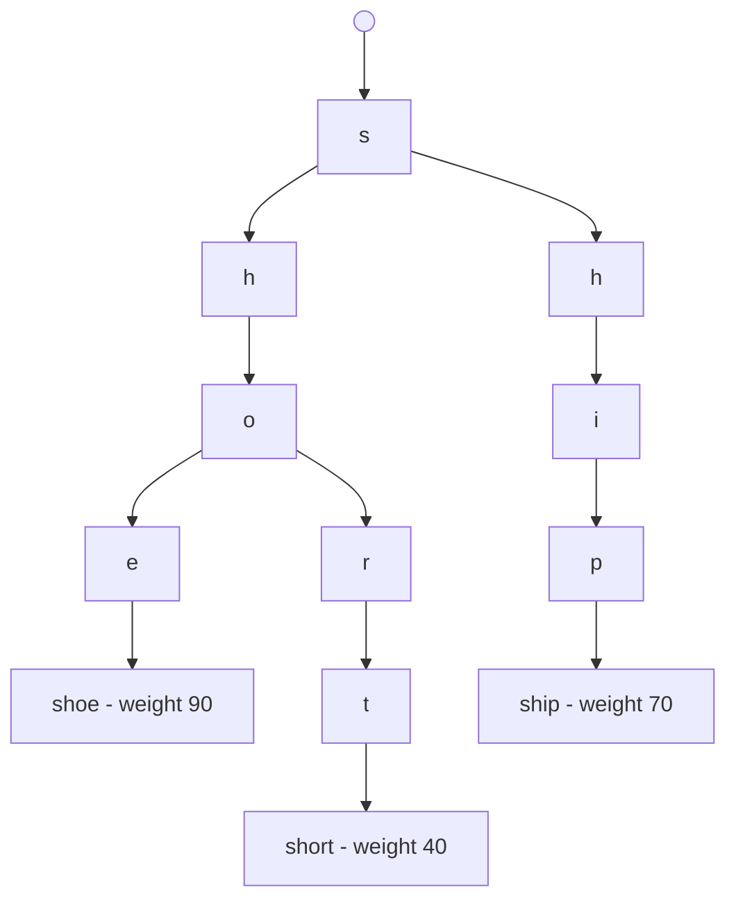

**Ranking suggestions.** Completions are ranked by popularity/weight (query logs), recency, and personalization — store a `weight` per suggestion. **MRR** is the right metric (first suggestion should be the answer).

**Scaling via prefix sharding.** Route by the first 1–3 characters so each shard owns a prefix range; the completion FST stays in RAM per shard. Cache hot prefixes ([Caching](03-caching.md)); precompute top-N completions per popular prefix.

**Architecture at scale (draw this if asked typeahead):**

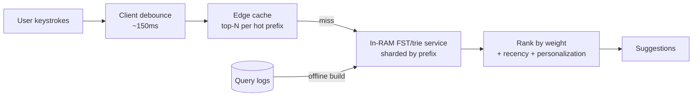

**Real tech.** ES **completion suggester** (FST, in-memory, sub-ms), `search_as_you_type` field type, or edge-ngram analyzer; many large systems build a custom in-memory trie service for full control over ranking/personalization (Twitter/LinkedIn-style typeahead).

**Pitfalls.** Completion suggester can't easily filter or do mid-word matches; edge-ngrams bloat the index; firing on every keystroke needs **debouncing** + aggressive caching or you DDoS your own cluster.

> **Staff-level insight:** Autocomplete is a *latency-first* product: you trade flexibility for speed by precomputing. The FST/completion-suggester wins because the entire structure lives in RAM and a prefix lookup is a few automaton transitions — but it's a rebuild-to-update structure, so for personalized or rapidly-changing suggestions you layer a custom service. At scale, the architecture is: client debounce → edge cache of top completions per prefix → in-memory FST/trie service sharded by prefix → fall back to full search only on submit. **Decisive default:** *for English product/title typeahead, start with the ES completion suggester or `search_as_you_type`; only build a custom in-RAM trie service when you need personalized ranking or mid-word/fuzzy matching the suggester can't do.* Earmark the keystroke-amplification risk early — debounce + cache or you load-test your own outage.

### 4.3 Fuzzy Search

**Definition.** Match terms that are *close* to the query despite typos, misspellings, or sound-alikes.

| Technique | Measures | Best for | Cost |
|---|---|---|---|
| **Levenshtein / edit distance** | insert/delete/substitute count | typos ("sheos"→"shoes") | bounded edits via automaton |
| **Damerau-Levenshtein** | + transposition | "teh"→"the" | slightly more |
| **n-gram (trigram)** | shared character n-grams | longer fuzzy, language-agnostic | index bloat |
| **Phonetic (Soundex/Metaphone)** | sound encoding | names ("Smith"/"Smyth") | false positives |
| **BK-tree** | metric-space tree on edit distance | offline dictionary fuzzy lookup | build cost |
| **SymSpell** | precomputed deletes dictionary | very fast spell-correction | memory for delete table |

**How edit-distance fuzzy works in Lucene.** A **Levenshtein automaton** for the query term within distance N is intersected with the term-dictionary FST, enumerating only terms within N edits — no full term scan. ES caps fuzziness at edit distance **2** (`fuzziness: AUTO` scales by term length: 0 edits for 1–2 char terms, 1 for 3–5, 2 for 6+) for exactly this performance reason.

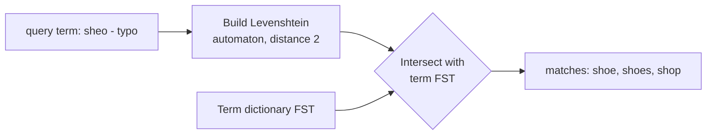

**BK-tree** (Burkhard-Keller): nodes are terms, edges labeled by edit distance; the triangle inequality of edit distance prunes the search to terms within `d ± tolerance`. Used for spell-correction dictionaries outside Lucene. **SymSpell** (Symmetric Delete) precomputes the delete-variants of dictionary terms and the query, matching in O(1)-ish — the fastest known "did you mean" approach for large dictionaries.

**Pitfalls.** Fuzzy is expensive on short terms (everything is within 2 edits of a 3-letter word — huge candidate set); phonetic over-matches; combine fuzzy with prefix constraints (`prefix_length: 1-2`) to bound the blowup.

> **Staff-level insight:** "Fuzzy search" in interviews usually means three different mechanisms — pick deliberately. Use **edit-distance (automaton)** for in-line typo tolerance, **n-grams** for cross-language/substring fuzziness, and **phonetic** for name search. Critically, never run fuzziness > 2 or unbounded prefixes over a large index — it defeats the FST pruning and scans the vocabulary. The production pattern is a cheap exact/prefix match first, with fuzzy as a *fallback* when results are thin, plus a separate spell-correction service (BK-tree / SymSpell) for "did you mean." Decisive default: *`fuzziness: AUTO` + `prefix_length: 1` on the main query, fuzzy-as-fallback only when result count is low — don't pay fuzzy cost on every query.*

### 4.4 Faceted Search & Filters

**Definition.** **Facets** are aggregated counts over result attributes (Brand: Nike (42), Adidas (31)) that let users drill down. **Filters** narrow results by attribute (price < 50, in stock) and, crucially, **don't affect score** — so they're cacheable.

**How it works.** Facet counts are computed via **aggregations over doc values** (columnar forward index) on the filtered result set. Filters run as a **bitset** (`filter` context in ES) which is cached and reused — separate from the scored `must` clauses.

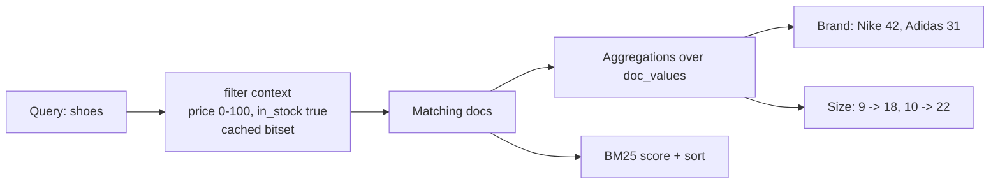

| Concept | Mechanism | Caching | Affects score? |
|---|---|---|---|
| Query (`must`/`should`) | scored postings merge | no | yes |
| Filter (`filter`) | bitset intersection | yes (filter cache) | no |
| Facet | terms/range aggregation over doc values | partial | no |

**Pitfalls.** High-cardinality facets (millions of unique values) are memory-heavy — use composite/terms partitioning; faceting on analyzed `text` is invalid (no doc values) → facet on `keyword`. Post-filtering for "show counts as if this facet weren't applied" needs `post_filter` and per-facet aggregations.

> **Staff-level insight:** The filter/query split is a major performance lever: pushing structured predicates into **filter context** makes them *cached bitsets* shared across queries, while keeping only the text relevance in scored context. E-commerce search lives and dies on this — a query like "shoes" filtered by category/price should reuse cached category and price bitsets so only the BM25 part recomputes. This is the search analog of [Caching](03-caching.md) the expensive-to-compute part separately from the cheap-to-vary part. Flag it as a deliberate decision in any catalog design.

### 4.5 Highlighting

**Definition.** Return snippets with the matched terms emphasized (`<em>`), giving users context for why a result matched.

| Highlighter | How it works | Needs | Speed |
|---|---|---|---|
| **Plain** | re-analyzes field at query time | nothing extra | slow on big docs |
| **Unified** (default ES) | uses postings or term vectors, breaks into passages | optional offsets | balanced |
| **Fast Vector (fvh)** | precomputed term vectors with offsets | `term_vector: with_positions_offsets` | fast, more storage |

**Pitfall.** Highlighting large documents with the plain highlighter re-analyzes the full text per result — a tail-latency killer. Store **offsets** (`index_options: offsets`) or term vectors for hot, large-text fields.

> **Staff-level insight:** Highlighting is a storage-vs-CPU trade exactly like phrase search. For a corpus of large documents (legal, support articles) precompute offsets so the highlighter does a lookup, not a re-analysis. For short fields (product titles), the plain highlighter is free. Decide per field, not globally — and don't over-engineer it for short text where it costs nothing.

### 4.6 Synonyms

**Definition.** Treat different terms as equivalent ("tv" = "television", "nyc" = "new york city") to boost recall.

| Dimension | Index-time synonyms | Query-time synonyms |
|---|---|---|
| Applied | when indexing | when querying |
| Update cost | requires **reindex** | **hot reload**, no reindex |
| Index size | larger (extra terms) | unchanged |
| Multi-word | reliable | trickier (graph tokens) |
| Recommended | for stable, multi-word | for evolving sets |


**Real tech.** ES `synonym` / `synonym_graph` token filter, with synonyms file or the synonyms API for hot updates. Solr `SynonymGraphFilterFactory`.

**Pitfalls.** Multi-word synonyms ("new york" → "nyc") need the **graph** filter and interact subtly with phrase/position queries; bidirectional vs one-way (`=>`) synonyms change recall/precision; over-broad synonym sets erode precision.

> **Staff-level insight:** Prefer **query-time synonyms** so you can iterate without reindexing 100M docs — the cost is slightly more query expansion, but the agility is worth it for an evolving synonym set curated from query logs. The deeper point and the trigger to escalate: synonyms are a *lexical* patch for the semantic gap. As your synonym file grows into the thousands of hand-curated rules, that's the signal to adopt **semantic/vector search** (§6), which captures synonymy implicitly via embeddings instead of manual lists. Name that trigger in the room rather than jumping to vectors prematurely.

### 4.7 Spell Correction & "Did You Mean"

**Definition.** **Spell correction** is a *query rewrite*: it decides, before or just after retrieval, that the user meant a different query (`"nike air maxx"` → `"nike air max"`). It is a different mechanism from fuzzy matching (§4.3). Fuzzy loosens matching for each term *inside* retrieval. Correction rewrites the *whole query* and tells the user ("Showing results for…").

**The model — noisy channel.** Treat the typed query `q` as a noisy version of the intended query `c`, and pick the most likely intent:

```
ĉ = argmax_c  P(c) · P(q | c)
P(c)     = language model   — how common is this query?  (mined from QUERY LOGS, not a dictionary)
P(q | c) = error model      — how likely is this typo?  (edit distance weighted by keyboard
                               adjacency, transpositions, phonetics; learned from reformulation pairs)
```

The insight that matters: **the language model comes from your own query logs and catalog, not from a dictionary.** A dictionary "corrects" `"asics"` to `"basics"` and `"pixel 9"` to `"pixel a"`. Your logs know that `asics` is a top-50 brand. The error model learns from **reformulation pairs**: a user types `q`, gets few clicks, then immediately types `c` and clicks. That pair is free training data at scale.

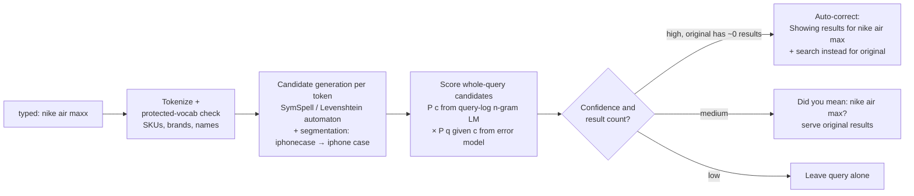

| Decision | Rule of thumb | Why |
|---|---|---|
| **Auto-correct** | Candidate is far more likely than the original **and** the original returns ~0 / very few results | Zero results is a dead end; a confident rewrite rescues the session |
| **Suggest ("did you mean")** | Candidate is likely but the original also has decent results | The user may have meant exactly what they typed; don't override them |
| **Do nothing** | Original is a protected term (SKU, brand, person) or confidence is low | A wrong correction is worse than no correction |

**Real-word errors** (`"peace of cake"`, `"form factor"` typed as `"from factor"`) are valid words, so a per-term dictionary check can't catch them. Only the **n-gram / contextual language model** catches them, because `"piece of cake"` is far more frequent as a phrase. That's the argument for scoring whole-query candidates rather than correcting token by token.

**Real tech.** Elasticsearch `term` suggester (per-token edit distance) and `phrase` suggester (n-gram LM over a shingle field, which handles real-word errors); **SymSpell** for a fast standalone service; large search engines run log-mined noisy-channel models with learned error models, increasingly a small seq2seq model as the candidate scorer.

**Related & recent searches** (the cheap neighbours of did-you-mean):
- **Related searches** come from the **session reformulation graph**: queries that follow each other in the same session (`"running shoes"` → `"trail running shoes"`), weighted by co-occurrence and the click success of the second query. Build it offline in batch and serve it as a precomputed `query → [related]` KV lookup.
- **Recent searches** are per-user state, not a search problem: a capped list (Redis `LPUSH` + `LTRIM 0 9`, or a client-side store) keyed by user. The Staff detail is that it's **personal data**, so it needs a clear-history control and must be covered by deletion/erasure ([13b](13b-data-compliance-privacy.md)).

**Pitfalls.** Correcting rare-but-valid terms (new brands, product codes, people's names) is the #1 failure, so keep a **protected vocabulary** fed from the catalog. Forced auto-correct with no "search instead for" escape hatch teaches users the box is broken. Segmentation errors (`"ipho ne"`, `"iphonecase"`) need split/merge candidates, not just edits. Each language needs its own LM and keyboard model.

> **Staff-level insight:** The metric is **correction precision**, not recall. Breaking a correct query costs more than missing a typo, because the user loses trust in the box. So I'd gate auto-correct on *both* model confidence *and* the original's result count, always show "search instead for", and track three online numbers: **zero-result rate** (should fall), **reformulation rate** (should fall), and **"search instead" click rate** (the false-correction alarm). The architectural line: *"Did-you-mean is a separate query-understanding service in front of retrieval. Its language model is mined from our query logs, so it knows our brands, which a dictionary never will."* Decisive default: *ES phrase suggester for v1; graduate to a log-mined noisy-channel service only when zero-result analysis shows typos are a top cause.*

---

## 5. Scaling & Architecture

> **Altitude cue:** This is the **highest-signal deep-dive in the module**. The indexing pipeline (§5.1), index/query separation (§5.2), and consistency/search-lag (§5.6) are where Staff designs are won. Earmark these early: "the hard part of search isn't the query — it's keeping the index consistent with the source of truth and reindexing without downtime."

### 5.1 The Indexing Pipeline

**Definition.** The write path from source-of-truth mutation to a searchable document: **ingest → analyze → index**, ideally decoupled via a log so search never sits in the user's write transaction.

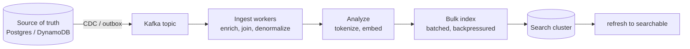

| Stage | Responsibility | Concern |
|---|---|---|
| Ingest | capture changes (CDC/outbox), enrich, denormalize joins | exactly-once-ish, ordering per doc |
| Analyze | run analyzers, compute embeddings | CPU; batch for throughput |
| Index | bulk write to shards | batch size, backpressure, refresh interval |

**Why a log, concretely.** Driving indexing off a Kafka topic (fed by CDC or an outbox) buys you four things at once, and you should name them: (1) **rebuildability** — replay the topic to rebuild the entire index from scratch, which is what makes "delete the cluster and rebuild" true; (2) **per-key ordering** — partition by document id so updates to the same doc never reorder; (3) **a natural batch buffer** so you bulk-index instead of one-doc-at-a-time; (4) **backpressure isolation** so a slow search cluster doesn't stall user writes.

**Idempotency.** Use the document id as the ES `_id` and external **versioning** (`version_type: external` with the source's sequence number / LSN) so replays and out-of-order delivery are safe — a stale event with a lower version is rejected. This is how you get "exactly-once-ish" on an at-least-once log.

> **Staff-level insight:** Drive indexing from **change data capture / the transactional outbox**, not from synchronous dual-writes in app code. Dual-writing to DB and ES in the request path guarantees eventual inconsistency on partial failure — it is the canonical anti-pattern, name it as such. A log (Kafka) gives you replay, ordering per document key, and a natural buffer to batch bulk writes. See [Data Processing](16-data-processing.md) for CDC and the outbox pattern. This is also how you achieve "delete the cluster and rebuild" durability. **Experience hook:** for chat-message search, every message create/edit/delete is a row change — CDC off the message table (or tailing the same log that fans out messages) is the clean feed, and it makes search lag a function of pipeline depth you can monitor, not a mystery.

### 5.2 Index Path vs Query Path Separation

**Definition.** Separate the resources/SLOs of *writing* (indexing) from *reading* (querying) so a reindex storm doesn't degrade search latency. This is **CQRS applied to search**.

```mermaid
flowchart TB
    subgraph Write[Index path]
        SRC[(Source)] --> Q[Queue] --> IW[Index workers] --> PRI[Primary shards]
    end
    subgraph Read[Query path]
        U[Users] --> COORD[Coordinating nodes] --> REP[Replica shards]
    end
    PRI -. replication .-> REP
```

| Path | Optimized for | Lever |
|---|---|---|
| Index path | throughput, durability | bulk batching, higher `refresh_interval`, dedicated ingest nodes |
| Query path | latency, availability | more replicas, query cache, coordinating-only nodes |

> **Staff-level insight:** Indexing and querying compete for the same CPU, heap, and disk I/O on a shared node — a heavy reindex will blow your p99 query latency. Mitigate by routing reads to **replicas**, bulk-indexing into **primaries**, dedicating **coordinating-only** and **ingest** node roles, and dialing `refresh_interval` way up (e.g., 30s or -1) during bulk loads, then restoring it. This is CQRS applied to search. The decisive move in a design: draw two paths from the start so a backfill or reindex storm can't take down live search.

### 5.3 Sharding & Replication

**Sharding.** An index is split into **primary shards** (fixed at creation — you cannot change the count without reindex/split/shrink). A document routes to a shard by `hash(routing_key) % num_primaries` (default routing key = `_id`). Each shard is an independent Lucene index.

**Replication.** Each primary has **N replicas** — full copies on other nodes for HA (survive node loss) and read scaling (queries hit any copy).

```mermaid
flowchart TB
    Q[Search] --> CO[Coordinating node]
    CO -->|scatter| S0[Shard 0]
    CO -->|scatter| S1[Shard 1]
    CO -->|scatter| S2[Shard 2]
    S0 --> G[Gather top-K<br/>merge + fetch]
    S1 --> G
    S2 --> G
    G --> R[Final results]
```

| Decision | Rule of thumb | Pitfall |
|---|---|---|
| Shard count | target 10–50 GB per shard; `data_size / 30GB` | over-sharding = overhead per query (scatter to too many) |
| Shard size | keep < ~50 GB | huge shards = slow recovery/rebalance |
| Replicas | ≥1 for HA; add for read QPS | each replica = full storage + indexing cost |
| Routing | custom routing to co-locate (e.g., by tenant) | hotspots if routing key skewed |

**Scatter-gather cost.** Every query fans out to *one copy of every shard*; more shards = more parallelism but also more coordination overhead and a wider tail (slowest shard sets latency). This is why over-sharding hurts. The tail-latency math: with S shards, query latency ≈ the **max** of S independent shard latencies, so p99 degrades as S grows even if mean stays flat — a direct application of [tail-at-scale](20-staff-execution.md) reasoning.

> **Staff-level insight:** Shard count is an *irreversible* day-1 decision (you reindex to change it), so size for ~12 months of growth, not today. The classic mistake is hundreds of tiny shards "for scale" — each shard has fixed overhead and every query touches all of them, so the coordinating node's gather and the slowest-shard tail dominate. Use **custom routing** to send a tenant's docs to one shard so its queries hit one shard instead of fanning out — huge latency win for multi-tenant search, at the cost of potential hotspots you must monitor. **Experience hook:** multi-tenant chat search is the textbook routing case — route by `tenant_id` so a workspace's search hits one shard, but watch for whale tenants that skew a single shard hot and need their own index.

### 5.4 Hot-Warm-Cold Architecture

**Definition.** Tier nodes by hardware cost and data age. Recent/hot data lives on fast NVMe nodes (heavy query + indexing); older data rolls to cheaper "warm" then "cold" (or frozen/searchable-snapshot on object storage) nodes. Driven by **Index Lifecycle Management (ILM)**.

```mermaid
flowchart LR
    NEW[New writes] --> HOT[Hot tier<br/>NVMe, many replicas<br/>active index + query]
    HOT -->|age 7d| WARM[Warm tier<br/>SSD, fewer replicas<br/>read-mostly]
    WARM -->|age 30d| COLD[Cold tier<br/>HDD / cheap]
    COLD -->|age 90d| FROZEN[Frozen<br/>searchable snapshots on S3]
```

| Tier | Hardware | Role | Replicas |
|---|---|---|---|
| Hot | NVMe, high CPU/RAM | active indexing + recent queries | high (HA + read QPS) |
| Warm | SSD | read-mostly, older | reduced |
| Cold | HDD / cheap | rare access | minimal |
| Frozen | object storage (S3) | searchable snapshots, slow | data fetched on demand |

> **Staff-level insight:** Hot-warm-cold is the cost-optimization play for **time-series search** (logs, metrics, events) where query frequency drops sharply with age. It's the search analog of storage tiering. The key enabler is **time-based indices with rollover + ILM** (`logs-2026.06.23`) so an entire old index moves between tiers as a unit and can be force-merged read-only or snapshotted to S3 — you'd never tier individual documents. For a *product catalog* (uniform access, all data hot) this pattern doesn't apply; **recognizing when it does and doesn't is the Staff signal** — proactively say "this is a catalog, access is uniform, so I'm deliberately not adding tiering; it earns its keep on time-series log/event search."

### 5.5 Zero-Downtime Reindexing with Aliases

**Problem.** Mappings/analyzers/shard counts are immutable on an existing index. Changing them means building a *new* index — without downtime.

**Solution: index aliases.** Applications query an **alias** (`products`), never the physical index (`products_v1`). To reindex: build `products_v2`, backfill, then **atomically swap** the alias.

```mermaid
flowchart TB
    APP[App queries alias: products] --> ALIAS{alias}
    ALIAS -->|before| V1[(products_v1)]
    ALIAS -.->|atomic swap| V2[(products_v2)]
    BUILD[Reindex job<br/>+ dual-write new changes] --> V2
```

**Zero-downtime steps:**
1. Create `products_v2` with the new mapping/shards.
2. Start **dual-writing** new changes to both v1 and v2 (or replay from the log).
3. **Reindex** historical data v1 → v2 (`_reindex` API or re-stream from Kafka).
4. Validate (doc counts, sample relevance / NDCG against a judged set).
5. **Atomically** repoint alias from v1 → v2 (single `aliases` action — no query sees a gap).
6. Drop v1.

> **Staff-level insight:** *Always* point applications at an alias from day one — it's free insurance and the only sane path to mapping changes, which are inevitable. The subtlety is **catching writes during the backfill**: either dual-write or, cleaner, rebuild entirely by **replaying the Kafka log** into v2 (another reason to drive indexing from a log, §5.1). The atomic alias swap means the cutover is instant and reversible — if v2's relevance regresses, you flip the alias back. This is **blue-green deployment for search indexes**. Say "alias from day one" reflexively — it's the cheapest insurance in the module.

### 5.6 Updates, Immutable Segments, Search Lag

**Immutable segments.** Lucene segments never change after they're written. Consequences:
- An **update** = mark old doc deleted (tombstone) + index a new version into a new segment. Deleted docs occupy space until a merge purges them.
- **Versioning** (`_version`, sequence numbers) provides optimistic concurrency.
- Heavy update/delete workloads create many deleted docs and force constant merging (CPU/IO).

**Search lag (consistency).** A newly written doc is durable (translog) but **not searchable until the next refresh** (default 1s) → search is **eventually consistent / near-real-time**. A `GET by _id` *is* real-time (reads translog), but a `search` is not.

```mermaid
flowchart LR
    W[Write doc v2] --> TL[Translog<br/>durable now]
    TL --> BUF[Buffer]
    BUF -->|refresh ~1s| SEG[New segment<br/>searchable]
    OLD[doc v1 in old segment] --> DEL[marked deleted]
    DEL -->|next merge| PURGE[purged]
```

| Property | Behavior | Implication |
|---|---|---|
| Update | delete + reindex (immutable) | costly for high-churn fields |
| Searchability | after refresh (~1s) | search is NRT, not real-time |
| GET by id | reads translog | real-time for point lookups |
| Deletes | tombstone until merge | disk bloat; merge pressure |

> **Staff-level insight:** "Why isn't my just-written document showing up in search?" is a guaranteed interview/production question — the answer is the **refresh interval** and segment immutability, not a bug. Tune it deliberately: lower refresh (or `?refresh=wait_for`) for read-your-writes use cases at a throughput cost; raise it (30s) for bulk ingestion. And design *around* immutability: never put a high-frequency mutable counter (live inventory, view count) on a search doc — model it in a real store and either filter post-search or denormalize on a schedule. **High-churn data is fundamentally hostile to an immutable-segment engine** — this is the single most reused decision in the module, and it's a real operational scar worth citing: a view-counter on a search doc thrashes merges and blows CPU/p99.

### 5.7 Capacity Planning

**Method (state this explicitly in interviews — graders score the formula, not the arithmetic):**

1. **Raw data size** = num_docs × avg_doc_bytes.
2. **Index size** ≈ 1.1× raw for analyzed text (postings, positions, doc values, stored). Plus vectors: `num_docs × dims × 4 bytes` (often dwarfs text — a 768-dim float vector = ~3 KB/doc).
3. **× replicas** (1 replica → ×2 storage).
4. **× headroom** (~30–50% for merges, growth, OS cache).
5. **Shards** — size the two regimes separately: text/postings shards by the ~30 GB/shard *disk* rule (`text_primary_size / 30 GB`); vector shards by **RAM per node** — the HNSW graph must fit in memory, so the binding limit is per-node RAM, not the 30-GB-disk rule. Don't divide the combined text+vector total by 30 GB.
6. **RAM** — keep substantial heap and large OS file cache (Lucene mmaps segments; hot index should fit in page cache). HNSW vector indexes should fit in RAM. Heap ≤ 31 GB (compressed oops); rest to OS cache.
7. **Query capacity** = peak_QPS × avg_query_cost; scale via replicas and caching.

**Worked numbers:** 100M products, 2 KB/doc text + 768-dim vector.
- Text raw ≈ 200 GB → indexed ≈ 220 GB.
- Vectors ≈ 100M × 768 × 4 B ≈ 300 GB (and should be RAM-resident for HNSW; quantize to int8/scalar or use HNSW-PQ to cut this ~4×).
- 1 replica → ~1 TB on disk, +headroom → ~1.5 TB.
- Text/postings (~220 GB) by the 30 GB/shard disk rule ≈ ~7–8 primary shards. The ~300 GB of vectors are sized by **RAM per node** (HNSW graph must be memory-resident), not the disk rule — spread them across enough nodes that each node's vector partition fits in RAM (quantize to int8/PQ to shrink ~4× first). The two are *not* added and divided by 30 GB.

| Resource | Driver | Rule of thumb |
|---|---|---|
| Disk | docs × size × (1+replicas) × 1.5 | 30–50 GB/shard |
| Heap | aggregations, fielddata | ≤ 31 GB; don't oversize |
| OS cache | hot segments | hot index should fit in page cache |
| RAM (vectors) | HNSW graph | vectors must fit in RAM for low latency |
| CPU | query complexity, merges, embeddings | scale with QPS via replicas |

> **Staff-level insight:** In capacity questions, **vectors change the math entirely** — a dense-vector field can be 10× the text size and *must* be RAM-resident for HNSW to hit low latency, so memory, not disk, becomes the binding constraint for semantic search. Always present capacity as a *formula with assumptions* (doc count, doc size, replica factor, headroom), then plug numbers — interviewers grade the method, not the arithmetic. And remember the unbreakable rules: heap ≤ ~31 GB (compressed pointers), leave the majority of RAM to the OS page cache, and keep shards in the 10–50 GB band. If memory is the binding constraint, that's your cue to discuss **vector quantization** (int8/PQ) before throwing hardware at it.

### 5.8 Tiered Indexes, Champion Lists & Early Termination

**The problem.** At web or marketplace scale (10¹⁰+ documents), even Block-Max WAND (§1.4) on a broad query like `"cheap flights"` touches millions of postings per shard, and every shard pays that cost on every query. More shards add hardware but don't cut the work per query. The way out is to **avoid scoring most of the corpus at all**, by ordering the work so that the docs most likely to be the answer get scored first.

**The enabling idea — a static quality score `g(d)`.** This is a query-independent prior per document: PageRank/link authority, popularity, sales rank, spam score, freshness. Final score ≈ `g(d) + relevance(q, d)`. Because `g(d)` is known at index time, you can **organize the index by it**.

| Technique | How it works | Saves | Risk |
|---|---|---|---|
| **Champion lists** | For each term, precompute the top-*r* docs by `tf × g(d)`; at query time score only the **union of the query terms' champion lists** | Postings scanned per query (to ~*r* per term) | Fewer than K good results for rare term combos → must fall back to full lists |
| **Tiered index** | Split the corpus by `g(d)`: **tier 1** = the small, high-quality slice (kept in RAM, heavily replicated); **tier 2+** = the long tail. Query tier 1; descend only if it returns < K results above a quality bar | Most queries never touch the big tier | Long-tail queries pay two round trips; tier boundaries need periodic rebuilds |
| **Impact- / quality-ordered postings** | Sort docIDs within postings by `g(d)` (or per-term impact) so the best candidates come first; **stop early** once top-K is stable | CPU per shard, with no extra index | No exact total-hit count (show "about 1.2M results") |
| **Freshness tier** | A small real-time index of recent docs, queried in parallel with the main tiers and merged | Avoids rebuilding the big tier for news/new listings | Merge logic + dedupe across tiers |

```mermaid
flowchart TB
    Q[Query] --> T1["Tier 1: top ~5-10% by quality g d<br/>RAM-resident, high replica count"]
    Q --> FR["Freshness tier<br/>last N hours, real-time index"]
    T1 --> C{"≥ K results above<br/>quality bar?"}
    C -->|yes, the common case| M[Merge + re-rank<br/>stage 2]
    C -->|no, long-tail query| T2["Tier 2: the long tail<br/>SSD, fewer replicas"]
    T2 --> M
    FR --> M
    M --> R[Top K]
```

**Real tech.** Lucene **index sorting** (`index.sort.field` in ES) plus early termination; ES `track_total_hits: false` (or a cap) so the engine can stop counting; per-term **impact scores** in Lucene's block-max metadata. Web search engines have used quality tiers since the early 2000s, and the original Google paper's split into "fancy" hits (title/anchor) and plain hits is a version of the champion-list idea.

**Pitfalls.** Tiering by a bad `g(d)` hides good long-tail docs permanently, because they never get clicks and so never get promoted. Fix that with exploration traffic and periodic re-tiering. Early termination breaks exact counts and some facet counts, so product has to accept "about N results." Champion lists must be rebuilt as `g(d)` drifts.

> **Staff-level insight:** This is the real answer to *"search 100B documents in under 100 ms."* It's not "add shards"; it's "**most queries are answered from a small, hot, high-quality tier**, and only the long tail pays for the full corpus." It's the same principle as hot-warm-cold (§5.4), except that the axis is **quality/popularity, not time**, and it has the same cost payoff: tier 1 gets RAM and 5× replicas, tier 2 gets SSD and 2×. I'd state the trade-off in recall terms: *"We give up a small amount of recall on rare queries, measured by sampling queries against the full index and checking that Recall@K stays above target."* YAGNI: below ~100M docs, BMW plus sensible sharding is enough; tiering is a trigger-driven move when p99 or cost per query on broad queries breaks the budget.

---

## 6. Modern Search — Semantic & Hybrid

> **Altitude cue:** Decisive default first: *keyword (BM25) + synonyms + good analyzers; go hybrid only when vocabulary-mismatch is a **measured** problem.* The anti-pattern this whole section guards against is reaching for vectors reflexively — treat embeddings as a deliberate, justified escalation, not a starting point.

**Keyword vs semantic.**

| | Keyword (BM25) | Semantic (vector) |
|---|---|---|
| Matches on | exact terms / lexical overlap | meaning / embedding proximity |
| Strength | precise, rare terms, codes, names, no training | synonyms, paraphrase, intent, cross-lingual |
| Weakness | vocabulary mismatch ("car" vs "auto") | weak on exact tokens/IDs; needs a good model; can "match" plausibly wrong things |
| Index | inverted index | ANN (HNSW/IVF) over embeddings |
| Cost | cheap | embedding compute + RAM-heavy ANN |

**Semantic search** embeds query and documents into the same vector space (via a model — see [AI Systems](17-ai-systems.md)) and retrieves nearest neighbors with **ANN** (Approximate Nearest Neighbor: HNSW graphs, IVF-PQ). It closes the vocabulary gap that synonyms patch by hand.

**ANN in one breath (name-and-move-on, detail lives in [AI Systems](17-ai-systems.md)):** exact kNN over 100M vectors is too slow, so you approximate. **HNSW** (hierarchical navigable small-world graph) is the ES/OpenSearch default — fast, high-recall, RAM-resident, expensive to build. **IVF-PQ** (inverted file + product quantization) trades some recall for far less memory — the choice when vectors don't fit in RAM. The knob is the recall/latency/memory triangle; you tune `ef_search`/`nprobe`.

**Hybrid search.** Run **both** BM25 and vector retrieval, then fuse. The standard fusion is **Reciprocal Rank Fusion (RRF)** — combine by rank, not raw scores (BM25 and cosine aren't comparable):

```
RRF_score(d) = Σ_systems  1 / (k + rank_system(d))     (k ~ 60)
```

```mermaid
flowchart TB
    Q[Query] --> EMB[Embed query]
    Q --> BM[BM25 retrieval<br/>top 100]
    EMB --> VEC[Vector kNN<br/>top 100 HNSW]
    BM --> RRF[Reciprocal Rank Fusion<br/>merge by rank]
    VEC --> RRF
    RRF --> RR[Optional cross-encoder<br/>re-rank top 50]
    RR --> RES[Results]
```

**Why RRF and not score-blending.** BM25 scores are unbounded and corpus-dependent; cosine sits in [-1, 1]. Linearly combining them requires per-query normalization that's brittle. RRF ignores magnitudes and fuses purely on **rank position**, which is robust and parameter-light (just `k`). This is why it's the default fusion in ES 8+ and OpenSearch — say "RRF because it needs no score calibration" and you've signaled you've actually shipped hybrid.

**When to use a vector DB vs ES.**

| Choose | When |
|---|---|
| **Elasticsearch/OpenSearch** | you need keyword + filters + facets + analytics + vectors together; one system; strong lexical + metadata filtering |
| **Dedicated vector DB** (Pinecone, Weaviate, Qdrant, Milvus) | vectors are primary, huge scale, advanced ANN tuning, RAG-first; tight embedding-model integration |
| **Hybrid in ES** | most real apps — `dense_vector` + BM25 + RRF in one query |

**Real tech.** ES `dense_vector` + `knn` + RRF (native since 8.x); OpenSearch k-NN plugin; Vespa (purpose-built for hybrid + LTR at scale); Pinecone/Weaviate/Qdrant/Milvus for vector-first. See [AI Systems](17-ai-systems.md) for embeddings, ANN internals (HNSW/IVF-PQ), and RAG.

> **Staff-level insight:** The current consensus is **hybrid beats either alone**: BM25 anchors precision on exact terms (it will never confidently surface a semantically-plausible-but-wrong doc), embeddings recover the vocabulary gap, and **RRF fuses them robustly without score calibration**. The architectural decision is *not* "vector DB or ES" but "do my vectors need to live next to rich keyword + filter + facet queries?" — if yes (most product/enterprise search), keep them together in ES/OpenSearch/Vespa; if vectors are the whole product at massive scale (RAG over billions of chunks), a dedicated vector DB earns its keep. **Don't reach for embeddings until BM25 + synonyms + good analyzers have plateaued** — semantic search adds real cost (embedding pipeline, RAM, model lifecycle) and a new failure mode (silent semantic drift when you swap models and forget to re-embed the corpus). That YAGNI discipline is itself the Staff signal here.

---

## 7. Worked Example — Design a Product Search System

> **Altitude cue:** This is the integration exercise. Lead with requirements and a decisive YAGNI baseline, earmark the two hard parts (index consistency + reindex, and inventory churn), then build up. Narrate trade-offs as you draw — the diagram alone isn't the grade; the reasoning is.

**Prompt:** Design search for an e-commerce catalog: 100M products, 5K QPS peak, sub-150ms p99, typo tolerance, autocomplete, facets (brand/price/category/rating), personalized + business ranking, near-real-time inventory.

**Opening move (say this first).** "Let me set a baseline and name what's actually hard. The baseline is ES/OpenSearch with multi-field BM25 + boosts + filters + facets — that covers most requirements off the shelf. I'm *not* adding a re-ranker or vectors on day one; I'll name the triggers. The two parts that will actually bite are (1) keeping the search index consistent with the catalog source of truth and reindexing without downtime, and (2) near-real-time inventory, which is high-churn and hostile to immutable segments. I'll spend my time there."

**Requirements split.**

| Functional | Non-functional |
|---|---|
| Full-text over title/desc/brand | p99 < 150 ms search; < 50 ms typeahead |
| Autocomplete | 5K QPS, spiky (sales events) |
| Typo tolerance | NRT updates (price/stock) |
| Facets + filters | HA across AZs |
| Relevance: text + popularity + personalization | Rebuildable from source of truth |
| "Did you mean" | Cost-aware (vectors RAM) |

**Architecture.**

```mermaid
flowchart TB
    subgraph Ingest[Indexing path]
        DB[(Catalog DB - source of truth)] -->|CDC/outbox| K[Kafka]
        K --> W[Index workers<br/>enrich, embed, denormalize]
        W --> BULK[Bulk index]
    end
    subgraph Search[Search cluster - ES/OpenSearch]
        BULK --> IDX[(products alias to products_v3)]
        IDX --- REP[Replicas across AZs]
    end
    subgraph Serve[Query path]
        U[Shopper] --> GW[Search API / BFF]
        GW --> AC[Autocomplete svc<br/>FST/trie in RAM]
        GW --> QU[Query understanding<br/>spell-correct, synonyms, intent]
        QU --> RET[Retrieve: BM25 + kNN + filters]
        RET --> RRF[RRF fuse]
        RRF --> RANK[Re-rank: LTR<br/>popularity, personalization, margin]
        RANK --> BIZ[Business rules<br/>pin, dedupe, dedup brand]
        BIZ --> RESP[Results + facets + highlight]
    end
    CACHE[(Result/filter cache)] --- GW
    INV[(Inventory store)] -.live stock.-> RANK
```

**Key design decisions & justifications (each is a decision-because-requirement-revisit-if):**

| Decision | Why (driving requirement) |
|---|---|
| ES/OpenSearch (not a vector DB) | need text + facets + filters + vectors together; one system. Revisit toward a vector DB only if vectors become the whole product at billions-of-chunks scale |
| Source of truth in DB, ES derived via CDC | ES is rebuildable read model, not system of record (§3.1, §5.1). Litmus: can rebuild from source |
| Alias `products` → `products_vN` | zero-downtime reindex for mapping changes (§5.5); alias from day one |
| Multi-field mapping: `title`(stemmed), `title.raw`(keyword), `title.suggest`(edge-ngram), `title_vec`(dense_vector) | recall + exact/sort/facet + typeahead + semantic; can't change mapping without reindex so design it up front |
| ~18–30 primary shards, replicas across AZs | ~30 GB/shard, HA + read QPS (§5.3, §5.7); sized for 12-month growth |
| Filters (price/stock/category) in **filter context** | cached bitsets, no scoring cost (§4.4) |
| Hybrid BM25 + kNN + **RRF** — *gated* | lexical precision + semantic recall (§6). YAGNI: ship BM25 first; add the vector field + RRF only when synonym lists balloon or paraphrase queries underperform |
| LTR re-rank top ~200 — *gated* | inject popularity/personalization/margin cheaply (§2.4, §2.7). Add once we have click/judgment data; start with `function_score` boosts |
| Autocomplete as separate in-RAM FST/trie service | <50 ms, custom ranking from query logs (§4.2); never touches the heavy pipeline |
| `fuzziness: AUTO`, `prefix_length: 1`, fuzzy-as-fallback | typo tolerance without vocab scan (§4.3) |
| **Inventory NOT a high-churn ES field** | model live stock in a fast KV store, filter/annotate post-retrieval (§5.6) — the crux decision |
| Result + filter cache at the API | cut load on repeated head queries during sale spikes ([Caching](03-caching.md)) |

**Latency budget (p99 ≈ 150 ms):** query understanding 5 ms → retrieve (BM25 + kNN, scatter-gather) 30–50 ms → RRF <1 ms → LTR re-rank 200 docs 20–40 ms → business rules + facets 10–20 ms → serialization/network. Autocomplete on a *separate* sub-50 ms path so keystrokes never hit the heavy pipeline. Note where the budget is tight: the scatter-gather tail and the re-rank step — those are where you'd cut (fewer candidates, cheaper re-ranker) if you blow p99.

**Failure modes addressed:** node loss → replicas across AZs; bad relevance deploy → alias flip-back (blue-green); reindex storm → dedicated index path + replicas serve reads (§5.2); hot query spikes (sale) → result cache + autoscale coordinating nodes; stale stock → live inventory store overrides ES at serve time; embedding model swap → re-embed corpus before cutover or semantic recall silently degrades.

> **Staff-level insight:** The defining move in this design is **separating the system of record from the search read-model** and feeding the latter through a log — that single decision delivers rebuildability, zero-downtime reindex, and clean index/query separation all at once. The second is recognizing **inventory is the wrong shape for ES** (high-churn, immutable segments) and keeping it out of the index. The third, which separates Staff from mid-level, is the **YAGNI gating**: vectors and LTR are drawn as *deferred* with explicit triggers, not bolted on reflexively. If you draw the two-stage retrieve-then-rank pipeline, the alias indirection, the filter/score split, a separate autocomplete path, *and* you say out loud what you're deliberately not building yet, you've hit every Staff signal in one design.

---

## Interview Cheat-Sheet

**Delivery (say these in the room):**
- Open with a **YAGNI baseline + named triggers**: "Postgres full-text / plain BM25 until relevance or scale forces ES; I'm not adding vectors/LTR yet because nothing requires them."
- **Earmark the crux early**: "the hard part isn't the query, it's index-source consistency, zero-downtime reindex, and high-churn fields."
- **Decide, don't enumerate**: choice + driving requirement + revisit-trigger. Never end on "it depends."
- **Pre-empt the trap**: position bias on CTR, analyzer mismatch on "no results," refresh lag on "write not visible."

**Mechanics:**
- **Inverted index** = term → postings (docIDs + freqs + positions). Built via the analysis chain. Lucene term dictionary = **FST**; long postings use **skip pointers**; docIDs delta + PForDelta compressed.
- **Analysis chain** (char filter → tokenize → lowercase → stop → stem) must be **identical at index and query time**. #1 cause of "no results"; debug with `_analyze`.
- **Forward (doc values) vs inverted**: inverted = retrieval/scoring; forward/doc-values = sort, facets, aggregations, highlight. Aggregate on `keyword`, not analyzed `text`.
- **Boolean retrieval**: AND = intersect (iterate shortest, `advance()`); OR = union + **WAND/Block-Max WAND** to skip docs that can't make top-K.
- **Phrase** needs positional postings; **shingles** trade index size for query CPU.
- **TF-IDF** flaws → **BM25** fixes via TF saturation (`k1`) + length norm (`b`); default `k1=1.2, b=0.75`. Tune field boosts before constants. Don't over-explain TF-IDF.
- **Two stages**: retrieval (high recall, whole index, BM25/kNN) → re-rank (high precision/NDCG, top ~100–1000, LTR/cross-encoder). Never rank the whole corpus; stage 1 = recall.
- **LTR** = re-ranker only; pointwise/pairwise/listwise (LambdaMART). Watch **position/click bias** and **train/serve feature parity**.
- **Metrics**: MRR (autocomplete/known-item), NDCG (graded e-commerce/web), Recall@k (retrieval stage), MAP (binary IR); offline NDCG iterates, online A/B + zero-result-rate is ground truth.
- **Lucene segments are immutable**: refresh (~1s → searchable, NRT), flush (fsync), merge (purge deletes). Update = delete + reindex.
- **ES is a derived read model, NOT a primary DB**: no transactions, NRT lag, costly updates. Keep source of truth elsewhere; feed via CDC; must be rebuildable. (Top anti-pattern — call it out.)
- **Shards**: fixed at creation (reindex to change), target 30 GB each, 10–50 GB band; over-sharding hurts (scatter-gather tail). **Custom routing** for multi-tenant.
- **Aliases** for zero-downtime reindex (atomic swap, flip-back) — alias from day one.
- **Hot-warm-cold + ILM** for time-series (logs); not for uniform-access catalogs.
- **Filters** in filter context = cached bitsets, no score. **Facets** = aggregations over doc values.
- **Autocomplete** = FST/completion suggester (RAM, fast) or edge-ngram; rank by popularity; metric = MRR; shard by prefix; debounce + cache; separate service.
- **Fuzzy** = Levenshtein automaton ∩ FST (cap edit distance 2, `prefix_length`); n-gram for substrings; phonetic for names; BK-tree/SymSpell for dictionaries; fuzzy-as-fallback.
- **Did-you-mean** = noisy channel `argmax P(c)·P(q|c)`: LM mined from **query logs** (knows your brands), error model from reformulation pairs; contextual n-gram LM catches real-word errors. Auto-correct only when confident **and** the original has ~0 results; always offer "search instead for". Metric = correction **precision** + "search instead" click rate. Related searches = session reformulation graph; recent searches = per-user capped list (personal data → erasable).
- **Tiered index / champion lists** = organize by static quality `g(d)`: answer most queries from a small RAM-resident tier 1, descend to the long tail only when < K results; champion lists = per-term top-r; quality-ordered postings + early termination (`track_total_hits: false`). Cost: some recall on rare queries; measure with sampled Recall@K vs the full index. Hot-warm-cold by quality, not time.
- **OpenSearch** = Apache-2.0 fork of ES 7.10 (licensing/AWS choice); **Solr** = Apache-governed Lucene engine (control vs ES ops UX); **Vespa** for hybrid+LTR at scale. All wrap Lucene-class engines.
- **Hybrid search** = BM25 + vector kNN fused by **RRF** (k≈60, rank-based, no calibration), optionally cross-encoder re-rank. ANN = HNSW (RAM, default) / IVF-PQ (memory-saving). Vectors RAM-heavy (768-d float ≈ 3 KB/doc) and dominate capacity; quantize before adding hardware.
- **Capacity** = docs × size × (1+replicas) × ~1.5 headroom; heap ≤ 31 GB; OS cache for hot segments; vectors must fit RAM. Present as a formula, then plug numbers.

---

## Common Interview Questions

**1. Walk me through what happens from typing a query to getting ranked results.**
*Staff answer:* Query is analyzed with the **same chain** as the field (tokenize/normalize/stem), optionally rewritten (spell-correct, synonyms, intent). Parsed into a boolean tree; postings are merged (AND = intersect shortest list with `advance()`, OR with **Block-Max WAND** to skip non-top-K docs). Matching docs are scored with **BM25** during retrieval (stage 1, high recall, whole index). In a coordinating node this is **scatter-gather** across all shards (query-then-fetch). The top ~few-hundred go to a **re-ranker** (LTR/cross-encoder, stage 2, high precision/NDCG) that adds popularity/freshness/personalization, then business rules (pin/dedupe/diversify), facets via aggregations over doc values, and highlighting. Always emphasize the two stages and scatter-gather — that's the structural signal.

**2. Why use BM25 over TF-IDF? When would you tune k1/b?**
*Staff answer:* TF-IDF has **unbounded term frequency** (a long doc spamming a term wins) and **no length normalization**. BM25 fixes both: `k1` saturates TF (diminishing returns) and `b` normalizes by document length. Defaults (1.2/0.75) are fine for most corpora. I tune `b→0` for short fields like titles (length shouldn't matter), raise `k1` for long technical docs, and only after fixing analyzers and field boosting — and always offline against a **judged set measured by NDCG**, never by eyeballing one query. I won't burn interview time deriving TF-IDF; the point is *why* it fails and that BM25 fixes it.

**3. Can I use Elasticsearch as my primary database?**
*Staff answer:* No — and I'd flag this as a top architectural anti-pattern the moment a design implies it. No multi-doc transactions, no real joins, **near-real-time** (1s refresh) so search is eventually consistent, immutable segments make updates expensive, and historically weak durability under partition. Treat ES as a **derived, rebuildable read model** fed from the system of record (Postgres/Dynamo/Kafka) via CDC/outbox. Litmus test I say aloud: can you delete the cluster and rebuild from source? If not, you've coupled durability to the wrong system.

**4. Design autocomplete for 100M queries with <50ms latency.**
*Staff answer:* Latency-first → precompute. Build a **trie/FST** (or ES completion suggester) keyed by prefix, held **in RAM**, with a popularity **weight** per completion mined from query logs. Shard by the first 1–3 chars (**prefix sharding**), cache top-N completions for hot prefixes at the edge, **debounce** keystrokes client-side. Rank by popularity + recency + personalization; metric is **MRR**. Keep it a **separate service** from main search so keystrokes never hit the heavy pipeline. Default to the completion suggester; only build a custom trie service when I need personalized ranking or mid-word/fuzzy matching it can't do.

**5. How do you reindex 2 billion documents with zero downtime?**
*Staff answer:* Apps query an **alias**, never the physical index — set that up from day one. Create `v2` with the new mapping/shard count, **dual-write or replay the Kafka log** so live changes land in v2, backfill history (`_reindex` or re-stream), validate (counts, sample NDCG), then **atomically swap** the alias v1→v2 in a single action (no query sees a gap), and drop v1. Reversible: if relevance regresses, flip the alias back. This is **blue-green for search** and the only way to change immutable mappings/shards. Replaying the log is cleaner than dual-write, which is another reason indexing runs off a log.

**6. Keyword vs semantic search — which do you pick?**
*Staff answer:* Both — **hybrid** — but not on day one. BM25 nails exact terms, codes, names, and rare jargon and never confidently returns a semantically-plausible-but-wrong doc; embeddings close the **vocabulary-mismatch gap** (car/automobile, paraphrase, intent). Run both retrievals and fuse with **Reciprocal Rank Fusion** (rank-based, k≈60, no score calibration needed), optionally cross-encoder re-rank the top 50. I don't reach for vectors until BM25 + synonyms + analyzers plateau, because embeddings add cost (embedding pipeline, RAM-heavy ANN, model lifecycle, silent semantic drift). Vector DB only when vectors are the entire product at massive scale (RAG).

**7. A user updates a product and doesn't see it in search results immediately. Bug?**
*Staff answer:* Not a bug — it's the **refresh interval** (default 1s) plus **segment immutability**. Writes are durable in the translog instantly and a `GET by _id` is real-time, but **search** only sees the doc after the next refresh creates a new searchable segment. The update itself is delete-tombstone + reindex into a new segment. For read-your-writes, use `?refresh=wait_for` or lower the interval (throughput cost); for bulk loads raise it to 30s. And never put high-churn fields (live inventory) on a search doc — that thrashes merges; keep them in a fast KV store and override at serve time.

**8. How do you choose shard count, and why is over-sharding bad?**
*Staff answer:* Primary shard count is **fixed at index creation** (changing it means reindex/split/shrink), so I size for ~12 months of growth: target ~30 GB per shard (10–50 GB band), so `projected_primary_size / 30 GB`. Over-sharding is harmful because every query **scatter-gathers to one copy of every shard** — more shards = more coordination overhead and a wider **tail** (slowest shard sets latency, since query latency is the max of all shard latencies), plus fixed per-shard memory/file-handle cost. For multi-tenant, use **custom routing** so a tenant's queries hit one shard instead of fanning out, watching for routing-key hotspots from whale tenants.

**9. How do facets and filters work, and why are they fast?**
*Staff answer:* **Filters** (price, in-stock, category) run in **filter context** as a **cached bitset** and **don't affect score**, so they're reused across queries — the BM25 part recomputes, the structured part is a cached intersection. **Facets** are **aggregations over doc values** (the columnar forward index) on the filtered set, which is why you facet on a `keyword` field, not analyzed `text` (no doc values there). High-cardinality facets need composite/partitioned aggregations. This filter/score split is the main e-commerce performance lever — caching the expensive-stable part separately from the cheap-varying part.

**10. What metrics do you use to evaluate search quality, and how do you avoid optimizing the wrong thing?**
*Staff answer:* Match the metric to the task and the **stage**. Retrieval stage → **Recall@k** (don't lose the good doc before re-ranking). Ranking stage → **NDCG** for graded e-commerce/web relevance (position-discounted, graded labels), **MRR** for autocomplete/known-item (first hit), **MAP** for binary IR. I instrument the two stages **separately** — a re-ranker can't fix what retrieval never surfaced. Offline NDCG is my fast loop; **online A/B + interleaving, plus zero-result-rate and conversion** are ground truth. Labels come from human judgments plus **debiased click signals** (inverse propensity weighting / interleaving) to counter **position bias**, because raw CTR creates a feedback loop where top results win for being on top, not for being best.

**11. (Meta / delivery) You have 35 minutes to design search for a new product. How do you spend them?**
*Staff answer:* I front-load the framing. First 5 minutes: clarify requirements and state a **YAGNI baseline with triggers** — "ES/OpenSearch with multi-field BM25 + facets covers most of this; I'm deliberately not adding vectors or LTR until a measured gap forces them." Next, I **earmark the two hard parts** — index-to-source consistency / zero-downtime reindex, and any high-churn field like inventory — and say "that's where I'll spend my time." Then I draw the two paths (CDC-fed index path, replica-served query path), the two ranking stages, and the alias, narrating each trade-off as a decision-because-requirement. I keep tokenization and TF-IDF to one sentence each. I close by stating what I'd build first, what I'd defer, and the top operational risk (search lag / merge pressure). The grade isn't the diagram — it's that I calibrated depth to risk and made decisions instead of listing options.

**12. (Meta / delivery) When would you NOT use a search engine at all?**
*Staff answer:* When nothing in the requirements forces one. If the corpus is small (sub-million rows), there's no relevance-ranking requirement, and you just need substring/keyword lookup, a database full-text index (Postgres `tsvector`/GIN, MySQL FULLTEXT) — or even a `LIKE`/trigram index — is the right call: no second system to operate, no consistency lag, strong durability. Reaching for Elasticsearch there is the same over-engineering as adding Kafka to a CRUD app. I name the **triggers** that *would* justify a dedicated engine — relevance ranking, faceting at scale, typo tolerance, autocomplete, or outgrowing single-node indexing — so the decision is explicit and revisitable rather than reflexive.

**13. Design "did you mean" for an e-commerce search bar.**
*Staff answer:* A **query-understanding service** in front of retrieval, using a **noisy-channel model**: pick the candidate `c` that maximizes `P(c) · P(q|c)`. `P(c)` is an n-gram language model mined from **our query logs and catalog**, so it knows `asics` is a brand and `pixel 9` is a product, which a dictionary doesn't. `P(q|c)` is an error model (keyboard-weighted edit distance, transpositions, splits/merges) trained on **reformulation pairs**: sessions where a user typed `q`, didn't click, then typed `c` and clicked. Candidates come from SymSpell/Levenshtein per token plus segmentation, and are scored as whole queries so the contextual LM catches real-word errors like "peace of cake". Decision policy: **auto-correct** only when confident *and* the original returns ~0 results; **suggest** when the original also has results; **never touch** protected-vocabulary terms (SKUs, brands). Always offer "search instead for". I'd measure correction **precision** over recall: zero-result rate and reformulation rate should fall, and a rising "search instead" click rate means false corrections. v1 is the ES phrase suggester; I'd graduate to the log-mined service once zero-result analysis shows typos are a top cause.

**14. How do you serve search over 100 billion documents in under 100 ms?**
*Staff answer:* Not by adding shards alone, because every shard still scores every match for a broad query. I'd **organize the index by a static quality score** `g(d)` (popularity, authority, spam score) and avoid scoring most of the corpus. **Tier 1** is the top ~5–10% of docs by quality, RAM-resident and heavily replicated, and it answers most queries. **Tier 2** (the long tail, on SSD with fewer replicas) is queried only when tier 1 returns fewer than K good results. Within each tier, postings are **quality-ordered** so the engine can **terminate early** once the top-K is stable, which means showing "about N results" rather than an exact count. **Champion lists** (a per-term top-r) speed up common terms further. A small **freshness tier** runs in parallel so new docs don't wait for a tier rebuild. The cost is some recall on rare queries, which I'd make explicit and measure by sampling queries against the full index (Recall@K above target). It's hot-warm-cold by quality instead of time, with the same cost payoff.
