# Module 8 — Storage Systems

> The definitive reference on how data physically lives at scale: object, block, and file storage; the distributed file systems (GFS, HDFS, Colossus) that underpin the cloud; erasure coding vs replication; and the durability/availability/cost/latency trade-offs you must reason about out loud in a Staff/Director interview. This module is written to be the *only* thing you study for storage — it carries the basics fast and earmarks the parts that actually separate a Senior answer from a Staff one.

## What you'll master

By the end of this module you will be able to:

- **Distinguish the three storage paradigms** (object, block, file) on access pattern, granularity, protocol, scalability, and cost — and *justify* which one a given workload needs.
- **Explain how S3-style object storage is built internally**: flat namespace, consistent-hashing placement, erasure coding, and the durability math that produces "eleven nines."
- **Reason about block storage** (EBS, local NVMe) — IOPS/throughput provisioning, snapshots, single-attach semantics — and when a database needs it.
- **Design with file storage** (NFS/SMB, EFS) and know the POSIX-semantics cost of shared mutable access.
- **Draw and defend GFS, HDFS, and Colossus architectures** — master/chunkserver split, chunk size, replication, append-optimized writes, single-master mitigations, and HA NameNode.
- **Do the erasure-coding-vs-replication trade-off math** (3x vs ~1.33–1.5x overhead) and know when each wins.
- **Apply a storage trade-off framework** (durability vs availability vs cost vs latency), tier hot/cold data, and design a blob/media storage service with deduplication and content-addressable storage.
- **Deliver all of the above at the right altitude** — name-and-move-on the commodity parts, deep-dive the crux, and make decisive recommendations instead of enumerating options.

**Cross-links:** [Fundamentals](01-fundamentals.md) · [Databases](06-databases.md) · [Cloud](14-cloud.md) · [Data Processing](16-data-processing.md) · [Staff-Level Execution](20-staff-execution.md)

---

## Table of Contents

1. [In the Room — Staff-Level Delivery](#in-the-room--staff-level-delivery)
2. [The Three Storage Paradigms](#1-the-three-storage-paradigms)
3. [Object Storage (S3-style) — Deep Dive](#2-object-storage-s3-style--deep-dive)
4. [Block Storage](#3-block-storage)
5. [File Storage](#4-file-storage)
6. [Distributed File Systems — GFS, HDFS, Colossus](#5-distributed-file-systems--gfs-hdfs-colossus)
7. [Erasure Coding vs Replication](#6-erasure-coding-vs-replication)
8. [Storage Trade-offs — The Interview Framework](#7-storage-trade-offs--the-interview-framework)
9. [Mini-Design: A Blob/File Storage Service](#8-mini-design-a-blobfile-storage-service)
10. [Interview Cheat-Sheet](#9-interview-cheat-sheet)
11. [Common Interview Questions](#10-common-interview-questions)

---

## In the Room — Staff-Level Delivery

> Read this section once and let it govern how you say everything below. Storage is the topic where it is easiest to torch ten minutes over-explaining what S3 is. Don't. The signal a panel is buying is *judgment under a requirement*, not a recital of AWS docs.

Storage almost never *is* the system design question. It's a sub-decision inside "design a chat app," "design a photo service," "design a metrics pipeline." So the dominant failure mode at Staff level is **altitude**: spending your minutes narrating commodity infrastructure instead of the one storage decision that carries risk. The rule below is simple — *name-and-move-on the boring 90%, deep-dive the 10% where this specific system bites.*

### Decisions to make decisively (say the choice, then the trigger to revisit)

Lead with a default, justify it with one requirement, and name the trigger that would change your mind. Never say "it depends" and stop — "it depends, *and here's the deciding variable*" is the Staff version.

| Decision | Default (say this) | Because | Revisit if |
|---|---|---|---|
| **Object vs block vs file** | **S3-style object storage for blobs/media; store the URL/key in the DB** | Immutable blobs at internet scale, cheapest per GB, durable, HTTP-native, sidesteps every locking/rename problem | The app needs POSIX (mmap, append, partial writes) or a single-writer DB needs a real disk |
| **Replication vs erasure coding** | **3x replication for hot, EC(6,3)≈1.5x for cold; tier between them** | Hot data needs cheap repair + low latency; cold data needs cheap storage at PB scale | Dataset is uniformly hot and tiny → all-replication; uniformly cold and huge → all-EC |
| **Storage class / tiering** | **Standard for hot, lifecycle to IA at ~30d, Glacier Instant for archive** | Match price to access frequency; keep retrieval instant for user-owned data | Access pattern is unknown → Intelligent-Tiering; true compliance cold → Deep Archive |
| **Where durability lives** | **Storage layer (EBS-style) for single-writer DBs; data layer for quorum systems on local NVMe** | Don't double-pay replication; let the system that already replicates own it | The DB does its own quorum (Cassandra/Kafka) → local NVMe for speed/cost |
| **Serving media** | **Put a CDN in front of object storage; never serve blobs from the app tier** | Egress and origin load dominate cost; the app tier should never be in the byte path | — (this is a near-universal default for media) |

### Altitude — what to name-and-move-on vs deep-dive

**Name-and-move-on (one sentence each, then move):**
- "We put user files in S3-style object storage and serve them through a CDN; the DB holds the object key, not the bytes." — This is the *correct* answer to 90% of "where do the files go" prompts. Say it and move to the interesting part.
- "Block volumes for the relational DB, snapshots to object storage for backup." — Commodity. Don't draw EBS internals unless asked.
- "What S3/object storage *is*" — assume the panel knows. Explaining buckets and keys for three minutes is the single most common altitude failure on this topic.

**Deep-dive only when storage IS the problem:**
- **Dedup / content-defined chunking** — when the prompt is a backup/sync/photo product where the same bytes recur. This is a real cost lever and a genuine design.
- **Durability math** — when asked "how do you not lose data" or "how does 11 nines work." Have the failure-rate-vs-repair-rate story ready.
- **Distributed FS design (GFS/Colossus)** — only when you're literally asked to build a storage substrate or a data lake's storage layer, or when probed on metadata-plane scaling.
- **EC vs replication trade-off** — when storage cost at PB/EB scale is explicitly the constraint.

### YAGNI default + trigger

**Default to "S3 + CDN + a key in the DB" and stop there.** Do not design a distributed file system, do not introduce dedup, do not draw erasure-coding fragments — *until a requirement forces it.* Triggers that earn the complexity:
- **Dedup/chunking** ← the workload is naturally repetitive (backups, file sync, re-uploaded media) AND cost/bandwidth is a stated constraint.
- **Erasure coding discussion** ← PB+ scale where storage cost is the explicit bottleneck.
- **Your own distributed FS** ← essentially never in an interview; S3/GCS/Colossus already exist. Proposing to build one is almost always over-engineering. The legitimate version is "we'd use Colossus/S3 and here's why it suffices."

### Top anti-patterns (storage-specific — avoid these on sight)

1. **Storing blobs in the database.** Bloats the DB, wrecks backup/restore time, blows the buffer pool, makes replication crawl. The reflex must be: *bytes to object storage, key/URL to the DB.* This is the #1 thing a panel watches for.
2. **Over-explaining what S3 is.** Buckets, keys, "it's like a giant key-value store for files" — the panel knows. One sentence, move on.
3. **Designing a distributed file system when S3 suffices.** Drawing a GFS master + chunkservers for "where do we store profile pictures" is textbook over-engineering. Name S3 and move.
4. **Option-listing without choosing** ("we could use EBS, or EFS, or S3, or..."). Decide. State the default and the trigger.
5. **Uniform thoroughness** — giving the durability-math treatment to every paragraph. Spend depth where risk concentrates.

### Experience hooks (use your actual background)

**Media storage in a chat product is a directly relevant domain.** Concrete hooks to drop:
- "In our chat product, message attachments — images, video, files, voice notes — go to object storage; the message row carries only the object key plus a thumbnail key. Putting attachment bytes in the message DB would have made our replication and backups untenable at message volume."
- "We front media with a CDN and hand clients presigned URLs so uploads/downloads never transit our API tier — that's what kept egress and app-tier CPU sane as media volume grew."
- "We tier: recent attachments hot, older ones lifecycle to infrequent-access. Thumbnails are regenerable, so we never paid premium durability for them."
- "Voice notes and re-shared media gave us natural dedup wins — the same forwarded image doesn't need re-storing."

These are *signal*: they show you've operated storage at scale, not just read about it. Use them to ground a recommendation ("I'd default to X because in production we saw Y"), not as war stories for their own sake.

> **The Staff lens in one line:** classify the data, default to object storage + CDN, name the trigger that would change the call, and reserve your depth for the one place where storage is genuinely the hard part. Everything in the rest of this module supports that posture. See [Staff-Level Execution](20-staff-execution.md) for the cross-cutting delivery playbook.

---

## 1. The Three Storage Paradigms

**Definition.** All durable storage exposes data through one of three abstractions, distinguished by *the unit you address and the protocol you speak*:

- **Block storage** — addresses fixed-size raw blocks (e.g. 512 B / 4 KB sectors) on a volume. The consumer (a filesystem or database) imposes structure. Lowest-level, highest-performance.
- **File storage** — addresses files inside a hierarchical namespace (directories), with POSIX-ish semantics (open/read/write/seek, locks, permissions). Shared across many clients.
- **Object storage** — addresses whole immutable objects by a key in a flat namespace, with rich metadata, over HTTP. Internet-scale, infinitely scalable, cheapest per GB.

> **Altitude cue:** This is the name-and-move-on layer. In a real interview you say "blobs go to object storage, the DB needs block, legacy mounts need file" in about ten seconds and move on. The table below is reference depth — internalize it, don't recite it.

### How it works — where each sits relative to the application

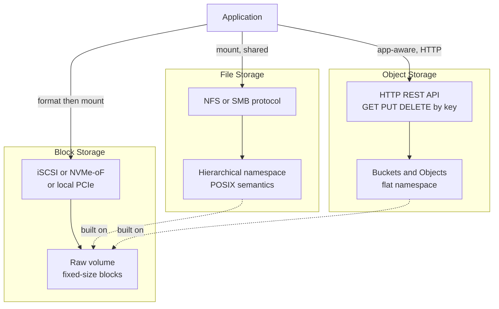

Note the dependency at the bottom: **file and object systems are themselves built on top of block devices** (or distributed file systems). Block is the foundation; the others add namespace and semantics.

### Comparison table

| Dimension | Block | File | Object |
|---|---|---|---|
| **Addressable unit** | Fixed block (512B–4KB) | File + path | Whole object + key |
| **Namespace** | None (flat LBA) | Hierarchical tree | Flat (prefixes simulate folders) |
| **Mutability** | In-place random write | In-place random write | Immutable; replace whole object |
| **Protocol** | iSCSI, NVMe-oF, FC, local PCIe | NFS, SMB/CIFS | HTTP REST (S3 API), Swift |
| **Consistency** | Strong (single writer) | POSIX (close-to-open on NFS) | Strong read-after-write (modern S3) |
| **Concurrency** | Single attach (usually) | Many clients, locking | Massively concurrent, no locks |
| **Latency** | µs (local NVMe) to low-ms | low-ms | ~10–100 ms first byte, often tens of ms (single-digit ms on express tiers) |
| **Throughput ceiling** | Per-volume (provisioned) | Per-share | Effectively unlimited (parallel) |
| **Scalability** | TB–10s TB per volume | TB–PB per share | Exabytes, trillions of objects |
| **Cost / GB-month** | High ($0.08–0.125 gp3) | Medium ($0.30 EFS Std, tiers down) | Low ($0.023 S3 Std → $0.001 Glacier Deep) |
| **Metadata** | None | Limited (POSIX attrs) | Rich, user-defined key/value |
| **Typical examples** | AWS EBS, GCP PD, Azure Disk, local NVMe | AWS EFS, GCP Filestore, NetApp, NFS | AWS S3, GCS, Azure Blob, MinIO, Ceph RGW |

### When to use which — decide, don't enumerate

| Workload | Choose | Because (requirement) | Revisit if |
|---|---|---|---|
| Database data files, boot volume | **Block** | Needs random in-place writes, low latency, single owner | The DB is a sharded quorum system that replicates itself → local NVMe |
| Shared config/home dirs, legacy POSIX app, ML shared dataset | **File** | Many readers/writers expect a real filesystem; can't be rewritten to HTTP | You control the app and can rewrite to object → use object instead |
| User uploads, images/video, backups, data lake, static assets, logs | **Object** | Immutable blobs, internet-scale, cheap, durable, HTTP-native | Access needs partial updates/appends/transactions → add a DB or table format on top |

> **Decisive default:** When a prompt says "store the files," your answer is **object storage with the key in the DB**, and you only deviate when a requirement forces POSIX (→ file) or a single-writer DB needs a disk (→ block). State that default out loud; don't list three options and trail off.

### Pitfalls

- **Storing blobs in the database** (the cardinal sin — see the anti-patterns section). Bytes belong in object storage; the DB holds the key.
- **Treating object storage like a filesystem.** "Listing a directory" is a `LIST` with a prefix scan — O(objects), not O(1). Renaming a "folder" copies every object. Don't build a POSIX app on S3 via a FUSE adapter and expect rename/append semantics.
- **Putting a database on a network file share** for performance: NFS adds latency and weak fsync semantics that corrupt DB write-ahead logs under failure.
- **Using a single block volume as a "shared drive"** — most block volumes are single-attach; multi-attach exists but requires a cluster-aware filesystem (GFS2, OCFS2) or you get corruption.

> **Staff-level insight:** The choice of paradigm is really a choice about *who owns the namespace and consistency*. Block pushes all structure to the client (max performance, no sharing). Object pushes all structure to the service (max scale, immutable units, no locking). File sits in the painful middle — it must provide shared mutable POSIX semantics across a network, which is why distributed file systems are the hardest of the three to build and the easiest to make slow. In interviews, when someone says "store the files," your first job is to disambiguate in one sentence — blobs (object), a mounted filesystem (file), or a raw device (block) — *pick object as the default*, and move on. Don't turn the disambiguation into a five-minute taxonomy lecture; that's altitude failure.

---

## 2. Object Storage (S3-style) — Deep Dive

**Definition.** Object storage stores data as **objects** inside **buckets**, addressed by a **key**. An object = `{ data blob, key, metadata (system + user), version-id }`. The namespace is **flat** — the key `photos/2026/cat.jpg` contains slashes but there is no real directory; `photos/` is just a *prefix* used for listing and (historically) partitioning.

> **Altitude cue:** Sections 2.1–2.2 (the data model and "what S3 is") are name-and-move-on territory in a live interview — assume the panel knows what a bucket and a key are. The deep-dive that earns signal is **2.2's durability math** and **2.5's per-prefix throughput** — that's where you go slow if storage is the crux. Read the model below for your own grounding; don't narrate it in the room.

### 2.1 The data model

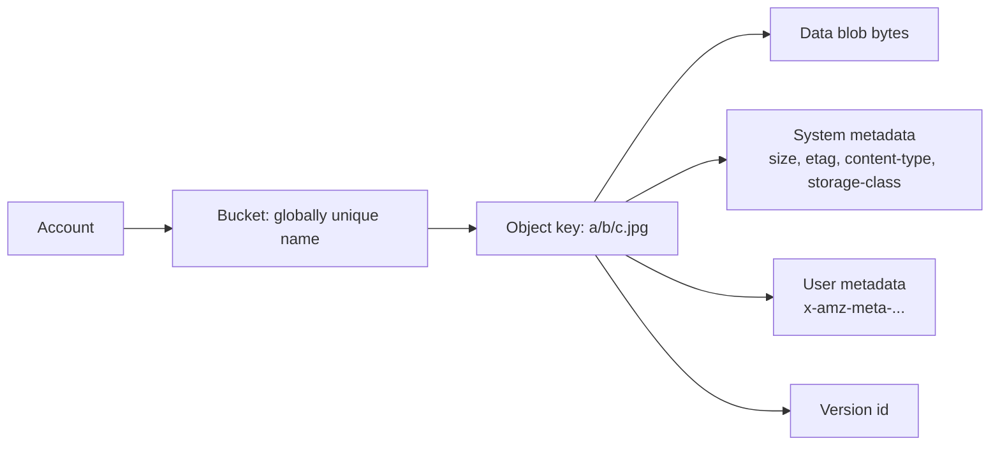

- **Bucket** — top-level container; name is globally unique (S3) or per-project (GCS). Holds policy, lifecycle, versioning, encryption defaults.
- **Key** — UTF-8 string up to 1024 bytes. The full key is the address; prefixes give pseudo-hierarchy.
- **Object** — the value. Immutable: you cannot modify byte 500; you `PUT` a whole new object (which, with versioning on, creates a new version).
- **Metadata** — system (size, last-modified, ETag/MD5, content-type, storage class) and user-defined (`x-amz-meta-*`). Critical for lifecycle and search-by-metadata patterns.

### 2.2 How it's built internally

A bucket is a logical wrapper; physically, objects are spread across thousands of storage nodes. The control plane maps `(bucket, key) → location`, and the data plane stores the bytes durably.

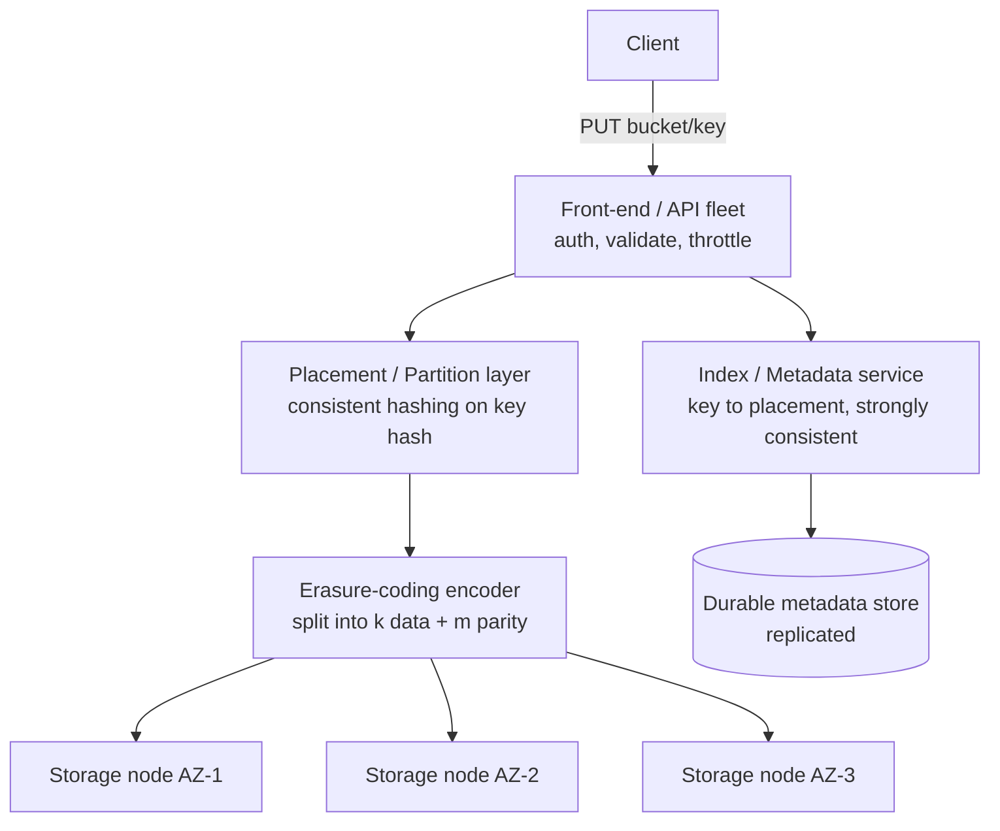

**Placement.** Objects are partitioned across storage nodes by hashing the key (consistent hashing / a token ring), so adding/removing nodes only remaps a fraction of keys. The metadata/index layer records exactly which shards landed where; it is itself strongly consistent and replicated (S3 famously rebuilt its index/metadata subsystem to provide strong consistency in 2020).

**Durability via erasure coding (not just copies).** Large object stores erasure-code each object: split into `k` data fragments + `m` parity fragments, spread `k+m` fragments across independent failure domains (disks, racks, AZs). Any `k` of the `k+m` reconstruct the object. (Details + math in §6.)

**Durability math — how 11 nines (99.999999999%) is achieved.** ⚠️ *This is a deep-dive crux: when asked "how do you not lose data," go slow here.* "Eleven nines of durability" means the *expected annual loss is ~1 object per 100 billion stored objects per year*. It's achieved by stacking independent mechanisms:

1. **Redundancy across failure domains** — fragments placed across ≥3 AZs so no single disk, host, rack, power, or AZ failure loses an object. With an EC(k, m) scheme you can lose any `m` fragments and still reconstruct.
2. **Continuous integrity scrubbing** — background processes verify checksums on every fragment and re-replicate/re-encode proactively before correlated failures accumulate. The key insight: durability is a race between *failure rate* and *repair rate*. Fast repair (parallel reconstruction across thousands of disks) keeps the probability of losing all `m+1` needed fragments astronomically low.
3. **Checksums end-to-end** — detect bit rot and bad disks; corrupted fragments are treated as failed and rebuilt.

The durability formula intuition: if a fragment is lost with some probability per unit time, and you need ≥ `m+1` simultaneous fragment losses *within one repair window* to lose an object, then durability ≈ `1 − P(≥ m+1 losses in a repair window)`. Because the repair window is minutes/hours and you require many simultaneous independent failures, that probability is ~10⁻¹¹.

**Worked nines intuition (numbers you can say out loud).** Take a single disk with an annualized failure rate (AFR) of ~2% (0.02). One copy → durability ≈ 98% — laughable. Now spread an object as EC(k=6, m=3) across 9 independent disks in 3 AZs; you lose the object only if ≥4 of the 9 fragments die *within the same repair window*. If a failed fragment is detected and rebuilt within, say, an hour, the per-fragment probability of failing *in that window* is roughly `0.02 / 8760 ≈ 2.3×10⁻⁶`. The probability that 4 specific fragments all fail in the same window is ~`(2.3×10⁻⁶)⁴ ≈ 2.8×10⁻²³`, and even multiplying by the `C(9,4)=126` ways to choose them and by 8760 windows/year lands you well past 10⁻¹¹ of annual loss probability. The exact constants don't matter — **the structure of the argument is the signal:** independent failure domains + many fragments + a *short repair window* turns a 2%-AFR disk into eleven nines. If you can recite that shape, you've answered the durability question at Staff level. The lever interviewers probe: *what dominates? Repair speed.* Slow repair (or correlated failures that defeat domain independence — a bad firmware rollout, a shared power bus) is what actually loses data, not the steady-state disk AFR.

### 2.3 Consistency model

- **Old S3 (pre-Dec 2020):** strong read-after-write for *new* object PUTs, but **eventual** consistency for overwrite PUTs and DELETEs, and eventual for LIST. This caused the classic "I just wrote it but GET 404s" race for overwrites.
- **Modern S3 (Dec 2020 onward):** **strong read-after-write consistency** for all PUTs, overwrites, and DELETEs, plus consistent LIST — at no extra cost. GCS has been strongly consistent for object reads for years.

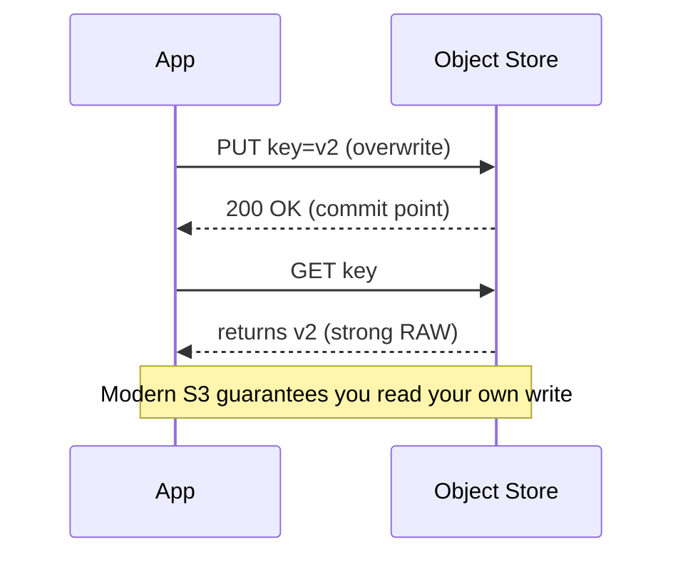

> Note: Strong consistency does **not** make objects mutable or give you transactions across objects. You still cannot atomically update two objects. For that you need conditional writes (S3 now supports `If-None-Match`/`If-Match` conditional PUTs, and as of 2024 native compare-and-swap-style conditional writes) or an external coordinator.

### 2.4 Key features

| Feature | What it does | Why it matters |
|---|---|---|
| **Versioning** | Keeps every version of a key; DELETE adds a delete marker | Protects against accidental overwrite/delete; ransomware recovery |
| **Lifecycle policies** | Transition or expire objects by age/prefix | Auto-tier hot→cold→archive; auto-delete old logs → cost control |
| **Storage classes** | Hot/warm/cold/archive tiers (see below) | Match access frequency to price |
| **Multipart upload** | Upload one object in parallel parts (5MB–5GB each, up to 10k parts, 5TB total) | Resumable, parallel, high-throughput uploads of large files |
| **Presigned URLs** | Time-limited signed URL for direct client GET/PUT | Offload up/downloads from your servers; no credentials on client |
| **Event notifications** | Fire event on PUT/DELETE → queue/function/topic | Event-driven pipelines (e.g. image-upload → thumbnail lambda) |
| **Server-side encryption** | SSE-S3, SSE-KMS, SSE-C | Compliance, at-rest encryption |
| **Object Lock / WORM** | Immutable retention | Compliance, audit, anti-tamper |

**Storage classes (S3 as the canonical example):**

| Class | Use case | Retrieval | ~Cost/GB-mo | Notes |
|---|---|---|---|---|
| **S3 Standard** | Hot, frequent | Instant | ~$0.023 | 3-AZ, 11 nines |
| **S3 Standard-IA** | Warm, infrequent | Instant | ~$0.0125 | + per-GB retrieval fee, min 30-day |
| **S3 One Zone-IA** | Re-creatable warm | Instant | ~$0.01 | Single AZ (less durable to AZ loss) |
| **S3 Intelligent-Tiering** | Unknown/variable access | Instant | tiers auto | Monitors access, auto-moves; small per-object fee |
| **S3 Glacier Instant Retrieval** | Archive, rare but instant | Instant (ms) | ~$0.004 | Min 90-day |
| **S3 Glacier Flexible** | Archive, minutes–hours | Minutes to 12h | ~$0.0036 | Bulk cheaper |
| **S3 Glacier Deep Archive** | Cold archive, compliance | 12–48h | ~$0.00099 | Cheapest; min 180-day |

> **Decisive default on classes:** Standard for hot, lifecycle to Standard-IA at ~30 days, Glacier **Instant** for archive you might still serve to a user (ms retrieval), Deep Archive *only* for compliance/cold backups you'll likely never read. Revisit if access is unpredictable → Intelligent-Tiering (it auto-moves and removes the guesswork, at a small per-object monitoring fee). Don't enumerate all seven classes in an interview; name the three you'd actually use and the trigger for the fourth.

### 2.5 Throughput, partitioning, and request rate

⚠️ *Deep-dive crux when the prompt is high-QPS.* Modern S3 scales request rate **per prefix**: ~**3,500 PUT/COPY/POST/DELETE** and ~**5,500 GET/HEAD requests per second per prefix**, and you can have many prefixes. Historically (pre-2018) keys were hashed by their *leading characters*, so sequential keys (`2026-06-23-...`) collided on one partition — the old advice was to add a random hash prefix. Today S3 auto-partitions adaptively, but **spreading load across prefixes still helps you scale to millions of req/s** and avoids the warm-up lag while S3 splits a hot partition.

**Worked example:** you need 50,000 GET/s on a media bucket. At ~5,500 GET/s per prefix you need ≥10 active prefixes. If all your keys share one prefix (`media/...`) you'll throttle (503 SlowDown) until S3 adaptively splits — which takes minutes. Design the key layout up front: hash a shard id into the prefix (`media/<2-hex>/<id>`) to get 256 prefixes immediately. This is the kind of concrete, numeric move that reads as operational experience rather than theory.

### 2.6 The PUT / GET path (with multipart)

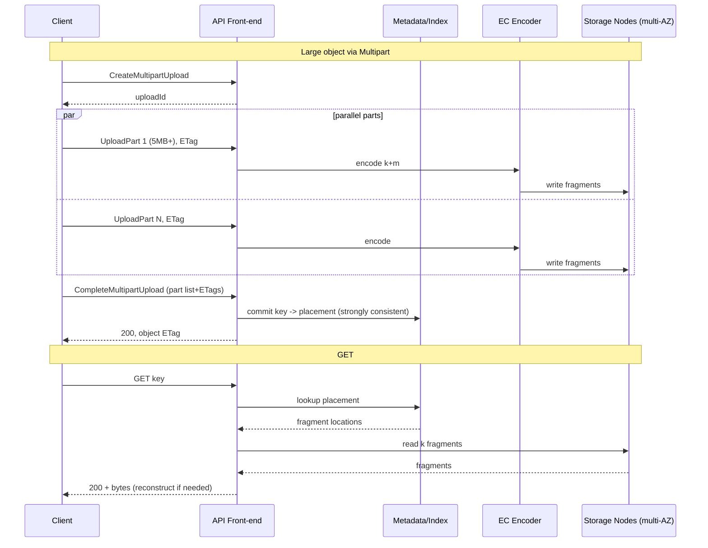

The single most important structural fact in this diagram: **the `CompleteMultipartUpload` → metadata commit is the strong-consistency point.** Until that commit, the object doesn't exist; after it, an immediate GET sees it. That commit is the only place a transaction-like guarantee lives in the whole system — everything else is immutable, write-once fragments with no coordination. Name that commit point explicitly when you walk the path; it's what shows you understand *why* object storage scales.

### 2.7 Cost model

You pay for **(1) storage** (per GB-month, by class), **(2) requests** (per 1,000 PUT/GET/LIST), **(3) data transfer out** (egress, often the biggest surprise — intra-region free, internet egress $0.05–0.09/GB), and **(4) retrieval/early-deletion fees** on IA/Glacier. The classic cost mistake is millions of tiny objects (request + per-object overhead dominate) or chatty egress.

> ⚠️ **Risk concentration — egress is where the bill explodes.** For any media-serving system, raw storage is rarely the dominant line item; **egress is.** Serving a viral image directly from object storage to the internet at scale can cost more in transfer than in storage by an order of magnitude. The mitigation is non-negotiable: a CDN in front with a high hit ratio. Flag this proactively in any media design — it's the cost risk that actually bites in production, and naming it unprompted is strong signal.

### Pitfalls

- **Listing at scale** is a prefix scan; designing a system that lists a bucket on the hot path will not scale — maintain your own index (DB) of keys.
- **Eventual-consistency assumptions in old code** — now strong on S3, but cross-region replication and other object stores may still be eventual.
- **Hot prefixes** — millions of req/s on one prefix; spread keys (see §2.5).
- **Tiny-object tax** — Glacier/IA have per-object minimums and overhead; aggregate small files into archives.
- **Egress bills** — serving media directly from S3 to the internet at scale; put a CDN in front.

> **Staff-level insight:** Object storage's superpower is that **immutability + flat namespace = trivial horizontal scale**. There are no in-place updates to coordinate, no locks, no rename, no parent-directory contention. Every hard distributed-systems problem (consensus on mutations) is sidestepped by making objects write-once and pushing the only mutable, strongly-consistent component into a small metadata/index service. When you propose S3 in an interview, articulate this in one sentence — *you get exabyte scale because you gave up POSIX* — and don't belabor it. The corollary worth saying: if your access pattern needs partial updates, appends, or transactions across blobs, object storage is the wrong primitive and you'll bolt a database on top (which is exactly what data lakes / table formats like Iceberg do — see [Data Processing](16-data-processing.md)).

---

## 3. Block Storage

**Definition.** Block storage exposes a **raw volume** of fixed-size blocks addressed by Logical Block Address (LBA). It has no notion of files — you format it with a filesystem (ext4, XFS, NTFS) or hand it to a database that manages raw blocks directly. It behaves like a local disk.

> **Altitude cue:** Block storage is mostly name-and-move-on. "The relational DB sits on a provisioned-IOPS block volume; we snapshot it to object storage for backup" is a complete answer for 90% of prompts. The one decision worth dwelling on is **§3.4 — local NVMe vs network block — because it's really the question of where replication lives**, and that's a genuine architecture fork.

### 3.1 How it works (EBS-style network block)

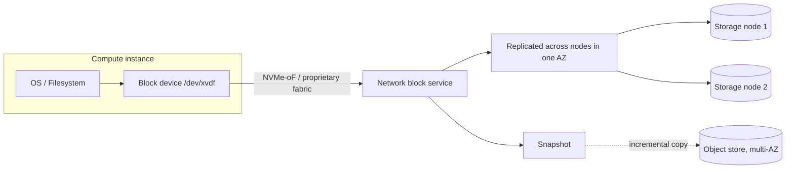

A network block volume (AWS EBS, GCP Persistent Disk, Azure Disk) lives in **one Availability Zone**, is **attached to one instance** at a time (multi-attach exists but needs a cluster filesystem), and is internally **replicated within that AZ** for durability. It survives instance termination. Latency is low-ms; with provisioned IOPS volumes you get predictable performance.

### 3.2 Provisioning IOPS and throughput

You buy performance explicitly:

| EBS type | IOPS | Throughput | Use case |
|---|---|---|---|
| **gp3** (SSD, general) | 3,000 baseline, up to 16,000 | 125 MB/s base, up to 1,000 | Default; decoupled IOPS/throughput |
| **gp2** (SSD, legacy) | 3 IOPS/GB (burst to 3,000) | scales with size | Older general purpose |
| **io2 Block Express** (SSD, provisioned) | up to 256,000 | up to 4,000 MB/s | Critical DBs needing guaranteed IOPS, 99.999% |
| **st1** (HDD, throughput) | low | up to 500 MB/s | Big sequential (logs, data warehouse) |
| **sc1** (HDD, cold) | lowest | low | Cold, infrequent |

> **Decisive default:** gp3 for general-purpose DB volumes (you tune IOPS and throughput independently without resizing the disk). Move to io2 Block Express only when a critical DB needs guaranteed high IOPS with a 99.999% volume-durability SLA. Don't volunteer the full EBS catalog in an interview; name gp3 as the default and io2 as the escalation.

### 3.3 Snapshots

Snapshots are **incremental, copy-on-write** point-in-time images, stored in object storage (multi-AZ, durable). First snapshot = full; subsequent = only changed blocks. Restoring creates a new volume that lazily hydrates blocks from the snapshot on first access. Snapshots are the backup/clone/cross-AZ-migration primitive for block volumes. Note the elegant layering: **block durability ultimately leans on object storage** — the backup of your "high-performance disk" lives in the cheap, 11-nines blob tier.

### 3.4 Local NVMe vs network block

| | Local NVMe (instance store) | Network block (EBS/PD) |
|---|---|---|
| **Latency** | ~10–100 µs | low-ms (network hop) |
| **IOPS/throughput** | Millions of IOPS, GB/s | Provisioned, lower |
| **Durability** | **Ephemeral** — lost on stop/terminate/host failure | Replicated, survives instance |
| **Attach** | Physically attached to host | Attach/detach over network |
| **Use** | Caches, scratch, sharded DBs with own replication (Cassandra, Kafka), temp | Boot volumes, single-instance DBs, anything needing persistence |

### When block is the right answer — decide

| Workload | Choose | Because | Revisit if |
|---|---|---|---|
| Single-primary RDBMS (Postgres/MySQL) | **Network block (EBS gp3/io2)** | Needs in-place writes, fsync durability, and the *storage layer* to own durability | — |
| Sharded/quorum store (Cassandra, Kafka, ES) | **Local NVMe** | The data layer already replicates; pay for speed, not double durability | Operational simplicity matters more than µs latency → EBS is acceptable |
| Boot/root volume | **Network block** | Must survive instance replacement | — |

### Pitfalls

- **Assuming local NVMe is durable** — it vanishes on host failure; only use it where the data layer replicates (or it's scratch).
- **Under-provisioning IOPS** then blaming the database for being slow.
- **Multi-attach without a cluster filesystem** → instant corruption (two kernels both think they own the blocks).
- **Snapshot restore "cold start"** — first reads are slow until blocks hydrate; pre-warm for latency-sensitive restores.
- **Cross-AZ assumption** — a single EBS volume cannot span AZs; HA needs replication or Multi-AZ DB.

> **Staff-level insight:** Block storage forces a single decision — *where does replication live?* — and the rest follows. Network block (EBS) replicates **inside the storage layer** within one AZ — convenient, but the volume is an AZ-scoped single point of failure, so HA databases on EBS still need application-level replication across AZs. Local NVMe replicates **nowhere** — you must build replication into the data system (Cassandra, Kafka, sharded MySQL). The Staff framing is a question you say out loud: *"Do I want the storage layer or the data layer to own durability?"* Stateful systems that already do quorum replication prefer cheap fast local NVMe; a single-primary RDBMS leans on EBS + snapshots + Multi-AZ. Say the question, give the default, move on.

---

## 4. File Storage

**Definition.** File storage presents a **shared hierarchical filesystem** over the network, mounted by many clients simultaneously, with **POSIX-ish semantics** (paths, permissions, locks, byte-range read/write, `fsync`). Protocols: **NFS** (Unix world) and **SMB/CIFS** (Windows world).

> **Altitude cue:** File storage is almost entirely name-and-move-on, and the Staff move is usually *to argue against it.* "We'd use EFS only if a legacy app demands a POSIX mount; otherwise object storage" is the whole answer. Don't deep-dive NFS internals unless the prompt is explicitly about a shared-filesystem product.

### 4.1 How it works

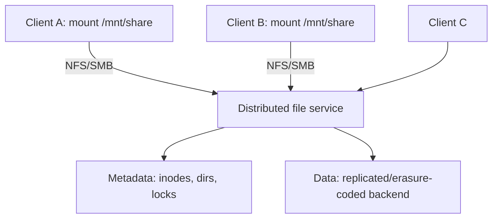

Managed examples: **AWS EFS**, **GCP Filestore**, **Azure Files**, on-prem **NetApp/Isilon**. EFS scales elastically to petabytes, is multi-AZ, charges per GB used (with IA tiering), and serves thousands of concurrent NFS clients.

### 4.2 POSIX semantics and their cost

The hard part is *shared mutable* state: two clients writing the same file, locking, and visibility of writes. NFS uses **close-to-open consistency** — a client sees another client's writes only after the writer `close()`s and the reader `open()`s; mid-file concurrent writes are not strongly ordered without explicit locks. SMB has richer opportunistic locking. These semantics add latency and limit throughput vs object storage.

### Comparison: File vs Object vs Block

| | Block | File | Object |
|---|---|---|---|
| Shared by many clients | No (usually) | **Yes** | Yes |
| POSIX (locks, partial writes, rename) | via local FS | **Yes** | No |
| Mount as a directory | After formatting | **Yes, native** | No (needs gateway) |
| Scale | TB | TB–PB | EB |
| Latency | µs–ms | ms | 10s–100s ms |

### When file storage is the right answer — decide

| Workload | Choose file? | Because / Trigger |
|---|---|---|
| Lift-and-shift legacy app expecting a mount | **Yes (EFS/Filestore)** | App mmaps/appends and won't be rewritten — the one legitimate trigger |
| Shared home dirs / dev environments | **Yes** | Humans expect a real filesystem |
| Shared media working set across app servers | **Maybe** | Default to object + local cache; use file only if the app demands POSIX |
| ML training over a shared dataset | **Usually no** | High-throughput training prefers object + local NVMe cache |
| Anything you control end-to-end | **No** | Use object storage; "we need a filesystem" is a smell to interrogate |

### Pitfalls

- **Databases on NFS** — weak `fsync` guarantees + latency = corruption and slowness. Don't.
- **Metadata-heavy workloads** (millions of tiny files, deep trees) hammer the metadata server — file systems bottleneck on metadata, not data.
- **Assuming strong cross-client consistency** — NFS is close-to-open, not linearizable.
- **Cost surprise** — EFS Standard is ~10–13x the price of S3 Standard per GB; use lifecycle/IA and don't park cold data there.

> **Staff-level insight:** File storage exists mostly for **compatibility**, not because it's the best scaling primitive. If you control the application, prefer object storage and treat "we need a filesystem" as a smell to investigate. The legitimate cases are POSIX-dependent legacy software and genuinely shared mutable working sets. In an interview, **choosing EFS over S3 should come with an explicit one-line reason** ("the app mmaps files and we won't rewrite it"), because file storage costs more, scales less, and carries consistency caveats that object storage doesn't. If you can't name the POSIX dependency, you've chosen wrong.

---

## 5. Distributed File Systems — GFS, HDFS, Colossus

**Definition.** A distributed file system spreads one logical filesystem across many machines, storing large files as **blocks/chunks** replicated across nodes, optimized for **high-throughput sequential reads and appends** over commodity hardware — the foundation of big-data processing (see [Data Processing](16-data-processing.md)).

> ⚠️ **YAGNI / over-engineering warning:** You will almost never *build* one of these in an interview, and proposing to is a classic over-engineering tell. S3, GCS, and Colossus already exist; "we'd use object storage / a managed DFS" is the right answer to "where does the data lake live." Study this section so you can **draw GFS confidently when asked to** and so you can reason about the **control-plane/data-plane separation** that recurs everywhere — *not* so you reach for a NameNode when someone asks where to put profile pictures. The deep-dive that earns signal here is the **single-master mitigation story (§5.1) and its evolution to a sharded metadata plane (§5.4)** — that's a general distributed-systems lesson, not just trivia.

### 5.1 Google File System (GFS, 2003)

**Design goals:** run on cheap, failure-prone commodity disks; store huge files (GBs–TBs); optimize for **large sequential reads and appends**, not random writes; favor throughput over latency.

**Architecture:** one **Master** (metadata) + many **Chunkservers** (data). Files are split into fixed **64 MB chunks**, each identified by a globally unique chunk handle, and each chunk is **replicated 3x** across chunkservers (and racks).

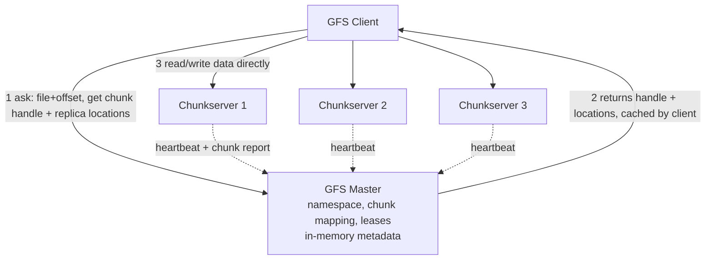

**Why 64 MB chunks?** Fewer chunks → smaller metadata (fits in master RAM); fewer client-master interactions; persistent TCP connection amortized over a big chunk; reduces master load. Downside: small files waste a chunk and create hotspots.

**Single master — and how they mitigated it.** ⚠️ *This is the deep-dive worth your time — it's a transferable lesson, not GFS trivia.* A single master is simpler (no consensus on metadata in the common path) but is a SPOF and bottleneck. Mitigations:
- **Master only handles metadata, never data** — data flows client↔chunkserver directly, so the master isn't on the bandwidth path.
- **Clients cache chunk locations** and talk to chunkservers directly for subsequent ops.
- **Metadata kept in memory** for speed; an **operation log** is persisted and replicated, with periodic **checkpoints**.
- **Shadow masters** serve read-only metadata; a new master can recover from the replicated op log + chunkserver reports (chunkservers re-report which chunks they hold).

**Write/record-append flow (the clever part).** GFS optimizes **append**: many clients concurrently appending to one file (e.g. a log) is the killer use case. The master grants a **lease** to one replica (the **primary**) that serializes mutations:

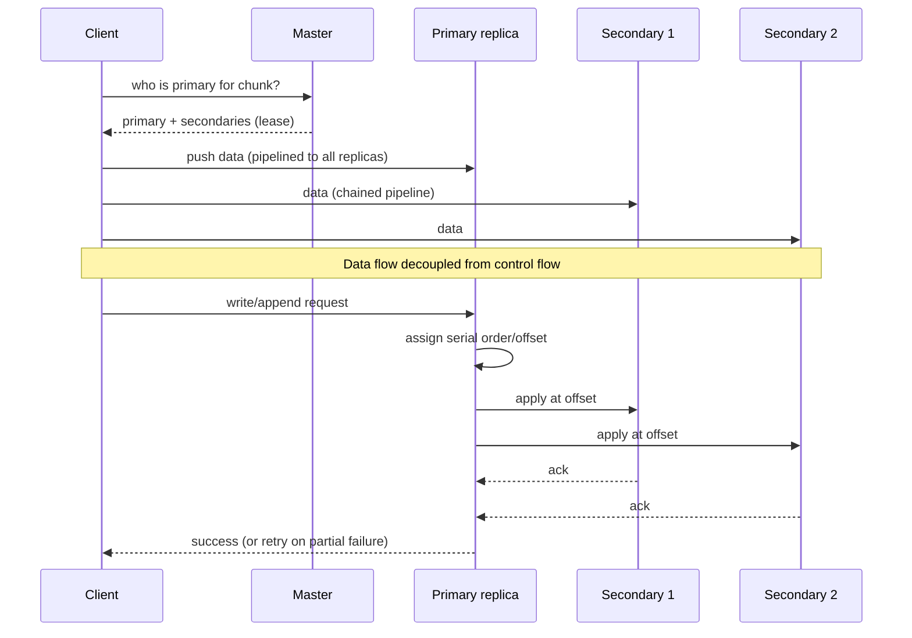

GFS provides **relaxed consistency**: record append guarantees the record appears *at least once* atomically, but may leave padding/duplicates — applications dedupe via record checksums/IDs. This relaxed model is what makes high-throughput concurrent append cheap.

### 5.2 HDFS (Hadoop Distributed File System)

HDFS is the open-source re-implementation of GFS ideas.

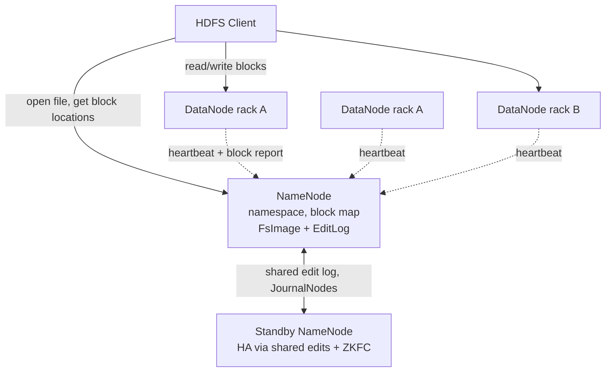

- **NameNode** = master (namespace + block→DataNode map, in memory; persisted as **FsImage** + **EditLog**).
- **DataNodes** = chunkservers; store **128 MB blocks** (default; was 64 MB), replicated **3x**.
- **Rack awareness** — replica placement: 1 copy local, 2nd on a different rack, 3rd on the same remote rack. Balances rack-failure tolerance vs cross-rack bandwidth.
- **HA NameNode** — Active + Standby NameNodes sharing an edit log via **JournalNodes (quorum)**, with **ZKFC + ZooKeeper** for automatic failover (solves GFS's SPOF).
- **Federation** — multiple independent NameNodes each owning a namespace sub-tree, to scale metadata beyond one NameNode's RAM.

**HDFS write path:** client asks NameNode for block locations → NameNode returns a **pipeline** of 3 DataNodes → client streams packets through the pipeline (DN1→DN2→DN3), each acking back. On a DataNode failure mid-write, the pipeline is rebuilt with remaining nodes and the block is re-replicated later.

### 5.3 GFS vs HDFS

| | GFS | HDFS |
|---|---|---|
| Master | Single master + shadows | NameNode + HA Standby (JournalNodes) |
| Chunk/block size | 64 MB | 128 MB (default) |
| Replication | 3x | 3x (also EC in HDFS 3.x) |
| Consistency | Relaxed (record append at-least-once) | Single-writer, write-once-then-append |
| Metadata scaling | Single master | Federation (multiple NameNodes) |
| Openness | Proprietary | Open source |

### 5.4 Colossus (GFS successor, brief)

Google replaced GFS with **Colossus** to fix the single-master metadata bottleneck and small-file weaknesses. Colossus distributes metadata across a horizontally-scalable service backed by **Bigtable** (which itself runs on Colossus); metadata is stored in a scalable database, and it uses **erasure coding** (not 3x replication) for most data to cut storage cost, and serves a much larger file count and smaller files efficiently. It's the storage substrate under Spanner, BigQuery, Gmail, etc.

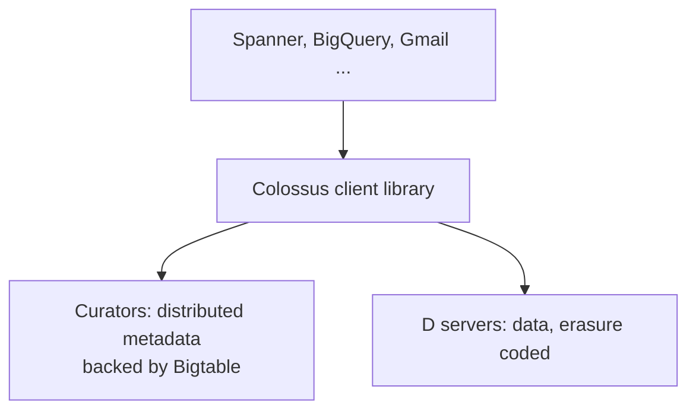

**The transferable lesson (worth saying):** GFS→Colossus is the canonical example of a pattern you'll re-derive constantly — *a single metadata coordinator is a brilliant simplification that buys you years, and the predictable next chapter is sharding that metadata layer and backing it with a scalable database once the file count outgrows one machine's RAM.* If you propose a single coordinator in any design, name this ceiling and this migration path; that's the Staff move.

### Why append-optimized?

Big-data workloads write data **once** (logs, ingested datasets, MapReduce output) and read it **many times sequentially**. There's almost no random in-place update. Optimizing for large sequential read + atomic append (and giving up cheap random writes) lets you use huge blocks, minimal metadata, and simple replication — which is exactly why HDFS underpins batch analytics.

### Pitfalls

- **Small-file problem** — HDFS NameNode holds all metadata in RAM (~150 bytes/object); millions of tiny files exhaust NameNode memory. Aggregate into large files (SequenceFiles, ORC/Parquet).
- **Relying on random writes** — these systems are append/write-once; random updates aren't the model.
- **NameNode as SPOF** if HA isn't configured.
- **Treating it as low-latency** — designed for throughput; a single read has high latency vs local disk.

> **Staff-level insight:** GFS's enduring lesson is the **separation of control plane and data plane**: route metadata through a (small, possibly single) master, but never route bytes through it — clients talk to data nodes directly. That principle reappears everywhere (S3 front-end vs storage nodes, Kafka controller vs brokers, the mini-design in §8). The *evolution* GFS→Colossus and NameNode→Federation/HA is equally instructive: a single metadata master is a brilliant simplification that buys you years, and the predictable next chapter is making that metadata layer horizontally scalable. In an interview, proposing a single coordinator is fine *if* you name the scaling ceiling and the migration path — and you should resist the urge to actually *build* a DFS when "use S3/Colossus" is the YAGNI-correct answer.

---

## 6. Erasure Coding vs Replication

**Definition.** Both are redundancy schemes for surviving disk/node failures.
- **Replication** — store `N` full copies. 3x replication tolerates 2 failures; 3x storage overhead.
- **Erasure coding (EC)** — split data into `k` fragments, compute `m` parity fragments via **Reed-Solomon**, store `k+m` fragments; any `k` reconstruct the data. Tolerates `m` failures with overhead `(k+m)/k`.

> **Altitude cue:** Only deep-dive this when *storage cost at scale is the explicit constraint.* The one-liner — "replicate hot, erasure-code cold, tier between" — is the answer that suffices in most designs. The math below is for when the panel pushes on cost or asks you to justify the call.

### Reed-Solomon intuition

Treat `k` data fragments as points; compute a polynomial through them; evaluate it at `m` extra points to get parity. Any `k` of the `k+m` points uniquely determine the polynomial → reconstruct the missing pieces. It's the same math as recovering a degree-(k−1) polynomial from any `k` of its evaluations.

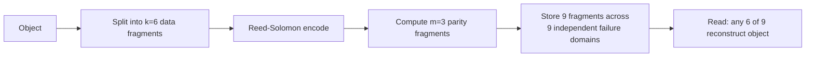

### Storage overhead math

| Scheme | Overhead | Tolerates | Example |
|---|---|---|---|
| 2x replication | 2.0x | 1 failure | Mirroring |
| 3x replication | 3.0x | 2 failures | HDFS/GFS default |
| EC(6,3) — 6 data, 3 parity | 9/6 = **1.5x** | 3 failures | Common cloud EC |
| EC(10,4) | 14/10 = **1.4x** | 4 failures | Azure LRS-style |
| EC(12,4) | 16/12 = **1.33x** | 4 failures | Facebook f4 / cold |
| EC(8,3) | 11/8 ≈ 1.375x | 3 failures | — |

So EC(6,3) survives 3 fragment failures vs 3x replication's 2, at half the storage (1.5x vs 3x) — but EC is **not unconditionally more durable**: it trades much higher repair-amplification (a single-fragment repair reads `k`=6 fragments and recomputes vs copying 1 block) and 3× the per-object node fan-out for that lower storage cost. That's why large object stores use EC for *bulk/cold* data while keeping hot data replicated.

### The trade-off — why not always EC?

| | Replication | Erasure coding |
|---|---|---|
| **Storage overhead** | High (2–3x) | Low (1.3–1.5x) |
| **Write cost** | Cheap (copy) | CPU to encode parity |
| **Read (normal)** | Read 1 copy, fast | Read `k` fragments (or fast-path the data fragments) |
| **Reconstruction (after loss)** | Copy 1 block | Read `k` fragments + recompute — **`k`x read amplification & network** |
| **Latency / small objects** | Low | Higher; fragmentation hurts tiny objects |
| **Best for** | Hot, latency-sensitive, small, frequently-updated | Cold/warm, large, write-once |

**Reconstruction cost is the catch:** to rebuild one lost EC fragment you must read `k` other fragments and recompute — `k`x the network/IO of replication's "copy one block." On a hot, high-churn dataset that repair traffic is brutal. So:

- **Hot path / small objects / low latency** → replication (often 3x).
- **Cold/warm, large, write-once (archives, old object data)** → erasure coding.
- **Tiered systems** keep new/hot data 3x-replicated, then **re-encode to EC** as it cools (HDFS 3.x, Ceph, Colossus all do this).

> **Decisive default:** 3x replication for hot/small/latency-sensitive data, EC(6,3)≈1.5x for cold/large/write-once, and a lifecycle worker that re-encodes data from the first to the second as it cools. Revisit toward all-EC if the entire dataset is uniformly cold and storage cost dominates; revisit toward all-replication if it's uniformly hot and tiny. State the tiering default; don't list six EC schemes and shrug.

> **Staff-level insight:** The right framing is "**EC trades CPU and repair-time read-amplification for storage cost.**" At exabyte scale, halving storage overhead (3x→1.5x) saves more money than the extra CPU costs — which is why cold object storage is virtually always EC. But for hot data, the `k`x reconstruction amplification and added read latency push you back to replication. The sophisticated answer is *tiering*: replicate hot, erasure-code cold, and let lifecycle policy move data between them. One advanced note that signals depth: **Local Reconstruction Codes (LRC, as in Azure)** add local parity groups so a *single*-fragment failure (the common case) is repaired by reading only a few local fragments instead of all `k` — directly attacking the main pain point of plain Reed-Solomon. Mention it as the refinement, not the headline.

---

## 7. Storage Trade-offs — The Interview Framework

Every storage decision balances **Durability, Availability, Cost, and Latency** (DACL). You usually can't max all four; pick the two that matter for the workload and degrade the others deliberately.

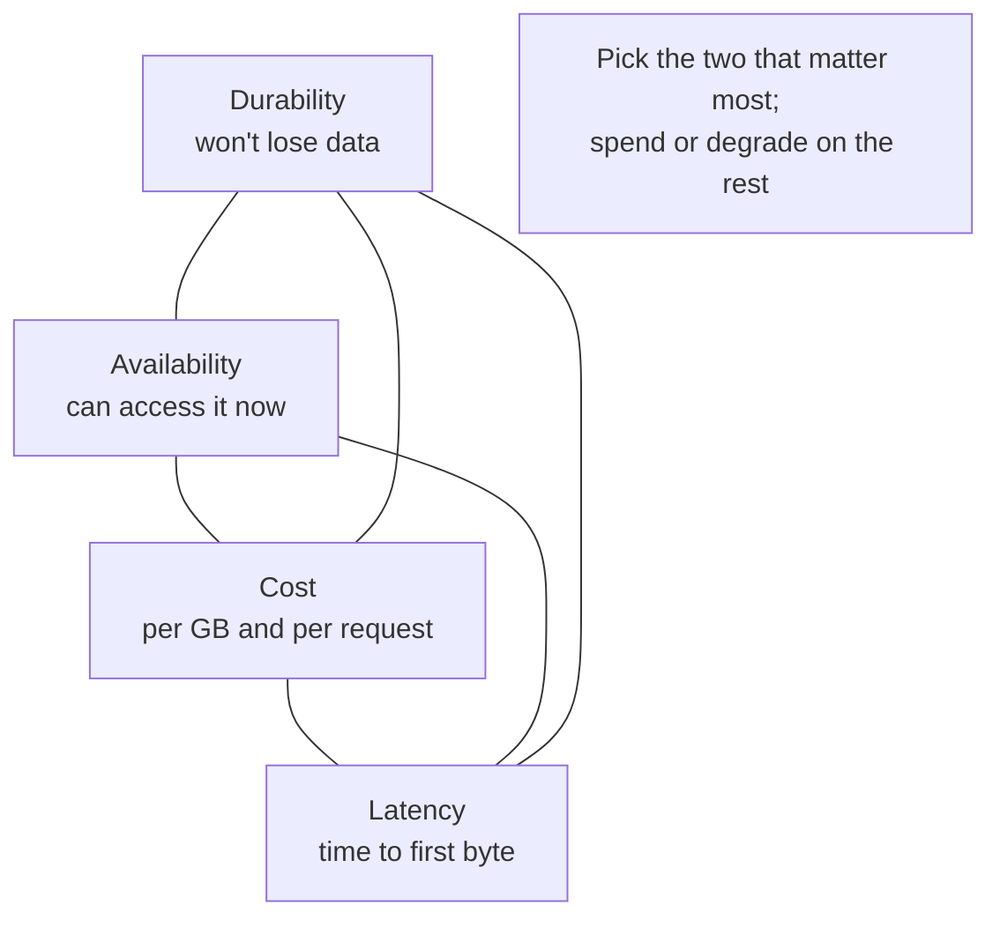

### Reasoning about each axis

| Axis | Levers that improve it | Cost of improving it |
|---|---|---|
| **Durability** | More replicas / higher EC parity, multi-AZ, scrubbing, versioning | More storage $, write amplification |
| **Availability** | Multi-AZ/region, more replicas online, caching | More $, more replication traffic |
| **Cost** | EC over replication, colder tiers, dedup, compression, lifecycle expiry | Higher latency (cold), reconstruction cost, CPU |
| **Latency** | Hot tier (SSD/NVMe), caching/CDN, replication near readers, smaller objects | Higher $, less durable (single-AZ NVMe) |

### Hot vs cold data tiering

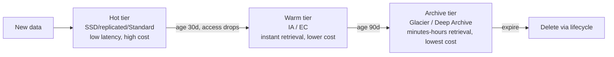

Classify by access frequency and recency; let lifecycle policies move data down the tiers automatically. Hot tier optimizes latency/availability; cold tier optimizes cost; durability stays high throughout.

### Deduplication & content-addressable storage (CAS)

⚠️ *Deep-dive crux when the prompt is backup/sync/photo/build-artifact — i.e. naturally repetitive data. Otherwise this is YAGNI; don't introduce it unprompted.* **CAS** addresses data by the **hash of its content** (e.g. SHA-256), not by a name. Identical content → identical address → stored **once**. This gives automatic **deduplication** and integrity (the address verifies the content).

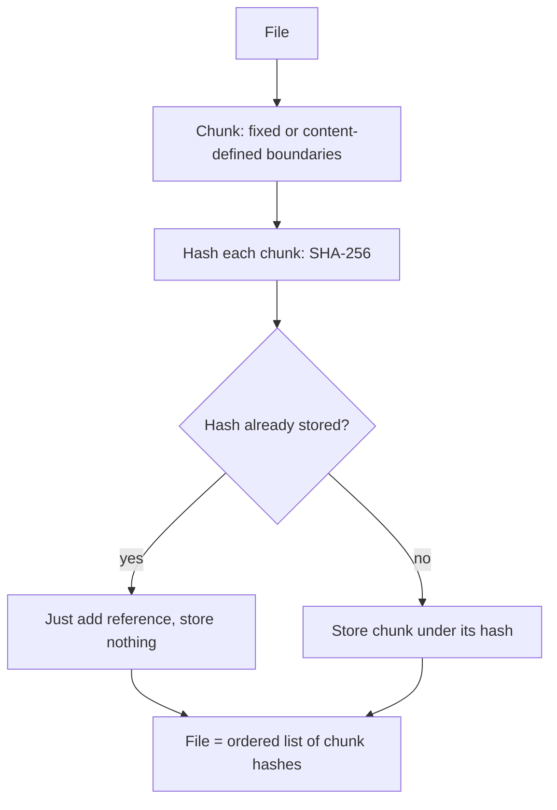

- **Git** — every blob, tree, and commit is stored under its SHA-1/SHA-256 content hash; identical files across commits stored once; the commit graph is a Merkle DAG.
- **Dropbox** — splits files into ~4 MB blocks, hashes each; only uploads blocks the server doesn't already have (cross-user dedup + delta sync). A file is a manifest of block hashes.
- **Backup systems (Borg, Restic), container registries (OCI layers), IPFS** — all CAS + dedup.

**Content-defined chunking (Rabin fingerprinting)** sets chunk boundaries by content, so inserting a byte only shifts one chunk's boundary (not all subsequent ones) — preserving dedup across edits. This is why a 1-byte change to a huge file uploads almost nothing.

### Pitfalls

- **Optimizing durability you don't need** — re-creatable derived data (thumbnails, caches) can use single-AZ / cheaper tiers; don't pay 11-nines for regenerable data.
- **Ignoring egress and request costs** in the "cost" axis — they often dwarf storage cost.
- **CAS without garbage collection** — reference-counted/GC'd CAS stores leak space when references drop; you need GC (Git `gc`, registry GC).
- **Hash collisions paranoia vs reality** — SHA-256 collisions are infeasible; SHA-1 is deprecated for security but the practical dedup risk is negligible (Git is migrating regardless).

> **Staff-level insight:** Senior candidates default to "make everything durable and fast." Staff candidates **classify data first** and right-size each class: hot/cold, regenerable/canonical, latency-critical/batch — then assign storage paradigm, tier, and redundancy per class. The single most valuable sentence you can say is: *"Not all this data deserves the same treatment."* Pair that with CAS/dedup *only when the data is naturally repetitive* (backups, user uploads, build artifacts) — it's the highest-leverage cost win and it gives integrity for free, but introducing it on non-repetitive data is over-engineering. The DACL triangle is your spoken framework: name which axis you're sacrificing and why it's safe to. ⚠️ And in any media-serving design, flag egress as the cost-risk concentration before anyone asks.

---

## 8. Mini-Design: A Blob/File Storage Service

**Problem.** Design a service like S3 / a media-upload backend: users upload arbitrary files (KB to GB), retrieve them fast, with high durability, dedup, tiering, and CDN delivery. Think Dropbox/Google Photos/an internal S3 — or, in your wheelhouse, the **attachment/media backend for a chat product**.

> **How to run this in the room:** lead with the boring-but-correct skeleton in one breath — *"object storage for the bytes, a metadata DB for the keys/ACLs, a CDN in front, presigned URLs so uploads bypass the app tier."* That's the YAGNI core and it's a complete answer. Then spend your depth on whichever of {dedup, tiering, durability, the strong-consistency commit point} the requirements actually stress. Don't build all of it uniformly.

### Requirements

- **Functional:** upload (incl. large/resumable), download, delete, list, metadata, sharing via links.
- **Non-functional:** 11-nines durability for canonical data; high availability; low-latency reads (global); cost-efficient at PB scale; dedup; encryption.
- **Scale assumptions:** billions of objects, PBs of data, 100k+ req/s, objects up to 5 TB.

### Architecture

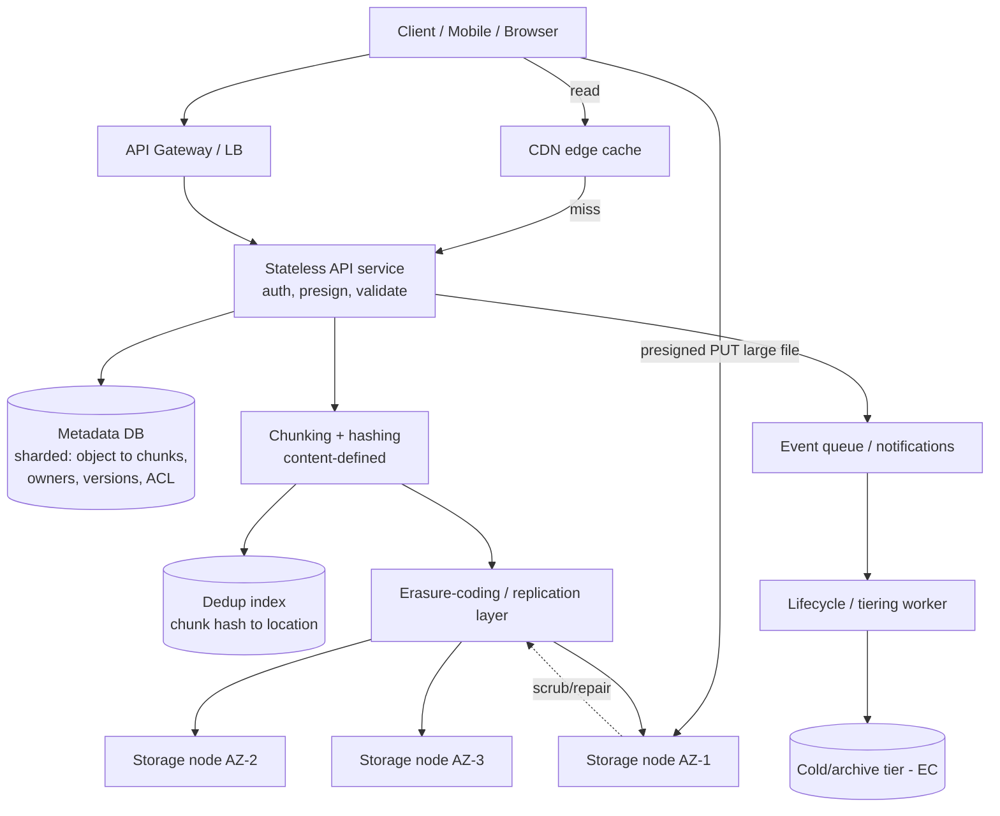

### Key design decisions (what to say)

1. **Object storage paradigm**, not file — immutable blobs, flat keyspace, HTTP. Pushes all the scaling-hard mutation problems away. *(This is the YAGNI core — say it and move.)*
2. **Separate metadata plane from data plane.** A sharded metadata DB (by object-id or owner) maps object → version → chunk list → placement, plus ACLs and dedup index. Data bytes never flow through the metadata service. (GFS lesson, §5.)
3. **Chunk + content-address for dedup** — *introduce this only because the requirements name dedup.* Split files into content-defined ~4 MB chunks, hash each (SHA-256), store each chunk **once** under its hash; an object = ordered manifest of chunk hashes. Cross-user dedup + delta sync. (Dropbox/Git model.) In a chat product specifically, forwarded/re-shared media and identical voice-note re-sends make this a real win.
4. **Redundancy by tier.** Hot/new chunks: 3x replication across AZs for low-latency reads and cheap repair. Cold chunks: re-encode to EC(6,3) (~1.5x) via lifecycle worker to cut cost. 11-nines via multi-AZ placement + continuous scrubbing + fast parallel repair (§2.2 math).
5. **Large/resumable uploads** via multipart + presigned URLs — clients upload parts directly to storage nodes (offload the API tier), then `Complete` commits the manifest in the metadata DB (**the strongly-consistent commit point → strong read-after-write**).
6. **Reads via CDN + presigned URLs** — serve hot/public objects from CDN edges; presigned URLs let clients fetch directly, keeping the API tier out of the byte path and cutting egress origin load. ⚠️ *Egress is the dominant cost for media — flag it.*
7. **Lifecycle & tiering** — policies move objects Standard → IA → Archive by age/access; expire regenerable data. Event notifications (queue) drive async pipelines (e.g. thumbnailing, virus scan).
8. **Consistency** — strong read-after-write by committing metadata atomically at `Complete`; object data immutable, so no in-place coordination.
9. **Encryption** — SSE with per-object keys wrapped by a KMS; chunks encrypted at rest. (Note: dedup + per-user encryption conflict — convergent encryption is the usual compromise, with its known privacy caveat. Don't gold-plate this unless the prompt asks.)

### Capacity / cost back-of-envelope

- 1 PB canonical data at EC(6,3) → ~1.5 PB raw. At ~$0.02/GB-mo hot that's ~$30k/mo; tiering 80% to Archive at ~$0.001/GB drops it dramatically.
- Dedup on user uploads commonly reclaims 30–70% (shared files, re-uploads) — often the biggest single cost lever.
- Egress dominates for media: a CDN with high hit ratio is essential, not optional. At 100k req/s of media without a CDN, internet egress alone can exceed the entire storage bill.

> **Staff-level insight:** The defining moves in this design are all *plane separation and per-class treatment*: metadata vs data plane; hot (replicated, CDN-fronted) vs cold (erasure-coded, archived); canonical vs regenerable; dedup'd content-addressed chunks vs object manifests. If you articulate those four splits and the strong-consistency commit point at `Complete`, you've demonstrated Staff-level storage judgment — the rest is parameters. And critically: **don't draw all of it unless the requirements pull it out of you.** The minimal correct answer (object + metadata DB + CDN + presigned URLs) is itself Staff-level when you state it decisively and then *earmark* dedup, tiering, and EC as the moves you'd add when scale and cost demand them.

---

## 9. Interview Cheat-Sheet

**Delivery posture (say it like this):** Default to **object storage + CDN, key in the DB.** Classify data first (hot/cold, canonical/regenerable). Make the call, name the trigger to revisit, and reserve depth for the one place storage is genuinely hard. Never store blobs in the DB; never explain what S3 is; never build a DFS when S3 suffices.

**Three paradigms in one line each:**
- **Block** = raw blocks, single attach, µs–ms, for DBs/boot volumes. Client owns structure.
- **File** = shared POSIX filesystem (NFS/SMB), for legacy/shared mutable trees. Costs more, scales less. Choose it only with a named POSIX reason.
- **Object** = immutable blobs by key over HTTP, exabyte scale, cheapest, for everything internet-facing. Service owns structure. **The default.**

**Object storage:** flat namespace, immutable objects, rich metadata; built on consistent-hashing placement + erasure coding; strong read-after-write (modern S3); ~3,500 write / 5,500 read req/s **per prefix**; storage classes hot→cold (Standard→IA→Glacier→Deep Archive); multipart + presigned URLs + lifecycle + events. **11 nines** = multi-AZ EC + scrubbing + fast parallel repair (failure rate vs repair rate race — repair speed is the dominant lever).

**Block:** EBS = AZ-scoped, single-attach, network-replicated, snapshots→object store. Local NVMe = µs latency but **ephemeral** — only where data layer replicates. Provision IOPS/throughput (gp3 default, io2 escalation). The one question: "Who owns durability — storage layer or data layer?"

**File:** EFS/Filestore, NFS close-to-open consistency, metadata is the bottleneck, ~10x S3 cost. Use only for POSIX-dependent/shared-mutable needs, with the reason named.

**GFS/HDFS:** single master/NameNode (metadata) + chunkservers/DataNodes (data); 64/128 MB chunks; 3x replication; rack-aware; **append-optimized, write-once**; data never flows through master. HA NameNode (JournalNodes + ZK), Federation for metadata scale. Colossus = distributed metadata over Bigtable + EC. **Small-file problem**: NameNode RAM. Don't build one — use it; the lesson is control-plane/data-plane separation + the metadata-sharding migration path.

**EC vs replication:** 3x repl tolerates 2 failures @ 3x cost; EC(6,3) tolerates 3 @ 1.5x cost. EC's catch = `k`x reconstruction read amplification + CPU + latency. Replicate hot, erasure-code cold, tier between. LRC makes single-failure repair cheap.

**Trade-off framework (DACL):** Durability vs Availability vs Cost vs Latency — pick two, degrade deliberately. **Classify data first** (hot/cold, canonical/regenerable). Tier with lifecycle. **CAS + dedup** (Git/Dropbox) = address by content hash, store once, integrity free; needs GC; content-defined chunking for edit-resilience — *introduce only for naturally repetitive data.*

**Magic numbers:** S3 Standard ~$0.023/GB-mo, Deep Archive ~$0.001; S3 object up to 5 TB, multipart up to 10k parts; 3,500 PUT / 5,500 GET per prefix/s; EBS gp3 3,000 IOPS base; HDFS block 128 MB; GFS chunk 64 MB; HDFS metadata ~150 B/object; internet egress ~$0.05–0.09/GB; EFS ~10x S3 cost.

---

## 10. Common Interview Questions

**Q1. When would you choose object storage over a distributed file system like HDFS?**
*Staff answer:* Default to object storage — immutable blobs by key over HTTP at internet scale with no POSIX needs covers user uploads, media, backups, the data-lake landing zone. Reach for HDFS/DFS only when you need a filesystem abstraction tightly coupled to compute locality for batch processing, and even then the industry has moved to **object storage as the data lake** (S3 + Spark/Trino) because it decouples storage from compute and is cheaper — HDFS's data-locality advantage matters less with fast networks and is outweighed by elastic, separately-scaled object storage. So my decisive call: object storage by default; HDFS only for legacy locality-sensitive on-prem pipelines, and I'd flag that as tech debt to migrate.

**Q2. How does S3 achieve 11 nines of durability? Walk me through the math intuition.**
*Staff answer:* It's a race between failure rate and repair rate across independent failure domains. Each object is erasure-coded into `k+m` fragments spread across ≥3 AZs, so you must lose more than `m` fragments *within one repair window* to lose data. Take a 2%-AFR disk: with EC(6,3) over 9 disks you need ≥4 to die in the same window. If repair completes in ~an hour, each fragment's chance of dying in that window is ~`0.02/8760 ≈ 2×10⁻⁶`; four of them coinciding is ~`(2×10⁻⁶)⁴`, and even after multiplying by the ways to choose four and the windows per year you're well past 10⁻¹¹ annual loss. The exact constants don't matter — the structure does: independent domains + many fragments + a *short* repair window. The dominant lever is **repair speed**, and the real-world threat is correlated failure that defeats domain independence (bad firmware, shared power), not steady-state disk AFR.

**Q3. Replication or erasure coding — how do you decide?**
*Staff answer:* It's CPU-and-repair-cost vs storage-cost, and the answer is tiering, not a single choice. 3x replication tolerates 2 failures at 3x storage but trivial repair (copy one block); EC(6,3) tolerates 3 failures at 1.5x storage but repair reads `k` fragments and recomputes — `k`x read/network amplification plus CPU and higher small-object latency. So my default: replicate hot/small/latency-sensitive data 3x, erasure-code cold/large/write-once data at ~1.5x, and run a lifecycle worker that re-encodes as data cools. At exabyte scale the EC storage savings dominate, which is why cold object storage is virtually always EC. I'd add Local Reconstruction Codes (Azure) to make the common single-failure repair cheap.

**Q4. A team wants to run PostgreSQL on EFS (NFS) for shared storage. What do you say?**
*Staff answer:* Don't — this is a corruption risk, not a preference. Databases need strong `fsync` durability and low-latency random writes; NFS has weak/ambiguous fsync semantics and close-to-open consistency that can corrupt the WAL under failure, plus network latency that tanks transaction throughput. PostgreSQL is single-writer anyway, so "shared" storage buys nothing. Use an EBS volume (gp3, or io2 for guaranteed IOPS) attached to the primary, snapshots for backup, and streaming replication / Multi-AZ for HA across AZs. EFS is for shared *file trees* across many app servers, never for a database's data directory.

**Q5. Why does GFS use a single master, and how do they keep it from being a fatal SPOF/bottleneck?**
*Staff answer:* A single master radically simplifies metadata management — no consensus on the hot path, global view of placement for smart replica decisions. They keep it viable by (1) keeping the master off the data path entirely — clients get chunk locations once, cache them, then stream bytes directly to/from chunkservers, so master bandwidth isn't the bottleneck; (2) keeping metadata in RAM for speed with a replicated, checkpointed operation log for durability; (3) shadow masters for read-only metadata and fast recovery. The predictable evolution is Colossus, which shards metadata across a scalable service backed by Bigtable once file count outgrows one machine's RAM. The transferable lesson — which I'd state in any design that proposes a single coordinator — is that a single coordinator is a fine simplification *if* you name its ceiling and the migration path to a sharded, DB-backed metadata plane.

**Q6. Design dedup for a file-backup/sync product. How do Dropbox and Git do it?**
*Staff answer:* Content-addressable storage. Split each file into chunks — content-defined (Rabin fingerprinting) so a 1-byte edit shifts only one chunk boundary rather than all of them — hash each chunk (SHA-256), and store each chunk once under its hash. A file becomes a manifest of ordered chunk hashes. On upload, the client sends hashes first; the server only requests chunks it doesn't already have, giving cross-user dedup and delta sync. Git does exactly this for blobs/trees/commits as a Merkle DAG. Caveats I'd name: reference counting + garbage collection to reclaim space when references drop, and dedup conflicting with per-user encryption (convergent encryption is the workaround, with privacy caveats). Dedup commonly reclaims 30–70% — usually the biggest cost lever. I'd only introduce this complexity because the product is *backup/sync*, where repetition is intrinsic; for non-repetitive data it'd be over-engineering.

**Q7. Walk me through what happens on an S3 multipart upload of a 50 GB file, and what guarantees you get.**
*Staff answer:* `CreateMultipartUpload` returns an uploadId. The client splits the file into parts (e.g. 100 × 500 MB) and uploads them **in parallel** — ideally via presigned URLs straight to the storage tier so my API servers aren't in the byte path — each part returning an ETag; parts are resumable and individually retryable. `CompleteMultipartUpload` sends the ordered list of part numbers + ETags; the service validates and atomically commits the object's metadata — **that commit is the strong-consistency point**, so an immediate GET returns the new object (modern S3 strong read-after-write). Until Complete, the object isn't visible; if abandoned, a lifecycle rule reaps incomplete uploads so you don't pay for orphaned parts. Benefits: parallelism for throughput, resumability for reliability, and bypassing the 5 GB single-PUT limit (up to 5 TB / 10k parts).

**Q8. How would you design the storage tiering for a photo-sharing service to minimize cost without hurting UX?**
*Staff answer:* Classify by access recency, then let lifecycle automate it. Recent uploads and recently-viewed photos = hot tier (Standard, replicated, CDN-fronted) for low latency. After ~30 days of low access, transition originals to IA (instant retrieval, ~half cost). After ~90+ days, move rarely-accessed originals to Glacier *Instant* Retrieval — still ms retrieval, because users won't tolerate hours for their own photos — reserving Deep Archive only for true compliance/cold backups. Keep *derived* assets (thumbnails, transcodes) regenerable on cheaper/single-AZ storage; don't pay 11-nines for regenerable data. Dedup identical uploads. Front everything with a CDN to slash egress — the real cost driver for media. Net: high durability throughout, low latency for what users actually touch, cost concentrated only where access justifies it.

**Q9. Object storage now offers strong consistency — does that mean you can use it like a database?**
*Staff answer:* No. Strong read-after-write means an immediate GET reflects your last PUT to *that key* — it doesn't give you mutability, multi-object transactions, or in-place updates. Objects are still write-once-whole; you can't atomically update two objects, and there's no efficient append or partial write. You get a little more with conditional writes (`If-Match`/`If-None-Match`) for optimistic concurrency on a single key. For real transactional/queryable semantics you add a layer — a metadata DB, or table formats like Iceberg/Delta (see [Data Processing](16-data-processing.md)) that provide ACID over immutable object files via a transaction log. So: strong consistency removed a footgun, but the primitive is still immutable blobs, and you build database semantics *on top*, not *with* it.

**Q10. Local NVMe is 10–50x faster and cheaper per IOPS than network block. Why not always use it?**
*Staff answer:* Because it's ephemeral — instance-store NVMe is lost on stop, terminate, or host failure, with no replication underneath. It's only safe where the data layer itself replicates: Cassandra, Kafka, Elasticsearch, sharded MySQL with replicas — systems that already do quorum/replica durability and treat a node loss as routine. For a single-primary RDBMS or a boot volume, you need the storage layer to own durability, so you use network block (EBS) with in-AZ replication and snapshots, plus cross-AZ replication for HA. The decision reduces to one question: "Does my data layer replicate?" If yes → local NVMe for speed and cost; if no → network block for durability.

**Q11. Where do you store user-uploaded media in a chat app — and why not in the database?** *(experience-grounded)*
*Staff answer:* Bytes go to object storage; the message row carries only the object key and a thumbnail key. Storing blobs in the database is the cardinal mistake — it bloats the DB, blows the buffer pool, makes logical backups and restores take hours, and drags replication to a crawl at message volume. In the chat product I ran, attachments — images, video, files, voice notes — lived in object storage behind a CDN, and clients used presigned URLs so uploads and downloads never transited our API tier; that's what kept egress and app-tier CPU manageable as media grew. We tiered older attachments to infrequent-access and kept thumbnails on cheap regenerable storage. The DB's job is to point at the bytes, not to hold them.

**Q12. (Meta/delivery) You've got 35 minutes to design a photo service and the panel keeps probing storage. How do you budget your depth?**
*Staff answer:* I open with the boring-correct skeleton in two sentences — object storage for bytes, metadata DB for keys/ACLs, CDN in front, presigned URLs to keep the app tier out of the byte path — and I explicitly say that's the default and complete for the common case. Then I ask which dimension matters: if it's cost at scale, I go deep on tiering + dedup + EC; if it's durability, I do the 11-nines failure-rate-vs-repair-rate story; if it's upload UX, I do multipart + resumability + the strong-consistency commit point. I *don't* give every part the same depth — uniform thoroughness is the trap. I name-and-move-on the commodity pieces and earmark the hard parts ("dedup is where the cost lever is; I'd spend time there if it matters"). That budgeting — signaling judgment about *where* the difficulty is — is itself the thing being evaluated. See [Staff-Level Execution](20-staff-execution.md).

---

*Next: see [Databases](06-databases.md) for how storage engines build on these primitives, [Data Processing](16-data-processing.md) for data lakes/lakehouses on object storage, [Cloud](14-cloud.md) for managed-service trade-offs, and [Staff-Level Execution](20-staff-execution.md) for the cross-cutting delivery playbook this module's "In the Room" section draws on.*
