# Module 9 — Real-Time Systems

> The definitive reference for designing WhatsApp / Slack / Discord-grade real-time infrastructure. Own this section in the interview. This module is built to be the **only** thing you study for a real-time / chat-infra round.

## What you'll master

By the end of this module you will be able to stand at a whiteboard and design a system that holds **tens of millions of concurrent connections**, pushes a message from one phone to another in **under 200 ms p99**, survives a **reconnect storm** on deploy, and degrades gracefully when a presence fan-out tries to notify a 100k-member group. You'll be able to defend every transport choice (why WebSocket and not SSE here, why MQTT for IoT), draw the full message path including the connection registry and router, reason about delivery semantics (sent / delivered / read), and explain the cost curve of presence and notifications at scale.

This is the module that separates "I can build a chat app" from "I can run chat infra for 500M users." Staff/Director interviews probe *the seams* — what happens on reconnect, how ordering survives multi-device, how you drain 2M sockets on a deploy. We go deep on all of it. For how to *carry yourself* while doing it — leading with decisions, managing altitude, earmarking the hard parts — see [Staff-Level Execution](20-staff-execution.md), and the new [§0 "In the Room"](#0-in-the-room--staff-level-delivery) below applies that lens specifically to real-time systems.

---

## Table of Contents

0. [In the Room — Staff-Level Delivery](#0-in-the-room--staff-level-delivery)
1. [Mental model: the real-time problem](#1-mental-model-the-real-time-problem)
2. [Real-time transport options](#2-real-time-transport-options)
   - [Short polling](#21-short-polling)
   - [Long polling](#22-long-polling)
   - [Server-Sent Events (SSE)](#23-server-sent-events-sse)
   - [WebSockets](#24-websockets)
   - [WebTransport](#25-webtransport)
   - [MQTT](#26-mqtt)
   - [The master comparison table](#27-the-master-comparison-table)
3. [WebSockets deep dive](#3-websockets-deep-dive)
   - [Handshake & frames](#31-handshake--frames)
   - [Heartbeats, backpressure & flow control](#32-heartbeats-backpressure--flow-control)
   - [C10K → C10M: scaling connections](#33-c10k--c10m-scaling-connections)
   - [Load-balancing stateful connections](#34-load-balancing-stateful-connections)
   - [Graceful deploys & connection draining](#35-graceful-deploys--connection-draining)
4. [MQTT for IoT & mobile](#4-mqtt-for-iot--mobile)
5. [Connection / gateway architecture](#5-connection--gateway-architecture)
   - [The gateway tier](#51-the-gateway-tier)
   - [Connection registry / session store](#52-connection-registry--session-store)
   - [Routing & fan-out](#53-routing--fan-out)
   - [Full message path](#54-full-message-path)
6. [Presence systems](#6-presence-systems)
7. [Push notifications](#7-push-notifications)
8. [Chat systems core](#8-chat-systems-core)
   - [Delivery semantics](#81-delivery-semantics-sent--delivered--read)
   - [Message ordering](#82-message-ordering-per-conversation)
   - [Group messaging fan-out](#83-group-messaging-fan-out-on-write-vs-fan-out-on-read)
   - [Storage model](#84-storage-model-per-user-inbox-vs-shared-log)
   - [Offline queue & multi-device sync](#85-offline-queue--multi-device-sync)
   - [Idempotency & dedup](#86-idempotency--dedup)
   - [End-to-end encryption](#87-end-to-end-encryption-conceptual)
   - [Media in messages](#88-media-in-messages)
9. [Scaling & reliability](#9-scaling--reliability)
10. [Interview Cheat-Sheet](#10-interview-cheat-sheet)
11. [Common Interview Questions](#11-common-interview-questions)

---

## 0. In the Room — Staff-Level Delivery

This section is the meta-layer: *how to deliver* a real-time design under interview pressure so you sound like the person who actually runs this infra, not someone who read about it. The technical depth is in §1–§11; this is the operating manual for using it. (General version: [Staff-Level Execution](20-staff-execution.md).)

### 0.1 The decisions to make decisively

A staff candidate **decides and moves**. Never say "it depends" and stop — say "**X because requirement, revisit if trigger**." Here are the load-bearing decisions for any real-time design and the default I lead with:

| Decision | Default (lead with this) | Switch when (trigger) |
|---|---|---|
| **Transport (hot path)** | **WebSocket** — chat is bidirectional and latency-sensitive in both directions (typing, receipts flow C→S constantly) | **SSE** if traffic is ≥90% server→push (feeds, notifications, LLM streaming) — you get reconnect + replay free; **long-poll** as the proxy-busting fallback; **MQTT/custom binary** for low-end mobile / 2G / IoT; **eye WebTransport** for mobile roaming + HOL-blocking pain |
| **Group fan-out** | **Fan-out-on-write** for small/medium conversations — materialize per-inbox, reads are O(1) | **Fan-out-on-read** (shared log + per-member cursor) above ~a few hundred members; live-push only to *currently online* members |
| **Presence cost stance** | **Subscribe-on-view + pull-for-visible + debounce flaps** — the cheapest update is the one you never send | Exact per-member presence only for DMs/small groups; **aggregate count** ("1.2k online") for huge groups |
| **Offline delivery model** | **Durable shared log + per-user cursor**; reconnect fetches `seqNo > lastRead` | Add an explicit per-device queue only if you have non-log event types (calls, ephemeral) that don't fit the log |
| **Delivery guarantee** | **At-least-once + client-generated `clientMsgId` idempotency** = effectively-exactly-once | Never promise exactly-once *on the wire* — it's a processing property, not a delivery one |
| **Registry consistency** | **TTL + heartbeat, eventually consistent** — self-heals on crash | Strong/consensus registration almost never worth it for chat; accept the post-crash drop window, caught by retry + cursor resync |

> **Signal, not solution.** You will not have time to design all of this. The skill is choosing *which* decisions to deep-dive (the crux) and which to name-and-move-on. Lead every section with the decision and the one-line reason; expand only where the interviewer pushes or where the risk lives.

### 0.2 Altitude — where to go deep, where to move on

**Name-and-move-on (don't burn minutes here — it signals junior to over-explain):**
- The WebSocket handshake mechanics (HTTP `Upgrade` → `101 Switching Protocols`, `Sec-WebSocket-Accept`). One sentence: "WS is an HTTP upgrade to a full-duplex framed channel." Move on.
- Frame opcodes, masking bits, the SHA1 accept hash. Know it (§3.1) so you can answer if probed, but don't volunteer a frame-format lecture.
- "We use Redis / Kafka / a CDN." Yes. Move to *how* you use them.

**Deep-dive (this is where staff interviews are won — earmark these as the hard parts out loud):**
- **The connection gateway + registry** — "which of my 500 nodes holds user X's socket?" This is the crux of real-time. (§5.1–5.2)
- **Message routing / backplane** — persist-before-fan-out, Redis last-hop vs Kafka durable log. (§5.3–5.4)
- **Group fan-out at scale** — the write-vs-read threshold, the celebrity / 100k-group problem. (§8.3)
- **Presence at scale** — fan-out amplification, debounce, thundering herd. (§6)
- **Ordering** — per-conversation seqNo, never client clocks. (§8.2)
- **Multi-device sync** — one cursor primitive, three problems; the E2E hard case. (§8.5)
- **The recovery storm** — reconnect storms, draining, decorrelation. (§3.5, §9)

> **Earmark the crux.** Say it explicitly: *"The interesting risk here isn't holding the sockets — it's the registry and the recovery storm; let me spend my time there."* Naming where the difficulty concentrates is itself a staff signal.

### 0.3 YAGNI — the default, and the trigger to add complexity

Real-time designs rot from over-engineering. Defaults that are *enough* until a named trigger says otherwise:

| Don't build yet (YAGNI) | Default instead | Trigger to actually build it |
|---|---|---|
| WebTransport / QUIC stack | WebSocket + jittered reconnect | Measured mobile-roaming reconnect pain or HOL-blocking latency at p99 |
| Kafka for the live hop | Redis pub/sub last-hop over a durable write | Need replayable ordered cross-node log, or audit/compliance |
| Exactly-once machinery | At-least-once + idempotency key | (never — this trigger doesn't fire) |
| Strongly-consistent registry | TTL + heartbeat | (almost never for chat) |
| Per-member presence for huge groups | Aggregate count | Product genuinely needs per-member dots in 10k+ rooms (rare) |
| Custom binary protocol | WebSocket + JSON/protobuf frames | Demonstrated battery/bytes problem on low-end devices at scale |

### 0.4 Top anti-patterns (the disqualifiers)

These are the specific ways candidates blow a real-time round. Avoid them, and *name the right answer* when you do:

1. **Sticky-session-only WS scaling.** Treating LB stickiness as the whole routing story. Stickiness keeps a *flow* on a node; it does **not** tell node Y where node X's user lives. You need a **registry + backplane**. Conflating these is the #1 trap. (§3.4, §5.2)
2. **Presence fan-out for huge groups without debounce.** Broadcasting every flap to every watcher. A flapping mobile user in a 100k room is a self-inflicted DDoS. Debounce offline, subscribe-on-view, aggregate. (§6)
3. **Claiming exactly-once delivery.** It's a red flag — it's impossible on the wire across failures. Say at-least-once + idempotent processing = *effectively* exactly-once. (§8.6)
4. **Making Redis pub/sub the durability layer.** Pub/sub is fire-and-forget; if it's your source of truth you have a silent data-loss bug. Persist first, then fan out. (§5.3)
5. **Sending media through the WebSocket/message path.** Instant disqualifier. Out-of-band pre-signed S3 upload + reference-in-message. (§8.8)
6. **Treating "sent to APNs" as "delivered."** Push is a best-effort wake-up nudge; the inbox sync on open is the real delivery. (§7)
7. **Quoting a connections-per-node number as gospel** without deriving it from memory and *failover headroom*. (§3.3)
8. **Trusting client timestamps for ordering.** Clock skew, malicious clients. Server seqNo is truth. (§8.2)

### 0.5 Experience hooks — chat-infra war stories to deploy

These are the moments to "cite real operational experience." Drop them where relevant; they instantly raise your altitude. (Phrase as lived experience — "the way this bites in production is…")

- **The reconnect storm on deploy.** "The first time you ship a naive deploy to 2M sockets, the LB drops them all at once, and the *recovery* — re-auth + re-register + presence re-flap + sync — is a bigger load spike than the steady state. It can topple the survivors. The fix isn't faster reconnect; it's **decorrelation**: jittered staggered reconnect windows, capacity headroom on survivors, and cheap cursor resume so a reconnect fetches only the gap." (§3.5, §9)
- **The presence thundering herd.** "A single influencer with the app open, on flaky mobile, flapping in and out of a tunnel — each flip fans out to thousands of watchers. Multiply by every flapping user and presence traffic dwarfs message traffic. We debounce offline 30–60s and only push presence for contacts visible on screen." (§6)
- **The registry as the real system.** "People think the hard part is holding a million WebSockets. It isn't — that's memory and an event loop. The hard part is the **connection registry**: given a message for user X, which of my N nodes holds X's socket(s), across multiple devices, with a node that might have died 2 seconds ago and not yet expired its TTL. That window — registry points at a dead node — is where messages get dropped, and at-least-once + cursor resync is what saves you." (§5.2)
- **The slow consumer that took down a node.** "One 2G client too slow to drain its send buffer; the buffer grows, GC pressure rises, the event loop stalls, and *every* connection on that node degrades. We bound every send buffer and drop slow consumers — node availability beats one degraded client, and they re-sync from a cursor anyway." (§3.2)
- **Continuous connection rotation.** "We force ~1% of connections to reconnect every few minutes in steady state, so the reconnect path is *always* warm and battle-tested. You never want your disaster-recovery code to be the code that only runs during disasters." (§3.5)

> **Staff-level insight (delivery):** The throughline of every story above is the same: *the hard part of real-time is the correlated-failure recovery path, not the happy path.* Lead with that framing and you've signaled, in one sentence, that you've actually operated this.

---

## 1. Mental model: the real-time problem

**Definition.** A real-time system delivers data to a client *as the event happens* — server-initiated push, not client-initiated pull — with end-to-end latency low enough that humans perceive it as live (typically < 200–500 ms for chat, < 100 ms for collaborative editing, < 50 ms for gaming).

The web was built on a **request/response** model: the client asks, the server answers, the connection closes. Real-time inverts this — the **server needs to push** to a client whose request you can't predict. Every transport below is a different answer to one question: *how does the server reach a client that didn't just ask for anything?*

Three hard problems define this domain, and every design decision traces back to them:

| Problem | Why it's hard | Where it bites |
|---|---|---|
| **Server push** | HTTP is pull-based; NAT/firewalls block inbound connections to clients | Transport choice |
| **Stateful connections** | A live socket pins a user to *one specific server* — breaks the stateless-LB assumption | Gateway + routing |
| **Fan-out cost** | One event (presence, group message) may need delivery to thousands of sockets across many servers | Presence + groups |

> **Staff-level insight:** The single most important reframing for an interviewer is this — *a real-time system is a distributed routing problem, not a connection problem.* Holding a million WebSockets is the easy 20%. The hard 80% is: given a message for user X, *which of my 500 gateway nodes holds X's socket, and how do I get the message there in one hop?* If you lead with the connection registry and the router, you're signaling staff-level thinking. If you lead with "we use WebSockets," you're signaling senior-at-best. (See [§0.2](#02-altitude--where-to-go-deep-where-to-move-on) — this is *the* deep-dive crux.)

---

## 2. Real-time transport options

Let's build up from the most primitive to the most capable. The interviewer wants to hear you *eliminate* options with reasons, not just name the winner. **Decision posture:** WebSocket is your default for the chat hot path; everything else you reach for under a specific trigger (see [§0.1](#01-the-decisions-to-make-decisively)).

### 2.1 Short polling

**Definition.** The client makes a normal HTTP request on a fixed interval (e.g., every 3 s) asking "anything new?" The server responds immediately — with data or empty.

**How it works.** `setInterval(() => fetch('/messages?since=lastId'), 3000)`. Stateless on the server; each request is independent.

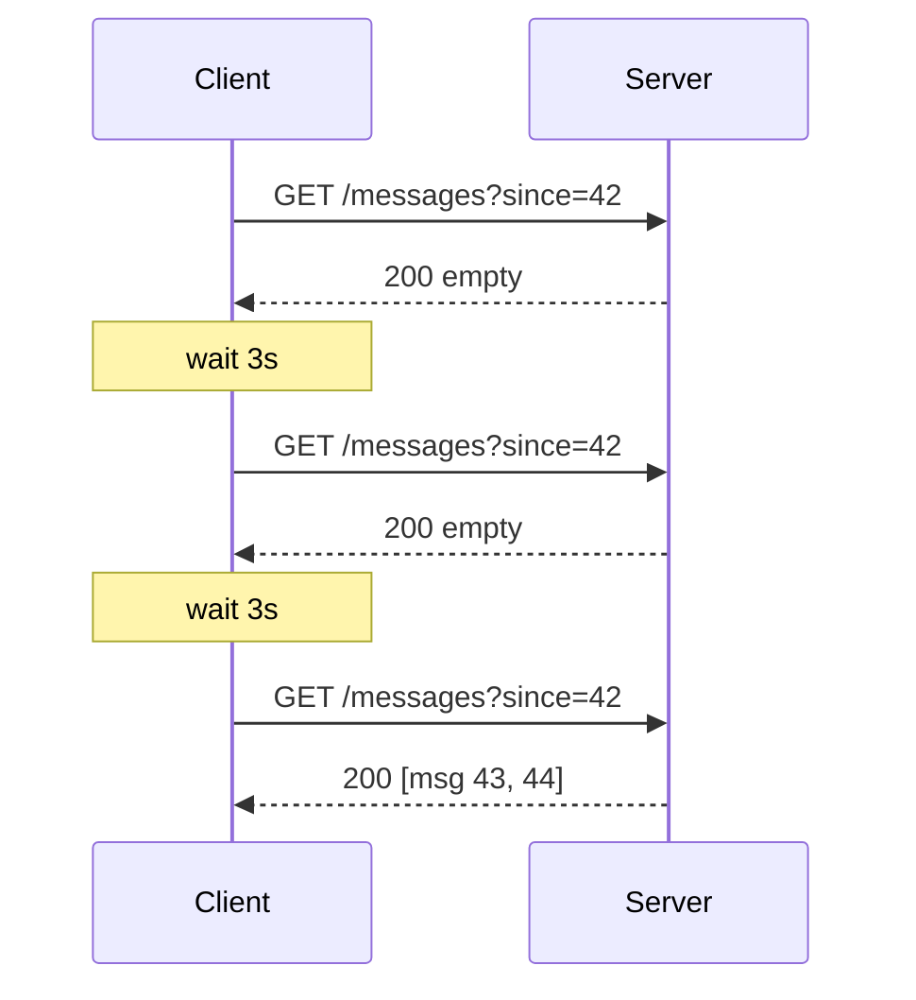

**Pros:** Dead simple, works everywhere, no special infra, stateless, trivially load-balanced.
**Cons:** Latency = poll interval (avg = interval/2). Massive wasted load — 90%+ of requests return empty. At 1M users polling every 3 s = **333k req/s** of mostly-empty traffic.

**Pitfalls.** Tuning the interval is a no-win: short = wasted load, long = high latency. Each request carries full HTTP headers (~500 B–1 KB) — the overhead dwarfs the payload. At 333k req/s × 700 B headers ≈ **230 MB/s of pure header tax** before a single byte of payload.

> **Staff-level insight:** Short polling is almost never the right *primary* transport, but it's an excellent *fallback* and a great choice for low-frequency, latency-tolerant signals (e.g., "check for app update" every 5 min). Don't dismiss it reflexively — say "I'd use it for X but not the hot path." (Altitude: name-and-move-on. Don't spend three minutes here.)

### 2.2 Long polling

**Definition.** The client makes a request; the server *holds it open* until there's data (or a timeout, ~30–60 s), then responds. The client immediately re-requests.

**How it works.** The server parks the request (no busy-wait — it's registered against a pub/sub or condition variable) and replies the instant an event arrives. This is the foundation of "Comet" and the original `socket.io` fallback.

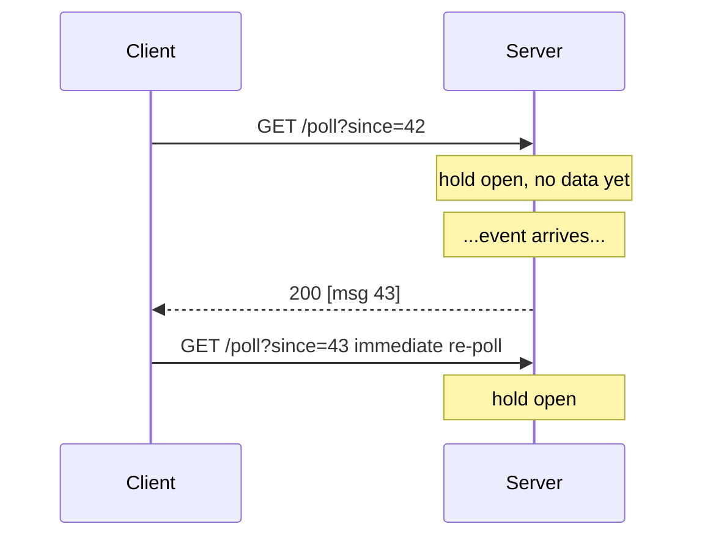

**Pros:** Near-real-time push latency, works through every proxy/firewall (it's just HTTP), no protocol upgrade.
**Cons:** A new TCP/TLS handshake and full HTTP headers per message cycle (unless HTTP keep-alive). The **window between responses** is a gap where messages must be buffered server-side. Ties up a server thread/connection per waiting client (mitigated by async I/O).

**Pitfalls.** The reconnect gap is a real ordering/loss hazard — always use a cursor (`since=`) so the re-poll catches anything that arrived during the gap. Proxies may impose their own idle timeouts shorter than yours, so cap the hold below the tightest known proxy timeout (often 30 s).

> **Staff-level insight:** Long polling is the universal fallback. Even today, when a corporate proxy strips the WebSocket `Upgrade` header, mature clients (Slack, socket.io, SignalR) silently fall back to long polling. In an interview, mentioning a **transport-negotiation/fallback chain** (WS → SSE → long poll) shows production maturity.

### 2.3 Server-Sent Events (SSE)

**Definition.** A long-lived, **unidirectional** (server → client) stream over a single HTTP response that never closes. The server keeps writing `text/event-stream` chunks.

**How it works.** Client opens `new EventSource('/stream')`. Server responds with `Content-Type: text/event-stream` and streams events: `data: {...}\n\n`. The browser auto-reconnects and sends `Last-Event-ID` to resume.

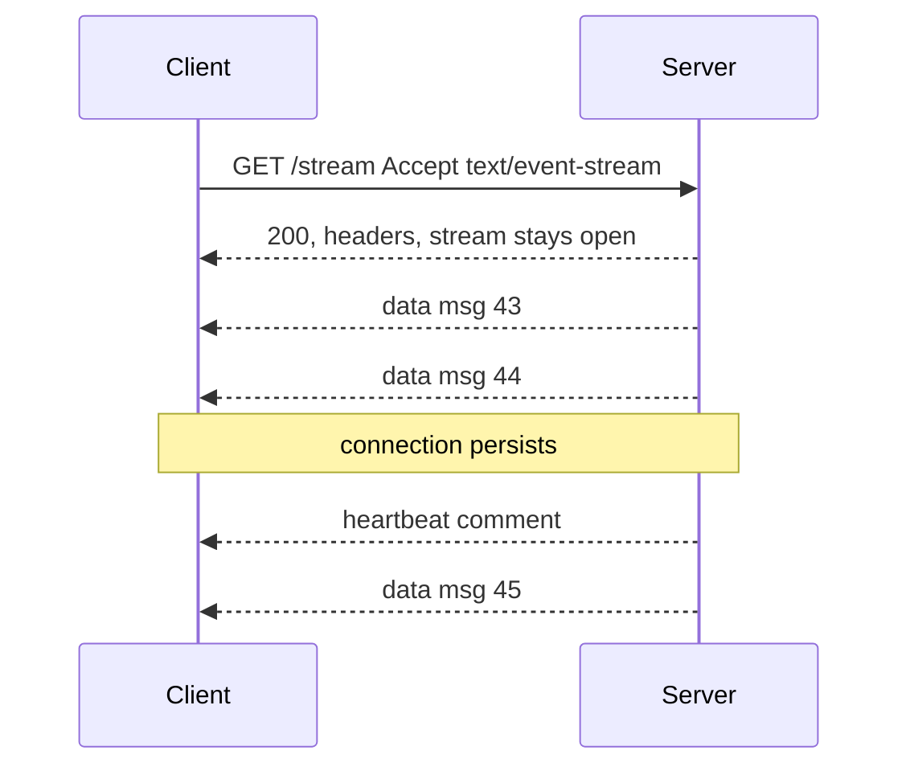

**Pros:** Built into browsers (`EventSource`), **automatic reconnection + event-ID resume for free**, plain HTTP (firewall-friendly), works great over HTTP/2 (multiplexed, no 6-connection limit). Lighter than WebSocket.
**Cons:** **Unidirectional** — client→server still needs separate requests. Text-only (no binary without base64). Under **HTTP/1.1**, browsers cap ~6 connections per domain, so SSE eats one (HTTP/2 fixes this via multiplexing). Limited browser support for custom headers on `EventSource` (auth via cookie or query param).

**Pitfalls.** Without HTTP/2 the 6-connection limit is brutal for multi-tab apps. Proxies that buffer responses will break streaming — must disable buffering (`X-Accel-Buffering: no` on nginx).

| | SSE | WebSocket |
|---|---|---|
| Direction | Server → client only | Bidirectional |
| Protocol | HTTP | ws:// (upgraded HTTP) |
| Auto-reconnect | Built in | DIY |
| Binary | No (text/base64) | Yes |
| Proxy friendliness | High (it's HTTP) | Medium (needs Upgrade) |

> **Staff-level insight:** SSE is criminally underused. For **server-push-dominant** workloads — live feeds, notifications, stock tickers, LLM token streaming, dashboards — SSE is simpler, cheaper, and more robust than WebSocket because reconnection and replay are *free*. Reach for WebSocket only when you genuinely need low-latency *client→server* messages (chat typing, gaming). Saying "I'd use SSE here because the traffic is 95% server→client" is a strong differentiator. **Decision:** SSE *because* the workload is push-dominant; revisit if you start needing frequent low-latency client→server signals.

### 2.4 WebSockets

**Definition.** A full-duplex, bidirectional, persistent TCP connection established by *upgrading* an HTTP connection. After the handshake, both sides send framed messages independently with minimal overhead (2–14 byte frame header).

**How it works.** Covered in depth in [§3](#3-websockets-deep-dive). In short: HTTP `Upgrade: websocket` handshake → connection switches to the WebSocket wire protocol → both sides push frames freely until close.

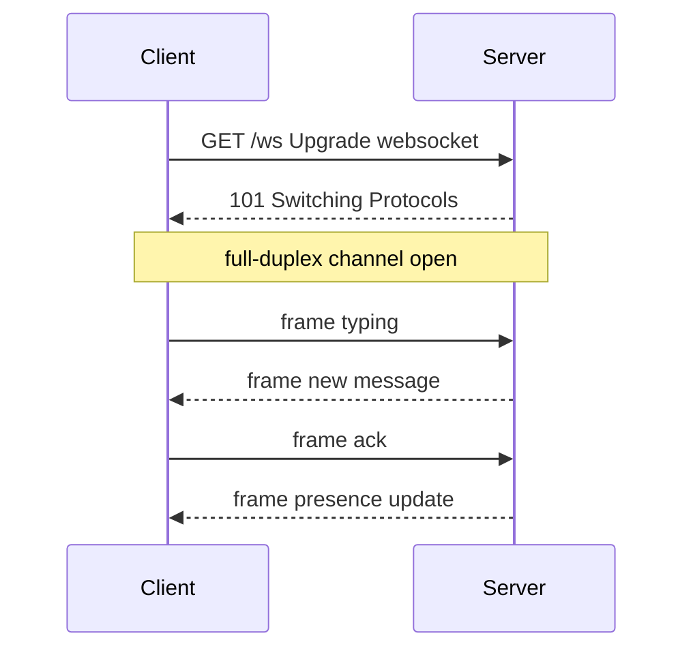

**Pros:** True bidirectional, lowest per-message overhead, lowest latency, binary + text. The standard for chat.
**Cons:** Stateful (pins user to a server), DIY reconnection/heartbeat/replay, harder to load-balance (sticky), some old proxies break the upgrade, connection limits per server require tuning.

> **Staff-level insight:** WebSocket is the right default for *chat* specifically because chat is genuinely bidirectional and latency-sensitive in both directions (typing indicators, read receipts flow client→server constantly). But name the cost: you've traded HTTP's beautiful statelessness for a stateful tier that needs a connection registry, sticky routing, and careful draining. The rest of this module is mostly about paying that bill. **Decision:** WebSocket for the chat hot path *because* it's bidirectional + latency-sensitive both ways; revisit transport only under the triggers in [§0.1](#01-the-decisions-to-make-decisively).

### 2.5 WebTransport

**Definition.** A modern (HTTP/3, QUIC-based) transport offering **bidirectional streams AND unreliable datagrams** over a single multiplexed connection — think "WebSocket + UDP" for the browser.

**How it works.** Built on QUIC (UDP under the hood). Provides multiple independent streams (no head-of-line blocking — a lost packet on one stream doesn't stall others) plus a datagram API for fire-and-forget. Connection migration: survives IP changes (Wi-Fi → cellular) without reconnect.

**Pros:** No head-of-line blocking (each stream independent), **unreliable datagram** mode for latency-critical data (gaming, voice, presence beacons), survives network switches via QUIC connection migration, multiplexed.
**Cons:** Emerging (Chrome/Edge solid, Safari/Firefox lagging as of 2026), requires HTTP/3 + QUIC infra, no universal proxy/middlebox support (UDP often blocked), less tooling.

| | WebSocket | WebTransport |
|---|---|---|
| Transport | TCP | QUIC (UDP) |
| Streams | Single | Many, independent |
| Head-of-line block | Yes (TCP) | No (per-stream) |
| Unreliable mode | No | Yes (datagrams) |
| Network migration | Reconnect | Seamless (QUIC) |
| Maturity (2026) | Universal | Emerging |

> **Staff-level insight:** Don't propose WebTransport as your default — it signals you're chasing shiny tech (an anti-pattern, see [§0.4](#04-top-anti-patterns-the-disqualifiers)). Do mention it as the *forward-looking* answer to two specific WebSocket pain points: **head-of-line blocking** (a single dropped TCP segment stalls *all* messages on a WS connection) and **mobile network switching** (every Wi-Fi↔cellular handoff is a WS reconnect storm). For a chat app where users are on mobile and roaming, QUIC connection migration is genuinely valuable. **Decision:** WebSocket today, WebTransport as the *migration target* — revisit when you have measured roaming-reconnect or HOL-blocking pain at p99, not before (YAGNI, [§0.3](#03-yagni--the-default-and-the-trigger-to-add-complexity)).

### 2.6 MQTT

**Definition.** A lightweight **pub/sub** messaging protocol over TCP (or WebSocket), designed for constrained devices and unreliable networks. Clients connect to a **broker**, publish to / subscribe to **topics**. Detailed in [§4](#4-mqtt-for-iot--mobile).

**Pros:** Tiny overhead (2-byte fixed header), pub/sub decoupling, **QoS levels** (0/1/2), retained messages, last-will, built for flaky mobile/IoT links. Notably, **Facebook Messenger historically used MQTT** to cut battery/latency on mobile.
**Cons:** Needs a broker (HiveMQ, EMQX, Mosquitto, AWS IoT Core), topic-based model is less flexible than arbitrary RPC, QoS 2 is expensive.

> **Staff-level insight:** MQTT's relevance to *chat* (not just IoT) is the Facebook Messenger story: on a high-latency mobile network, MQTT's tiny headers and persistent pub/sub connection delivered messages faster and with less battery drain than HTTP polling. If asked "how would you optimize for low-end Android on 2G in emerging markets," MQTT (or an MQTT-like custom binary protocol, which is what WhatsApp built) is a legitimate, sophisticated answer. **Decision:** MQTT/custom-binary *because* of bytes-on-wire + radio-wakeup battery cost on constrained mobile; default to WebSocket otherwise.

### 2.7 The master comparison table

| Dimension | Short Poll | Long Poll | SSE | WebSocket | WebTransport | MQTT |
|---|---|---|---|---|---|---|
| **Direction** | C→S (pull) | C→S (pull) | S→C only | Bidirectional | Bidirectional | Pub/sub (bi) |
| **Latency** | Poll interval | Low | Low | Lowest | Lowest | Low |
| **Server push** | No (faked) | Faked | Yes | Yes | Yes | Yes |
| **Per-msg overhead** | Full HTTP hdrs | Full HTTP hdrs | Tiny | 2–14 B frame | Small | 2 B header |
| **Connection cost** | None (transient) | 1 held req | 1 stream | 1 socket | 1 QUIC conn | 1 socket |
| **Reconnect/replay** | N/A | Cursor DIY | Built-in (Last-Event-ID) | DIY | DIY | Session + QoS |
| **Binary** | Yes | Yes | No | Yes | Yes | Yes |
| **HOL blocking** | N/A | N/A | TCP | TCP | None | TCP |
| **Firewall/proxy** | Excellent | Excellent | Good | Medium (Upgrade) | Poor (UDP blocked) | Medium |
| **Network migration** | Trivial | Trivial | Reconnect | Reconnect | Seamless | Reconnect |
| **Scaling shape** | Stateless | Semi-stateful | Stateful | Stateful | Stateful | Broker-centric |
| **Best for** | Rare/tolerant signals | Universal fallback | Push-dominant feeds | Chat, collab, games | Future mobile/games | IoT, low-end mobile |

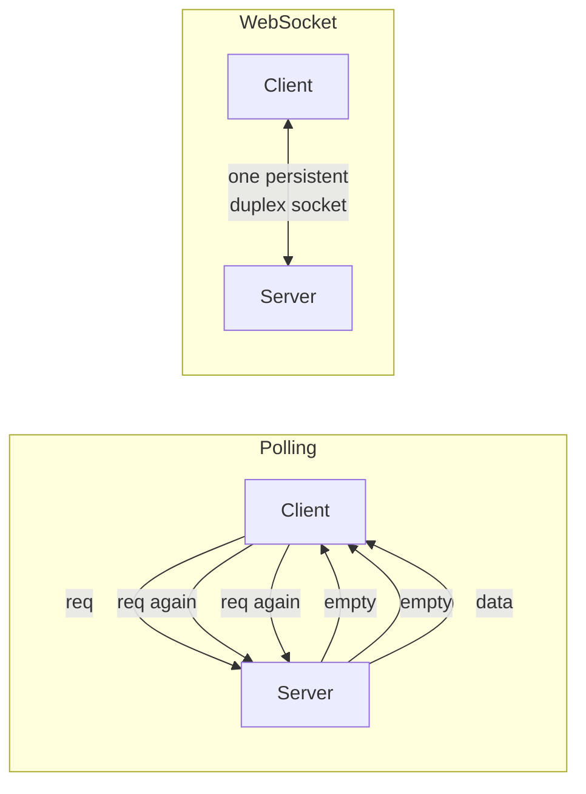

> **Staff-level insight:** The interview-winning move is a **decision tree, not a favorite**: "Is traffic push-dominant? → SSE. Bidirectional + low latency? → WebSocket. Constrained device / flaky mobile? → MQTT. Need it to work through any proxy? → long-poll fallback. Building for the next 5 years on mobile? → eye WebTransport." Then pick WebSocket for the chat hot path and explain the fallback chain. *Decide, don't enumerate.*

---

## 3. WebSockets deep dive

This is the section production-grade real-time infra lives in. Go deep — but with altitude discipline: the handshake is name-and-move-on; the connection density, stateful LB, and draining are the deep-dive crux.

### 3.1 Handshake & frames

> **Altitude cue:** This subsection is *name-and-move-on* material. Know it cold so you can answer a probe, but in the room: "WS is an HTTP `Upgrade` to a `101`, then both sides speak framed messages." One sentence, then move to the registry. Over-explaining the frame format is an [anti-pattern](#04-top-anti-patterns-the-disqualifiers).

**The handshake** is an HTTP/1.1 `Upgrade` that the server answers with `101 Switching Protocols`. After 101, the bytes on the wire are no longer HTTP — they're WebSocket frames.

```
Client →
GET /chat HTTP/1.1
Host: gateway.chat.example.com
Upgrade: websocket
Connection: Upgrade
Sec-WebSocket-Key: dGhlIHNhbXBsZSBub25jZQ==
Sec-WebSocket-Version: 13
Sec-WebSocket-Protocol: chat.v2

Server →
HTTP/1.1 101 Switching Protocols
Upgrade: websocket
Connection: Upgrade
Sec-WebSocket-Accept: s3pPLMBiTxaQ9kYGzzhZRbK+xOo=
```

The `Sec-WebSocket-Accept` is `base64(SHA1(key + GUID))` — it proves the server is a genuine WebSocket endpoint that understood the handshake (stops a non-WS HTTP cache/server from completing the handshake). This is distinct from client-frame masking (below), which prevents cache-poisoning of intermediaries via crafted payloads.

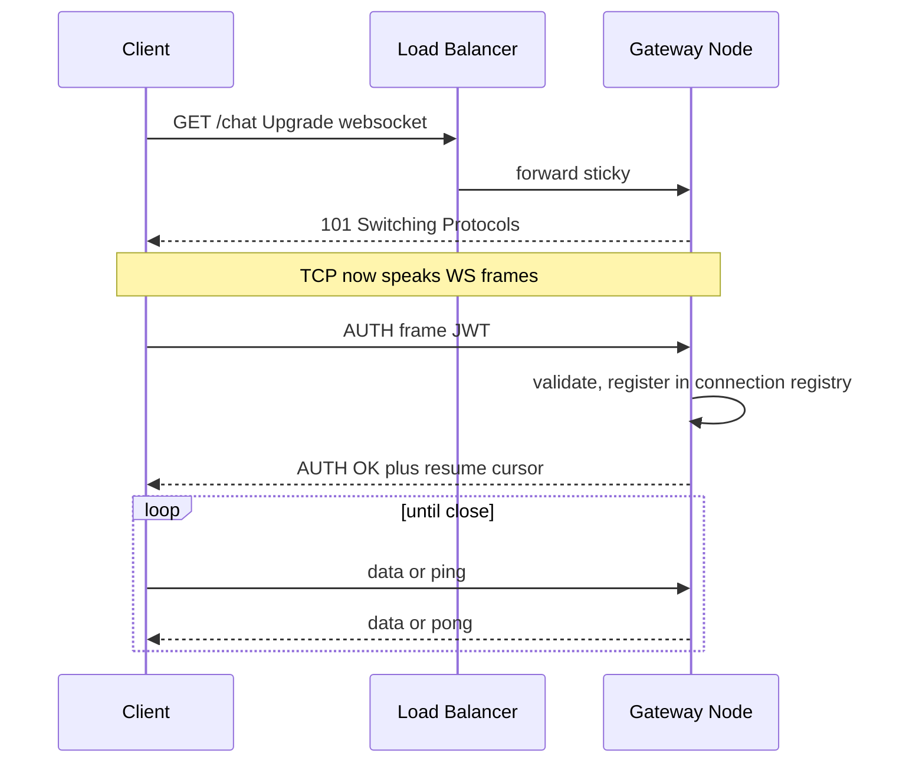

**Frames.** Every message is one or more frames. The 2–14 byte header carries: FIN bit (last frame of message), opcode (text/binary/close/ping/pong/continuation), MASK bit (client→server frames MUST be masked with a 4-byte key, an anti-cache-poisoning measure), and payload length (7 / 7+16 / 7+64 bits — variable to keep small messages cheap).

| Opcode | Meaning |
|---|---|
| 0x0 | Continuation frame |
| 0x1 | Text |
| 0x2 | Binary |
| 0x8 | Close |
| 0x9 | Ping |
| 0xA | Pong |

**Pitfalls.** (1) Browsers don't let you set arbitrary headers on the WS handshake — auth must go via cookie, the `Sec-WebSocket-Protocol` subprotocol field, a query-string token, or a first in-band AUTH frame. (2) Message fragmentation across frames is real — your parser must reassemble. (3) The masking requirement means servers do extra XOR work per client frame. (4) `permessage-deflate` compression saves bandwidth but adds CPU + per-connection memory (~tens of KB of zlib window) — at C10M that memory cost can dominate; often you disable it for chat's small frames.

> **Staff-level insight:** Don't authenticate *only* in the HTTP upgrade — tokens expire while the socket lives for hours. Use a **first in-band AUTH frame with a JWT** so you can re-auth/refresh over the live connection, and a **per-connection idle + max-lifetime cap** (force a re-handshake every N hours) so you can rotate credentials and rebalance load. This is a detail most candidates miss and it shows you've actually operated long-lived connections.

### 3.2 Heartbeats, backpressure & flow control

**Heartbeats (ping/pong).** TCP can keep a socket "open" long after the peer is gone (a half-open connection — phone went into a tunnel). You **cannot trust TCP to tell you a client is dead.** So the server sends a WS `ping` (opcode 0x9) every ~30 s; the client replies `pong`. Miss 2–3 pongs → declare dead, close, free resources, mark offline. The client *also* pings to detect a dead server / dead NAT mapping.

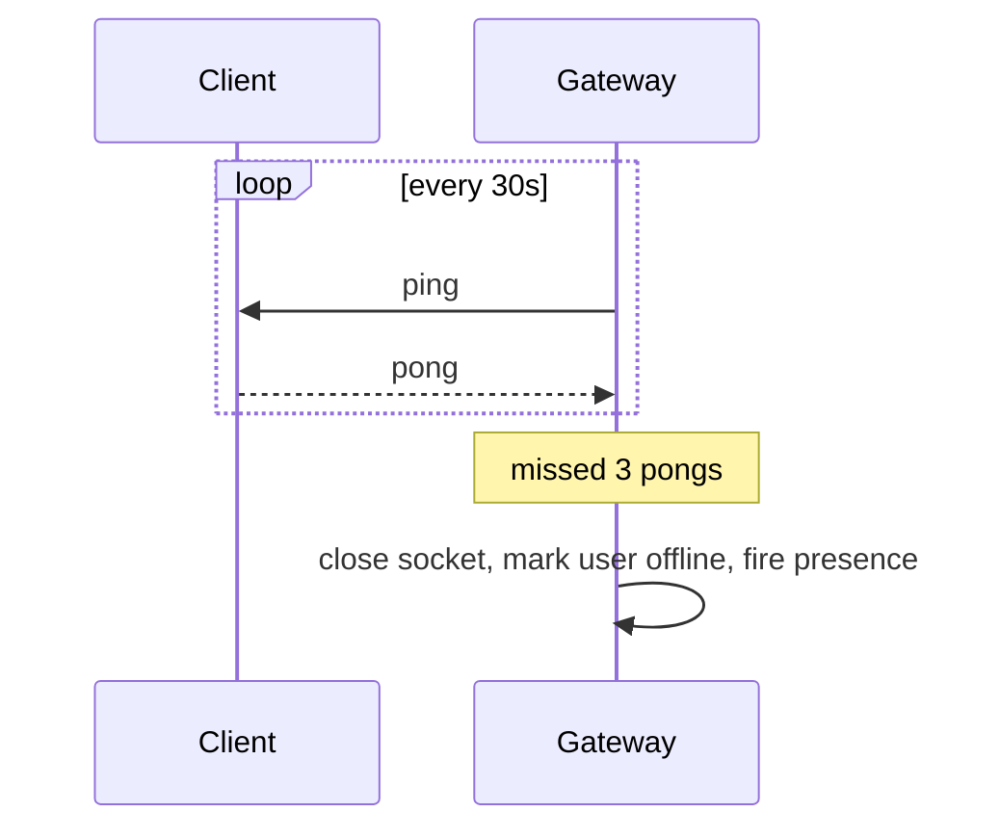

**Why heartbeats also keep NAT alive:** carrier-grade NAT and proxies drop idle mappings after 30–120 s. Without a heartbeat, the connection silently dies. Heartbeats serve double duty: liveness detection *and* keep-alive. This is why mobile clients often ping more aggressively (and why over-aggressive pings drain battery — a real tuning trade-off). **Cost math:** a 30 s heartbeat on 10M connections = ~333k ping/pong round-trips per second of pure liveness traffic — non-trivial, and a reason to push the interval as long as NAT timeouts allow.

**Backpressure.** If the server pushes faster than a slow client (2G phone) can drain, data buffers in the kernel/app send queue. Unbounded buffering = OOM and a cascading failure. **Flow control options:**
- Bound the per-connection send buffer; on overflow, **drop the slow consumer** (close the socket — they'll reconnect and re-sync via cursor).
- **Coalesce/collapse** stale updates: for presence/typing, only the *latest* state matters — drop intermediate values.
- Apply **per-connection rate limits** and shed low-priority traffic first.

| Strategy | Use when | Cost |
|---|---|---|
| Bounded buffer + drop conn | General safety net | Client must resync |
| Coalesce latest-wins | Presence, typing, cursors | Lose intermediate states (fine) |
| Backpressure to producer | Source can slow down | Couples producer to slow consumer |
| Spill to per-user queue | Must not lose msgs | Storage + sync complexity |

> **Staff-level insight (war story):** The classic outage is **one slow consumer taking down a node**: their send buffer grows, GC pressure rises, the event loop stalls, *all* connections on that node suffer. Senior engineers say "we use heartbeats." Staff engineers say "we **bound every send buffer and drop slow consumers**, because availability of the node matters more than the liveness of one degraded client — and chat clients re-sync from a cursor on reconnect anyway, so dropping them is safe." **Decision:** bound + drop *because* node availability beats one client's liveness; revisit only for message types you genuinely cannot lose (then spill to a per-user durable queue).

### 3.3 C10K → C10M: scaling connections

**The C10K problem** (Dan Kegel, 1999): a server handling 10,000 concurrent connections can't use a thread-per-connection model — 10k threads = gigabytes of stack + brutal context-switch overhead. The fix: **event-driven I/O** with the OS readiness-notification syscalls — `epoll` (Linux), `kqueue` (BSD/macOS), IOCP (Windows). One thread (or a small pool = #cores) multiplexes thousands of sockets; the kernel tells you which are ready.

**C10M** (10 million connections) is the modern bar for top-tier chat infra. Getting there:

| Layer | Bottleneck | Fix |
|---|---|---|
| **OS** | File descriptor limit | Raise `ulimit -n`, `fs.file-max` to millions |
| **OS** | Ephemeral port range (outbound) | Widen `ip_local_port_range`; multiple IPs |
| **OS** | Per-conn memory (buffers) | Tune `tcp_rmem`/`tcp_wmem` small for idle chat sockets |
| **App** | Thread-per-conn | epoll/kqueue event loop; async runtime |
| **App** | GC pressure / heap | Compact per-conn state; off-heap buffers; Rust/Go/C++ |
| **Hardware** | NIC interrupts | RSS / multi-queue NIC, IRQ affinity |

**Per-server connection limit** is governed mostly by **memory**, not CPU, for idle chat connections. Rough math: each idle WebSocket costs ~tens of KB (socket buffers + app state). At ~30–50 KB/conn, a 64 GB box holds ~1–2M idle connections *if* the app is lean (this is why WhatsApp famously ran ~2–3M connections per server on FreeBSD with Erlang). At a real-time chat platform scale you might budget more conservatively — **300k–1M per node** — to leave headroom for message throughput, GC, and failover absorption.

**Worked capacity example.** Suppose 10M concurrent users, each on one device, target 50 KB/conn lean state, 64 GB nodes. Theoretical max ≈ 64 GB / 50 KB ≈ 1.3M/node → ~8 nodes. But you **never run there**: cap at ~600k/node for message-CPU + GC + failover headroom → ~17 nodes, then add ~20% spare so losing 2–3 nodes doesn't cascade → **~20 nodes**. Multi-device (avg 1.8 connections/user) pushes connection count to 18M → **~30 nodes**. *Show this derivation, not a memorized number.*

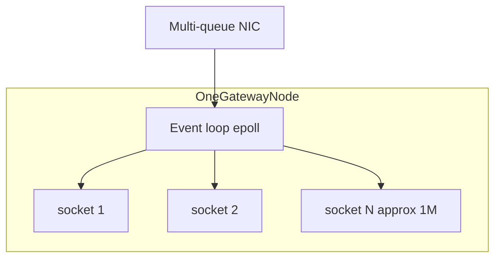

**Tech that nails this:** Erlang/Elixir (Phoenix Channels — 2M+ connections demonstrated on one box), Go (goroutines + netpoller), Rust (tokio), Node.js (libuv/epoll, but single-threaded CPU ceiling), C++ (uWebSockets — extremely high density).

> **Staff-level insight:** Don't quote a connection-per-server number as gospel — derive it (an [anti-pattern](#04-top-anti-patterns-the-disqualifiers) is the memorized number). Say: "Idle chat sockets are *memory*-bound, ~30 KB each, so a 64 GB node *could* hold ~2M, but I'd cap at ~500k–800k to leave headroom for (a) message-processing CPU, (b) GC pauses, and (c) **failover absorption** — if a neighbor node dies, its connections stampede onto survivors, so each node must hold its own load *plus a share of a dead node's*. Capacity planning for the failure case, not the steady state, is the staff-level distinction."

### 3.4 Load-balancing stateful connections

A WebSocket pins a user to **one specific gateway node** for the connection's lifetime. This breaks the stateless-LB model from [Load Balancing](05-load-balancing.md). Two questions arise:

**(A) How does the LB route the upgrade request?**
- **L4 (TCP) load balancing** is ideal for WS: the LB just forwards TCP and stays out of the way after the handshake. AWS NLB, HAProxy in TCP mode, IPVS. Connection-oriented hashing keeps a flow on one backend naturally.
- **L7 (HTTP) load balancing** can inspect the `Upgrade` header and route (AWS ALB, nginx, Envoy) — needed if you route by path/subprotocol, but it terminates and proxies, adding a hop.
- **Sticky routing** isn't strictly needed *during* a connection (the TCP flow stays put), but matters on **reconnect** — ideally land back on a node that already has your session warm, or any node that can rehydrate from the registry.

**(B) How does a message for user X find X's node?** — This is the **connection registry** problem; see [§5.2](#52-connection-registry--session-store). The LB does NOT solve this; you need a separate routing layer.

| LB approach | Pros | Cons |
|---|---|---|
| **L4 / NLB** | Cheap, transparent, low latency, huge scale | No header-based routing, no TLS termination here |
| **L7 / ALB / Envoy** | Path/subprotocol routing, TLS, observability | Extra hop, lower per-node density |
| **DNS / client-side** | Pin region/shard at connect | Stale on topology change |
| **Consistent hashing** | Predictable node for a user | Rebalancing on scale events disrupts conns |

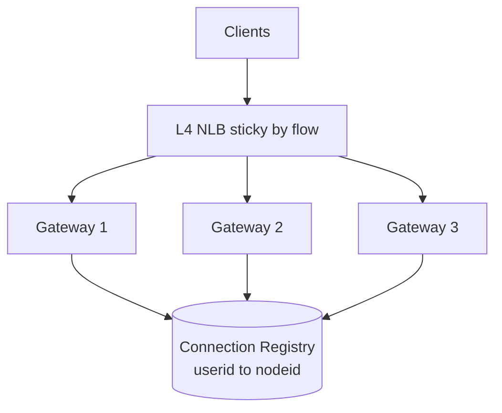

> **Staff-level insight:** A subtle but important point — and the **#1 disqualifier** if you miss it ([§0.4](#04-top-anti-patterns-the-disqualifiers)): **LB stickiness and message routing are two different problems and people conflate them.** Stickiness gets *X's upgrade request* to *some* node and keeps it there. But when *Y sends a message to X*, Y's node has no idea where X is — that's solved by the **registry + pub/sub backplane**, completely independent of the LB. State this separation explicitly; it's a common interview trap. **Decision:** L4/NLB for the upgrade *because* it's transparent and high-density; registry + backplane for routing — never sticky-session-only.

### 3.5 Graceful deploys & connection draining

The hardest operational problem in real-time systems — and an [earmarked crux](#02-altitude--where-to-go-deep-where-to-move-on). You have 2M live sockets across 100 nodes and you need to ship code. A naive deploy kills 2M connections at once → **reconnect storm** (thundering herd) → registry write storm + auth stampede + presence flap → possible cascading outage.

**Connection draining playbook:**

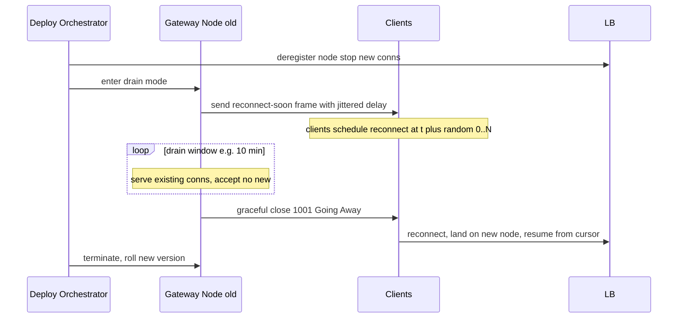

**Key techniques:**
1. **Slow drain** — deregister from LB, then let connections migrate over a long window (5–30 min), not instantly.
2. **Server-initiated reconnect with jitter** — send clients a "please reconnect within the next N seconds, at a random offset" signal. **Jitter is everything** — without it, all clients reconnect simultaneously = the storm you were avoiding.
3. **Rolling, not all-at-once** — drain a small % of fleet at a time; never more capacity than survivors can absorb.
4. **Capacity headroom** — survivors must have room for drained connections (ties back to the failover budget in §3.3).
5. **Fast re-sync** — clients reconnect with a **cursor/last-seen-id**, so the new node serves only the gap, not the whole history.
6. **Idempotent re-registration** — registry writes on reconnect must be cheap and idempotent.

> **Staff-level insight (signature question + war story):** "How do you deploy without dropping 2M connections?" is a *signature* staff real-time question. The winning answer has three pillars: **(1) drain slowly over a long window, (2) reconnect with jitter + backoff to defeat the thundering herd, (3) resume from a cursor so reconnects are cheap.** Then add the operational kicker: "I'd run a **continuous low-rate connection-rotation** in steady state — forcing, say, 1% of connections to reconnect every few minutes — so the reconnect path is *always* warm and battle-tested, and a full deploy is just a louder version of normal. You never want your disaster-recovery path to be code that only runs during disasters." This is the [recovery-storm framing](#05-experience-hooks--chat-infra-war-stories-to-deploy) — lead with it.

---

## 4. MQTT for IoT & mobile

**Definition.** MQTT (Message Queuing Telemetry Transport) is a lightweight publish/subscribe protocol over TCP. Clients connect to a **broker**; they **publish** messages to **topics** (hierarchical strings like `chat/room/42/messages`) and **subscribe** to topic filters (`chat/room/+/messages`, `chat/#`). The broker handles routing — publishers and subscribers never know each other.

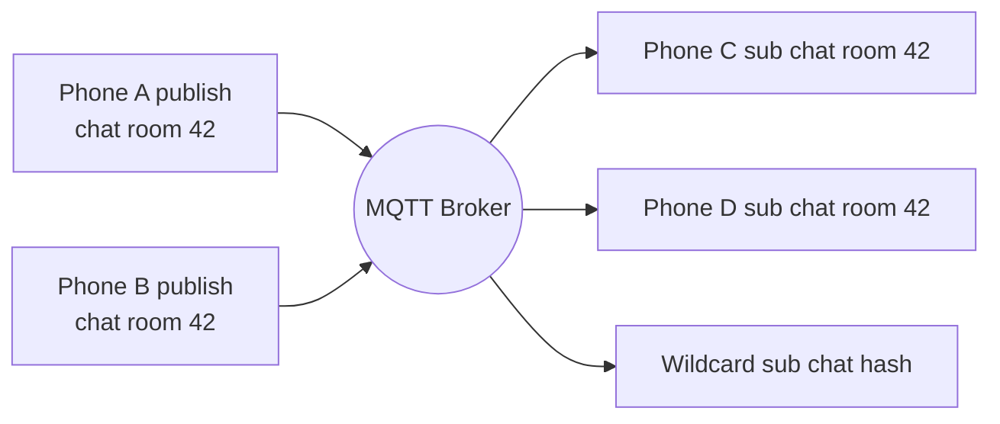

**QoS levels** — the delivery-guarantee dial:

| QoS | Name | Guarantee | Handshake | Use when |
|---|---|---|---|---|
| **0** | At most once | Fire-and-forget, may lose | PUBLISH only | Frequent telemetry, presence beacons |
| **1** | At least once | No loss, may duplicate | PUBLISH → PUBACK | Most chat messages |
| **2** | Exactly once | No loss, no dup | 4-way: PUBLISH→PUBREC→PUBREL→PUBCOMP | Billing, critical commands |

**Other MQTT primitives:**
- **Retained message:** broker stores the *last* message on a topic; new subscribers get it immediately on subscribe. Perfect for "current state" (e.g., a device's last status, a channel's current topic).
- **Last Will & Testament (LWT):** client registers a message at connect time that the broker publishes *if the client dies ungracefully* (missed keep-alive). **This is presence for free** — set LWT to "user offline" and the broker announces a crash automatically.
- **Keep-alive:** client declares a keep-alive interval; broker expects a PINGREQ within 1.5× that or considers it dead (fires LWT).
- **Persistent sessions (`cleanSession=false`):** broker queues QoS 1/2 messages for an offline subscriber and delivers on reconnect — built-in offline queue.

**Brokers:** EMQX, HiveMQ, Mosquitto (light), VerneMQ, AWS IoT Core. Top brokers cluster to millions of connections.

> **Staff-level insight:** MQTT gives you, *out of the box*, four things you'd otherwise hand-build for chat: **QoS-based at-least-once delivery, offline message queueing (persistent sessions), presence (LWT + keep-alive), and current-state replay (retained messages).** The reason WhatsApp/Messenger gravitated to MQTT-like protocols on mobile is the **header efficiency** — 2 bytes vs HTTP's hundreds — which directly cuts radio wake-ups and battery drain on cellular. If an interviewer asks about emerging-market / low-end-device optimization, MQTT is the credible expert answer. **The caveat to state (decisively):** MQTT's topic model is rigid, so most large-scale chat apps eventually build a *custom* binary protocol with MQTT's ideas rather than vanilla MQTT — don't default to MQTT for a general chat backend, reach for it under the low-end-mobile trigger.

---

## 5. Connection / gateway architecture

Now we assemble the system. This is the heart of the module and the [#1 deep-dive crux](#02-altitude--where-to-go-deep-where-to-move-on) — spend your interview minutes here.

### 5.1 The gateway tier

**Definition.** A horizontally-scaled tier of **stateless-as-possible edge nodes** whose only job is to (a) hold WebSocket/long-poll connections, (b) authenticate, (c) translate between the wire protocol and internal messages, and (d) push to/pull from the backend. The gateway holds connection *state* but minimal *business* state — business logic lives behind it.

**Why separate the gateway from business services?** Different scaling axes. Gateways scale with **connection count** (memory-bound). Business services scale with **message throughput / DB load** (CPU/IO-bound). Decoupling lets you scale each independently, deploy business logic without dropping connections, and keep the connection tier dumb, fast, and stable.

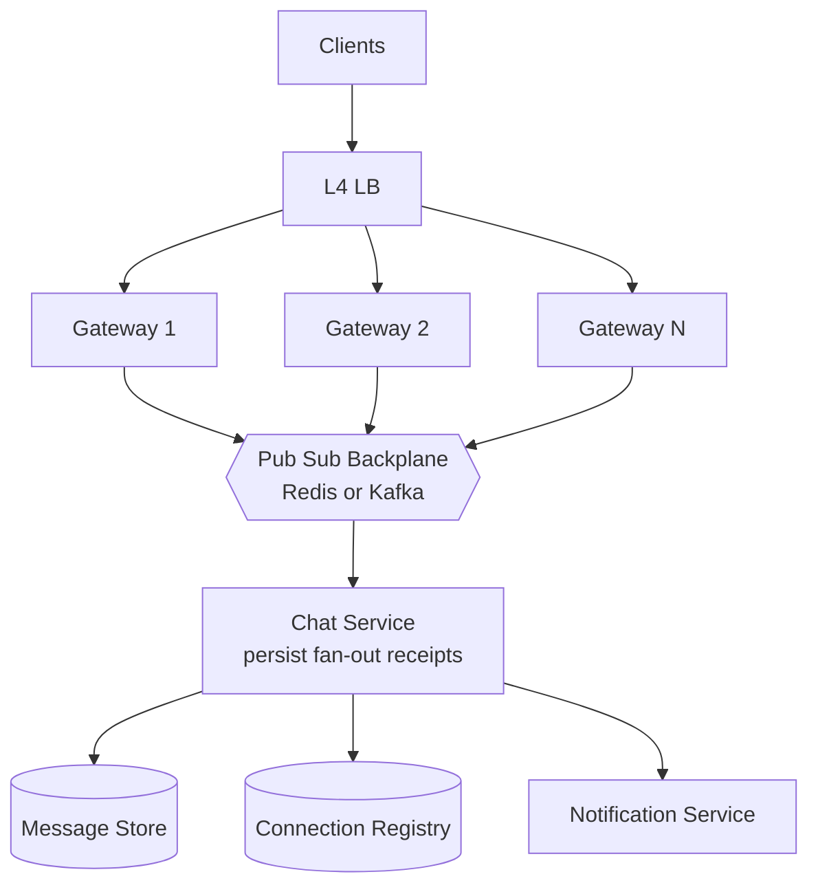

> **Staff-level insight:** The gateway/business split *because* connection-count scaling and message-throughput scaling are different axes — and critically, it lets you ship business logic **without dropping a single socket** (you only drain the gateway tier on gateway deploys, which are rare). That decoupling is what makes the [reconnect-storm problem](#35-graceful-deploys--connection-draining) tractable: most deploys never touch the connection tier at all.

### 5.2 Connection registry / session store

**Definition.** The authoritative map of **which gateway node currently holds which user's connection(s)**. Given `userId` (and `deviceId`), it answers "which node, so I can route a message there?" This is *the* real system in real-time — earmark it as the hard part out loud.

**Implementation options:**

| Approach | How | Pros | Cons |
|---|---|---|---|
| **Redis hash + TTL** | `SET conn:user:123 = node-7` with TTL, refreshed by heartbeat | Simple, fast, TTL self-heals stale entries | Single registry = SPOF (cluster it); write load |
| **Redis Pub/Sub per node** | Each node subscribes to `node:7`; sender publishes to the node channel | No central lookup race; backplane doubles as transport | Pub/sub is fire-and-forget (no persistence) |
| **Consistent hashing** | `node = hash(userId) % ring` — no registry lookup at all | Zero lookup, deterministic | Rebalancing on scale/failure moves users |
| **Gossip / service mesh** | Nodes gossip membership; route via mesh | Decentralized, resilient | Complex, eventual consistency |
| **Kafka-partitioned** | User → partition → consumer node | Ordered, durable, replayable | Higher latency than Redis |

**TTL + heartbeat pattern (most common, my default):** on connect, the gateway writes `conn:user:123 → {node, deviceId}` with a 60 s TTL and refreshes it every 30 s via the heartbeat. If the node dies, the key expires and the user is naturally seen as offline — **self-healing without explicit cleanup.**

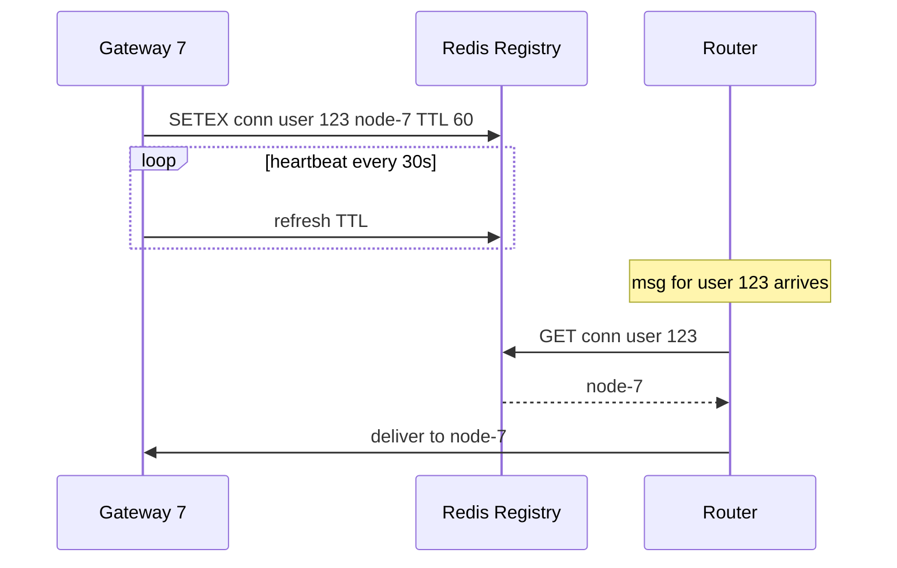

**The crux: the dead-node window.** There's a window after a node crash where the registry still points at the dead node (TTL not yet expired) and messages routed there are dropped. This is real and unavoidable with a TTL registry. You **accept** it because the alternative — strongly-consistent registration via consensus — is far slower, and at-least-once retry + client cursor resync *catches the gap anyway*. Naming this window and why you accept it is the single highest-leverage staff move in this section.

> **Staff-level insight:** Multi-device makes the registry a **one-to-many** map: `user:123` → `[{node-7, phone}, {node-12, web}, {node-3, desktop}]`. Every message fans out to *all* devices, and the registry stores a set per user, not a single value. Also call out the **consistency vs simplicity** trade-off: a TTL-based registry is *eventually* consistent — there's the dead-node window above. **Decision:** Redis TTL + heartbeat registry *because* it self-heals and is sub-ms; revisit toward consensus only if you have a hard no-drop requirement that cursor-resync can't satisfy (you almost never do).

### 5.3 Routing & fan-out

Two backplane choices to move a message from the sender's node to the recipient's node:

**Redis Pub/Sub backplane (my default for the live hop)** — each gateway subscribes to its own channel (`node:7`). To deliver to user X: look up X's node in the registry → publish to that node's channel → the owning node pushes down the socket. Low latency (~sub-ms), simple. Downside: **fire-and-forget, no durability, no replay** — if the message is lost in flight, it's gone (mitigated by persisting in the chat service before fan-out).

**Kafka backplane** — messages go to a topic partitioned by conversation or user; gateway nodes consume their partitions. Durable, ordered per partition, replayable. Downside: higher latency than Redis, more operational weight. Often used for the **persistence + fan-out pipeline** while Redis pub/sub handles the **live-delivery hop**.

**Common hybrid (the right default):** Kafka (or Redis Streams) for the durable write log and async fan-out; Redis pub/sub for the last-hop live push. Persist first (durability), then deliver live (speed).

| Backplane | Latency | Durable | Ordered | Replay | Best for |
|---|---|---|---|---|---|
| Redis Pub/Sub | Lowest | No | No | No | Last-hop live delivery |
| Redis Streams | Low | Yes | Yes | Yes | Durable + fast |
| Kafka | Higher | Yes | Per partition | Yes | Durable log, async fan-out |
| NATS / JetStream | Low | Optional | Yes | Yes | Cloud-native middle ground |

> **Staff-level insight (anti-pattern alert):** The principle to articulate: **persist before you fan out.** The chat service writes the message to durable storage (and assigns its conversation sequence number) *before* the live fan-out hop. That way, even if the Redis pub/sub delivery is lost, the message exists, the recipient's reconnect/cursor-sync will pick it up, and delivery is at-least-once. The live hop is an *optimization for latency*, not the *source of truth*. Candidates who make Redis pub/sub the durability layer have a data-loss bug ([§0.4](#04-top-anti-patterns-the-disqualifiers)); saying "pub/sub is best-effort delivery on top of a durable log" is the correct staff framing. **Decision:** Redis pub/sub last-hop *because* sub-ms latency; durable Kafka/Streams log underneath *because* persist-before-fan-out is non-negotiable.

### 5.4 Full message path

Here is the canonical end-to-end path the interviewer wants drawn — sender → recipient, through every tier. **If you can draw this one diagram and narrate every arrow's decision, you've shown you can design the system.**

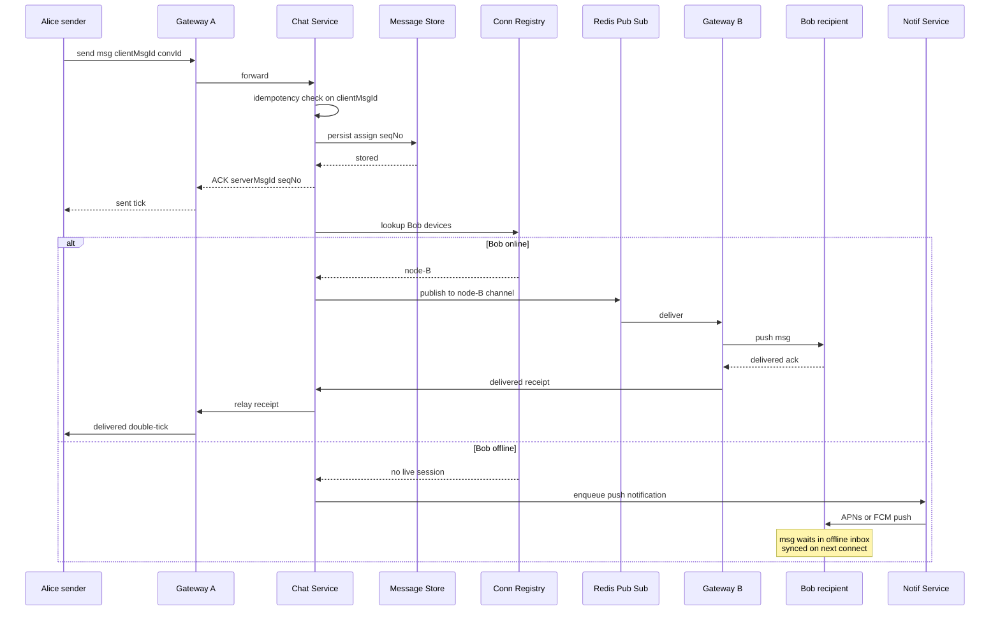

> **Staff-level insight:** Walk this diagram top-to-bottom in the interview and narrate the *decisions* at each fork: (1) **ACK to sender comes from persistence, not from delivery** — "sent" means "durably stored," and that's what lets you show the single tick reliably. (2) The **online/offline fork** in the chat service is *the* central decision point — online → socket via backplane, offline → push notification + inbox. (3) **Receipts flow back through the same path in reverse.** If you can draw this one diagram cleanly and explain every arrow, you've demonstrated you can design the system. This is the artifact to anchor the whole interview on.

---

## 6. Presence systems

An [earmarked crux](#02-altitude--where-to-go-deep-where-to-move-on) — and the #1 place naive designs die at scale.

**Definition.** Presence is the *ephemeral* state of a user's availability: **online / offline**, **last seen** timestamp, and **typing** indicators. It's "soft state" — lossy, high-churn, and cheap-to-reconstruct, which fundamentally changes how you store it (in-memory/Redis with TTL, *not* the durable message DB).

**Online/offline + last seen — TTL key pattern.**
- On connect / on each heartbeat: `SETEX presence:user:123 "online" 60` (refreshed every 30 s).
- If heartbeats stop (crash, network drop), the key **expires** → user is offline. The *last write time* becomes "last seen."
- No explicit "go offline" message needed — expiry handles the unhappy path. (Send one on graceful disconnect for snappiness.)

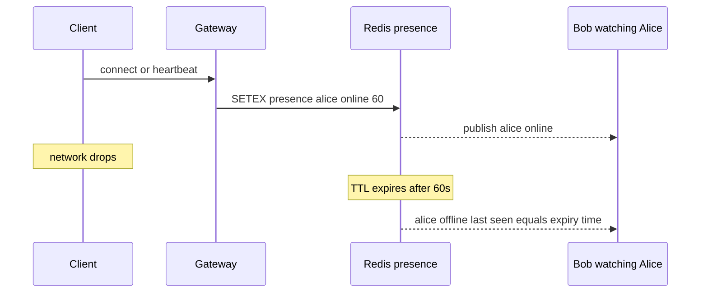

**Typing indicators — debouncing.** Typing is the highest-churn presence signal — a keystroke could fire an event. **Never send per-keystroke.** Pattern: client sends `typing-start` once, then **throttles** (e.g., at most one refresh every 3–5 s while typing continues), and sends `typing-stop` (or lets a short server-side TTL auto-expire the indicator after ~5 s of silence). Typing events are **QoS 0 / fire-and-forget** — losing one is invisible; they never persist.

**The fan-out cost problem.** This is the heart of presence at scale. When Alice comes online, *everyone watching Alice* must be told. Cost = `presence_changes × average_watchers`.
- For a user with 5,000 contacts who has the app open, one online/offline flip = up to 5,000 fan-out pushes.
- In a **100,000-member group/server (Discord-style)**, a single member's presence change naively fans out to 100k clients. A flapping connection (mobile in/out of a tunnel) multiplies this into a storm.
- **Worked cost:** 1M users, each flapping on average twice a minute on mobile, average 200 watchers each → 1M × 2/60 × 200 ≈ **6.7M presence pushes/sec** if naive. Subscribe-on-view (watch ~20 visible contacts, not 200) + debounce (cut flaps 10×) drops this ~100× to a manageable level. *This is why the mitigations below aren't optional.*

**Mitigations:**

| Technique | How | Trade-off |
|---|---|---|
| **Subscribe on view** | Only fetch presence for contacts currently *visible on screen* | Most contacts never watched; huge savings |
| **Pull not push** | Client polls presence for visible contacts every N s | Slightly stale; far cheaper than push fan-out |
| **Debounce flaps** | Wait 30–60 s before broadcasting "offline" | Hides brief disconnects; small staleness |
| **Coalesce/batch** | Batch many presence deltas into one update per tick | Lower fan-out volume; small latency |
| **Aggregate for big groups** | Show "1.2k online" count, not per-member dots | Lose per-member precision (acceptable) |
| **Tiered precision** | Exact presence for DMs/small groups, sampled/counted for huge ones | Complexity |

> **Staff-level insight (war story + anti-pattern):** Presence is where naive chat designs *die at scale*, and interviewers know it. The killer line: **"Presence is a fan-out amplification problem, not a storage problem — and the cheapest update is the one you never send."** Lead with **subscribe-on-view + pull-for-visible** to cut fan-out by orders of magnitude (a user has 5k contacts but sees ~20 on screen), **debounce offline** to absorb mobile flapping ([the thundering-herd war story](#05-experience-hooks--chat-infra-war-stories-to-deploy)), and for massive groups **switch from per-member presence to an aggregate count.** The disqualifier to avoid: presence fan-out for huge groups without debounce ([§0.4](#04-top-anti-patterns-the-disqualifiers)). Then name the explicit trade-off: presence is **eventually consistent by design** — you accept a few seconds of staleness because *strong* presence consistency would cost more than the feature is worth. WhatsApp's "last seen" being slightly stale isn't a bug; it's the correct cost decision. **Decision:** subscribe-on-view + debounce + aggregate-for-huge-groups *because* fan-out amplification is the binding constraint; revisit toward exact per-member presence only for DMs and small rooms.

---

## 7. Push notifications

**Definition.** When the recipient is **offline** (no live socket), you can't push down a connection — you hand the message to the OS-level push services, **APNs** (Apple Push Notification service) and **FCM** (Firebase Cloud Messaging, Android/web), which wake the device and display/deliver the payload.

**Token registration flow.** The app registers with the OS push service → receives a **device token** (APNs) / **registration token** (FCM) → uploads it to your backend, associated with `userId + deviceId`. Tokens **rotate** (app reinstall, OS update, time) — you must handle token refresh and **prune dead tokens** via provider feedback.

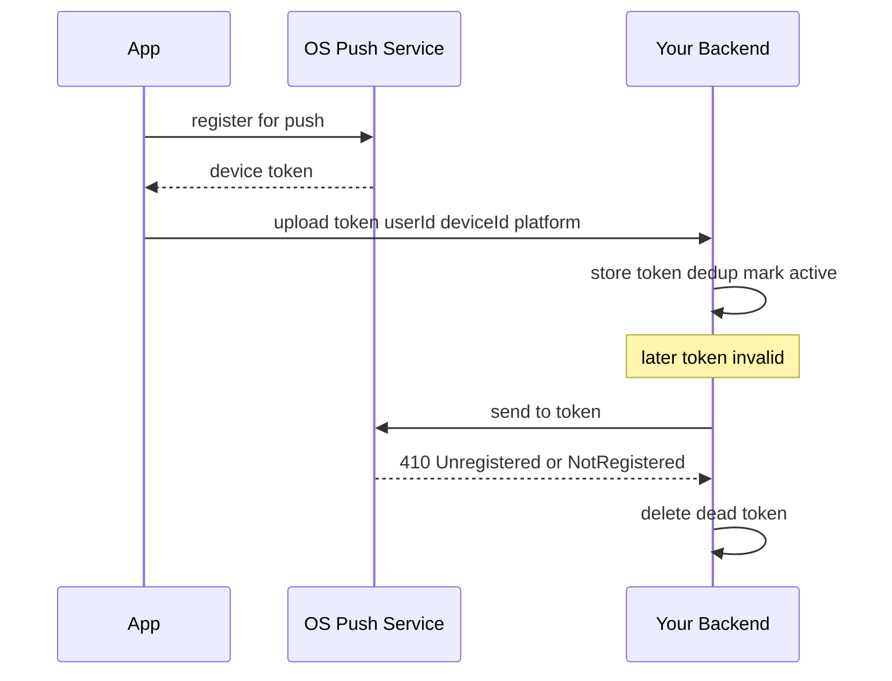

**The notification decision/fan-out service.** The brain of delivery — for each recipient device it decides the channel:

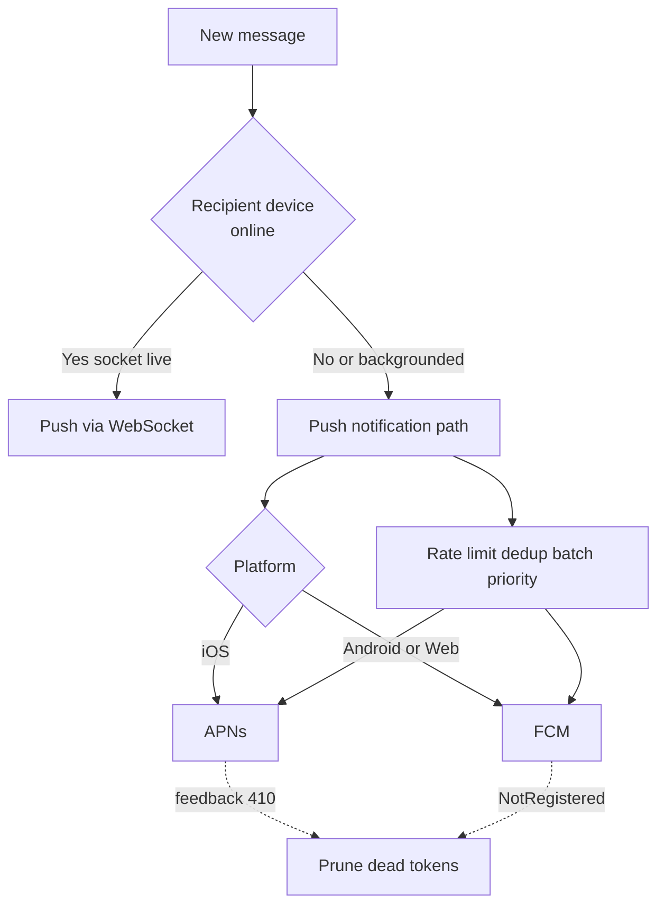

**Payload & delivery.** APNs uses HTTP/2 with token-based auth (JWT, `.p8` key) — persistent multiplexed connections, high throughput. FCM offers HTTP v1 API. Payloads are small (APNs ≤ 4 KB) — send a *notification hint*, not the full message; the app fetches/syncs the real content on open. **Silent/background pushes** (`content-available`) can wake the app to sync without showing UI (rate-limited by the OS — Apple throttles silent pushes aggressively, ~2-3/hour budget, so you can't rely on them for timely delivery).

**Production controls the pipeline must implement:**

| Control | Why | How |
|---|---|---|
| **Batching** | Provider throughput, cost | Batch sends to APNs/FCM; collapse multiple msgs into "3 new messages" |
| **Rate limiting** | Don't spam user/device; respect provider limits | Per-user/per-device caps, token-bucket |
| **Dedup** | Same msg via multiple paths (online + push race) | Idempotency key (msgId) per device |
| **Priority** | DM/mention > group chatter | High-priority pushes bypass batching |
| **Collapse keys** | Replace stale notifs (FCM `collapse_key`, APNs `apns-collapse-id`) | "You have 5 messages" supersedes "4 messages" |
| **Provider failover** | APNs/FCM outage | Retry, queue, alternate channels (SMS/email for critical) |
| **Quiet hours / prefs** | UX | Per-user notification settings, DND windows |

> **Staff-level insight (anti-pattern alert):** Three details elevate the answer. **(1) The online↔push race:** a message can arrive *just as* the user backgrounds the app — you may push to both socket and notification. Dedup with a per-device `msgId` so the user never sees a duplicate. **(2) Push is unreliable best-effort** — APNs/FCM give no hard delivery guarantee, so push is a *wake-up nudge*, and the **durable inbox sync on app open is the real delivery mechanism.** Never treat "sent to APNs" as "delivered" ([§0.4](#04-top-anti-patterns-the-disqualifiers)). **(3) Notification collapsing** (`apns-collapse-id` / FCM `collapse_key`) is how WhatsApp shows "7 messages" instead of 7 buzzes — essential for both UX and battery. State that push is the *signal*, the inbox is the *source of truth*, and you've shown you understand the real architecture. **Decision:** push as best-effort wake-up + inbox as source of truth *because* providers give no delivery guarantee.

---

## 8. Chat systems core

### 8.1 Delivery semantics (sent / delivered / read)

The three-state lifecycle and its UI (the famous ticks):

| State | Meaning | Trigger | UI (WhatsApp) |
|---|---|---|---|
| **Sent** | Durably stored on server | Server persists + assigns seqNo, ACKs sender | Single grey tick |
| **Delivered** | Reached recipient's device | Recipient's client ACKs receipt | Double grey tick |
| **Read** | Recipient opened the conversation | Recipient app fires read receipt | Double blue tick |

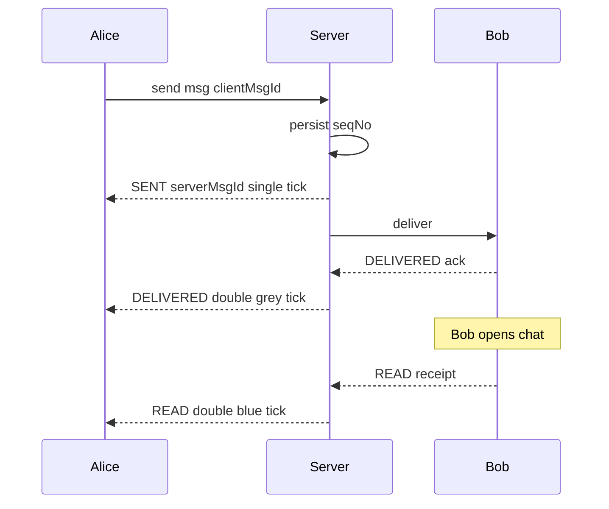

**Implementation notes.** Each transition is itself a small message routed back to the sender via the same gateway path. Receipts are **batchable** (don't send a read receipt per message — send "read up to seqNo N"). Read receipts are often **privacy-toggleable** (and reciprocal — if you disable yours, you don't see others').

> **Staff-level insight:** The crisp definitions are what matter: **Sent = durably persisted (server-side fact), Delivered = on recipient's device (client ACK), Read = recipient viewed (client signal).** The non-obvious staff point: **"sent" must be backed by persistence, not by fan-out success** — otherwise a delivery failure looks like a send failure to the user. And **collapse receipts**: "read up to seqNo N" in one message instead of N receipts, or your receipt traffic in a busy group exceeds your message traffic (in a 50-person group, naive per-message read receipts = 50× the message volume just in receipts — a real production hot spot).

### 8.2 Message ordering (per conversation)

An [earmarked crux](#02-altitude--where-to-go-deep-where-to-move-on) — one decision (conversation-scoped seqNo) cleanly solves ordering, gap-detection, *and* multi-device consistency.

**The guarantee that matters:** messages within a *single conversation* appear in the **same order for all participants**. You do *not* need a global total order across all conversations (impossibly expensive) — only **per-conversation ordering**.

**Mechanism: a per-conversation sequence number.** The server, on persisting a message, assigns a **monotonically increasing seqNo scoped to the conversation** (the conversation is the ordering domain / partition key). Clients render by seqNo. This gives a clean total order per conversation without global coordination.

| Approach | How | Trade-off |
|---|---|---|
| **Server seqNo per conversation** | Single authority per conv assigns increasing int | Simple, total order; conv is the serialization point |
| **Logical/Lamport clocks** | Each event carries a logical counter | Decentralized; only partial order, ties need tiebreak |
| **Hybrid Logical Clocks (HLC)** | Physical + logical for causal + wall-clock-ish | Multi-master, causality-aware; more complex |
| **Client timestamps** | Order by device clock | **Broken** — clock skew, never trust client time for order |

**Why conversation = partition key:** route all messages for conversation C through one ordering authority (one DB partition / one Kafka partition / one actor). That serializes writes for C → clean seqNo, no cross-shard coordination. Different conversations are independent and parallel.

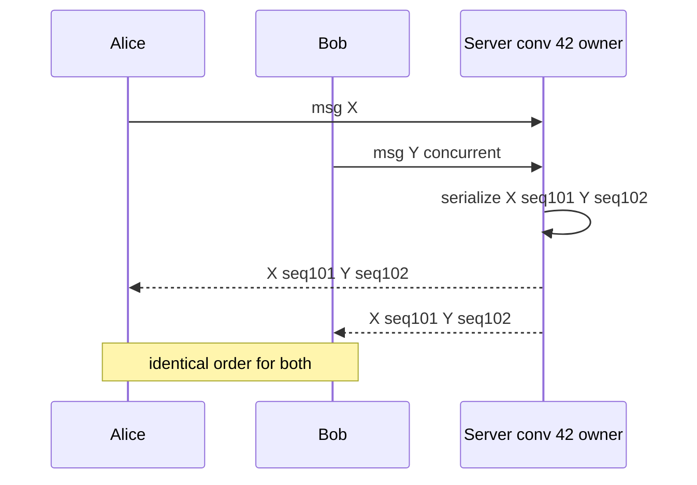

> **Staff-level insight (anti-pattern alert):** Say the magic words: **"I need per-conversation ordering, not global ordering, so the conversation is my partition/serialization key."** Then: **never trust client timestamps for ordering** ([§0.4](#04-top-anti-patterns-the-disqualifiers) — clock skew, malicious clients, time-zone bugs) — the *server-assigned seqNo is the source of truth*; client time is only a display/dedup hint. For multi-device, the seqNo is also what each of a user's devices syncs against, guaranteeing every device renders the same order. This single decision (conversation-scoped seqNo) cleanly solves ordering, gap-detection on reconnect, and multi-device consistency at once. **Decision:** server seqNo scoped to conversation-as-partition-key *because* it gives total per-conversation order with zero global coordination.

### 8.3 Group messaging: fan-out-on-write vs fan-out-on-read

The defining scaling decision for groups — *where do you pay the fan-out cost?* An [earmarked crux](#02-altitude--where-to-go-deep-where-to-move-on). (Directly parallels the feed problem in [Chat design problems](18a-design-chat-social.md).)

**Fan-out-on-write (push / copy-to-inbox):** when a message is sent, write a copy into **each recipient's inbox** immediately. Reads are then trivial (read your own inbox). Write amplification = group size.

**Fan-out-on-read (pull / shared log):** store the message **once** in a shared conversation log. Each member's read **queries the shared log** at their cursor. Writes are cheap (one write); reads do the work.

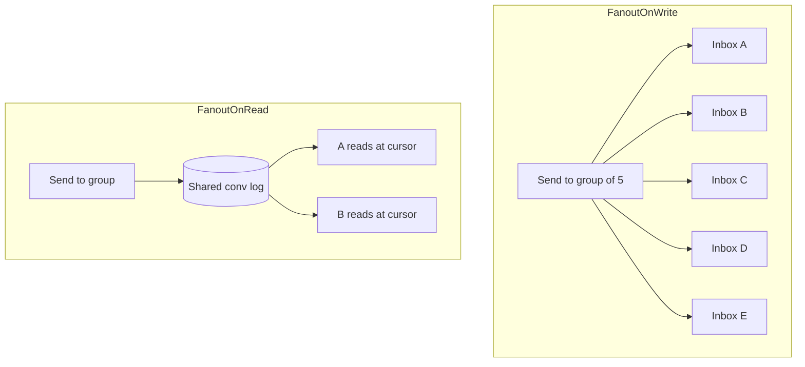

| | Fan-out on write | Fan-out on read |
|---|---|---|
| Write cost | O(group size) | O(1) |
| Read cost | O(1), pre-materialized | O(query) per read |
| Storage | N copies | 1 copy |
| Best for | Small/medium groups, read-heavy | Large groups, broadcast |
| Killer case | **Huge groups** (write amplification) | Active small groups (re-query churn) |
| Real examples | DMs, small groups | WhatsApp groups, Slack channels, Discord |

**The large-group / broadcast problem.** Fan-out-on-write to a **100k-member group** or a **1M-follower broadcast channel** is catastrophic — one message = up to 1M inbox writes (the "celebrity problem"). At that scale you **must** use fan-out-on-read (shared log + per-member cursor), and you fan out the *live notification* only to **currently-connected** members (via the registry), not to everyone. *Worked: a 100k group with 30 msgs/min on fan-out-on-write = 3M inbox writes/min ≈ 50k writes/sec for one group — versus 30 writes/min on the shared log.*

**The pragmatic hybrid:** fan-out-on-write for **small/medium** conversations (cheap, fast reads), fan-out-on-read for **large** groups and broadcast channels. WhatsApp uses a single stored copy per group + per-member delivery tracking; Slack/Discord use a shared channel log with per-user read cursors.

> **Staff-level insight:** The senior answer picks one; the staff answer says **"it's a threshold-based hybrid, and the threshold is where write-amplification cost crosses read-query cost."** Below ~hundreds of members → fan-out-on-write (materialize inboxes, fast reads). Above that → shared log + per-member read cursor + live-push-only-to-connected. The crucial scaling insight for huge groups: **you only fan out the live push to the small subset of members who are currently online** (registry tells you who) — the offline majority just syncs from the shared log when they reconnect. Never write a million inbox rows for one broadcast message. **Decision:** threshold hybrid *because* the cost curves cross at ~a few hundred members; default fan-out-on-write below, shared-log + cursor + online-only-push above.

### 8.4 Storage model: per-user inbox vs shared log

Tightly coupled to §8.3 — the storage layout *is* the fan-out strategy:

| Model | Layout | Pros | Cons |
|---|---|---|---|
| **Per-user inbox** | Each user has their own message timeline (a copy per recipient) | Read = scan one partition, fast; per-user retention/delete easy | N× storage; write amplification; group edits are hard |
| **Shared conversation log** | One log per conversation; users track a read cursor (last seqNo) | 1× storage; cheap writes; natural ordering | Reads query shared log; per-user state (read pos) separate |

**Typical real design (my default):** a **shared conversation log** (`conversation_id` → ordered messages by seqNo) as the source of truth, plus lightweight **per-user-per-conversation metadata** (`{userId, convId} → {lastReadSeq, lastDeliveredSeq, muted}`). This gives 1× message storage with per-user read/delivery state — the best of both. Cassandra/ScyllaDB/DynamoDB are natural fits: partition by `conversation_id`, cluster (sort) by `seqNo` — gives ordered range reads and append-friendly writes.

```mermaid
graph LR
    subgraph SharedLogPlusCursor
    LOG[(conv 42 log<br/>partition by convId<br/>sorted by seqNo)]
    C1[user A cursor lastRead 100]
    C2[user B cursor lastRead 87]
    LOG --- C1
    LOG --- C2
    end
```

> **Staff-level insight:** **"Store the message once (shared conversation log), track read/delivery state per user (cursor)."** This separates the *expensive, immutable* data (messages — stored once) from the *cheap, mutable* per-user state (cursors, mute flags). Then pick the right DB: **wide-column (Cassandra/Scylla/DynamoDB) partitioned by conversation_id, clustered by seqNo** — append-optimized, ordered range scans, horizontally scalable, no hot global table. This is exactly how production chat backends store messages. **Decision:** shared log + per-user cursor on a wide-column store partitioned by convId *because* it gives 1× storage, natural ordering, and append-friendly writes.

### 8.5 Offline queue & multi-device sync

An [earmarked crux](#02-altitude--where-to-go-deep-where-to-move-on) — one cursor primitive, three problems solved.

**Offline message queue.** When a recipient is offline, messages accumulate. With a shared log this is *implicit* — the user's cursor lags, and on reconnect they fetch `messages where seqNo > lastReadSeq`. No separate "queue" structure needed; the gap between cursor and head *is* the queue.

**Reconnect / sync flow.** Client reconnects → sends its `lastSeq` per conversation → server returns the delta (everything newer). For many conversations, sync a compact **per-conversation high-water-mark digest** first, then fetch deltas only for conversations that advanced.

```mermaid
sequenceDiagram
    participant C as Client was offline
    participant G as Gateway
    participant S as Sync Service
    C->>G: reconnect plus per-conv cursors
    G->>S: sync request
    S->>S: diff cursors vs head seqNos
    S-->>C: deltas msgs above cursor per conv
    C->>C: render advance cursors
    C-->>S: ack new high-water marks
```

**Multi-device sync.** A user has phone + web + desktop, each an independent connection (own registry entry) and each its **own cursor**. Every message fans out to all of the user's online devices; offline devices catch up via cursor sync on reconnect. **Read state must sync across a user's own devices** — reading on your phone should clear the unread badge on web. Model read receipts as "user U read conv C up to seqNo N," replicated to all of U's devices.

> **Staff-level insight:** Multi-device is where the **cursor model pays off massively** — the *exact same mechanism* (per-(user|device, conversation) high-water mark) handles offline catch-up, reconnect-after-deploy gap-fill, *and* cross-device read-state sync. One primitive, three problems solved. The hard sub-problem to **earmark** for E2E systems: **with end-to-end encryption, the server can't decrypt to copy a message to a new device** — so multi-device E2E (Signal's "sesame" / per-device sessions) requires encrypting separately for each of the recipient's devices, or device-to-device key transfer. WhatsApp's multi-device E2E was a genuinely hard engineering project for exactly this reason — flag it as the hard part, don't pretend it's trivial.

### 8.6 Idempotency & dedup

**The problem.** At-least-once delivery + client retries (flaky network) means the *same* message can arrive twice — sender retries a send whose ACK was lost; a message gets delivered via both socket and push. Without dedup, users see duplicates.

**The mechanism — client-generated idempotency key.** The *sender's client* generates a unique `clientMsgId` (UUID) at compose time and includes it on every retry. The server **dedups on `clientMsgId`**: first time → persist + assign seqNo; retry of the same id → return the *existing* serverMsgId/seqNo, do **not** create a duplicate.

```mermaid
sequenceDiagram
    participant C as Client
    participant S as Server
    C->>S: send clientMsgId u1 text
    S->>S: not seen u1 persist seqNo 50
    S--xC: ACK lost
    Note over C: timeout retry
    C->>S: send clientMsgId u1 text retry
    S->>S: seen u1 return seqNo 50 no dup
    S-->>C: ACK seqNo 50
```

**Recipient-side dedup** too: the receiving client dedups on `serverMsgId`/`seqNo`, so a message arriving via both socket and push notification renders once.

> **Staff-level insight (anti-pattern alert):** **At-least-once + client-side idempotency key = effectively-exactly-once, without the cost of true exactly-once delivery.** You never try to guarantee exactly-once *on the wire* (provably expensive/impossible across failures — [claiming it is a disqualifier](#04-top-anti-patterns-the-disqualifiers)); instead you make **delivery at-least-once and processing idempotent**, deduping on a client-generated id at both server (on send) and client (on receive). State that you deliberately *chose* at-least-once over exactly-once because dedup is cheap and exactly-once transport isn't worth it. That framing — "exactly-once is a property of *processing*, not *delivery*" — is a senior-distributed-systems signal. **Decision:** at-least-once + idempotency key *because* exactly-once-on-the-wire is impossible across failures and dedup is nearly free.

### 8.7 End-to-end encryption (conceptual)

> **Altitude cue:** You won't implement Signal in an interview — name the protocol and pivot immediately to the *architectural implications*, which is where the staff signal lives. Don't rabbit-hole into ratchet cryptography.

**Definition.** With E2E encryption, only the communicating clients hold the keys — the **server relays ciphertext it cannot read.** The gold standard is the **Signal Protocol** (used by Signal, WhatsApp, Messenger secret chats, Google Messages RCS).

**Two pillars:**
1. **X3DH (Extended Triple Diffie-Hellman):** the initial key agreement. Each user publishes a bundle of public keys (identity key, signed prekey, one-time prekeys) to the server. A sender fetches the recipient's bundle and derives a shared secret *even if the recipient is offline* (asynchronous — critical for messaging).
2. **Double Ratchet:** ongoing per-message key evolution. The Double Ratchet combines a Diffie-Hellman ratchet and a symmetric-key ratchet. The DH ratchet advances whenever a new ratchet public key arrives from the peer (i.e. on a change of direction / reply), and its shared secret is fed into a ROOT KDF chain, which derives the sending/receiving SYMMETRIC chains. The symmetric chain advances once per message (giving forward secrecy); the DH ratchet gives post-compromise security / self-healing.

**Security properties this buys:**
- **Forward secrecy:** compromising today's key doesn't decrypt *past* messages (keys are deleted after use).
- **Post-compromise / future secrecy ("self-healing"):** the DH ratchet re-randomizes, so a key compromise heals after the next round-trip.

```mermaid
sequenceDiagram
    participant A as Alice
    participant Srv as Server sees only ciphertext
    participant B as Bob
    Note over A,B: X3DH using Bob published prekey bundle
    A->>Srv: encrypted Alice key plus Bob prekey
    Srv->>B: relays ciphertext
    Note over A,B: Double Ratchet advances per message
    A->>Srv: ciphertext key ratchet step 1
    Srv->>B: relay
    B->>Srv: ciphertext DH ratchet step
    Srv->>A: relay
```

> **Staff-level insight:** You won't be asked to implement Signal, but you must articulate the *system-design implications*: **(1) the server is a blind relay** — it cannot do server-side search, content moderation on plaintext, or push the actual message text (push payloads carry only "new message," the client decrypts locally). **(2) Multi-device is hard** (see §8.5) — you can't just copy ciphertext to a new device; you encrypt per-device. **(3) Group E2E** needs Sender Keys (WhatsApp's deployment — Signal itself uses pairwise client-side fan-out): pairwise-encrypting each message to every member is O(N) per message per sender; Sender Keys cuts the per-message cost to O(1) — encrypt once with the sender key — paying O(N) only on a key rotation (membership change). **(4) Key/identity management** (safety numbers, key-change warnings) is the real UX cost. Knowing E2E *reshapes the entire architecture* — not just "add encryption" — is the staff-level point. **Decision:** if E2E is a requirement, the server becomes a blind relay and you lose server-side search/moderation/rich-push *by design* — surface that trade-off early, don't let it ambush the design.

### 8.8 Media in messages

**Definition.** Images, video, audio, files — large binary payloads that should **never** flow through the message/WebSocket path.

**Pattern: out-of-band upload + reference-in-message.**
1. Client requests a **pre-signed upload URL** from the media service.
2. Client uploads **directly to blob storage** (S3 / GCS) via that URL — bypassing your gateway entirely.
3. The **message** carries only a *reference* (media id / URL + metadata: mime, size, dimensions, blurhash thumbnail, duration).
4. Recipient fetches the media (via CDN) on demand, using its own pre-signed/authorized URL.

```mermaid
sequenceDiagram
    participant A as Alice
    participant MS as Media Service
    participant S3 as Blob Store
    participant S as Chat Service
    participant B as Bob
    A->>MS: request upload URL
    MS-->>A: pre-signed PUT URL plus mediaId
    A->>S3: PUT bytes directly
    A->>S: send msg mediaId thumb mime size
    S->>B: deliver msg small ref only
    B->>MS: request download URL for mediaId
    MS-->>B: pre-signed CDN URL
    B->>S3: GET via CDN
```

**Production details:** server-side **transcoding** (multiple resolutions, format normalization), **thumbnail/blurhash** so the chat renders instantly before full media loads, **CDN** for delivery, **virus/abuse scanning**, dedup by **content hash** (same forwarded image stored once), and for E2E — **encrypt the blob client-side** before upload (server stores only ciphertext; the key travels in the encrypted message).

> **Staff-level insight (anti-pattern alert):** The one-liner: **"Media never touches the message path — it's out-of-band: pre-signed direct-to-S3 upload, CDN download, and the message carries only a reference plus a tiny thumbnail/blurhash."** This keeps the WebSocket/message tier lean (it moves KB, not MB), offloads bandwidth to S3/CDN, and lets media and messaging scale independently. The E2E twist — **encrypt the blob client-side with a per-file key carried inside the encrypted message** — shows you've thought past the happy path. Sending a 20 MB video through your WebSocket gateway is an [instant disqualifier](#04-top-anti-patterns-the-disqualifiers); name the out-of-band pattern immediately. **Decision:** out-of-band pre-signed upload + reference-in-message, always — no trigger flips this.

---

## 9. Scaling & reliability

Pulling the threads together into the system-level concerns. The unifying theme: **design for the recovery storm, not the steady state.**

**Millions of concurrent connections.** Memory-bound (§3.3): lean per-connection state, event-driven I/O (epoll/kqueue), tuned kernel (fds, ports, buffers), and a runtime built for it (Erlang/Elixir, Go, Rust, uWebSockets). Horizontally scale the **stateless gateway tier** behind L4 LB; capacity-plan for the **failover case**, not steady state.

**Horizontal gateway scaling.** Add nodes → LB spreads new connections → registry tracks placement → backplane routes between nodes. The gateway tier must be *truly horizontal*: any node can hold any user; routing is via registry + pub/sub, not node affinity. Auto-scale on connection count + message rate, but beware scale-down (dropping a node = a mini reconnect storm).

**Reconnect storms / thundering herd.** The recurring villain ([war story](#05-experience-hooks--chat-infra-war-stories-to-deploy)). Defenses (apply *all* of them):

| Defense | Mechanism |
|---|---|
| **Jittered backoff** | Reconnect after `base × 2^attempt × random(0.5,1.5)` — never synchronized |
| **Staggered reconnect** | Server tells clients a *random* reconnect window on drain |
| **Capacity headroom** | Survivors sized to absorb a dead node's connections |
| **Connection rotation** | Continuously cycle a small % so the reconnect path stays warm |
| **Resume cheaply** | Cursor-based resync → reconnect fetches only the gap, not full history |
| **Auth caching** | Reconnect auth must be cheap (don't hammer the auth DB) |
| **Rate-limit accepts** | Gateways throttle new-connection accept rate to protect downstream |

```mermaid
graph TB
    DEPLOY[Node drained or crashed] --> STORM{Reconnect storm risk}
    STORM --> JIT[Jittered backoff]
    STORM --> STAG[Staggered windows]
    STORM --> CAP[Headroom on survivors]
    STORM --> CUR[Cheap cursor resume]
    JIT --> OK[Smooth re-balance]
    STAG --> OK
    CAP --> OK
    CUR --> OK
```

**At-least-once + client dedup (§8.6).** Persist before fan-out; retry on failure; dedup on `clientMsgId`/`serverMsgId`. Never aim for exactly-once delivery; aim for at-least-once + idempotent processing.

**Ordering guarantees (§8.2).** Per-conversation seqNo via conversation-as-partition-key. Clients detect gaps (missing seqNo) and request fill on reconnect.

**Multi-device sync (§8.5).** Per-device cursors; fan-out to all online devices; cross-device read-state replication.

**Multi-region.** For global chat, pin a conversation/user to a home region (the ordering authority lives there), replicate the durable log cross-region async for DR, and route a roaming user's gateway connection to the nearest edge while routing *messages* back to the home region's chat service. Cross-region adds latency on the write path but keeps the seqNo authority single-homed — don't try to make ordering multi-master (that's a CRDT/HLC problem you don't want for chat).

> **Staff-level insight:** When asked "what's the hardest part of operating this at scale?", the strongest answer isn't "holding the connections" — it's **"the correlated failure modes"** ([the throughline of every war story](#05-experience-hooks--chat-infra-war-stories-to-deploy)). A deploy, a network partition, or an AZ loss doesn't fail *one* connection — it fails *millions simultaneously*, and the recovery (reconnect, re-auth, re-register, presence re-flap, sync) is itself a load spike that can take down the survivors. Everything in this section — jitter, headroom, cheap resume, continuous rotation — exists to **decorrelate** those failures and **flatten the recovery spike.** Designing for the *recovery storm*, not just the steady state, is the defining mark of staff-level real-time systems thinking.

---

## 10. Interview Cheat-Sheet

**Transport decision tree:**
- Push-dominant feed/notifications/LLM-stream → **SSE** (free reconnect + replay)
- Bidirectional + low-latency (chat, collab, games) → **WebSocket**
- Constrained device / flaky mobile / IoT → **MQTT**
- Must traverse any proxy → **long-poll fallback**
- Future-proofing mobile (no HOL block, network migration) → **WebTransport**

**The non-negotiable principles (say these):**
1. *Real-time = a routing problem, not a connection problem.* Lead with the **connection registry + backplane**.
2. *Persist before you fan out.* Durable log is the source of truth; live push is a latency optimization.
3. *At-least-once delivery + idempotent processing* (client-generated `clientMsgId`), never exactly-once on the wire.
4. *Per-conversation ordering* via conversation-as-partition-key + server seqNo. Never trust client clocks.
5. *Store the message once* (shared conversation log) + *per-user cursors* for read/delivery/sync state.
6. *Fan-out-on-write for small groups, fan-out-on-read for large/broadcast* — threshold hybrid; live-push only to *online* members.
7. *Presence is fan-out amplification* — subscribe-on-view, pull-for-visible, debounce flaps, aggregate for big groups; eventually consistent by design.
8. *Push = a wake-up nudge, not delivery* — the inbox sync on open is the real delivery.
9. *Bound every send buffer, drop slow consumers* — node availability > one degraded client.
10. *Design for the recovery storm* — jittered backoff, capacity headroom, cheap cursor-resume, continuous connection rotation.

**Delivery posture (how to say it):** lead with the decision + reason + trigger; earmark the crux (registry, fan-out, presence, recovery storm); name-and-move-on the handshake; never claim exactly-once; never make pub/sub the durability layer. See [§0](#0-in-the-room--staff-level-delivery).

**Numbers to drop:**
- Idle WS ~30 KB/conn → ~500k–2M/node (memory-bound); cap conservatively for failover headroom.
- Heartbeat ~30 s; declare dead after 2–3 missed pongs (~90 s). 10M conns × 30 s heartbeat ≈ 333k pings/sec.
- WhatsApp: ~2M+ connections/server (Erlang/FreeBSD) — a 2012-era tuned benchmark, not a steady-state production target under message load. Phoenix/Elixir: 2M+ demonstrated.
- WS frame header 2–14 B; MQTT fixed header 2 B; HTTP headers hundreds of bytes (the polling tax).
- APNs payload ≤ 4 KB; silent-push budget ~2–3/hour. Presence fan-out: 5k contacts × flap = 5k pushes (why subscribe-on-view matters).
- 100k-member group on fan-out-on-write at 30 msgs/min ≈ 50k inbox writes/sec — why huge groups force fan-out-on-read.

**Architecture skeleton to draw:** Clients → L4 LB → stateless Gateway tier (holds WS) → Pub/Sub backplane (Redis live-hop + Kafka durable log) → Chat Service (idempotency, persist+seqNo, fan-out decision) → {Message Store (shared log, partition by convId), Connection Registry (TTL keys, user→nodes), Notification Service (online→socket / offline→APNs/FCM)}.

**Cross-references:** [Messaging & event-driven](04-messaging-event-driven.md) · [Load Balancing](05-load-balancing.md) · [Distributed Systems](02-distributed-systems.md) · [Chat & social design problems](18a-design-chat-social.md) · [Staff-Level Execution](20-staff-execution.md).

---

## 11. Common Interview Questions

**Q1. WebSocket vs SSE vs long polling — when each, and why?**
**A (Staff):** Decision by traffic shape and direction. *SSE* for server-push-dominant workloads (notifications, live feeds, LLM token streams) — you get auto-reconnect + `Last-Event-ID` replay for free and it's plain HTTP, so it's simpler and more robust than WS when you don't need a fast client→server path. *WebSocket* for genuinely bidirectional, low-latency chat — typing/receipts flow client→server constantly. *Long polling* as the universal fallback when proxies strip the `Upgrade` header. The mature design is a **negotiation chain (WS → SSE → long poll)**, and I'd note WS's cost: it trades HTTP's statelessness for a stateful tier needing a registry, sticky routing, and draining.

**Q2. Design the message path from Alice to Bob. Walk every hop.**
**A (Staff):** Alice→Gateway A→Chat Service. Chat Service does **idempotency check on `clientMsgId`**, **persists + assigns conversation seqNo** (this is what "sent ✓" means — durability, not delivery), ACKs Alice. Then the **fan-out decision**: registry lookup for Bob's devices. Online → publish to Bob's gateway via Redis pub/sub → push down socket → Bob ACKs → "delivered ✓✓" relays back to Alice. Offline → enqueue **APNs/FCM push** (just a wake-up nudge) and the message waits in Bob's inbox; on reconnect Bob **syncs from his cursor**. Key decisions: persist-before-fan-out, ACK-from-persistence, online/offline fork, receipts reverse the path.

**Q3. How do you hold and scale to 10M concurrent connections?**
**A (Staff):** Connections are *memory-bound* (~30 KB/idle WS), so it's a kernel + runtime problem: epoll/kqueue event-driven I/O (no thread-per-conn), tuned `ulimit`/`file-max`/port range/TCP buffers, a lean runtime (Erlang/Elixir, Go, Rust). Per node I'd hold maybe 500k–800k — *not* the theoretical max — because I must reserve **failover headroom**: when a neighbor dies its connections stampede onto survivors. So 10M / ~600k ≈ 17 nodes + ~20% spare ≈ 20. Scale horizontally with a stateless gateway tier behind L4 LB; route between nodes via registry + pub/sub, not node affinity. I plan capacity for the failure case, not steady state — and I *derive* the number, I don't quote it.

**Q4. How do you deploy new code without dropping millions of live connections?**
**A (Staff):** Three pillars. **(1) Slow drain** — deregister the node from the LB, then migrate connections over a 5–30 min window, rolling a small % of the fleet at a time so survivors can absorb the load. **(2) Jittered staggered reconnect** — send clients a "reconnect within a random window" signal; *jitter is everything* or you recreate the thundering herd you're avoiding, plus exponential backoff with jitter on the client. **(3) Cheap resume** — clients reconnect with a cursor and fetch only the gap, not full history. The kicker: I run **continuous low-rate connection rotation** in steady state so the reconnect path is always warm — your recovery code shouldn't only run during disasters. And most deploys don't touch the gateway at all because business logic lives behind it.

**Q5. Design presence (online/last-seen/typing) for users with thousands of contacts.**
**A (Staff):** Presence is *ephemeral soft state* → Redis TTL keys, not the durable DB: `SETEX presence:user 60`, refreshed by heartbeat; expiry = offline, last write = last-seen. Self-healing, no explicit offline message needed. The real problem is **fan-out amplification** — one flip × thousands of watchers; naive, that's millions of pushes/sec at scale. So: **subscribe-on-view** (only watch contacts visible on screen — 20 not 5,000), **pull-for-visible** instead of push, **debounce offline** 30–60 s to absorb mobile flapping, **aggregate to a count** for huge groups, and **throttle typing** to one event/3–5s with TTL auto-expiry (QoS 0, never persisted). I'd state explicitly that presence is **eventually consistent by design** — strong consistency isn't worth the cost.

**Q6. Implement delivery semantics — the sent/delivered/read ticks — reliably.**
**A (Staff):** **Sent** = server durably persisted + assigned seqNo (a *server-side fact*, decoupled from fan-out success, so a delivery hiccup doesn't look like a send failure). **Delivered** = recipient's device ACKed receipt. **Read** = recipient opened the conversation. Each transition is a small message routed back to the sender via the gateway. Critically I **collapse receipts** — "delivered/read up to seqNo N" in one message, not one per message — or in a busy group the receipt traffic exceeds the message traffic (50-person group = 50× receipt amplification naively). Read state is per-user and replicates across the user's own devices.

**Q7. How do you guarantee message ordering, especially with multiple devices?**
**A (Staff):** I need **per-conversation ordering, not global** — so the conversation is my partition/serialization key. The server assigns a **monotonic seqNo scoped to the conversation** on persist; everyone renders by seqNo → identical order for all participants. I **never trust client timestamps** (clock skew, malicious clients) — server seqNo is the source of truth, client time is a display/dedup hint only. The same seqNo powers gap detection on reconnect and multi-device consistency: each device syncs against the conversation's seqNo, so all of a user's devices show the same order. One primitive solves ordering, sync, and multi-device at once.

**Q8. Fan-out-on-write vs fan-out-on-read for groups — design for a 100k-member group.**
**A (Staff):** It's a **threshold hybrid**. Small/medium groups → fan-out-on-write (copy to each inbox; reads are pre-materialized and fast). Large groups/broadcast → fan-out-on-read: store the message **once** in a shared conversation log, each member tracks a read cursor. For 100k members, fan-out-on-write is catastrophic (~50k inbox writes/sec for one busy group — the celebrity problem), so I use the shared log and **fan out the live push only to currently-connected members** (the registry tells me who); the offline majority syncs from the log on reconnect. Storage model mirrors this: one shared log (Cassandra/Scylla partitioned by convId, clustered by seqNo) + lightweight per-user cursor state.

**Q9. How do you prevent duplicate messages with at-least-once delivery?**
**A (Staff):** I deliberately choose **at-least-once delivery + idempotent processing** over exactly-once (which is impractical on the wire). The sender's client generates a **`clientMsgId` (UUID) at compose time** and includes it on every retry; the server dedups on it — first time persists and assigns seqNo, a retry returns the existing seqNo without creating a duplicate. The receiving client also dedups on `serverMsgId`/seqNo so a message arriving via both socket and push renders once. Net effect: *effectively-exactly-once* — because exactly-once is a property of *processing*, not *delivery*.

**Q10. How would you optimize chat for low-end Android on 2G in emerging markets?**
**A (Staff):** Minimize radio wake-ups and bytes-on-wire — that's battery and latency on cellular. Use **MQTT (or an MQTT-like custom binary protocol)**: 2-byte headers vs HTTP's hundreds, persistent pub/sub connection, QoS 1 for at-least-once, **persistent sessions** for offline queueing, **LWT + keep-alive** for presence, **retained messages** for current state — all the chat primitives nearly for free. This is exactly why Facebook Messenger adopted MQTT and WhatsApp built a custom binary protocol. Layer on aggressive **notification collapsing** (one "7 messages" buzz, not 7), **thumbnail/blurhash** so media renders before download, and tuned heartbeat intervals to balance NAT-keepalive against battery.

**Q11. What's the hardest part of operating real-time chat at scale?**
**A (Staff):** Not holding connections — that's the easy 20%. The hard part is **correlated failure**: a deploy, network partition, or AZ loss fails *millions of connections simultaneously*, and the recovery (reconnect + re-auth + re-register + presence re-flap + sync) is itself a massive load spike that can topple the survivors. Everything in the design — jittered backoff, capacity headroom for failover, cheap cursor-based resume, continuous connection rotation, persist-before-fan-out, bounded send buffers — exists to **decorrelate failures and flatten the recovery spike**. Designing for the recovery storm rather than steady state is the whole game.

**Q12 (meta / delivery). I give you 35 minutes to design WhatsApp. How do you spend them, and what do you deliberately *not* go deep on?**
**A (Staff):** I'd front-load the decisions and the crux. First 3 min: requirements + the load-bearing choices stated decisively — WebSocket transport, shared-log storage with per-user cursors, at-least-once + idempotency, per-conversation seqNo ordering. Next ~20 min on the **crux**: the gateway tier + connection registry + backplane (the routing problem), the full message path, group fan-out threshold, and presence at scale — because that's where the design lives or dies. I'd explicitly **name-and-move-on** the WS handshake mechanics, the exact frame format, and "we use a CDN/Redis" — those are table stakes, not differentiators. I'd **earmark the hard parts out loud** — multi-device E2E, the dead-node registry window, the reconnect storm — and spend my remaining minutes there rather than spreading thoroughness uniformly. The meta-skill is altitude control: deep on the seams, fast on the basics, a decision (with trigger) at every fork.

**Q13 (meta / delivery). The interviewer says "it depends" is a non-answer. How do you handle a genuine trade-off without dodging?**
**A (Staff):** I commit to a default and bound it with a trigger: "*X because requirement; I'd revisit if trigger.*" For example, "Redis pub/sub for the live hop *because* sub-ms latency matters and I have a durable log underneath; I'd move to Kafka end-to-end if I needed replayable cross-region ordering or compliance audit." That's not dodging — it's stating the decision, the reason, and the precise condition that would flip it. The trap is enumerating options without choosing; the fix is to choose, justify against the requirement, and name what would change my mind. If I genuinely lack a fact to decide, I say what I'd measure and what each outcome would imply — still a decision, just a conditional one.
