# Module 10 — Microservices

> The definitive Staff-level reference on microservices: decomposition, DDD, communication, the pattern catalog, distributed data, cross-cutting concerns, and — most importantly — *when not to use them*.

## What you'll master

By the end of this module you will be able to walk into a Staff Engineer / Senior EM / Director system-design interview and:

- Argue *both sides* of the monolith-vs-microservices debate with real numbers, and articulate the "start with a modular monolith" wisdom without sounding dogmatic.
- Decompose a system by **business capability** and **subdomain**, recognize the decompose-by-noun anti-pattern, and tie service boundaries to DDD **bounded contexts** and to teams (Conway's law).
- Choose between **sync and async** communication, **orchestration vs choreography**, and **API composition vs CQRS** read models for cross-service queries — and defend the choice.
- Reason precisely about the pattern catalog: **API Gateway, BFF, service discovery, sidecar, service mesh, ambassador, adapter, strangler fig**.
- Solve the hard problem — **distributed data**: database-per-service, the dual-write problem, **transactional outbox + CDC**, sagas, eventual consistency, materialized views.
- Diagnose the failure modes that sink real systems: the **distributed monolith**, **chatty services**, **fan-out p99 amplification**, dual-writes, and shared databases.
- Apply a crisp **decision framework** for microservices vs modular monolith vs serverless — and deliver the recommendation the way a Staff Engineer does: decisively, with a default and a revisit-trigger.

This module is opinionated on purpose. Staff Engineers are paid for judgment, not for reciting that "microservices scale teams." Where there is a defensible default, this module *takes it* and tells you the trigger that would change it.

---

## Table of Contents

1. [In the Room — Staff-Level Delivery](#in-the-room--staff-level-delivery)
2. [Monolith → Modular Monolith → Microservices](#1-monolith--modular-monolith--microservices)
3. [Service Decomposition Strategies](#2-service-decomposition-strategies)
4. [Domain-Driven Design Essentials](#3-domain-driven-design-essentials)
5. [Bounded Contexts & Context Mapping](#4-bounded-contexts--context-mapping)
6. [Inter-Service Communication](#5-inter-service-communication)
7. [Orchestration vs Choreography](#6-orchestration-vs-choreography)
8. [Cross-Service Queries: API Composition vs CQRS](#7-cross-service-queries-api-composition-vs-cqrs)
9. [API Gateway & Backends-for-Frontends](#8-api-gateway--backends-for-frontends)
10. [Service Discovery](#9-service-discovery)
11. [Sidecar, Service Mesh, Ambassador, Adapter](#10-sidecar-service-mesh-ambassador-adapter)
12. [Strangler Fig: Migrating Off a Monolith](#11-strangler-fig-migrating-off-a-monolith)
13. [Data Management: Database-per-Service](#12-data-management-database-per-service)
14. [The Dual-Write Problem & Transactional Outbox](#13-the-dual-write-problem--transactional-outbox)
15. [Eventual Consistency, Duplication & Materialized Views](#14-eventual-consistency-duplication--materialized-views)
16. [Cross-Cutting Challenges](#15-cross-cutting-challenges)
17. [The Distributed Monolith & Latency Amplification](#16-the-distributed-monolith--latency-amplification)
18. [When NOT to Use Microservices](#17-when-not-to-use-microservices)
19. [A Realistic Reference Architecture](#18-a-realistic-reference-architecture)
20. [Interview Cheat-Sheet](#interview-cheat-sheet)
21. [Common Interview Questions](#common-interview-questions)

Related modules: [Staff-Level Execution](20-staff-execution.md) · [Architecture Patterns](15-architecture-patterns.md) · [Messaging & Event-Driven](04-messaging-event-driven.md) · [Observability](12-observability.md) · [Reliability](11-reliability.md) · [Leadership & Trade-offs](19-leadership-tradeoffs.md) · Sagas in [Module 02](02-distributed-systems.md).

---

## In the Room — Staff-Level Delivery

This section is the lens. Everything below it is detail; this is how you *carry* the detail in a real interview or a real architecture review. The microservices topic is the single most over-engineered area in our industry, which makes it the single best place to demonstrate Staff-level judgment: a Staff Engineer is the person who says "not yet, and here's the cheaper thing that buys 80% of the value." Cross-reference: [Staff-Level Execution](20-staff-execution.md).

### Decisions to make decisively (default + trigger, never "it depends")

State the decision, the *because*, and the *revisit-if*. Lead with the recommendation; the reasoning follows it.

| Decision | Decisive default | Because (requirement) | Revisit if (trigger) |
|---|---|---|---|
| Architecture style | **Modular monolith** | one deploy, ACID, fast refactor — the domain isn't understood yet and boundaries are cheap to move in-process | a *named, quantified* force appears: a component must scale independently, deploy on its own cadence, or be fault-isolated; or coordination cost across teams exceeds distribution cost |
| Service boundary | **One bounded context = one service = one team** | aligns the consistency boundary, the deploy unit, and the org so changes stay local | a single context grows two divergent invariant sets, or two contexts deploy in lockstep |
| Sync vs async | **Sync for the user-blocking critical path (tight timeout + fallback); async for everything downstream of the acknowledgment** | availability multiplies on synchronous chains; you minimize the sync critical path | the user genuinely needs a synchronous answer from a downstream system (card validity) — then sync that *one* hop |
| Orchestration vs choreography | **Choreography between contexts; orchestration *within* a complex, auditable saga** (Temporal / Step Functions) | simple fan-out wants loose coupling; a stuck order needs a queryable state machine | the choreographed flow exceeds ~3-4 steps or anyone asks "what state is order #123 in?" and you can't answer without grepping logs |
| Cross-service query | **API composition** | low fan-out, freshness-sensitive, simplest thing that works | read is high-QPS, join-heavy, or must survive a source-service outage — then a **rebuildable** CQRS read model |
| State change + event | **Transactional outbox + CDC + idempotent consumers** | "save then publish" is a data-loss bug under crashes; this is the only atomic-with-no-2PC answer | never — this is non-negotiable in any event-driven service |
| Data ownership | **Database-per-service, no shared schema** | the schema *is* the contract; sharing it re-couples deploys, failure domains, and models | never relax this; route analytics to a warehouse via events/CDC, not to OLTP tables |

Notice none of these is "it depends." "It depends" without a default is the most common mid-level tell. The Staff move is to *give the default*, then name the one or two conditions that would flip it.

### Altitude — name-and-move-on vs deep-dive

Spend your minutes where the risk concentrates. The cheap-to-move, well-understood pieces get a sentence; the irreversible, failure-prone pieces get the whiteboard.

**Name-and-move-on (one sentence each, do not over-explain — over-explaining basics is a junior tell):**
- "Services talk over gRPC behind an API gateway; the gateway does auth, rate-limiting, and TLS termination." Move on.
- "Discovery is Kubernetes DNS — I don't hand-roll a registry." Move on.
- "Each service has its own CI/CD pipeline and canaries via Argo Rollouts." Move on.
- "Golden signals scraped by Prometheus, dashboards in Grafana." Move on.
- "REST/JSON at the public edge, Protobuf internally." Move on.

**Deep-dive (this is where the interview is won or lost — earmark these as the hard parts):**
- **Service decomposition** — where the boundaries go. A wrong boundary is a multi-quarter migration. (§2, §3, §4)
- **Data consistency across services** — sagas, where you need strong vs eventual consistency, which invariant cannot tolerate lag. (§6, §12, §14)
- **The dual-write / transactional outbox** — the most under-appreciated correctness bug in the field. (§13)
- **Distributed tracing & the fan-out p99 math** — at scale the tail *is* the user experience, and tails multiply. (§15, §16)

If you find yourself spending equal time on "how gRPC works" and "where the saga compensation boundary goes," you've mis-allocated. Uniform thoroughness is an anti-pattern; risk-weighted thoroughness is the skill.

### YAGNI default and its trigger

**Start with a modular monolith. Full stop.** This is the strongest YAGNI stance in the entire system-design curriculum, and microservices is exactly the topic where YAGNI is most often violated. You extract a service only when you can:

1. **Name** the force (independent scale / independent deploy cadence / fault isolation / team ownership), and
2. **Quantify** it ("checkout is CPU-bound and needs 8× the replicas of the rest of the app at peak," not "we might need to scale it later").

"We might need it later" is not a force; it's a guess, and you pay for the guess immediately in operational tax. The trigger to revisit the modular monolith: **coordination cost across teams begins to exceed distribution cost** — i.e., teams are blocking each other on deploys, or one component's scaling/failure profile is genuinely divergent. When that fires, extract *the one seam* via strangler fig, not the whole thing.

### Top anti-patterns to call out (and avoid in your own answer)

These are both *system* anti-patterns to diagnose and *delivery* anti-patterns to avoid in how you answer:

| Anti-pattern (system) | Why it kills you | The tell |
|---|---|---|
| **Microservices for a small team** | distribution costs, zero autonomy benefit (no Conway payoff) | 1-2 teams, 20+ services, everyone context-switching |
| **Shared database** | the schema becomes the contract; deploys re-couple | two services SELECT from the same table |
| **Distributed monolith** | all the costs of distribution, none of the autonomy | lockstep deploys, deep sync chains, change touches many services |
| **Chatty fan-out** | tail latency multiplies; N+1 over the network | a loop that calls a service per item |

| Anti-pattern (delivery) | What it sounds like | Fix |
|---|---|---|
| Over-explaining basics | three minutes on what an API gateway is | name it, move on |
| Option-listing without choosing | "we could do A, or B, or C…" then stopping | pick one, give the trigger that flips it |
| False humility | "I'm not really sure, but maybe…" on something you know | state it as a default with confidence |
| Over-engineering by default | reaching for microservices/mesh/Kafka unprompted | start with the monolith; add the network boundary reluctantly |
| Uniform thoroughness | equal depth on gRPC and on saga compensation | risk-weight; deep-dive the crux |

### Experience hooks (cite real operational scars)

Generic answers are forgettable; scarred answers are credible. Weave in operational experience like these (adapt to your own — these are the *shape* of the hook). From experience running **real-time chat infrastructure**, the most authentic hooks are about fan-out, presence, ordering, and connection state:

- *"On a real-time chat platform, the fan-out is the whole game — a single message into a large group fans out to thousands of recipient connections, so I learned the hard way that synchronous fan-out is a non-starter: you put the message on a broker, key by conversation for ordering, and let edge/gateway nodes own the WebSocket fan-out. The p99 you feel is the slowest delivery hop, not the mean."*
- *"We had a presence service that everyone called synchronously — it became the availability ceiling for the whole product, because 0.999^N across the chains pulled the composite below three nines. We moved presence to an eventually-consistent local cache fed by events; nobody noticed the seconds of lag, and we got our nines back."*
- *"The outbox pattern saved us from a silent data-loss bug: we were doing `db.save()` then `publish()` for 'message sent' events, and under pod restarts we'd occasionally persist the message but never emit the delivery event — receipts went missing. Moving to outbox + Debezium CDC made it atomic and the bug class disappeared."*
- *"We almost shared a database between the messaging service and the moderation service 'just for the one table.' It never stays one table. We caught it in review and went event-driven instead; that one 'no' is probably the highest-leverage architectural decision I've defended."*

When you tell a hook, keep it to two sentences and end on the *lesson*, not the war story. The signal is "I have operated this," not "let me narrate an outage."

### The one-liner to open with

When an interviewer says "design a system with microservices," the Staff opening is *not* to start drawing services. It's: **"I'd start with a modular monolith and extract the one service that has a named, quantified force — let me first find where that force actually is, because the most expensive mistake here is drawing a boundary in the wrong place."** That single sentence signals seniority before you've drawn a box.

---

## 1. Monolith → Modular Monolith → Microservices

**Definition.** A **monolith** is a single deployable unit where all modules share one process, one codebase, and (usually) one database. A **modular monolith** keeps the single deployable but enforces strict internal module boundaries — clear interfaces, no reaching across module internals, ideally separate schemas per module. **Microservices** split those modules into independently deployable services communicating over the network, each owning its data.

**How it works — the maturity path.** The honest industry consensus (Fowler's "Monolith First," Shopify, GitHub, Stack Overflow, Segment's famous *re-monolithing*) is that you should **start with a monolith**, evolve it into a modular monolith as it grows, and extract microservices only where a *specific, named force* demands it: independent scaling, independent deploy cadence, team autonomy at scale, or fault isolation. You cannot draw good service boundaries before you understand the domain — and you only understand the domain after building the monolith.

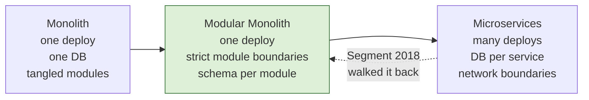

| Dimension | Monolith | Modular Monolith | Microservices |
|---|---|---|---|
| Deploy unit | 1 | 1 | N |
| Deploy blast radius | whole app | whole app | one service |
| Refactor across boundary | trivial (compiler) | easy | painful (network + versioning) |
| Scaling granularity | whole app | whole app | per service |
| Transactional consistency | ACID, free | ACID, free | sagas, eventual |
| Local dev | run one thing | run one thing | run/ mock N things |
| Operational complexity | low | low | high |
| Team autonomy | low | medium | high |
| Latency between modules | nanoseconds (in-proc) | nanoseconds | milliseconds (network) |

**The cost of a boundary in numbers.** This table is why "modular monolith first" is a *default*, not a preference. The same logical call costs radically more once it crosses the network:

| Call type | Typical latency | Failure modes you inherit |
|---|---|---|
| In-process function call | ~1-10 ns | none beyond ordinary bugs |
| In-process call across module boundary | ~10-100 ns | none beyond bugs |
| Same-datacenter gRPC call | ~0.2-1 ms (~100,000× slower) | timeout, partial failure, retry, partition, serialization |
| Cross-AZ call | ~1-2 ms | + AZ failure correlation |
| Cross-region call | ~30-150 ms | + region partition, split-brain |

A module-to-module refactor is a compiler-checked rename. A service-to-service boundary move is a backward-compat shim, a dual-write, a data backfill, and a multi-week migration. **You are not just moving a call; you are buying a permanent tax of network latency, partial failure, and versioning.** That asymmetry is the entire argument.

**Real examples.** Shopify runs a massive modular monolith (Rails) with enforced component boundaries via the `packwerk` tool. Stack Overflow famously serves enormous traffic on a small, monolithic .NET deployment. Basecamp / 37signals champions the "Majestic Monolith." Segment moved *to* microservices and then *back* to a monolith because the operational tax (per-service queues, dependency hell across ~140 services, every shared change touching dozens of repos) outweighed the benefits — their public write-up is the canonical "we walked it back" case study.

**Pitfalls.** (1) Splitting before the domain is understood — you cement the wrong boundaries in network calls that are ~100,000× harder to move than function calls. (2) Treating "modular monolith" as a euphemism for "big ball of mud with folders" — modularity must be *enforced* (build-time dependency rules: `packwerk`, ArchUnit, module systems, separate schemas), not aspirational. (3) Microservices envy: adopting them for résumé/architecture-fashion reasons rather than a measured force. (4) Forgetting that a modular monolith with schema-per-module is *pre-factored* for extraction — you can lift a module to a service later with much less pain than untangling a big ball of mud.

> **Staff-level insight:** The most expensive mistake in distributed systems is drawing a service boundary in the wrong place. Inside a monolith, a wrong boundary is a refactor; across services it's a multi-quarter migration with backward-compat shims, dual writes, and data backfills. So the Staff move is to *defer the network boundary as long as possible* — extract a module to a service only when you can name the force (independent scale, independent deploy, fault isolation, team ownership) and quantify it. "We might need to scale it later" is not a force; it's a guess. **Decision: modular monolith with enforced boundaries and schema-per-module, because boundaries are cheap to move in-process and the domain isn't yet understood; revisit per-seam when a named, quantified force appears.**

---

## 2. Service Decomposition Strategies

> **Altitude: this is a deep-dive section.** Decomposition is where the interview is won. A wrong boundary is the most expensive mistake in the whole module — spend your minutes here.

**Definition.** Decomposition is how you carve a system into services. The two principled strategies are **by business capability** (what the business *does* — Order Management, Pricing, Inventory) and **by subdomain** (DDD's partition of the problem space). The dominant **anti-pattern** is **decompose-by-noun** (a "User service," "Product service," "Address service") which produces anemic CRUD services that everyone calls for everything.

**How it works.** A *business capability* is something an organization does to generate value, derived from the business architecture (e.g. for e-commerce: Catalog, Pricing, Inventory, Order, Payment, Shipping, Notification). A *subdomain* is the DDD decomposition of the problem domain into Core (your differentiator), Supporting (necessary but not differentiating), and Generic (buy/borrow — auth, billing). Both converge on *behavioral, vertically-sliced* services that own their data and logic end-to-end.

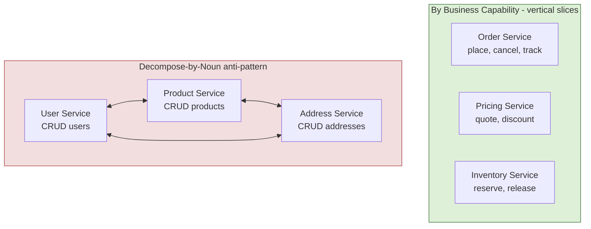

| Strategy | Slices by | Coupling outcome | Risk |
|---|---|---|---|
| Business capability | what the business does | low — behavior + data co-located | needs good business-architecture insight |
| Subdomain (DDD) | problem-space partition | low — aligns to bounded contexts | requires domain modeling skill |
| By noun / entity | data nouns | **high** — chatty CRUD, anemic services | distributed monolith |
| By technical layer | UI / logic / data tiers | **high** — every feature touches all 3 | worst of all worlds |

**The behavior test (the crux).** A correct service exposes *behavior*, not *data*. Apply this acid test to every proposed boundary:

> *Can this service enforce one meaningful business invariant entirely on its own, without synchronously asking another service?*

- "Inventory Service: `reserve(sku, qty)` rejecting the reservation when stock is insufficient" — **passes**. It owns an invariant (never oversell) and enforces it locally.
- "User Service: `getUser`, `updateUser`, `listUsers`" — **fails**. It owns no invariant; it's a distributed table that every feature calls. The behavior lives in the callers, which is the definition of an anemic service.

If a service's API is mostly `getX / setX / listX`, you have a distributed table, not a service.

**Worked example — chat platform decomposition (capability vs noun).** A naive chat backend decomposes by noun: User Service, Message Service, Channel Service, Presence Service — and immediately every feature ("send a message to a channel") requires a synchronous tour through all four. The capability-aligned version:

- **Messaging** capability: owns conversations, message ordering, delivery semantics, the invariant "messages in a conversation are totally ordered." Sending a message is one local transaction plus an outbox event.
- **Presence** capability: owns online/typing/last-seen, an inherently soft, eventually-consistent signal — a *separate* service precisely because its consistency and scaling profile differ wildly from messaging.
- **Membership/Identity** capability: owns who-can-talk-to-whom and roles, enforcing the authorization invariant locally.

The noun version makes "send a message" a four-hop synchronous fan-out (a distributed monolith); the capability version makes it one local write plus async fan-out for delivery and presence.

**Real examples.** Amazon's services map to capabilities (Ordering, Fulfillment, Payments). Uber organizes around domains (Dispatch, Pricing, Maps, Payments). The classic failure: a startup builds a "User service" and a "Notification service," then discovers *every* feature requires a synchronous call to both, recreating a monolith over HTTP.

**Pitfalls.** (1) Anemic services (a service is just a CRUD wrapper over a table — the behavior lives in callers). (2) Decomposing by technical layer (frontend/backend/data services) — guarantees that any feature change touches every service. (3) Over-decomposition into nanoservices where the network/serialization cost dwarfs the work done (if a "service" does <1 ms of real work behind a 1 ms network hop, you've doubled latency to do nothing). (4) Decomposing by entity lifecycle when the lifecycles are actually coupled (an order and its lines are one aggregate, not two services).

> **Staff-level insight:** A correct service should expose *behavior*, not *data*. If your service's API is `getX/setX/listX`, you have a distributed table, not a service. The test I use in interviews: "Can this service enforce one meaningful business invariant entirely on its own, without synchronously asking another service?" If not, the boundary is wrong. Capability-based decomposition passes this test; noun-based decomposition fails it. **Decision: decompose by business capability / subdomain, because it co-locates behavior with the data and the invariant; revisit a boundary the moment a service can't enforce its own invariant without a synchronous call out — that's the signal the seam is in the wrong place.**

---

## 3. Domain-Driven Design Essentials

> **Altitude: deep-dive.** The aggregate is where DDD touches distributed systems hardest — it determines where your sagas and your service boundaries go.

**Definition.** **Domain-Driven Design (DDD)** is a modeling approach that aligns software structure with the business domain, using a **ubiquitous language** shared by engineers and domain experts. Its tactical building blocks are **entities** (identity over time — a `Customer`), **value objects** (defined by attributes, immutable — `Money`, `Address`), and **aggregates** (a cluster of entities/value objects with a single root that guards invariants and is the **transaction/consistency boundary**).

**How it works.** The **aggregate** is the crucial concept for microservices. An aggregate root is the *only* entry point; external code references the aggregate by its root ID, never by internal entities. **One transaction = one aggregate.** Cross-aggregate changes must go through events and eventual consistency — which is exactly the rule that maps aggregates onto service boundaries and forces sagas. The ubiquitous language ensures that a word like "order" means precisely the same thing in code, conversation, and the database within a context.

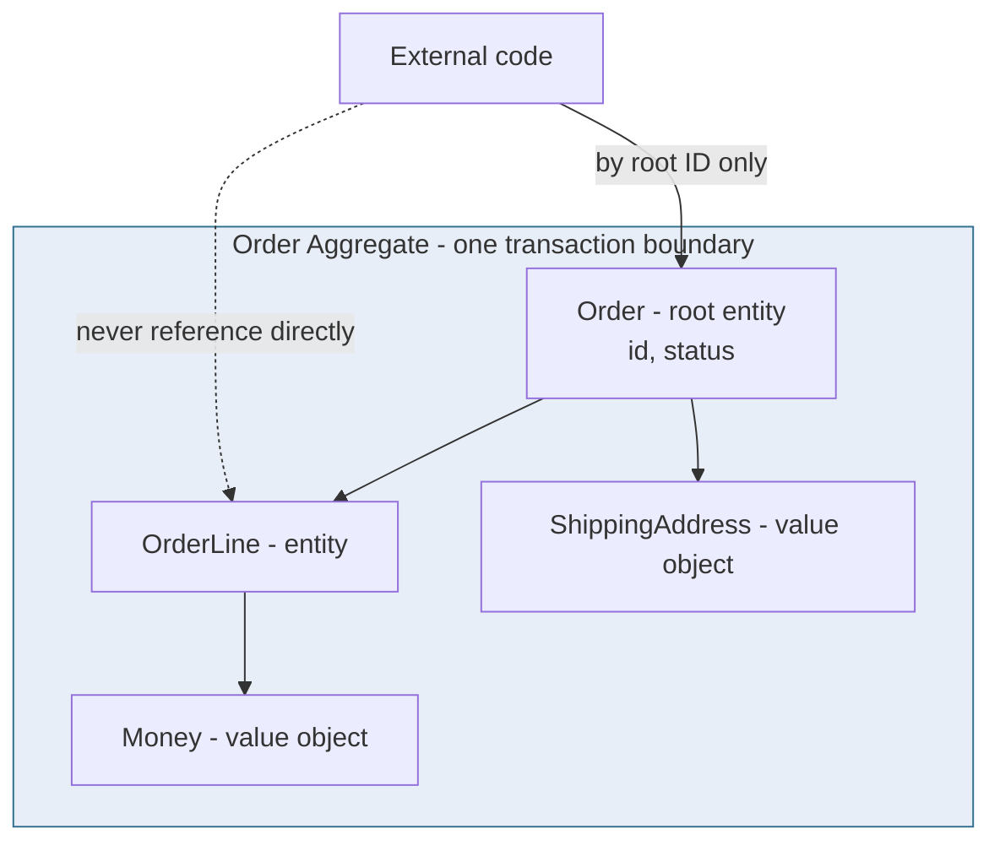

| Building block | Identity | Mutability | Example | Role |
|---|---|---|---|---|
| Entity | has an ID | mutable | Customer, Order | tracked over time |
| Value object | none (by value) | immutable | Money, DateRange | describes attributes |
| Aggregate | root has ID | mutable via root | Order + Lines | **consistency boundary** |
| Domain event | event ID | immutable | OrderPlaced | records a fact |
| Repository | — | — | OrderRepository | persists aggregates |

**Why aggregate sizing is three decisions at once.** The size you pick for an aggregate simultaneously determines:
1. **Consistency** — everything inside is ACID-consistent in one transaction; everything outside is eventually consistent.
2. **Concurrency** — the aggregate is the locking/optimistic-concurrency unit, so a giant aggregate serializes unrelated updates and tanks throughput.
3. **Decomposition** — aggregate boundaries are strong candidates for service boundaries, so an oversized aggregate drags too much into one service.

Worked example: model `Order` and its `OrderLines` as **one** aggregate (the invariant "order total = sum of line totals" must hold atomically). Model `Inventory` as a **separate** aggregate — and almost certainly a separate service — because the reservation invariant ("never oversell") is independent and has a different concurrency profile. The consequence falls straight out: placing an order that reserves stock spans two aggregates, so it *cannot* be one ACID transaction — it's a **saga** with a compensating "release reservation" step.

**Real examples.** Banking models `Account` as an aggregate where the invariant "balance never negative" is enforced atomically within the root. E-commerce models `Order` with its lines as one aggregate so totals stay consistent; `Inventory` is a *separate* aggregate (and usually a separate service), so reserving stock is an asynchronous saga, not a joined transaction. On a chat platform, a `Conversation` aggregate guards the "monotonic, gap-free sequence numbers within a conversation" invariant locally — which is exactly why message ordering is a single-aggregate, single-writer concern rather than a cross-service coordination.

**Pitfalls.** (1) Giant aggregates that pull half the domain into one transaction (kills concurrency and scalability). (2) Treating value objects as entities (giving `Address` an ID and lifecycle it doesn't need). (3) Anemic domain model — data bags with no behavior, all logic in "service" classes. (4) Letting the database schema, not the domain, drive the model. (5) Referencing other aggregates by object reference instead of by ID — it quietly recreates a giant in-memory graph and a giant transaction.

> **Staff-level insight:** The aggregate is where DDD touches distributed systems most directly: *the aggregate is your atomic transaction unit, and aggregate boundaries are strong candidates for service boundaries.* When an interviewer asks "where do I need a saga?", the answer falls out of the aggregates: any business operation spanning two aggregates cannot be one ACID transaction, so it's a saga with compensations. Sizing aggregates correctly (small, invariant-focused) is therefore simultaneously a consistency, concurrency, and decomposition decision. **Decision: keep aggregates small and invariant-focused, one transaction per aggregate, because it maximizes concurrency and makes saga boundaries obvious; revisit only if an invariant genuinely spans entities that must change atomically.**

---

## 4. Bounded Contexts & Context Mapping

**Definition.** A **bounded context** is an explicit boundary within which a domain model and its ubiquitous language are consistent and valid. The same word ("Customer," "Product") legitimately means *different things* in different contexts. A **context map** documents the relationships and integration patterns between contexts: **shared kernel, customer-supplier, conformist, anti-corruption layer (ACL), open-host service, published language**.

**How it works.** Bounded contexts are the *strategic* DDD pattern and the single best heuristic for service boundaries: **one bounded context → (usually) one service → one team.** A "Customer" in Sales (a lead with deal stages) is not the "Customer" in Support (a ticket history) nor in Billing (an account with payment methods). Trying to unify them into one canonical model is the central mistake; instead, each context models its own and translates at the edges.

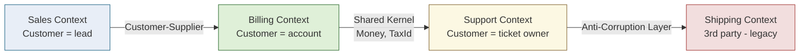

| Context-map relationship | Meaning | When to use | Coupling |
|---|---|---|---|
| Shared Kernel | shared subset of model/code | two teams, tight cooperation | high — change requires coordination |
| Customer-Supplier | upstream serves downstream's needs | downstream has influence | medium |
| Conformist | downstream just accepts upstream's model | no influence over upstream | high (one-way) |
| Anti-Corruption Layer (ACL) | translation layer isolates your model | integrating legacy/3rd-party | low — insulated |
| Open-Host Service | upstream publishes a stable public API | many consumers | low |
| Published Language | shared well-documented schema (e.g. events) | event-driven integration | low |

**The ACL is non-negotiable at any legacy/vendor seam.** When you integrate a legacy ERP, a payment processor, or any model you don't control, put an **anti-corruption layer** at the boundary — a translation layer that maps the foreign model into yours. Without it, the foreign model's quirks (a `customer_type` enum with 14 values, a date field that's actually a string, a "soft delete" flag you must remember) leak into your domain and metastasize. The ACL is cheap to build and pays for itself the first time the vendor changes their schema and only the ACL has to change.

**Conway's law and the Inverse Conway Maneuver.** Your architecture *will* mirror your communication structure (org chart). This is not a tendency; it's a law you should exploit. The **Inverse Conway Maneuver**: design the *team topology* to match the bounded contexts you want, then let the services follow the teams. If you want a clean Billing service, you need a Billing team that owns it end-to-end; if Billing logic is split across three teams, the service will be too (or it'll be a coordination nightmare). See [Leadership & Trade-offs](19-leadership-tradeoffs.md).

**Real examples.** A retailer integrating a legacy ERP wraps it in an **ACL** so the ERP's ugly model never leaks into the new Order service. Stripe is an **Open-Host Service** with a **Published Language** (its versioned API). Internal platform teams expose **published languages** via event schemas in a registry (Avro/Protobuf + schema registry).

**Pitfalls.** (1) The "single canonical model" fantasy — forcing one `Customer` schema org-wide; it collapses under conflicting requirements. (2) Skipping the ACL when integrating legacy, letting its model corrupt yours. (3) Overusing Shared Kernel — it re-couples the teams you were trying to decouple. (4) Mapping multiple bounded contexts onto one service (loses the boundary) or one context across many services (loses cohesion). (5) A context map that exists only in someone's head — if the relationship types aren't written down, the integration coupling is unmanaged.

> **Staff-level insight:** Bounded contexts are where DDD and Conway's law (see [Leadership & Trade-offs](19-leadership-tradeoffs.md)) meet. Your architecture *will* mirror your org chart, so the strategic act is the **Inverse Conway Maneuver**: design the team topology to match the bounded contexts you want, then let the services follow. When I review a microservices proposal, the first thing I look for is a context map with explicit relationship types — its absence means the boundaries are accidental and the integration coupling is unmanaged. An anti-corruption layer at the seam to any legacy or vendor system is non-negotiable. **Decision: one bounded context = one service = one team, with an explicit context map and an ACL at every legacy/vendor seam, because it aligns the model, the deploy unit, and the org; revisit if a context grows two divergent invariant sets (split it) or two contexts deploy in lockstep (you've mis-drawn the boundary).**

---

## 5. Inter-Service Communication

**Definition.** Services communicate either **synchronously** (caller blocks for a response — REST over HTTP, gRPC) or **asynchronously** (caller emits a message/event and continues — Kafka, RabbitMQ, SQS/SNS). This is the most consequential architectural choice in a microservices system because it dictates coupling, failure behavior, and consistency model.

**How it works.** Sync request/response is simple and gives immediate answers but creates **temporal coupling** — both services must be up *simultaneously*, and latency/failures cascade. Async messaging decouples in time: the producer doesn't know or wait for consumers, enabling fault tolerance, buffering, and fan-out, at the cost of eventual consistency and harder debugging. (Deep dive: [Messaging & Event-Driven](04-messaging-event-driven.md).)

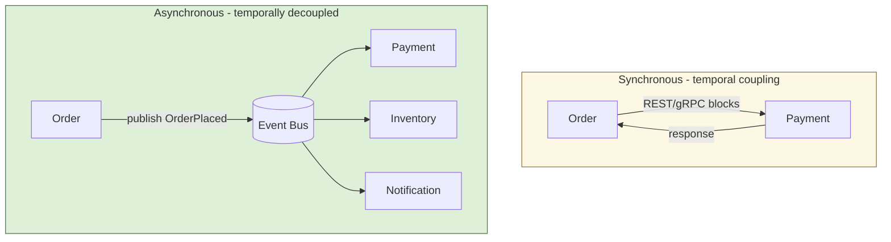

| Aspect | REST/HTTP | gRPC | Async messaging/events |
|---|---|---|---|
| Coupling | temporal | temporal | temporally decoupled |
| Latency | ms, network round-trip | lower (HTTP/2, binary) | producer is fire-and-forget |
| Payload | JSON (verbose) | Protobuf (compact, typed) | any (often Avro/Protobuf) |
| Streaming | limited | first-class bidi streaming | natural |
| Failure mode | caller sees error now | caller sees error now | buffered, retried later |
| Discoverability/tooling | universal, browser-friendly | needs proto + tooling | needs broker + schema registry |
| Best for | external APIs, simple queries | internal high-throughput RPC | workflows, fan-out, decoupling |
| Consistency | can be strong | can be strong | eventual |

**The availability math (the killer argument — earmark this).** Synchronous composition *multiplies* unavailability. If a user request synchronously depends on N services each at availability `a`, the composite availability is `a^N`:

| Per-service availability | Synchronous chain length N | Composite availability | Nines lost |
|---|---|---|---|
| 99.9% | 1 | 99.9% | — |
| 99.9% | 3 | 99.70% | ~½ nine |
| 99.9% | 5 | 99.50% | ~1 nine |
| 99.9% | 10 | 99.00% | ~1.5 nines |
| 99.99% | 5 | 99.95% | — |

You *lose a nine* by composing five reliable services synchronously. The fix is not "make each service more reliable" (diminishing returns and expensive); it's **shorten the synchronous critical path** so N is small, and push everything downstream of the user's acknowledgment onto async events where a temporarily-down consumer just processes the backlog later. Async breaks the multiplication entirely: the producer's availability no longer depends on the consumers'.

**Real examples.** Google and most internal Big Tech RPC is gRPC/Protobuf for efficiency and typed contracts. Public-facing APIs (Stripe, GitHub) are REST/JSON for ubiquity. Order pipelines (Uber, DoorDash, Amazon checkout) lean heavily on async events for the steps after the user-facing acknowledgment. Real-time chat is the extreme case: the message *send* is a short sync write, but the *delivery fan-out* to thousands of recipients is always async over a broker — synchronous fan-out would couple the sender's latency to the slowest recipient connection.

**Pitfalls.** (1) Defaulting to synchronous chains for everything — you build a distributed monolith whose availability is the *product* of all services' availabilities. (2) Using async where the user needs a synchronous answer (e.g., "is this card valid?") and bolting on polling. (3) Forgetting that async demands idempotent consumers and dead-letter handling. (4) gRPC across the public internet/browsers without a gateway/transcoding. (5) Async "fire and forget" with no dead-letter queue — failures vanish silently.

> **Staff-level insight:** Availability math is the killer argument. If a request synchronously fans out to five services each at 99.9% availability, the chain is 0.999^5 ≈ 99.5% — you *lost a nine* by composing reliable services synchronously. The Staff default is: **commands that the user waits on → sync with tight timeouts + fallbacks; everything downstream of the user's acknowledgment → async events.** "Sync for queries, async for state-change propagation" is a defensible one-liner, but the deeper principle is minimizing the synchronous critical path. **Decision: sync for the user-blocking critical path with tight timeouts and a fallback, async for everything after the acknowledgment, because availability multiplies on sync chains; revisit a hop to sync only if the user genuinely needs that answer in-band.**

---

## 6. Orchestration vs Choreography

**Definition.** In **orchestration**, a central coordinator (an orchestrator / workflow engine) explicitly tells each service what to do and in what order. In **choreography**, there is no central brain — each service reacts to events and emits its own, and the workflow *emerges* from the chain of reactions. This is the central design axis for multi-service business processes (e.g. order fulfillment) and for **sagas** (see [Module 02](02-distributed-systems.md)).

**How it works.** Orchestration centralizes the workflow logic in one place (e.g., a Saga Orchestrator or a workflow engine like Temporal/AWS Step Functions). It's explicit, observable, and easy to reason about, but the orchestrator becomes a coupling point and a potential bottleneck. Choreography distributes logic; services are loosely coupled and easy to add, but the end-to-end flow is *implicit* — no single place tells you what the process is, making debugging and reasoning about cycles hard.

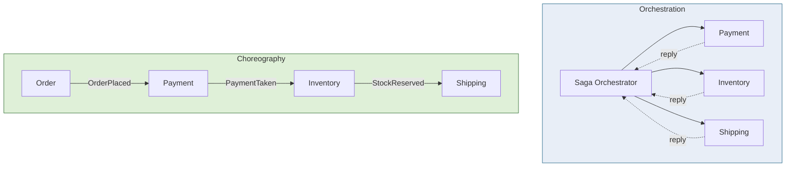

| Aspect | Orchestration | Choreography |
|---|---|---|
| Workflow logic | centralized in orchestrator | distributed across services |
| Coupling | services coupled to orchestrator | services coupled to events |
| Visibility | explicit, one place to look | implicit, must trace events |
| Add a step | change orchestrator | add a subscriber |
| Failure handling | central compensation logic | each service compensates |
| Risk | orchestrator = bottleneck/SPOF | cyclic dependencies, hard to debug |
| Best for | complex, long-running, auditable flows | simple, loosely-coupled fan-out |

**Worked saga — order fulfillment with compensations.** Place order → reserve inventory → capture payment → schedule shipment. Each step has a compensation:

| Step | Forward action | Compensation if a later step fails |
|---|---|---|
| 1 | Reserve inventory | Release reservation |
| 2 | Capture payment | Refund payment |
| 3 | Schedule shipment | Cancel shipment |

Orchestrated, the orchestrator holds this state machine, retries transient failures, and on a hard failure runs the compensations in reverse — and crucially, you can *query* "order #123 is at step 2, awaiting payment." Choreographed, each service must know what event to emit on failure and what to compensate, and the state lives nowhere — you reconstruct it from a distributed trace. For a 4-step saga that must be auditable, orchestration wins on operability alone. (Saga mechanics in depth: [Module 02](02-distributed-systems.md).)

**Real examples.** Netflix Conductor and Temporal/Cadence (Uber) are orchestration engines for complex, long-running, auditable workflows. AWS Step Functions orchestrates Lambda-based pipelines. Pure event choreography is common for simpler reactive flows (e.g., "user signed up → send welcome email, provision account, add to CRM").

**Pitfalls.** (1) Pure choreography for a complex 8-step saga — nobody can answer "what state is order #123 in?" without grepping logs across services. (2) An orchestrator that grows into a god-service holding all business logic (re-monolithing). (3) Choreography cycles (A's event triggers B, B's triggers A) producing infinite loops. (4) No saga log / no idempotency in either model. (5) Reaching for a heavyweight workflow engine for a 2-step flow that two events would handle.

> **Staff-level insight:** Choreography for *simple, stable* flows; orchestration for *complex, evolving, auditable* flows. The decisive factor at scale is **observability and operability**: when (not if) an order gets stuck, an orchestrator gives you a queryable state machine and a clear place to retry/compensate, whereas pure choreography forces you to reconstruct the workflow from distributed traces. Most mature systems end up *hybrid* — choreographed events between bounded contexts, orchestrated sagas *within* a complex business process. Reaching for Temporal/Step Functions for the hard sagas is a sign of seniority, not over-engineering. **Decision: choreography between contexts, orchestration within a complex/auditable saga, because operability dominates at scale; revisit to orchestration the moment a flow exceeds ~3-4 steps or anyone needs to query its state.**

---

## 7. Cross-Service Queries: API Composition vs CQRS

**Definition.** Once each service owns its own database, a query that needs data from *several* services (e.g., "show this customer's order with product details, current shipping status, and loyalty points") can no longer be a SQL join. The two solutions are **API Composition** (a composer fans out to each service at query time and stitches the result) and **CQRS read models** (maintain a denormalized, pre-joined view, updated by subscribing to the services' events).

**How it works.** *API Composition* is simple — a gateway/BFF or a dedicated composer calls each owning service and merges in memory. It's read-time work, so it suffers the fan-out latency problem and is bounded by the slowest dependency. *CQRS* (Command Query Responsibility Segregation) separates the write side (services owning their data) from a read side: a **materialized view** is built by consuming domain events and kept eventually consistent, so the cross-service query becomes a single fast lookup against the pre-joined view.

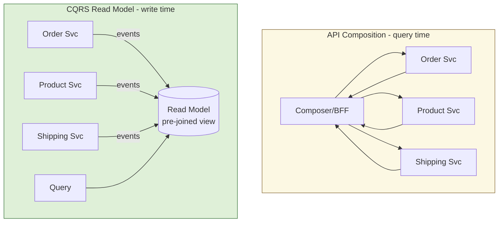

| Aspect | API Composition | CQRS Read Model |
|---|---|---|
| When work happens | at query time | at write time (async) |
| Read latency | sum/max of fan-out calls | single fast lookup |
| Data freshness | strongly consistent (live) | eventually consistent |
| Complexity | low | high (event pipeline, rebuilds) |
| Failure coupling | slowest/down dependency blocks read | read survives source outages |
| Storage cost | none extra | duplicated, denormalized data |
| Best for | simple, low-fan-out, fresh-data reads | high-read, complex joins, dashboards, search |

**The rebuild question is the crux (earmark it).** A CQRS read model you cannot deterministically rebuild from the event log (or snapshot + log) is a *liability*, not an asset. When (not if) a bug poisons the view — a bad consumer deploy double-applies events, or a schema change corrupts a field — your recovery is "replay the events to rebuild the view." If you can't, a one-hour fix becomes a multi-day data-reconciliation incident reconstructing state from source services that have since moved on. So before you adopt CQRS, answer: *where does the event log live, how far back does it retain, and can I replay it from a snapshot?* Kafka with log compaction or a long retention window, plus periodic snapshots, is the standard answer.

**Real examples.** API composition powers most BFF aggregation endpoints (mobile home screen pulling from 3-4 services). CQRS read models power product search (Elasticsearch index fed by catalog/inventory events), customer 360 dashboards, and order-history pages at Amazon/Uber scale. A chat "unread counts across all conversations" view is a classic CQRS read model — composing it live across thousands of conversations per user would be brutal fan-out, so you maintain a per-user denormalized counter updated by message/read events.

**Pitfalls.** (1) API composition with high fan-out → p99 amplification (covered in §16). (2) CQRS everywhere → massive accidental complexity; it's justified only when read/write asymmetry or join complexity is real. (3) Read models with no rebuild strategy — when a bug poisons the view, you must be able to replay events to rebuild it. (4) Forgetting CQRS read models are *eventually* consistent (read-your-writes anomalies in the UI). (5) Composing live across a dependency that's frequently down — the read inherits its downtime.

> **Staff-level insight:** Default to **API composition** for low fan-out, freshness-sensitive reads; reach for **CQRS read models** only when the read pattern is genuinely expensive to compose live (deep joins, high QPS, search/aggregation) or must survive source-service outages. The killer follow-up I always raise: "How do you *rebuild* the read model?" A CQRS view you cannot deterministically rebuild from the event log (or a snapshot + log) is a liability — when corruption happens, replayability is the difference between a one-hour fix and a multi-day data-reconciliation incident. **Decision: API composition by default, because it's simplest and strongly consistent; revisit to a rebuildable CQRS read model when the read is high-QPS, join-heavy, or must survive source outages.**

---

## 8. API Gateway & Backends-for-Frontends

> **Altitude: name-and-move-on for the basics.** "An API gateway does auth, routing, rate-limiting, and TLS termination at the edge." That's the whole pitch — don't spend three minutes on it. The judgment is *keep it thin* and *BFF per client*.

**Definition.** An **API Gateway** is a single entry point between external clients and internal services, handling cross-cutting concerns: routing, authentication/authorization, rate limiting, TLS termination, request/response transformation, and sometimes aggregation. A **Backend-for-Frontend (BFF)** is a *specialized* gateway per client type (web, iOS, Android, partner) that tailors and aggregates APIs to that client's exact needs.

**How it works.** The gateway terminates TLS, authenticates (validates JWT/OAuth tokens), enforces quotas and rate limits, and routes to the right backend service — sparing every service from re-implementing these. A BFF goes further: rather than one gateway serving all clients, each frontend gets its own backend owned by the frontend team, so the mobile BFF can return a single lean payload while the web BFF returns a richer one — eliminating chatty client-side fan-out and over-fetching.

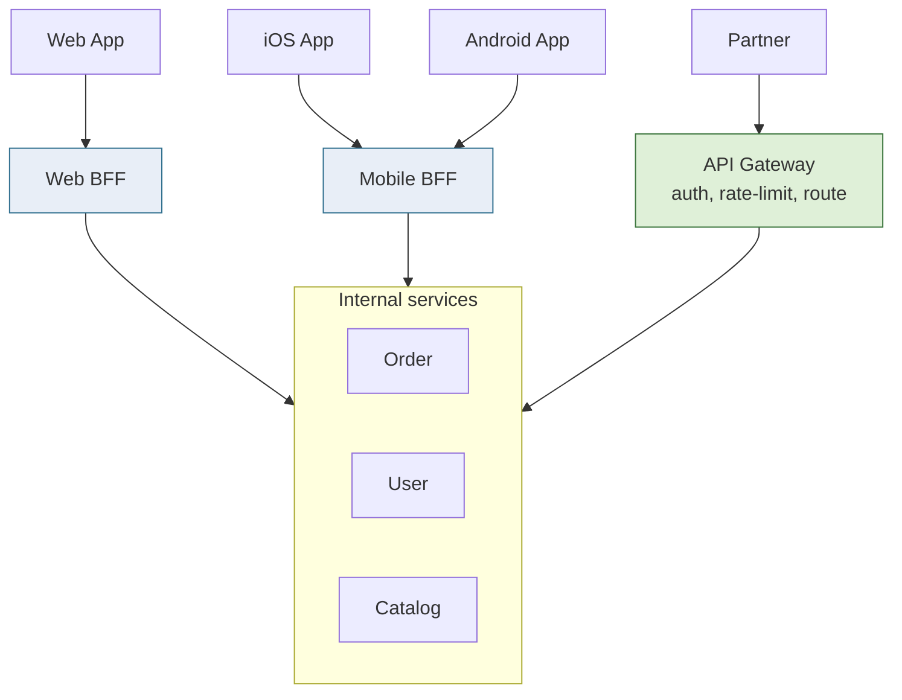

| Concern | API Gateway (shared) | BFF (per client) |
|---|---|---|
| Audience | all clients / partners | one client type |
| Owned by | platform/API team | the frontend team |
| Aggregation | generic | client-tailored |
| Payload shaping | minimal | optimized per device |
| Risk | god-gateway, team bottleneck | duplicated logic across BFFs |
| Best for | external/public APIs, common policy | divergent client needs |

**The boundary to enforce: a gateway must never contain a business rule.** The moment domain logic lands in the gateway, it becomes a deploy bottleneck coupling every team — every business change now requires a gateway deploy, and the gateway team becomes the org's critical path. Keep the gateway to *policy* (auth, routing, rate-limit, TLS) and push *aggregation* into BFFs owned by client teams or a dedicated composition layer.

**Real examples.** Netflix popularized the BFF pattern (different backends for TV, mobile, web). Kong, AWS API Gateway, Apigee, Envoy-based gateways, and Spring Cloud Gateway implement the gateway role. GraphQL is sometimes used as a BFF/aggregation layer to let clients request exactly the fields they need. For real-time clients, the "gateway" is often a stateful WebSocket edge tier — it terminates the connection, authenticates once, and fans messages in/out — which is a BFF specialized for persistent connections.

**Pitfalls.** (1) The gateway becoming a **god object** with business logic — keep it to cross-cutting concerns, not domain rules. (2) The gateway as an org bottleneck (every team waits on the gateway team for route changes). (3) BFF logic duplication across web/mobile BFFs. (4) Putting heavy aggregation in the gateway, making it a latency and failure chokepoint.

> **Staff-level insight:** Keep the gateway *thin* (auth, routing, rate-limit, TLS — policy, not domain logic) and push *aggregation* into BFFs owned by client teams, or into a dedicated composition layer. The boundary I enforce: a gateway should never contain a business rule, because the moment it does, it becomes a deployment bottleneck coupling every team. BFFs solve the "mobile needs a different shape than web" problem cleanly, but watch the duplication tax — when three BFFs reimplement the same auth/aggregation, extract a shared library or a thin composition service rather than copy-pasting. **Decision: thin gateway for policy, BFF per client for aggregation, because it keeps domain logic out of the org's critical path; revisit to a shared composition service when BFFs start duplicating aggregation logic.**

---

## 9. Service Discovery

> **Altitude: name-and-move-on.** "On Kubernetes, discovery is DNS — I don't hand-roll a registry." That's the answer in one line. The only interesting part is narrating the *evolution* registry → DNS → mesh.

**Definition.** **Service discovery** lets services find the network locations (IP:port) of other services, which in a dynamic, autoscaling, container world change constantly. Two models: **client-side discovery** (the client queries a registry and load-balances itself) and **server-side discovery** (the client hits a fixed endpoint — a load balancer or the platform — which resolves and routes).

**How it works.** Services register themselves (or are registered) in a **service registry** (Consul, Eureka, etcd, ZooKeeper) on startup and send heartbeats; the registry removes dead instances. In *client-side* discovery (Netflix Eureka + Ribbon (legacy)), the client fetches the instance list and picks one. In *server-side* discovery, the client calls a stable name and a router/LB does the lookup. **Kubernetes** implements server-side, DNS-based discovery: a `Service` object gets a stable virtual IP and DNS name (`orders.default.svc.cluster.local`); `kube-proxy`/CNI load-balances across the healthy pod endpoints maintained by the control plane.

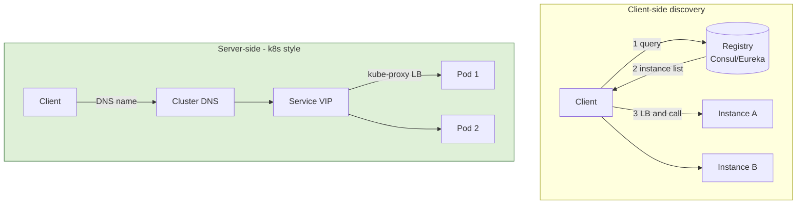

| Aspect | Client-side | Server-side / DNS (k8s) |
|---|---|---|
| Who load-balances | the client (smart client) | the platform/LB (thin client) |
| Client complexity | high (registry-aware) | low (just a name) |
| Language coupling | needs lib per language | language-agnostic |
| Examples | Eureka+Ribbon, Consul | k8s Services, AWS Cloud Map, ALB |
| Extra hop | none | one (through LB/proxy) |
| Failure point | registry | LB/router + control plane |

**Real examples.** Netflix's OSS stack used Eureka (client-side). HashiCorp Consul provides registry + health checks + DNS. Kubernetes is the de-facto standard today: DNS-based server-side discovery built in, often augmented by a service mesh for richer load balancing (see §10).

**Pitfalls.** (1) Stale registry entries routing traffic to dead instances (heartbeat/health-check tuning matters). (2) DNS caching/TTL issues causing clients to keep hitting old IPs. (3) The registry as a SPOF — it must be HA (Consul/etcd are themselves clustered with Raft). (4) Reinventing discovery when the platform (k8s) already provides it.

> **Staff-level insight:** On Kubernetes, you mostly *shouldn't think about service discovery* — the platform provides DNS-based server-side discovery for free, and a service mesh adds smarter L7 load balancing on top. The interview signal is recognizing the *trade*: client-side discovery gives you sophisticated, latency-aware load balancing without an extra network hop, but at the cost of a discovery library in every language — which is exactly why the industry shifted the smarts into the *sidecar* (mesh), getting client-side intelligence without polluting application code. That evolution — registry → DNS → mesh — is the throughline a Staff Engineer should narrate. **Decision: use the platform's DNS-based discovery (k8s), because hand-rolling a registry is reinventing a solved problem; revisit toward mesh-managed discovery when you need latency-aware L7 load balancing across many languages.**

---

## 10. Sidecar, Service Mesh, Ambassador, Adapter

**Definition.** The **sidecar** pattern deploys a helper process/container alongside each service instance, sharing its lifecycle and network namespace, to handle cross-cutting concerns *out of process*. A **service mesh** (Istio, Linkerd, Consul Connect) is a network of sidecar proxies (the **data plane**, typically Envoy) coordinated by a **control plane**, providing mTLS, traffic management (retries, timeouts, circuit-breaking, traffic shifting), and observability — *without changing application code*. **Ambassador** (sidecar as an outbound proxy to remote services) and **Adapter** (sidecar normalizing a service's output, e.g., metrics format) are specialized sidecars.

**How it works.** Each pod runs the app container plus an Envoy sidecar; all inbound/outbound traffic transparently routes through the sidecar. The control plane (Istiod for Istio) pushes config to all sidecars: who can talk to whom (policy), mTLS certificates (automatic mutual TLS between services), retry/timeout/circuit-breaker rules, and traffic-splitting (e.g., 95% v1 / 5% v2 for canaries). Telemetry (golden signals, distributed-trace spans) is emitted by the sidecars uniformly, giving observability for free (see [Observability](12-observability.md)). Reliability concerns — timeouts, retries, circuit breaking — are offloaded from app code to the mesh (see [Reliability](11-reliability.md)).

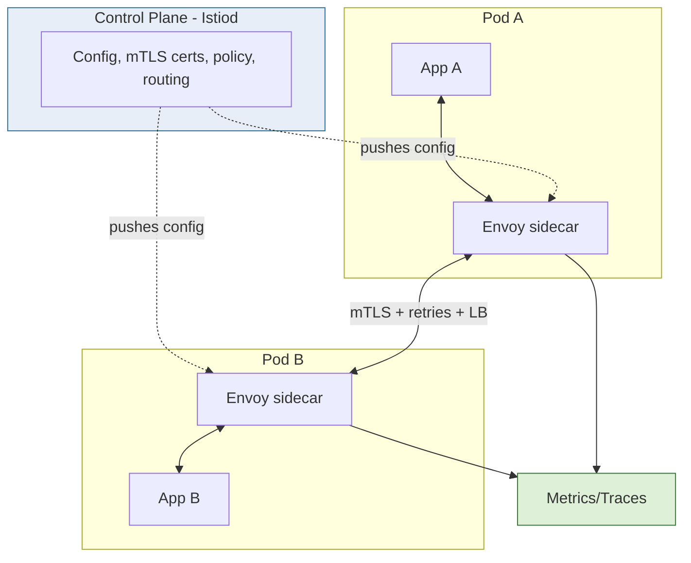

| Capability | Without mesh | With service mesh |
|---|---|---|
| mTLS between services | hand-rolled per service | automatic, control-plane managed |
| Retries/timeouts/circuit-break | library per language | sidecar config, language-agnostic |
| Traffic shifting / canary | custom routing | declarative weights |
| Observability (golden signals) | instrument each app | uniform from sidecars |
| Policy / authZ between services | bespoke | central policy |
| Cost | low infra, high code | infra + latency overhead, low code |

| Sidecar variant | Direction | Purpose | Example |
|---|---|---|---|
| Mesh proxy (Envoy) | in & out | full L7 management | Istio/Linkerd |
| Ambassador | outbound | proxy to remote/external service | DB proxy, API client |
| Adapter | output | normalize interface/format | metrics exporter, log shipper |

**The cost you're buying (be specific).** A mesh isn't free — each hop now traverses two extra proxies. Budget roughly:
- **Latency:** ~0.5-2 ms added per hop (two proxy traversals); negligible for most APIs, but it *compounds* across a deep call chain — five hops can add several ms of pure proxy overhead.
- **Resources:** ~50-150 MB memory and a fraction of a CPU per sidecar; at thousands of pods this is a real cluster-capacity line item (which is why Istio ambient mode and eBPF/Cilium aim to reduce per-pod sidecars).
- **Operational:** a control plane to run, version, and upgrade; debugging now includes "is it the app or the Envoy?"

**The when (the actual judgment):** below ~10-20 services, a shared resilience library (Resilience4j on the JVM, Polly in .NET) plus k8s DNS is simpler and cheaper. Above that — especially with multiple languages — the per-team cost of re-implementing mTLS and retries *correctly* in five languages exceeds the mesh's tax.

**Real examples.** Istio (Envoy data plane + Istiod control plane) and Linkerd (lighter, Rust micro-proxy) are the dominant meshes. Lyft created Envoy. Consul Connect provides mesh on Consul. Cilium offers an eBPF-based, sometimes sidecar-less mesh; Istio's ambient mode also reduces per-pod sidecars.

**Pitfalls.** (1) Adopting a mesh before you have enough services to justify it — the operational complexity (control-plane ops, version upgrades, debugging Envoy) is real. (2) Latency/resource overhead — every hop now passes through two extra proxies (a few hundred microseconds to low ms, plus CPU/memory per sidecar). (3) Treating the mesh as a silver bullet for a bad architecture — it doesn't fix a distributed monolith. (4) Hidden failure modes when the control plane misconfigures the data plane.

> **Staff-level insight:** A service mesh moves cross-cutting networking concerns (mTLS, retries, timeouts, circuit breaking, traffic shifting, golden-signal telemetry) *out of every application in every language* and into a uniform infrastructure layer — that's its real value: **consistency and language-agnosticism at scale**, not raw capability. The Staff judgment is *when*: below ~10-20 services, a shared resilience library (Resilience4j/Polly) plus k8s DNS is simpler and cheaper. Above that, the per-team cost of re-implementing mTLS and retries correctly in five languages exceeds the mesh's operational tax. And never sell a mesh as a cure for architecture — it makes a distributed monolith *observably* slow, not fast. **Decision: shared resilience library + k8s DNS below ~10-20 services, service mesh above it, because the value is language-agnostic consistency not raw capability; revisit to a mesh when you have polyglot services re-implementing mTLS/retries.**

---

## 11. Strangler Fig: Migrating Off a Monolith

**Definition.** The **Strangler Fig** pattern (Fowler) incrementally replaces a legacy monolith by routing specific functionality to new services one slice at a time, behind a **façade/proxy**, until the monolith is "strangled" and can be retired — *without a risky big-bang rewrite*.

**How it works.** Place a routing façade (gateway/proxy) in front of the monolith. For each capability you extract, build the new service, then flip the façade to route that capability's traffic to the new service while everything else still hits the monolith. Data is migrated incrementally (often with dual-write or CDC during transition). Repeat slice by slice. Each step is independently shippable and reversible, so risk stays bounded — the opposite of a multi-year rewrite that delivers value only at the end (and usually fails).

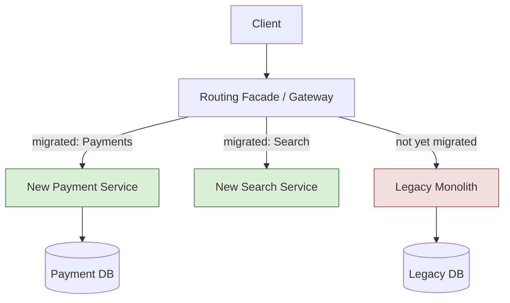

| Migration approach | Risk | Time-to-value | Reversibility |
|---|---|---|---|
| Big-bang rewrite | very high | only at the end | low |
| Strangler fig | low, incremental | continuous | high (per slice) |
| Branch-by-abstraction | low | continuous | high |

**Never propose a big-bang rewrite.** It is the canonical career-ending project (Joel Spolsky's "Things You Should Never Do") — it delivers value only at the end, by which point the requirements have moved, the old system has kept evolving, and you're maintaining two systems. In an interview, proposing one is a *junior* signal. The strangler fig is the fundable, de-risked answer.

**Real examples.** Practically every large monolith-to-services migration (banks, retailers, Amazon's original split) used some strangler variant. The façade is often an existing API gateway; data migration leans on the transactional-outbox/CDC tooling from §13.

**Pitfalls.** (1) The "strangler" that never finishes — the last 20% of the monolith lives forever because it's the gnarliest; budget explicitly for full retirement with a decommissioning mandate. (2) Data coupling: the new service and monolith sharing tables during transition (manage with CDC + dual-write, then cut over). (3) The façade accumulating logic and becoming a new monolith. (4) Extracting easy slices first and leaving the hard core untouched (sometimes you must extract a hard seam early to unlock the rest).

> **Staff-level insight:** Never propose a big-bang rewrite in an interview — it's the canonical career-ending project ("Things You Should Never Do"). The strangler fig is the *correct, fundable, de-risked* answer because it delivers value continuously and is reversible per slice. The two hardest parts are (1) the **data**, not the code — you'll need outbox/CDC and a careful dual-write-then-cutover plan, and (2) **finishing** — without an explicit decommissioning mandate, the monolith becomes immortal and you've added distribution cost on top of legacy cost. Sequence extractions by *seam strength and business value*, not by what's easiest. **Decision: strangler fig with a routing façade and a funded decommissioning mandate, because it's reversible per slice and delivers value continuously; the hard parts are the data migration and finishing — sequence by seam strength and business value, not by ease.**

---

## 12. Data Management: Database-per-Service

> **Altitude: deep-dive.** This is the line that separates microservices from a distributed monolith. If you enforce only one rule, enforce this one.

**Definition.** **Database-per-service** is the foundational microservices data principle: each service exclusively owns its data store; no other service may read or write it directly — access is *only* through the owning service's API. The opposing **shared-database anti-pattern** lets multiple services read/write the same schema, which silently re-couples them.

**How it works.** Private data means a service can choose the right database for its job (polyglot persistence — Postgres for orders, Elasticsearch for search, Redis for sessions, Cassandra for time-series), evolve its schema independently, and scale its storage independently. The cost is that you lose cross-service ACID transactions and SQL joins, which forces sagas (§6, [Module 02](02-distributed-systems.md)), API composition / CQRS (§7), and event-driven duplication (§14).

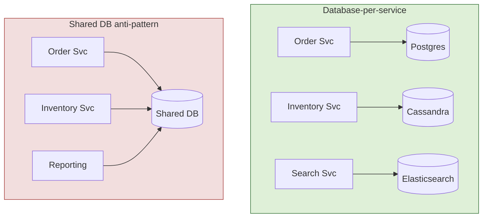

| Aspect | Database-per-service | Shared database |
|---|---|---|
| Coupling | low (API only) | **high (schema is the contract)** |
| Schema evolution | independent | coordinated, blocking |
| Tech choice | polyglot per service | one-size-fits-all |
| Transactions across services | sagas / eventual | ACID (but couples) |
| Cross-service query | composition / CQRS | SQL join (tempting trap) |
| Failure isolation | strong | shared blast radius |
| Best for | true microservices | NOT recommended |

**The analytics objection (the hardest one — have the answer ready).** Someone always says "but we need to join across everything for reporting." The wrong answer is "let the analytics service read the OLTP tables" — that *is* the shared-DB anti-pattern wearing a hat, and it couples every service's schema to the report writers. The right answer: **stream every service's events (or CDC) into a data warehouse / lake**, where the joins live, keeping the operational stores private. Analytics queries the warehouse; OLTP stays owned. This is non-negotiable and it's the single most common place "microservices" quietly collapse into a distributed monolith.

**Real examples.** Amazon's two-pizza teams each own their data stores. Polyglot persistence is standard at Netflix (Cassandra, EVCache, Elasticsearch). The shared-DB anti-pattern is the most common reason a "microservices" system is actually a distributed monolith — teams share a database to avoid the pain of distributed data, and re-couple everything.

**Pitfalls.** (1) A "reporting" or "analytics" service that reads everyone's tables directly — the shared-DB anti-pattern in disguise; instead, replicate to a data warehouse via events/CDC. (2) Foreign keys across service boundaries (impossible to enforce, and they encode coupling). (3) "Just this one shared table" — it never stays one. (4) Underestimating the operational cost of running many databases (backups, upgrades, failover × N).

> **Staff-level insight:** Database-per-service is the *non-negotiable* line that separates microservices from a distributed monolith — the moment two services share a schema, the schema *is* the contract and you've coupled their deploy cadence, their failure domains, and their data models. The hardest objection in interviews is reporting/analytics ("but we need to join across everything"): the right answer is never "let analytics read the OLTP tables" — it's stream all services' events (or CDC) into a warehouse/lake where the joins live, keeping the operational stores private. If you only enforce one rule when adopting microservices, enforce this one; everything else is recoverable, shared databases are not. **Decision: database-per-service with zero shared schemas, because the schema is the contract and sharing it re-couples everything; route analytics to a warehouse via events/CDC — never relax this rule.**

---

## 13. The Dual-Write Problem & Transactional Outbox

> **Altitude: deep-dive.** This is the most under-appreciated correctness bug in event-driven microservices. Naming the fix unprompted is one of the clearest senior signals there is.

**Definition.** The **dual-write problem** arises when a service must atomically (a) update its database *and* (b) publish an event/message — but the database and the message broker are two separate systems with no shared transaction. If you write to the DB then publish, a crash in between loses the event (DB updated, no event) or, if reordered, publishes a phantom event (event sent, DB rolled back). The **transactional outbox** pattern solves it: write the event into an *outbox table* in the *same* DB transaction as the state change, then relay it to the broker separately — usually via **Change Data Capture (CDC)**.

**How it works.** Within one ACID transaction, the service writes both the business row and an outbox row. A separate relay process — the **CDC** approach reads the DB's transaction log (Debezium reading Postgres WAL / MySQL binlog) — picks up new outbox rows and publishes them to Kafka, then marks them sent. Because the outbox write is atomic with the business write, the event is *guaranteed* to exist; because the relay is at-least-once, consumers must be idempotent. This converts an impossible distributed transaction into two local, recoverable steps.

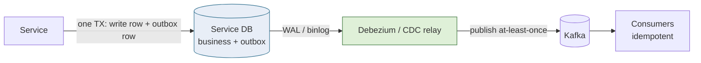

| Approach | Atomicity | Ordering | Risk |
|---|---|---|---|
| Write DB then publish (naive dual-write) | **none** | none | lost or phantom events |
| 2PC / XA across DB + broker | yes | yes | slow, fragile, poor support |
| Transactional outbox + polling relay | yes | per-aggregate | polling latency, table growth |
| Transactional outbox + CDC (log tailing) | yes | per-aggregate (via partition key) | CDC infra to operate |
| Event sourcing (event log is source of truth) | yes (single write) | yes | full paradigm shift |

**The failure trace that makes it concrete.** Naive `db.save()` then `kafka.publish()`:
1. `db.save()` commits — the order row is now persisted.
2. The pod is OOM-killed / the node reboots / the network partitions *before* `kafka.publish()` runs.
3. The order exists; the `OrderPlaced` event never fires. Payment, inventory, and shipping never hear about it. The order is silently stuck forever, and nothing alerts because each service is individually healthy.

This is not a rare edge case — under any meaningful throughput with rolling deploys and autoscaling, pods restart constantly, so this *will* happen at a predictable rate. The outbox makes the event atomic with the row, so step 3 is impossible. The price is at-least-once delivery (the relay might publish a row twice if it crashes after publishing but before marking sent) — which is why **every consumer must be idempotent** (dedupe on an idempotency key) and you key Kafka by aggregate ID for per-aggregate ordering.

**Real examples.** Debezium (Red Hat) is the standard CDC tool feeding Kafka from Postgres/MySQL/MongoDB. The outbox pattern is documented by Debezium and widely used at companies running event-driven microservices. Event sourcing (Axon, EventStore) is the more radical alternative where the event log *is* the database. (See [Messaging & Event-Driven](04-messaging-event-driven.md).)

**Pitfalls.** (1) Believing "write DB, then publish to Kafka" is safe — it is the bug, not the fix; one in N crashes loses an event. (2) Reaching for 2PC/XA — broker support is poor and it serializes throughput. (3) Outbox table bloat without a purge/archival job. (4) Forgetting that CDC delivers *at-least-once*, so every consumer must dedupe (idempotency keys). (5) Ordering: ensure per-aggregate ordering (Kafka key = aggregate ID).

> **Staff-level insight:** The dual-write problem is the single most under-appreciated bug in event-driven microservices — naive teams write `db.save()` then `kafka.publish()` and ship a data-loss bug that only manifests under crash/partition. When an interviewer mentions "publish an event when an order is placed," the *immediate* Staff response is "I'd use a transactional outbox with CDC so the event is atomic with the state change, and make consumers idempotent because delivery is at-least-once." Naming outbox + CDC + idempotency unprompted is one of the clearest senior signals in distributed-data design. The deeper truth: you can have atomicity *or* dual systems, never both at once — so collapse the two writes into one local transaction and relay asynchronously. **Decision: transactional outbox + CDC (Debezium) + idempotent consumers, because it makes the event atomic with the state change without 2PC; this is non-negotiable in any service that emits events.**

---

## 14. Eventual Consistency, Duplication & Materialized Views

**Definition.** With private databases and no distributed transactions, microservices systems are **eventually consistent**: after a change, replicas/derived data converge to a consistent state *after some delay*, not instantly. To serve cross-service data efficiently, services **duplicate** the bits of other services' data they need (a denormalized **materialized view**), kept fresh by consuming events.

**How it works.** When Service B needs some of Service A's data (e.g., Shipping needs the customer's address from the Order/Customer service), instead of synchronously calling A on every request, B subscribes to A's events and keeps a *local read-optimized copy* of just the fields it needs. This trades storage and consistency lag for availability and latency: B keeps working even if A is down, and reads are local. The application and UX must be designed for the lag (read-your-writes handling, "processing…" states, idempotency).

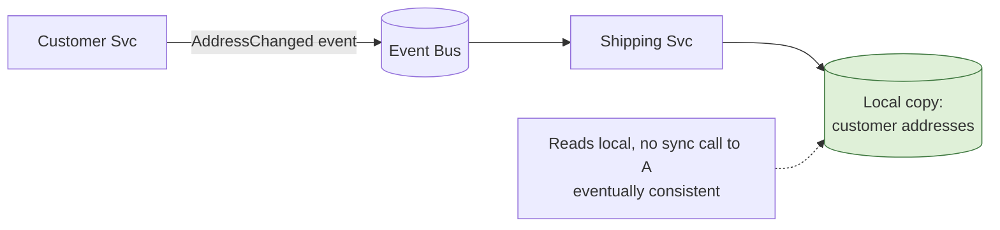

| Consistency model | Guarantee | Latency | Availability | Use in microservices |
|---|---|---|---|---|
| Strong (ACID/linearizable) | read sees latest write | higher (coordination) | lower (CAP: CP) | within one service/aggregate |
| Eventual | converges later | low (local reads) | high (CAP: AP) | across services (the norm) |
| Causal / read-your-writes | session ordering | medium | high | UX-sensitive flows |

**Map every dependency to a consistency requirement (the Staff move).** Eventual consistency is the *deliberate price* you pay for availability and autonomy — and the skill is making it invisible where it matters and acceptable where it doesn't. Tag each cross-service data dependency:

| Data | Tolerable lag? | Required consistency | Why |
|---|---|---|---|
| Displayed customer name | seconds, fine | eventual | wrong name for 2s harms nobody |
| Recommendation / feed rank | seconds, fine | eventual | inherently approximate |
| Account balance / payment | **no** | strong (one aggregate or saga w/ reservation) | double-charge is a real-money bug |
| Inventory count for "buy" | **no** | strong (reserve in one aggregate) | overselling is a real-world failure |
| Chat unread count | seconds, fine | eventual | a slightly stale badge is acceptable |

The interview trap is a flow that *looks* fine under eventual consistency but hides an invariant (double-charging, overselling). Spotting where you need strong vs eventual — and *saying why* — is the mid-level/Staff differentiator.

**Real examples.** Order-history pages, search indexes, recommendation features, and "customer 360" views are materialized views fed by events. Most large consumer systems (Amazon cart/catalog, social feeds) are eventually consistent and design the UX around it. Chat read-receipts and presence are deliberately eventually consistent — a "delivered" tick arriving a second late is fine, and forcing strong consistency there would tank availability.

**Pitfalls.** (1) Pretending the system is strongly consistent — then a user updates their address and the shipping label uses the old one for a few seconds, causing a real-world error. (2) Unbounded duplication — copying *all* of A's data into B (just copy what B needs). (3) No event versioning — a schema change in A's events silently breaks B's view. (4) Forgetting read-your-writes: a user changes something and doesn't see it reflected, files a bug. (5) No way to rebuild a corrupted view from the event log.

> **Staff-level insight:** Eventual consistency is not a bug to be tolerated — it's the *deliberate price* you pay for availability and autonomy, and the Staff skill is making it *invisible to users where it matters and acceptable where it doesn't*. Map each cross-service data dependency to a consistency requirement: money and inventory often need strong consistency (so keep them in one aggregate/service or use a saga with reservations); a displayed name or a recommendation can lag seconds with zero harm. The recurring interview trap is a flow that *looks* fine under eventual consistency but has a hidden invariant (double-charging, overselling) — naming where you need strong vs eventual consistency, and *why*, is the differentiator between a mid-level and a Staff answer. **Decision: eventual consistency by default across services with per-dependency tagging, because it buys availability and autonomy; revisit to strong consistency (single aggregate or saga with reservation) for money and inventory invariants.**

---

## 15. Cross-Cutting Challenges

> **Altitude: tracing is a deep-dive (you cannot debug a distributed system without it); the rest are name-the-standard-solution-and-move-on.**

**Definition.** Independent of decomposition, every microservices system must solve a recurring set of cross-cutting concerns: **distributed tracing**, **inter-service failure handling**, **versioning/backward compatibility**, **contract testing**, and **independent deployment**. These are where "we have microservices" succeeds or fails operationally.

**How it works (each concern):**

- **Distributed tracing** — a request gets a **correlation/trace ID** at the edge, propagated through every hop via headers (W3C Trace Context `traceparent`); each service emits **spans** with parent links, assembled into one trace in Jaeger/Tempo/Zipkin. Context propagation must cross sync calls *and* async messages (trace ID in the message header). See [Observability](12-observability.md).
- **Failure handling** — networks fail, so every remote call needs a **timeout**, bounded **retries** (with exponential backoff + jitter, idempotency to make retries safe), and a **circuit breaker** to stop hammering a failing dependency, plus **bulkheads** to isolate resource pools. See [Reliability](11-reliability.md).
- **Versioning** — services must evolve without lockstep deploys: additive/backward-compatible changes, tolerant readers, never remove/repurpose a field consumers use; version explicitly (`/v2`, Protobuf field numbers) when you must break.
- **Contract testing** — **consumer-driven contracts** (Pact) let consumers declare expectations that providers verify in CI, catching breaking changes *before* deploy without slow end-to-end environments.
- **Deployment** — services deploy **independently**; de-risk with **canary** (route a small % to the new version) and **blue-green** (instant switch + instant rollback).

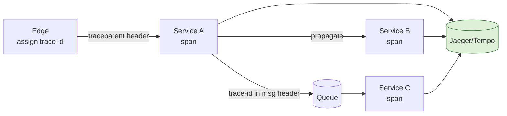

| Challenge | Without it | Standard solution |
|---|---|---|
| Cross-service debugging | grep logs in N services | distributed tracing + correlation IDs |
| Cascading failure | one slow dep takes all down | timeout + retry/backoff + circuit breaker |
| Breaking API change | consumers break on deploy | backward-compat + consumer-driven contracts (Pact) |
| Risky releases | big-bang, hard rollback | canary / blue-green / feature flags |
| Slow integration testing | flaky end-to-end envs | contract testing in CI |

| Deployment strategy | Mechanism | Rollback | Risk exposure |
|---|---|---|---|
| Rolling | replace instances gradually | redeploy old | medium |
| Blue-green | two envs, switch traffic | instant flip back | low, 2× cost briefly |
| Canary | small % then ramp | route back to stable | lowest (graduated) |

**The retry-storm trap (numbers).** Retries are safe only with idempotency *and* backoff+jitter — otherwise they amplify outages. If a downstream service degrades and every caller retries 3× immediately, you've tripled the load on an already-struggling service, guaranteeing it stays down (a metastable failure). Exponential backoff with jitter spreads the retries; a circuit breaker stops them entirely once the failure rate crosses a threshold, giving the downstream room to recover. The rule: **retry + idempotency + backoff + jitter + circuit breaker, or don't retry at all.** See [Reliability](11-reliability.md).

**Real examples.** OpenTelemetry + Jaeger/Tempo for tracing (now the vendor-neutral standard). Resilience4j (JVM), Polly (.NET), or a service mesh for resilience. Pact for consumer-driven contracts. Argo Rollouts/Flagger for automated canaries; LaunchDarkly for feature flags.

**Pitfalls.** (1) Tracing that breaks at the async boundary (no trace propagation through queues) — your trace ends at the producer. (2) Retries without idempotency → duplicate side effects (double charge). (3) Retry storms amplifying an outage (retries on top of retries). (4) "We'll test end-to-end" instead of contract tests — slow, flaky, blocks independent deploys. (5) Breaking changes shipped because nobody knows who consumes the field.

> **Staff-level insight:** The three I refuse to ship microservices without: **correlation IDs / distributed tracing** (you *cannot* debug a distributed system from logs alone), **idempotency on every retried operation** (because at-least-once + retries make duplicate delivery a certainty, not an edge case), and **consumer-driven contract tests** (the only scalable way to preserve independent deployability — end-to-end test suites become the coordination bottleneck microservices were meant to eliminate). Notice these are the concerns that *enable* autonomy; skip them and you get the costs of microservices with none of the deploy-independence benefit. **Decision: tracing + idempotency + consumer-driven contracts are non-negotiable from day one, because they are what make autonomy real; everything else is tuning.**

---

## 16. The Distributed Monolith & Latency Amplification

> **Altitude: deep-dive the fan-out math.** The tail-latency multiplication is non-intuitive and is exactly the kind of quantitative reasoning that separates a Staff answer.

**Definition.** A **distributed monolith** is the worst-of-both-worlds outcome: services that are physically separate but so tightly coupled (synchronous call chains, shared database, lockstep deploys, shared models) that they must be deployed and reasoned about together — you pay all the distribution costs and get none of the autonomy benefits. **Latency amplification / the fan-out p99 problem** is the phenomenon where one request fanning out to many services makes *tail* latency dominate, because the overall latency is bounded by the *slowest* of the parallel calls.

**How it works.** Synchronous fan-out: a request to N services in parallel completes only when the *slowest* returns, so the request's p99 approaches the *max* of the dependencies' tails. Worse, the more services you call, the more likely *at least one* is slow: if each service is fast 99% of the time, calling 100 of them means the chance that *all* are fast is 0.99^100 ≈ 37% — i.e., ~63% of requests hit at least one slow tail. This is why "more services = slower tails" unless you actively manage it (hedged requests, timeouts, fewer hops, async). Chatty services (many small calls where one would do) and N+1 patterns across the network compound it.

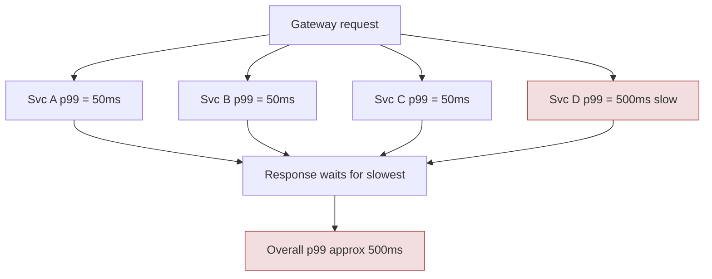

**The fan-out tail math (memorize this — it's the quantitative crux).** If each backend is "slow" (above some tail threshold) with probability `p`, then a parallel fan-out to N backends is *all-fast* with probability `(1-p)^N`:

| Per-service "slow" prob p | Fan-out N | P(all fast) = (1-p)^N | P(≥1 slow) |
|---|---|---|---|
| 1% | 5 | 95.1% | 4.9% |
| 1% | 10 | 90.4% | 9.6% |
| 1% | 100 | 36.6% | **63.4%** |
| 0.1% | 100 | 90.5% | 9.5% |

The lesson is brutal and non-intuitive: **composing many "usually fast" services synchronously makes the *common* case slow.** A backend that's slow only 1% of the time, fanned out to 100, means ~63% of user requests hit at least one slow tail. The mitigations (from Google's "The Tail at Scale"): **shorten the synchronous critical path** (fewer hops), **hedge / tied requests** (send to two replicas, take the first; cancel the loser), **cache / duplicate locally** to remove the hop entirely, and **aggressive timeouts with fallbacks** so one slow service can't hold the request hostage.

| Symptom | Distributed monolith tell-tale | Healthy microservices |
|---|---|---|
| Deploys | must deploy services together | independent deploys |
| Data | shared database / tables | database-per-service |
| Calls | deep synchronous chains | async events, shallow sync |
| Change | one feature touches many services | change isolated to one service |
| Tail latency | dominated by slowest hop | bounded, hedged, cached |
| Coupling | shared models, lockstep versioning | tolerant readers, contracts |

**Real examples.** Segment's revert to a monolith was partly distributed-monolith pain. Many "we did microservices" failures are really distributed monoliths. Google's "The Tail at Scale" paper documents fan-out tail amplification and remedies (hedged/tied requests, request reissue). On a chat platform, fan-out *is* the tail problem in its purest form: delivering one message to a 10,000-member channel means the user's perceived "sent" latency must *not* wait on all 10,000 deliveries — you acknowledge on the local write and fan out asynchronously, or the tail of the slowest connection becomes everyone's latency.

**Pitfalls.** (1) Synchronous chains 5+ deep — multiplies latency *and* failure probability. (2) Ignoring tail latency and optimizing the mean (users feel p99, and fan-out makes p99 the common case). (3) Chatty N+1 across the network (loop calling a service per item). (4) Coupling via shared libraries that force coordinated upgrades. (5) Assuming parallel fan-out is "free" — it's bounded by the worst tail.

> **Staff-level insight:** "Microservices" and "distributed monolith" are physically identical — the difference is entirely *coupling*, and the four diagnostics are: can each service deploy independently, does each own its data, is the synchronous call depth shallow, and is each change isolated to one service. If any answer is no, you've built a distributed monolith and should stop adding services. On latency: the math is brutal and non-intuitive — composing 99th-percentile-reliable services synchronously yields *unreliable* tails, because tails *multiply across fan-out*. The mitigations a Staff Engineer reaches for — shorten the synchronous critical path (go async post-acknowledgment), cache/duplicate to avoid the hop, hedge requests, and set aggressive timeouts with fallbacks — are about *controlling the tail*, which at scale *is* the user experience. **Decision: keep synchronous call depth shallow and fan-out async, because tails multiply across synchronous fan-out; the four distributed-monolith diagnostics (independent deploy, own data, shallow sync, isolated change) are your stop-adding-services trigger.**

---

## 17. When NOT to Use Microservices

> **This is the section that demonstrates seniority more than any other.** Recommending microservices unconditionally is a junior signal; recommending them surgically and reluctantly is a Staff signal.

**Definition.** Microservices are a solution to *specific organizational and scaling problems*, not a default architecture. The honest costs — operational complexity, network unreliability, distributed-data difficulty, debugging hardness, and org overhead — mean that for most teams, *most of the time*, a (modular) monolith is the correct choice. This section is the decision framework.

**How it works — the costs you're buying:**

- **Operational complexity:** N deployments, N pipelines, N databases (backups/upgrades/failover), service discovery, a mesh, distributed tracing — you need real platform/SRE maturity.
- **Network reliability:** in-process calls become network calls — partial failures, timeouts, retries, partitions become *your* problem (the fallacies of distributed computing).
- **Data consistency:** no ACID across services — sagas, eventual consistency, outbox, reconciliation.
- **Debugging:** a single user action spans many services/logs/traces; root-causing requires distributed tracing and correlation discipline.
- **Org overhead:** Conway's law — you need enough teams to own services; with one team and 30 services, the team context-switches across all of them and gains nothing.

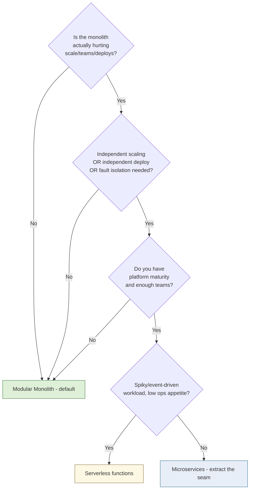

| Choose... | When | Strengths | Costs |
|---|---|---|---|
| Modular monolith | most cases, <~50 eng, evolving domain | simple ops, ACID, fast dev, easy refactor | one scaling/deploy unit |
| Microservices | many teams, divergent scale/deploy, fault isolation | autonomy, independent scale & deploy | ops + data + debugging tax |
| Serverless (FaaS) | spiky/event-driven, glue, low-ops | scale-to-zero, no infra, pay-per-use | cold starts, vendor lock-in, limits |

**The org-first framing (the actual decision).** Microservices are an answer to a *people* problem far more than a technology problem — Amazon adopted them so two-pizza teams could deploy without coordination, not because a monolith couldn't scale technically (Stack Overflow proves it can). So the framework is org-first: *do you have enough teams and platform maturity that coordination cost exceeds distribution cost?* If yes, extract along bounded contexts. If no, a modular monolith gives you ~80% of the modularity benefit at ~20% of the cost, and you can extract specific seams later.

**Real examples.** Shopify, Stack Overflow, Basecamp (modular monolith / "Majestic Monolith"). Segment moved back to a monolith. Serverless shines for event glue, cron, image processing, and unpredictable spiky load (much of the Lambda ecosystem). See [Architecture Patterns](15-architecture-patterns.md) for the broader landscape.

**Pitfalls.** (1) Adopting microservices with one team — you get distribution costs with zero autonomy benefit. (2) Premature decomposition before the domain is understood. (3) Underestimating the *platform investment* (CI/CD, mesh, tracing, on-call) microservices presuppose. (4) Confusing "we need to scale one hot component" (extract *that one* service) with "we need to be all-microservices."

> **Staff-level insight:** Microservices are an answer to a *people* problem (independent teams shipping independently) far more than a technology problem — Amazon adopted them to let two-pizza teams deploy without coordination, not because monoliths can't scale technically. So the decision framework is org-first: *do you have enough teams and platform maturity that coordination cost exceeds distribution cost?* If yes, extract along bounded contexts; if no, a modular monolith gives you 80% of the modularity benefit at 20% of the cost, and you can extract specific seams later. The strongest thing you can say in a Staff interview is "I'd start with a modular monolith and extract the *one* service that has a named, quantified force — and here's how I'd avoid building a distributed monolith." Recommending microservices unconditionally is a *junior* signal; recommending them *surgically and reluctantly* is a Staff signal. **Decision: modular monolith unless coordination cost across teams exceeds distribution cost, because microservices solve a people problem not a tech problem; revisit per-seam when teams block each other or a component's scale/failure profile is genuinely divergent.**

---

## 18. A Realistic Reference Architecture

Putting it together: a production-grade e-commerce platform with a gateway, BFFs, a service mesh, several capability-aligned services with private databases, an async backbone with transactional outbox + CDC, a CQRS read model, and end-to-end observability.

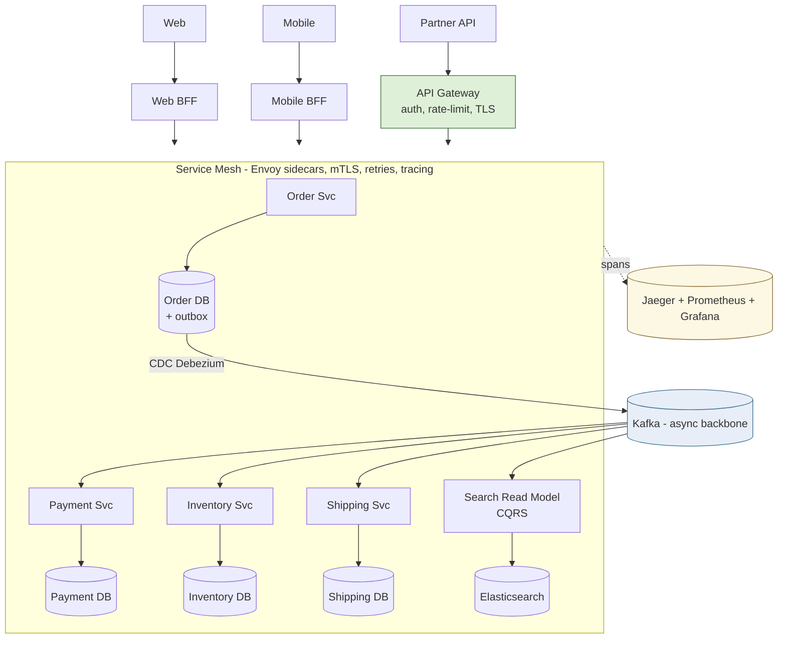

**What each piece is doing and why:**
- **BFFs + Gateway** — client-tailored aggregation (BFF) and shared cross-cutting policy (gateway, kept thin). §8.
- **Service mesh** — mTLS, retries/timeouts/circuit-breaking, traffic shifting, uniform telemetry, offloaded from app code. §10.
- **Capability-aligned services, each with a private DB** — Order, Payment, Inventory, Shipping; no shared schema. §2, §12.
- **Transactional outbox + CDC (Debezium) → Kafka** — atomic state-change-plus-event, no dual-write bug; downstream services react (choreography) or an orchestrated saga coordinates checkout. §6, §13.
- **CQRS read model (search)** — denormalized, event-fed, rebuildable; offloads expensive cross-service reads. §7, §14.
- **Observability** — distributed tracing + golden signals across all hops, sync and async. §15, [Observability](12-observability.md).

**How to present this in the room.** Do *not* narrate it box by box — that's uniform thoroughness. Narrate the *spine*: "The synchronous critical path for checkout is two hops, gateway → order; everything after the user's acknowledgment — payment, inventory, shipping, search indexing — rides the async backbone, so the user-facing tail doesn't multiply and the system stays up when a downstream is degraded." Then say what you'd reach for only when forced: "I'd add the mesh once we cross ~10-20 polyglot services, and the CQRS read model only when live composition gets too slow." That sequencing — show the resilient spine, then name the *triggers* for the heavier machinery — is the Staff delivery.

> **Staff-level insight:** Notice what's *deliberately absent and present*: the synchronous critical path for checkout is short (gateway → order), and everything after the user's acknowledgment (payment capture, inventory, shipping, search indexing) flows over the async backbone — so the user-facing tail latency doesn't multiply across services, and the system stays available even when a downstream service is degraded. That single design choice — *minimize the synchronous critical path, push everything else async* — is the spine of a resilient microservices architecture, and it's worth stating explicitly when you whiteboard this.

---

## Interview Cheat-Sheet

- **Open with the YAGNI stance.** "I'd start with a modular monolith and extract the one service with a named, quantified force." That sentence signals seniority before you draw a box.
- **Start with a monolith.** Modular monolith → extract a service only for a *named, quantified* force (scale / deploy cadence / fault isolation / team ownership). Boundaries are cheap to move in-process, brutal to move across the network (~100,000× the latency, plus partial failure and versioning).
- **Decompose by business capability or subdomain**, never by noun/entity (anemic CRUD = distributed monolith). A service exposes *behavior*, not a table. Acid test: can it enforce one invariant without a synchronous call out?
- **Aggregate = transaction/consistency boundary.** One transaction = one aggregate. Cross-aggregate → saga + eventual consistency. Aggregate sizing = consistency + concurrency + decomposition, all at once.
- **Bounded context → service → team.** Use a context map (ACL for legacy/vendors, open-host + published language for many consumers). Inverse Conway Maneuver.
- **Sync for user-facing queries with tight timeouts; async events for everything downstream of the acknowledgment.** Availability multiplies: 0.999^5 ≈ 99.5% (you lose a nine).
- **Orchestration** for complex/auditable sagas (Temporal, Step Functions); **choreography** for simple fan-out. Most mature systems are hybrid. The deciding factor is operability — can you query "what state is order #123 in?"
- **Cross-service query:** API composition (fresh, low fan-out) vs CQRS read model (high read, complex joins, must be rebuildable). Always answer "how do I rebuild the view?"
- **Gateway = thin** (auth, routing, rate-limit, TLS, no business logic); **BFF** per client for aggregation.
- **k8s gives DNS-based server-side discovery; mesh adds smart L7.** Evolution: registry → DNS → sidecar/mesh.
- **Service mesh** (Envoy data plane + control plane) = mTLS + resilience + traffic shifting + observability, language-agnostic. Worth it above ~10-20 services; ~0.5-2 ms + 50-150 MB per sidecar.
- **Database-per-service is non-negotiable.** Shared DB = the schema becomes the contract = distributed monolith. Analytics reads a warehouse, not OLTP tables.
- **Dual-write bug:** never "save then publish." Use **transactional outbox + CDC (Debezium) + idempotent consumers** (at-least-once). Name it unprompted.
- **Eventual consistency is a deliberate price.** Map each data dependency to strong vs eventual; protect money/inventory invariants.
- **Strangler fig**, never a big-bang rewrite. Hardest parts: the data, and finishing.
- **Distributed-monolith tells:** lockstep deploys, shared DB, deep sync chains, change touches many services.
- **Fan-out p99:** tail latency is bounded by the slowest hop and *multiplies* across services (0.99^100 ≈ 37% all-fast). Shorten the sync critical path; hedge; cache; timeout.
- **Non-negotiables:** correlation IDs/tracing, idempotency on retries, consumer-driven contract tests (Pact).
- **When NOT to:** few teams, immature platform, undelineated domain → modular monolith. Microservices solve a *people* problem.
- **Delivery:** decide don't enumerate; give a default + a revisit-trigger; risk-weight your depth; cite an operational scar.

---

## Common Interview Questions

**Q1. "We're a 15-engineer startup whose monolith is getting slow to deploy. Should we move to microservices?"**
*Staff answer:* Almost certainly not yet. Slow deploys at 15 engineers are usually a CI/test/modularity problem, not a distribution problem — and microservices would add operational, data-consistency, and debugging costs with little team-autonomy upside (you don't have enough teams for Conway's law to pay off). I'd first invest in a **modular monolith**: enforce module boundaries (build-time dependency rules, schema-per-module), speed up CI, and add feature flags for safer releases. If a *specific* component has a *named* force — say checkout needs to scale independently or the payments domain needs fault isolation — I'd extract *that one* service via strangler fig, not rewrite into microservices. The goal is to defer the network boundary until the domain and the org actually demand it.

**Q2. "How do you decide where to draw service boundaries?"**
*Staff answer:* Along **bounded contexts / business capabilities**, not nouns. I model the domain with the business and look for clusters where the ubiquitous language and invariants are internally consistent — those are bounded contexts, and they map to services and to teams. My acid test: *can this service enforce a meaningful business invariant without synchronously calling another service?* If yes, the boundary is behavioral and correct; if it's just CRUD over a table that everyone calls, it's a distributed table and the boundary is wrong. I also size aggregates carefully because aggregate boundaries are strong service-boundary candidates and they determine where sagas are required. And I draw a **context map** with explicit relationships (ACL to legacy, customer-supplier, published language) so the integration coupling is deliberate, not accidental.

**Q3. "Service A updates its DB and needs to publish an event. How do you make that atomic?"**
*Staff answer:* This is the **dual-write problem** — the database and the broker are separate systems with no shared transaction, so "save then publish" loses or duplicates events under crashes. I'd use the **transactional outbox**: write the event into an outbox table in the *same* DB transaction as the state change, then relay it to Kafka via **CDC** (Debezium tailing the WAL/binlog). That makes the event atomic with the state change and turns one impossible distributed transaction into two recoverable local steps. Delivery is **at-least-once**, so consumers must be **idempotent** (dedupe on an idempotency key), and I'd key by aggregate ID for per-aggregate ordering. I'd avoid 2PC/XA — poor broker support and it serializes throughput.

**Q4. "A query needs data from five services. How do you serve it?"**
*Staff answer:* Two options. **API composition** — a BFF or composer fans out to the five services and stitches in memory; simple and strongly consistent, but read latency is bounded by the slowest dependency and the read fails if any dependency is down. **CQRS read model** — subscribe to the services' events and maintain a denormalized, pre-joined materialized view, so the query is a single fast lookup that survives source outages, at the cost of eventual consistency and a data pipeline. I default to composition for low fan-out, freshness-sensitive reads, and reach for CQRS when the read is high-QPS, join-heavy, or must survive outages (search, dashboards, customer-360). The question I always answer for CQRS: *how do I rebuild the view?* — it must be deterministically replayable from the event log, or it's a liability.

**Q5. "What's a distributed monolith and how do you avoid one?"**
*Staff answer:* It's services that are physically separate but so coupled they must be deployed and reasoned about together — you pay all the distribution costs (network, data, debugging) and get none of the autonomy. The four tells: services can't deploy independently, they share a database, there are deep synchronous call chains, and a single feature change touches many services. You avoid it by enforcing **database-per-service**, keeping the **synchronous call depth shallow** (async after the user's acknowledgment), using **tolerant readers and contracts** instead of shared models/libraries, and aligning services to bounded contexts so changes stay local. If I see two services sharing a schema, I stop — the schema has become the contract and the boundary is gone.

**Q6. "Orchestration or choreography for an order-fulfillment saga?"**
*Staff answer:* For a real fulfillment flow, **orchestrate the saga** (Temporal / Step Functions) and choreograph between bounded contexts — I won't hide behind "it depends." Choreography (services react to events) is great for simple, stable, loosely-coupled fan-out, but for a complex multi-step saga it makes the workflow *implicit* — nobody can answer "what state is order #123 in?" without tracing events, and you risk cyclic dependencies. Orchestration centralizes the workflow into a queryable state machine with clear compensation and retry logic, at the cost of a coordination component you must keep from becoming a god-service. The deciding factor at scale is operability: when an order gets stuck, I want a state machine to query, not logs to grep. I'd flip to pure choreography only if the flow is ≤3 steps and stable.

**Q7. "Why a service mesh, and when is it overkill?"**
*Staff answer:* A mesh (Envoy data plane + control plane) moves cross-cutting *networking* concerns — mTLS, retries, timeouts, circuit breaking, traffic shifting, and golden-signal telemetry — out of every application in every language and into a uniform infrastructure layer. Its real value is **consistency and language-agnosticism**: you stop re-implementing mTLS and retries (incorrectly) in five languages. It's overkill below ~10-20 services, where a shared resilience library plus Kubernetes DNS is simpler and avoids the per-pod latency/resource overhead (~0.5-2 ms and 50-150 MB per sidecar) and control-plane operational burden. And I'd never sell it as an architecture fix — a mesh makes a distributed monolith *observably* slow, not fast.

**Q8. "How do you keep tail latency sane when a request fans out to many services?"**
*Staff answer:* Respect the math: with synchronous fan-out, overall latency is bounded by the *slowest* dependency, and the probability that *at least one* dependency is slow rises sharply with N (0.99^100 ≈ 37% all-fast, so ~63% of requests hit a slow tail). So I attack the tail directly: **shorten the synchronous critical path** (only the user-blocking work is sync; everything else goes async post-acknowledgment), **cache or duplicate** data locally to remove a hop, **hedge requests** for read-heavy fan-out (Google's tail-at-scale technique), and set **aggressive timeouts with fallbacks/degraded responses** so one slow service can't hold the whole request hostage. The framing I bring is that at scale the tail *is* the user experience, and fan-out *multiplies* tails — so reducing hops beats optimizing any single service's mean.

**Q9. "How do services evolve without breaking each other, and how do you test that?"**
*Staff answer:* Backward-compatible, additive change is the rule — tolerant readers, never remove or repurpose a field consumers use, and version explicitly (Protobuf field numbers, `/v2`) only when a break is unavoidable, running both versions during migration. To enforce this without slow, flaky end-to-end environments, I use **consumer-driven contract testing** (Pact): each consumer declares its expectations, the provider verifies them in CI, and a breaking change fails the provider's build *before* deploy. That's the only scalable way to preserve **independent deployability** — the moment you depend on a full end-to-end suite, that suite becomes the coordination bottleneck microservices were supposed to remove. I pair this with canary/blue-green deploys and feature flags so rollout risk stays graduated and reversible.

**Q10. "Sketch how you'd migrate a large monolith to microservices."**
*Staff answer:* **Strangler fig**, never a big-bang rewrite (which is the canonical doomed project). Put a routing façade/gateway in front of the monolith; for each slice — chosen by *seam strength and business value*, not by what's easiest — build the new service with its own database, migrate data incrementally (dual-write or CDC during transition, then cut over), and flip the façade to route that capability to the new service while everything else still hits the monolith. Each step is independently shippable and reversible, so risk stays bounded and value is continuous. The two hardest parts are the **data** (you'll lean on outbox/CDC and careful dual-write-then-cutover) and **finishing** — without an explicit decommissioning mandate the monolith becomes immortal and you've stacked distribution cost on legacy cost. I'd also extract along bounded contexts and apply the Inverse Conway Maneuver so teams and services line up.

**Q11. (Meta / delivery) "You have 45 minutes to design this. How do you spend them, and where do you go deep?"**
*Staff answer:* I risk-weight. The first five minutes I spend *resisting* over-architecting — I'll say explicitly "I'd start with a modular monolith and only extract services where there's a named force," because the most expensive mistake here is a wrong boundary, and I want to find the force before I draw boxes. Then I go deep where the risk concentrates: **service decomposition** (a wrong boundary is a multi-quarter migration), **data consistency** (where do I need strong vs eventual, where's the saga, where's the outbox), and **the fan-out tail math** (because at scale the tail is the UX). I deliberately *name-and-move-on* the commodity pieces — gateway does auth and routing, discovery is k8s DNS, golden signals to Prometheus — because spending equal time on those is a mid-level tell. The signal I'm trying to send is judgment about *where the hard parts are*, not exhaustive coverage.

**Q12. (Meta / delivery) "How do you push back when a team wants to adopt microservices and you think it's premature?"**
*Staff answer:* I don't make it a "no" — I make it a "not yet, and here's the cheaper thing that buys most of the value." I'd frame it org-first: microservices solve a *people* problem, so I ask how many teams we have and whether they're actually blocking each other on deploys; if it's one or two teams, Conway's law won't pay off and we'd take the distribution tax for no autonomy benefit. I'd propose a **modular monolith with enforced boundaries and schema-per-module** as the concrete next step — it captures ~80% of the modularity at ~20% of the cost and pre-factors us for extraction. Then I'd name the *trigger* that would change my mind: a specific component with a named, quantified scaling or deploy-cadence force, which we'd extract surgically via strangler fig. Putting the decision on an explicit, measurable trigger turns an architecture argument into an agreement about *when*, which is how I de-escalate these. I've seen the alternative — a small team running 30 services and drowning in operational toil — and that scar is the most persuasive thing I bring.

---

*Cross-references: [Staff-Level Execution](20-staff-execution.md) · [Architecture Patterns](15-architecture-patterns.md) · [Messaging & Event-Driven](04-messaging-event-driven.md) · [Observability](12-observability.md) · [Reliability](11-reliability.md) · [Leadership & Trade-offs](19-leadership-tradeoffs.md) · [Data Consistency / Sagas (Module 02)](02-distributed-systems.md).*
