# Module 11 — Reliability Engineering

> The definitive reliability reference for Staff Engineer / Senior EM / Director system-design interviews.

## What you'll master

Reliability is the discipline of making systems keep their promises under failure. By the end of this module you will be able to walk into a design interview and:

- Speak fluently about **SLA / SLO / SLI**, error budgets, and the "nines" — and use them to *govern* engineering decisions, not just recite them.
- Reason quantitatively with **MTBF / MTTR / MTTD / MTTA** and explain why **reducing MTTR usually beats increasing MTBF**.
- Design a **resilient call path** combining timeouts, retries-with-jitter, circuit breakers, bulkheads, load shedding, and hedging — and explain the failure modes each one prevents *and* introduces.
- Design a **rate limiter** from scratch (the interview favorite): all five algorithms, distributed enforcement, and the placement decision.
- Architect **redundancy, failover, and disaster recovery** with explicit RTO/RPO trade-offs and cost tiers.
- Run **chaos engineering** like an SRE: hypothesis, blast radius, steady-state, game days.
- Apply a **Staff-level reliability checklist** to any design on the whiteboard — and **deliver** it in the room with decisive recommendations, not option menus.

Cross-references: [Distributed Systems](02-distributed-systems.md) · [Observability](12-observability.md) · [Microservices](10-microservices.md) · [Load Balancing](05-load-balancing.md) · [Staff-Level Execution](20-staff-execution.md)

---

## Table of Contents

1. [In the Room — Staff-Level Delivery](#in-the-room--staff-level-delivery)
2. [Availability & SRE Foundations](#1-availability--sre-foundations)
   - [1.1 SLA vs SLO vs SLI](#11-sla-vs-slo-vs-sli)
   - [1.2 Choosing good SLIs — RED & USE](#12-choosing-good-slis--red--use)
   - [1.3 The Nines & downtime budgets](#13-the-nines--downtime-budgets)
   - [1.4 Why 100% is the wrong target](#14-why-100-is-the-wrong-target)
   - [1.5 Error budgets](#15-error-budgets)
3. [Reliability Metrics](#2-reliability-metrics)
4. [Resilience Patterns](#3-resilience-patterns)
   - [3.1 Timeouts & deadline propagation](#31-timeouts--deadline-propagation)
   - [3.2 Retries — backoff, jitter, budgets](#32-retries--backoff-jitter-budgets)
   - [3.3 Circuit breakers](#33-circuit-breakers)
   - [3.4 Bulkheads](#34-bulkheads)
   - [3.5 Load shedding & graceful degradation](#35-load-shedding--graceful-degradation)
   - [3.6 Backpressure](#36-backpressure)
   - [3.7 Fallbacks & default responses](#37-fallbacks--default-responses)
   - [3.8 Hedged requests](#38-hedged-requests)
   - [3.9 Fail-fast](#39-fail-fast)
   - [3.10 The resilient call path](#310-the-resilient-call-path)
5. [Rate Limiting (Deep)](#4-rate-limiting-deep)
   - [4.1 Algorithms](#41-algorithms)
   - [4.2 Distributed rate limiting](#42-distributed-rate-limiting)
   - [4.3 Placement & keying](#43-placement--keying)
   - [4.4 Designing a rate limiter as a system](#44-designing-a-rate-limiter-as-a-system)
6. [Redundancy & Failover](#5-redundancy--failover)
7. [Chaos Engineering](#6-chaos-engineering)
8. [Disaster Recovery](#7-disaster-recovery)
9. [Making a Design "Reliable" — Staff Checklist](#8-making-a-design-reliable--the-staff-checklist)
10. [Interview Cheat-Sheet](#interview-cheat-sheet)
11. [Common Interview Questions](#common-interview-questions)

---

## In the Room — Staff-Level Delivery

Reliability is the topic where mid-level and Staff candidates diverge most visibly, because reliability has no single "right answer" — only **defensible trade-offs tied to a business requirement**. The interviewer is not testing whether you can name the patterns (everyone can). They're testing whether you can *decide* — pick a target, pick a tier, pick an algorithm — and defend it against the requirement, then move on. This section is the lens you apply to everything below. Cross-link: [Staff-Level Execution](20-staff-execution.md).

### Decisions to make decisively

Walk in ready to *commit* to these, in this voice: **"`<choice>` because `<requirement>`; revisit if `<trigger>`."** Never "it depends."

| Decision | Default you commit to | Because | Revisit if |
|----------|----------------------|---------|------------|
| **Target SLO** | Derive from the business need, not a reflex. For a chat app's message-send path: **99.95%** | Users tolerate a rare blip but churn on a broken send; 99.99% would halve velocity for invisible gain | Contractual SLA demands more, or a paying tier needs a stricter promise |
| **Which resilience patterns where** | Timeouts + retries-with-jitter + circuit breakers on **every** outbound call; bulkheads + load shedding on shared resources | These are the floor; they neutralize the common cascade (resource-exhaustion contagion) | Never skip — name them and move on |
| **Rate-limiter algorithm** | **Token bucket** (allows bursts, good UX, O(1) memory) | Most user-facing traffic is bursty-but-legit; bursting is a feature, not abuse | Downstream needs a constant rate → leaky bucket; need exact accounting at scale → sliding window counter |
| **DR tier** | Derive from **RTO/RPO**. For a billing DB: **warm standby**. For analytics: **backup & restore** | RTO/RPO are business numbers; you match cost to the cost-of-downtime, per workload | Region-wide SLA or compliance demands active-active |
| **Topology default** | **Single region, multi-AZ** | Multi-AZ is table stakes and covers the overwhelmingly common failure (rack/AZ loss) | SLA, latency-to-user, or compliance/data-residency demands multi-region |

### Altitude — name-and-move-on vs deep-dive

Spend your minutes where the risk is. The interviewer's signal-to-noise tolerance is low; uniform thoroughness reads as junior.

- **Name and move on (basics — one sentence each):** "Every dependency call gets a timeout, budgeted retries with jitter, and a circuit breaker — standard, I'll assume it's in our service mesh." "Bounded queues everywhere." "Multi-AZ is table stakes." Do not lecture on what a timeout is.
- **Deep-dive (the risk crux — this is where you earn the level):**
  1. **The SLO / error-budget reasoning** — *why* this target, what the budget buys, the freeze policy. This is the decision that governs everything else.
  2. **Distributed rate limiting** — the accuracy/latency/availability trade-off, two-tier local+global, fail-open. The genuinely hard part.
  3. **The DR strategy** — tier per workload from RTO/RPO, replica-poisoning, test-restores and drills.

### YAGNI default and its trigger

> **Default: single region, multi-AZ, until the SLA or a compliance requirement demands multi-region.** Multi-region active-active triples cost and operational complexity (conflict resolution, split-brain, async-replication RPO, failover orchestration) and is the single most common over-engineering tell in reliability interviews. Reach for it only when a stated requirement forces it — a region-failure SLA, geo-latency for users, or data-residency law. Say the trigger out loud; that earmarks the hard part and shows you know *why* you're deferring it, not that you forgot it.

### Top anti-patterns (call these out, don't commit them)

| Anti-pattern | Why it's wrong | The Staff move |
|--------------|----------------|----------------|
| **Targeting 100% / "five nines" reflexively** | Impossible, ~10× cost per nine, kills velocity, invisible to users | Derive the loosest tolerable SLO; price each nine |
| **Retries without backoff + jitter** | Synchronized retries become a thundering herd / retry storm that re-kills a recovering service — a self-inflicted DDoS | Exponential backoff + **full jitter** + retry budget + breaker gating |
| **Multi-region by reflex** | Over-engineering when the SLA doesn't need it | Single-region multi-AZ default; multi-region only on a stated trigger |
| **Option-listing without choosing** ("we could do X, or Y, or Z...") | Reads as indecision; the interviewer wants a recommendation | Decide, state the trade-off, name the revisit trigger |
| **False humility / "it depends"** | Wastes the interviewer's time | Commit to a default; *then* enumerate when it changes |
| **Uniform thoroughness** | Explaining basics at the same depth as the crux dilutes signal | Name basics in a sentence; spend minutes on SLO, distributed RL, DR |

### Experience hooks (cite real operational experience)

Anchor each deep-dive in something you've *run*. Generic versions to adapt to your own incidents:

- *"On a real-time chat infra I ran the incident where a slow presence-service dependency saturated every gateway's thread pool and took down message delivery — that's what made bulkheads-per-dependency and aggressive timeouts non-negotiable for me."*
- *"We had a retry storm once: client SDK, gateway, and a backend service each retried 3× with no jitter; one downstream blip became ~27× backend load and turned a 30-second degradation into a 20-minute outage. Now retries live at exactly one layer with a budget."*
- *"I've watched a 'hot standby' DB fail over and surface expired credentials and stale config nobody had touched in a year — which is why I drill failover quarterly, not just configure it."*
- *"We failed *open* on our distributed rate limiter when Redis blipped; over-permitting for 90 seconds was strictly better than the limiter taking down the API it was supposed to protect."*

Use these as *signal, not solution* — one sentence to establish you've operated the thing, then return to the design.

---

## 1. Availability & SRE Foundations

### 1.1 SLA vs SLO vs SLI

**Definitions (be precise — interviewers test this):**

- **SLI — Service Level Indicator:** a *quantitative measurement* of some aspect of the service. E.g., "the proportion of HTTP requests that complete in < 300 ms with a 2xx/3xx status." An SLI is a number you compute from telemetry.
- **SLO — Service Level Objective:** an *internal target* for an SLI over a window. E.g., "99.9% of requests succeed within 300 ms, measured over a rolling 28 days." The SLO is what your team commits to internally.
- **SLA — Service Level Agreement:** a *contractual* promise to a customer, with **consequences** (refunds, credits, penalties) when violated. E.g., "99.9% monthly uptime or we credit 10% of the bill."

**How they relate:** SLI is the *measurement*, SLO is the *goal*, SLA is the *contract*. You always set your **SLO stricter than your SLA** (the gap is your safety margin). If the SLA is 99.9%, your internal SLO might be 99.95% — so you start firefighting before customers can claim credits.

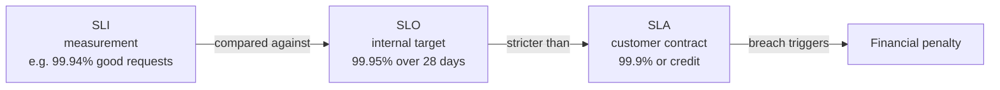

**Who they're for:**

| Term | Audience | Nature | Failure consequence |
|------|----------|--------|---------------------|
| **SLI** | Engineers, monitoring | Empirical metric | N/A — it's just data |
| **SLO** | Eng + product (internal) | Engineering target | Error-budget burn, release freeze |
| **SLA** | Legal, sales, customer | Contract | Money / credits / churn |

**Real examples:**
- **AWS S3** SLA: 99.9% monthly → service credits at tiers (10% below 99.9%, 25% below 99.0%).
- **Google Cloud** publishes SLAs (99.95% for many products); internal SLOs are stricter and not public.
- **Stripe** targets very high availability internally with much tighter SLOs than any external SLA.

**Pitfalls:**
- Setting SLA == SLO leaves zero safety margin; the first incident breaches the contract.
- Defining an SLI that doesn't reflect user experience (e.g., measuring server CPU instead of request success rate).
- "Availability" with no latency component — a request that returns in 30 s "succeeded" but the user already left.
- **SLA that's stricter than your dependencies allow.** If your DB's managed SLA is 99.95%, you cannot contract 99.99% on top of it without redundancy *across* providers/regions. Availability composes multiplicatively — see §1.3.

> **Decision, in the room:** When asked "what's the SLA?", commit: *"I'd set the customer SLA at 99.9% and run an internal SLO of 99.95% — the 0.05% gap is our firefighting margin so we react before credits trigger. I'd revisit upward only if we sign an enterprise contract that demands it, and price the redundancy that requires."*

> **Staff-level insight:** SLOs are a *negotiation tool*, not a vanity metric. The right SLO is the **loosest** one your users will tolerate, because every extra nine costs roughly 10x more and *removes engineering freedom*. In the interview, when asked "what availability?", don't say "99.999%" reflexively — say "what does the user actually need, and what will each nine cost us in redundancy and velocity?" That framing signals seniority.

---

### 1.2 Choosing good SLIs — RED & USE

A good SLI is **user-centric**, **measurable at request granularity**, and expressed as a **ratio of good events to total events** (`SLI = good / total`).

**Request-based vs window-based:**
- **Request-based SLO:** `good_requests / total_requests ≥ target`. Cleaner math, what most teams use.
- **Window-based SLO:** count *time windows* (e.g., 1-min buckets) as "good" if they meet a threshold; SLO = good_windows / total_windows. Closer to how some SLAs are written ("uptime per minute"), but a single bad request can taint a whole minute.

> **Decision, in the room:** Default to **request-based** SLIs — cleaner math, directly user-aligned. Use window-based only when the *contract* is written that way (some uptime SLAs). Name it and move on; this isn't the crux.

**Two complementary methods to pick SLIs:**

| Method | For | The signals | Mnemonic |
|--------|-----|-------------|----------|
| **RED** | Request-driven services (APIs, microservices) | **R**ate (req/s), **E**rrors (failed req/s), **D**uration (latency distribution) | "Request health" |
| **USE** | Resources (CPU, disk, queues, pools) | **U**tilization (% busy), **S**aturation (queue depth / wait), **E**rrors (error count) | "Resource health" |

RED tells you whether *users* are happy; USE tells you *why* a resource is the bottleneck. You instrument both — see [Observability](12-observability.md).

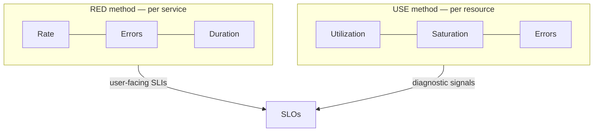

**Common SLI types:**

| SLI type | Definition | Example |
|----------|------------|---------|
| **Availability** | good requests / total requests | 2xx+3xx / all responses |
| **Latency** | requests under threshold / total | p99 < 300 ms |
| **Quality** | full-quality responses / total (for degradable systems) | non-degraded responses |
| **Freshness** | data younger than X / total reads | cache age < 60 s |
| **Correctness** | correct outputs / total | reconciliation pass rate |
| **Durability** | objects not lost / total stored | the "11 nines" of S3 |

**Pitfalls:**
- Averaging latency (mean hides the tail) — always SLO on **percentiles** (p95/p99/p99.9). One slow p99.9 request can be a whale customer doing 40% of your revenue.
- Counting health-check traffic in your SLI (inflates the success ratio).
- Measuring at the wrong vantage point — server-side success doesn't capture the load balancer dropping the connection. Measure as close to the user as feasible.
- **Forgetting the streaming/long-lived case.** For a chat app, "availability of a WebSocket" isn't a single request/response — your SLI must cover *connection establishment success*, *message-delivery success*, and *delivery latency* separately. Flag this as a risk crux for real-time systems: the request/response SLI model under-measures persistent connections.

> **Staff-level insight:** The single best SLI question to ask is *"what is the smallest unit of user-perceived success?"* For a checkout flow it's "did the order get placed," not "did the `/checkout` endpoint return 200." For chat it's "did the recipient receive the message," not "did the send API return 200." A 200 that loses the message is a failure your SLI must catch. Tie SLIs to **journeys**, not endpoints.

---

### 1.3 The Nines & downtime budgets

Availability is usually expressed in "nines." Memorize this table — interviewers love to see you reach for it instinctively.

| Availability | "Nines" | Downtime / year | Downtime / month (avg month, ~30.44d) | Downtime / day | Downtime / week | Typical use |
|--------------|---------|-----------------|------------------------|----------------|-----------------|-------------|
| 90% | one nine | 36.5 days | 72 h | 2.4 h | 16.8 h | Toy / batch |
| 99% | two nines | 3.65 days | 7.2 h | 14.4 min | 1.68 h | Internal tools |
| 99.9% | three nines | 8.76 h | 43.8 min | 1.44 min | 10.1 min | Standard SaaS |
| 99.95% | three-and-a-half | 4.38 h | 21.9 min | 43 s | 5.04 min | Paid SaaS tier |
| 99.99% | four nines | 52.6 min | 4.38 min | 8.6 s | 1.01 min | Payments, critical |
| 99.999% | five nines | 5.26 min | 26.3 s | 0.86 s | 6.05 s | Telco, core infra |
| 99.9999% | six nines | 31.5 s | 2.6 s | 0.086 s | 0.6 s | Rarely justified |

Quick mental math: **three nines ≈ ~9 hours/year ≈ ~43 min/month.** Each additional nine divides downtime by 10. Handy anchor: **four nines ≈ ~1 minute/week** — that's how little headroom you have before a single bad deploy blows the budget.

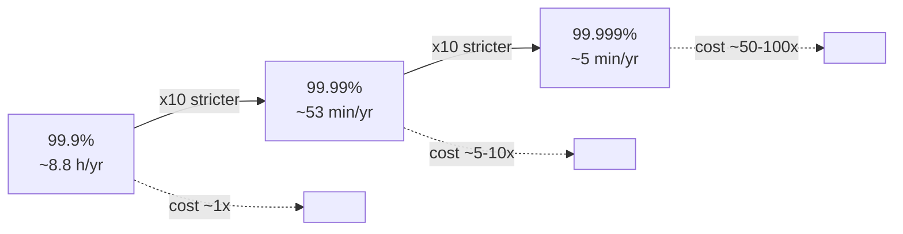

**Availability composes (the dependency-chain math).** Independent components in series multiply: a request that traverses a load balancer (99.99%), a service (99.95%), and a database (99.95%) has an *aggregate* availability of `0.9999 × 0.9995 × 0.9995 ≈ 99.89%` — **below** any single component. This is why:

- More serial dependencies ⇒ lower aggregate availability. Reducing the number of synchronous hops on the critical path is itself a reliability lever.
- **Redundant** components in *parallel* compose the other way — two independent 99% replicas give `1 − (0.01 × 0.01) = 99.99%`. Redundancy is how you claw back nines.

> **Decision, in the room:** *"Each synchronous hop on the critical path multiplies availability down, so I'd keep the message-send path to the fewest hops — gateway → write → ack — and push everything else (fan-out, indexing, analytics) async. That buys reliability for free before I spend a dollar on redundancy."* This is altitude: it's a structural decision, not a pattern.

> **Staff-level insight:** Each nine roughly multiplies cost by 5–10x (multi-AZ → multi-region → multi-cloud, plus the operational maturity to use the budget). Beyond ~four nines, **your dependencies become the ceiling**: if your cloud provider's compute SLA is 99.99%, you cannot credibly promise 99.999% on a single provider — you'd need cross-cloud failover. State this dependency math in the interview; it shows you understand availability *composes*.

---

### 1.4 Why 100% is the wrong target

**100% availability is impossible and undesirable:**

1. **It's unachievable.** Your network, DNS, BGP, the user's ISP, power, and upstream dependencies all fail. The path from user to server has many links; product availability is the *product* of all of them. If your server is 100% but the network is 99.99%, the user sees 99.99%.
2. **It's prohibitively expensive.** Each nine costs an order of magnitude more.
3. **It kills velocity.** A 100% target means you can *never* ship risky changes — and shipping is how you add value. ~70% of outages come from changes (deploys, config). Zero error budget = zero change.
4. **Users can't tell the difference.** If a user's device/network has 99.9% reliability, your service being 99.999% vs 99.99% is invisible to them. Spending to be more reliable than the *weakest link the user depends on* is wasted money.

**The right target is "just reliable enough"** — set by user need and the reliability of the chain around you.

> **Anti-pattern to call out by name:** targeting 100% (or "five nines, to be safe"). It's the clearest junior tell in a reliability interview. The Staff reframe: *"Reliability is a feature with diminishing returns; the error budget prices it."*

> **Staff-level insight:** This is the core SRE philosophy: **reliability is a feature with diminishing returns**, and the error budget is the mechanism that prices it. Saying "we'll target 99.95%, not 99.99%, because the extra nine buys nothing the user can perceive and would halve our release velocity" is a *Staff/Director-level* answer — it trades reliability against business value explicitly.

---

### 1.5 Error budgets

**Definition:** The error budget is the **allowed unreliability**: `error_budget = 1 − SLO`. If your SLO is 99.9%, your error budget is **0.1%** of requests (or of time) that may fail in the window before you've "spent" it.

**The math (worked example):**
- SLO = 99.9% over 28 days.
- Traffic = 1,000,000,000 requests / 28 days.
- Error budget = 0.1% × 1B = **1,000,000 allowed failed requests** for the window.
- Or in time terms: 0.1% × 28 days ≈ **40 minutes 19 seconds** of total downtime budget.

**Second worked example (tighter SLO, real stakes):**
- SLO = 99.95% over 28 days, traffic = 5B requests.
- Error budget = 0.05% × 5B = **2,500,000 allowed failures**, or 0.05% × 28 days ≈ **20 minutes 10 seconds** of downtime for the window.
- A single 8-minute incident burns ~40% of the budget. Two such incidents and you're in freeze territory. This is why **burn-rate alerting** (not just total-spend) matters — see below.

**Burn rate — the operational lever.** Burn rate = how fast you're consuming budget relative to "even" consumption. A burn rate of 1 spends the whole budget exactly over the window; a burn rate of 10 spends it in 1/10th the window. Google's multi-window burn-rate alerting (e.g., page if you'd exhaust the budget in < 1 hour at the current rate over both a 5-min and 1-hour window) catches both fast catastrophic burns and slow leaks while avoiding flapping. See [Observability](12-observability.md).

| Burn rate | Budget gone in (for a 28-day window) | Typical response |
|-----------|--------------------------------------|------------------|
| 1× | 28 days (sustainable) | None — this is the budgeted norm |
| 2× | 14 days | Ticket; investigate the slow leak |
| 10× | ~2.8 days | Page (slow-burn alert) |
| 14.4× | ~2 days | Page; you're burning a month in days |
| 100×+ | hours | Page immediately — active incident |

**How it governs release velocity — the policy:**

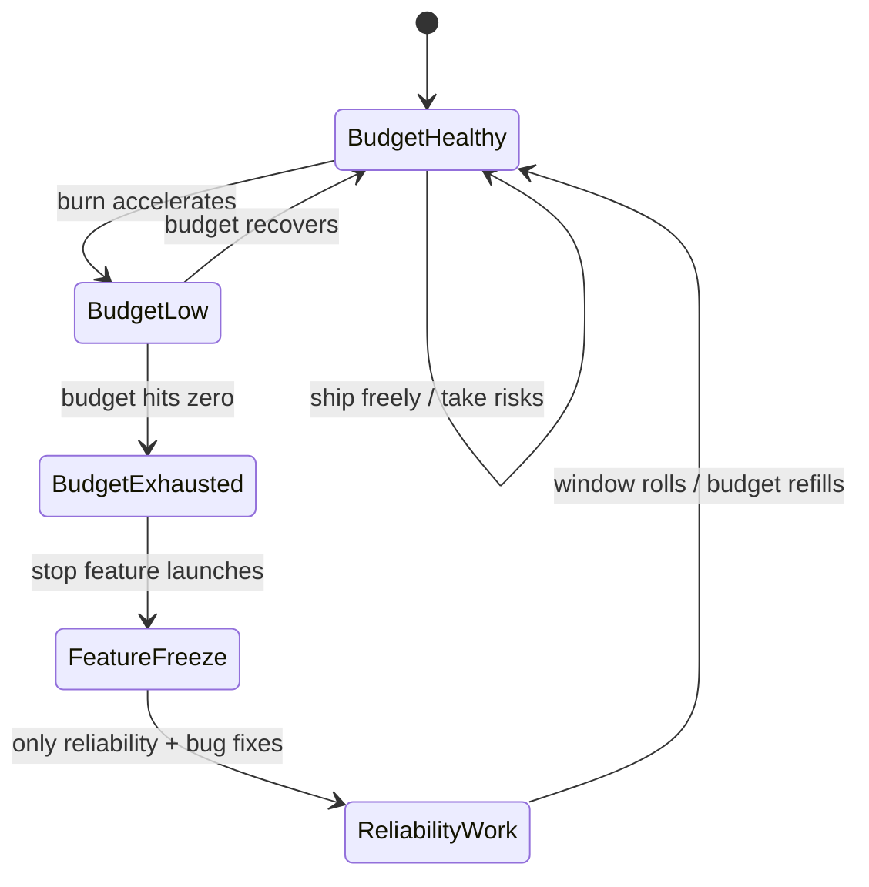

| Budget state | Policy |
|--------------|--------|
| Plenty remaining | Ship features fast; take calculated risks; run chaos experiments |
| < 25% remaining | Slow down, increase review rigor, add canaries |
| Exhausted | **Freeze feature launches.** Only reliability fixes, bug fixes, and rollbacks until budget recovers |
| Repeatedly exhausted | Renegotiate the SLO *or* invest in reliability — the SLO is wrong or the system is too fragile |

**The dev-vs-ops alignment it creates:** Traditionally devs want to ship fast and ops want stability — opposing incentives. The error budget **unifies them** under one number. Devs get to ship *as fast as the budget allows*; when they overspend, *they* (not ops via a veto) accept the freeze. It turns "no" into "not until the budget recovers," which is data-driven and self-policing.

**Pitfalls:**
- Treating the budget as "must spend it all" — it's a *ceiling*, not a quota to exhaust.
- No enforcement: a budget with no freeze policy is just a dashboard.
- Single huge incident eating a quarter's budget in an hour, then "business as usual" — needs burn-rate (not just total-spend) alerting.
- **No agreement *in advance*.** Negotiating the freeze policy mid-incident, with product leadership angry, is how the policy dies. Pre-commit while everyone is calm.

> **Staff-level insight:** The error budget is the single most important organizational artifact in SRE because it **converts a political argument into an arithmetic one.** As an EM/Director, your win is getting product and eng leadership to agree, *in advance*, that an exhausted budget freezes launches. Pre-committing the policy when everyone is calm is far easier than negotiating mid-incident. Mention "policy agreed in advance, automatically enforced, with multi-window burn-rate alerting" to signal org maturity.

---

## 2. Reliability Metrics

These metrics quantify failure and recovery. They drive *where you invest*.

| Metric | Stands for | Definition | Drives |
|--------|-----------|------------|--------|
| **MTBF** | Mean Time **B**etween **F**ailures | Avg uptime between failures (repairable systems) | How often you fail → redundancy, quality |
| **MTTF** | Mean Time **T**o **F**ailure | Avg lifetime of a *non-repairable* component (e.g., a disk) | Hardware refresh, RAID sizing |
| **MTTD** | Mean Time **T**o **D**etect | Failure occurs → you *notice* | Monitoring, alerting, SLI coverage |
| **MTTA** | Mean Time **T**o **A**cknowledge | Alert fires → on-call *responds* | On-call rotation, paging, escalation |
| **MTTR** | Mean Time **T**o **R**ecover/Repair | Failure → service restored | Runbooks, rollback speed, automation |

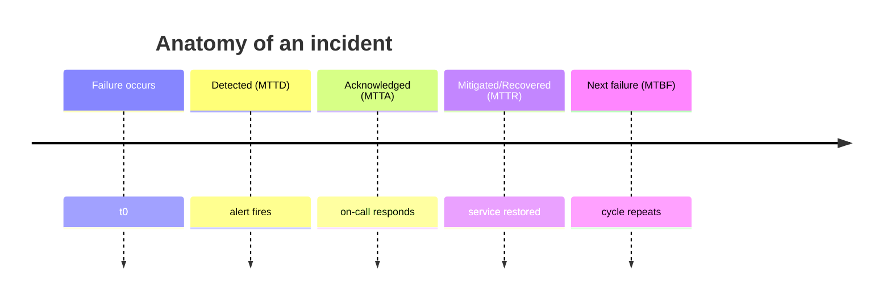

**MTTR decomposes.** The wall-clock recovery time is the sum of the stages — and each is a separate investment target:

```
MTTR (total) ≈ MTTD (detect) + MTTA (acknowledge) + time-to-diagnose + time-to-mitigate
```

This decomposition tells you *where* your incidents bleed time. If MTTD dominates, fix observability/alerting. If MTTA dominates, fix paging/escalation. If diagnose dominates, fix runbooks and tracing. If mitigate dominates, fix rollback automation and feature flags. In an interview, decomposing MTTR and pointing at the dominant stage is a sharper answer than "improve MTTR."

**The core availability formula:**

```
Availability = MTBF / (MTBF + MTTR)
```

MTTR here is the full recovery time (it contains MTTD + MTTA + actual repair).

**Worked example:** MTBF = 1000 h, MTTR = 1 h → Availability = 1000 / 1001 = **99.9%.** Cut MTTR to 0.1 h (6 min) → 1000 / 1000.1 = **99.99%** — one extra nine *without touching failure rate*.

**Why reducing MTTR often beats increasing MTBF:**

| Lever | What it takes | Effect |
|-------|---------------|--------|
| **↑ MTBF** | Better hardware, more testing, formal verification, redundancy — *expensive, slow, diminishing returns*; you can never reach "never fails" | Fewer incidents |
| **↓ MTTR** | Fast rollback, automated remediation, good runbooks, feature flags, canaries, observability | Same incident count, far less impact |

- You can **always** drive MTTR down with engineering you control; you can't drive MTBF to infinity.
- Most outages are change-induced and *transient* — fast rollback (low MTTR) neutralizes them.
- A system that fails often but **recovers in seconds** can be more available than one that fails rarely but takes hours to fix. This is the philosophy behind "design for failure": assume things break, optimize recovery.

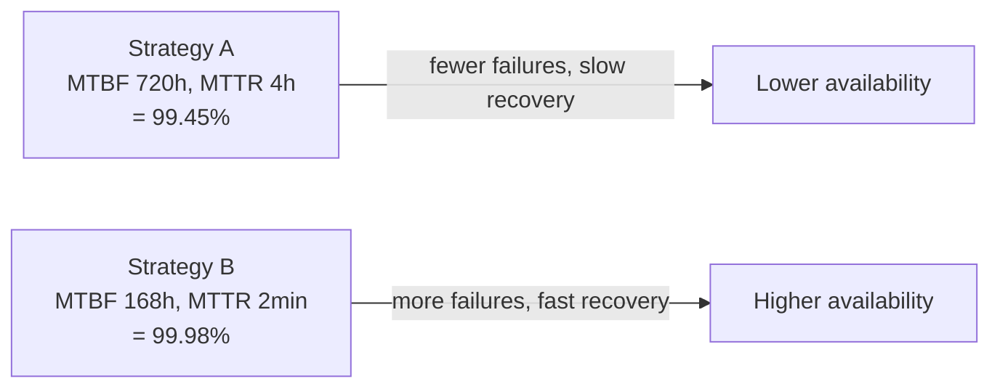

> **Decision, in the room:** When asked "how do you improve availability," commit immediately: *"I attack MTTR first — fast rollback, canaries behind flags, automated remediation — because it's the lever I fully control and `Availability = MTBF/(MTBF+MTTR)`. I only chase MTBF (redundancy, hardening) once MTTR is tight, because MTBF hits diminishing returns and can never reach 'never fails.'"* Then decompose MTTR and point at the dominant stage.

> **Staff-level insight:** In an interview, when asked "how do you improve availability," lead with **MTTR**, not MTBF. That single formula plus the MTTR argument is one of the highest-signal things you can say. Bonus signal: tie it to the org — "low MTTR is mostly *organizational* (on-call quality, runbook freshness, blameless postmortems), not just tooling."

---

## 3. Resilience Patterns

Resilience patterns prevent a single failure from cascading into a total outage. The mantra: **fail fast, isolate failures, degrade gracefully, recover automatically.** See also [Microservices](10-microservices.md) for where these live in a service mesh.

> **Altitude note:** In the room, **name the whole set in one breath and move on** — *"every outbound call gets a timeout, budgeted retries with jitter, and a circuit breaker; shared resources get bulkheads and load shedding; I'll assume this lives in the service mesh sidecar so it's uniform and language-agnostic."* Then deep-dive only the pattern the interviewer probes or the one that's the risk crux for *this* system. Explaining what a timeout *is* at length is a junior tell. The sections below are reference depth; deploy them selectively.

### 3.1 Timeouts & deadline propagation

**Definition:** A timeout bounds how long a caller waits for a response before giving up. **Every** network/IO call must have one — a missing timeout means a single slow dependency can exhaust all your threads/connections and take you down.

**How it works:** Set a timeout slightly above the dependency's p99.9 latency (not its average). On expiry, abort the call, release the resource, and return an error or fallback. The default in most libraries is "infinite" — this is the #1 silent reliability bug.

**Deadline propagation:** In a call chain A→B→C, the *remaining* budget should flow downstream. If A gives B 1000 ms and B has already spent 300 ms, B should call C with a ~700 ms deadline, not a fresh 1000 ms. gRPC propagates deadlines natively; otherwise pass an `X-Deadline`/`grpc-timeout` header. Without propagation, B keeps working on a request A has already abandoned — pure waste ("zombie work").

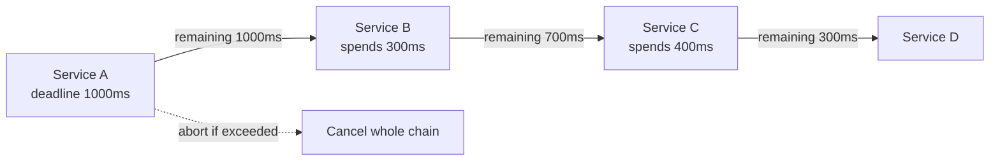

| Pitfall | Consequence | Fix |
|---------|-------------|-----|
| No timeout | Thread/conn exhaustion, cascading hang | Always set one |
| Timeout > parent's | Parent gives up but child keeps going | Propagate deadlines |
| Timeout = average latency | Spurious timeouts on normal tail | Set above p99/p99.9 |
| Static timeout everywhere | Slow path starved or fast path too patient | Per-dependency tuning |

> **Staff-level insight:** Timeouts must be **budgeted top-down**, not picked per call in isolation. Sum of inner timeouts should be ≤ the outer timeout, or you get the absurd case where the user's request already timed out 2 seconds ago while three services downstream keep grinding. Saying "deadline propagation" unprompted is a strong senior signal — most candidates only say "add timeouts." **Experience hook:** the slow-dependency thread-pool exhaustion incident (presence service saturating gateways) is the canonical story to attach here.

---

### 3.2 Retries — backoff, jitter, budgets

**Definition:** Retrying a failed request to ride out *transient* failures (a blip, a brief partition, a single bad node behind a load balancer).

**How it works — the rules:**

1. **Exponential backoff:** wait `base × 2^attempt` between tries (e.g., 100 ms, 200 ms, 400 ms) so you don't hammer a struggling dependency.
2. **Jitter (mandatory):** add randomness so retries from many clients don't synchronize into a **thundering herd**. "Full jitter": `sleep = random(0, base × 2^attempt)`. Without jitter, all clients that failed at t0 retry at exactly t0+100ms together, re-killing the recovering service.
3. **Idempotency requirement:** only safely retry operations that are idempotent (GET, PUT with same body) or made idempotent via an **idempotency key** (so a retried "charge card" doesn't double-charge). Non-idempotent writes need dedup at the server.
4. **Retry budget / retry amplification:** cap retries as a *fraction* of total traffic (e.g., max 10% extra). In a deep call chain, naive retries **multiply**: if each of 3 layers retries 3×, one user request becomes 3³ = 27 backend calls — a **retry storm** that turns a small blip into a self-inflicted DDoS.
5. **Don't retry non-retryable errors:** 4xx (except 429), validation failures — retrying just wastes capacity.

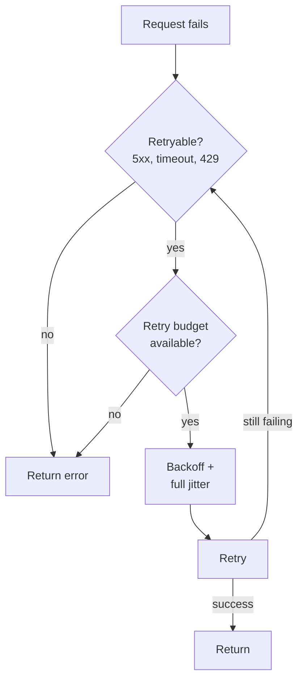

| Backoff strategy | Behavior | Use when |
|------------------|----------|----------|
| Fixed | Same delay each time | Rarely — herds easily |
| Exponential | Doubles each attempt | Default |
| Exponential + full jitter | Doubles, randomized | AWS-recommended (full jitter and decorrelated jitter both perform well) |
| Decorrelated jitter | `sleep = min(cap, random(base, prev*3))` | High-contention systems |

> **Decision, in the room:** *"Retries at exactly one layer — the edge — with exponential backoff, full jitter, a retry budget capped at ~10% of traffic, and gated by the circuit breaker. Idempotency keys on any write. I do not retry at every layer, because that's how a 3³ retry storm turns a blip into an outage."* The anti-pattern (retries without backoff/jitter) is worth naming explicitly.

> **Staff-level insight:** The most dangerous reliability pattern is **retries without budgets and without circuit breakers** — it converts a recoverable degradation into an outage via amplification. State the rule: "retries only at *one* layer (ideally the edge), with budgets, jitter, idempotency, and gated by a circuit breaker." Mentioning "retry amplification = 3³" math instantly shows you've operated real distributed systems. **Experience hook:** the SDK→gateway→backend retry-storm incident.

---

### 3.3 Circuit breakers

**Definition:** A state machine that *stops* calls to a failing dependency, giving it time to recover and **failing fast** instead of piling up doomed requests (which would exhaust threads and amplify the outage).

**The three states:**

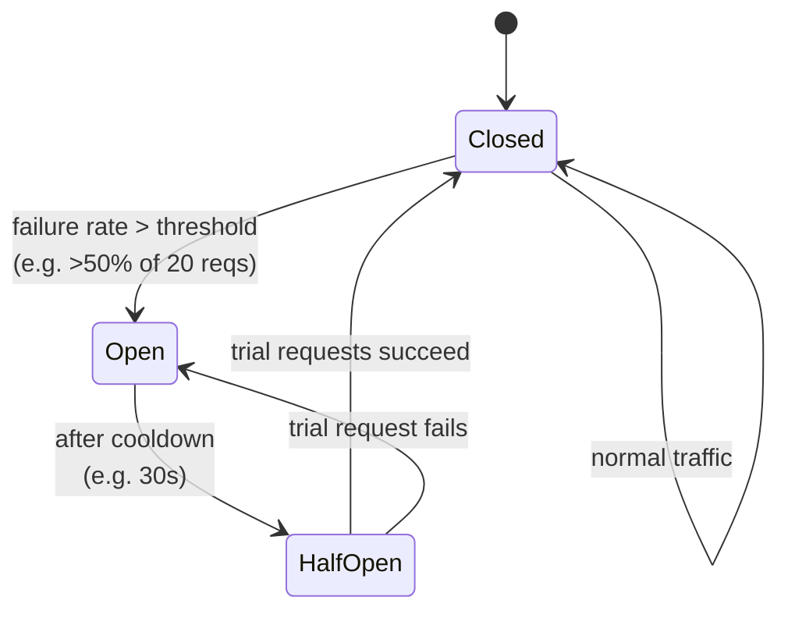

- **Closed:** normal — requests flow; the breaker counts failures over a rolling window.
- **Open:** tripped — requests **fail immediately** (no call made) and hit the fallback. Stays open for a cooldown.
- **Half-Open:** after cooldown, lets a *few* trial requests through. If they succeed → Closed; if any fail → back to Open. This probes recovery without flooding.

**Key thresholds:**

| Parameter | Typical value | Meaning |
|-----------|---------------|---------|
| Failure rate threshold | 50% | Trip when >50% of recent calls fail |
| Volume threshold | 20 requests | Don't trip on tiny samples (1/2 ≠ failure) |
| Sleep/cooldown window | 5–30 s | How long to stay Open |
| Half-open trial count | 1–5 | Probes allowed before deciding |

**Real tech:** Netflix **Hystrix** (now maintenance mode), **Resilience4j** (JVM), **Polly** (.NET), Envoy/Istio **outlier detection** (circuit breaking at the mesh layer — see [Microservices](10-microservices.md)). Envoy also does per-host ejection.

| Pitfall | Fix |
|---------|-----|
| Threshold too sensitive → flapping | Add volume threshold + hysteresis |
| One global breaker for all dependencies | Breaker *per dependency* (one slow dep shouldn't trip others) |
| No fallback when Open | Pair with fallback/default response |
| Breaker hides a real, persistent failure | Alert when breakers stay Open |

> **Staff-level insight:** A circuit breaker's real job is **shedding load from a sick dependency so it can recover** — it protects the *callee* as much as the caller. Combined with bulkheads, it prevents the classic cascading failure where Service A's threads all block on a dead Service B and A dies too, taking down C and D. In a mesh era, push circuit breaking to the **sidecar** (Envoy outlier detection) so it's uniform and language-agnostic rather than reimplemented per service.

---

### 3.4 Bulkheads

**Definition:** Named after ship compartments — partition resources so a failure in one area can't sink the whole vessel. Isolate thread pools / connection pools / instances per dependency or per tenant.

**How it works:** Instead of one shared thread pool serving all dependencies, give each dependency (or critical-vs-noncritical traffic) its *own* pool. If dependency B hangs and saturates its pool, dependency A's pool is untouched — A keeps serving. Same idea for connection pools, queues, and even whole instance fleets per tenant.

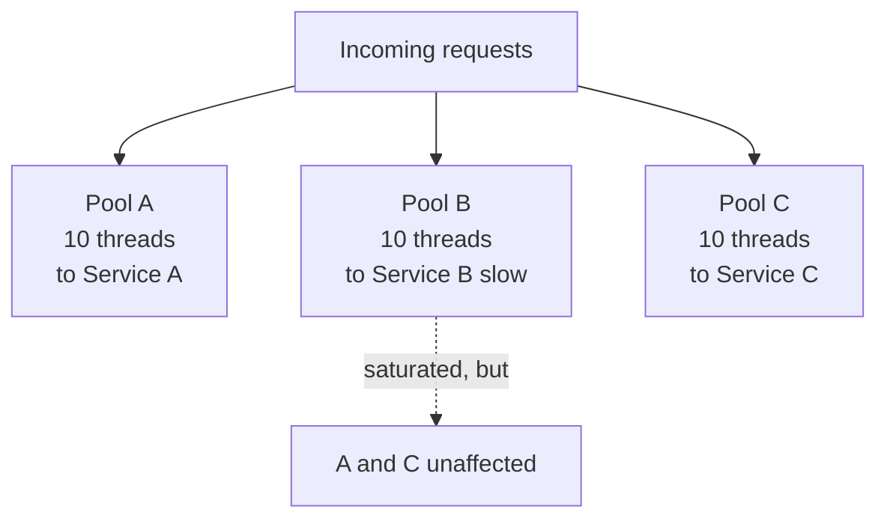

| Bulkhead type | Isolates | Example |
|---------------|----------|---------|
| Thread-pool | Concurrency per dependency | Resilience4j bulkhead, Hystrix pools |
| Connection-pool | DB/HTTP connections | Separate pools per downstream |
| Instance / cell | Whole fleets | Cell-based architecture, shuffle sharding |
| Tenant | Noisy-neighbor blast radius | Per-customer queues/quotas |

**Cell-based / shuffle sharding:** AWS's evolution of bulkheads — assign each customer to a small random subset of cells so a poison-pill customer only impacts the few cells they share, not everyone. Dramatically shrinks blast radius. **The math:** with 8 cells and each customer assigned to 2, there are `C(8,2) = 28` unique pairings; a single poison customer degrades only their 2 cells, and the *probability another customer shares both* cells is small — so blast radius drops from "everyone" to a tiny fraction, without 8× the hardware.

> **Decision, in the room:** *"Bulkhead per dependency by default — separate thread/connection pools so a slow dependency can't starve the others. For multi-tenant blast-radius containment I'd reach for cell-based architecture with shuffle sharding; I'd defer that until we have enough tenants and a noisy-neighbor risk to justify the routing complexity."* (YAGNI trigger named.)

> **Staff-level insight:** Bulkheads are how you stop **resource exhaustion contagion** — the most common cascade mechanism. The Staff move is **cell-based architecture / shuffle sharding**: instead of one big shared pool, partition customers across cells so any single failure (bad deploy, poison request, noisy tenant) is contained to a fraction of users. AWS uses this for control planes; mention it to show you think in blast-radius terms, not just per-call resilience. **Experience hook:** the thread-pool exhaustion incident is the "why I now insist on bulkheads" story.

---

### 3.5 Load shedding & graceful degradation

**Load shedding:** When overloaded, *deliberately reject* some requests (return 429/503 fast) to protect the system's ability to serve the rest. Better to serve 80% of traffic well than collapse serving 0%. Prioritize: shed low-priority/cheap-to-reject traffic first; protect critical paths (checkout > recommendations; message-send > read-receipts).

**Graceful degradation:** Drop non-essential features under stress while keeping the core working. Examples: serve stale cache instead of recomputing; hide the recommendations carousel but keep checkout; disable personalization; return lower-res images; for chat, drop typing-indicators and presence before dropping message delivery.

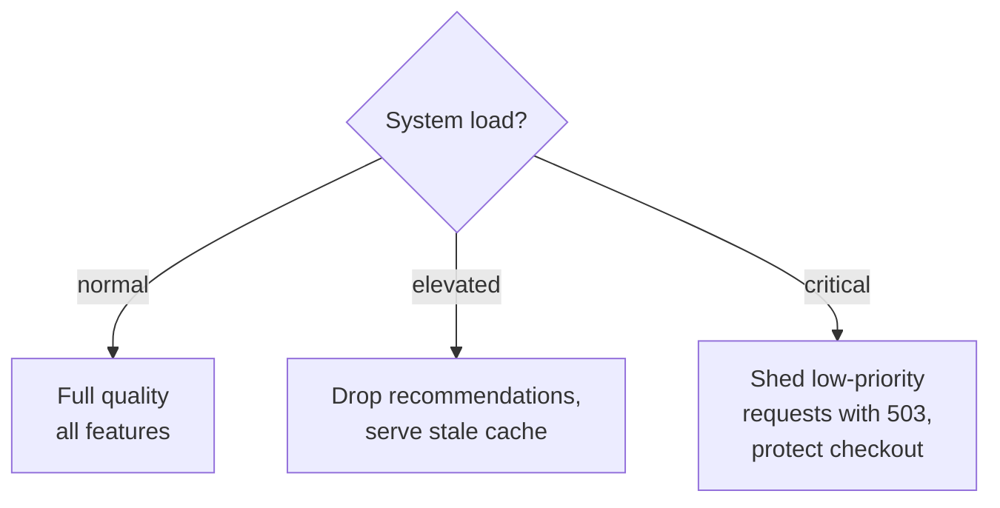

| Technique | Sheds | Keeps |
|-----------|-------|-------|
| Load shedding | Requests (reject early) | Capacity for accepted requests |
| Graceful degradation | Features/quality | Core function available |
| Priority queuing | Low-priority work | High-priority SLA |

**Real:** Netflix degrades to a non-personalized fallback row when the recommendation service is down. Amazon hides "customers also bought" rather than failing the product page. Facebook sheds via "load shedding at the edge" with request priorities.

> **Decision, in the room:** *"I'd rank features by criticality up front and shed cheapest-first, at the edge, before spending CPU. For chat: shed presence and typing indicators, then read-receipts, then history backfill — and protect message send/deliver to the last. The system should brown out before it blacks out."* Naming the shed order is exactly the judgment Staff interviews probe.

> **Staff-level insight:** Load shedding must happen **at the edge and cheaply** — rejecting a request *after* you've spent CPU on it is the worst of both worlds. Implement admission control before expensive work, and make the system **brown out** (degrade) before it **blacks out** (fails).

---

### 3.6 Backpressure

**Definition:** A mechanism for a *downstream* component to signal *upstream* "slow down, I'm full," propagating that signal back to the source rather than silently building unbounded queues (which cause OOM, latency explosion, then collapse).

**How it works:** Bounded queues + flow control. When a consumer can't keep up, it stops pulling (or signals the producer to pause). In reactive streams the consumer *requests* N items (pull-based demand). TCP does this natively (receive window). Kafka consumers naturally apply backpressure by controlling poll rate. Without backpressure, a fast producer + slow consumer = unbounded buffer = crash.

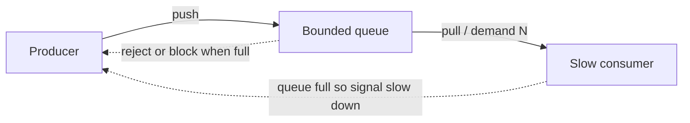

| Strategy when buffer full | Behavior | Trade-off |
|---------------------------|----------|-----------|
| Block producer | Producer waits | Backpressure, but can stall upstream |
| Drop newest/oldest | Lose data | Survives, but data loss |
| Reject (fail fast) | 429/503 to caller | Caller decides; clean |
| Buffer to disk | Spill | Durable but slow, finite |

> **Staff-level insight:** Backpressure is the *honest* alternative to unbounded buffering. The anti-pattern is an in-memory queue with no bound "for resilience" — it just delays and worsens the failure (latency climbs, then OOM). The Staff answer: **bound every queue**, and decide explicitly what happens at the limit (block, drop, or reject). Tie this to async architectures — a message queue *is* a backpressure buffer, but only if it's bounded and consumers can scale or shed. **For real-time chat specifically:** a fast-publishing user fanning out to a slow consumer connection needs per-connection bounded send buffers with a drop-or-disconnect policy, or one heavy user OOMs the gateway.

---

### 3.7 Fallbacks & default responses

**Definition:** When a dependency fails (or a circuit is open), return a **degraded-but-useful** response instead of an error.

**Fallback hierarchy (best to worst):**
1. **Cached value** — last-known-good from local/Redis cache.
2. **Stale-but-served** — serve expired cache (stale-while-revalidate).
3. **Default / static response** — empty list, generic recommendations, sensible defaults.
4. **Reduced functionality** — skip the feature entirely.
5. **Graceful error** — a clean error with retry guidance (last resort).

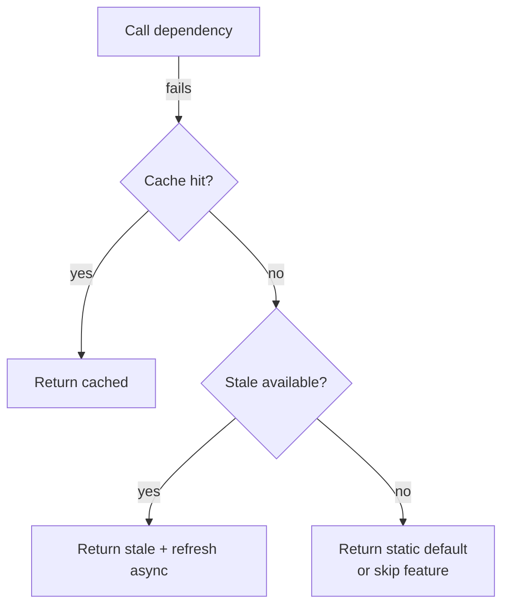

**Pitfalls:** Fallbacks can mask outages (you "succeed" while degraded — alert on fallback rate). A fallback that itself calls a dependency can fail too — fallbacks should be *cheap and local*. Stale data can be wrong/unsafe (don't serve stale balances in banking).

> **Staff-level insight:** Distinguish **safe-to-degrade** data (recommendations, trending, presence) from **must-be-correct** data (account balance, inventory at checkout, message ordering/delivery). For the former, aggressively fall back; for the latter, fail closed. Knowing *which* is which — and saying "I'd never serve a stale balance, but I'd happily serve stale presence" — is the judgment that separates Staff candidates from those who blanket-apply patterns.

---

### 3.8 Hedged requests

**Definition:** To cut **tail latency** (p99/p99.9), send the same request to multiple replicas and use the **first** response, cancelling the rest. Trades a little extra load for dramatically lower tail latency.

**How it works (Google's "tied/hedged requests"):** Send to replica 1; if no response by the p95 latency mark, send a *second* request to replica 2; take whichever returns first, cancel the other. Because only the slow tail triggers a hedge, extra load is small (~5%) but it removes the impact of a single slow/GC-paused replica.

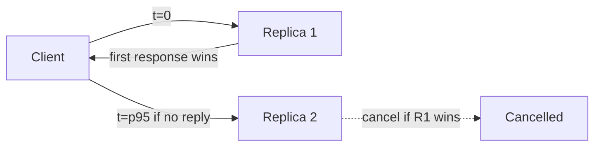

| Variant | When 2nd request sent | Extra load |
|---------|----------------------|------------|
| Naive duplication | Immediately | ~100% (2x) — wasteful |
| Hedged (deferred) | After p95 delay | ~5% — efficient |
| Tied requests | Both sent, "tied" cancel | Low — coordinated cancel |

**Real:** Google BigTable/Spanner use hedging. DynamoDB and Cassandra have similar "speculative retry." Works only for **idempotent, read-mostly** operations (sending two writes is dangerous).

> **Decision, in the room:** *"Hedging is a tail-latency tool, not a default — I'd add it only on a read-heavy fan-out path where p99 tail is hurting users, send the hedge after the p95 mark for ~5% extra load, restrict to idempotent reads, and shed hedges first under overload so it doesn't become a feedback loop."* Earmark it as YAGNI until tail latency is a measured problem.

> **Staff-level insight:** Hedging attacks the problem that in a 100-replica fan-out, the *slowest* replica dictates user latency (tail-at-scale). It's the read-path complement to load balancing. Caveat it: only for idempotent reads, and **load-shed the hedges first** under overload (a struggling system hedging more requests makes overload worse — feedback loop). Mentioning "tail at scale" and the deferred-hedge load math is a strong senior signal.

---

### 3.9 Fail-fast

**Definition:** Detect that a request *cannot* succeed (or is no longer worth attempting) as early and cheaply as possible, and return immediately rather than holding resources. Fail-fast is the connective tissue of the patterns above: a tripped circuit breaker, a full bulkhead, a deadline already exceeded, a load-shed admission decision — all are forms of failing fast.

**Why it matters:** The opposite — "fail slow" — is where outages are born. A request that holds a thread, a connection, and a lock for 30 seconds before timing out has done maximal damage for zero value. Failing fast releases resources for requests that *can* succeed.

**Where to fail fast:**
- **At admission** — reject early if rate-limited or overloaded (cheapest possible failure).
- **At the breaker** — if the dependency is known-sick, don't even try.
- **At the bulkhead** — if the pool is full, reject immediately instead of queueing unboundedly.
- **On deadline** — if the remaining budget is already gone, don't start the call.
- **On validation** — reject malformed/unauthorized requests before any expensive work.

> **Staff-level insight:** "Fail fast" is the unifying principle behind timeouts, breakers, bulkheads, and load shedding — they all convert *slow, resource-holding failures into fast, cheap ones*. The Staff framing: *"I want every failure to be cheap and early. A request that's going to fail should fail at admission, not after it's consumed a thread, a DB connection, and 30 seconds."* Saying this ties the whole pattern stack together rather than reciting it as a list.

---

### 3.10 The resilient call path

Putting it together — a single outbound call from Service A to Service B, instrumented with every pattern in order:

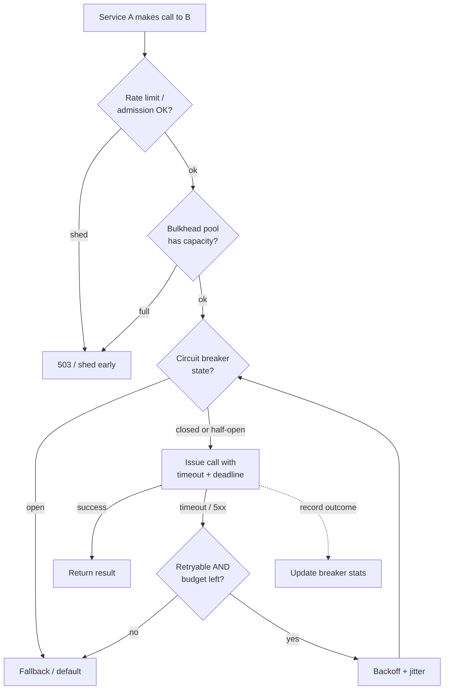

**Order of operations (outer → inner):**
1. **Rate limit / load shed** — reject excess *before* spending resources (fail fast at admission).
2. **Bulkhead** — acquire from the per-dependency pool (fail fast if full).
3. **Circuit breaker** — if open, skip the call → fallback.
4. **Timeout + deadline** — bound the call, propagate remaining budget.
5. **Retry (budgeted, jittered, idempotent)** — for transient failures only, gated by the breaker.
6. **Fallback** — on exhaustion, return degraded response.
7. **Record metrics** — feed breaker stats and SLIs.

| Pattern | Prevents | Introduces (watch out) |
|---------|----------|------------------------|
| Timeout | Hung threads | Spurious failures if too tight |
| Retry | Transient blips | Amplification/storms |
| Circuit breaker | Cascading failure | Flapping, hidden outages |
| Bulkhead | Resource contagion | Lower max utilization |
| Load shed | Total collapse | Rejected good traffic |
| Hedging | Tail latency | Extra load |
| Fail-fast | Resource-holding slow failures | Must pair with fallback/UX |

> **Decision, in the room:** *"This whole stack lives in the service-mesh sidecar (Envoy/Istio), not hand-rolled per service — consistency is itself a reliability property and I don't want twelve teams' twelve retry implementations. I'd draw the path once, narrate why each layer exists and what it costs, and note that order matters: retries live *inside* the breaker, not outside it."*

> **Staff-level insight:** These patterns **interact**, and order matters. Retries *inside* a circuit breaker are safe; a circuit breaker that doesn't account for retries can be fooled. The whole stack belongs in a **shared library or service mesh sidecar** (Envoy/Istio), *not* hand-rolled per service — consistency is itself a reliability property. In the interview, draw this path and narrate *why each layer exists and what it costs*; that holistic view is exactly what Staff/Principal interviews assess.

---

## 4. Rate Limiting (Deep)

Rate limiting protects services from overload, abuse, and runaway costs; enforces fairness and quotas; and is a near-universal interview topic. (Overlaps with design module 18d — here we go for conceptual depth.) **This is a deep-dive section** — the distributed-enforcement trade-off (§4.2) is one of the three risk cruxes in a reliability interview; budget your time accordingly.

### 4.1 Algorithms

> **Default to commit to:** **Token bucket.** It allows bursts (good UX for human-driven traffic), settles to a steady rate, and costs O(1) memory. Switch only on a stated trigger — see the decision callout after the comparison table.

#### Token Bucket

A bucket holds up to `B` tokens, refilled at rate `r` tokens/sec. Each request consumes a token; if the bucket is empty, the request is limited (429). **Allows bursts** up to `B`, then settles to steady rate `r`.

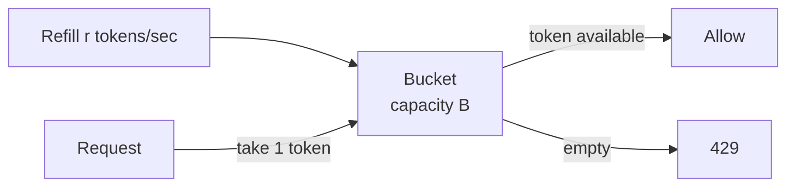

- **Pros:** Allows bursts (good UX), smooth average, simple, memory = 2 numbers (tokens, last-refill-ts) per key.
- **Cons:** Burst can briefly exceed steady rate.
- **Used by:** AWS API Gateway, Stripe, most cloud APIs.
- **Capacity worked example:** `r = 10 tokens/s`, `B = 50`. An idle client accumulates up to 50 tokens, can fire a 50-request burst instantly, then is throttled to 10/s thereafter. Steady-state sustained rate = `r` = 10/s = 600/min regardless of burst.

#### Leaky Bucket

Requests enter a queue (the bucket); they "leak" out at a **fixed** rate. Overflow (full queue) is dropped. Smooths output to a constant rate — **no bursts** pass through.

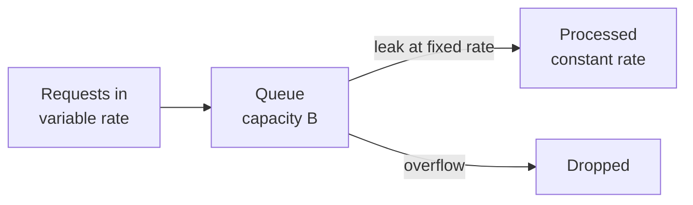

- **Pros:** Perfectly smooth output rate; protects downstream that needs constant load.
- **Cons:** No burst tolerance (bad for bursty-but-legit traffic); queue adds latency.
- **Used by:** Shaping traffic to a fixed-capacity downstream; NGINX.

#### Fixed Window Counter

Count requests per fixed time window (e.g., per minute). Reset the counter each window. Reject when count > limit.

- **Pros:** Trivial — one counter per key per window; cheap in Redis (`INCR` + `EXPIRE`).
- **Cons:** **Boundary burst problem** — a client can send `limit` requests at 0:59 and `limit` more at 1:00, getting 2× limit in a 2-second span.

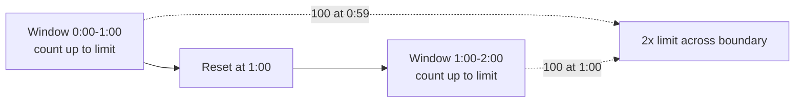

#### Sliding Window Log

Store a **timestamp for every request** in a sorted set. To check, drop timestamps older than `now − window`, then count what remains. Reject if count ≥ limit.

- **Pros:** **Exact** — no boundary problem; precise rolling window.
- **Cons:** Memory grows with request volume (one entry per request); expensive at scale (Redis sorted set per key). For a key doing 10k req/min that's 10k sorted-set members per key — multiply by millions of keys and it's untenable.

#### Sliding Window Counter

Approximation that fixes the fixed-window boundary problem cheaply. Keep counts for the current and previous fixed windows; weight the previous window by the fraction of it still inside the rolling window:

```
estimated = current_count + previous_count × (overlap_fraction)
```

E.g., 30% into the current minute: `est = current + previous × 0.7`. Reject if `est > limit`.

- **Pros:** Near-exact, smooths boundary bursts, **O(1) memory** (two counters per key). The pragmatic favorite.
- **Cons:** Slight approximation (assumes uniform distribution in the previous window). Cloudflare uses exactly this at massive scale.

**Comparison table:**

| Algorithm | Burst handling | Memory/key | Accuracy | Smoothing | Complexity |
|-----------|----------------|-----------|----------|-----------|------------|
| **Token Bucket** | Allows bursts ≤ B | O(1) (2 values) | Good | Average rate | Low |
| **Leaky Bucket** | No bursts (smooths) | O(B) (queue) | Good | Constant output | Low-med |
| **Fixed Window** | 2× at boundary | O(1) | Poor at edges | None | Lowest |
| **Sliding Window Log** | Exact | O(n) requests | Exact | Exact | High |
| **Sliding Window Counter** | Smoothed | O(1) (2 counters) | Near-exact | Good | Low-med |

> **Decision, in the room:** *"Token bucket by default — most user-facing traffic is bursty-but-legit and bursting is good UX, at O(1) memory. I switch to **sliding window counter** if I need accurate accounting at scale without burst leakage (what Cloudflare/Kong run), and to **leaky bucket** only when a downstream demands a strictly constant rate. I'd avoid sliding window *log* — exact, but O(n) memory per key doesn't scale."* Naming the right trade-off per algorithm is the whole point of the question.

---

### 4.2 Distributed rate limiting

A single rate limiter is easy; rate limiting across a **fleet** of N gateway nodes — where any node may serve any user — is the hard part. **This is the crux of the rate-limiter question.**

**The sync problem:** If each of 10 nodes enforces "100 req/min" locally, a user spread across all nodes gets 1000 req/min. You need a *shared* view of the count.

**Approaches:**

| Approach | How | Pros | Cons |
|----------|-----|------|------|
| **Centralized (Redis)** | All nodes `INCR` a shared Redis key | Accurate, simple | Redis latency on hot path; Redis is a SPOF/bottleneck |
| **Local + async sync** | Each node limits locally; periodically reconcile with global | Fast, no per-req network hop | Temporarily over-limit between syncs |
| **Local with global budget split** | Divide global limit across nodes (100/10 = 10 each) | No coordination | Unfair if traffic skewed to few nodes |
| **Sticky routing** | Route a key always to the same node (consistent hashing) | Local counting is exact | Hotspots, rebalancing on node change |
| **Gossip / approximate** | Nodes share counts via gossip | Decentralized, no SPOF | Eventually consistent, complex |

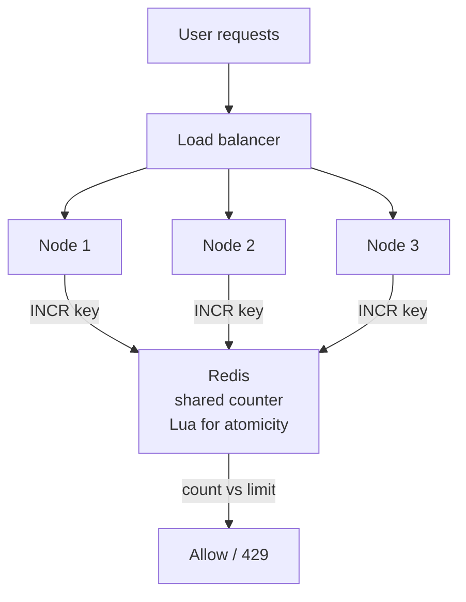

**Redis implementation details:**
- Use a **Lua script** (or `INCR`+`EXPIRE` atomically) so the check-and-increment is atomic — avoids race conditions where two nodes both read 99 and both allow. The Lua script runs server-side as a single atomic unit, eliminating the read-modify-write race entirely.
- For sliding-window: `ZADD`/`ZREMRANGEBYSCORE` on a sorted set (log) or two `INCR`'d window keys (counter).
- Mitigate Redis latency with **local pre-check** (token bucket per node with a small local allowance) + periodic global reconciliation — the **"local + global"** two-tier design. Local catches obvious cases fast; global catches the distributed total.

**Reference Lua sketch (token-bucket check-and-take, atomic):**

```
-- KEYS[1] = bucket key; ARGV: rate, capacity, now, requested
-- reads tokens + last_ts, refills based on elapsed time,
-- takes 'requested' if available, writes back, returns allowed/denied.
-- The entire script executes atomically server-side -> no race.
```

> **Decision, in the room:** *"I commit to a **two-tier** limiter: a fast local token bucket on each node for the common case, plus an async-reconciled global counter in Redis (atomic via Lua) for the aggregate. It's ~99% accurate, has no per-request network hop, and — critically — **fails open** to local limits if Redis is unavailable. I accept slight over-permitting between syncs because exact distributed counting isn't worth the latency or the availability risk. I'd only go fully centralized-Redis-per-request if a hard quota (billing/abuse) demands exactness, and even then I'd shard hot keys."*

> **Staff-level insight:** The honest Staff answer is that distributed rate limiting trades **accuracy vs latency vs availability**, and you rarely need exactness. Saying "I'd fail *open* on the limiter if Redis is unavailable, because a rate limiter that takes down the API it protects is worse than briefly over-permitting" shows you understand the limiter must be *more* reliable than what it guards. **Experience hook:** the fail-open-during-Redis-blip incident.

---

### 4.3 Placement & keying

**Where to enforce:**

| Layer | Pros | Cons |
|-------|------|------|
| **Client-side** | Saves bandwidth, polite | Untrusted — never the only line |
| **Edge / CDN (Cloudflare, etc.)** | Stops abuse before it hits your infra; cheapest to reject | Less app context |
| **API Gateway** | Central policy, per-key/per-route, one place | Gateway becomes critical path |
| **Per-service** | Protects each service's own capacity | Duplicated logic, harder to coordinate |

Defense in depth: edge for crude volumetric/DDoS, gateway for per-API-key business limits, service for protecting its own scarce resource (e.g., DB connections).

**Keying — what to limit by:**

| Key | Use case | Caveat |
|-----|----------|--------|
| Per-IP | Anonymous abuse, DDoS | NAT/shared IPs punish many users; IPv6 rotation evades |
| Per-user / per-account | Fair usage, quotas | Needs auth before limiting |
| Per-API-key | B2B / tiered plans | The standard for paid APIs |
| Per-endpoint | Protect expensive routes | Combine with above |
| Global | Protect total capacity | Backstop |

**The 429 contract:** Return **HTTP 429 Too Many Requests** with a **`Retry-After`** header (seconds or HTTP-date) so well-behaved clients back off correctly. Also commonly: `RateLimit-Limit`, `RateLimit-Remaining`, `RateLimit-Reset` headers (the IETF draft standard). A 429 *without* Retry-After teaches clients to retry blindly — making things worse.

> **Decision, in the room:** *"Defense in depth: edge for volumetric/DDoS, gateway for per-API-key plan quotas, service-local for protecting scarce resources like DB connections. Key layered — a single request is checked against per-IP, per-API-key, and per-endpoint simultaneously and rejected if *any* trips. Always emit 429 with Retry-After so it's a cooperative backpressure signal, not an adversarial wall."*

> **Staff-level insight:** Layer the keys, and always emit `Retry-After`. The subtlety interviewers reward: rate limiting and load shedding converge — both are admission control, just keyed differently (identity vs system health). Both are "fail fast at admission" from §3.9.

---

### 4.4 Designing a rate limiter as a system

If asked to design a standalone rate limiter service:

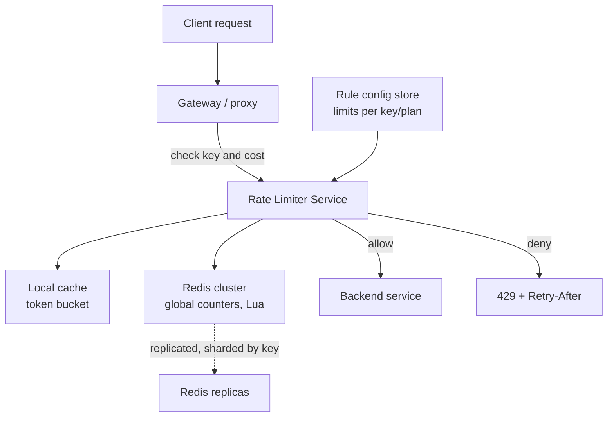

**Design decisions to articulate:**
- **Algorithm:** Sliding window counter (accuracy + O(1)) or token bucket (bursts). State why.
- **Storage:** Redis (in-memory, atomic ops, TTL); shard by rate-limit key (consistent hashing) so hot keys distribute.
- **Consistency model:** Eventually-consistent two-tier (local + global) for throughput; accept slight over-permit.
- **Atomicity:** Lua scripts for check-and-decrement.
- **Availability:** Limiter must be *more* available than the protected service; **fail open** when the store is down (don't make the limiter a SPOF that takes down the API).
- **Rules engine:** externalized config (limits per plan/endpoint/key), hot-reloadable.
- **Performance:** sub-millisecond decision; local cache for hot keys; pipeline Redis calls.
- **Observability:** emit metrics on limit hits per key (detect abuse and mis-tuned limits).

| Requirement | Decision |
|-------------|----------|
| Low latency | Local cache + Redis pipeline; <1 ms |
| Accuracy at scale | Sliding window counter, two-tier |
| Fairness | Per-key (user/IP/API-key) buckets |
| Resilience | **Fail open**; limiter never a hard dependency |
| Configurability | External rules store, hot reload |
| Multi-region | Per-region limits + async global reconciliation |
| Cost-fairness | Cost-weighted tokens (heavy query = more tokens) |

> **Staff-level insight:** The trap question is "what if Redis goes down?" — the answer that separates levels is **fail open with a conservative local fallback limit**, plus the recognition that a rate limiter is *infrastructure* and must out-rank the services it protects in reliability. Also call out **cost-weighted limiting** (a heavy GraphQL query consumes more "tokens" than a cheap GET) — real APIs (GitHub, Shopify) limit by *computed cost*, not raw request count.

---

## 5. Redundancy & Failover

Redundancy eliminates single points of failure by having spare capacity ready to take over. See [Load Balancing](05-load-balancing.md) for how traffic is steered during failover, and [Distributed Systems](02-distributed-systems.md) for quorum/consensus.

> **YAGNI default, stated up front:** **Single region, multi-AZ.** This covers the overwhelmingly common failure (rack/AZ loss) at moderate cost and is table stakes for production. **Trigger to go multi-region:** a region-failure SLA, geo-latency requirements for distant users, or data-residency/compliance law. Name this default and trigger explicitly; jumping to multi-region active-active unprompted is the #1 over-engineering tell.

**Redundancy levels:**

| Notation | Meaning | Example |
|----------|---------|---------|
| **N** | Exactly enough capacity, no spare | Cheapest, no fault tolerance |
| **N+1** | One spare beyond need | Survives 1 component failure |
| **N+2** | Two spares | Survives 2 (or 1 while another is in maintenance) |
| **2N** | Full duplicate (100% redundant) | Survives loss of a whole set |
| **2N+1** | Full duplicate + 1 | Data centers / power for max resilience |

**Active-active vs active-passive:**

```mermaid
flowchart TB
  subgraph AA["Active-Active"]
    LB1["LB"] --> A1["Node A serving"]
    LB1 --> A2["Node B serving"]
  end
  subgraph AP["Active-Passive"]
    LB2["LB"] --> P1["Primary serving"]
    P2["Standby idle"] -.->|promote on failure| LB2
  end
```

| Dimension | Active-Active | Active-Passive |
|-----------|---------------|----------------|
| Capacity use | Both serve (full utilization) | Standby idle (waste) |
| Failover time | ~instant (already live) | Promotion delay |
| Complexity | High (conflict resolution, split-brain) | Lower |
| Cost efficiency | Better | Worse (paying for idle) |
| Data | Needs multi-master or careful sharding | Simpler (one writer) |

**Standby warmth tiers:**

| Standby type | State | Failover speed | Cost |
|--------------|-------|----------------|------|
| **Hot** | Running, in sync, ready | Seconds | High |
| **Warm** | Running, partially synced/scaled | Minutes | Medium |
| **Cold** | Off, must boot + restore | Hours | Low |

**Multi-AZ vs multi-region:**

| Scope | Protects against | Latency between | Complexity |
|-------|------------------|-----------------|------------|
| **Multi-AZ** | Rack/datacenter/AZ failure | ~1–2 ms (sync replication OK) | Moderate — standard practice |
| **Multi-region** | Region-wide outage, disaster, geo-latency | 10s–100s ms (async usually) | High — data consistency, failover orchestration |

Multi-AZ is table stakes for production. Multi-region is for the highest tiers and disaster recovery — and forces **async replication** (so RPO > 0) because synchronous cross-region writes are too slow.

**Quorum & leader failover:** For stateful systems, a **quorum** (majority, e.g., 2 of 3 or 3 of 5) ensures writes survive node loss and prevents split-brain. Leader failover uses consensus (Raft/Paxos) or a coordinator (ZooKeeper/etcd) to elect a new leader when the old one dies. The number of replicas **should preferably be odd** to break ties efficiently — even counts work but give no extra tolerance per node and worsen split-vote risk (3 tolerates 1 failure, 5 tolerates 2). See [Distributed Systems](02-distributed-systems.md).

```mermaid
flowchart TB
  L["Leader writes"] --> F1["Follower 1"]
  L --> F2["Follower 2"]
  L -.->|leader dies| Election["Raft election:<br/>majority elects new leader"]
  Election --> NL["Follower 1 promoted<br/>to leader"]
```

**The single-point-of-failure (SPOF) hunt:** Systematically trace *every* component and ask "what if this dies?" Common hidden SPOFs:
- The load balancer itself (need redundant LBs + DNS/anycast failover).
- A single database primary (need replicas + auto-failover).
- DNS, a shared config service, a single NAT gateway, a single message broker.
- A shared cache that the system can't run without.
- The deployment pipeline / a single region's control plane.
- *People* — one engineer who alone knows how to recover something.

> **Decision, in the room:** *"Multi-AZ with N+1 per tier and a redundant LB fronted by health-checked DNS/anycast — that's my baseline. DB: primary + sync standby in another AZ with automated failover, plus async read replicas. I'd run the data tier as active-passive (one writer keeps consistency simple) but the stateless tiers active-active so the failover path is the normal path. I go multi-region only when the SLA or compliance forces it — and I'd say so rather than build it speculatively."* Then do the SPOF hunt out loud.

> **Staff-level insight:** Active-passive is *deceptively* risky: the standby is rarely exercised, so when failover finally fires, the cold path is full of surprises (stale config, expired creds, never-tested promotion). **Active-active is more reliable precisely because the failover path is the normal path** — it's continuously tested. The Staff move: prefer active-active where data allows, and if you must run active-passive, **regularly fail over on purpose** (game days) so the path stays warm. "Untested failover is not failover, it's hope." **Experience hook:** the hot-standby-with-expired-creds failover surprise.

---

## 6. Chaos Engineering

**Definition:** The discipline of *proactively* injecting failure into (ideally production) systems to discover weaknesses **before** they cause outages — turning "I think it's resilient" into "I've proven it's resilient."

**The four principles:**
1. **Define steady state** — a measurable "normal" (e.g., orders/sec, p99 latency, error rate). This is your hypothesis baseline.
2. **Hypothesize it holds** — "killing one instance will *not* change steady state" (because we have redundancy).
3. **Inject real-world failures** — kill instances, add latency, drop a dependency, exhaust resources.
4. **Minimize blast radius** — start small (one instance, off-peak, with a kill switch), expand confidence gradually. Disprove the hypothesis with the *least* customer impact.

```mermaid
flowchart LR
  SS["1. Measure<br/>steady state"] --> H["2. Hypothesize<br/>it holds under failure"]
  H --> I["3. Inject failure<br/>small blast radius"]
  I --> O{"4. Steady state<br/>maintained?"}
  O -->|yes| Confidence["Confidence up<br/>expand scope"]
  O -->|no| Weakness["Found a weakness<br/>so fix it"]
```

**What to test (the failure taxonomy):**

| Level | Failure injected | Validates |
|-------|------------------|-----------|
| **Instance** | Kill a process/VM/pod | Auto-healing, redundancy |
| **AZ / zone** | Take down a whole AZ | Multi-AZ failover |
| **Region** | Region blackout | Multi-region DR, RTO/RPO |
| **Dependency** | Make a downstream fail/return errors | Circuit breakers, fallbacks |
| **Latency** | Add 200 ms–5 s to a dependency | Timeouts, hedging, degradation |
| **Resource** | CPU/memory/disk/conn-pool exhaustion | Bulkheads, load shedding |
| **Network** | Partition, packet loss, DNS failure | Partition tolerance, retries |
| **Clock / state** | Clock skew, expired certs, full disk | Hidden assumptions |

**Game days:** Scheduled, planned chaos exercises where a team deliberately triggers failures (often a fictional incident scenario) to practice response, validate runbooks, and find gaps. Like a fire drill for engineers — builds *human* muscle memory, not just system resilience.

**Tools:**

| Tool | By | Scope |
|------|----|----|
| **Chaos Monkey** (Simian Army) | Netflix | Randomly kills instances |
| **Chaos Kong / Gorilla** | Netflix | Region / AZ failures |
| **Gremlin** | Gremlin Inc. | SaaS, broad failure injection, blast-radius controls |
| **Litmus / Chaos Mesh** | CNCF | Kubernetes-native chaos |
| **AWS Fault Injection Simulator (FIS)** | AWS | Managed chaos on AWS |
| **Pumba** | OSS | Docker container chaos |

> **Decision, in the room:** *"I'd start chaos in staging to validate the mechanics, then graduate to production off-peak with a tiny blast radius and an abort switch, then make it continuous. The hypothesis-driven framing matters — I'm not 'randomly breaking things,' I'm disproving a specific steady-state hypothesis with minimal customer impact. The real payoff is organizational: game days are how I find the stale runbook and the alert that doesn't fire — and they lower MTTR because we've *rehearsed* the recovery."*

> **Staff-level insight:** Chaos engineering is **science applied to operations** — it's hypothesis-driven, not "randomly break things." Saying "untested resilience is assumed resilience" and tying chaos to **lowering MTTR** (you've rehearsed the recovery) connects it back to the metrics that matter.

---

## 7. Disaster Recovery

DR is your plan for surviving large-scale loss — a region down, data corruption, ransomware, accidental mass-deletion. Defined by two numbers. **This is a deep-dive section** — the tier-per-workload decision and the test-restore/drill discipline are where Staff candidates separate from those who just recite RTO/RPO.

### RTO vs RPO

- **RTO — Recovery Time Objective:** the maximum *acceptable time to restore service* after a disaster. "How long can we be down?" Drives failover speed / standby warmth.
- **RPO — Recovery Point Objective:** the maximum *acceptable data loss*, measured in time. "How much data can we afford to lose?" Drives backup/replication frequency.

```mermaid
flowchart LR
  Backup["Last good backup<br/>or replication point"] -->|RPO equals data lost| Disaster["DISASTER at t0"]
  Disaster -->|RTO equals time to restore| Recovered["Service restored"]
```

On a timeline: **RPO measures backward** from the disaster (how far back is your last safe data point); **RTO measures forward** from the disaster (how long until you're up). RPO=0 means zero data loss (synchronous replication); RTO=0 means instant failover (active-active).

### DR strategy tiers (cost vs RTO/RPO)

```mermaid
flowchart LR
  BR["Backup and<br/>Restore<br/>RTO hours-days"] --> PL["Pilot Light<br/>RTO 10s of min"]
  PL --> WS["Warm Standby<br/>RTO minutes"]
  WS --> AA["Multi-site<br/>Active-Active<br/>RTO near zero"]
  BR -.->|cheapest| C1["low cost"]
  AA -.->|most expensive| C2["high cost"]
```

| Strategy | How it works | RTO | RPO | Cost |
|----------|--------------|-----|-----|------|
| **Backup & Restore** | Periodic backups to durable storage; restore on disaster | Hours–days | Hours (backup interval) | $ (lowest) |
| **Pilot Light** | Core data replicated + minimal always-on services; scale up the rest on failover | 10s of minutes | Minutes | $$ |
| **Warm Standby** | Scaled-down full copy always running; scale up + cut over | Minutes | Seconds–minutes | $$$ |
| **Hot / Multi-site Active-Active** | Full production in 2+ sites serving live traffic | Seconds (~0) | ~0 | $$$$ (highest) |

The trade-off is monotonic: lower RTO/RPO costs more. **Pick the tier per workload** — your billing DB may need warm standby (low RPO), while batch analytics is fine with backup-restore.

> **Decision, in the room:** *"I derive the tier per workload from RTO/RPO, which are business numbers. For our billing/transaction DB I'd run warm standby — minutes RTO, seconds RPO — because lost payment data is unacceptable. For analytics and derived data, backup-and-restore is fine; hours RTO costs us nothing real. I don't put everything on the top tier — that's how DR budgets get wasted on data nobody would miss for a day."*

### Backups

- **Full vs incremental vs differential:** Full = entire dataset (slow, big, simple restore). Incremental = only changes since *last backup* (fast, small, slow restore — must replay chain). Differential = changes since *last full* (middle ground). Typical pattern: weekly full + daily incrementals.
- **The 3-2-1 rule:** **3** copies of data, on **2** different media types, with **1** copy off-site (and increasingly **3-2-1-1-0**: +1 immutable/offline copy for ransomware, +0 verified-no-errors). Off-site/off-account matters — ransomware and account compromise can delete same-account backups.
- **Test your restores.** A backup you've never restored is **Schrödinger's backup** — simultaneously working and broken until observed. Untested backups routinely fail (corruption, missing pieces, wrong version, no documented procedure). *Regularly restore to a clean environment and verify.*

| Backup type | Speed | Storage | Restore complexity |
|-------------|-------|---------|--------------------|
| Full | Slow | Large | Simple (one file) |
| Incremental | Fast | Small | Complex (replay chain) |
| Differential | Medium | Medium | Medium (full + 1 diff) |

### Replication for DR, runbooks, drills

- **Data replication:** Synchronous (RPO=0, but latency cost, only intra-region practical) vs asynchronous (RPO>0, survives cross-region, risk of losing the un-replicated tail). Cross-region DR is almost always async — be explicit about the resulting RPO.
- **Runbooks:** Step-by-step recovery procedures — failover commands, who to call, decision criteria. Must be *current* and *tested*; a runbook nobody has executed is fiction.
- **Failover drills:** Regularly *execute* the DR plan (planned region failover, restore-from-backup drill). This is chaos engineering applied to DR — it's the only way to know your RTO/RPO are real, not aspirational.

> **Staff-level insight:** RTO and RPO are **business decisions, not engineering ones** — you derive them from "what does an hour of downtime / an hour of lost data cost us?" and let that pick the tier and budget. The two failures that sink real companies: (1) **backups that were never test-restored** (they fail exactly when needed), and (2) **DR plans that were never drilled** (RTO is 4× the estimate because creds expired, the runbook is stale, and the one person who knew the steps left). The Staff answer always includes *"and we drill it quarterly and test-restore monthly."* Also flag **replica-poisoning**: if a logical corruption (bad deploy, ransomware) replicates to your standby, hot standby doesn't save you — you need **point-in-time backups** as a separate defense from replication. **Experience hook:** the expired-creds failover surprise applies here too.

### Case study — GitLab.com database loss (Jan 31, 2017)

> **Source:** GitLab's public postmortem and the live incident doc from that night. Figures are as GitLab reported them.

The canonical "every backup was Schrödinger's backup" incident, and the best one to cite when an interviewer asks *"how do you know your backups work?"*

**The sequence:**
1. A spam surge loaded the primary Postgres (`db1`). Replication to the secondary (`db2`) fell behind and then **broke**: the WAL it needed had already been removed.
2. Late at night, an engineer tried to re-seed `db2`. `pg_basebackup` hung. To retry, they ran `rm -rf` on the data directory, **in a shell on `db1`, not `db2`**. They noticed within a second or two, but roughly **300 GB** of production data was already gone.
3. They reached for the backups. GitLab's own postmortem summary: **of five backup/replication mechanisms, none was working reliably or even set up**:

| Mechanism | Believed state | Actual state |
|---|---|---|
| Daily `pg_dump` to S3 | Running | **Failing silently**: a 9.2 `pg_dump` binary against a 9.6 server; the failure emails were **rejected by DMARC**, so nobody saw them. The S3 bucket was empty |
| Streaming replica (`db2`) | Hot standby | The thing that was broken, and the reason anyone was touching the box |
| Azure disk snapshots | A safety net | **Not enabled** for the database servers |
| S3 backup of snapshots | Off-site copy | Empty |
| LVM snapshot | Used to refresh **staging**, not a DR mechanism | **The one that saved them**: taken manually about **6 hours** earlier to seed staging |

4. They restored from that staging snapshot. Copying it over slow cloud disks took about **18 hours** (actual RTO). About **6 hours of database writes were lost** (actual RPO): reportedly ~5,000 projects, ~5,000 comments and ~700 new user accounts. Git repositories lived on separate storage and survived.
5. GitLab live-streamed the recovery and published a public, **blameless** postmortem. It's widely cited as how to handle incident communication well.

**Map it to this module, one lesson per row:**
- **Replication is not a backup** (§7 staff insight): the replica was the *first* thing to fail, and a replica would also have faithfully replicated an `rm -rf`-equivalent logical error.
- **Untested backups don't exist.** Five mechanisms that were never test-restored added up to zero mechanisms. The fix is an *automated* restore-and-verify job (restore nightly to a scratch instance, run row-count and checksum queries, alert on failure).
- **Alert on the absence of success, not just on failure.** The failure alerts were sent and silently dropped. A **dead-man's switch** ("page if no successful backup in 26 h") catches the failure, the broken alert path *and* a cron that never ran.
- **The real RTO/RPO is whatever your last *verified* restore achieved.** On paper it was "daily backups"; in reality it was 6 h RPO and 18 h RTO, and only by luck.
- **Human factors are reliability engineering:** a tired operator, two hosts with near-identical prompts, a destructive command with no confirmation. Mitigations: color-coded production prompts, the two-person rule for destructive operations on primaries, tooling that refuses `rm -rf` on a live data directory, and not doing risky surgery at 11 pm without a second person.

> **Staff-level insight:** when asked "what's your backup strategy?", don't list mechanisms. That's exactly the trap GitLab fell into, since they had five. Say: *"Backups are measured by restores: an automated nightly restore to an isolated instance with integrity checks, a dead-man's-switch alert if a verified backup is older than 26 hours, point-in-time recovery from WAL archiving to a separate account for a minutes-level RPO, and a quarterly drill that times the full restore so our RTO is a measured number. Replication is for availability; it's not on the backup list."* Citing GitLab by name, with the DMARC detail, shows you've studied real failures rather than reciting 3-2-1.

---

## 8. Making a Design "Reliable" — the Staff Checklist

When an interviewer says "now make it reliable / what are the failure modes," walk this checklist out loud. This is the synthesis of the whole module. Apply the [In the Room](#in-the-room--staff-level-delivery) lens to each step: *decide, give the trigger, move on.*

```mermaid
flowchart TB
  D["Your design"] --> SLO["1. Define SLO + error budget"]
  SLO --> SPOF["2. Hunt SPOFs<br/>add redundancy"]
  SPOF --> RES["3. Resilience patterns<br/>on every dependency"]
  RES --> CAP["4. Capacity + load shed<br/>+ rate limit"]
  CAP --> DATA["5. Data: replication,<br/>backups, RPO"]
  DATA --> OBS["6. Observe: SLIs,<br/>alerts, burn rate"]
  OBS --> DR["7. DR: RTO, runbooks,<br/>drills"]
  DR --> CHAOS["8. Prove it: chaos<br/>+ game days"]
```

1. **Set the target.** What SLO? What's the error budget and freeze policy? (Don't say five nines reflexively — derive the loosest tolerable target.)
2. **Eliminate SPOFs.** Trace every component: LB, DB primary, DNS, cache, broker, region. Add N+1/active-active redundancy, multi-AZ baseline.
3. **Make every dependency call resilient.** Timeout + deadline propagation, budgeted retries with jitter, circuit breaker, bulkhead, fallback. Push into a mesh/library. (Name in one breath; deep-dive only the crux.)
4. **Control admission.** Rate limit (per-key) and load shed at the edge; graceful degradation paths defined; backpressure on all queues (bounded).
5. **Protect data.** Replication (sync vs async + resulting RPO), backups (3-2-1, tested restores), idempotency for retried writes, quorum for consistency.
6. **Make it observable.** RED/USE SLIs, multi-window burn-rate alerts, MTTD/MTTR instrumentation, distributed tracing — see [Observability](12-observability.md).
7. **Plan disaster recovery.** RTO/RPO per workload → DR tier; runbooks; quarterly failover drills.
8. **Prove resilience.** Chaos experiments (small blast radius first), game days, regular failover tests. Untested resilience is assumed resilience.
9. **Optimize MTTR over MTBF.** Fast rollback, feature flags, canaries, automated remediation.
10. **Design for blast-radius containment.** Cells / shuffle sharding so any one failure hits a fraction of users.

> **Delivery reminder:** Don't recite all ten at uniform depth. Lead with the target (1), do the SPOF hunt (2), name the resilience stack in a breath (3–4), then spend your remaining minutes on whichever of {SLO reasoning, data/DR, blast radius} is the genuine risk for *this* system. That altitude discipline is itself the signal.

---

## Interview Cheat-Sheet

| Concept | One-liner |
|---------|-----------|
| **Staff delivery** | Decide: "`<choice>` because `<requirement>`; revisit if `<trigger>`." Never "it depends." |
| **SLI / SLO / SLA** | Measurement / internal target / customer contract. SLO stricter than SLA. |
| **Error budget** | `1 − SLO`; governs release velocity; exhausted → feature freeze; multi-window burn-rate alerting. |
| **Good SLI** | `good/total` events, user-centric, percentile-based. RED (services) + USE (resources). |
| **Three nines** | 99.9% ≈ 8.8 h/yr ≈ 43 min/month. Four nines ≈ 1 min/week. Each nine = ÷10 downtime, ×~10 cost. |
| **Availability composes** | Serial deps multiply down; parallel redundancy multiplies up. Fewer hops = free reliability. |
| **Why not 100%** | Impossible, expensive, kills velocity, user can't perceive it. |
| **Availability formula** | `MTBF / (MTBF + MTTR)`. |
| **MTTR over MTBF** | You fully control recovery; decompose MTTR → detect/ack/diagnose/mitigate; failure rate has diminishing returns. |
| **Fail fast** | Make every failure cheap and early (admission, breaker, bulkhead, deadline). |
| **Timeout** | Every call needs one; set above p99; propagate deadlines. |
| **Retry** | Backoff + **jitter** + **budget** + **idempotency** + gated by breaker. Beware amplification (3³). |
| **Circuit breaker** | Closed→Open→Half-Open. Fails fast, lets dependency recover. Per-dependency. |
| **Bulkhead** | Isolate pools per dependency; cells/shuffle sharding for blast radius. |
| **Load shed** | Reject early when overloaded; brown out before black out; rank shed order. |
| **Backpressure** | Bound every queue; signal upstream to slow down. |
| **Hedged request** | Send 2nd request after p95; cut tail latency; idempotent reads only; YAGNI until tail hurts. |
| **Rate limit default** | **Token bucket** (bursts, O(1)). Sliding window counter for accuracy at scale; leaky for constant rate. |
| **Distributed RL** | Two-tier local+global; Redis + Lua atomic; **fail open**. |
| **429** | Always with `Retry-After`. |
| **Redundancy** | N+1, active-active > active-passive (failover path is the normal path). |
| **Topology default** | Single region multi-AZ until SLA/compliance forces multi-region. |
| **Multi-AZ vs region** | AZ = sync OK, table stakes; region = async, RPO>0, DR. |
| **RTO / RPO** | Time to recover / data you can lose. Business decisions. Tier per workload. |
| **DR tiers** | Backup-restore → pilot light → warm standby → active-active (cost ↑, RTO/RPO ↓). |
| **3-2-1** | 3 copies, 2 media, 1 off-site; **test restores**; replica-poisoning needs point-in-time backups. |
| **GitLab 2017** | `rm -rf` on the primary; 0 of 5 backup mechanisms worked (pg_dump version mismatch, alerts lost to DMARC). Saved by a 6 h-old staging snapshot, 18 h restore. Lesson: automated restore-verify + dead-man's-switch alert; replication ≠ backup. |
| **Chaos** | Steady state → hypothesis → inject → small blast radius. Lowers MTTR. |

---

## Common Interview Questions

**Q1. What availability should we target, and how do you decide?**
Don't reflexively say five nines. Commit decisively: *"I'd target 99.95% for this, with an internal SLO of 99.95% and a customer SLA of 99.9% — the gap is firefighting margin."* Justify from the user: being more reliable than the *weakest link they depend on* is wasted money. Translate the target into an error budget (`1−SLO` ≈ 20 min/window here) and a pre-agreed freeze policy. Note each nine costs ~10× and removes engineering freedom, and that beyond ~four nines your cloud provider's own SLA becomes the ceiling unless you go multi-cloud. The senior signal is treating reliability as a feature with diminishing returns, priced by the error budget — and *picking a number*, not listing options.

**Q2. Walk me through making a single service-to-service call reliable.**
Name the stack in one breath, then narrate order. Outer-to-inner: admission/rate-limit and load-shed first (reject before spending resources — fail fast); acquire a bulkhead pool slot (fail fast if full); check the circuit breaker (open → fallback); issue the call with a timeout set above the dependency's p99 and propagate the remaining deadline; on transient failure, retry with exponential backoff + full jitter, gated by a retry budget and only if idempotent; on exhaustion return a degraded fallback; record the outcome to feed the breaker and SLIs. Emphasize this belongs in a shared library or sidecar (Envoy), and that order matters — retries live *inside* the breaker. Don't over-explain what a timeout is.

**Q3. Why is reducing MTTR often more valuable than increasing MTBF?**
Availability = MTBF/(MTBF+MTTR). MTTR is the lever you fully control (rollback, automation, runbooks, canaries) while MTBF hits diminishing returns and can never reach "never fails." Decompose MTTR into detect/ack/diagnose/mitigate and attack the dominant stage. A system that fails often but recovers in seconds beats one that fails rarely but takes hours. Worked numbers: with MTBF 1000h, cutting MTTR from 1h to 6min takes you from 99.9% to 99.99% without changing failure rate. Plus most outages are change-induced and transient, so fast rollback neutralizes them. Bonus: low MTTR is mostly *organizational*, not just tooling.

**Q4. Design a rate limiter for a multi-tenant API.**
Commit to **token bucket** (allow bursts, good UX, O(1) memory) — or sliding window counter if you need accurate accounting at scale (what Cloudflare uses); justify the choice rather than listing all five. Store counters in Redis with Lua scripts for atomic check-and-increment, sharded by key. For a fleet, use a two-tier design: fast local token bucket + async-reconciled global counter — ~99% accurate with no per-request network hop. Key by per-API-key (plan quotas), per-IP (anti-abuse), and per-endpoint (protect heavy routes) simultaneously. Return 429 with Retry-After. Critically: **fail open** if Redis is down — a limiter that takes down the API it protects is worse than briefly over-permitting. Bonus: cost-weighted limiting (heavy queries cost more tokens).

**Q5. Token bucket vs leaky bucket vs sliding window — when each?**
Lead with the default and the triggers. Token bucket when you *want* bursts (most user-facing APIs — bursting is good UX), settles to steady rate `r`, O(1) memory. Leaky bucket when downstream needs a *constant* rate (smooths output, no bursts). Fixed window is cheapest but has the 2×-at-boundary problem. Sliding window log is exact but O(n) memory — avoid at scale. Sliding window counter is the pragmatic winner for accuracy at scale: near-exact, fixes the boundary burst, O(1) memory (two counters). Match the algorithm to whether you value bursts, smoothness, or accuracy — and *pick one as default*.

**Q6. A downstream dependency gets slow. Walk me through what happens and how you prevent a cascade.**
Without protection: callers' threads block waiting, the thread/connection pool saturates, the caller stops serving *all* traffic (not just calls to the slow dep), and the failure cascades upward — A dies because B is slow, taking down C and D. (Cite the experience: this is exactly the presence-service-saturates-gateways incident.) Prevention: timeouts (release threads fast — fail fast), bulkheads (isolate the slow dep's pool so other deps are unaffected), a circuit breaker (after a failure threshold, fail fast and stop calling the sick dependency — which also lets *it* recover), and fallbacks (degrade gracefully). Add load shedding so you brown out instead of black out. The cascade mechanism is resource-exhaustion contagion; bulkheads + breakers contain it.

**Q7. Active-active vs active-passive — which is more reliable?**
Counterintuitively, active-active is often *more* reliable because the failover path **is** the normal serving path — it's continuously exercised. Active-passive's standby is rarely tested, so real failover surfaces stale config, expired creds, and untested promotion exactly when you can least afford it (I've watched a "hot" standby fail over straight into expired credentials). Active-active also uses capacity fully (no idle standby) and fails over instantly, at the cost of complexity (conflict resolution, split-brain, multi-master data). Decisive position: run stateless tiers active-active; keep the data tier active-passive (single writer = simpler consistency) but **fail over on purpose regularly** (game days) to keep the path warm. "Untested failover is hope, not failover."

**Q8. Explain RTO and RPO and how they drive DR architecture.**
RPO = max acceptable data loss (measured backward from disaster — drives backup/replication frequency); RTO = max acceptable downtime (measured forward — drives standby warmth). They're *business* decisions: derive from the cost of an hour of downtime / lost data. They map to DR tiers monotonically by cost: backup-restore (hours, cheap) → pilot light → warm standby → multi-site active-active (~0, expensive). **Pick per workload** — billing needs warm standby, analytics tolerates backup-restore; putting everything on the top tier is wasted budget. Always add: test-restore backups monthly and drill failover quarterly, because the two things that sink companies are untested backups and undrilled DR plans. And watch replica-poisoning: logical corruption replicates to a hot standby, so you still need point-in-time backups as a separate defense.

**Q9. How do error budgets change how engineering and product work together?**
They convert a political argument ("ship fast" vs "stay stable") into an arithmetic one. The budget is `1−SLO`; devs ship as fast as it allows, and when they overspend, *they* accept a feature freeze until it recovers — it's self-policing and data-driven, not an ops veto. The Staff/Director move is getting product and eng leadership to pre-commit to the freeze policy *while everyone is calm*, and to enforce it automatically with multi-window burn-rate alerting (catch both the fast catastrophic burn and the slow leak). It aligns incentives under one number and makes reliability a shared, budgeted resource rather than an argument.

**Q10. How would you validate that a system is actually as resilient as you designed it to be?**
Chaos engineering and game days. Define steady state (measurable normal), hypothesize it holds under a specific failure, inject that failure with the smallest possible blast radius and a kill switch, and observe — if steady state breaks, you found a real weakness before customers did. Test the full taxonomy: instance kills, AZ/region loss, dependency failure, injected latency, resource exhaustion, network partition. Graduate from staging to production off-peak to continuous. Game days additionally validate the human side — stale runbooks, alerts that don't fire, single points of *human* knowledge. The principle: untested resilience is merely assumed resilience, and chaos lowers MTTR by rehearsing recovery.

**Q11. (Meta/delivery) The interviewer gives you a design and says "make it reliable" with 10 minutes left. How do you spend them?**
This is an altitude-and-prioritization test, and the answer is the [In the Room](#in-the-room--staff-level-delivery) lens. Don't recite all ten checklist items uniformly. First, *set the target* — derive the loosest tolerable SLO from the business need and state the error budget; that one decision frames everything. Then do a fast SPOF hunt and *name* the resilience stack in a single breath ("timeouts, jittered retries, breakers, bulkheads — in the mesh"). Then spend the bulk of the time on the one genuine risk crux for *this* system — usually the data/DR story or the blast-radius containment — and make a decisive call with a revisit trigger. The signal isn't covering everything; it's knowing what *not* to dwell on and committing to the hard call. Saying "I'd defer multi-region until the SLA demands it" is worth more than ten shallow patterns.

**Q12. (Meta/delivery) You and the interviewer disagree on whether the system needs multi-region. How do you handle it?**
Don't cave (false humility) and don't dig in. Anchor on the requirement: *"Multi-region buys us survival of a region-wide outage and lower latency for distant users, at roughly 3× cost and real complexity — conflict resolution, split-brain, RPO>0 from async replication. If our SLA tolerates a region-level event recovered via warm standby, single-region multi-AZ is the right call and I'd revisit the moment we sign a contract or hit a data-residency law that forces it."* Then ask which requirement they're optimizing for. The Staff move is making the trade-off *explicit and requirement-driven* so the disagreement resolves on facts, not opinion — and showing you'll change your answer when the requirement changes, not when pushed.

---

*Related modules:* [Distributed Systems](02-distributed-systems.md) · [Load Balancing](05-load-balancing.md) · [Microservices](10-microservices.md) · [Observability](12-observability.md) · [Staff-Level Execution](20-staff-execution.md)
