# Module 12 — Observability

> *"You can't debug what you can't see. At Staff level, observability is not a dashboard you bolt on at the end — it's a design constraint you reason about from the first whiteboard line."*

## What you'll master

This module makes you fluent in the **theory, economics, and operational practice** of observability for large distributed systems. By the end you will be able to:

- Articulate **why observability ≠ monitoring** in terms an interviewer recognizes as senior (cardinality, unknown-unknowns).
- Reason precisely about the **three pillars** — metrics, logs, traces — including their *failure modes* and *cost curves*, not just their happy paths.
- Defend opinionated choices: *"alert on SLO burn rate, not CPU"*, *"sample traces with tail-based sampling for errors"*, *"cap your metric cardinality or your TSDB dies."*
- Walk through a **worked p99 latency-spike diagnosis** using all three pillars in sequence.
- Design observability **into** a system with explicit cost/cardinality/retention trade-offs and a build-vs-buy stance.
- Speak the modern stack: **Prometheus, Grafana, OpenTelemetry, Jaeger/Tempo, Thanos/Mimir, PagerDuty**, and the commercial players (Datadog, Honeycomb), plus where **eBPF** fits.

Cross-references: [Reliability & SRE](11-reliability.md) (SLOs, error budgets, postmortems), [Microservices](10-microservices.md) (why distributed systems need tracing), [Distributed Systems](02-distributed-systems.md) (partial failure, clocks, causality), [Staff-Level Execution](20-staff-execution.md) (how to deliver these decisions in the room).

---

## Table of Contents

1. [In the Room — Staff-Level Delivery](#in-the-room--staff-level-delivery)
2. [Observability vs Monitoring](#1-observability-vs-monitoring)
3. [The Three Pillars — Overview & Limits](#2-the-three-pillars--overview--limits)
4. [Pillar 1 — Metrics](#3-pillar-1--metrics)
5. [Pillar 2 — Logs](#4-pillar-2--logs)
6. [Pillar 3 — Traces](#5-pillar-3--traces)
7. [How the Pillars Tie Together](#6-how-the-pillars-tie-together)
8. [Prometheus Deep Dive](#7-prometheus-deep-dive)
9. [Grafana](#8-grafana)
10. [OpenTelemetry — The Standard](#9-opentelemetry--the-standard)
11. [Vendors & the Landscape](#10-vendors--the-landscape)
12. [Alerting & On-Call](#11-alerting--on-call)
13. [Incident Management](#12-incident-management)
14. [Designing Observability Into a System](#13-designing-observability-into-a-system)
15. [Worked Example — Diagnosing a p99 Spike](#14-worked-example--diagnosing-a-p99-spike)
16. [Interview Cheat-Sheet](#15-interview-cheat-sheet)
17. [Common Interview Questions](#16-common-interview-questions)

---

## In the Room — Staff-Level Delivery

> Read this section first; it is the lens for everything below. At Staff level you are not graded on whether you *know* the three pillars — that is assumed. You are graded on whether you can **make defensible calls fast, name the one or two things that are actually hard, and move on from the rest.** The single biggest failure mode for a senior candidate on this topic is *uniform thoroughness*: lovingly explaining what a counter is for three minutes while never committing to a sampling strategy. Don't do that. Spend your altitude where the risk is.

### Decisions to make decisively

State these as decisions, not menus. Each is "`<choice>` because `<requirement>`; revisit if `<trigger>`." Never say "it depends" without immediately resolving the dependency out loud.

| Decision | Default call | Because | Revisit if |
|---|---|---|---|
| Instrumentation API | **OpenTelemetry, everything through the Collector** | Instrumentation is the sticky asset that lives in your code forever; backends are commodities. Instrument once, swap backends with a config change. | Never, really — this is the one near-universal call. Only skip OTel if a mandated vendor agent is already deployed fleet-wide. |
| Metrics + dashboards backend | **Prometheus + Grafana** (self-host) or **Grafana Cloud / Datadog** (buy) | De-facto standard, PromQL is the lingua franca, huge exporter ecosystem, K8s-native. | Self-host LGTM/Thanos when the SaaS bill crosses ~3 FTE of cost; buy when you have no platform team. |
| What pages a human | **SLO burn-rate, multi-window** | Pages must map to user pain and severity. CPU/queue-depth are diagnostics, not pages. | Never. This is the hill to die on. |
| Trace sampling | **Tail-based in the Collector gateway: 100% of errors + slow, ~1% baseline** | You want the *interesting* traces, not a random 1% that misses your 0.01% errors. | Drop to head-based if trace volume is low enough to keep everything, or if Collector memory for buffering becomes the bottleneck at extreme RPS. |
| Log strategy | **One canonical structured event per request per service; sample successes, keep 100% errors** | Cheaper, richer, and naturally bridges to traces vs. 20 chatty lines. | Keep verbose logs for a specific subsystem under active investigation via a per-request debug header. |
| Where high-cardinality lives | **Traces and logs (wide events), never metric labels** | `user_id` in a Prometheus label is a cartesian-product bomb that OOMs the TSDB. | Never put unbounded IDs in metric labels. Full stop. |

### Altitude — where to go deep, where to move on

**Name-and-move-on (one sentence each, don't linger):**

- "Metrics, logs, and traces, emitted via **OpenTelemetry**, shipped through the **Collector** to **Prometheus/Grafana** for metrics-and-dashboards, **Loki/ELK** for logs, **Tempo/Jaeger** for traces." That is the spine. State it and keep moving — do not explain what a histogram is unless asked.
- Counter vs gauge, pull vs push, what Grafana renders — name them, don't teach them.

**Deep-dive (this is where the interview is actually won — earmark these as the hard parts):**

- **Cardinality control.** The #1 way real teams kill Prometheus. Be able to estimate series counts out loud and state a budget.
- **SLO burn-rate, multi-window multi-burn-rate alerting.** The dividing line between "I've read about SRE" and "I've carried a pager."
- **Trace-based debugging via exemplars + trace_id.** The pivot path is the single most reused incident workflow; deliver it as a narrative.
- **Ingest cost and cost control at scale.** Do the `$/GB × GB/day × retention` math out loud. This is where experienced operators separate from juniors.

### YAGNI default + trigger

Start with **RED metrics + SLO burn-rate alerts + one canonical log line + OTel auto-instrumentation**. That is enough to run most services well. Do **not** reach for tail-based sampling infrastructure, a self-hosted Thanos/Mimir cluster, eBPF, or high-cardinality wide-event stores until a trigger forces it:

- Tail sampling → when trace volume makes 100% retention infeasible *and* head sampling is missing your rare errors.
- Thanos/Mimir → when you need cross-cluster global query or >15-month retention, or one Prometheus OOMs.
- Honeycomb-class wide-event store → when "GROUP BY user_id WHERE latency > 1s" becomes a recurring debugging need metrics can't serve.
- eBPF → when you have polyglot/legacy services you can't or won't re-instrument.

### Top anti-patterns (call these out by name)

1. **High-cardinality label explosion** — `user_id`/`request_id`/raw-URL in metric labels → TSDB OOM. The classic junior tell.
2. **Alert fatigue** — paging on non-actionable, non-urgent, cause-based signals until people ignore the pager and miss the real one.
3. **Logging everything** — TB/day of INFO with no sampling → a five-figure surprise bill and slow queries.
4. **Alerting on CPU** (causes, not symptoms) — CPU at 95% serving traffic happily is *fine*; page on the symptom (latency/error SLO), use CPU for diagnosis.
5. **Three disconnected silos** — metrics, logs, traces with no shared trace_id → telemetry, not observability.
6. **Uniform thoroughness in the interview** — explaining basics at the same depth as the crux. Altitude discipline is itself a graded signal.

### Experience hooks (cite real operational scars, briefly)

These are the kinds of concrete war stories that prove you've operated at scale — drop one when relevant, don't narrate all of them:

- *"We took down a Prometheus by adding a `room_id` label on a per-message counter — millions of active rooms, head-series blew past memory in an hour. Fix: move room_id to trace/log attributes, keep the metric label set to {event_type, region, status}, ~8k series."*
- *"A p99 spike on message-send that turned out to be a dropped DB index after a migration — found it in under ten minutes via exemplar → trace → trace_id → slow-query log → change feed. The whole point of wiring exemplars was that ten-minute path."*
- *"A WebSocket fan-out service where head-sampling at 1% never captured the 0.05% of connections that hung; tail sampling on duration > 2s surfaced them immediately."*
- *"A Datadog bill that crossed the cost of two engineers because nobody sampled success logs; we cut it ~16× by keeping 100% errors and sampling INFO at 5%, trace_id-keyed."*

> The meta-signal across all of this: a Staff engineer treats observability as a **budgeted, SLO-serving design constraint reasoned about from the first whiteboard line**, not a Datadog agent bolted on before launch. If you remember one thing from this module for the room: **decide, name the crux, do the cost math, move on.** See [Staff-Level Execution](20-staff-execution.md) for the general delivery playbook.

---

## 1. Observability vs Monitoring

### Definition

**Monitoring** is the practice of collecting and alerting on a **predefined** set of signals — you decide in advance *what questions you'll ask* ("is CPU > 80%?", "is the error rate > 1%?") and build dashboards/alerts for those. Monitoring answers **known-unknowns**: failure modes you anticipated.

**Observability** is a *property of a system* — the degree to which you can understand its **internal state from its external outputs**, including for questions you **did not anticipate**. Observability targets **unknown-unknowns**: "Why are exactly the requests from customer X in region eu-west, hitting API v2, on Android, with payloads > 1MB, suddenly 4× slower?" — a question nobody wrote a dashboard for.

The term is borrowed from **control theory** (Kálmán): a system is observable if its internal state can be inferred from its outputs over time.

### How it works — the cardinality distinction

The technical heart of the distinction is **cardinality**. Cardinality = the number of unique values a dimension (or combination of dimensions) can take.

- **Monitoring** uses **low-cardinality, pre-aggregated** data. `http_requests_total{status="500"}` is cheap because there are ~5 status classes. You aggregate *at write time*.
- **Observability** requires **high-cardinality, high-dimensionality** data retained at the **event level** so you can slice arbitrarily *at query time* — by `user_id`, `request_id`, `build_sha`, `device`, `region`, `feature_flag`. The ability to ask `GROUP BY user_id WHERE latency > 1s` after the fact is what distinguishes observable systems.

This is why Honeycomb-style "wide events" and high-cardinality columnar stores exist: classic time-series databases (Prometheus) explode if you put `user_id` in a label.

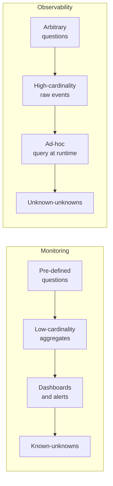

### Comparison

| Aspect | Monitoring | Observability |
|---|---|---|
| Targets | Known-unknowns | Unknown-unknowns |
| Question timing | Defined in advance | Asked ad-hoc, after the fact |
| Cardinality | Low (aggregate at write) | High (slice at query) |
| Primary artifact | Dashboards, threshold alerts | Explorable event data, traces |
| Failure it catches | "The thing we feared broke" | "Something novel broke" |
| Cost driver | Cheap, bounded | Expensive, grows with cardinality |
| Mental model | "Is the system healthy?" | "Why is the system behaving this way?" |

### Real examples

- **Monitoring**: Nagios/Zabbix checking host up/down; a Prometheus alert on `node_filesystem_avail < 10%`.
- **Observability**: Honeycomb tracing a single slow request to a specific shard; querying "all spans where `db.statement` matched a missing index, grouped by tenant."

### Pitfalls

- **"We have 200 dashboards, so we're observable."** No — dashboards are monitoring. If you can only answer questions you anticipated, you're not observable.
- **Conflating the three pillars with observability.** Having metrics + logs + traces in three disconnected silos is *telemetry*, not observability. Observability requires **correlation** (shared `trace_id`) so you can pivot across them.
- **Cardinality blindness.** Teams add `user_id` as a Prometheus label and take down their TSDB. Cardinality must be a conscious, budgeted decision.

> **Staff-level insight:** The interviewer is testing whether you understand that *the data model determines what questions you can ask*. Pre-aggregated metrics are a lossy compression of reality optimized for cheap known-question answering. The moment you average away the dimensions, you've thrown out the ability to debug the unknown. Senior engineers design the **data collection** around "what will I wish I had captured at 3am during an incident I can't yet imagine?" — and then bound the cost so it doesn't bankrupt the company.

---

## 2. The Three Pillars — Overview & Limits

### Definition

The "three pillars" of observability are **Metrics**, **Logs**, and **Traces** — three telemetry signal types with complementary strengths. They are a *useful pedagogical model* but, as Charity Majors and others argue, also a **flawed marketing frame**: three separately-billed, separately-stored silos is the *opposite* of unified observability. The frame survives because the tooling is organized this way.

### How they relate

| Signal | Answers | Granularity | Cost shape |
|---|---|---|---|
| **Metrics** | *Is something wrong? How much?* | Aggregated, numeric | Cheap, bounded by cardinality |
| **Logs** | *What exactly happened in this event?* | Per-event, textual | Expensive, scales with volume |
| **Traces** | *Where did the time go across services?* | Per-request, causal | Expensive; usually sampled |

The canonical workflow: **Metrics tell you *that* something is wrong → Traces tell you *where* → Logs tell you *why*.**

> **Decision (default):** Emit all three **via OpenTelemetry**, route through the **Collector** — metrics to Prometheus, traces to Tempo/Jaeger, logs to Loki/ELK. *Because* instrumentation outlives any backend choice and you want one wire format (OTLP) and one place (the Collector gateway) to do sampling, redaction, and cost control. *Revisit if* a vendor agent is already mandated fleet-wide. This is the name-and-move-on baseline; the depth below is reserved for cardinality, sampling, and cost — the parts that actually bite.

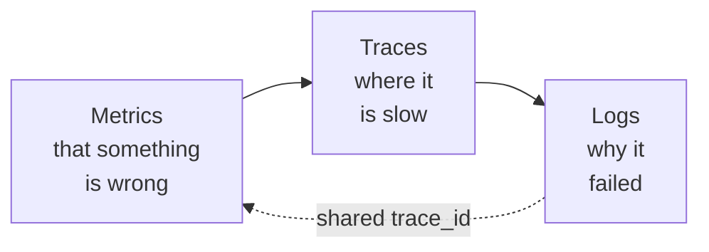

### Limits of each pillar

- **Metrics** lose individual events. A p99 spike tells you *something* is slow but not *which* request — you can't drill into a single bad request from an aggregate.
- **Logs** are unstructured by default, expensive at volume, and hard to correlate across services without discipline (correlation IDs). Free-text logs don't aggregate.
- **Traces** are usually **sampled**, so the specific slow request you care about may not have been captured. Tail-based sampling mitigates this but is operationally heavier.

> **Staff-level insight:** The modern critique — which scores points in interviews — is that the "three pillars" should converge on **structured, high-cardinality, canonical events** (one wide event per request, emitted from each service, carrying trace context). From that single event stream you can *derive* metrics (count/aggregate), reconstruct traces (via span relationships), and read logs (the event itself). OpenTelemetry's unified data model and Honeycomb's architecture both push toward this convergence. Saying "pillars are a billing artifact, not a fundamental truth" signals you've thought past the marketing.

---

## 3. Pillar 1 — Metrics

### Definition

A **metric** is a numeric measurement captured over time — a **time series**: a stream of `(timestamp, value)` points identified by a name and a set of key/value **labels** (dimensions). Example: `http_request_duration_seconds{method="GET", route="/checkout", status="200"}`.

### The four core metric types

| Type | Semantics | Example | Key operations |
|---|---|---|---|
| **Counter** | Monotonically increasing (resets to 0 on restart) | `requests_total`, `errors_total` | `rate()`, `increase()` |
| **Gauge** | Value that goes up and down | `queue_depth`, `memory_bytes`, `temperature` | instantaneous read, `avg/min/max` |
| **Histogram** | Samples bucketed into configurable boundaries; client-side buckets | `request_duration_seconds_bucket{le="0.1"}` | `histogram_quantile()` |
| **Summary** | Client-computed quantiles over a sliding window | `request_duration{quantile="0.99"}` | direct quantile read (not aggregatable) |

**Histogram vs Summary** — a frequent interview probe:

| | Histogram | Summary |
|---|---|---|
| Quantile computed | Server-side, at query time | Client-side, at emit time |
| Aggregatable across instances | **Yes** (sum the bucket counts) | **No** (can't merge precomputed quantiles) |
| Configurability | Pick quantiles at query time | Quantiles fixed at instrumentation time |
| Cost | More time series (one per bucket) | Cheaper series, more client CPU |
| Accuracy | Bounded by bucket boundaries | Exact within the window, per-instance only |

> Rule of thumb: **prefer histograms** in distributed systems because you can aggregate across replicas. Summaries are only acceptable when you need an exact per-instance quantile and never aggregate.

> **Note (modern default, 2026):** the "more time series (one per bucket)" cost above is the *classic* fixed-bucket histogram. **Prometheus native (exponential / sparse) histograms** — on the GA track in 2026 — store the whole distribution in a single series with dynamically-sized exponential buckets, removing the per-bucket series multiplication while improving resolution. Prefer native histograms for new latency instrumentation where your stack supports them.

### How it works — cardinality

A **time series** is uniquely identified by the metric name **plus the full set of label values**. The number of distinct series = the **cartesian product** of all label value sets.

```
http_requests_total{method, status, route, region}
   = |methods| × |statuses| × |routes| × |regions|
   = 5 × 6 × 200 × 4  = 24,000 series   ← fine

Add user_id (1,000,000 users):
   = 24,000 × 1,000,000 = 24 billion series   ← TSDB death
```

Every unique series consumes memory in the TSDB head block and storage on disk. **Cardinality explosion** is the #1 way teams kill Prometheus. Each new high-cardinality label *multiplies* the series count.

**Concrete numbers to quote in the room.** A Prometheus head series costs roughly **1–3 KB of RAM** (samples in the head block + index). So:

- **100k active series** ≈ 0.1–0.3 GB head, comfortable.
- **1M series** ≈ 1–3 GB head plus index overhead — a real single-node Prometheus runs into the low millions of series before you fight OOM and slow queries.
- **10M+ series** — you are now in Thanos/Mimir/VictoriaMetrics territory or you have a cardinality bug.

Rule of thumb to state decisively: **budget ~10k active series per service, low single-digit millions per Prometheus.** The killer is not the count today — it's **per-label churn**: an autoscaling `pod` label or a deploy-versioned `instance` label creates *new* series on every rollout, and old ones linger in the head until they age out, so a busy CI day can transiently 5× your series.

> **Experience hook:** the fastest cardinality bomb I have shipped was a `room_id` label on a real-time message counter. With millions of active rooms it was an unbounded cartesian factor; the head block crossed memory in about an hour and the scrape started failing. The fix was a one-line decision stated up front: **room_id is a trace/log attribute, never a metric label.** The metric kept `{event_type, region, status}` — about 8k series.

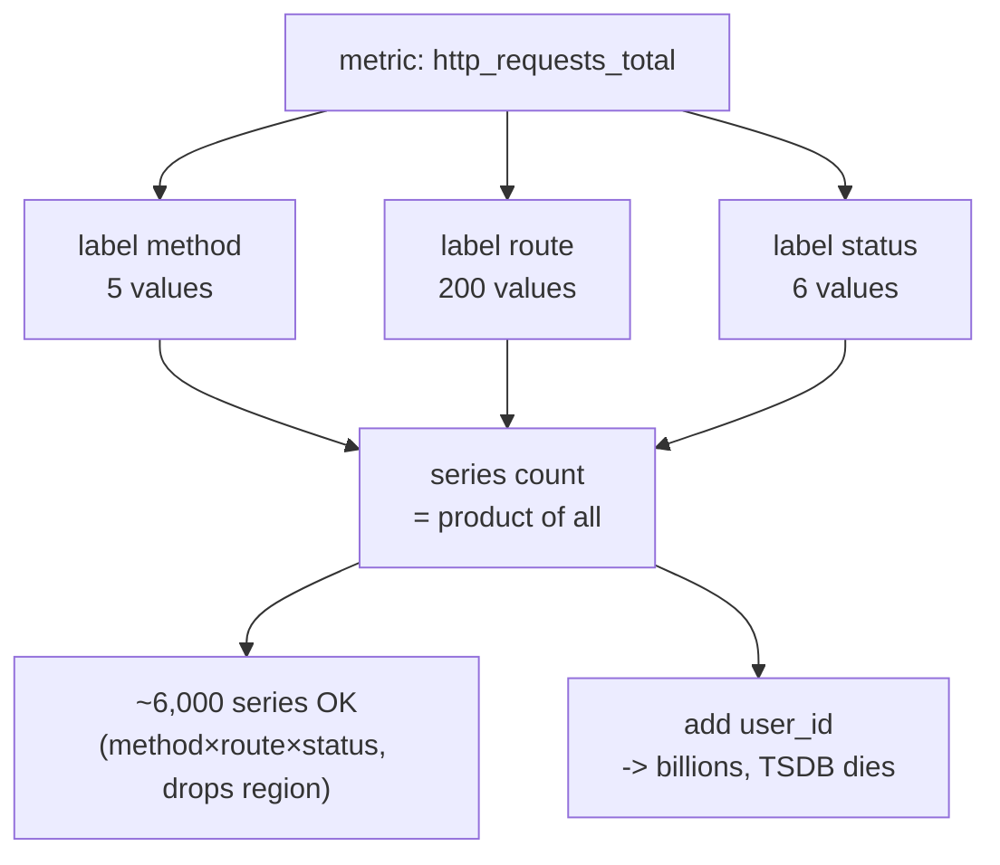

### Pull vs Push

| | Pull (scrape) | Push |
|---|---|---|
| Who initiates | Monitoring server polls targets | Target sends to collector |
| Examples | Prometheus, classic SNMP | StatsD, Graphite, OTLP push, Datadog agent |
| Service discovery | Server discovers targets (K8s SD) | Client must know endpoint |
| Health signal | "Can't scrape" = target down (free liveness) | Need separate heartbeat |
| Short-lived jobs | Hard (job may exit before scrape) → use Pushgateway | Natural fit |
| Firewall/NAT | Server must reach targets | Target reaches out (easier across boundaries) |

Prometheus is famously **pull-based** (scrape `/metrics` over HTTP). Pull gives you a free up/down signal and centralized control of scrape frequency; push suits ephemeral/serverless workloads. OpenTelemetry supports both.

### Aggregation & why you can't average percentiles

Metrics are aggregated across time (downsampling) and across dimensions (sum over instances). The critical trap:

**You cannot average percentiles.** The average of two servers' p99s is **not** the p99 of the combined traffic. Percentiles are non-linear order statistics — `avg(p99_a, p99_b) ≠ p99(a ∪ b)`. If server A (1000 req) has p99=100ms and server B (10 req) has p99=2000ms, averaging gives 1050ms, but the true combined p99 is ≈100ms (B's traffic is negligible). To compute a correct aggregate percentile you must **merge the underlying distributions** — which is exactly why histograms (mergeable bucket counts) beat summaries (precomputed, non-mergeable quantiles).

```promql
# CORRECT aggregate p99 across all instances — merge buckets, then quantile
histogram_quantile(0.99,
  sum by (le) (rate(http_request_duration_seconds_bucket[5m])))

# WRONG — averaging precomputed quantiles loses correctness
avg(http_request_duration_seconds{quantile="0.99"})
```

### Why percentiles, not averages

The **average latency lies**. If 99% of requests are 10ms and 1% are 5s, the mean is ~60ms — looks fine, but 1% of your users are furious. **Tail latency (p95/p99/p99.9)** is what users experience, especially in systems with fan-out: a request touching 100 services hits the p99 of *at least one* with high probability (the "tail at scale" problem — Dean & Barroso). Always reason in percentiles; report p50 (typical), p99 (bad day), p99.9 (worst-case fan-out).

### The methodologies: RED, USE, Four Golden Signals

| Method | Scope | Signals | Use when |
|---|---|---|---|
| **RED** | Per service / request-driven | **R**ate, **E**rrors, **D**uration | Microservices, request-serving systems |
| **USE** | Per resource | **U**tilization, **S**aturation, **E**rrors | Hosts, disks, queues, CPU, infra |
| **Four Golden Signals** (Google SRE) | Per user-facing service | Latency, Traffic, Errors, Saturation | The canonical SLO-aligned set |

- **RED** (Tom Wilkie): for each service, track **Rate** (req/s), **Errors** (failed req/s), **Duration** (latency distribution). Request-centric.
- **USE** (Brendan Gregg): for each resource, track **Utilization** (% busy), **Saturation** (queued work beyond capacity), **Errors** (error events). Resource-centric — great for "is this box the bottleneck?"
- **Four Golden Signals**: Latency (split success vs error latency!), Traffic, Errors, Saturation. The superset most teams standardize on.

> Tip: **RED for services, USE for resources.** They're complementary — RED tells you the user-facing symptom, USE tells you which resource is the cause.

> **Decision (default):** Standardize every request-serving service on **RED with latency as a histogram**, every host/pool/queue on **USE**, and define **SLOs on the golden signals** so alerting has something to burn against. *Because* this gives you one consistent dashboard shape across the fleet and a clean symptom-vs-cause split: you page on RED/golden-signal SLOs, you diagnose with USE. *Revisit if* a service is purely batch/async (then queue-age and consumer-lag matter more than request rate). Name-and-move-on: don't enumerate all three frameworks in an interview — pick "RED for services, USE for resources, golden signals as the SLO superset" and move to the crux.

### Real tech

Prometheus, VictoriaMetrics, InfluxDB, Graphite, Datadog metrics, CloudWatch, OpenTelemetry metrics, StatsD.

### Pitfalls

- **Cardinality explosion** from unbounded labels (`user_id`, `request_id`, raw URLs with IDs, full error messages).
- **Averaging percentiles** (covered above) — instantly flags a junior.
- **Wrong metric type** — using a gauge where you need a counter loses the `rate()` semantics across restarts.
- **Coarse buckets** — histogram buckets that don't bracket your SLO threshold give useless quantile estimates near the SLO.
- **Mixing success and error latency** — a flood of fast 500s can make p99 *look better* while users suffer.

> **Staff-level insight:** Treat **cardinality as a budget**, like a memory budget. State it explicitly: "We cap each service at ~10k active series; `user_id` goes to traces/logs (high-cardinality stores), never to metric labels." When asked to design metrics, name your label set *and* estimate the series count out loud — that single move ("method × route × status × region ≈ X series, within our 10k budget") tells the interviewer you've actually run Prometheus in anger. And always instrument **histograms** for latency so aggregate percentiles stay correct across replicas.

---

## 4. Pillar 2 — Logs

### Definition

A **log** is an immutable, timestamped record of a discrete event. Logs are the most flexible, highest-fidelity, and (per byte) most expensive signal.

### Structured vs Unstructured

| | Unstructured | Structured |
|---|---|---|
| Format | Free-text strings | Key/value (JSON, logfmt) |
| Example | `User 42 failed login from 1.2.3.4` | `{"event":"login_fail","user_id":42,"ip":"1.2.3.4","trace_id":"abc"}` |
| Query | grep / regex (brittle) | Field-based filters & aggregation |
| Machine-parseable | Poorly | Natively |
| Cardinality | N/A | Carries high-cardinality fields cheaply |

**Always emit structured logs.** Free-text logs force lossy regex extraction downstream. Structured logs become *queryable events* — and a sufficiently rich structured log is the "wide event" that blurs the line into observability.

### Log levels

`TRACE < DEBUG < INFO < WARN < ERROR < FATAL`. Set production default to **INFO**; allow **dynamic** level changes (per-service, ideally per-request via a debug header) so you can crank to DEBUG for a specific tenant without redeploying. **WARN/ERROR should be actionable** — if an ERROR doesn't warrant investigation, it's noise that trains people to ignore real errors.

### How centralized logging works

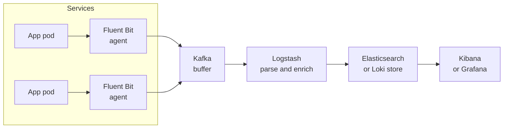

Pattern: a **per-node agent** (Fluent Bit / Fluentd / Vector / Filebeat) tails container stdout, ships to a **buffer** (Kafka, for backpressure & replay), through a **processing** stage (parse, enrich with k8s metadata, redact PII), into a **store/index**, queried via a **UI**.

### ELK/EFK vs Loki

| | ELK/EFK (Elasticsearch) | Loki (Grafana) |
|---|---|---|
| Index | Full-text index of log content | Index only **labels**; log body unindexed |
| Storage | Expensive (inverted index) | Cheap (object storage, like Prometheus' model) |
| Query | Powerful full-text (Lucene) | LogQL, grep-on-labels then scan |
| Best for | Rich search, security/SIEM | Cost-efficient, label-correlated logs |
| Cost at scale | High | Low |

EFK = Elasticsearch + Fluentd + Kibana. ELK = Elasticsearch + Logstash + Kibana. **Loki**'s key idea: "like Prometheus, but for logs" — index only a small set of labels (matching your metrics labels) and store raw log lines cheaply in object storage; you grep within a label-narrowed slice. Trades query power for ~10× cost reduction.

> **Decision (default):** **Loki** (or ClickHouse) for general application logs because the cost curve dominates at scale and label-narrowed grep covers most debugging. *Because* a full-text inverted index over TB/day is the expensive part you rarely need. *Revisit if* you need rich free-text search, security/SIEM, or compliance retention with arbitrary querying — then **Elasticsearch/OpenSearch** earns its cost for that subset. Don't run both for the same data; pick per use-case. This is a name-the-tradeoff-and-choose moment, not a both-sides list.

### The cost problem & sampling

Logs are the **runaway cost** of observability. At scale a service can emit TBs/day. Commercial ingestion runs roughly **$0.10–$2.50 per GB ingested** (plus retention/indexing — Datadog also bills per *indexed* event, Splunk historically by daily ingest volume), so 5 TB/day can be **$15k–$375k/month**. To anchor the math in the room:

```
1 service, 10k req/s, 2 KB/structured-log/request, 1 log line per request:
  10,000 × 2 KB × 86,400 s  ≈  1.7 TB/day raw   ≈  ~50 TB/month
  At $0.50/GB ingest         ≈  ~$850/day        ≈  ~$25k/month  (one service, ingest only)
Multiply by 30 services and you are at a seven-figure annual log bill before retention.
```

> **Decision (default):** **one canonical structured log line per request per service; keep 100% of ERROR, sample success/INFO at ~1–10% with deterministic trace_id-keyed sampling; tier retention 7–30d hot → 90d–1y cold (S3/Glacier).** *Because* logs are the one signal whose cost grows unbounded with traffic and most INFO lines are never read. *Revisit if* a subsystem is under active incident investigation — then flip verbose logging on for it via a per-request debug header, not a global redeploy. Controls:

- **Sampling**: keep 100% of errors, sample 1–10% of successful/INFO logs. Use **consistent (deterministic) sampling** keyed on `trace_id` so a sampled trace keeps *all* its logs.
- **Level discipline**: DEBUG off in prod by default.
- **Tiered retention**: hot (searchable, 7–30d) → warm → cold (S3/Glacier, 90d–1y, slow restore).
- **Drop noise at the agent** (health-check logs, chatty libraries) before it costs you.
- **Aggregate at source**: convert high-volume repetitive logs into metrics.

### Correlation IDs

A **correlation/request ID** (and `trace_id`) generated at the edge (gateway) and propagated through every downstream call & log line is what makes logs *connected* rather than a pile of disconnected events. Without it, debugging across services is archaeology. With it: `trace_id="abc123"` returns the full causal story.

### PII concerns

Logs are a top source of **compliance breaches** (GDPR, CCPA, PCI, HIPAA). Emails, tokens, card numbers, request bodies leak into logs constantly. Controls: **redaction at the agent** (regex/field allowlists), **structured field tagging** (`@pii` fields dropped/hashed), **never log secrets/auth headers/full bodies**, **short retention** for anything sensitive, and **access controls + audit** on the log store. Tokenize or hash identifiers you need for correlation.

### Real tech

Elasticsearch/OpenSearch, Loki, Splunk, Datadog Logs, Sumo Logic, Vector, Fluent Bit/Fluentd, Filebeat, ClickHouse (increasingly popular for logs).

### Pitfalls

- **Unbounded volume → budget shock** (the classic surprise Datadog bill).
- **Logging in hot loops** — synchronous logging can become the bottleneck; use async/buffered logging.
- **No correlation ID** — logs unjoinable across services.
- **PII leakage** into logs.
- **Logging instead of metrics** — counting events by scanning logs is slow and expensive; emit a counter.

> **Staff-level insight:** The senior move is to **invert the default**: emit **one structured "canonical log line" per request per service** — a wide event carrying trace_id, user, route, latency, status, downstream timings, feature flags — instead of scattering 20 chatty log lines. This is cheaper (one event, sampleable as a unit), richer (high-cardinality, queryable), and naturally bridges to traces. Then aggressively sample successes, keep errors at 100%, and tier retention. When asked about log cost in an interview, do the math out loud — "$/GB × GB/day × retention" — and propose sampling + Loki/ClickHouse-class storage. That's the answer that shows you've owned a budget.

---

## 5. Pillar 3 — Traces

### Definition

A **distributed trace** records the end-to-end journey of a single request as it flows across services. A trace is a **tree (DAG) of spans**. A **span** is one unit of work (an operation in one service) with a start time, duration, name, status, and **attributes** (key/value tags). Spans carry a `trace_id` (shared across the whole request) and `span_id`, plus a `parent_span_id` linking them into a tree.

### How it works — context propagation

The magic is **context propagation**: the `trace_id` and current `span_id` must be carried across every service boundary, usually via **HTTP headers**. The industry standard is **W3C Trace Context**:

- `traceparent: 00-4bf92f3577b34da6a3ce929d0e0e4736-00f067aa0ba902b7-01`
  - `00` = version
  - `4bf9...4736` = **trace-id** (16 bytes)
  - `00f0...02b7` = **parent-id** (the caller's span-id, 8 bytes)
  - `01` = **trace-flags** (bit 0 = sampled)
- `tracestate:` = vendor-specific key/values for multi-vendor interop.

(Legacy: B3 headers from Zipkin, `X-B3-TraceId` etc.) Each service reads the incoming `traceparent`, starts a child span, and injects an updated `traceparent` into outgoing calls. **Async hops** (Kafka, queues) must propagate context in message headers or the trace breaks.

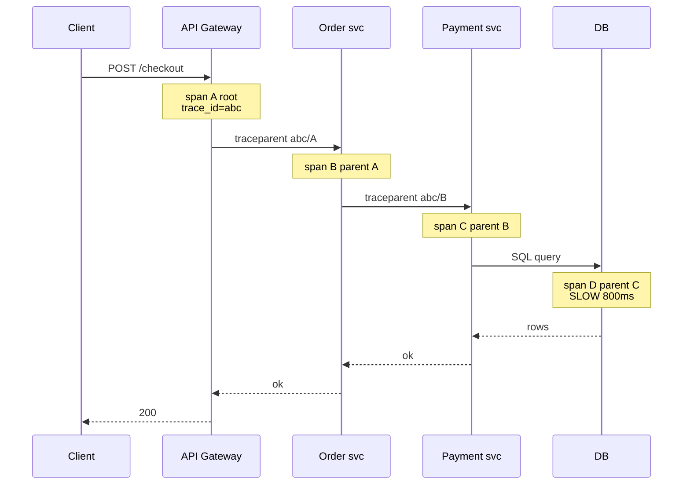

A **flame graph** (or Gantt/waterfall) visualizes spans by start time and duration, so you instantly see *where the time went* — the wide bar is your culprit (span D above).

```mermaid
gantt
  title Trace waterfall for trace abc
  dateFormat X
  axisFormat %Lms
  section Gateway
  span A root        :0, 1000
  section Order
  span B             :50, 900
  section Payment
  span C             :120, 820
  section DB
  span D query SLOW  :180, 800
```

### Sampling — head vs tail

You can't store every span at scale (cost + volume). **Sampling** decides which traces to keep.

| | Head-based sampling | Tail-based sampling |
|---|---|---|
| Decision point | At trace **start** (root) | After trace **completes** (at collector) |
| Decision basis | Random/rate (e.g., keep 1%) | Trace outcome: errors, latency, attributes |
| Pros | Simple, cheap, stateless, low overhead | Keeps the *interesting* traces (slow/errored) |
| Cons | Misses rare errors/slow traces statistically | Must buffer all spans of a trace; stateful, heavier |
| Where | SDK / propagated via trace-flags | OpenTelemetry Collector `tailsampling` processor |

**Head-based** is decided once at the root and propagated (so the whole trace is consistently kept or dropped — critical for completeness). Its flaw: a random 1% misses your rare 0.01% errors. **Tail-based** buffers all spans of a trace until it finishes, then keeps it if it errored or exceeded a latency threshold — so you keep the traces you actually want, at the cost of memory + complexity at the collector. Many shops run **head sampling at high rate + tail sampling to retain anomalies**, or dynamic/priority sampling.

> **Decision (default):** **Tail-based sampling in the OTel Collector gateway — keep 100% of errors, 100% of traces over a latency threshold, and ~1% of the rest.** *Because* the whole value of tracing is finding the slow/broken request, and a random head sample of 1% statistically misses your rare-but-critical traces. *Revisit if* trace RPS is low enough to keep everything (then don't sample at all), or if the Collector's per-trace buffering memory (it must hold all spans of a trace for the decision window, typically a few seconds) becomes the bottleneck at extreme RPS — then fall back to a hybrid: head-sample at a high baseline rate to cap volume, tail-sample within that to retain anomalies. **Earmark this as a hard part:** tail sampling is stateful and the gateway is a thing you now have to run HA, size for buffer memory, and reason about under traffic spikes.

> **Experience hook:** on a WebSocket fan-out service, head sampling at 1% never once captured the ~0.05% of connections that hung on a downstream stall — they were statistically invisible. A tail-sampling policy of `duration > 2s OR status=error` surfaced them on the first occurrence. That is the difference between the two strategies stated as a scar, not a table.

### Span attributes

Spans carry **high-cardinality attributes** — `http.method`, `http.route`, `http.status_code`, `db.statement`, `user.id`, `region`, `error=true`, custom business tags. This is where traces shine: unlike metrics, **traces can hold high-cardinality data**, so you can later ask "show slow spans where `tenant=acme` and `db.table=orders`." Add **span events** (timestamped logs within a span) and **links** (relate traces, e.g., for batch/fan-in).

### Real tech

**Jaeger**, **Grafana Tempo**, **Zipkin** (open source backends); **OpenTelemetry** (instrumentation/collection); **Datadog APM**, **Honeycomb**, **New Relic**, **AWS X-Ray** (commercial). Tempo is notable: like Loki, it stores traces cheaply in object storage and indexes minimally, retrieving by trace_id (you find the trace_id from logs/metrics).

### Pitfalls

- **Broken propagation** — a service or library that drops the header silently severs the trace (very common across async/queue boundaries and at language/framework edges).
- **Clock skew** across hosts distorts span timing (spans can appear to start before their parent). Use durations, not absolute cross-host timestamps, and NTP-sync.
- **Over-instrumentation** — a span per function call creates noise and overhead; instrument meaningful boundaries.
- **Sampling away the bug** — head sampling at 1% means the one slow trace you need may not exist. Use tail sampling for errors/latency.
- **Cardinality cost in trace stores** that index attributes (vs Tempo's index-by-id model).

> **Staff-level insight:** Traces are the pillar most teams under-invest in and the one that most differentiates a senior answer, because in a microservices world (see [Microservices](10-microservices.md)) **only traces show you cross-service causality and where latency accumulates**. The killer combo to articulate: **tail-based sampling** (keep 100% of errors and slow traces, ~1% of the rest) + **exemplars** (link a metric data point to a concrete trace) so you pivot from "p99 spiked on this graph" directly into "here's an actual slow trace that caused it." If you can say "I'd use exemplars to jump from the latency histogram to a representative slow trace, then to that trace's logs by trace_id," you've demonstrated the unified workflow interviewers are listening for.

---

## 6. How the Pillars Tie Together

The whole point is **correlation**. A `trace_id` is the **join key** across all three pillars.

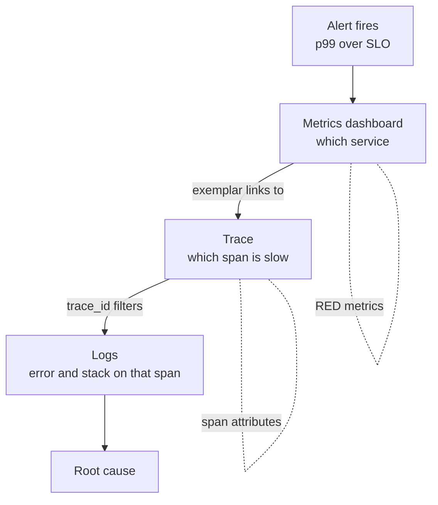

- **Metrics → Trace**: **exemplars** embed a sample `trace_id` into histogram buckets, so a point on a latency graph links to an actual trace.
- **Trace → Logs**: every log line carries the span's `trace_id`/`span_id`, so one filter pulls the exact logs for the slow span.
- **Logs → Trace**: a log line you stumble on carries `trace_id` → open the full trace.
- **Trace → Metrics**: aggregate span data into RED metrics ("span metrics" generation in Tempo/OTel).

> **Staff-level insight:** When asked "how do metrics, logs, and traces work together," don't list them — **describe the pivot path**: alert (SLO burn) → dashboard (locate service) → exemplar → trace (locate slow span) → trace_id → logs (read the why). The unifying primitive is the **consistently propagated trace_id**; without it, you have three disconnected datasets and a 2am guessing game. This is the single most reused workflow in real incident response.

---

## 7. Prometheus Deep Dive

### Definition

**Prometheus** is the de-facto open-source metrics & alerting system (CNCF graduated, originated at SoundCloud, inspired by Google Borgmon). It's a **pull-based** TSDB with a powerful query language (**PromQL**) and built-in alerting.

### How it works

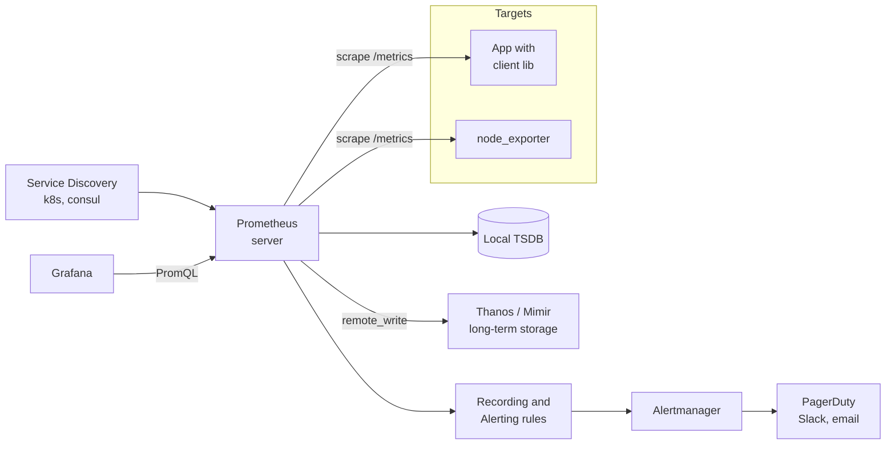

1. **Scrape**: Prometheus periodically (e.g., every 15s) HTTP-GETs `/metrics` on each target. Targets expose metrics via **client libraries** or **exporters**.
2. **Exporters** translate third-party systems into Prometheus format: `node_exporter` (host metrics), `blackbox_exporter` (probes), `kube-state-metrics`, `mysqld_exporter`, etc.
3. **Service discovery** (Kubernetes, Consul, EC2) auto-finds targets.
4. **TSDB**: stores samples locally in compressed blocks (2h blocks, WAL for durability).
5. **Rules**: **recording rules** precompute expensive queries; **alerting rules** evaluate conditions and fire to **Alertmanager**.
6. **Alertmanager**: dedups, groups, silences, routes alerts to receivers (PagerDuty, Slack).

### PromQL essentials

```promql
# Rate of requests per second over 5m (counters need rate)
rate(http_requests_total[5m])

# Error ratio (RED: Errors)
sum(rate(http_requests_total{status=~"5.."}[5m]))
  / sum(rate(http_requests_total[5m]))

# Aggregate p99 latency (merge histogram buckets first!)
histogram_quantile(0.99,
  sum by (le) (rate(http_request_duration_seconds_bucket[5m])))

# Saturation: memory utilization
node_memory_MemAvailable_bytes / node_memory_MemTotal_bytes
```

Key functions: `rate()`/`irate()` (per-second over counters), `increase()`, `histogram_quantile()`, aggregation operators (`sum/avg/max by (...)`), `predict_linear()` (capacity forecasting), `absent()` (alert when a series disappears).

### The cardinality trap (again, because it matters)

Prometheus stores each unique series **in memory** (head block) and on disk. High-cardinality labels (`user_id`, `pod` churn from autoscaling, `request_id`, raw paths) cause **OOM crashes** and slow queries. Mitigations: drop/relabel high-card labels at scrape (`metric_relabel_configs`), avoid IDs in labels, use **recording rules** to pre-aggregate, and watch `prometheus_tsdb_head_series`.

### Scaling Prometheus: remote write, federation, Thanos/Cortex/Mimir

A single Prometheus is limited by one node's memory/disk and retains data locally (~weeks). For **global view, long-term retention, and HA**:

| Approach | What it does | Trade-off |
|---|---|---|
| **Federation** | A higher-level Prometheus scrapes aggregated metrics from lower ones | Simple; only for aggregates, not full-fidelity global query |
| **remote_write** | Stream samples to a remote backend | Decouples storage from scraping |
| **Thanos** | Sidecar uploads blocks to object storage; Querier fans out across Prometheis + store gateway; global query, dedup, downsampling | Sidecar model, eventual global view |
| **Cortex / Mimir** | Horizontally-scalable, multi-tenant, push-based (remote_write in); microservices architecture | Operationally complex but massively scalable |
| **VictoriaMetrics** | Drop-in, more efficient TSDB, single-binary or clustered | Less ecosystem lock-in to Prometheus internals |

**Thanos** and **Mimir** (Grafana's evolution of Cortex) are the standard answers for "millions of series, years of retention, global multi-cluster view." Both lean on **cheap object storage (S3/GCS)** for long-term data and add **downsampling** (5m/1h resolution for old data) to keep queries fast.

> **Decision (default):** **Prometheus per cluster for scrape + ~15d local retention; Thanos sidecar → S3 for long-term + a Thanos Querier for global PromQL; downsample >30d to 5m and >1y to 1h.** *Because* this is the lowest-operational-burden path to "global view + long retention" that still speaks plain PromQL, and object storage makes retention nearly free. *Revisit if* you need **horizontally-scalable multi-tenant push** (a platform team offering metrics-as-a-service to many teams) — then **Mimir/Cortex**; or if you want a simpler, more memory-efficient single system — then **VictoriaMetrics**. Don't reach for any of these until one Prometheus actually OOMs or you genuinely need cross-cluster query — that is the YAGNI trigger.

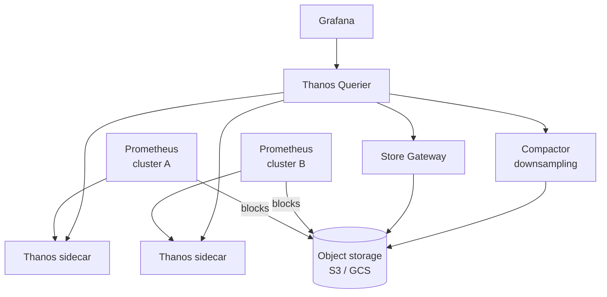

### Real examples

Kubernetes monitoring (kube-prometheus-stack / Prometheus Operator), with Grafana dashboards and Alertmanager → PagerDuty.

### Pitfalls

- **Cardinality OOM** (the recurring theme).
- **Treating local storage as durable/long-term** — it's not; use remote_write/Thanos.
- **No HA** — a single Prometheus is a SPOF for alerting; run pairs.
- **Scrape interval vs rate window mismatch** — `rate([1m])` with 30s scrape can be noisy/inaccurate; window should cover ≥4 scrapes.
- **Alerting on raw, flappy series** instead of recording-rule-smoothed aggregates.

> **Staff-level insight:** Know the **scaling story cold**, because "how do you keep 18 months of metrics across 50 clusters?" is a classic follow-up. The answer: Prometheus per cluster for scrape + short-term, **remote_write or Thanos sidecar → object storage** for long-term, a **global Querier (Thanos/Mimir)** for cross-cluster PromQL, and **downsampling** so historical queries stay cheap. And always close the loop to cost: cardinality and retention are the two dials that set your bill, and downsampling old data is the cheapest lever.

---

## 8. Grafana

### Definition

**Grafana** is the open-source **visualization and dashboarding** layer — a unified query/visualization front-end over many data sources (Prometheus, Loki, Tempo, Elasticsearch, CloudWatch, SQL, etc.). It does not store data; it queries and renders.

### How it works

- **Data sources**: pluggable backends; one dashboard can mix Prometheus metrics, Loki logs, and Tempo traces.
- **Dashboards**: panels (time series, stat, table, heatmap, gauge) with **template variables** (`$service`, `$region`) for reusable, parameterized views.
- **Explore**: ad-hoc query mode for incident-time investigation, with **trace-to-logs** and **logs-to-trace** correlation links.
- **Alerting**: Grafana has its own unified alerting (an alternative/complement to Alertmanager).
- **Grafana stack (LGTM)**: **L**oki (logs), **G**rafana (viz), **T**empo (traces), **M**imir (metrics) — a cohesive open-source observability suite.

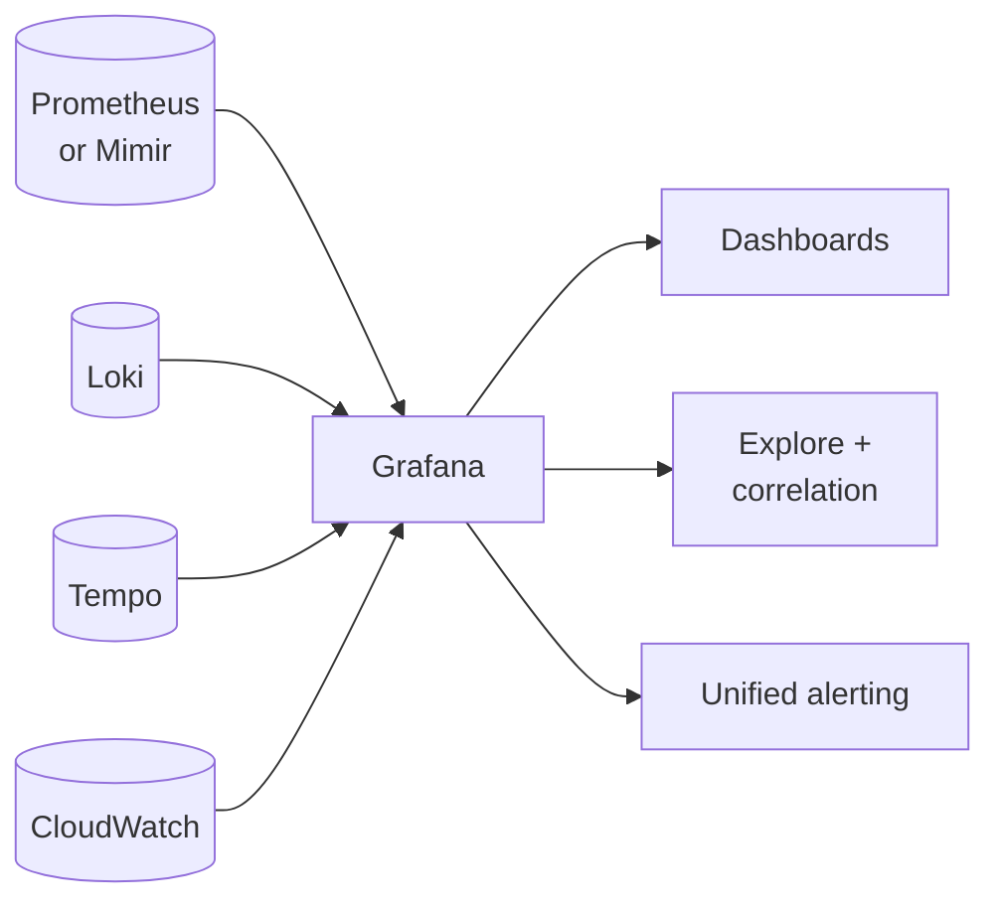

### Comparison: Grafana vs vendor dashboards

| | Grafana | Datadog/New Relic dashboards |
|---|---|---|
| Data sources | Many, open, mix freely | Mostly their own ingestion |
| Cost | Open-source core free | Per-host/per-GB billing |
| Correlation | trace↔log↔metric via links | Tight, built-in, polished |
| Ops burden | You run the backends | Fully managed |

### Pitfalls

- **Dashboard sprawl** — hundreds of stale, inconsistent dashboards nobody trusts. Standardize via **dashboards-as-code** (Grafonnet/Terraform) and templates.
- **Vanity dashboards** that look impressive but don't map to SLOs or aid debugging.
- **Heavy queries** (high-cardinality, long ranges) overloading the data source.

> **Staff-level insight:** Dashboards are for **humans navigating known structure**; they are **not** observability and not your alerting source of truth. Push for a small set of **SLO-aligned, RED/USE-structured dashboards generated as code**, plus **Explore** for ad-hoc investigation. When an interviewer leans on dashboards, gently reframe: "Dashboards help me confirm and locate; the actual debugging of an unknown happens by *querying* high-cardinality data, and the actual *waking up* happens via SLO burn-rate alerts."

---

## 9. OpenTelemetry — The Standard

### Definition

**OpenTelemetry (OTel)** is the **CNCF vendor-neutral standard** for generating, collecting, and exporting telemetry — **traces, metrics, and logs** — through a single set of **APIs, SDKs, semantic conventions, and a Collector**. It is the merger of OpenTracing + OpenCensus and is now the second-most-active CNCF project (after Kubernetes). It defines **OTLP** (OpenTelemetry Protocol) as the wire format.

### Why OTel won

- **Vendor neutrality**: instrument **once**, export **anywhere** (Jaeger, Tempo, Datadog, Honeycomb, New Relic) by swapping a Collector exporter — no re-instrumentation, no lock-in. This broke the vendor agent monopoly.
- **Unified data model** across all three signals, with **semantic conventions** (standard attribute names like `http.request.method`, `db.system`) so data is portable and tools interoperate.
- **Auto-instrumentation** for popular languages/frameworks — get traces with near-zero code changes (Java agent, Python/Node auto-instrumentation).
- **Industry consensus**: every major vendor backs it; it's the safe default.

### Architecture: API / SDK / Collector

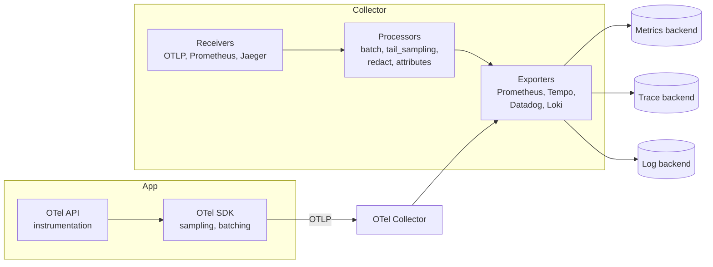

- **API**: the stable interface your code calls to create spans/metrics (decoupled from implementation).
- **SDK**: the implementation — sampling, batching, context propagation, resource detection.
- **Collector**: a standalone, vendor-agnostic pipeline — **Receivers** (ingest OTLP/Prometheus/Jaeger/etc.) → **Processors** (batch, **tail-based sampling**, attribute filtering, **PII redaction**, memory limiting) → **Exporters** (fan out to any backend). Run as an **agent** (per-node, sidecar) and/or **gateway** (central cluster for tail sampling and egress control).

### The Collector pipeline value

The Collector is the **decoupling and control point**: it lets you change backends, do **tail-based sampling** centrally (needs all spans of a trace, so the gateway is the right place), redact PII before egress, transform/enrich, and control cost — all **without touching application code**.

### Comparison: OTel vs proprietary agents

| | OpenTelemetry | Proprietary agent (Datadog/NR) |
|---|---|---|
| Lock-in | None — swap exporter | High — re-instrument to leave |
| Signals | Traces + metrics + logs unified | Vendor-defined |
| Maturity | Traces GA, metrics GA, logs maturing | Very mature, polished |
| Auto-instrumentation | Broad, growing | Often deeper/more polished |
| Cost control | You own the Collector | Vendor-controlled |

### Real tech

OTel SDKs (Java, Go, Python, Node, .NET…), OTel Collector, OTLP, exporters for Tempo/Jaeger/Prometheus/Loki/Datadog/Honeycomb.

### Pitfalls

- **Telemetry volume** — auto-instrumentation can flood you; tune sampling and drop noisy spans at the Collector.
- **Logs signal still maturing** relative to traces/metrics.
- **Collector as SPOF/bottleneck** — run it HA, with batching and memory limits.
- **Version skew** across SDKs and semantic conventions during the standard's rapid evolution.

> **Staff-level insight:** **Standardize on OpenTelemetry for instrumentation and route everything through the Collector** — this is the single highest-leverage observability-architecture decision, and saying it crisply marks you as current. The strategic argument: instrumentation is the expensive, sticky part (it lives in your code forever); backends are commodities. OTel makes **instrumentation an asset you own** and **backends a swappable, negotiable cost**. Bonus point: put **tail-based sampling and PII redaction in the Collector gateway** so cost and compliance are controlled centrally without app redeploys.

---

## 10. Vendors & the Landscape

### Open source backends

| Tool | Signal | Niche |
|---|---|---|
| **Prometheus / Mimir / Thanos / VictoriaMetrics** | Metrics | De-facto metrics + long-term/scale |
| **Loki** | Logs | Cheap, label-indexed logs |
| **Elasticsearch / OpenSearch** | Logs | Rich full-text search, SIEM |
| **Jaeger** | Traces | CNCF tracing backend |
| **Tempo** | Traces | Cheap, object-storage traces |
| **Zipkin** | Traces | Original OSS tracer (B3) |
| **Grafana** | Viz | Unified dashboards |
| **OpenTelemetry** | All | Instrumentation/collection standard |

### Commercial / SaaS

| Vendor | Strength | Watch-out |
|---|---|---|
| **Datadog** | All-in-one, polished, vast integrations | Cost can explode (per-host + per-GB + custom-metric billing) |
| **New Relic** | Mature APM, consumption pricing | Pricing model shifts |
| **Honeycomb** | High-cardinality, event-based, true observability (BubbleUp) | Different mental model; smaller ecosystem |
| **Splunk** | Logs/SIEM powerhouse | Expensive at scale |
| **Grafana Cloud** | Managed LGTM, OTel-native | — |
| **AWS X-Ray / CloudWatch** | Native AWS integration | AWS-centric, weaker UX |

### eBPF-based observability

**eBPF** runs sandboxed programs in the Linux kernel, enabling **auto-instrumentation with zero code changes** — capture network flows, syscalls, and even L7 request metrics/traces by observing the kernel. Tools: **Cilium/Hubble** (network), **Pixie**, **Parca** (continuous profiling), **Grafana Beyla**, **Coroot**, **Odigos**. 

- **Pros**: no app changes, language-agnostic, low overhead, captures things app instrumentation misses (network, kernel).
- **Cons**: limited to what's observable at kernel/network level (struggles with encrypted-in-process context, business semantics), needs kernel privileges, can't see application intent the way manual spans can.

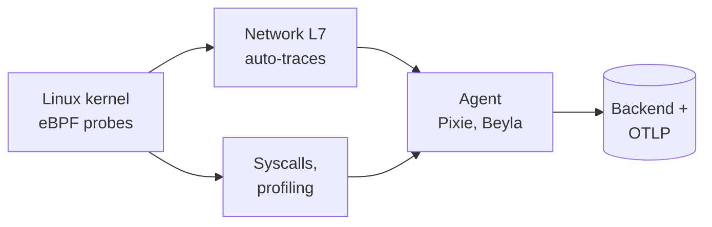

### Comparison: Build vs Buy

| | Build (OSS self-hosted) | Buy (SaaS) |
|---|---|---|
| Up-front cost | Low license, high eng time | Low eng time |
| Ongoing cost | Infra + on-call for the obs stack | Subscription (scales with data $$) |
| Control / customization | Full | Limited |
| Lock-in | Low (esp. with OTel) | High (mitigated by OTel) |
| When | Large scale, cost-sensitive, strong platform team | Small/mid team, speed-to-value, no platform team |

> **Staff-level insight:** The pragmatic, fundable answer is **OTel for instrumentation + buy the backend early, revisit at scale**. SaaS is cheaper than a dedicated observability platform team until your data volume makes the bill exceed several engineers' cost — that's the crossover where self-hosting LGTM/Thanos pays off. Because you instrumented with OTel, **switching is a Collector config change, not a re-instrumentation project**, so build-vs-buy becomes a reversible, ongoing cost decision rather than a one-way door. Naming that crossover ("we self-host once the Datadog bill exceeds ~3 FTE") is the kind of concrete economic reasoning Staff/Director interviews reward.

---

## 11. Alerting & On-Call

### Definition

**Alerting** turns telemetry into human action. The Staff-level principle: **alert on symptoms (user pain), not causes (internal mechanics).** Page a human only when something is **broken or about to be**, **actionable**, and **urgent**.

### Symptoms vs causes

- **Symptom alert** (good): "checkout success rate < 99.9%" / "p99 latency > SLO." Reflects user pain; fires once per real problem.
- **Cause alert** (mostly bad as a *page*): "CPU > 90%," "a node restarted," "queue depth high." These are often **fine** (CPU at 95% serving traffic happily is not a problem) and create **noise**. High CPU only matters if it *causes* a symptom — so alert on the symptom and use the cause metrics for *diagnosis*.

> The canonical line: **"Alert on SLO burn rate, not CPU."**

### SLO-based / burn-rate alerting

(Builds on [Reliability](11-reliability.md) — SLIs, SLOs, error budgets.) Given an SLO (e.g., 99.9% success over 30 days), your **error budget** is 0.1% of requests. **Burn rate** = how fast you're consuming that budget relative to the steady rate. Burn rate of 1 means you'll exactly exhaust the budget over the window; burn rate 14.4 means you'd exhaust the *entire monthly* budget in ~2 days.

**Multi-window, multi-burn-rate (MWMBR)** alerting (Google SRE workbook) combines a **fast/high-burn** alert (page now — catastrophic) with a **slow/low-burn** alert (ticket — chronic erosion), each requiring **two windows** (a long window to detect, a short window to confirm it's *still* happening so the alert auto-resolves and doesn't fire on a blip).

| Severity | Long window | Short window | Burn rate | Budget consumed | Action |
|---|---|---|---|---|---|
| **Page** (fast) | 1 hour | 5 min | 14.4 | 2% in 1h | Wake someone |
| **Page** (slower) | 6 hours | 30 min | 6 | 5% in 6h | Wake someone |
| **Ticket** (slow) | 1 day | 2 hours | 3 | 10% in 1 day | File ticket |
| **Ticket** (chronic) | 3 days | 6 hours | 1 | 10% in 3 days | File ticket |

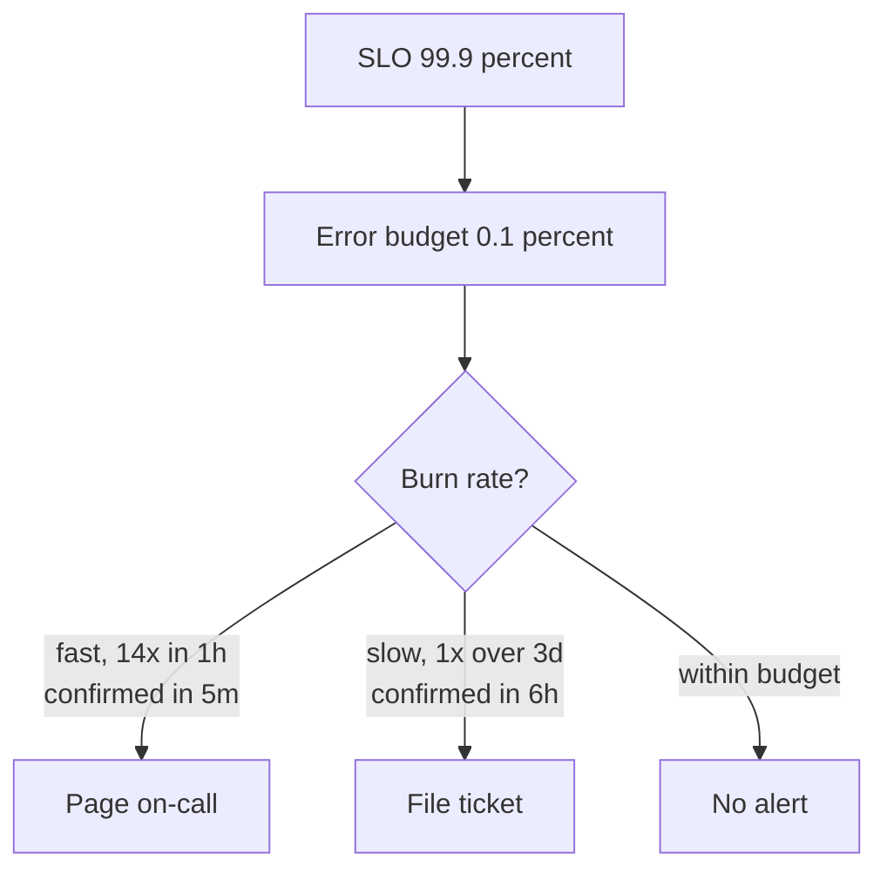

The **two-window** trick: the long window catches the burn, the **short confirmation window** ensures it's ongoing right now — so the alert clears when the incident ends, avoiding stale pages.

> **Decision (default):** **Page only on multi-window multi-burn-rate SLO alerts; everything else is a ticket or a dashboard.** *Because* this is the only alerting model that makes page volume proportional to user pain and self-resolving, which is the root cure for alert fatigue. *Revisit if* a service has no meaningful SLI yet — then your first job is to define one, not to add a CPU threshold alert as a stopgap. **Earmark MWMBR as a hard part to deliver well:** be ready to defend the specific windows (1h/5m fast, 6h/30m, 1d/2h, 3d/6h) and explain *why two windows* (long detects, short confirms it's still happening so it auto-resolves). Getting the "why two windows" right is the tell that you've actually tuned these and not just read the SRE workbook.

### Alert fatigue & actionability

**Alert fatigue** — too many non-actionable alerts — is a top *reliability* risk: people start ignoring pages and miss the real one. Every page must pass: **Is it real? Is it urgent? Is it actionable? Does it map to user impact?** If not, demote to a ticket or delete it. Track **alert noise ratio** (pages that led to no action) and run **alert reviews**.

| Disposition | Meaning | Channel |
|---|---|---|
| **Page** | Urgent, user-impacting, needs human now | PagerDuty/Opsgenie → phone/SMS |
| **Ticket** | Needs attention, not urgent | Jira/Slack, business hours |
| **Log/dashboard only** | Diagnostic, not alert-worthy | No notification |

### Runbooks

Every alert links to a **runbook**: what it means, likely causes, diagnostic queries, mitigation steps, escalation. Runbooks turn a 3am page into a checklist instead of a panic. An alert without a runbook is half-built.

### On-call: rotations, escalation

- **Rotations**: primary + secondary, weekly handoffs, follow-the-sun for global teams to avoid night pages.
- **Escalation policy**: if primary doesn't ack in N minutes → secondary → manager. Encoded in **PagerDuty/Opsgenie**.
- **Humane on-call**: bounded page volume (e.g., target <2 pages/shift), comp/time-off, no single-person heroics, on-call load as a tracked metric.

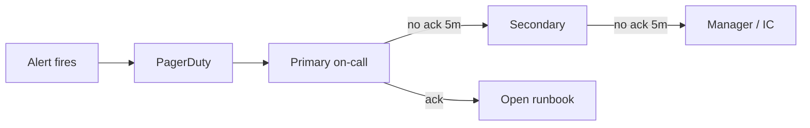

### Real tech

PagerDuty, Opsgenie, VictorOps/Splunk On-Call, Grafana OnCall, Prometheus Alertmanager (dedup/group/route/silence), Slack integrations.

### Pitfalls

- **Cause-based paging** → noise and fatigue.
- **No confirmation window** → flappy alerts that fire and self-resolve constantly.
- **Alerts without runbooks** → slow, stressful response.
- **Static thresholds** that don't track traffic patterns (3am vs noon).
- **Paging on things that aren't urgent** (disk 70% full → ticket, not page).

> **Staff-level insight:** The strongest possible alerting answer is: **"Page on multi-window multi-burn-rate SLO alerts; everything else is a ticket or a dashboard."** This single sentence ties together SLOs/error budgets (Reliability), symptom-based alerting, and fatigue reduction. Then add the operational maturity layer: every page has a runbook, alert noise is a tracked metric reviewed in retros, and on-call load is a humane, bounded thing managers own. Interviewers for EM/Director roles specifically listen for the **people/process** layer here — you're being assessed on whether your on-call would burn out a team.

---

## 12. Incident Management

### Definition

**Incident management** is the structured process for detecting, responding to, mitigating, and learning from incidents. The Staff/EM priority order: **mitigate first, root-cause later; communicate continuously; learn blamelessly.**

### Severity levels

| Sev | Meaning | Example | Response |
|---|---|---|---|
| **SEV1** | Critical, major user impact / outage | Checkout down globally | All-hands, IC, exec comms, 24/7 |
| **SEV2** | Significant, partial impact | One region degraded | Page team, IC, active |
| **SEV3** | Minor / contained | Non-critical feature broken | Business-hours fix |
| **SEV4/5** | Cosmetic / low | Typo, minor glitch | Backlog |

Severity drives **who's engaged, comms cadence, and SLA**.

### Roles: Incident Commander

- **Incident Commander (IC)**: owns coordination and decisions (not necessarily the deepest technical expert). Runs the incident, delegates, decides on mitigations. **The IC commands; they don't debug.**
- **Communications Lead**: status updates to stakeholders/status page.
- **Operations/Subject-matter experts**: do the hands-on fixing.
- **Scribe**: timeline of what happened and when.

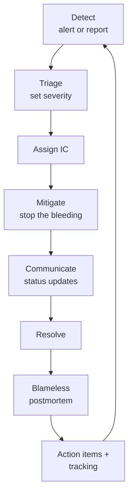

### Mitigate first

The first goal is **stop user pain**, not understand it: roll back the deploy, fail over the region, shed load, flip the feature flag, scale up. Root cause comes *after* the bleeding stops. Connects to [Reliability](11-reliability.md) patterns (rollbacks, failover, circuit breakers, load shedding).

### Postmortems & blameless culture

A **blameless postmortem** assumes people acted reasonably given the information they had; it focuses on **systemic causes** (why did the system *allow* this?) not individual blame. Blame makes people hide information → you lose the learning. Postmortem contents: timeline, impact, contributing factors, what went well/poorly, **action items with owners and due dates**, and lessons.

### The Five Whys

A root-cause technique: ask "why?" iteratively to move from symptom to systemic cause.

> Site down → *why?* DB connections exhausted → *why?* A query started doing a full table scan → *why?* A migration dropped an index → *why?* Migrations aren't reviewed for index impact → *why?* No automated check for query plans in CI.
> **Root cause**: missing CI guardrail — not "the engineer who ran the migration." Action item: add query-plan regression check.

Caveat: real incidents are usually **multi-causal** (a chain of contributing factors), so prefer "contributing factors" framing over a single linear "five whys" when systems are complex.

### Real tech

PagerDuty / Opsgenie / FireHydrant / incident.io / Rootly (incident tooling), Slack war rooms, Statuspage (external comms), Jira (action items).

### Pitfalls

- **Debugging before mitigating** — users suffer while you investigate.
- **No clear IC** → chaos, duplicated effort, no decisions.
- **Blame culture** → people hide info, repeat failures.
- **Postmortem action items never done** → same incident recurs.
- **Single-linear root cause** for genuinely multi-factor failures.

> **Staff-level insight:** For EM/Director interviews this is often the *most* scrutinized area because it's about **leadership under pressure and organizational learning**, not just tech. Nail the three pillars of incident response: **(1) clear roles** (IC commands, experts debug, comms lead talks), **(2) mitigate before diagnose**, **(3) blameless learning with tracked action items**. The deepest signal you can send: "the output of an incident isn't a fix, it's a **systemic improvement that makes the class of failure impossible or auto-detected** — and we measure ourselves on action-item completion, not incident count." That reframes incidents from failures-to-punish into the primary feedback loop that drives reliability.

---

## 13. Designing Observability Into a System

### Definition

Designing observability in means treating telemetry, cost, cardinality, retention, and SLOs as **first-class design constraints** from day one — not instrumentation bolted on after launch.

### What to instrument (a checklist)

- **Every service**: RED (rate, errors, duration) on all endpoints; the four golden signals.
- **Every resource**: USE (utilization, saturation, errors) on CPU, memory, disk, connection pools, queues.
- **Every request**: a trace with propagated context across all hops (incl. async/queues), and **one canonical structured log line** per service.
- **Business KPIs**: signups, checkouts, payments — the things that map to money and to SLOs.
- **Dependencies**: latency/error rate to every downstream (DB, cache, third-party API) — see [Microservices](10-microservices.md).
- **Queues/async**: depth, age of oldest message, consumer lag (e.g., Kafka lag).

### The cost / cardinality / retention trade-offs

Three dials set your bill and capability:

| Dial | Increase it → | Decrease it → |
|---|---|---|
| **Cardinality** | Richer slicing, find rare issues | Cheaper, but lose drill-down |
| **Volume/sampling** | More fidelity | Cheaper, risk missing events |
| **Retention** | Longer historical analysis | Cheaper, lose trend/forensics |

Standard strategy: **high fidelity, short retention** for raw data; **aggregated/downsampled, long retention** for trends. Tier storage (hot/warm/cold). Keep 100% of errors, sample successes.

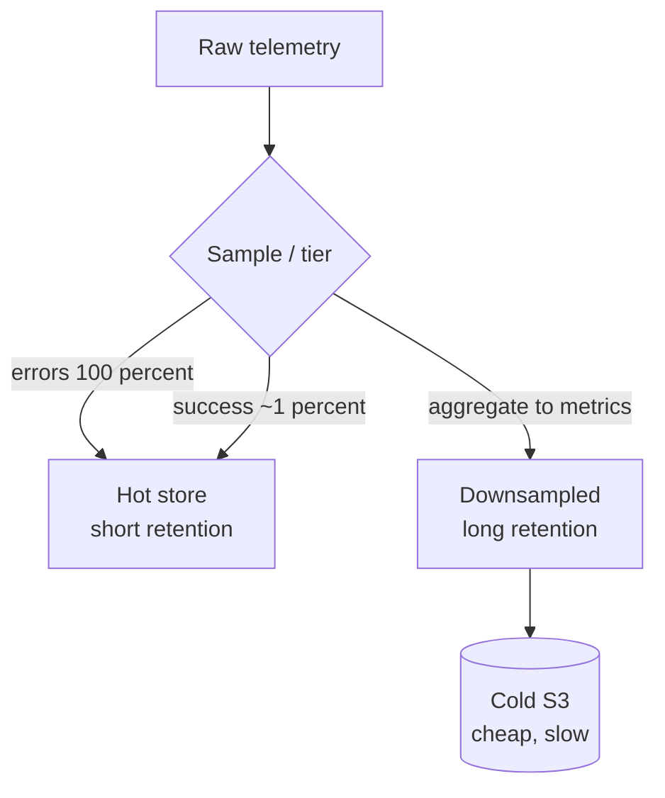

### Sampling strategies

- **Metrics**: pre-aggregate; cardinality budget; recording rules.
- **Logs**: consistent (trace_id-keyed) sampling; 100% errors; drop health-check noise; convert high-volume repetitive logs into metrics.
- **Traces**: tail-based sampling (keep all errors + slow), head sampling for baseline; exemplars to link from metrics.

### Data volume / cost math (do this out loud)

```
Logs:
  10,000 req/s × 2 KB/log × 86,400 s/day  ≈ 1.7 TB/day raw
  At $0.50/GB ingest                       ≈ $850/day ≈ $25k/mo (ingest only)
  → Sample success at 5%, keep 100% errors:
     ~0.1 TB/day effective                  ≈ ~$1.5k/mo  (16x cheaper)

Metrics:
  Cost ∝ active time series × retention.
  Budget ~10k series/service; downsample >30d to 1h resolution.

Traces:
  10,000 req/s, 100% sampling is infeasible to store.
  Tail-sample: 100% errors + 1% success ≈ 1–2% volume retained,
  but you keep the traces that matter.
```

State the formula: **cost ≈ (events/sec × bytes/event × $/GB × retention)** and then show the *levers* (sampling, tiering, downsampling) that cut it 10×.

**Where the money actually goes (rule of thumb to state decisively):** at scale, **logs are usually the largest line item, traces second, metrics smallest** — and metrics cost is dominated by *cardinality × retention*, not raw volume. So the priority order of cost levers is: (1) **sample logs** (biggest, fastest 10× win), (2) **tail-sample traces** (keep value, cut volume ~50–100×), (3) **cap metric cardinality + downsample old data**. If an interviewer asks "your obs bill doubled, what do you cut first?" the answer is **success-log sampling**, every time — not metrics.

> **Decision (default):** **OTel for instrumentation + buy the backend (Grafana Cloud / Datadog) early; self-host LGTM/Thanos when the SaaS bill exceeds ~3 FTE of fully-loaded engineering cost.** *Because* a platform team to run self-hosted observability is itself expensive, so SaaS is cheaper until your data volume makes the bill clear that bar — and because you instrumented with OTel, switching is a Collector exporter change, not a re-instrumentation project. *Revisit if* compliance/data-residency forces self-hosting earlier, regardless of cost. Naming the concrete crossover ("we self-host once Datadog exceeds ~3 engineers") is the economic reasoning Staff/Director loops reward; "it depends on scale" is the answer that loses points.

### Client-side monitoring — the failures your servers never see

**Definition.** Server-side telemetry only sees requests that **arrive**. A DNS failure, a BGP route leak at a peer ISP, a broken CDN edge, an expired certificate, or a bad mobile release can stop users reaching you while every server dashboard stays green. **Client-side monitoring** measures from the user's side, and comes in two forms: **synthetic probes** (you act as a client) and **real-user monitoring, RUM** (the real clients report).

**Why "watch for a traffic dip" isn't enough.** Traffic varies naturally, so a dip alert is either too noisy or too slow, and a failure that hits one ISP, one region or one app version is a small share of total traffic. You need a signal that says *who* is failing and *where*.

| Approach | How | Sees | Blind spot |
|---|---|---|---|
| **Synthetic probes** (active) | Scripted requests from vantage points around the world, every N seconds | Reachability and latency per region, even at 3 am with no users; works before launch | Coverage (there are 100k+ autonomous systems; you probe a few hundred); synthetic traffic isn't real user behaviour |
| **RUM / client agent** (passive) | An SDK in the browser or app reports errors, timings and failed requests from real sessions | Every network, device and app version your users actually have | Nothing when no one is using the product; needs consent and privacy care; a client that can't reach you can't report to you either (see below) |

Use **both**: probes for a clean, always-on baseline and for alerting; RUM for coverage and for answering "which users?".

**The design — agent, independent collector, and a way to reach it when things are broken.**

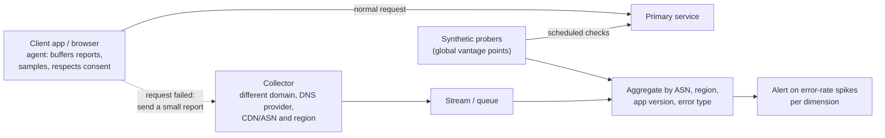

- **The collector must not share fate with what it monitors.** If reports go to `api.example.com` and that is what's unreachable, you learn nothing. Host the collector on a **different domain, DNS provider, network/CDN and region** from the primary service. This is the [static-stability](28-designing-for-failure.md) rule applied to telemetry: the monitoring path can't depend on the thing being monitored.
- **The agent buffers and retries.** Store reports locally (bounded) and upload when any path works, so an outage shows up late rather than never. Batch, compress and sample to protect battery and data on mobile ([Mobile 05](../Mobile%20System%20Design/05-performance-battery-startup.md)).
- **Control it remotely.** A response header or remote config tells clients what to report and at what sample rate, so you can turn reporting up during an incident and off if the collector is overloaded.
- **Aggregate on dimensions that localize the fault:** autonomous system (ISP), country/region, app version, OS, CDN PoP, and error class (DNS, TCP, TLS, HTTP status, timeout). "Errors up 40× for one ISP in one country" is a routing problem; "up for one app version everywhere" is a release.
- **Browsers have a built-in version:** the **Reporting API / Network Error Logging (NEL)** lets a site ask browsers to report connection failures to an endpoint you name, which is exactly the agent-and-collector pattern.

**Privacy is part of the design.** Collect the minimum: coarse location (country or region, not coordinates), truncated IPs, no traceroute hops or resolver details that reveal where someone is, no URLs with personal data in them. Ask consent where the law requires it, and give reports a short retention.

**Pitfalls.**
- Collector on the same domain or CDN as the service: it goes down with it.
- Unsampled RUM from millions of clients becomes its own DDoS and its own bill; sample by default and raise the rate on demand.
- Alerting on global error rate only: a regional or single-ISP outage never crosses the threshold. Alert **per dimension**.
- Counting only errors that reach your servers, which misses the whole class this section is about.

> **Staff-level insight:** *"My server SLIs are measured where requests arrive, so they miss users who never arrive. I'd add synthetic probes for an always-on baseline and RUM for coverage, send client reports to a collector that shares no domain, DNS, CDN or region with the service, and alert on error rate per ISP, region and app version. The Facebook 2021 outage is the reminder: their own tools sat behind the network that failed."* Measuring the SLO **from the client** is also the honest version of the number: availability as the user experienced it, not as the load balancer logged it.

### Build vs Buy (recap)

See §10. **OTel for instrumentation + buy the backend early; self-host LGTM/Thanos when the SaaS bill exceeds a small team's cost.** OTel keeps the decision reversible.

### Comparison: instrumentation strategy

| Strategy | Effort | Coverage | Best for |
|---|---|---|---|
| Manual (custom spans/metrics) | High | Business-aware, precise | Critical paths, business KPIs |
| Auto-instrumentation (OTel agents) | Low | Broad framework coverage | Baseline coverage fast |
| eBPF | Near-zero app change | Network/syscall L7 | Legacy, polyglot, can't change code |

Best practice: **auto-instrument for breadth, manual-instrument the critical/business paths for depth.**

### Pitfalls

- **Observability as an afterthought** — retrofitting trace propagation across an existing fleet is painful.
- **No cardinality/cost budget** → surprise bill or TSDB OOM.
- **100% retention of everything** — bankrupting and unnecessary.
- **Instrumenting tech but not business** — you see CPU but not "checkouts dropped 20%."
- **No SLOs** — you have data but no definition of "healthy," so you can't alert on symptoms.

> **Staff-level insight:** Lead with the **economic and design framing**: "Observability has three cost dials — cardinality, volume, retention — and I budget each explicitly against the questions we'll need to answer." Then connect to reliability: **observability exists to serve SLOs** — you instrument so you can *measure* the SLIs that define user happiness and *alert* on their burn rate. The strongest design answers make observability a **named non-functional requirement** with a budget, an SLO link, and a sampling/retention strategy — not "we'll add Datadog later." That reframes observability from cost center to the feedback loop that makes the whole system operable.

---

## 14. Worked Example — Diagnosing a p99 Spike

**Scenario:** PagerDuty fires at 02:14 — *"checkout p99 latency SLO burn rate 14× over 1h (confirmed 5m)."* Walk the three pillars.

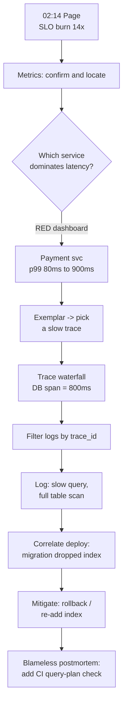

**Step 1 — Metrics (is it real, where?).** The alert is **SLO burn-rate**, so it's already a real user-impacting symptom (no flap — the 5m confirmation window held). Open the **RED dashboard**: traffic is normal (rule out load spike), error rate flat (it's latency, not errors), and the **per-service latency breakdown** shows the **Payment service** p99 jumped 80ms → 900ms while others are flat. *Metrics told us THAT and roughly WHERE.*

**Step 2 — Traces (where exactly?).** Click the **exemplar** on the payment latency histogram bucket to jump to a concrete **slow trace**. The **flame graph** shows total 900ms, of which an **800ms DB span** (`db.statement = SELECT ... FROM orders WHERE ...`) dominates; app code is fast. *Traces localized the time to a single DB query span.*

**Step 3 — Logs (why?).** Filter logs by that **trace_id** (it's on every log line). The payment service's canonical log + DB slow-query log shows `query plan: full table scan on orders (rows=12M)`. Cross-reference the **deploy timeline / change feed** in Grafana: a **schema migration 25 minutes ago dropped an index** that this query relied on. *Logs (plus change correlation) told us WHY.*

**Step 4 — Mitigate, then learn.** **Mitigate first**: roll back the migration / re-add the index → p99 recovers, burn-rate alert clears. **Then** a blameless postmortem with **Five Whys** → root cause "no CI guardrail catches index-removing migrations" → **action item: add a query-plan regression check to CI**, owner + due date.

> **Staff-level insight:** The narrative arc — **alert (SLO) → metrics (that/where) → trace via exemplar (where exactly) → logs via trace_id (why) → correlate with change feed → mitigate → blameless learning** — is the single most valuable thing to be able to deliver fluently in an interview. It demonstrates you understand *each pillar's role, the correlation glue (exemplars + trace_id), the change-correlation instinct ("what deployed 25 min ago?"), and the operational discipline (mitigate before diagnose, blameless follow-up).* Practice telling this story in 90 seconds; it answers half the observability questions you'll get.

### The same walkthrough, with the queries and the dead-ends a Staff engineer rules out

Reciting the happy path is fine; what separates an experienced operator is **how fast you rule out the wrong branches** and the *exact* signals checked. Here is the spike with the real moves.

**0. Read the page itself.** "p99 SLO burn 14× over 1h, confirmed 5m" already tells me: it's *latency* (not availability), it's *real* (5m confirmation window held, so not a flap), and it's *fast-burning* (catastrophic budget consumption, page-worthy). I do not start guessing — I start narrowing.

**1. Metrics — split the symptom before chasing it.** First, **is it latency or errors?** A flood of fast 5xx can make p99 *drop* while users suffer, so I separate them:

```promql
# Error ratio — is this actually errors masquerading as a latency change?
sum(rate(http_requests_total{job="checkout",status=~"5.."}[5m]))
  / sum(rate(http_requests_total{job="checkout"}[5m]))

# Traffic — did load spike (capacity problem) or is RPS flat (something got slow)?
sum(rate(http_requests_total{job="checkout"}[5m]))

# Aggregate p99, BROKEN OUT by downstream service to localize
histogram_quantile(0.99,
  sum by (le, service) (rate(http_request_duration_seconds_bucket{job="checkout"}[5m])))
```

Dead-ends I rule out here, fast, and *say so out loud*: error rate flat → not a crash loop. RPS flat → not a thundering-herd/capacity event (so I don't go scale-up the fleet). Saturation/USE on the hosts normal → not a noisy-neighbor or CPU-throttle. The per-service breakdown shows **Payment p99 80ms → 900ms, everything else flat** — so it's *one* service and it's latency. That took four queries and maybe 90 seconds.

**2. Traces — localize the time, don't theorize about it.** I click the **exemplar** on the Payment latency histogram bucket (the exemplar carries a real trace_id from a slow request — this is why exemplars exist). The flame graph: 900ms total, an **800ms DB span** dominates, app code is fast. I do *not* go read the payment-service code yet — the trace already told me it's not in our code, it's the query. If the trace showed time spread across many small spans instead, *that* would point at GC pauses, connection-pool exhaustion, or N+1 — and I'd pivot accordingly. The trace tells me which hypothesis to even hold.

**3. Logs — confirm the why with the trace_id, not a fishing expedition.** I filter logs by that exact `trace_id` (on every line because we propagate it). The slow-query log: `query plan: full table scan on orders (rows=12M)`. Now I have mechanism, not just symptom.

**4. Change correlation — the reflex that closes incidents in minutes.** The first question for any sudden-onset regression is **"what changed?"** I overlay the **deploy/change feed** on the latency graph: a **schema migration ~25 minutes ago dropped an index** this query relied on. The onset time lines up with the deploy. That correlation is the actual root cause discovery — the three pillars localized *what*, the change feed gave me *who/when*.

**5. Mitigate, then learn — in that order.** **Mitigate first:** re-add the index (or roll back the migration). p99 recovers, the burn-rate alert auto-clears (short window). *Only then* the blameless postmortem: Five Whys lands on "no CI guardrail catches index-removing migrations," not "the engineer who ran it." Action item with owner + due date: **a CI query-plan regression check**. The output of the incident is a guardrail that makes this failure class impossible to ship again — not a one-off fix.

| Step | Pillar / source | Question answered | Time |
|---|---|---|---|
| 0 | The page (SLO burn) | Is it real, latency or availability, how urgent? | seconds |
| 1 | Metrics (RED, USE, histogram by service) | That + roughly where; rule out errors/load/saturation | ~90s |
| 2 | Trace (via exemplar) | Where exactly — the dominant span | ~60s |
| 3 | Logs (via trace_id) | Why — the mechanism | ~60s |
| 4 | Change feed overlay | What changed to cause it | ~30s |
| 5 | Mitigate then postmortem | Stop pain, then prevent recurrence | minutes |

> **Staff-level insight:** The depth signal is not the happy path — it's the **ruled-out branches**: separating latency from errors before chasing latency, confirming RPS is flat before touching capacity, checking USE before blaming a downstream, and reaching for the change feed *first* on any sudden onset. That instinct — "sudden regression = what deployed?" — closes more incidents in minutes than any dashboard. Deliver it with the queries and the dead-ends, and you've shown you've actually held the pager, not just read about it.

---

## 15. Interview Cheat-Sheet

**The one-liners that signal seniority:**

- *"Monitoring is for known-unknowns; observability is for unknown-unknowns — and the difference is **cardinality**."*
- *"The three pillars are a billing artifact; the real unit is the **wide structured event** you can derive all three from."*
- *"**Alert on SLO burn rate, not CPU.** CPU is a diagnostic signal, not a page."*
- *"Server metrics only see requests that **arrive**. Synthetic probes plus RUM, reporting to a collector that shares no fate with the service, cover the users who never got there."*
- *"**Metrics tell you *that*, traces tell you *where*, logs tell you *why*** — joined by a propagated **trace_id**."*
- *"You **can't average percentiles** — merge histogram buckets and compute the quantile."*
- *"**RED for services, USE for resources**, four golden signals as the SLO-aligned superset."*
- *"Standardize on **OpenTelemetry**; instrumentation is the sticky asset, backends are swappable commodities."*
- *"**Tail-based sampling**: keep 100% of errors and slow traces, ~1% of the rest."*
- *"Cardinality is a **budget** — `user_id` goes to traces/logs, never to metric labels."*
- *"Scale Prometheus with **remote_write → Thanos/Mimir → object storage + downsampling**."*
- *"**Multi-window, multi-burn-rate** alerts: fast burn pages, slow burn tickets, short window confirms."*
- *"**Mitigate first, root-cause later**; blameless postmortems with tracked action items."*

**Quick-reference tables:**

| Pillar | Tells you | Cost | Key risk |
|---|---|---|---|
| Metrics | That / how much | Low | Cardinality explosion |
| Logs | Why (per event) | High | Volume cost, PII |
| Traces | Where (cross-service) | Med | Sampling, broken propagation |

| Method | Signals | For |
|---|---|---|
| RED | Rate, Errors, Duration | Services |
| USE | Utilization, Saturation, Errors | Resources |
| Golden Signals | Latency, Traffic, Errors, Saturation | User-facing SLOs |

| Scaling Prometheus | Use |
|---|---|
| Federation | Cross-instance aggregates |
| remote_write | Decouple storage |
| Thanos | Global view + object-storage long-term |
| Mimir/Cortex | Horizontally scalable, multi-tenant |

---

## 16. Common Interview Questions

> **How to answer these at Staff level:** lead with the decision, not the landscape. Every answer below opens with a committed call and a "because/revisit" rather than a survey of options. If you catch yourself saying "it depends," immediately resolve the dependency out loud ("it depends on trace volume — under ~5k traces/sec keep everything; above that, tail-sample"). And practice *altitude*: name the basics in a clause and spend your breath on the crux (cardinality, burn-rate, sampling, cost).

**Q1. What's the difference between monitoring and observability?**
**A.** Monitoring collects and alerts on a *predefined* set of signals — it answers **known-unknowns** (questions you anticipated) using low-cardinality, pre-aggregated data. Observability is a *property of the system*: the ability to understand internal state from external outputs, including for questions you **didn't anticipate** (unknown-unknowns), which requires **high-cardinality, high-dimensionality data** you can slice ad-hoc at query time. The technical crux is **cardinality**: monitoring aggregates away dimensions at write time (cheap, bounded); observability retains them at the event level so you can `GROUP BY user_id WHERE latency > 1s` after the fact. Three siloed pillars aren't observability — correlation via a propagated `trace_id` is.

**Q2. Walk me through debugging a sudden p99 latency spike.**
**A.** (The §14 arc.) Start from the **SLO burn-rate alert** (already a confirmed user symptom). **Metrics/RED dashboard**: rule out traffic/error changes, locate the service whose p99 jumped. **Exemplar → trace**: open a concrete slow trace, read the flame graph to find the dominant span (e.g., an 800ms DB query). **trace_id → logs**: read why (full table scan). **Correlate the change feed**: a migration dropped an index 25 min ago. **Mitigate first** (rollback/re-add index), then **blameless postmortem** with an action item (CI query-plan check). The glue is exemplars + trace_id; the instinct is "what changed recently?"

**Q3. Why can't you average percentiles, and how do you compute an aggregate p99 correctly?**
**A.** Percentiles are non-linear order statistics — `avg(p99_a, p99_b) ≠ p99(a ∪ b)`. Averaging is dominated by series counts: a low-traffic instance's high p99 shouldn't move the combined p99 but averaging lets it. To compute a correct aggregate, you must **merge the underlying distributions**: use **histograms** (sum the bucket counts across instances with `sum by (le)`, then `histogram_quantile`). This is *the* reason to prefer histograms over summaries in distributed systems — summaries pre-compute per-instance quantiles that can't be merged.

**Q4. How would you instrument a new microservice for observability?**
**A.** **OpenTelemetry SDK** for traces/metrics/logs, route through an **OTel Collector**. **RED metrics** (histograms for duration so aggregate percentiles stay correct) per endpoint + **USE** on resources. **Propagate W3C trace context** across every hop including async/queues. Emit **one canonical structured log line** per request with trace_id, user, route, latency, status. Instrument **business KPIs** and **downstream dependency** latency/errors. Define **SLOs/SLIs** and wire **multi-window burn-rate alerts**. Set a **cardinality budget** (IDs to traces/logs, not metric labels), **tail-sample** traces (100% errors), and **sample/tier** logs. State the cost math.

**Q5. Explain SLO burn-rate alerting and why it beats threshold alerts.**
**A.** Given an SLO (99.9%/30d → 0.1% error budget), **burn rate** is how fast you're consuming budget vs the sustainable rate (burn 14.4 = whole monthly budget in ~2 days). **Multi-window multi-burn-rate**: a **fast/high-burn** condition (e.g., 14× over 1h, confirmed over 5m) **pages**; a **slow/low-burn** condition (e.g., 1× over 3 days) **tickets**. The **short confirmation window** ensures the burn is *ongoing now*, so alerts auto-resolve and don't flap. It beats CPU/threshold alerts because it alerts on **user pain proportional to severity**, ties directly to the error budget (and to dev velocity), and dramatically cuts **alert fatigue** — you page on symptoms, not causes.

**Q6. How do metrics, logs, and traces work together?**
**A.** Don't list — describe the **pivot path**. Metrics tell you **that** something's wrong and roughly where (RED/golden signals). **Exemplars** link a metric data point to a concrete **trace**, which tells you **where** the time/error is across services (the slow span). The span's **trace_id** is on every **log line**, so one filter gives you the **why**. The unifying primitive is the **consistently propagated trace_id**. Modern view: all three derive from one **wide structured event** per request — you can count it (metrics), relate it (traces), and read it (logs).

**Q7. Why did OpenTelemetry win, and what's the role of the Collector?**
**A.** OTel won on **vendor neutrality** (instrument once, export anywhere — backends become swappable commodities while instrumentation, the expensive sticky part, is an asset you own), a **unified data model** with **semantic conventions** across traces/metrics/logs, broad **auto-instrumentation**, and **industry consensus** (every vendor backs it). The **Collector** is the decoupling/control point: **receivers → processors → exporters** running as agent and/or gateway. It lets you swap backends, do **tail-based sampling** and **PII redaction** centrally, enrich/transform, and control cost — all **without touching app code or redeploying**.

**Q8. How do you scale Prometheus for long-term retention and a global view?**
**A.** A single Prometheus is bounded by one node's memory and keeps only local short-term data, and is a SPOF for alerting. Run **Prometheus per cluster** for scrape + short-term, then **remote_write** or a **Thanos sidecar** to **object storage (S3/GCS)** for cheap long-term retention. A **global Querier** (Thanos/Mimir/Cortex) fans out PromQL across all instances + the store gateway for a **single-pane global view**, with **deduplication** for HA pairs and **downsampling** (5m/1h for old data) to keep historical queries fast and cheap. Mimir/Cortex if you need horizontally-scalable multi-tenant push; VictoriaMetrics as an efficient alternative. The two cost dials are **cardinality** and **retention**; downsampling is the cheapest lever.

**Q9. How do you control observability cost without going blind?**
**A.** Three dials: **cardinality, volume/sampling, retention**. Strategy: **high fidelity + short retention** for raw data, **aggregated/downsampled + long retention** for trends; **tier** storage (hot/warm/cold S3). **Keep 100% of errors, sample successes** (consistent, trace_id-keyed). Convert high-volume repetitive logs into **metrics**. **Cardinality budget**: IDs go to traces/logs (high-card stores), never metric labels. **Tail-sample** traces. Do the math out loud — `cost ≈ events/s × bytes/event × $/GB × retention` — and show the levers cut it ~10×. **OTel + Collector** centralizes sampling/redaction; **build-vs-buy** crossover is when the SaaS bill exceeds a small platform team's cost.

**Q10. Describe your incident management process.**
**A.** **Detect** (SLO alert/report) → **triage/severity** (SEV1–5 drives engagement and comms cadence) → assign an **Incident Commander** (commands and decides; doesn't debug) with a **comms lead** and **SMEs** → **mitigate first** (rollback, failover, flag flip, load shed — stop user pain before root-causing) → **communicate continuously** (status page, stakeholders) → **resolve** → **blameless postmortem** (systemic causes, not blame; **Five Whys** / contributing factors) → **action items with owners and due dates**, tracked to completion. The output of an incident isn't a fix — it's a **systemic improvement that makes the failure class impossible or auto-detected**; we measure action-item completion, not incident count, and we manage **on-call load and alert fatigue** as humane, tracked metrics.

**Q11. (Meta / delivery) We have limited time — how do you decide what to instrument first for a brand-new service?**
**A.** I don't try to be thorough; I **risk-weight**. Day one: **RED metrics with latency as a histogram, an SLO with multi-window burn-rate alerting, one canonical structured log line per request, and OTel auto-instrumentation for baseline traces** — all via OTel through the Collector. That is enough to *run* the service and to *page on user pain*. I explicitly **defer** tail-sampling infra, Thanos, wide-event stores, and eBPF until a named trigger fires (trace volume, cross-cluster query, recurring high-cardinality debugging need). The signal I'm sending is YAGNI discipline plus a clear floor: never ship a service that can't tell me whether it's meeting its SLO. The anti-pattern I'm avoiding is gold-plating observability before there's a single SLO to serve.

**Q12. (Meta / delivery) Your interviewer pushes back: "Why not just put everything in Datadog and add `user_id` to your metrics so you can slice by user?"**
**A.** I'd push back decisively, not hedge. Two separate things: **Datadog-vs-self-host** is a reversible cost decision (fine to start on Datadog *because* we instrumented with OTel, so leaving is a Collector config change — revisit at the ~3-FTE cost crossover). But **`user_id` as a metric label is a hard no** — it's an unbounded cartesian factor that OOMs the TSDB and explodes Datadog custom-metric billing. High-cardinality slicing by user belongs in **traces and logs** (wide events), or a columnar event store like Honeycomb, *not* metric labels. The correct answer to "slice by user" is "that question lives at the event level, queried at read time — that's exactly the metrics-vs-observability cardinality distinction." Refusing the bad label crisply, while conceding the reasonable build-vs-buy point, is the calibrated-judgment signal the question is testing.

**Q13. Users in one country report the app is down, but every dashboard is green. What happened, and how should you have known first?**
**A.** The failure is **between the user and us**: DNS, a BGP route leak at an ISP, a CDN edge, or a certificate, so the requests never reach the servers whose metrics I'm looking at. Server-side SLIs can't see it, and a global traffic-dip alert won't fire for a slice this small. I should have had two client-side signals: **synthetic probes** from vantage points in that region, and **RUM** from the app itself, reporting failed requests to a **collector on a different domain, DNS provider, CDN and region**, so reports still get out when the main path is broken. Aggregated by **ISP (autonomous system), region and app version**, that turns "is it us?" into "errors are 40× normal for one ISP in one country" within minutes. I'd keep the reports minimal and sampled for privacy and cost, and raise the sample rate remotely during an incident.

---

*End of Module 12 — Observability. Next: revisit [Reliability & SRE](11-reliability.md) for the SLO/error-budget foundations this module builds on, [Microservices](10-microservices.md) for why distributed tracing is non-negotiable at scale, and [Staff-Level Execution](20-staff-execution.md) for the delivery playbook — deciding decisively, controlling altitude, and risk-weighting — that turns this knowledge into a Staff-level performance in the room.*
