# Module 13 — Security

> The definitive security reference for Staff Engineer / Senior EM / Director system-design interviews.

## What you'll master

Security is where the most senior interviews quietly separate candidates. A mid-level engineer says "we'll use OAuth and HTTPS." A Staff candidate explains *which* OAuth grant for *which* client, why the JWT revocation problem forces a hybrid stateful/stateless design, how envelope encryption makes key rotation O(1), and how to threat-model a multi-tenant system so one customer can't read another's data. This module makes you fluent in:

- **Authentication** — proving *who* you are: sessions vs tokens, OAuth 2.0 grants, OIDC, JWT internals and their sharp edges, SAML, MFA/passkeys, mTLS.
- **Authorization** — deciding *what* you can do: RBAC, ABAC, ReBAC (Google Zanzibar), policy engines (OPA/Cedar), least privilege, multi-tenancy.
- **Cryptography & data protection** — encryption at rest/in transit, KMS & envelope encryption, password hashing, secrets management, key rotation, tokenization, PII/PCI.
- **Application security** — the full OWASP Top 10, plus CSRF/XSS/clickjacking, the same-origin policy and CORS.
- **Network & infra security** — rate limiting, DDoS mitigation, WAF, API signing & replay protection, zero-trust (BeyondCorp), defense in depth, microservice security.
- **Designing secure systems** — a STRIDE-based threat-modeling checklist you can apply to *any* design question.

Cross-references: [Networking in Fundamentals](01-fundamentals.md) · [API Gateway / Microservices](10-microservices.md) · [Reliability](11-reliability.md) · [Staff-Level Execution](20-staff-execution.md) · multi-tenant deep dive in Module 19.

---

## Table of Contents

1. [In the Room — Staff-Level Delivery](#in-the-room--staff-level-delivery)
2. [Authentication](#1-authentication)
   - [1.1 Sessions vs Tokens](#11-sessions-vs-tokens)
   - [1.2 OAuth 2.0](#12-oauth-20)
   - [1.3 OpenID Connect (OIDC)](#13-openid-connect-oidc)
   - [1.4 JWT Internals](#14-jwt-internals)
   - [1.5 SAML & Enterprise SSO](#15-saml--enterprise-sso)
   - [1.6 MFA, TOTP, WebAuthn, Passkeys](#16-mfa-totp-webauthn-passkeys)
   - [1.7 mTLS for Service-to-Service](#17-mtls-for-service-to-service)
3. [Authorization](#2-authorization)
   - [2.1 RBAC](#21-rbac)
   - [2.2 ABAC](#22-abac)
   - [2.3 ReBAC & Google Zanzibar](#23-rebac--google-zanzibar)
   - [2.4 PBAC & Policy Engines](#24-pbac--policy-engines-opacedar)
   - [2.5 Least Privilege & Multi-Tenant Authz](#25-least-privilege--multi-tenant-authz)
4. [Cryptography & Data Protection](#3-cryptography--data-protection)
   - [3.1 Hashing vs Encryption vs Encoding](#31-hashing-vs-encryption-vs-encoding)
   - [3.2 Symmetric vs Asymmetric](#32-symmetric-vs-asymmetric)
   - [3.3 Encryption at Rest & Envelope Encryption](#33-encryption-at-rest--envelope-encryption)
   - [3.4 Encryption in Transit](#34-encryption-in-transit-tls--pfs)
   - [3.5 Password Storage](#35-password-storage)
   - [3.6 Secrets Management](#36-secrets-management)
   - [3.7 Key Rotation](#37-key-rotation)
   - [3.8 Tokenization & PII/PCI Classification](#38-tokenization--piipci-classification)
5. [Application Security — OWASP Top 10](#4-application-security--owasp-top-10)
   - [4.1 The Top 10](#41-the-top-10-2021)
   - [4.2 XSS](#42-xss)
   - [4.3 CSRF](#43-csrf)
   - [4.4 Clickjacking](#44-clickjacking)
   - [4.5 Same-Origin Policy & CORS](#45-same-origin-policy--cors)
6. [Network & Infrastructure Security](#5-network--infrastructure-security)
   - [5.1 Rate Limiting (Security Angle)](#51-rate-limiting-security-angle)
   - [5.2 DDoS Protection](#52-ddos-protection)
   - [5.3 WAF](#53-waf)
   - [5.4 API Security: Keys, HMAC, Replay Protection](#54-api-security-keys-hmac-replay-protection)
   - [5.5 Zero-Trust Architecture (BeyondCorp)](#55-zero-trust-architecture-beyondcorp)
   - [5.6 Defense in Depth & Microservice Security](#56-defense-in-depth--microservice-security)
7. [Designing Secure Systems](#6-designing-secure-systems)
8. [Interview Cheat-Sheet](#interview-cheat-sheet)
9. [Common Interview Questions](#common-interview-questions)

---

## In the Room — Staff-Level Delivery

> Read this section first. It's the operating manual for *how to deliver* the rest of this module in a real interview. Everything below assumes the reader has deep experience building real-time chat infrastructure — a multi-tenant B2B SaaS where a single cross-tenant leak is company-ending. Use that as the worked example throughout. Cross-link: [Staff-Level Execution](20-staff-execution.md).

A mid-level engineer recites controls. A Staff engineer makes **decisions with stated requirements and revisit triggers**, spends words where the *risk* is, and names-and-moves-on where it isn't. The failure mode at Staff level is never "didn't know TLS" — it's *uniform thoroughness*: lecturing the interviewer on what a JWT is for four minutes while never naming the one authz bug that would actually breach the system.

### Decisions to make decisively (state the default + trigger, don't enumerate)

| Decision | Default | Because (requirement) | Revisit if (trigger) |
|---|---|---|---|
| User identity protocol | **OAuth2 + OIDC** via a managed IdP (Auth0/Okta/Cognito/WorkOS) | Don't roll your own; standardized, federation-ready | Hard regulatory data-residency forcing self-hosted IdP (Keycloak) |
| Token model | **Short-lived JWT (5–15 min) access + stateful rotating refresh** | Local verify on hot path + a revocation kill-switch | Real-time ban SLA tighter than access-token TTL → add introspection/denylist |
| Authz model | **RBAC** | Most permissions are static org roles; simplest to audit | Requirements say "their own / same team / shared-with" → ABAC or ReBAC |
| Shared-resource / social-graph authz | **ReBAC (Zanzibar: OpenFGA/SpiceDB)** | Channel/room membership is a relationship graph | Graph is shallow and static → RBAC is cheaper |
| Encryption at rest | **Envelope encryption + cloud KMS, per-tenant KEK** | O(1) rotation + crypto-shred for GDPR erasure | Regulatory HSM mandate → CloudHSM/dedicated KMS |
| Service-to-service | **mTLS via service mesh (Istio/Linkerd, SPIFFE)** | Cryptographic service identity, auto cert rotation | Tiny service count → managed mTLS may be over-engineering early |
| Secrets | **Secrets manager → dynamic short-lived creds (Vault)** | Eliminate standing secrets and the leave-the-company fire drill | Early-stage, few secrets → cloud Secrets Manager is enough |

> **The golden rule:** never say "it depends" and stop. Say *"X because Y; I'd revisit if Z."* That single sentence pattern is the difference between sounding senior and sounding evasive.

### Altitude — what to name-and-move-on vs. deep-dive

**Name and move on (one sentence each, then keep walking):** "TLS everywhere including east-west, OAuth2/OIDC for identity, secrets in Vault, Argon2id if we store passwords, standard security-header baseline." The interviewer already knows what TLS is; spending time defining it *costs* you signal. Asserting it as a baseline and moving on *buys* signal.

**Deep-dive the risk crux — for a multi-tenant chat platform that is specifically:**
1. **The multi-tenant authorization model** — how a forgotten `WHERE tenant_id` clause can't leak (defense in depth: token-derived tenant + DB RLS + CI cross-tenant tests). This is the company-ending risk; it deserves the most airtime. ⚠️
2. **Token & session design** — short-lived JWT + revocation strategy, and the WebSocket-specific wrinkle: a long-lived chat socket authenticated *once at connect* outlives a 15-min token, so you need in-band re-auth or a revocation signal on the live connection. ⚠️
3. **The specific OWASP risks for THIS system** — A01 Broken Access Control (cross-tenant IDOR on message/channel IDs) and A03 Injection are the realistic top threats for a chat API; SSRF matters if you fetch link previews / unfurl URLs. Don't recite all ten — pick the three that bite *here*.

### YAGNI default + trigger

Default to the *boring, managed, proven* control. Do **not** propose ReBAC, token exchange (RFC 8693), per-request OPA sidecars, or self-hosted HSMs until a requirement demands them. Trigger to escalate: a stated requirement (sharing graph, per-hop least privilege, compliance mandate) that the simpler control provably can't express. "We could add OPA, but RBAC covers today's requirements — I'd reach for a policy engine when authz logic starts duplicating across services."

### Top anti-patterns (these visibly downgrade a candidate)

- **Rolling your own auth or crypto.** "I'd implement our own token signing / password hashing / SAML validation." Instant downgrade. Use vetted libraries and IdPs.
- **JWT without thinking about revocation.** Saying "stateless JWT" with no logout/ban story. Always volunteer the revocation trade unprompted.
- **Secrets in env vars / repo / container image.** Treating `.env` committed to git as acceptable.
- **Over-explaining basics.** Defining what TLS/hashing/CORS *is* at length. Name it, assert the choice, move on.
- **Option-listing without choosing.** "We could use sessions, or JWTs, or PASETO..." then not deciding. Decide.
- **Uniform thoroughness / false humility.** Equal depth on everything, or "I'm not really a security expert." You have production exposure — speak from it.

### Experience hooks (say these from real operational memory)

- "On our chat platform the scariest class of bug isn't crypto — it's a query that forgot its tenant scope, so I'd enforce `tenant_id` in *two* places and add a CI test that tries to read across tenants."
- "WebSocket auth bit us conceptually: the socket authenticates once at handshake but lives for hours, so a 15-minute access token is moot unless you push a revocation signal or re-auth in-band."
- "We learned to key users on the IdP `sub`, not email — a customer reassigned an employee's email and it silently merged two identities in a test tenant."
- "Rate limiting on `/login` and OTP-verify had to be per-account *and* per-IP — per-IP alone did nothing against distributed credential stuffing."

---

## 1. Authentication

> **Authentication (authn)** answers *"who are you?"* — **Authorization (authz)** answers *"what are you allowed to do?"*. They are different problems with different solutions. Conflating them is the single most common mistake in security interviews.

### 1.1 Sessions vs Tokens

**Definition.** After login, the server needs to remember the user across stateless HTTP requests. Two strategies: a **server-side session** (server stores state, client holds an opaque session ID in a cookie) or a **token** (client holds a self-describing, signed token such as a JWT; server stores nothing).

**How it works.**

- *Session:* On login the server creates a record (`session_id -> {user_id, roles, expiry}`) in Redis/Memcached/DB and sets a `Set-Cookie: sid=...; HttpOnly; Secure; SameSite`. Each request carries the cookie; the server looks the ID up. Logout = delete the record. Revocation is instant.
- *Token:* On login the server signs a JWT containing claims and returns it. Each request carries `Authorization: Bearer <jwt>`. The server *verifies the signature* — no lookup. Revocation is hard (the token is valid until expiry).

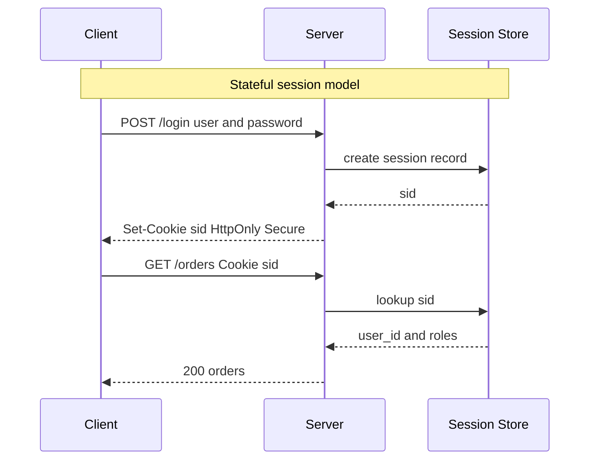

| Aspect | Server-side session | Token (JWT) |
|---|---|---|
| Server state | Yes (store needed) | No (stateless) |
| Horizontal scale | Needs shared/sticky store | Trivial, no shared state |
| Revocation | Instant (delete record) | Hard (valid until expiry) |
| Size on wire | Small opaque ID (~32B) | Large (~0.5–2 KB) |
| Cross-domain / mobile | Cookies awkward | Bearer header ideal |
| Latency per request | +1 store lookup | None (local verify) |
| Blast radius if leaked | Until logout/expiry | Until expiry (no kill switch) |

**Real tech.** Sessions: Redis-backed sessions (Rails, Django, Express `connect-redis`). Tokens: Auth0, Okta, AWS Cognito, Keycloak issue JWTs.

**Pitfalls.**
- "Stateless JWT" is a marketing promise that breaks the moment you need logout, ban-a-user, or rotate-on-password-change. You end up adding a denylist — i.e., state.
- Cookie sessions need CSRF protection; bearer tokens in headers are immune to CSRF but vulnerable to XSS if stored in `localStorage`.

> **Staff-level insight:** The session-vs-token debate is really a *consistency-vs-availability* trade for your auth layer. Sessions give you strong consistency (instant revocation) at the cost of a stateful dependency on the hot path. Tokens give you availability and scale at the cost of weak consistency (a compromised token stays live until expiry). The grown-up answer in interviews is a **hybrid**: short-lived (5–15 min) access tokens for the stateless fast path, plus a stateful refresh-token store so you retain a revocation kill-switch. Don't pick a side dogmatically — articulate the trade.

**Decision (decisive):** **Short-lived access JWT (verified locally at the gateway) + stateful rotating refresh token**, *because* it keeps stateless scale on the hot path while preserving a revocation kill-switch; **revisit if** the product needs ban-takes-effect-in-under-a-second, in which case add `jti` denylist or per-request introspection on the sensitive paths only.

#### ⚠️ Earmarked hard part — long-lived WebSocket connections (the chat-platform crux)

This is the one that separates someone who has *operated* a real-time system from someone who read about JWTs. A REST request re-presents its token on every call, so a 15-minute TTL naturally bounds a leak. **A chat WebSocket authenticates once at the handshake and then stays open for hours.** The token that authorized the connection may expire — or the user may be banned — while the socket is still happily delivering messages. Naive designs leave a banned user connected.

Patterns to handle it (decide, with trigger):

| Pattern | How | Use when |
|---|---|---|
| **Re-auth in-band** | Client sends a fresh access token over the socket periodically; server re-validates and drops on failure | Default — cheap, keeps the long-lived socket honest |
| **Revocation pub/sub** | On ban/logout, publish `revoke:user:123` on Redis; every gateway node holding that socket force-closes it | When you need near-instant kick (moderation, abuse) ⚠️ |
| **Short connection TTL** | Force reconnect every N minutes; reconnect re-authenticates | Simple but adds reconnect churn at scale |
| **Connection-bound session record** | Socket maps to a stateful session row; check a version/epoch on sensitive actions | When per-message authz must reflect live permission changes |

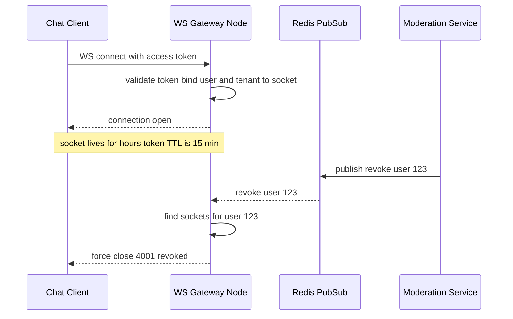

> **Experience hook to say out loud:** "On a chat platform I'd authenticate the WebSocket at handshake, bind the verified `user_id` and `tenant_id` to the connection, and subscribe each gateway node to a Redis revocation channel so a ban force-closes live sockets in milliseconds — because the access-token TTL does nothing for a connection that's already open."

---

### 1.2 OAuth 2.0

**Definition.** OAuth 2.0 is a **delegated authorization** framework (RFC 6749). It lets a *third-party app* obtain *scoped, time-limited access* to a user's resources **without seeing the user's password**. It is *not* an authentication protocol (that's OIDC, built on top).

**The four roles.**

| Role | Meaning | Example |
|---|---|---|
| Resource Owner | The user who owns the data | You |
| Client | The app wanting access | A photo-printing app |
| Authorization Server (AS) | Issues tokens after consent | Google's OAuth endpoint |
| Resource Server (RS) | Hosts the protected API | Google Photos API |

**Grant types (how the client gets a token).**

| Grant | Use case | Front-channel secret? | Status |
|---|---|---|---|
| Authorization Code + PKCE | Web apps, SPAs, mobile | Public clients: no (PKCE replaces the secret); confidential server-side apps: secret **+** PKCE | **Recommended for all clients** |
| Client Credentials | Machine-to-machine, no user | Client secret | Recommended (service auth) |
| Device Code | TVs, CLIs, input-constrained | No | Recommended for those devices |
| Implicit | SPAs (legacy) | Token in URL fragment | **Deprecated** — use code+PKCE |
| Resource Owner Password | Trusted first-party (legacy) | Sends raw password | **Deprecated** — phishing-shaped |

**Access vs refresh tokens.**
- **Access token** — short-lived (minutes), presented to the resource server on every call. If stolen, limited blast radius.
- **Refresh token** — long-lived (days/weeks), presented *only* to the AS to mint new access tokens. Stored securely; should be **rotated** on each use (refresh-token rotation) so reuse of an old one signals theft.
- **Scopes** — strings like `photos.read`, `email`, `orders:write` that bound *what* the token can do. Least privilege at the token level.

**Authorization Code + PKCE flow** (the one to draw).

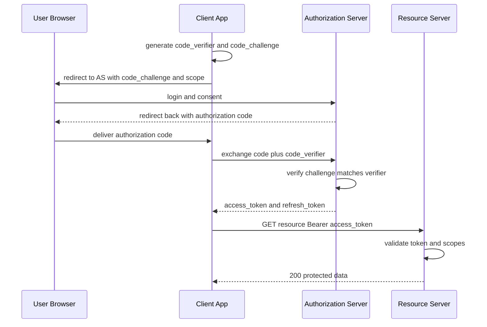

**Why PKCE (Proof Key for Code Exchange).** The authorization code travels through the browser/redirect and can be intercepted (especially on mobile via custom URL schemes). PKCE binds the code to a one-time secret (`code_verifier`) that only the legitimate client knows, so a stolen code is useless. For **public clients** (SPAs/mobile) that can't keep a secret, PKCE replaces the client secret; for **confidential clients** (server-side web apps) it is used *in addition to* the client secret, not instead of it.

**Decision (decisive):** **Authorization Code + PKCE for every interactive client (web, SPA, mobile); Client Credentials for machine-to-machine; Device Code for input-constrained clients.** *Because* PKCE is now the universal recommendation — RFC 9700 (OAuth Security BCP) recommends PKCE for all clients; the OAuth 2.1 *draft* folds it in and removes the implicit + password grants; **revisit if** a legacy partner literally cannot do PKCE — then isolate that exception behind a tightly scoped, short-TTL token, don't reintroduce implicit globally. For a chat SDK embedded in customers' apps, the customer's *backend* uses Client Credentials to mint scoped tokens for *its* end users — never ship a long-lived master key to the mobile client.

**Real tech.** Google, GitHub, Microsoft Entra ID, Auth0, Okta. "Sign in with Google" buttons are OAuth+OIDC. Device code: `aws sso login`, GitHub CLI, smart-TV apps.

**Pitfalls.**
- Using **implicit flow** in a new SPA (token in URL fragment leaks via history, referrer, logs). Always code+PKCE now.
- Not validating the `state` parameter → CSRF on the OAuth redirect.
- Overly broad scopes (`read_write_everything`) — violates least privilege.
- Mismatched/loose `redirect_uri` allow-list → open redirect → token theft.

> **Staff-level insight:** OAuth is authorization, not authentication — yet 90% of "Login with X" buttons abuse the access token as proof of identity. That's the **confused-deputy / token-substitution** risk: an access token issued to App A for *its* resources can be replayed to App B if B blindly trusts it. The fix is OIDC's **ID token** (audience-bound, signed identity assertion) plus validating `aud`/`iss`/`azp`. In an interview, calling out "OAuth ≠ authn, use OIDC for identity" instantly signals senior depth.

---

### 1.3 OpenID Connect (OIDC)

**Definition.** OIDC is a thin **authentication** layer on top of OAuth 2.0. OAuth gets you an *access token* (authz); OIDC adds an **ID token** (authn) — a signed JWT asserting *who the user is*.

**How it works.** Same authorization-code flow, but the client requests the `openid` scope. The AS (now an "OpenID Provider") returns an **ID token** alongside the access token. The client validates the ID token's signature and claims (`iss`, `aud`, `exp`, `nonce`, `sub`). For more profile data, the client calls the **UserInfo endpoint** with the access token.

| | OAuth 2.0 | OpenID Connect |
|---|---|---|
| Purpose | Authorization (delegated access) | Authentication (identity) |
| Key artifact | Access token (opaque/JWT) | ID token (always a JWT) |
| Audience | Resource server | The client itself |
| Tells you | What you can access | Who the user is |
| Standard claims | None mandated | `sub`, `iss`, `aud`, `exp`, `iat`, `nonce` |

**ID token claims** (canonical): `iss` (issuer), `sub` (stable user ID — use this as your foreign key, *not* email), `aud` (your client ID), `exp`/`iat`, `nonce` (replay defense), plus optional `email`, `name`, `picture`.

**Real tech.** Google Sign-In, Microsoft, Apple ("Sign in with Apple"), Auth0, Okta, Keycloak, AWS Cognito.

**Pitfalls.**
- Keying users on `email` instead of `sub` — emails change and can be reassigned.
- Skipping `nonce` validation (replay) or `aud` validation (token confusion).
- Treating the *access token* as identity proof (see 1.2 insight).

> **Staff-level insight:** The clean mental model: **OAuth issues a valet key to your car; OIDC issues a passport that proves it's you.** Use the access token to call APIs, the ID token to populate your identity/session. In a federated, multi-IdP enterprise design, OIDC's standardized discovery (`/.well-known/openid-configuration`) and JWKS endpoint let you rotate signing keys and add new identity providers without code changes — that operability story is what Directors care about.

---

### 1.4 JWT Internals

**Definition.** A **JSON Web Token** is a compact, URL-safe, self-contained token: `base64url(header) . base64url(payload) . base64url(signature)`. Signed (JWS) tokens guarantee integrity/authenticity; encrypted (JWE) tokens add confidentiality.

**Structure.**
- **Header** — `{ "alg": "RS256", "typ": "JWT", "kid": "key-id" }`. `kid` lets the verifier pick the right public key from JWKS.
- **Payload** — claims: `sub`, `iss`, `aud`, `exp`, `iat`, `nbf`, `jti` (unique ID for denylisting) + custom claims (`roles`, `tenant_id`).
- **Signature** — `Sign(base64url(header) + "." + base64url(payload), key)`.

> base64url is **encoding, not encryption** — the payload is *readable by anyone*. Never put secrets in a JWS payload.

**JWS vs JWE.**

| | JWS (signed) | JWE (encrypted) |
|---|---|---|
| Guarantees | Integrity + authenticity | Confidentiality + integrity |
| Payload readable? | Yes (base64, visible) | No (ciphertext) |
| Common algs | HS256, RS256, ES256 | RSA-OAEP, A256GCM |
| Use when | Most access/ID tokens | Token carries sensitive data |

**The `alg: none` attack.** Early JWT libraries accepted `"alg": "none"` (unsigned token) — an attacker strips the signature, sets `alg: none`, and forges any claims. **Defense:** never accept `none`; pin the expected algorithm server-side; reject algorithm confusion (e.g., a server expecting RS256 tricked into verifying an HS256 token using the *public* key as the HMAC secret).

**Expiry & refresh.** Keep access tokens short (5–15 min). On expiry the client uses the refresh token to mint a new one. Short expiry bounds the damage of leaks and partly mitigates the revocation problem.

**The revocation problem & solutions.** A signed JWT is valid until `exp` — there's no server-side switch to kill it early. Mitigations:

| Approach | How | Cost |
|---|---|---|
| Short expiry | 5–15 min access tokens | Minimal; the standard baseline |
| Token denylist | Store revoked `jti` until expiry | Reintroduces state (small) |
| Refresh-token rotation | Invalidate refresh chain on reuse | Needs refresh store |
| Token versioning | `token_version` claim vs DB counter; bump to revoke all | 1 lookup, coarse-grained |
| Short-lived + introspection | RS calls AS `/introspect` per request | Latency, but real-time |

**Where to store the token (browser).**

| Storage | XSS risk | CSRF risk | Notes |
|---|---|---|---|
| `localStorage` | High (JS-readable) | None | Convenient; avoid for sensitive apps |
| `sessionStorage` | High | None | Same risk, per-tab lifetime |
| Cookie `HttpOnly Secure SameSite` | Low (JS can't read) | Needs CSRF defense | **Generally safest** |
| In-memory (JS var) | Medium | None | Lost on refresh; pair with silent re-auth |

**Pitfalls.**
- Long-lived access tokens (a 24h JWT is a 24h liability).
- HS256 with a shared secret across many services → any service can forge tokens. Prefer asymmetric **RS256/ES256** so only the AS signs and services verify with the public key.
- Putting PII in the payload (it's world-readable base64).

> **Staff-level insight:** The honest framing: a JWT is only truly "stateless" if you never need to revoke. The instant your design has *logout, ban-user, or rotate-on-password-change*, statelessness is a fiction and you're back to a denylist or short-TTL-plus-introspection. Senior answer: **short-lived access JWTs (verify locally, no DB hit on the hot path) + stateful refresh tokens with rotation (your kill-switch)**. You keep ~95% of the scale benefit while retaining real-time revocation where it matters. Also pre-empt the `alg:none` / algorithm-confusion attacks unprompted — it shows you know JWTs bite.

---

### 1.5 SAML & Enterprise SSO

**Definition.** **SAML 2.0** (Security Assertion Markup Language) is the older, XML-based enterprise SSO standard. The **Identity Provider (IdP)** (Okta, Entra ID, Ping) authenticates the user and posts a signed XML **assertion** to the **Service Provider (SP)** (your app).

**How it works (SP-initiated).** User hits your app → app redirects to IdP with a `SAMLRequest` → IdP authenticates → IdP POSTs a signed `SAMLResponse` (assertion with attributes/groups) back to your ACS (Assertion Consumer Service) URL → you validate the XML signature and create a session.

| | SAML 2.0 | OIDC |
|---|---|---|
| Format | XML | JSON / JWT |
| Era / fit | Enterprise, B2B, legacy | Modern web/mobile/API |
| Transport | Browser POST/redirect | REST + JWT |
| Mobile-friendly | Poor | Excellent |
| Still dominant in | Large-enterprise SSO | Consumer + new apps |

**Pitfalls.** XML signature wrapping (XSW) attacks; trusting unsigned assertions; clock-skew on `NotOnOrAfter`; canonicalization bugs. XML parsing is a notorious attack surface (XXE).

> **Staff-level insight:** Don't write your own SAML — the XML signature-validation surface is brutal and historically full of bypasses. In interviews, the right move is "we'd support **both** SAML (for enterprise customers who mandate it) and OIDC (for everything else) via a managed IdP like Okta/WorkOS, behind a normalized internal identity abstraction." That dual-protocol pragmatism is exactly what enterprise-SaaS Staff/Director roles screen for.

---

### 1.6 MFA, TOTP, WebAuthn, Passkeys

**Definition.** **Multi-factor authentication** requires ≥2 of: *something you know* (password), *something you have* (phone/key), *something you are* (biometric).

**Mechanisms.**
- **TOTP** (RFC 6238) — Google Authenticator/Authy. Shared secret + current time → 6-digit code rotating every 30s. Phishable (user can be tricked into typing the code into a fake site).
- **SMS OTP** — weakest factor; vulnerable to SIM-swap and SS7 interception. Better than nothing, not a real second factor for high-value accounts.
- **WebAuthn / FIDO2** — public-key cryptography. The authenticator (YubiKey, Touch ID, Windows Hello) holds a private key; the server stores the public key. **Origin-bound** → phishing-resistant by design.
- **Passkeys** — WebAuthn credentials that sync across a user's devices via the platform (iCloud Keychain, Google Password Manager). Passwordless, phishing-resistant, the modern endgame.

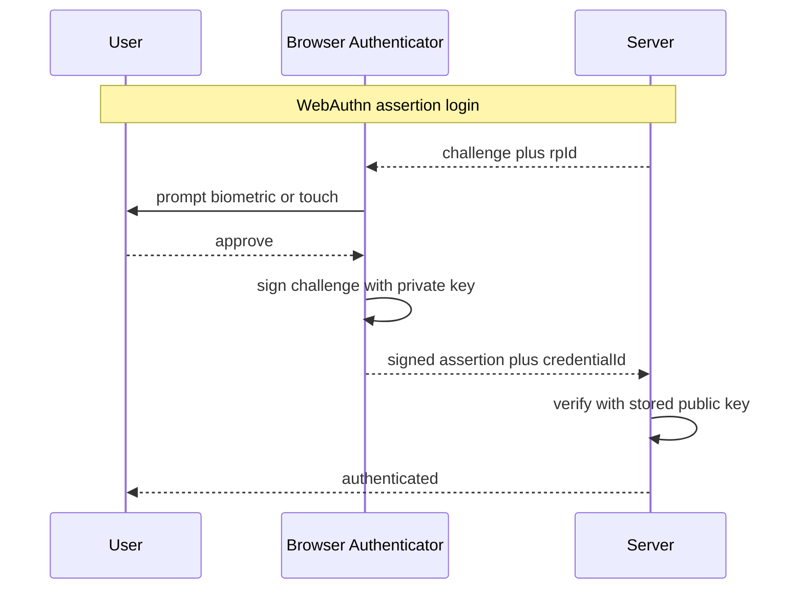

| Factor | Phishing-resistant | Cost/UX | Notes |
|---|---|---|---|
| SMS OTP | No | Low / familiar | SIM-swap risk; avoid for high value |
| TOTP app | No | Low | Better than SMS, still phishable |
| Push approval | Partial | Good | MFA-fatigue attacks possible |
| WebAuthn key | Yes | Hardware needed | Strongest; origin-bound |
| Passkeys | Yes | Excellent | Passwordless future |

**Pitfalls.** SMS as the *only* factor; MFA-fatigue (spamming push prompts until the user taps "approve"); no recovery path (locks users out); not rate-limiting OTP verification (brute-force the 6 digits).

> **Staff-level insight:** Phishing-resistance is the dividing line that matters at scale. TOTP/SMS stop credential-stuffing but *not* real-time phishing proxies (Evilginx). WebAuthn/passkeys cryptographically bind the credential to the origin, so a phishing site can't relay it. For a system handling money or admin access, the Staff answer is "passkeys/WebAuthn for the high-value paths, TOTP as fallback, SMS only as account-recovery hint, never as the sole factor."

---

### 1.7 mTLS for Service-to-Service

**Definition.** **Mutual TLS** — both client and server present X.509 certificates and verify each other. Standard TLS authenticates only the *server*; mTLS authenticates *both ends*, giving cryptographic service identity.

**How it works.** Each service has a cert signed by an internal CA (often a SPIFFE/SPIRE identity, e.g. `spiffe://prod/payments`). During the TLS handshake both sides validate the peer cert against the trusted CA. The service mesh (Istio/Linkerd) injects sidecars that handle cert issuance, rotation (hourly), and mTLS transparently.

**Real tech.** Istio + SPIFFE/SPIRE, Linkerd, AWS App Mesh, HashiCorp Consul Connect.

**Pitfalls.** Manual cert management doesn't scale (use a mesh); long-lived certs (rotate frequently); not pinning the CA; assuming mTLS gives *authorization* — it gives *identity*; you still need authz on top.

> **Staff-level insight:** mTLS is the foundation of zero-trust east-west traffic: it replaces "trust the network/IP" with "trust the cryptographic identity." But mTLS only proves *which service* is calling, not *on whose behalf* — for end-user context you still propagate a token (see 5.6 token propagation & the confused deputy). The combo — mTLS for service identity + propagated JWT for user identity — is the canonical secure-microservices answer. See [Microservices](10-microservices.md).

---

## 2. Authorization

> **Altitude cue for the room:** name the model you're choosing and *why this system needs it*, then move on — don't lecture on all three. The decision tree is one sentence: *"Static org roles → RBAC. Context/data-dependent rules (their own, business hours, region) → ABAC. Shared-resource / membership graphs → ReBAC."* Say which one fits and why; the interviewer does not need a taxonomy.

### 2.1 RBAC

**Definition.** **Role-Based Access Control** assigns permissions to **roles**, and roles to **users**. You check "does this user's role grant this permission?"

**How it works.** `User → Role → Permission`. E.g., `alice → editor → {post:create, post:edit}`. Permissions are coarse; roles are the unit of management.

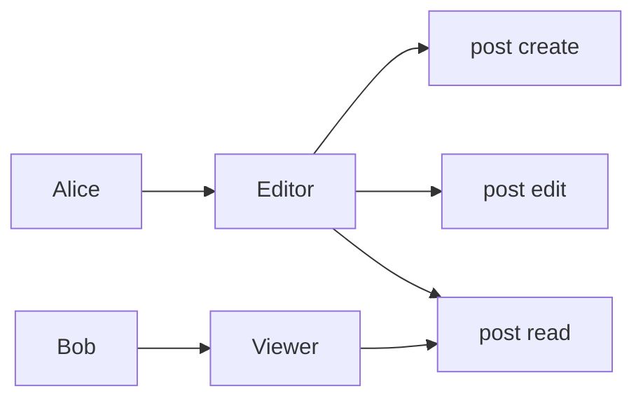

**Real tech.** AWS IAM roles/policies, Kubernetes RBAC, GitHub org roles, most SaaS apps.

**Pitfalls — role explosion.** Real authorization is contextual ("editors can edit only *their own team's* posts in the *EU* region"). RBAC encodes context as more roles: `eu-team-a-editor`, `us-team-b-viewer`... → combinatorial explosion, thousands of roles, unmaintainable.

> **Staff-level insight:** RBAC is perfect when permissions are *static and org-structured* and terrible when they're *contextual/data-dependent*. The moment a requirement contains the words "their own," "in the same team," or "during business hours," RBAC starts to explode and you should reach for ABAC or ReBAC. Naming that inflection point in an interview shows you've actually maintained an authz system, not just read about one.

---

### 2.2 ABAC

**Definition.** **Attribute-Based Access Control** evaluates **policies** over **attributes** of the subject, resource, action, and environment. "Allow if `user.dept == resource.dept AND time in business_hours AND user.clearance >= resource.classification`."

**How it works.** A **Policy Decision Point (PDP)** evaluates rules; a **Policy Enforcement Point (PEP)** enforces the decision. Attributes come from tokens, the resource record, and context (IP, time, device posture).

| Dimension | Attributes |
|---|---|
| Subject | role, department, clearance, tenant |
| Resource | owner, classification, region |
| Action | read, write, delete |
| Environment | time, IP, device trust, MFA status |

**Real tech.** AWS IAM condition keys, XACML, Open Policy Agent, AWS Cedar.

**Pitfalls.** Policies become hard to reason about ("is this resource reachable by anyone?"); testing combinatorial attribute space is hard; performance if attributes require lookups.

> **Staff-level insight:** ABAC trades RBAC's simplicity for expressive, fine-grained, context-aware decisions — at the cost of *auditability*. The killer ABAC question in design reviews is "can you statically prove no policy grants public access to PII?" Pair ABAC with policy-as-code (OPA/Cedar) plus automated policy tests in CI, so policies are version-controlled, reviewable, and testable — that's the operational maturity Staff reviewers look for.

---

### 2.3 ReBAC & Google Zanzibar

**Definition.** **Relationship-Based Access Control** models authorization as a **graph of relationships** between subjects and objects. "Can Alice view doc:42?" → traverse: is Alice an `owner` of doc:42, or a `member` of a `folder` that is a `parent` of doc:42? Google's **Zanzibar** (2019 paper) is the canonical implementation powering Drive/YouTube/Calendar permissions.

**How it works.** Authorization data is stored as **relation tuples**: `object#relation@subject`, e.g. `doc:42#viewer@user:alice` or `doc:42#parent@folder:eng`. **Userset rewrites** express inheritance: "a `viewer` of a doc = direct viewers ∪ viewers of its parent folder ∪ its editors." A **check** traverses this graph. Zanzibar adds **zookies** (consistency tokens) for "new enemy" prevention — ensuring you don't read a stale ACL after a permission was revoked.

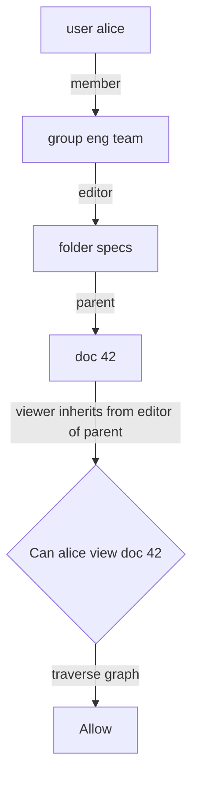

**Real tech.** Google Zanzibar; open implementations: **SpiceDB** (AuthZed), **Ory Keto**, **OpenFGA** (Auth0/Okta, CNCF). Used by GitHub, Airbnb, Carta.

**Pitfalls.** Operating a consistent, globally-distributed, low-latency authz graph is genuinely hard (Zanzibar serves 10M+ QPS at <10ms p99 via aggressive caching + Spanner). Consistency vs latency trade is real; naive graph traversal can be deep/expensive.

**Worked example — chat channel membership as relation tuples.** A chat platform's authz is *exactly* a relationship graph: `channel:general#member@user:alice`, `channel:general#admin@user:bob`, `org:acme#member@user:alice`, and a rewrite "a `viewer` of a channel = direct members ∪ members of the parent org with the `everyone` flag." "Can Alice post to channel:general?" becomes a graph check, not a pile of roles. This is why "who's in this room and what can they do" is unnatural in pure RBAC but trivial in ReBAC.

**Decision (decisive):** **RBAC for tenant-admin/operator roles (static, org-structured), ReBAC (OpenFGA/SpiceDB) for channel/room/thread membership (relationship-shaped).** *Because* mixing models to fit the shape of each problem beats forcing one model everywhere; **revisit if** the channel graph is shallow and static enough that a membership table + RBAC covers it — don't stand up a Zanzibar service for a feature that a join table handles. YAGNI: reach for ReBAC when sharing/inheritance/nesting appears, not before.

> **Staff-level insight:** ReBAC is the right model for **shared-document / social-graph / hierarchical-resource** systems (Drive, GitHub, Notion, *and chat channels*) where "who can see this" depends on a web of nested relationships RBAC/ABAC can't express cleanly. The Zanzibar superpower is **decoupling authz from app code** into a centralized, consistent, auditable service with a uniform tuple model. If asked to design Drive sharing *or chat channel permissions*, naming Zanzibar/OpenFGA and the tuple model is a near-instant signal of Staff-level breadth — but pair it with the YAGNI caveat so you don't look like you over-engineer.

---

### 2.4 PBAC & Policy Engines (OPA/Cedar)

**Definition.** **Policy-Based Access Control** centralizes authorization logic into a dedicated **policy engine** that apps query for decisions, externalizing authz from business code. **OPA** (Open Policy Agent, CNCF) uses the **Rego** language; **AWS Cedar** is a verification-friendly policy language used by Amazon Verified Permissions.

**How it works.** App sends `{subject, action, resource, context}` to the PDP → engine evaluates declarative policies → returns `allow/deny` (+ obligations). OPA can run as a sidecar, library, or central service; policies are versioned, tested, and deployed like code.

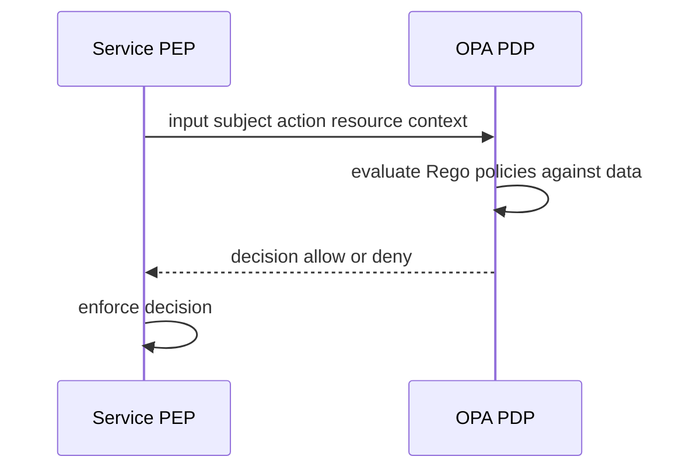

| Engine | Language | Strength |
|---|---|---|
| OPA | Rego | General-purpose, K8s admission, microservice authz |
| Cedar | Cedar | Analyzable/verifiable, RBAC+ABAC, AWS-native |
| OpenFGA / SpiceDB | DSL/tuples | ReBAC / Zanzibar-style |

**Pitfalls.** PDP becomes a hot dependency (cache decisions, run as sidecar to bound latency); Rego has a learning curve; stale policy/data bundles; not testing deny paths.

> **Staff-level insight:** The architectural win is **separating authorization from business logic** — policies live in one auditable, version-controlled place instead of scattered `if (user.role == ...)` checks across 40 services. OPA is also the standard for *infrastructure* policy (Kubernetes admission control, Terraform/CI guardrails), so "policy as code" gives you one mental model spanning app authz and infra governance. That convergence is a strong Staff/Director talking point.

---

### 2.5 Least Privilege & Multi-Tenant Authz

**Definition.** **Principle of least privilege (PoLP):** every identity (user, service, token) gets the *minimum* permissions needed, for the *minimum* time. **Multi-tenant authorization** ensures one customer (tenant) can never access another's data — the cardinal sin of SaaS.

**How it works.**
- *Least privilege:* scoped tokens, narrow IAM roles, time-boxed elevation (JIT access), separate read/write credentials, per-environment isolation.
- *Multi-tenancy:* every query is scoped by `tenant_id`. Patterns: **shared DB + row-level security (RLS)** (Postgres RLS enforces `tenant_id = current_setting('app.tenant')` at the DB), **schema-per-tenant**, or **DB-per-tenant** (strongest isolation, highest cost). The `tenant_id` must come from the *verified token*, never from a client-supplied parameter.

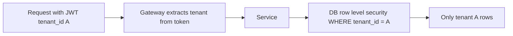

| Isolation model | Isolation | Cost | Blast radius | Choose when |
|---|---|---|---|---|
| Shared DB + RLS | Logical | Low | One bug leaks all tenants | Default — thousands of small/medium tenants, cost-sensitive |
| Schema-per-tenant | Medium | Medium | Limited per schema | Hundreds of tenants, moderate isolation needs |
| DB-per-tenant | Physical | High | Strongest; per-tenant keys | A few large enterprise tenants with contractual isolation / per-tenant keys |

**Decision (decisive):** **Shared DB + Postgres RLS by default, keyed on a token-derived `tenant_id`**, *because* it scales to many tenants cheaply while RLS provides a second enforcement layer; **revisit if** a large enterprise customer contractually requires physical isolation or its own KMS key — then promote *that tenant* to DB-per-tenant (a hybrid pool-plus-silo model) rather than rearchitecting everyone.

#### ⚠️ Earmarked hard part — the company-ending bug for a chat platform

For real-time-chat infrastructure, message, channel, and presence data for thousands of customers share storage. The realistic catastrophic failure is **not** a broken cipher — it's a single query that forgets its tenant scope, or an API that trusts a client-supplied tenant/conversation ID (cross-tenant IDOR). Treat this as the highest-risk area and design *three* independent layers so no single mistake leaks data:

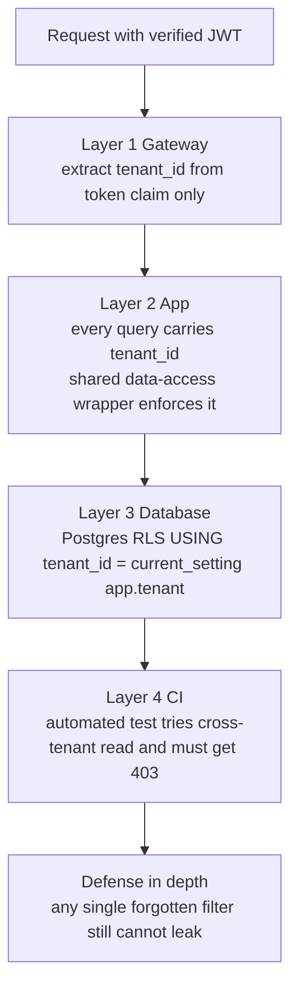

**Worked example — what good looks like:**
1. **Never derive tenant from the request body or path** — only from the signed token claim. A client sending `?tenant_id=other-co` must be ignored; the value comes from `jwt.tenant_id`.
2. **Centralize enforcement**, don't sprinkle `WHERE tenant_id` across 200 handlers. A repository/data-access layer sets `SET app.tenant = $verified_tenant` per request inside a transaction; every query inherits the RLS filter. One place to audit, not 200.
3. **RLS as the backstop**, so even a hand-written query that *forgot* the filter still returns zero foreign rows. RLS is the seatbelt for the inevitable human error.
4. **CI cross-tenant tests** — an automated suite that authenticates as tenant A and tries to read tenant B's messages/channels/users, asserting `403`/empty. Run on every PR. This converts "we're careful" into "we're verified."

**Caches and side channels** are the commonly-missed fourth surface: a Redis cache key like `channel:42:members` *without* a tenant prefix can serve tenant A's data to tenant B if IDs collide across tenants. Namespace every cache key, search index, and pub/sub channel by `tenant_id`. Same for per-tenant rate-limit buckets and presence fan-out.

**Pitfalls.** Trusting a client-supplied `tenant_id` (IDOR across tenants); forgetting the `WHERE tenant_id` clause on a new query (the classic catastrophic leak); shared caches/search indexes keyed without tenant; admin/superuser/`BYPASSRLS` roles silently bypassing RLS in a batch job; background workers and analytics jobs that run *without* the request-scoped tenant context.

> **Staff-level insight:** Multi-tenant isolation is *the* highest-stakes authz problem in SaaS — a single missing `tenant_id` filter is a company-ending breach. The Staff move is **defense in depth with explicit blast-radius reasoning**: derive `tenant_id` from the verified token at the gateway, centralize enforcement in a data-access layer, enforce it again at the DB via Postgres RLS so a forgotten `WHERE` clause still can't leak, namespace every cache/index/pubsub key by tenant, and add CI tests that *attempt* cross-tenant access. Don't rely on one layer. In the room, say: *"For a multi-tenant chat backend I'd spend most of the security time here, because this is the threat that ends the company."* (Deep dive in Module 19.)

---

## 3. Cryptography & Data Protection

### 3.1 Hashing vs Encryption vs Encoding

**Definition.** These three are constantly confused; an interviewer will probe it.

| | Reversible? | Key needed? | Purpose | Example |
|---|---|---|---|---|
| **Encoding** | Yes (trivially) | No | Data representation/transport | Base64, URL-encode |
| **Encryption** | Yes (with key) | Yes | Confidentiality | AES-256, RSA |
| **Hashing** | No (one-way) | No | Integrity, password storage | SHA-256, bcrypt |

**Pitfalls.** "We base64-encoded the password for security" — base64 is *not* security, it's transport encoding (instantly reversible). Hashing for confidentiality (you can't get the data back). Encryption for passwords (if the key leaks, all passwords leak — hash them instead).

> **Staff-level insight:** A crisp one-liner that lands every time: *encoding is for compatibility, encryption is for confidentiality, hashing is for integrity.* If a candidate says "we'll hash the credit card so we can show it later" or "base64 keeps it safe," the interviewer downgrades them on the spot. Know exactly which tool solves which problem.

---

### 3.2 Symmetric vs Asymmetric

**Definition.** **Symmetric** crypto uses one shared key for encrypt+decrypt (fast). **Asymmetric** uses a public/private key pair (slower, solves key distribution).

| | Symmetric (AES) | Asymmetric (RSA/ECC) |
|---|---|---|
| Keys | One shared secret | Public + private pair |
| Speed | Fast (bulk data) | Slow (small payloads) |
| Problem solved | Bulk confidentiality | Key exchange, signatures, identity |
| Examples | AES-256-GCM, ChaCha20 | RSA-2048, ECDSA, Ed25519 |

**How they combine.** Real systems use **hybrid**: asymmetric crypto to securely exchange a symmetric session key, then fast symmetric encryption for the bulk data. TLS, PGP, and envelope encryption all do this.

> **Staff-level insight:** Never asymmetric-encrypt large payloads — it's slow and size-limited. The universal pattern (TLS, KMS, envelope encryption) is *asymmetric to exchange/protect a symmetric key, symmetric for the data*. Knowing this hybrid is the bridge to understanding envelope encryption below.

---

### 3.3 Encryption at Rest & Envelope Encryption

**Definition.** **Encryption at rest** protects stored data (DBs, disks, backups, object storage). **Envelope encryption** is the scalable pattern: encrypt data with a **Data Encryption Key (DEK)**, then encrypt the DEK with a **Key Encryption Key (KEK)** held in a **KMS/HSM**. You store the encrypted DEK *next to the data*; the KEK never leaves the KMS.

**How it works.**
1. App asks KMS to generate a DEK → KMS returns plaintext DEK + DEK-encrypted-under-KEK.
2. App encrypts data with plaintext DEK, then discards the plaintext DEK; stores the encrypted DEK alongside the ciphertext.
3. To decrypt: send the encrypted DEK to KMS → KMS decrypts it with the KEK → returns plaintext DEK → app decrypts data.

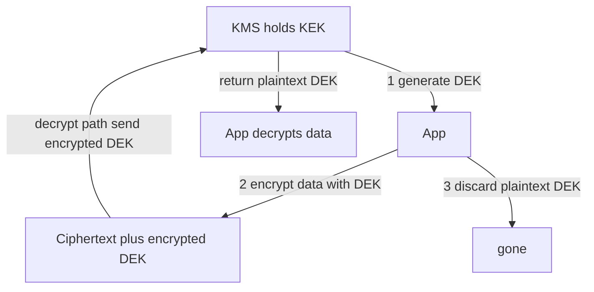

**Decision (decisive):** **Envelope encryption with a cloud KMS-held KEK and a per-tenant (or per-record for the most sensitive data) DEK.** *Because* it makes rotation O(1) and enables per-tenant crypto-shredding for GDPR erasure; **revisit if** a customer contract or regulator mandates a hardware HSM or customer-managed keys (BYOK) — then back the KEK with CloudHSM / a dedicated key store, same pattern. Name-and-move-on: "TDE/at-rest encryption is on by default at the storage layer; the interesting part is the *key hierarchy*, so let me spend the time there."

**Real tech.** AWS KMS + S3 SSE-KMS / EBS / RDS encryption, GCP KMS, Azure Key Vault, HashiCorp Vault Transit. Transparent Data Encryption (TDE) in SQL Server/Oracle/Postgres encrypts at the storage engine.

**Pitfalls.** Storing the DEK in plaintext (defeats the point); one global KEK (no blast-radius control — use per-tenant KEKs); no audit on KMS decrypt calls; assuming at-rest encryption protects against a compromised app (it doesn't — the app can decrypt).

> **Staff-level insight:** Envelope encryption's genius is making **key rotation O(1)**: to rotate, you re-encrypt only the *KEK* (or re-wrap the small DEKs) — never the terabytes of actual data, which stay encrypted under unchanged DEKs. It also gives you **fine-grained revocation** (per-tenant KEKs → disable one tenant's KEK to cryptographically shred their data — "crypto-shredding," a GDPR right-to-erasure tactic). When asked "how do you encrypt PII at scale and stay GDPR-compliant," envelope encryption + per-tenant KEKs + crypto-shredding is the complete, senior answer.

---

### 3.4 Encryption in Transit (TLS & PFS)

**Definition.** **TLS** secures data in transit. The handshake authenticates the server (cert), negotiates a cipher, and establishes a symmetric session key. **mTLS** adds client-cert auth (see 1.7). **Perfect Forward Secrecy (PFS)** ensures that compromising the server's long-term private key *later* doesn't decrypt *past* sessions.

**How it works (TLS 1.3 recap).** Client hello → server cert + key share → ephemeral **ECDHE** key exchange → both derive the session key → encrypted application data. TLS 1.3 dropped to a 1-RTT handshake (0-RTT for resumption) and removed legacy/insecure ciphers. **Caveat:** 0-RTT early data is **replay-vulnerable** (an attacker can resend captured early-data packets), so it must be restricted to **idempotent** requests — never use it for state-changing operations. PFS comes from the **ephemeral** Diffie-Hellman: a fresh key per session, never reused, never stored.

| Property | Mechanism |
|---|---|
| Server identity | X.509 cert chain to a trusted CA |
| Confidentiality | AES-GCM / ChaCha20 session key |
| Forward secrecy | Ephemeral ECDHE per session |
| Integrity | AEAD (GCM) auth tag |

**Pitfalls.** TLS termination at the LB then *plaintext* inside the VPC ("encrypt the front door, leave the back door open" — zero-trust says encrypt internal traffic too); accepting old TLS 1.0/1.1; no cert pinning for mobile; expired certs (use ACME/Let's Encrypt auto-renew).

> **Staff-level insight:** "We use HTTPS" is table stakes. The senior signal is mentioning **PFS** (so a future key compromise can't retroactively decrypt captured traffic — relevant against "harvest now, decrypt later" adversaries) and **end-to-end encryption inside the perimeter** via mTLS, not just at the edge. That's the zero-trust posture: never trust the network, even your own VPC.

---

### 3.5 Password Storage

**Definition.** Passwords must be stored as **salted, slow, one-way hashes** using a purpose-built password-hashing function — never reversible encryption, never a fast/plain hash.

**How it works.**
- **Salt** — a unique random value per password, stored alongside the hash. Defeats rainbow tables and ensures identical passwords hash differently.
- **Slow/adaptive** — bcrypt/scrypt/Argon2 are deliberately *expensive* (configurable work factor) so brute-forcing is impractical. As hardware improves, you raise the cost factor.
- **Pepper** (optional) — a secret added from a KMS/HSM, not stored in the DB, so a DB-only leak isn't enough.

| Algorithm | Type | Resists | Recommendation |
|---|---|---|---|
| MD5 / SHA-1/256 alone | Fast hash | Nothing for passwords | **Never** |
| bcrypt | Adaptive | GPU brute-force | Good, widely supported |
| scrypt | Memory-hard | GPU/ASIC | Good |
| **Argon2id** | Memory-hard | GPU/ASIC/side-channel | **Current best practice** |

**Decision (decisive):** **Argon2id with a unique per-user salt and a tuned work factor; bcrypt only if a platform/library constraint forces broad compatibility.** *Because* memory-hardness resists GPU/ASIC cracking; **revisit if** you can avoid storing passwords at all — then delegate to OIDC/passkeys and store *nothing*. State the preference, don't list five algorithms.

**Pitfalls.** Plain SHA-256 (GPUs do billions/sec); no salt (rainbow tables); reusing one salt for all; encrypting instead of hashing (key leak = all passwords); not raising work factor over time.

> **Staff-level insight:** The instant-fail answer is "we SHA-256 the password." Fast hashes are built for *speed* — the opposite of what password storage needs. You want *slow, salted, memory-hard*: **Argon2id** (or bcrypt if you need broad compatibility), unique per-user salt, tuned work factor, ideally an HSM-held pepper. And don't store passwords at all if you can avoid it — delegate to OIDC/passkeys. Saying "the best password DB is no password DB" reads as genuinely senior.

---

### 3.6 Secrets Management

**Definition.** Secrets (DB creds, API keys, signing keys, TLS certs) must live in a **dedicated secrets manager** with access control, audit, rotation, and encryption — *never* in source code, config committed to git, or plaintext env files in the repo.

**How it works.** Apps authenticate to the secrets store (via IAM role, Kubernetes service account, or AppRole) and fetch secrets at runtime. Best stores support **dynamic secrets**: short-lived credentials generated on demand (e.g., Vault mints a 1-hour Postgres user) and auto-revoked, so there's no long-lived standing secret to steal.

| Tool | Highlights |
|---|---|
| HashiCorp Vault | Dynamic secrets, transit encryption, leasing, multi-cloud |
| AWS Secrets Manager | Native rotation, IAM-integrated |
| GCP Secret Manager / Azure Key Vault | Cloud-native, versioned |
| Sealed Secrets / SOPS | GitOps-friendly encrypted secrets |

**Pitfalls.** Secrets in git history (rotate *and* purge — git history is forever); secrets in container images/build logs/CI env; over-broad read access; no rotation; printing secrets in stack traces.

> **Staff-level insight:** The maturity ladder is: hard-coded → env vars → secrets manager → **dynamic, short-lived secrets**. The last rung is the goal: a secret that lives 1 hour and auto-revokes is barely worth stealing, and it eliminates the "rotate everything after an employee leaves" fire drill. Pair this with mTLS/IAM-based machine identity so services authenticate *without* a bootstrap secret at all (solving the "secret-zero" problem). That trajectory is what distinguishes a Staff answer from "we'll put it in Secrets Manager."

---

### 3.7 Key Rotation

**Definition.** Periodically replacing cryptographic keys to bound the blast radius of an undetected compromise and to satisfy compliance (PCI mandates annual rotation).

**How it works.** With envelope encryption, rotation is cheap: generate a new KEK version, re-wrap (re-encrypt) the small DEKs under it; the bulk data is untouched. KMS keeps old key versions to decrypt legacy data while new writes use the new version. **Automatic rotation** (AWS KMS yearly, Secrets Manager configurable) removes human error.

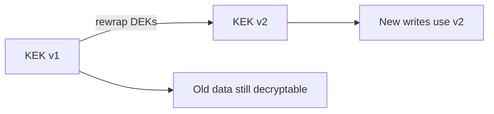

**Pitfalls.** Rotating the KEK but never re-wrapping old DEKs (old key must live forever); no key versioning (can't decrypt old data after rotation); manual rotation that never happens; rotating signing keys without a JWKS overlap window (breaks live tokens).

> **Staff-level insight:** Rotation is only *cheap* because of envelope encryption — without it, "rotate the key" means re-encrypting petabytes, so nobody does it, and a leaked key stays catastrophic forever. Tie rotation to your incident response too: a clean, tested rotation runbook means a leaked key is a 10-minute fix, not a multi-day re-encryption project. For signing keys (JWT), always rotate with a **JWKS overlap window** (publish new + old public keys) so in-flight tokens validate during the transition.

---

### 3.8 Tokenization & PII/PCI Classification

**Definition.** **Tokenization** replaces sensitive data (PAN, SSN) with a non-sensitive **token** that maps back to the original *only* inside a secured **token vault**. Unlike encryption, the token has no mathematical relationship to the data — there's nothing to decrypt if the app is breached. **Data classification** tags data by sensitivity (Public / Internal / Confidential / Restricted-PII/PCI) to drive controls.

**How it works.** A payment flow sends the card to a PCI-compliant tokenization service (Stripe, a token vault) → gets back `tok_xxx` → stores only the token. The token can be used to charge again, but the raw PAN never touches your systems → **descopes** most of your infrastructure from PCI-DSS.

| | Tokenization | Encryption |
|---|---|---|
| Reversible by app? | No (only via vault) | Yes (with key) |
| Math relationship to data | None | Yes |
| Main use | PCI/PII descoping | General confidentiality |
| If app breached | Tokens useless | Data at risk if key reachable |

**Data-protection regimes.** PCI-DSS (card data), HIPAA (health), GDPR/CCPA (personal data — right to erasure, data minimization), SOC 2 (controls attestation).

**Pitfalls.** Treating tokenization as encryption (different threat model); logging raw PII before tokenizing; no classification → can't tell what needs protecting; storing classification but not enforcing it.

> **Staff-level insight:** Tokenization's strategic value is **compliance scope reduction**: by never letting raw card data into your systems (delegate to Stripe/Adyen), you shrink your PCI audit boundary from "everything" to "almost nothing" — a massive cost and risk reduction. In any payments/PII design, lead with "what data can we *avoid holding*?" Data you don't store can't be breached, leaked, or subpoenaed. Data minimization is the cheapest security control there is.

---

## 4. Application Security — OWASP Top 10

The **OWASP Top 10** is the industry-standard list of the most critical web app risks. Know each as a one-line *attack* + *defense*.

> **Risk-weighting for the room (do NOT recite all ten):** for a multi-tenant real-time chat API, the threats that actually bite are **A01 Broken Access Control** (cross-tenant IDOR on message/channel/user IDs — the company-ender), **A03 Injection** (SQLi/NoSQL on the message store, plus stored XSS rendered in chat clients), and **A07 Identification & Auth Failures** (credential stuffing, weak session/socket auth). **A10 SSRF** becomes relevant the moment you add link previews / URL unfurling. Name *these three-to-four* and design defenses for them; mention the rest only if asked. Uniform coverage of all ten is the mid-level tell.

### 4.1 The Top 10 (2021)

> **Version note (2026):** the **2021** list below is the long-stable set most candidates have memorized, and it remains a perfectly good interview baseline. A **2025 revision** of the OWASP Top 10 also exists — it reorders several categories and adds a new **Software Supply Chain Failures** category (broadening the old A08 integrity theme). Exact 2025 rankings aren't reproduced here; just know the revision exists and names that supply-chain category, and reason from the underlying risks rather than the ordinal.

| # | Category | Attack (one line) | Defense (one line) |
|---|---|---|---|
| A01 | **Broken Access Control** | User edits URL `/users/123` → `/users/124` and reads another's data (IDOR) | Server-side authz on *every* request; deny by default; never trust client IDs |
| A02 | **Cryptographic Failures** | PII sent over HTTP or stored unencrypted/with weak hash | TLS everywhere, strong ciphers, encrypt at rest, Argon2 for passwords |
| A03 | **Injection (SQLi/NoSQL/cmd)** | `'; DROP TABLE users; --` in an input concatenated into a query | Parameterized queries / prepared statements; never string-concat; validate input |
| A04 | **Insecure Design** | No rate limit on password reset → account takeover by design | Threat-model early (STRIDE); secure-by-design patterns; abuse cases |
| A05 | **Security Misconfiguration** | Default admin password, open S3 bucket, verbose error stack traces | Hardened baselines, least privilege, disable defaults, no debug in prod |
| A06 | **Vulnerable & Outdated Components** | Known CVE in an old library (e.g., Log4Shell) | SCA scanning (Dependabot/Snyk), patch SLAs, SBOM |
| A07 | **Identification & Auth Failures** | Credential stuffing, weak passwords, no MFA, session fixation | MFA, rate-limit logins, strong session mgmt, breached-password checks |
| A08 | **Software & Data Integrity Failures** | Compromised CI pipeline or unsigned update injects malware (SolarWinds) | Signed artifacts, verified dependencies, secure CI/CD, SLSA |
| A09 | **Security Logging & Monitoring Failures** | Breach goes undetected for months (no alerting) | Centralized logs, alerting on auth anomalies, tamper-proof audit trail |
| A10 | **SSRF** | App fetches a user-supplied URL → attacker points it at `169.254.169.254` to steal cloud creds | Allow-list egress, block link-local/metadata IPs, no raw URL fetch |

**SQLi deep dive.** The classic. `SELECT * FROM users WHERE email = '" + input + "'` lets an attacker inject `' OR '1'='1`. **Defense:** parameterized queries (`WHERE email = ?`) so input is *data*, never *code*. ORMs help but raw queries still need binding. Add least-privilege DB users (the app's user can't `DROP`).

**SSRF deep dive.** Devastating in cloud: the **IMDS** endpoint `http://169.254.169.254/` returns IAM credentials. SSRF → fetch that → exfiltrate creds → full account compromise (this was the **Capital One 2019** breach). **Defenses:** enforce IMDSv2 (session-token-required), block link-local ranges at egress, allow-list destinations, run egress through a proxy.

> **Staff-level insight:** **A01 Broken Access Control** is #1 for a reason — it's the most common and most damaging, and it's an *authorization* bug, not a crypto bug. The lesson for system design: authorization must be enforced **server-side on every single request**, derived from the *verified token*, never inferred from a client-supplied ID or a hidden UI element. "We hid the admin button" is not access control. When designing any API, walk through the IDOR case explicitly: "what stops user A from requesting user B's resource by changing the ID?"

---

### 4.2 XSS

**Definition.** **Cross-Site Scripting** injects attacker JavaScript that runs in the victim's browser in the context of your site — stealing tokens, hijacking sessions, defacing.

| Type | How |
|---|---|
| **Stored** | Malicious script saved in DB (e.g., a comment), served to all viewers |
| **Reflected** | Script in a URL/param reflected straight back in the response |
| **DOM-based** | Client-side JS writes untrusted data into the DOM unsafely |

**Defenses.** Context-aware **output encoding** (HTML-escape on render); never `innerHTML` with untrusted data (use `textContent`); a strict **Content Security Policy** (`script-src 'self'`) to block inline/injected scripts; `HttpOnly` cookies so XSS can't read the session; frameworks (React/Angular) that auto-escape by default; sanitize rich HTML with DOMPurify.

> **Staff-level insight:** XSS is why the `localStorage`-vs-cookie token debate matters: if an attacker lands XSS, a token in `localStorage` is *instantly readable JS*, while an `HttpOnly` cookie is not. So XSS defense and token-storage strategy are coupled decisions. The layered answer: framework auto-escaping (prevent), CSP (contain — defense in depth even if escaping fails), and `HttpOnly` (limit blast radius). One control isn't enough.

---

### 4.3 CSRF

**Definition.** **Cross-Site Request Forgery** tricks a logged-in user's browser into making an unwanted *state-changing* request to your site, riding their cookies. Victim visits evil.com → it auto-submits `POST yourbank.com/transfer`.

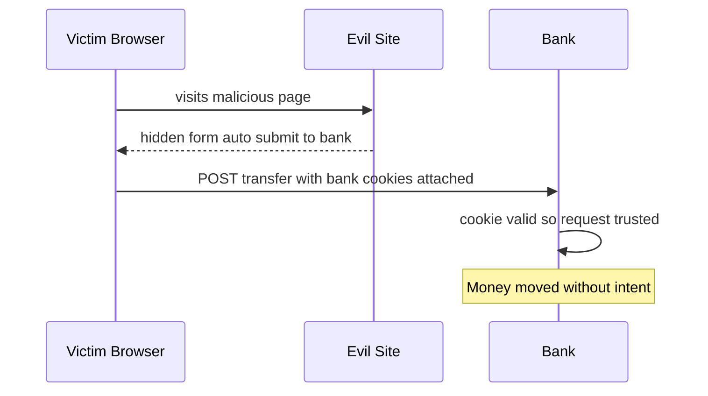

**Defenses.** **CSRF tokens** (unpredictable per-session token in forms, validated server-side — evil.com can't read it due to SOP); **`SameSite=Lax/Strict` cookies** (browser won't send cookies on cross-site requests — the modern default defense); checking `Origin`/`Referer`; **bearer tokens in headers are inherently CSRF-immune** (the browser doesn't auto-attach an `Authorization` header cross-site).

> **Staff-level insight:** CSRF is fundamentally a *cookie* problem — it exploits the browser's automatic cookie attachment. Token-in-header auth sidesteps CSRF entirely but reopens the XSS storage question. So you're choosing your poison: cookie auth → handle CSRF (`SameSite` + token); header auth → handle XSS (storage). `SameSite=Lax` as a default has dramatically reduced CSRF in modern apps, but layer the synchronizer/double-submit token for sensitive actions — don't rely on `SameSite` alone since enforcement varies.

---

### 4.4 Clickjacking

**Definition.** The attacker frames your site invisibly (opacity 0) over their page, tricking the user into clicking a real button (e.g., "Delete account" / "Authorize payment") they can't see.

**Defenses.** `X-Frame-Options: DENY` (legacy) and the modern **CSP `frame-ancestors 'self'`** directive to control who can iframe you; frame-busting JS as backup.

> **Staff-level insight:** Clickjacking is cheap to prevent (one header) and embarrassing to miss — set `frame-ancestors` on every sensitive page. It belongs in your standard security-header baseline alongside HSTS, CSP, and `X-Content-Type-Options: nosniff`. Mentioning a *security header baseline* as a default in any web design signals operational hygiene.

---

### 4.5 Same-Origin Policy & CORS

**Definition.** The **Same-Origin Policy (SOP)** is the browser's foundational rule: scripts on origin A (`scheme://host:port`) cannot read responses from origin B. **CORS** (Cross-Origin Resource Sharing) is the controlled *relaxation* of SOP — the server opts in to allow specific cross-origin reads via headers.

**How CORS works.** For non-simple requests the browser sends a **preflight** `OPTIONS` with `Origin`; the server responds with `Access-Control-Allow-Origin`, `-Methods`, `-Headers`, and optionally `-Credentials`. The *browser* enforces the result — CORS is a browser mechanism, not server-side access control.

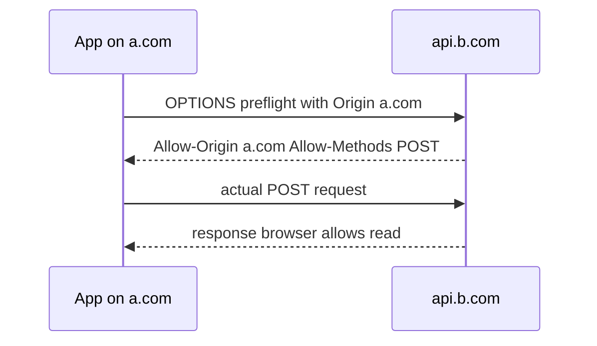

**Pitfalls.** `Access-Control-Allow-Origin: *` *with* credentials (forbidden combo / dangerous); reflecting the `Origin` header without an allow-list (effectively allow-all); thinking CORS is a *security control* (it protects *users' browsers* from cross-origin reads — it does **not** protect your *server*; attackers can still hit your API directly with curl).

> **Staff-level insight:** The most common CORS misconception: people think loosening CORS *exposes* their API. It doesn't — your API is reachable by any HTTP client regardless of CORS; CORS only governs what *browser JS on other origins* may read. Server-side authentication/authorization is your real protection. Saying "CORS isn't a server-side access control; it's browser-enforced and your authz must stand on its own" is a precise senior distinction that trips up many candidates.

---

## 5. Network & Infrastructure Security

### 5.1 Rate Limiting (Security Angle)

**Definition.** Beyond capacity protection, rate limiting is a *security* control: it blunts brute-force, credential-stuffing, enumeration, scraping, and app-layer DoS. (See [Reliability](11-reliability.md) for the algorithms — token bucket, sliding window.)

**Security-specific application.** Tier limits by sensitivity: aggressive on `/login`, `/reset-password`, `/mfa-verify` (e.g., 5/min/account *and* /IP); per-account *and* per-IP (stop distributed credential stuffing); exponential backoff + CAPTCHA on repeated failures; global limits on expensive endpoints.

| Target | Without limiting | With limiting |
|---|---|---|
| Login | Brute-force passwords | Lockout/backoff after N |
| OTP verify | Brute 6-digit code (10⁶) | 5 tries then block |
| Signup | Mass fake accounts | Per-IP cap + CAPTCHA |
| Password reset | Account enumeration | Throttle + generic response |

> **Staff-level insight:** Rate limiting for security must key on the *right dimension*. Per-IP alone fails against distributed botnets (1 request per IP); per-account alone fails against spray attacks (one password tried across millions of accounts). You need *both*, plus device fingerprinting and anomaly detection for sophisticated adversaries. And combine with generic error responses on auth endpoints to prevent *enumeration* (don't reveal whether the username exists).

---

### 5.2 DDoS Protection

**Definition.** **Distributed Denial of Service** overwhelms a target from many sources. Three layers:

| Layer | Example | Mitigation |
|---|---|---|
| **Volumetric (L3/4)** | UDP/DNS amplification floods the pipe | Anycast + scrubbing centers absorb/filter; huge upstream capacity |
| **Protocol (L4)** | SYN flood exhausts connection tables | **SYN cookies**, connection rate limits, stateless filtering |
| **Application (L7)** | Flood of expensive `/search` requests | WAF, rate limiting, CAPTCHA/JS challenge, behavioral analysis |

**How mitigation works.**
- **Anycast** advertises one IP from many global PoPs → attack traffic is *distributed* across the provider's network and absorbed near the source.
- **Scrubbing centers** route traffic through filters that drop malicious packets and forward clean traffic.
- **SYN cookies** let the server respond to SYN without allocating state, defeating SYN floods.
- **Challenges** (CAPTCHA, JS proof-of-work, Cloudflare's managed challenge) separate bots from humans at L7.

**Real tech.** Cloudflare, AWS Shield (Standard free / Advanced), Akamai, Google Cloud Armor.

> **Staff-level insight:** You cannot out-scale a serious volumetric DDoS from your own infrastructure — terabit floods require a provider with massive distributed capacity (Cloudflare/Akamai/Shield) sitting in front via anycast. The Staff framing is *defense in depth by layer*: CDN/anycast for volumetric, SYN cookies + connection limits for protocol, and WAF + adaptive rate limiting + challenges for the increasingly common *application-layer* attacks (which are cheap for attackers and hardest to distinguish from real traffic). Also design for graceful degradation: shed load and serve cached/static content rather than fully failing.

---

### 5.3 WAF

**Definition.** A **Web Application Firewall** inspects HTTP traffic and blocks malicious patterns (SQLi, XSS, path traversal, known CVE exploits) before they reach the app — at L7.

**How it works.** Sits at the edge/CDN; applies managed rule sets (OWASP Core Rule Set), custom rules, IP reputation, geo-blocking, and bot management. Can run in *detect* (log) or *block* mode.

**Real tech.** AWS WAF, Cloudflare WAF, Imperva, F5, ModSecurity (OSS).

**Pitfalls.** False positives blocking legit traffic (tune in detect mode first); treating WAF as a substitute for secure code (it's a *compensating* control, bypassable); not covering APIs/JSON payloads.

> **Staff-level insight:** A WAF is a *speed bump and compensating control*, not a fix — it buys you time to patch (huge during a 0-day like Log4Shell, when a virtual patch at the WAF protects you in minutes while you roll the real fix) and filters the noise, but determined attackers bypass signature-based rules. Position it as **one layer of defense in depth**, never the only line. The senior answer pairs WAF (perimeter) with secure coding (parameterized queries, input validation) at the source.

---

### 5.4 API Security: Keys, HMAC, Replay Protection

**Definition.** Server-to-server and webhook APIs authenticate via **API keys** or, more securely, **HMAC request signing** with **replay protection**.

**How it works.**
- **API key** — a static bearer secret in a header. Simple but a long-lived secret; if leaked, full access until rotated. Scope + rate-limit per key.
- **HMAC signing** — client signs the request (method + path + body + **timestamp** + **nonce**) with a shared secret; server recomputes and compares. The secret never travels; tampering breaks the signature.
- **Replay protection** — include a **timestamp** (reject if older than ~5 min) and a **nonce** (reject if seen before, tracked in a short-TTL cache). Prevents an attacker from re-sending a captured valid request.

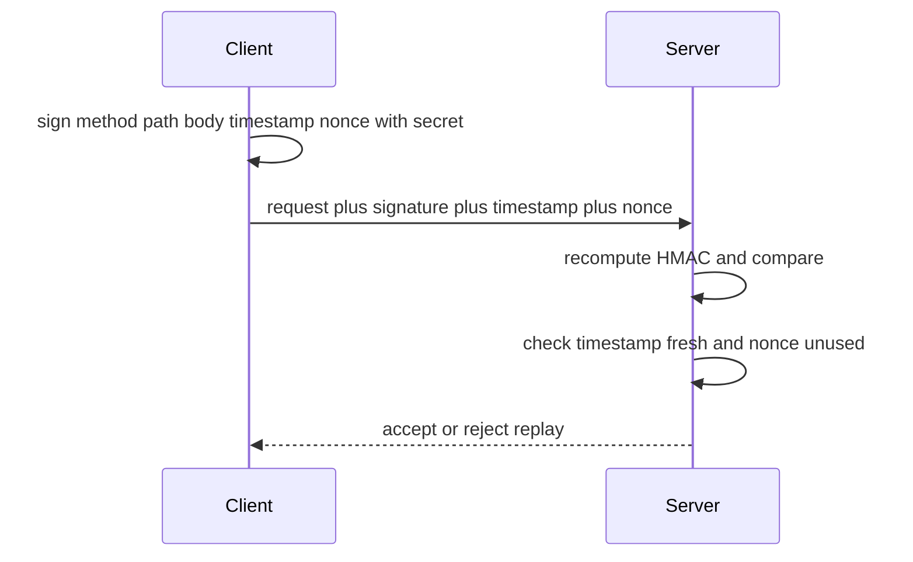

| Mechanism | Secret on wire? | Tamper-proof | Replay-proof | Use |
|---|---|---|---|---|
| API key | Yes (the key) | No | No | Simple internal/partner |
| HMAC signed | No | Yes | With nonce+ts | Webhooks, partner APIs |
| OAuth + mTLS | No | Yes | Short-lived tokens | High-security M2M |

**Real tech.** AWS SigV4 (HMAC signing), Stripe/GitHub webhook signatures (`Stripe-Signature` with timestamp), Twilio request validation.

> **Staff-level insight:** The reason Stripe/AWS sign requests instead of using a bearer key is that signing proves *integrity* and, with timestamp+nonce, *freshness* — a captured request can't be replayed or tampered. For *receiving* webhooks (a common design sub-problem), always verify the signature *and* the timestamp window; many real breaches come from endpoints that trust unsigned webhooks. Mentioning replay protection (timestamp + nonce) unprompted is a strong senior signal.

---

### 5.5 Zero-Trust Architecture (BeyondCorp)

**Definition.** **Zero-trust** abandons the "trusted internal network" model: *never trust, always verify*. Every request — even from inside the perimeter — is authenticated, authorized, and encrypted based on **identity and device posture**, not network location. Google's **BeyondCorp** pioneered this for employees.

**How it works.** No VPN-as-the-boundary; instead an **identity-aware proxy (IAP)** gates every app. Each request carries verified user identity + device trust signals (managed, patched, compliant) + context (location, risk), evaluated against policy per request. Service-to-service uses mTLS identities. The network is assumed hostile.

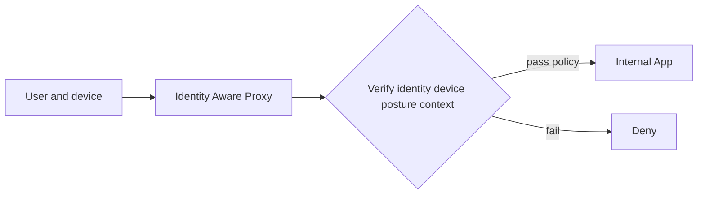

**Core tenets.** Verify explicitly · least-privilege per request · assume breach · micro-segmentation · continuous verification (not one-time login).

**Real tech.** Google BeyondCorp, Cloudflare Access, Zscaler, Tailscale, AWS Verified Access.

> **Staff-level insight:** The strategic driver for zero-trust is that the perimeter dissolved — cloud, SaaS, remote work, and microservices mean there's no "inside" to defend. The castle-and-moat model fails because one breached host inside the network has free rein (lateral movement — exactly how most major breaches escalate). Zero-trust makes lateral movement hard: every hop re-authenticates. For Director-level discussions, frame it as both a security posture *and* an enabler of remote work and M&A integration without network-merge nightmares.

---

### 5.6 Defense in Depth & Microservice Security

**Definition.** **Defense in depth** layers independent controls so no single failure is catastrophic. In **microservices**, the key problems are service identity (mTLS), user-context propagation, and the **confused deputy**.

**The confused deputy.** A privileged service is tricked by a less-privileged caller into misusing *its* authority. Example: Service A (gateway) calls Service B (payments) with *its own* high-privilege identity, but on behalf of an unauthenticated/unauthorized end user → B does something the user shouldn't be allowed to. The fix: **propagate the end-user's identity/token** through the call chain, and have each service authorize against the *user*, not just the calling service.

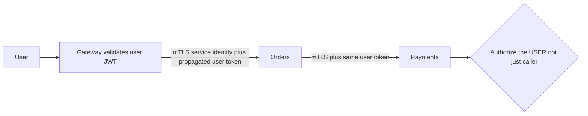

**Token propagation patterns.**
- **Pass the user JWT** downstream (each service validates it) — simple, but spreads the token widely.
- **Token exchange** (RFC 8693) — the gateway swaps the external token for a narrowed internal token per hop (least privilege per service).
- **Sidecar-injected identity** (Istio) — mesh carries user context in headers, verified by the mesh.

| Concern | Control |
|---|---|
| Service identity | mTLS (SPIFFE/SPIRE) |
| User identity downstream | Propagated/exchanged token |
| Confused deputy | Authorize the *user*, not just the caller |
| East-west encryption | mTLS in the mesh |
| Per-service least privilege | Token exchange / narrowed scopes |

**Defense-in-depth layers (concentric).** Edge (WAF/DDoS) → Gateway (authn, rate limit) → Service mesh (mTLS) → App (authz, input validation) → Data (encryption, RLS) → Monitoring (audit, anomaly detection).

> **Staff-level insight:** The microservices security trap is conflating *service* identity with *user* identity. mTLS tells Payments that *Orders* called it — but Payments must still authorize the *end user* on whose behalf the call is made, or you've built a confused deputy where any service with mesh access can move money. The complete answer: **mTLS for service-to-service identity + propagated (ideally exchanged/narrowed) user token for end-user authorization, validated at every hop**, never trusting an upstream's say-so. This "verify at every layer" stance is the essence of both zero-trust and defense in depth — see [Microservices](10-microservices.md).

---

## 6. Designing Secure Systems

When an interviewer says "now let's talk about security" (or you should *proactively* bring it up), drive the conversation with **STRIDE threat modeling** and a checklist. Pick the threats that matter for *this* design — don't recite all controls blindly.

### STRIDE threat model

| Threat | Question | Primary controls |
|---|---|---|
| **S**poofing | Can someone impersonate a user/service? | Strong authn, MFA, mTLS, signed tokens |
| **T**ampering | Can data be modified in transit/at rest? | TLS, HMAC/signatures, integrity checks, WORM logs |
| **R**epudiation | Can an actor deny an action? | Tamper-proof audit logs, signed events |
| **I**nformation disclosure | Can data leak? | Encryption at rest/transit, least privilege, tokenization |
| **D**enial of service | Can it be taken down? | Rate limiting, autoscaling, DDoS protection, quotas |
| **E**levation of privilege | Can someone gain more access? | Least privilege, authz on every request, no client-trust |

### The Staff-level security checklist (apply to any design)

1. **Authentication** — How do users/services prove identity? (OIDC for users, mTLS for services, MFA/passkeys for sensitive access.)
2. **Authorization** — Enforced *server-side on every request*, from the *verified token*. Pick RBAC/ABAC/ReBAC to fit. Walk the IDOR case.
3. **Multi-tenancy** — `tenant_id` from the token, enforced in *every* query + DB-level RLS. Test cross-tenant access.
4. **Encryption in transit** — TLS everywhere incl. internal (mTLS), PFS, modern ciphers.
5. **Encryption at rest** — Envelope encryption (KMS, DEK/KEK), per-tenant keys, crypto-shredding for erasure.
6. **Secrets** — Secrets manager, dynamic/short-lived secrets, *nothing* in code/repo.
7. **Input validation & injection** — Parameterized queries, output encoding, allow-list validation, SSRF egress controls.
8. **Passwords/credentials** — Argon2id + salt, or better, delegate to OIDC/passkeys.
9. **Rate limiting & DDoS** — Per-account + per-IP limits on auth/expensive endpoints; CDN/WAF/anycast for DDoS.
10. **Security headers** — CSP, HSTS, `frame-ancestors`, `X-Content-Type-Options`, `SameSite` cookies.
11. **Least privilege** — Narrow IAM roles, scoped tokens, JIT elevation, separate read/write/admin.
12. **Audit logging & monitoring** — Tamper-proof logs of auth/authz/sensitive actions; alert on anomalies; detect breaches fast (A09).
13. **Dependencies & supply chain** — SCA scanning, patch SLAs, signed artifacts, SBOM (A06/A08).
14. **Data classification & compliance** — Classify PII/PCI/PHI; minimize what you store; meet GDPR/PCI/HIPAA/SOC2.
15. **Threat model** — Run STRIDE; enumerate abuse cases; design for "assume breach."

> **Staff-level insight:** Two things separate Staff/Director security answers. First, **proactively raising security** before being asked, and framing it via *threat modeling for this specific system* rather than reciting a checklist — "the highest-risk threat here is cross-tenant data access, so let's design that defense first." Second, **defense in depth with explicit blast-radius reasoning**: for every control, ask "what's the damage if this one layer fails?" and ensure a second layer catches it. Security maturity isn't knowing more controls — it's prioritizing the right ones for the threat model and layering them so no single failure is fatal.

---

## Interview Cheat-Sheet

| Topic | One-liner to say |
|---|---|
| Authn vs Authz | "Authn = who you are; Authz = what you can do. Different problems." |
| Sessions vs JWT | "Hybrid: short-lived access JWT for scale + stateful refresh token for revocation." |
| OAuth grant | "Authorization code + PKCE for everything; client credentials for M2M; implicit/password are deprecated." |
| OAuth vs OIDC | "OAuth is authorization (access token); OIDC is authentication (ID token) on top." |
| JWT revocation | "Signed JWTs can't be revoked early — short TTL + denylist/introspection, or hybrid with sessions." |
| `alg:none` | "Pin the expected algorithm; never accept `none`; watch algorithm confusion (RS256↔HS256)." |
| RBAC vs ABAC vs ReBAC | "RBAC for static org roles; ABAC for context; ReBAC (Zanzibar) for shared-resource graphs." |
| Envelope encryption | "DEK encrypts data, KEK encrypts DEK in KMS → key rotation is O(1), only re-wrap DEKs." |
| Password storage | "Argon2id (or bcrypt) + unique salt, slow & memory-hard. Never plain SHA/MD5." |
| Hash vs encrypt vs encode | "Encoding=compatibility, encryption=confidentiality, hashing=integrity/one-way." |
| Multi-tenancy | "`tenant_id` from the verified token + Postgres RLS as a backstop; test cross-tenant." |
| OWASP #1 | "Broken Access Control — authz server-side on every request, never trust client IDs." |
| SSRF | "Block link-local/metadata IP (169.254.169.254), allow-list egress — see Capital One." |
| XSS vs CSRF | "XSS = inject script (escape + CSP); CSRF = ride cookies (SameSite + token)." |
| CORS | "Browser-enforced relaxation of SOP — NOT a server-side access control." |
| DDoS | "Anycast/scrubbing for volumetric, SYN cookies for protocol, WAF+limits for app-layer." |
| mTLS | "Service identity, not user identity — still propagate the user token (confused deputy)." |
| Zero-trust | "Never trust the network; verify identity + device per request (BeyondCorp)." |
| Secrets | "Secrets manager + dynamic short-lived creds; nothing in code/repo." |
| Threat model | "Run STRIDE, prioritize by this system's risk, defense in depth with blast-radius reasoning." |
| WebSocket auth | "Socket authenticates once at handshake but lives for hours — bind user/tenant to the connection and force-close via a Redis revocation channel; token TTL alone is moot." |
| Multi-tenant chat | "Tenant from the token only, centralized data-access enforcement, RLS backstop, namespaced caches, CI cross-tenant tests — three layers because it's the company-ender." |
| Delivery | "Lead with the threat model for *this* system, decide with triggers (not 'it depends'), name-and-move-on the basics, deep-dive the real risk, state what you're deliberately not building." |

---

## Common Interview Questions

**Q1. Design authentication for a system with web, mobile, and third-party API clients. What do you choose?**
*Staff answer:* OIDC (OAuth + ID token) via a managed IdP (Auth0/Okta/Cognito) so I don't roll my own. **Authorization code + PKCE** for web/SPA/mobile (PKCE replaces the client secret public clients can't keep), **client credentials** for third-party M2M, **device code** for any input-constrained clients. Short-lived access JWTs (5–15 min, verified locally at the gateway for scale) + rotating refresh tokens in a stateful store (my revocation kill-switch). RS256 so services verify with the public key and only the IdP signs. MFA/passkeys on sensitive flows. I'd explicitly note OAuth is authz, OIDC is authn, and key users on `sub`, not email.

**Q2. A JWT is "stateless." How do you log a user out or ban them immediately?**
*Staff answer:* You can't, purely statelessly — a signed JWT is valid until `exp`. Options: (1) short TTL so the window is small; (2) a `jti` denylist in Redis checked on the hot path (reintroduces state, but tiny); (3) a `token_version` claim compared to a DB counter — bump it to revoke all of a user's tokens (one lookup, coarse); (4) refresh-token rotation so the long-lived credential is revocable. My default is the **hybrid**: short access JWTs + stateful refresh tokens, which keeps the scale benefit while giving real-time revocation where it matters. I'd be upfront that "fully stateless JWT" is a fiction once you need logout/ban.

**Q3. Design authorization for Google-Drive-style document sharing.**
*Staff answer:* This is a relationship-graph problem — RBAC explodes and ABAC gets unwieldy, so **ReBAC** modeled on **Google Zanzibar**. Store relation tuples (`doc:42#viewer@user:alice`, `doc:42#parent@folder:eng`) and use userset rewrites for inheritance (folder permissions cascade to docs, editors imply viewers). Use **OpenFGA/SpiceDB** as a centralized, consistent authz service decoupled from app code, with consistency tokens (zookies) to prevent stale-ACL reads after revocation. I'd discuss the latency-vs-consistency trade and aggressive caching (Zanzibar hits <10ms at 10M+ QPS via caching over Spanner).

**Q4. How do you encrypt PII at scale and comply with GDPR right-to-erasure?**
*Staff answer:* **Envelope encryption**: a per-record/per-tenant DEK encrypts the data; a KEK in KMS encrypts the DEK; store the wrapped DEK next to the ciphertext. This makes rotation O(1) (re-wrap DEKs, not the data). For GDPR erasure, use **per-tenant/per-user KEKs** and **crypto-shred** — destroy the key and the data is permanently unrecoverable even from backups, satisfying right-to-erasure without rewriting petabytes. I'd add data classification, data minimization (don't store what you don't need), tokenization for the most sensitive fields, and audit logging of all KMS decrypt calls.

**Q5. Walk me through the Capital One breach and how your design prevents it.**
*Staff answer:* It was **SSRF + over-privileged IAM**. A misconfigured WAF was tricked into making a server-side request to the EC2 instance metadata endpoint (`169.254.169.254`), which returned the IAM role's credentials; those creds had broad S3 access, so the attacker exfiltrated 100M+ records. Defenses: enforce **IMDSv2** (session-token-required, blocks the simple SSRF), **least-privilege IAM** (the WAF role shouldn't read customer S3 — limits blast radius even if creds leak), egress allow-listing to block link-local/metadata IPs, and SSRF input validation (no raw user-controlled URL fetches). It's a textbook case for defense in depth: any *one* of those controls would have blunted it.

**Q6. How do you secure communication between microservices?**
*Staff answer:* **mTLS** for service-to-service identity and east-west encryption — each service gets a cert (SPIFFE/SPIRE) via the service mesh (Istio/Linkerd), with automatic short-lived cert rotation. But mTLS only proves *which service* is calling, not *which user* — so I **propagate the end-user's token** (or use RFC 8693 token exchange to narrow it per hop) and authorize the *user* at every service. That prevents the **confused deputy**, where a low-privilege caller tricks a privileged service into misusing its authority. Layer it: gateway validates the user JWT, mesh enforces mTLS, each service re-authorizes the user, data layer enforces tenant RLS — verify at every hop, trust no upstream blindly.

**Q7. What's the difference between XSS and CSRF, and how do token storage choices interact?**
*Staff answer:* XSS injects attacker JS that runs in the victim's browser as your site (defenses: framework auto-escaping, strict CSP, `HttpOnly` cookies). CSRF rides the victim's auto-attached cookies to force state-changing requests (defenses: `SameSite=Lax/Strict`, anti-CSRF tokens, `Origin` checks). They're coupled with token storage: a token in `localStorage` is XSS-readable but CSRF-immune; an `HttpOnly` cookie resists XSS theft but needs CSRF defense. So you choose your poison — I prefer `HttpOnly Secure SameSite` cookies plus a CSRF token, layered with CSP, so no single control failing is catastrophic.

**Q8. How would you protect a public API from abuse and DDoS?**
*Staff answer:* Layered. At the edge: CDN + **anycast** to absorb/distribute **volumetric** floods, **SYN cookies** and connection limits for **protocol** attacks, and a **WAF** + adaptive **rate limiting** + JS/CAPTCHA challenges for **application-layer** attacks. Rate limits keyed on *both* per-IP and per-API-key/per-account (per-IP alone fails against botnets). For partner APIs, **HMAC request signing** with timestamp + nonce for integrity and replay protection rather than static bearer keys. Graceful degradation under attack — shed load, serve cached/static content. And I'd front it with a provider (Cloudflare/Shield) because you can't out-scale a terabit flood on your own.

**Q9. Explain zero-trust and why the perimeter model failed.**
*Staff answer:* Castle-and-moat assumes the internal network is trusted, so one breached host gets free **lateral movement** — which is how most major breaches escalate. The perimeter dissolved with cloud, SaaS, remote work, and microservices: there's no "inside" anymore. **Zero-trust** (Google BeyondCorp) means *never trust, always verify* — every request, even internal, is authenticated, authorized, and encrypted based on **identity + device posture + context**, evaluated per request via an identity-aware proxy, with mTLS for services. Every hop re-authenticates, so a single compromised host can't roam. It's also a business enabler — secure remote access without VPN sprawl.

**Q10. How do you store passwords, and how do you handle the case where you'd rather not store them at all?**
*Staff answer:* If I must store them: **Argon2id** (memory-hard, GPU/ASIC-resistant) with a unique per-user **salt** and a tuned work factor I raise over time, ideally with an HSM-held **pepper** so a DB-only leak isn't enough. Never plain MD5/SHA (GPUs do billions/sec) and never reversible encryption (key leak = all passwords). But the better answer is **don't store passwords** — delegate to OIDC (Sign in with Google/Apple) or go passwordless with **passkeys/WebAuthn**, which are phishing-resistant (origin-bound) and eliminate the entire credential-database attack surface. "The most secure password store is no password store" is the posture I'd argue for.

**Q11. Design the security model for a multi-tenant real-time chat platform (e.g., a chat-as-a-service SDK). Where do you spend your time?**
*Staff answer:* I'd say up front that the company-ending threat here is **cross-tenant data access**, so that gets most of the airtime; TLS/OIDC/secrets-in-Vault I'd assert as baseline and move past. Identity: customers' backends use **Client Credentials** to mint **short-lived scoped JWTs** for their end users (never ship a master key to the mobile client); the JWT carries `tenant_id` and `user_id`. Isolation in **defense in depth**: tenant derived only from the verified token, enforced in a centralized data-access layer, backstopped by **Postgres RLS**, with every cache/search/pubsub key namespaced by tenant, plus **CI tests that attempt cross-tenant reads and must fail**. Authz: **RBAC** for tenant-admin roles, **ReBAC (OpenFGA)** for channel/room membership because that's a relationship graph. The real-time wrinkle: **WebSocket auth happens once at handshake but the socket lives for hours**, so I bind `user_id`/`tenant_id` to the connection and subscribe each gateway node to a Redis revocation channel to force-close banned users' sockets — the access-token TTL alone does nothing for an open connection. Message content: encrypt at rest with envelope encryption + per-tenant KEK (enables crypto-shred for GDPR). Rate-limit `/login` and message-send per-account *and* per-IP. I'd explicitly *not* build E2EE unless a requirement demands it (it breaks moderation, search, and push) — YAGNI with a clear trigger.

**Q12. A JWT authenticated a chat WebSocket 40 minutes ago and the access token has since expired — is the connection still trusted? How do you handle revocation on a live socket?**
*Staff answer:* This is the trap. The token expiring doesn't matter to an already-open socket — there's no per-request re-check the way REST has. So I design the socket lifecycle explicitly: bind the verified `user_id`/`tenant_id` to the connection at handshake; require the client to **re-present a fresh token in-band periodically** and drop the socket on failure; and for moderation/ban, publish a **revocation event on Redis pub/sub** that every gateway node consumes to **force-close** affected sockets in milliseconds. For per-message authorization that must reflect live permission changes (e.g., kicked from a channel), check a cheap channel-membership epoch on send. The honest framing: "stateless JWT" buys nothing on a long-lived connection — you need an out-of-band kill-switch, and I'd say so unprompted.

**Q13 (meta/delivery). The interviewer says "let's talk security" with 8 minutes left. How do you structure your answer so you sound Staff, not encyclopedic?**
*Staff answer:* I'd lead with the threat model for *this* system, not a checklist: "The highest-risk threat here is cross-tenant data access, so I'll design that defense first, then cover authn and transport quickly." Then I make **decisions with triggers** — "short-lived JWT + rotating refresh, because we need scale plus a revocation kill-switch; I'd add introspection if ban-latency needs to be sub-second" — never "it depends." I **name-and-move-on** the basics (TLS everywhere, OIDC, secrets in Vault) in one breath and **deep-dive the one or two real risks** with blast-radius reasoning ("if the app-layer tenant filter is forgotten, RLS still catches it"). I close by stating what I'm *deliberately not* doing and why (YAGNI: "I'm not adding per-hop token exchange yet — RBAC + propagated JWT covers today's requirements"). Structure beats coverage: prioritize, decide, layer, and say the quiet part — what would actually breach this system.

**Q14 (meta/delivery). What's a security answer that would make you downgrade a senior candidate on the spot?**
*Staff answer:* Three, in order: (1) **rolling their own crypto or auth** — "we'd implement our own token signing / password hashing / SAML parser" signals they'll ship a vulnerability; the senior move is vetted libraries and managed IdPs. (2) Saying **"stateless JWT"** with no revocation story — it shows they've never had to ban a user or handle logout in production. (3) **Reciting all of OWASP** with equal weight instead of naming the two or three risks that matter for the system on the whiteboard — that's mid-level pattern-matching, not Staff judgment. I'd also flag **false humility** ("I'm not really a security person") from someone with a decade of production exposure — at Staff level you're expected to own this, speak from your operational scars, and prioritize confidently.

---

*Next:* multi-tenant isolation deep dive (Module 19) · resilience patterns in [Reliability](11-reliability.md) · service-mesh and gateway patterns in [Microservices](10-microservices.md) · TLS/networking foundations in [Fundamentals](01-fundamentals.md).
