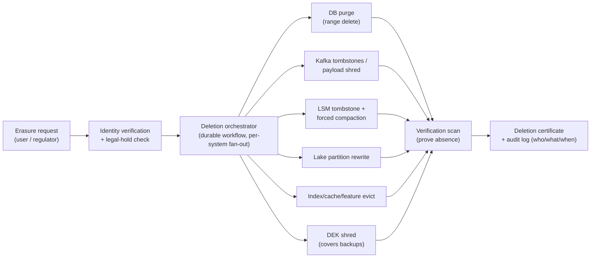

# Module 13b — Data Compliance, Erasure & Regional Storage

> Companion to [13 — Security](13-security.md) (authn/authz/encryption) — this module is the *data-law* layer Google explicitly lists in its NFR rubric ([26 — Playbook](26-google-sd-playbook.md)): **the right to be forgotten in systems built never to forget, and data that must not leave the region it was born in.** At L6 this is not a legal lecture — it's storage-engine mechanics: tombstones in LSM trees, key shredding across backups, and replication topologies with a fence.
> Cross-links: [DD-04 Cassandra](../Deep%20Dives/04-cassandra.md) · [DD-02 Kafka](../Deep%20Dives/02-kafka.md) · [CS-27 §5](../Deep%20Dives/27-topk-music-analytics.md) (k-anonymity, deletion in a lake) · [Mobile 06](../Mobile%20System%20Design/06-security-privacy.md) (the client half: deletion is a code path).

## What you'll master

- **The erasure problem stated honestly**: your data is in 9 places, 6 of which were designed to be immutable.
- **Crypto-shredding** as the universal eraser (and its key-management bill), vs **physical purge** mechanics in Kafka and LSM stores without wrecking read performance.
- **Deletion as an orchestrated workflow** with SLA, verification, and audit evidence — not a DELETE statement.
- **Regional isolation**: placement policies, geo-fenced replication, and how global features survive when the rows can't travel.

## 1. Where the data actually is (the map that makes the problem real)

A user's data after two years in a healthy architecture: primary DB rows · read replicas · **Kafka topics** (retention or compacted) · **LSM SSTables** (immutable by design) · object-store lake partitions · derived aggregates & ML features · search indexes · caches · **backups/snapshots** · logs with user IDs in URLs. An erasure request must terminate in *all* of them inside the SLA (GDPR: "without undue delay," ~30 days in practice). The L5 mistake is answering for the primary DB; the question *is* the other eight.

## 2. The two erasure mechanisms (and when each wins)

### 2.1 Crypto-shredding — delete the key, not the data

Every user gets a **data-encryption key (DEK)**; all their PII — in the DB, the lake, Kafka payloads, *and every backup* — is encrypted under it. Erasure = destroy the DEK in the key vault. All copies everywhere become ciphertext noise **simultaneously, including the backup tapes you'll never mount** — which is the killer feature: it's the only mechanism that erases *backups* without rewriting them.

> **The recursion probe an interviewer *will* spring:** *"You destroyed the DEK — but the DEK lives in the KMS, and the KMS is itself backed up. When you restore last month's KMS snapshot for DR, the shredded DEK comes back and the ciphertext is readable again. So you didn't actually erase anything."* The answer: crypto-erasure is only complete if key destruction propagates across the KMS's *own* backups — so (1) use the KMS's native scheduled key-deletion (e.g. a mandatory waiting period, then cryptographic destruction across the service's replicas/backups), (2) bound KMS backup retention *below* your erasure SLA, or (3) wrap DEKs under a **KEK** and rotate/destroy the KEK so restored DEKs are unwrappable. NIST 800-88 "cryptographic erase" is the standard to name. Without this, "I'll crypto-shred" is a claim you can't actually certify — and certifying erasure is the whole compliance requirement.

The bill, stated plainly: the key vault becomes tier-0 critical (key loss = data loss for that user; vault latency is on your read path unless DEKs are cached — cache-with-TTL and accept the revocation lag, and say so); per-user encryption complicates *shared* structures (you can't build a plaintext search index over crypto-shredded fields — tokenize or accept re-index-on-delete); and key granularity is a design decision (per-user is the default; per-user-per-purpose lets you shred "ad profile" while keeping "order history" the law says you must retain).

**Decision ladder:** crypto-shred when data is *immutable-by-design or widely copied* (backups, archives, lake, Kafka long-retention). Physically purge when data is *hot, indexed, and query-serving* (primary DB, caches, search) — because ciphertext-tombstones still occupy your indexes and your query plans.

### 2.2 Physical purge in the hard engines

- **Kafka:** three postures. Short-retention topics (≤ SLA) — erasure is free, the log forgets by policy; note it and move on. **Compacted topics** — write `(user_key → null)`: the tombstone deletes prior values at next compaction; verify compaction actually runs within the SLA (lag on cold partitions is the gotcha). Long-retention event topics keyed by something else — you cannot rewrite a log segment in place: this is where **payload-level crypto-shredding** is the only honest answer. Consumers must treat "key no longer decrypts" as a normal case, not an error.
- **LSM stores (Cassandra/RocksDB/HBase — [DD-04](../Deep%20Dives/04-cassandra.md)):** `DELETE` writes a **tombstone**; the data physically persists in older SSTables until **compaction** rewrites them. Three operational consequences: (1) purge SLA = tombstone + *guaranteed compaction of affected SSTables within the window* — schedule targeted/major compaction for erasure batches, don't pray to the background scheduler; (2) `gc_grace_seconds` (default 10 days) must elapse with all replicas repaired, or the tombstone GC resurrects "zombie" data from an unrepaired replica — repair cadence is part of your compliance posture; (3) **the read-performance trap**: erasure batches that spray point tombstones across wide partitions make every read scan tombstone graveyards (the classic p99 cliff). The structural fix is upstream: **partition user data by `user_id`** so erasure is one *range* tombstone and one partition's compaction — schema design *is* compliance design.
- **Object-store lake:** the [CS-27 §5](../Deep%20Dives/27-topk-music-analytics.md) machinery — partition-atomic rewrites dropping the user's rows, feasible *because* the pipeline was built replayable; or crypto-shred and let the readers skip undecryptable rows.
- **Derived data:** deletion propagates as an **event** — feature stores, search indexes, caches, and aggregates each subscribe and apply their own mechanism. Aggregates that are k-anonymous (counts over ≥ k users) are generally *out of erasure scope* — say this; re-aggregating the world per deletion is neither required nor sane.

## 3. Deletion is a workflow, not a statement

Properties that make it defensible: **idempotent, resumable steps** (it's a saga — [15-pattern](../Deep%20Dives/15-pattern-multi-step-processes.md) — running for days across systems); **legal-hold check first** (retention floors beat erasure requests for tax/fraud records — the orchestrator resolves the conflict by policy, not by whoever wrote the consumer); **verification as a separate scan** that *proves absence* (auditors accept evidence, not intentions); and a **certificate with per-system timestamps**. The SLA dashboard for oldest-open-request is a compliance artifact, and it pages someone.

> **Staff & EM insight #1:** L5 says "we'll delete the user's rows and expire the backups." L6 names the two mechanisms and *routes each store to one of them by its physics* — purge what's hot and indexed, shred what's immutable and copied — and knows the LSM traps (gc_grace zombies, tombstone read-cliffs, compaction scheduling) by name. The EM overlay: the deletion SLA is a **legal commitment with an audit trail and an on-call owner**, the workflow is a staffed product (not a script in a wiki), and privacy review is a *launch gate* — every new datastore answers "how does erasure reach you?" before it takes traffic.

## 4. Regional data isolation (geo-fencing)

**The requirement shape:** EU residents' data is stored and processed only in EU regions (similarly India, China, …). This is a *placement* problem, and it must be enforced by configuration the infrastructure obeys — not by developer discipline.

- **Classify at write:** every record carries a **residency tag** derived from the data subject's home region (not the request's origin — a German on holiday in Tokyo is still EU data). Classification is in the schema, set once, migrated deliberately.
- **Placement policies in the storage layer:** replication topology per tag — EU-tagged rows replicate across EU AZs/regions *only* (Spanner-style placement configs; per-region Kafka clusters; per-region buckets). The fence is declarative and auditable: "show me every store that can hold EU data" must be a query, not an archaeology project.
- **The global-feature problem** (the part interviewers actually probe): search, dedup, analytics, and "find my friend" want global indexes over rows that can't travel. The menu: **(a) regional silos + scatter-gather** at query time (latency and partial-failure cost, honest and common); **(b) tokenized global index** — the global layer holds only opaque tokens/pointers + non-PII attributes, resolution happens in-region (PII never crosses; the global index is legally boring); **(c) k-anonymous global aggregates** — counts travel, rows don't ([CS-27](../Deep%20Dives/27-topk-music-analytics.md) again). Pick per feature; refuse the "just replicate it, it's only metadata" shortcut — metadata *is* personal data more often than not.
- **Read replicas & failover safely:** cross-region read replicas of EU data into non-EU regions are the classic silent violation — the replication fence must bind *replicas and backups*, not just primaries; DR for EU data means a *second EU region*, and that's a cost line the EM signs (residency ≈ a minimum viable footprint per fenced region: compute + storage + on-call coverage — [19b §1](19b-engineering-operations-economics.md) makes that number).
- **User moves region:** a deliberate migration workflow (copy under the new tag, verify, delete under the old, audit) — the same orchestrator skeleton as §3, which is why you build it once.

> **Staff & EM insight #2:** L5 hears "EU data in EU" and draws a region boundary on the diagram. L6 pushes the fence into *metadata the platform enforces* — residency tags + declarative placement + an auditable inventory — and solves the global-feature tension per feature with the silo/token/aggregate menu. The EM overlay: residency multiplies your region count and your on-call surface; the honest cost conversation ("supporting country X's residency law costs us a full regional footprint — is the market worth it?") is an EM-level input to product strategy, and being able to *have* it with numbers is the L6 bar.

## Interview Cheat-Sheet

**30-second version:** erasure = route every copy to one of two mechanisms — **physical purge** for hot/indexed stores (range tombstones via user-partitioned schemas, forced compaction inside the SLA, gc_grace + repair to prevent zombies) and **crypto-shredding** for immutable/copied stores (per-user DEKs; killing the key erases lake, logs, and *backups* at once; vault becomes tier-0) — driven by a durable idempotent **deletion workflow** (legal-hold check → fan-out → verification scan → certificate) · residency = **tags at write + declarative placement** binding replicas *and* backups; global features via silos/scatter-gather, tokenized indexes, or k-anonymous aggregates; user relocation is a migration workflow.

| Probe | Answer |
|---|---|
| "Delete a user from Kafka?" | Compacted topic: null tombstone + verify compaction lag. Long-retention log: payload crypto-shred — you don't rewrite segments |
| "Delete from Cassandra without killing reads?" | Partition by user_id so it's one range tombstone; force compaction for the SLA; respect gc_grace + repair or zombies return |
| "What about backups?" | The reason crypto-shredding exists: shred the DEK and every snapshot ever taken goes dark together |
| "Prove it's gone?" | Verification scan + deletion certificate with per-system timestamps — auditors accept evidence, not intentions |
| "EU data, global search?" | Tokenized global index (PII stays home), or regional scatter-gather, or k-anonymous aggregates — per feature, never "replicate it anyway" |

**Say-verbatim:**
- *"Erasure has two mechanisms: purge what's hot and indexed, crypto-shred what's immutable and copied — every store in the inventory is routed to one of them."*
- *"Schema design is compliance design: partition by user and deletion is one range tombstone instead of a read-killing graveyard."*
- *"Deletion is a durable workflow with a verification scan and a certificate — a DELETE statement is not evidence."*
- *"The residency fence binds replicas and backups, not just primaries — and DR for EU data means a second EU region, which is a cost line, not a footnote."*
