# Module 14 — Cloud Architecture

> The definitive cloud-architecture reference for Staff / Senior EM / Director system-design interviews. Optimized for **decision frameworks over service trivia** — interviewers at this level want to hear *why* you pick a managed service, *where* the costs and failure boundaries are, and *how* you'd defend the trade-off. The losing move is reciting what EC2 and S3 are; the winning move is *deciding*, attaching a requirement to every choice, and naming where the bill and the blast radius concentrate.

## What you'll master

By the end of this module you will be able to:

- Reason from **first principles** about cloud service models (IaaS → PaaS → SaaS → FaaS) and the **shared responsibility** boundary, instead of memorizing product names.
- Design **multi-AZ and multi-region** topologies and articulate the availability/cost/latency trade-offs (links [Reliability](11-reliability.md)).
- Fluently name the **AWS / GCP / Azure** building blocks an interviewer expects, and translate between them via an equivalence table — *capability first, product second*.
- Apply the **Well-Architected pillars** as a structured way to critique any design.
- Take a decisive **Staff-level position** on multi-cloud, hybrid, lock-in, and migration (the 6/7 Rs) — and defend it under pushback without retreating to "it depends".
- Spot the **hidden cost killers** (egress, NAT, cross-AZ traffic, serverless at scale) and design cost-aware architectures (links [Module 19 — Cost](19-leadership-tradeoffs.md)).
- Speak credibly about **IaC, containers, Kubernetes, and GitOps** as the delivery substrate.
- Deliver all of the above with the *altitude* and *signal* of a Staff engineer — see [Staff-Level Execution](20-staff-execution.md).

---

## Table of Contents

1. [In the Room — Staff-Level Delivery](#in-the-room--staff-level-delivery)
2. [Cloud Fundamentals](#1-cloud-fundamentals)
3. [Regions, Zones, and Edge](#2-regions-zones-and-edge)
4. [Shared Responsibility Model](#3-shared-responsibility-model)
5. [Cloud-Native Principles & Service Categories](#4-cloud-native-principles--service-categories)
6. [AWS Building Blocks](#5-aws-building-blocks)
7. [GCP Building Blocks](#6-gcp-building-blocks)
8. [Azure Building Blocks](#7-azure-building-blocks)
9. [Cross-Cloud Equivalence Table](#8-cross-cloud-equivalence-table)
10. [Cloud Architecture Patterns](#9-cloud-architecture-patterns)
11. [Auto-Scaling](#10-auto-scaling)
12. [Managed vs Self-Hosted](#11-managed-vs-self-hosted)
13. [Multi-Cloud & Hybrid](#12-multi-cloud--hybrid)
14. [Cloud Migration Strategies (the 6/7 Rs)](#13-cloud-migration-strategies-the-67-rs)
15. [Cost & FinOps](#14-cost--finops)
16. [IaC & Containers](#15-iac--containers)
17. [Worked Example — Real-Time Chat on the Cloud](#16-worked-example--real-time-chat-on-the-cloud)
18. [Interview Cheat-Sheet](#interview-cheat-sheet)
19. [Common Interview Questions](#common-interview-questions)

---

## In the Room — Staff-Level Delivery

> Read this section first. It is the lens for everything below. The other 15 sections are the *content*; this one is *how to deliver it* so a Staff interviewer hears signal, not a service catalog. Cross-link: [Staff-Level Execution](20-staff-execution.md).

Cloud rounds have a specific failure mode that's different from algorithm or pure-design rounds: there's a *huge* surface area of named products, and it's tempting to demonstrate breadth by naming all of them. That reads as **junior**. The senior signal is the opposite — say less about *what* the services are, and far more about *which one you'd pick and why*, *where the cost and risk concentrate*, and *what you'd consciously not build*.

### Decisions to make decisively

Walk in pre-committed to these defaults. State them as defaults, then adjust to the requirement in front of you. Never enumerate options and trail off.

| Decision | Default position | One-liner to say | Revisit trigger |
|----------|------------------|------------------|-----------------|
| **Managed vs self-hosted** | **Managed.** | "I'd use the managed service — RDS/MSK/OpenSearch — because the differentiator isn't running the database; it's the product on top of it." | Self-host when you hit a missing feature/version, cost at extreme scale (premium in the millions), or compliance the managed offering can't meet. |
| **Serverless vs containers** | **By traffic shape.** Serverless for spiky/event-driven/low-baseline; containers for sustained throughput. | "Serverless because this path is bursty and low-duty-cycle, so I pay nothing when idle; I'd move to containers once load is continuous because per-invocation pricing crosses over." | Cross the duty-cycle threshold (~continuous load at real concurrency), need predictable latency (no cold starts), or long-running/stateful work. |
| **Single-cloud vs multi-cloud** | **Single cloud.** | "Single cloud, using the best managed services it offers, with portability discipline only at the seams — Terraform, containers, open data formats. Lock-in is a cost I manage, not a disease I fear." | Forced by regulatory/sovereignty mandate, an acquisition, or genuine hyperscale. Never by reflex "no lock-in." |
| **Picking a specific service** | **By capability, not brand.** | "An object store like S3/GCS/Blob" — name the role, then the product. | When a *specific* proprietary capability (Spanner's global strong consistency, BigQuery's serverless scan) is the actual requirement. |
| **Multi-AZ vs multi-region** | **Multi-AZ for prod; multi-region is a business decision.** | "Multi-AZ by default — it's cheap insurance. Multi-region only if the SLO and RTO/RPO demand it, because active-active makes every stateful component confront CAP." | SLO ≥ 99.99%, data-residency, or regional-DR mandate. |

The pattern in every row: **`<choice>` because `<one requirement>`; revisit if `<trigger>`.** That sentence shape is the whole game. It shows you've decided, anchored the decision to a requirement, and pre-registered the condition under which you'd change your mind — which is exactly what a reversible-but-considered Staff decision sounds like.

### Altitude — where to go fast, where to go deep

**Name-and-move-on (low altitude — do NOT dwell):**

- *What* IaaS/PaaS/FaaS/SaaS are. One sentence each, then move.
- *What* EC2, S3, Lambda, a VPC, an ALB are. Reciting "EC2 is a virtual machine" burns time and signals you think the interviewer doesn't know it.
- The full service catalog. You should *know* it (the equivalence table below), but listing it unprompted is a trivia dump.
- Basic k8s object definitions (Pod/Deployment/Service). Assume shared vocabulary.

**Deep-dive (high altitude — this is where the round is won):**

- **The cost model**, especially **egress and cross-AZ transfer** — the single most-overlooked thing, and the one that marks budget-owning seniority.
- **Auto-scaling failure modes** — the scale-up storm, leading vs lagging signals, the database as the real ceiling.
- **Multi-region data consistency** — the CAP tax of active-active, why it's a business decision.
- **The managed-vs-self trade-off** quantified in *engineer-hours and pages*, not instance price.
- **Serverless-vs-container crossover** with an actual number attached.

The rule: spend your minutes proportional to *risk*, not proportional to surface area. Uniform thoroughness across the whole service catalog is itself an anti-pattern.

### YAGNI — the default, and its trigger

Default to the **simplest topology that meets the stated SLO**: single region, multi-AZ, managed services, one cloud. Add complexity only when a *specific* requirement forces it.

- Don't propose multi-region until they give you an SLO that multi-AZ can't meet.
- Don't propose Kubernetes until the workload complexity justifies the operational tax (a couple of stateless services run fine on ECS/Cloud Run/Fargate).
- Don't propose multi-cloud at all unless mandated.
- Don't propose a service mesh, a data lake, or event sourcing because they're impressive — propose them when the problem demands them.

**The trigger to add complexity:** a concrete, quantified requirement (an SLO number, a compliance clause, a scale figure, a latency budget) that the simpler design provably fails. Until that trigger fires, the simpler design *is* the senior answer.

### Earmark the hard parts early

Within the first minute of a cloud design, flag where the difficulty lives so the interviewer knows you see it: *"The interesting parts here are going to be the data layer's consistency model and the cross-AZ traffic cost — the compute and the CDN are commodity. Let me get the easy boxes down fast and spend our time on those two."* That single sentence demonstrates altitude and risk-weighting before you've drawn anything.

### Top anti-patterns (and the antidote)

| Anti-pattern | Why it reads as junior | Antidote |
|--------------|------------------------|----------|
| **Multi-cloud "for no lock-in"** by reflex | Doubles cost, halves velocity, forgoes the managed services that justify being on a cloud at all | Single cloud + portability at the seams; quantify the exit option instead of buying it up front |
| **Service-name trivia dumps** | Breadth ≠ depth; recites the catalog instead of deciding | Name the *capability*, pick *one* product, attach the requirement |
| **Ignoring egress / cross-AZ cost** | Marks someone who's never owned a cloud bill | Treat egress and cross-AZ as first-class design constraints; state the cost of your design |
| **Serverless-everything** | Cargo-cults "modern"; ignores the cost crossover and cold-start latency | Pick by traffic shape; name the crossover with a number |
| **Reciting what EC2/S3 are** | Wastes minutes on shared vocabulary | One sentence max, then move to the decision |
| **Option-listing without choosing** ("could use X, or Y, or Z…") | Pushes the decision onto the interviewer | Decide, justify with a requirement, pre-register the revisit trigger |
| **False humility** ("I don't really know cloud cost…") | Erodes the credibility you're being evaluated on | If unsure, state your assumption and reason from it |
| **Over-engineering** (multi-region/mesh/event-sourcing by default) | Solves problems nobody stated | YAGNI until a quantified requirement forces it |

### Experience hooks — cite real operational scars

Staff signal comes from sounding like you've been paged. Weave in concrete, lived detail (drawn from real-time chat infrastructure, where these bite hard):

- *"On a real-time chat backend, cross-AZ chatter between the WebSocket fan-out tier and the presence store quietly became one of our biggest line items — the fix was AZ-affinity routing and co-locating the chatty pair, not more instances."*
- *"We learned the hard way that auto-scaling on CPU is too lagging for a connection-spike workload — when a big client's app pushed a notification, thousands of sockets reconnected at once, CPU caught up 90 seconds too late, and the fleet browned out. We moved to scaling on connection-accept rate and queue depth, plus a warm buffer."*
- *"Lambda cold starts were fine for our webhook glue but a non-starter on the message-send hot path — p99 latency budget was 100ms and a cold VPC-attached Java function blew that. That path stayed on always-warm Fargate."*
- *"DynamoDB global tables gave us multi-region writes for chat metadata, but we had to design around last-writer-wins conflict resolution explicitly — the consistency tax was real and we paid it deliberately, not by accident."*
- *"The serverless-to-container crossover wasn't theoretical: once a feature went from spiky to always-on, the Lambda bill crossed a couple of always-warm Fargate tasks and we migrated it — and saved roughly half."*

These hooks do more for your score than any amount of service enumeration.

---

## 1. Cloud Fundamentals

### Definition

A **cloud service model** describes how much of the stack the provider operates versus how much you operate. The classic mental model is "pizza as a service": the more managed the offering, the less of the stack you touch — and the less control (and operational burden) you have.

> **Altitude cue:** Name these four models and move. Do not spend three minutes explaining each layer — the interviewer knows what a VM is. The *one* thing worth lingering on is the decision principle in the Staff insight below.

### How it works — the responsibility ladder

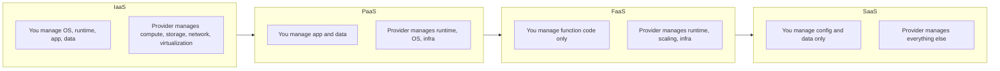

### Comparison table

| Model | You operate | Provider operates | Unit of deploy | Scaling | Example | Best when |
|-------|-------------|-------------------|----------------|---------|---------|-----------|
| **IaaS** | OS, patching, runtime, app, scaling logic | Hypervisor, hardware, network | VM / volume | Manual / ASG | EC2, GCE, Azure VM | You need full control, lift-and-shift, custom kernels, GPUs |
| **PaaS** | App code, data model | Runtime, OS, autoscaling, LB | App / build | Built-in | Heroku, App Engine, Elastic Beanstalk, Cloud Run | Standard web apps, fast dev velocity |
| **FaaS** | Function code + config | Everything incl. scaling to zero | Function | Per-request, automatic | Lambda, Cloud Functions, Azure Functions | Event-driven, spiky/intermittent, glue logic |
| **SaaS** | Configuration + data | Whole application | N/A | N/A | Auth0, Datadog, Snowflake, Workday | Non-differentiating capabilities you should buy not build |

### Real numbers / examples

- **IaaS** gives you sub-millisecond control over instance type but you own the pager for OS CVEs.
- **FaaS** scales from 0 to thousands of concurrent executions in seconds, but bills per-invocation + GB-second — economical for spiky low-duty-cycle workloads, expensive at sustained high throughput (see [§14](#14-cost--finops)).
- **Concrete cost anchor:** a Lambda invocation costs ~$0.20 per 1M requests **plus** ~$0.0000166667 per GB-second. A 512 MB function running 200ms costs ~$0.0000017 per call. At 1,000 req/s sustained (≈2.6B calls/month) that's a meaningful bill versus 2–3 always-warm Fargate tasks at a few hundred dollars/month — this is the crossover, made concrete.

### Pitfalls

- Treating FaaS as "always cheaper" — it inverts above a duty-cycle threshold.
- Choosing IaaS by default and re-implementing what a managed PaaS gives free (TLS, autoscaling, health checks).
- Choosing FaaS for a latency-critical hot path and getting blindsided by cold starts.

> **Staff-level insight:** The interview-winning framing isn't "which model" but **"how much undifferentiated heavy lifting can I delegate while keeping control of the things that are my competitive advantage?"** Buy commodity (auth, queues, DBs); build your differentiator. Every layer you push down the ladder removes a class of 3am pages — but also removes a lever you may later need (custom networking, kernel tuning, cost control). State the boundary explicitly, and state it as a *decision*: "PaaS/serverless for everything except the message-routing core, which stays on containers because latency control there is the product." Don't enumerate the ladder — pick a rung per component and justify it.

---

## 2. Regions, Zones, and Edge

### Definition

- **Region** — a geographic area (e.g. `us-east-1`) containing multiple isolated data centers. Regions are the blast-radius and data-residency boundary.
- **Availability Zone (AZ)** — one or more discrete data centers within a region with independent power, cooling, and networking, interconnected by low-latency (<1–2 ms) links. The unit of fault isolation *inside* a region.
- **Edge / PoP (Point of Presence)** — globally distributed caching/termination locations (CDN, DNS, TLS termination) far more numerous than regions (AWS: ~36 regions, ~110+ AZs, 700+ CloudFront PoPs).

> **Altitude cue:** The definitions above are name-and-move-on. The crux that wins the round is the **latency-dictates-replication-mode** insight and the **cross-AZ-traffic-is-billed** insight below. Earmark those.

### How it works

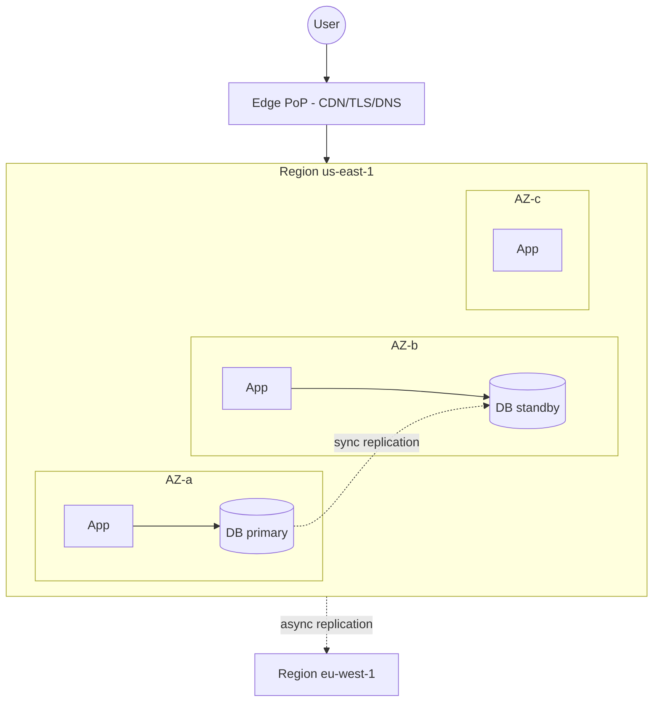

### Design tiers — link [Reliability](11-reliability.md)

| Topology | Survives | RPO / RTO | Cost multiplier | When |
|-----------|----------|-----------|-----------------|------|
| **Single-AZ** | Nothing (AZ outage = down) | High / High | 1x | Dev, non-critical batch |
| **Multi-AZ (active-active app, sync-replicated DB)** | AZ failure | ~0 / seconds | ~1.3–2x | Default for production |
| **Multi-region active-passive (warm standby)** | Region failure | seconds–minutes / minutes | ~1.5–2.5x | Regulated, regional DR |
| **Multi-region active-active** | Region failure, transparent | ~0 / ~0 | 2x+ and high complexity | Global low-latency, highest availability |

**Decision shortcut:** *Multi-AZ because every prod workload needs DC-failure survival and the cost is marginal; multi-region only if the SLO/RTO/RPO forces it; revisit to active-active if you cross 99.99% or need sub-100ms global latency.*

### Real numbers

- Cross-AZ round trip: ~0.5–2 ms. Cross-region (us-east ↔ eu-west): ~70–90 ms. Trans-Pacific (us-west ↔ ap-southeast): ~120–180 ms. This latency dictates whether you replicate **synchronously** (AZ — sync adds <2ms, acceptable) or **asynchronously** (region — sync would add 70ms+ to every write, unacceptable).
- **Cross-AZ data transfer is billed** (~$0.01/GB *each way* on AWS — so ~$0.02/GB round-trip) — a real and frequently overlooked cost (see [§14](#14-cost--finops)). At 10 TB/day of cross-AZ chatter that's ~$200/day ≈ $6K/month from data movement alone.
- **Cross-region transfer** is ~$0.02–0.09/GB depending on the pair — replicating a busy DynamoDB table or Kafka topic cross-region for DR is a line item you must budget.

### Pitfalls

- Putting all instances of a tier in one AZ "by accident" because the autoscaling group wasn't spread across subnets in multiple AZs.
- Assuming multi-region gives you active-active for free — it forces you to solve **data consistency** (conflict resolution, global tables, quorum) which is the actual hard part. Link [Databases](06-databases.md).
- Forgetting that some services are **regional** (S3 buckets, DynamoDB tables, SQS queues) vs **global** (IAM, Route 53, CloudFront, WAF for CloudFront) — affects DR design and which control plane survives a regional outage.
- Treating an AZ identifier as portable across accounts — AWS shuffles the physical AZ behind `us-east-1a` per account, so "same AZ name" across accounts isn't the same physical AZ.

> **Staff-level insight:** Multi-AZ is a no-brainer; multi-region is a **business decision, not a technical one**. The cost is not infrastructure — it's that active-active forces every stateful component to confront the CAP theorem. In an interview, *ask the requirement, then decide*: "What's our availability SLO and RTO/RPO?" If they say 99.9% with minutes of RTO tolerance, propose **multi-AZ + region-level DR (pilot light/warm standby)** and move on — don't enumerate four topologies. Reserve active-active for 99.99%+ global products and call out the consistency tax explicitly. On real-time chat we ran active-passive across regions for the control plane and accepted a multi-second failover, because the alternative — globally consistent presence state — wasn't worth the complexity for a few minutes of RTO budget.

---

## 3. Shared Responsibility Model

### Definition

The cloud provider secures **the cloud** (physical, hypervisor, managed-service internals); you secure **what you put in the cloud** (data, IAM, network config, app code). The line moves depending on the service model.

### How it works

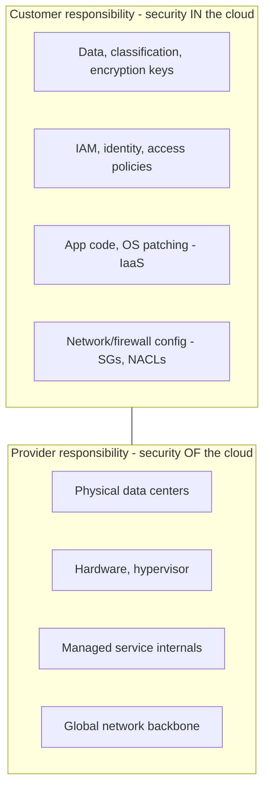

### Where the line moves

| Service type | Customer also responsible for | Provider takes over |
|--------------|-------------------------------|---------------------|
| **IaaS (EC2)** | Guest OS patching, runtime, app, firewall rules, data | Hypervisor down |
| **Managed DB (RDS)** | Schema, queries, access policy, encryption choice, backups config | OS/DB patching, replication mechanics |
| **Serverless (Lambda/S3)** | Code, IAM, data, bucket policy | Runtime, patching, scaling, availability |

### Pitfalls (the classic breaches)

- **Public S3 buckets** — provider secured the platform; *you* misconfigured the policy. Capital One (2019, ~100M records via SSRF + over-broad IAM role), countless leaks.
- Over-broad IAM roles (`*:*`) — the single biggest cloud risk. Apply least privilege.
- Assuming "managed" means "secure by default" — encryption at rest, key rotation, and network exposure are still yours.
- Leaving security-group ingress at `0.0.0.0/0` on management ports (SSH/RDP/DB) — a perennial source of compromise.

> **Staff-level insight:** Nearly all cloud breaches are **customer-side misconfiguration**, not provider compromise. As a Staff/Director, the leverage is in **guardrails over gates**: SCPs/Org policies, Terraform modules with secure defaults, automated config scanning (AWS Config, GuardDuty, Security Hub), and "no public bucket" org rules enforced at the org level (S3 Block Public Access account-wide). You scale security by making the secure path the easy path, not by reviewing every PR. Say this decisively: *"I'd enforce 'no public bucket' and 'no `0.0.0.0/0` on admin ports' as org SCPs, ship a paved-road Terraform module with encryption and least-privilege baked in, and let Config flag drift — gates don't scale to dozens of teams, guardrails do."*

---

## 4. Cloud-Native Principles & Service Categories

### Cloud-native principles

1. **Design for failure** — assume every component fails; health checks, retries with backoff + jitter, circuit breakers, graceful degradation.
2. **Statelessness** — push state to managed stores so compute is disposable/horizontally scalable.
3. **Automation / IaC** — no snowflake servers; everything reproducible.
4. **Loose coupling** — async messaging, well-defined APIs, bounded contexts. Link [Architecture Patterns](15-architecture-patterns.md).
5. **Observability** — metrics, logs, traces as first-class (the three pillars).
6. **Elasticity** — scale out/in with demand; pay for what you use.
7. **Immutability** — replace, don't patch.

### The service-category map

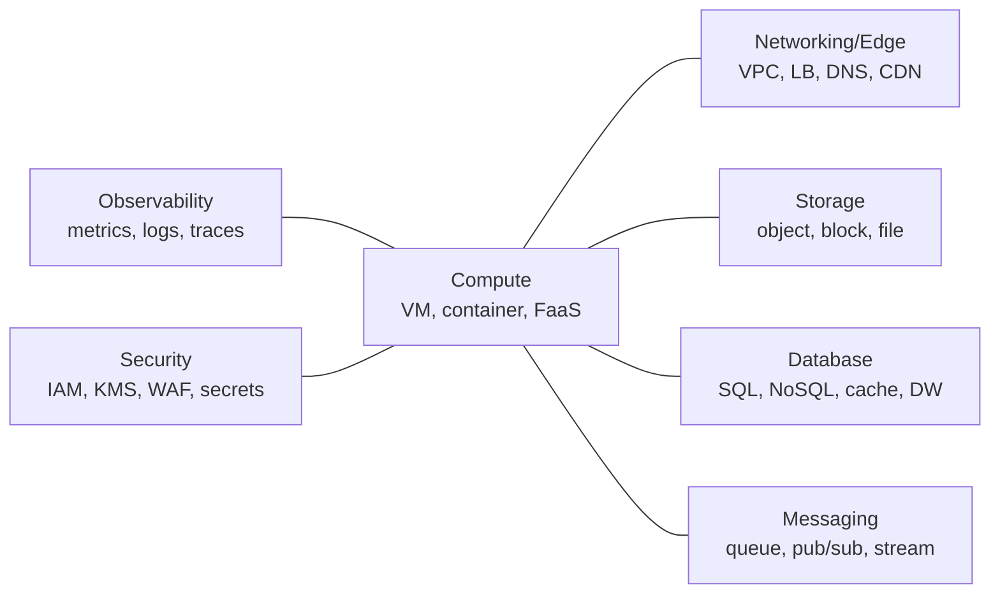

| Category | What it provides | Representative services (AWS) |
|----------|------------------|-------------------------------|
| Compute | Run code | EC2, ECS, EKS, Lambda, Fargate |
| Storage | Persist bytes | S3, EBS, EFS, Glacier |
| Networking/Edge | Connect & route | VPC, ELB, Route 53, CloudFront, API Gateway |
| Database | Structured/queryable state | RDS, Aurora, DynamoDB, ElastiCache, Redshift |
| Messaging | Decouple & stream | SQS, SNS, EventBridge, Kinesis, MSK |
| Observability | Know what's happening | CloudWatch, X-Ray, OpenTelemetry |
| Security | Identity & protection | IAM, KMS, Secrets Manager, WAF, GuardDuty |

> **Staff-level insight:** When you walk into a design interview, this 7-box map is your **mental checklist** — and your altitude control. Sketch the data flow, then ask of each box: *managed or self-hosted? where's the state? where's the failure boundary? where's the cost?* Those four questions per box are the entire interview. Candidates who name services impress junior interviewers; candidates who reason across these seven categories systematically — and *decide* per box — impress Staff interviewers. Crucially, don't apply uniform depth: blow through the commodity boxes (CDN, object store) in seconds and spend your time on the boxes where state, consistency, and cost live (database, messaging).

---

## 5. AWS Building Blocks

This is the vocabulary interviewers expect. Below are the must-knows with the *decision* attached to each. **The decisions matter more than the descriptions** — when you cite a service in a design, lead with why you picked it over the alternative.

> **Altitude cue:** You should be able to name everything in this section fluently, but in a live round you'd *use* maybe 6–8 of these and say one decisive sentence each. The tables are reference; the bold decision lines are what you say out loud.

### 5.1 Compute

#### EC2 — virtual machines (IaaS)

- **Instance families:** `m` (general/balanced), `c` (compute-optimized), `r`/`x` (memory-optimized), `i`/`d` (storage/IO), `p`/`g` (GPU), `inf`/`trn` (AWS Inferentia/Trainium ASICs), `t` (burstable/cheap). Pick by the bottleneck.
- **Graviton (ARM)** families (`m7g`, `c7g`, etc.) offer ~20–40% better price-performance for most workloads that recompile cleanly — a default cost lever, not an afterthought.
- **Purchasing models:**

| Model | Discount vs on-demand | Commitment | Interruptible | Use for |
|-------|----------------------|------------|---------------|---------|
| On-Demand | 0% | None | No | Spiky, unpredictable, dev |
| Reserved / Savings Plans | up to ~72% | 1–3 yr | No | Steady baseline load |
| Spot | up to ~90% | None | **Yes (2-min notice)** | Fault-tolerant batch, CI, stateless workers |

**Decision:** *Savings Plans for the steady baseline, on-demand for the variable headroom, Spot for fault-tolerant async workers — a blended fleet, not one model for everything.*

#### ECS vs EKS — container orchestration

| | ECS | EKS |
|---|-----|-----|
| Control plane | AWS-proprietary, simpler | Managed Kubernetes (open standard) |
| Ops burden | Lower | Higher (k8s expertise) |
| Portability | AWS lock-in | Portable across clouds |
| Ecosystem | AWS-native | Huge CNCF ecosystem |
| Control-plane cost | Free | ~$0.10/hr per cluster (~$73/mo) + nodes |
| When | All-in on AWS, want simplicity | Multi-cloud, k8s skills, advanced scheduling |

**Decision:** *ECS (or Cloud Run / Fargate) if you're all-in on one cloud and the workload is a handful of services — k8s is operational tax you don't need. EKS once you have genuine multi-cluster/multi-cloud needs, existing k8s expertise, or advanced scheduling. Don't reach for k8s to look modern; it's a platform team's full-time job.*

Both can run on **EC2** (you manage nodes) or **Fargate** (serverless — no nodes).

#### Lambda — FaaS

- **Event sources:** API Gateway, S3 events, DynamoDB Streams, SQS, SNS, EventBridge, Kinesis.
- **Limits (know these):** 15-min max execution, up to 10 GB memory (CPU scales with memory, ~1 vCPU per 1,769 MB), 6 MB sync / 1 MB async payload, ephemeral `/tmp` up to 10 GB, default 1,000 concurrent executions/account (soft).
- **Cold starts:** ~100ms (Node/Python, small package) to 1–10s+ (large JVM, VPC-attached, big dependency tree). Mitigate with provisioned concurrency, smaller packages, avoiding unnecessary VPC attachment, SnapStart (Java/Python — restores a pre-initialized snapshot, cutting cold start by up to ~10x).
- **Concurrency model:** one execution environment per concurrent request; reserved concurrency caps a function, provisioned concurrency keeps N environments warm.

**Decision:** *Lambda for event-driven glue, spiky low-baseline endpoints, and async fan-out workers. Not on a latency-critical hot path with a tight p99 budget unless you pay for provisioned concurrency — and at that point re-check the cost against always-warm containers.*

#### Fargate — serverless containers

Run ECS/EKS tasks without managing EC2 nodes. You pay per vCPU/GB-second of the task. Bridges "I want containers" with "I don't want to manage a node fleet." Premium over self-managed EC2 nodes is ~15–30%, bought back in eliminated node ops.

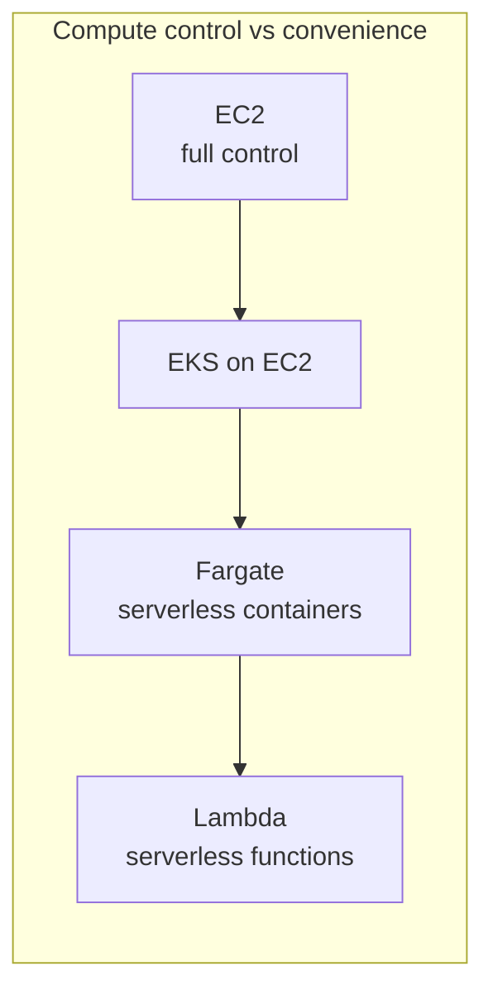

**Decision along the spectrum:** *Start as far right (most managed) as the workload allows; move left only when control or cost-at-scale forces it. Most services belong on Fargate/Cloud Run; reserve EC2-node clusters for cost at scale or special hardware (GPU, local NVMe).*

### 5.2 Storage & Database

| Service | What it is | When to use |
|---------|------------|-------------|
| **S3** | Object storage, 11 nines durability, virtually unlimited | Static assets, data lake, backups, logs, large blobs. Not for low-latency random writes |
| **EBS** | Network-attached block volume for one EC2 (gp3 default; io2 for high IOPS) | Boot disks, databases on EC2, low-latency block IO |
| **EFS** | Managed NFS, multi-attach | Shared POSIX file system across instances |
| **RDS** | Managed SQL (Postgres, MySQL, etc.) | Relational OLTP; Multi-AZ for HA, read replicas for scale-out reads |
| **Aurora** | AWS-built MySQL/Postgres-compatible, storage decoupled, 6-way replicated across 3 AZs | Cloud-native relational at scale, fast failover, up to 15 read replicas; Serverless v2 auto-scales capacity |
| **DynamoDB** | Managed key-value/document NoSQL, single-digit-ms, serverless | High-scale, predictable-access-pattern OLTP, global tables for multi-region |

Link [Storage](08-storage.md) and [Databases](06-databases.md) for deep dives. Key RDS notes: **Multi-AZ = HA (sync standby, not for read scaling)**; **read replicas = read scaling (async, can serve stale reads)**. Don't conflate them — a common interview trap.

**Decision:** *DynamoDB when access patterns are known and you need predictable single-digit-ms at any scale — chat message storage by conversation-id is a textbook fit. Aurora when you need rich relational queries and joins at scale with fast failover. Plain RDS when you need a standard relational DB and Aurora's premium isn't justified. Don't default to a relational DB for a high-write key-access workload, and don't reach for DynamoDB when the access patterns are still fluid and you need ad-hoc queries.*

### 5.3 Networking & Edge

| Service | What it is | When to use |
|---------|------------|-------------|
| **VPC** | Isolated virtual network: subnets (public/private), route tables, **security groups** (stateful, instance-level), **NACLs** (stateless, subnet-level), **NAT gateway** (private→internet egress), **peering / Transit Gateway** (VPC-to-VPC) | Foundation of every AWS deployment |
| **CloudFront** | CDN over global edge PoPs | Cache static/dynamic content near users, TLS termination, DDoS edge, **egress savings** |
| **Route 53** | DNS + health-checked routing: **simple, weighted, latency-based, geolocation, failover, multivalue** policies | Global traffic steering, DR failover, canary by weight |
| **ELB** | Load balancers — **ALB** (L7, HTTP, path/host routing, WebSocket), **NLB** (L4, TCP/UDP, ultra-low latency, static IP, millions of connections), **GWLB** (appliances) | ALB for web/microservices, NLB for extreme perf / non-HTTP / long-lived connections |
| **API Gateway** | Managed API front door: auth, throttling, request validation, REST/HTTP/WebSocket | Public APIs, Lambda backends, rate limiting |

Link [Load Balancing](05-load-balancing.md). **Security groups vs NACLs**: SGs are stateful and applied to instances (return traffic auto-allowed); NACLs are stateless and applied to subnets (must allow both directions). Use SGs as the primary control, NACLs for coarse subnet guardrails.

**NAT Gateway cost flag:** NAT charges ~$0.045/hr **plus ~$0.045/GB processed** — high-egress private workloads (pulling large images, calling external APIs) can rack up surprising NAT bills. Mitigate with VPC endpoints (S3/DynamoDB gateway endpoints are free and bypass NAT entirely).

**Decision (LB):** *ALB for HTTP/microservices with path/host routing. NLB for WebSocket-heavy or non-HTTP workloads needing ultra-low latency, static IPs, or millions of long-lived connections — which is exactly the real-time chat fan-out tier, where NLB's connection scale and low overhead beat ALB.*

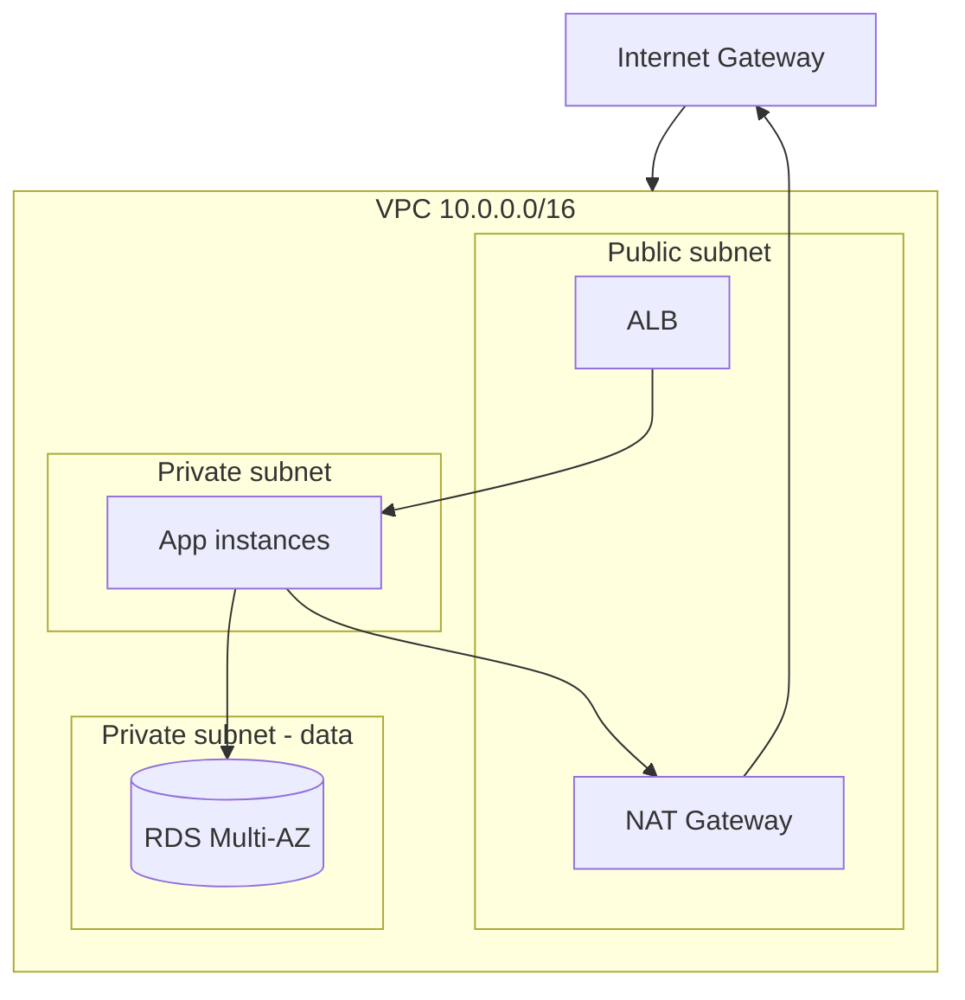

### 5.4 Integration / Messaging

| Service | Model | What it is | When to use |
|---------|-------|------------|-------------|
| **SQS** | Queue (point-to-point) | Decouple producer/consumer; Standard (at-least-once, best-effort order) or FIFO (ordered + exactly-once *processing* within a 5-min dedup window — still requires idempotent consumers) | Buffering, work queues, smoothing spikes |
| **SNS** | Pub/Sub (fan-out) | Push to many subscribers (SQS, Lambda, HTTP, email) | Fan-out notifications, broadcast |
| **EventBridge** | Event bus | Schema-based routing, SaaS integrations, rules, scheduler | Event-driven architectures, decoupled domains |
| **Kinesis** | Stream | Ordered, replayable shards; sub-second; multiple consumers; ~1 MB/s or 1,000 rec/s per shard | Real-time analytics, clickstream, log ingestion |
| **MSK** | Managed Kafka | Self-hosted-Kafka semantics, managed | High-throughput streaming, Kafka ecosystem, partition control |
| **Step Functions** | Orchestration | Visual state machine over services, retries, error handling | Coordinating long-running/multi-step workflows, sagas |

The canonical pattern: **SNS → multiple SQS queues** (fan-out + per-consumer buffering). For streaming/replay use Kinesis/MSK; for choreography use EventBridge; for orchestration use Step Functions.

> **Staff-level insight:** The most common AWS integration mistake is choosing SQS when you need **replay and multiple independent consumers** (use Kinesis/Kafka) or choosing a stream when you just need a durable work queue (over-engineered). Decide on three axes: **delivery semantics** (at-least vs exactly-once), **ordering** (per-key vs global vs none), and **replayability** (can a new consumer re-read history?). Name those three and the right service falls out — don't list all five services and ask the interviewer which they prefer. For a chat backend: per-conversation ordering + replay for new consumers (e.g. a search indexer joining later) points to Kafka/Kinesis partitioned by conversation-id; transient fan-out of a "new message" notification to push/badge/webhook workers points to SNS→SQS.

---

## 6. GCP Building Blocks

| Service | What it is | AWS equivalent | Why notable |
|---------|------------|----------------|-------------|
| **GKE** | Managed Kubernetes; Autopilot mode runs nodeless | EKS | Best-in-class managed k8s (Google invented k8s) |
| **Cloud Run** | Serverless containers, scale-to-zero, request-based | Fargate + Lambda hybrid | Deploy any container, pay per request, no infra |
| **BigQuery** | **Serverless** columnar data warehouse; storage/compute fully separated; petabyte queries in seconds | Redshift / Athena | See below — it's the differentiator |
| **Pub/Sub** | Global managed pub/sub messaging | SNS + SQS combined | Auto-scaling, global, push & pull |
| **Spanner** | Globally distributed, **strongly consistent** relational DB with horizontal scale (TrueTime) | Aurora/DynamoDB (no true equiv) | Externally consistent SQL at global scale |
| **Cloud Storage** | Object storage | S3 | Single global namespace, storage classes |
| **Bigtable** | Wide-column NoSQL, low-latency, high-throughput | DynamoDB (HBase-like) | Powers Search/Maps; HBase API |

### Why BigQuery is special

BigQuery **decouples storage from compute completely** and runs queries on a shared, serverless pool (Dremel + Colossus + Jupiter network). You **never provision a cluster** — you submit SQL and pay per TB scanned (~$5/TB on-demand) or via slots/flat-rate. This means:

- Zero-ops analytics: no nodes, no resizing, no vacuum.
- Massive parallelism on demand (thousands of cores for one query).
- Cost model is **per-query** — cheap for occasional huge scans, but a runaway `SELECT *` on a PB table is a real bill ($5,000 for one petabyte scan). Partition + cluster + select only needed columns; set per-query and per-user byte-scan quotas as a guardrail.

> **Staff-level insight:** When an interviewer asks "design an analytics platform," naming BigQuery (or Snowflake) and explaining **storage/compute separation + serverless scaling** signals you understand the modern data-warehouse paradigm, versus proposing a self-managed Hadoop/Redshift cluster you have to size and babysit. Pick it decisively for spiky/unpredictable analytical load and lean teams, and immediately name the cost guardrail (partitioning + scan quotas) so you don't sound naive about the per-TB model. Spanner is the other GCP "wow" — invoke it specifically when the requirement is *both* global scale *and* strong consistency, the combination DynamoDB can't give you. If you only need one of those, Spanner is over-engineering — say so.

---

## 7. Azure Building Blocks

| Service | What it is | AWS equivalent | GCP equivalent |
|---------|------------|----------------|----------------|
| **AKS** | Managed Kubernetes | EKS | GKE |
| **Azure Functions** | FaaS | Lambda | Cloud Functions |
| **Cosmos DB** | Multi-model, globally distributed NoSQL with **5 tunable consistency levels** | DynamoDB | Spanner/Firestore |
| **Blob Storage** | Object storage | S3 | Cloud Storage |
| **Service Bus** | Enterprise messaging (queues + topics, sessions, transactions) | SQS + SNS | Pub/Sub |

Cosmos DB's distinguishing feature is its **five consistency levels** (Strong, Bounded Staleness, Session, Consistent Prefix, Eventual) — a clean illustration of the consistency/latency/availability trade-off you can cite in any CAP discussion. Session consistency (the default) is the pragmatic sweet spot for per-user workloads like chat. Azure tends to win where the org is Microsoft-centric (AD integration, .NET, enterprise agreements) — and that org/contract reality, not technical superiority, is usually the actual reason a company is on Azure. Naming that honestly is itself Staff signal.

---

## 8. Cross-Cloud Equivalence Table

The single most useful table for cloud-agnostic interviews.

| Capability | AWS | GCP | Azure |
|------------|-----|-----|-------|
| VMs (IaaS) | EC2 | Compute Engine | Virtual Machines |
| Managed Kubernetes | EKS | GKE | AKS |
| Serverless containers | Fargate / App Runner | Cloud Run | Container Apps |
| FaaS | Lambda | Cloud Functions | Azure Functions |
| Object storage | S3 | Cloud Storage | Blob Storage |
| Block storage | EBS | Persistent Disk | Managed Disks |
| Managed SQL | RDS / Aurora | Cloud SQL / Spanner | Azure SQL DB |
| NoSQL | DynamoDB | Firestore / Bigtable | Cosmos DB |
| Queue | SQS | Pub/Sub (pull) | Service Bus / Storage Queue |
| Pub/Sub | SNS | Pub/Sub | Event Grid |
| Streaming | Kinesis / MSK | Pub/Sub / Dataflow | Event Hubs |
| CDN | CloudFront | Cloud CDN | Azure CDN / Front Door |
| DNS | Route 53 | Cloud DNS | Azure DNS / Traffic Manager |
| Data warehouse | Redshift | BigQuery | Synapse Analytics |
| Cache | ElastiCache | Memorystore | Azure Cache for Redis |
| Secrets | Secrets Manager | Secret Manager | Key Vault |
| IaC native | CloudFormation | Deployment Manager | ARM / Bicep |

> **Staff-level insight:** Memorize the *rows*, not the cells. In an interview, say "an object store like S3 / GCS / Blob" — naming the **capability first, product second** shows you reason architecturally and aren't married to one vendor. This is exactly the muscle multi-cloud portability requires, and it lets you stay productive on whatever cloud the company actually runs. The anti-pattern is reciting this whole table unprompted — it's a *reference* you draw from when you need to translate, not a monologue to perform. Pull a single row when the conversation calls for it.

---

## 9. Cloud Architecture Patterns

### 9.1 The Well-Architected Framework — six pillars

A structured lens to **critique any design**. Memorize the six; use them as a checklist when an interviewer asks "what are the trade-offs?"

| Pillar | Core question | Levers |
|--------|---------------|--------|
| **Operational Excellence** | Can we run & evolve this safely? | IaC, CI/CD, runbooks, observability, game days |
| **Security** | Is data & access protected? | Least-privilege IAM, encryption, network isolation, defense in depth |
| **Reliability** | Does it recover from failure? | Multi-AZ, retries, backups, DR, health checks ([Reliability](11-reliability.md)) |
| **Performance Efficiency** | Right resources, used well? | Right instance types, caching, async, serverless where it fits |
| **Cost Optimization** | Are we paying only for value? | Rightsizing, RIs/Spot, egress awareness, scale-to-zero ([§14](#14-cost--finops)) |
| **Sustainability** | Minimizing environmental impact? | Efficient regions, managed services, right-sizing, ARM/Graviton |

> **How to wield this:** don't recite all six. When asked for trade-offs, pick the **two pillars where this design's risk concentrates** and go deep there. For a chat backend that's usually Reliability (availability of the connection tier) and Cost (egress/cross-AZ) — name those two, acknowledge the rest are satisfied by standard practice, and move. Uniform thoroughness across six pillars is the altitude anti-pattern in framework form.

### 9.2 Reference architecture — classic 3-tier

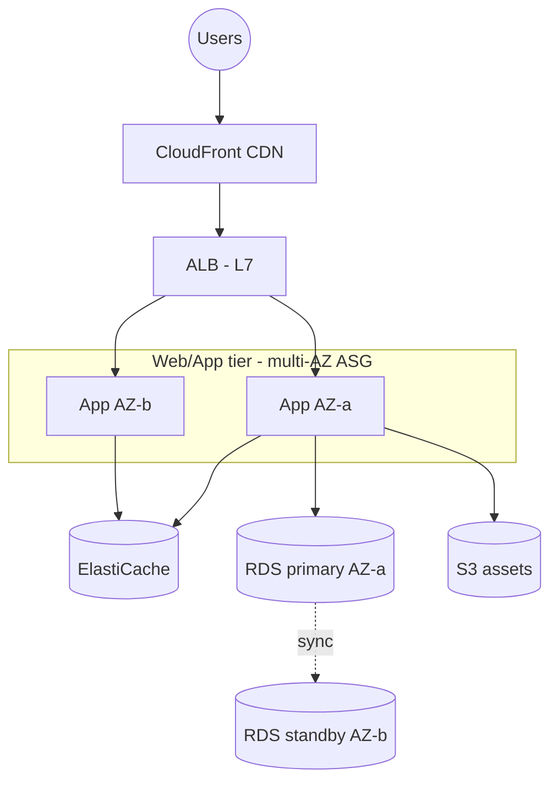

### 9.3 Reference architecture — serverless

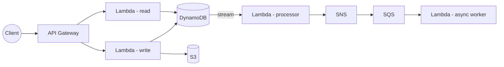

Serverless wins: zero idle cost, automatic scaling, minimal ops. Serverless pains: cold starts, per-invocation cost at scale, harder local testing, distributed-tracing complexity, vendor lock-in.

> **Staff-level insight:** Don't present one "right" architecture and don't present both with a shrug. *Decide based on traffic shape and state the crossover.* The 3-tier is the **safe default for steady, stateful workloads**; the serverless reference is for **spiky, event-driven, low-baseline** workloads. The crossover: roughly, once you're running compute >40–60% of the time at meaningful concurrency, containers/VMs beat per-invocation FaaS on cost. Choosing the architecture by **traffic shape and duty cycle** — and naming the number where you'd switch — is the Staff-level move. A real system is usually *hybrid*: serverless for the spiky control-plane and async glue, containers for the always-on hot path.

---

## 10. Auto-Scaling

### Definition

Automatically adjusting capacity to match demand — scaling **out/in** (add/remove instances, horizontal) or **up/down** (resize, vertical).

### Strategies

| Strategy | How it works | Best for | Pitfall |
|----------|--------------|----------|---------|
| **Target tracking** | Maintain a metric at target (e.g. CPU 60%, requests/target) | Steady, metric-correlated load | Lags sudden spikes |
| **Step / simple scaling** | Add N when metric crosses threshold | Coarse control | Oscillation if poorly tuned |
| **Scheduled** | Scale at known times (business hours, 9am traffic) | Predictable daily/weekly patterns | Misses unexpected spikes |
| **Predictive** | ML forecasts demand, pre-warms capacity | Recurring patterns w/ ramp time | Needs history, can mis-forecast |

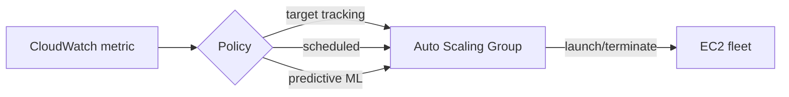

### Real considerations

- **Warm-up / cooldown** prevents thrashing. Account for instance boot + app start time (use predictive or scheduled to pre-warm).
- Scale on a **leading indicator** (queue depth, request rate, connection-accept rate) not a lagging one (CPU) when boot is slow.
- **Stateless** tier scales freely; stateful tiers need read replicas / sharding, not just more instances.
- **Time-to-healthy matters:** a VM that takes 90s to boot+warm can't absorb a spike that saturates in 20s — you need a warm buffer or a faster substrate (pre-baked AMI, Fargate, scale-to-warm-pool).

> **Staff-level insight:** The interesting failure — and the one worth deep-diving — is the **scale-up storm**: a spike triggers scaling, but cold instances take 90s to be healthy, so the existing fleet saturates and cascades into a brownout. Defenses: scale on **a leading signal** (queue depth / connection-accept rate — a true story from real-time chat, where a customer's push notification triggered a thundering herd of socket reconnects and CPU-based scaling reacted 90s too late), keep a **warm buffer**, use **predictive scaling** for known ramps, and combine with **load shedding / backpressure** so you degrade gracefully rather than collapse. Also state decisively: auto-scaling is *not* a substitute for a properly sized **database** — the DB is usually the real ceiling, and you can't horizontally scale a primary by adding app instances. Earmark the DB as the bottleneck early.

---

## 11. Managed vs Self-Hosted

### The decision framework

| Dimension | Managed (e.g. RDS, MSK, OpenSearch Service) | Self-hosted (e.g. Postgres/Kafka on EC2/k8s) |
|-----------|----------------------------------------------|----------------------------------------------|
| Ops burden | Provider handles patch/backup/failover | You own all of it |
| Cost | Premium per unit (~20–50% over raw compute) | Cheaper compute, expensive engineer time |
| Control / tuning | Limited (no superuser, fixed versions) | Full (kernel, extensions, configs) |
| Time-to-value | Minutes | Days–weeks + ongoing |
| Lock-in | Higher | Lower / portable |
| Scaling | Often a config change | You build it |

### How to decide

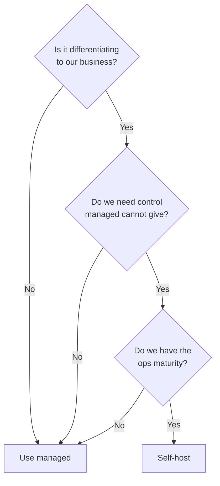

> **Staff-level insight:** Default to **managed**, and make self-hosting earn its place — say that as a position, not a maybe. The honest cost of self-hosting is rarely the EC2 bill — it's the **on-call rotation, the 3am page, the version upgrades, the security patching, and the bus-factor expertise**. The legitimate reasons to self-host: (1) a feature/version the managed service lacks (a specific Postgres extension, a Kafka feature, a custom storage engine), (2) cost at extreme scale where the premium is millions/year, (3) avoiding lock-in for a *core* capability, (4) data-residency/compliance the managed offering can't meet. Quantify the engineer-hours, not just the instance price — "self-hosting Kafka would save ~$X/month in service premium but cost ~1.5 FTE of platform engineering and a new on-call rotation; not worth it until we're at Y MB/s." That sentence is the whole answer.

---

## 12. Multi-Cloud & Hybrid

### Multi-cloud — the decisive Staff view

**Why people want it:** avoid vendor lock-in, negotiating leverage, regulatory/sovereignty, best-of-breed (BigQuery + AWS app), resilience against a provider outage.

**Why it's costly:** lowest-common-denominator architecture (you can't use the best managed services), duplicated tooling/expertise, **cross-cloud egress costs** (egress to another cloud is internet-rate, ~$0.05–0.09/GB), networking complexity, doubled operational surface, harder security posture.

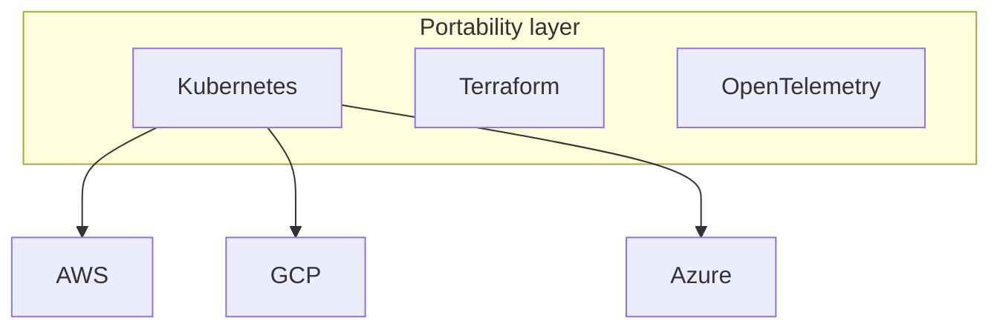

**Portability tooling:** Kubernetes (compute portability), Terraform (provisioning portability), OpenTelemetry (observability portability), open protocols (S3 API, Postgres wire). But portability has a **cost**: you forgo proprietary managed services (DynamoDB, Spanner, BigQuery) that are often the reason to be on that cloud at all. Abstraction layers add their own complexity and can leak.

### Hybrid cloud

On-prem + cloud, connected (Direct Connect / ExpressRoute / VPN). Vendor bridges: **AWS Outposts** (AWS hardware in your DC), **Azure Arc / Stack**, **Google Anthos / GKE Enterprise** (consistent k8s across on-prem + clouds).

- **Data gravity** — large datasets are expensive/slow to move, so compute migrates *to* the data. This often dictates *where* a workload runs.
- **Latency** — keep chatty components co-located; the on-prem↔cloud hop is tens of ms.

### The lock-in spectrum

| Posture | Lock-in | Velocity | Cost | When |
|---------|---------|----------|------|------|
| Single cloud, native services | High | Highest | Lowest ops | Most companies |
| Single cloud + portable core (k8s/TF) | Medium | High | Moderate | Want optionality, low cost |
| True multi-cloud active-active | Low | Low | High | Few — regulatory or hyperscale only |

> **Staff-level insight:** The mature position, stated without hedging: **"Lock-in is a cost you pay for leverage; manage it, don't fear it."** Use proprietary managed services where they create disproportionate value (DynamoDB, BigQuery, Lambda), and apply **portability discipline only at the seams that matter** — keep data in open formats (Parquet), use Terraform, containerize compute, abstract the vendor SDK behind your own interface. That gives you a credible *exit option* without paying the full multi-cloud tax up front. **Reflexive "no lock-in" multi-cloud is usually a mistake that doubles cost and halves velocity** — name it as the anti-pattern it is. Genuine multi-cloud is justified almost only by regulatory/sovereignty mandate, an acquisition that lands you on two clouds, or true hyperscale where one provider can't supply enough capacity. If an interviewer pushes "but what about resilience against a provider outage?", answer: multi-*region* on one cloud gets you most of that resilience at a fraction of the multi-cloud cost — provider-wide outages are rare; correlated multi-region-within-cloud is rarer still.

---

## 13. Cloud Migration Strategies (the 6/7 Rs)

When moving workloads to the cloud, each application gets one of these dispositions:

| R | Strategy | What it means | Effort | Cloud benefit |
|---|----------|---------------|--------|---------------|
| **Rehost** | "Lift and shift" | Move VM as-is to EC2 | Low | Low (just relocation) |
| **Replatform** | "Lift and reshape" | Minor optimization, e.g. self-managed DB → RDS | Medium | Medium |
| **Repurchase** | "Drop and shop" | Replace with SaaS (e.g. CRM → Salesforce) | Medium | Offload entirely |
| **Refactor / Re-architect** | Rebuild cloud-native | Decompose to microservices/serverless | High | Highest |
| **Retire** | Decommission | Turn off unused apps | Low | Cost savings |
| **Retain** | Revisit later | Keep on-prem for now (compliance, data gravity) | None | Deferred |
| *(7th)* **Relocate** | Move at hypervisor level (VMware Cloud) | Bulk move without conversion | Low | Low |

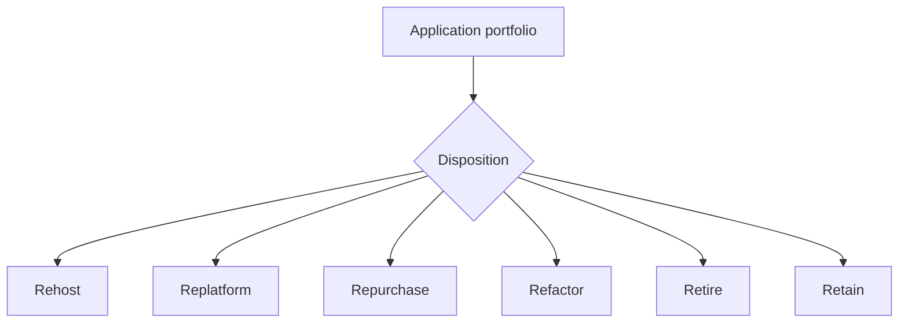

> **Staff-level insight:** The Director-level answer is about **sequencing and portfolio thinking**, not any single R. Start with **discovery + dependency mapping**, retire the dead weight first (instant savings, builds credibility with finance), rehost the simple/low-risk to build migration muscle and momentum, then **refactor selectively** only where cloud-native delivers real value (high-traffic, differentiating services). Don't refactor everything — it's the most expensive R and each refactor should be *earned* by a business case. A staged "rehost-then-optimize" reduces risk versus a big-bang re-architecture. Watch **data gravity and egress** when sequencing — move the data and its chatty compute together, or you pay egress on every cross-boundary call during the transition. State your sequence decisively: *"Retire, then rehost the simple stuff, then refactor the two services that are actually differentiating — not a big-bang rewrite."*

---

## 14. Cost & FinOps

Link [Module 19 — Cost](19-leadership-tradeoffs.md) for the deep dive; here is the cloud-specific core. **This section is the highest-leverage deep-dive in the whole module** — owning the cost model is what distinguishes a budget-owning senior from someone who's only ever shipped features.

### The cloud cost model

You pay for: **compute** (instance-hours / GB-seconds), **storage** (GB-month + request ops), **data transfer** (especially egress), **managed-service premiums**, and **idle waste**.

### Egress — the hidden killer

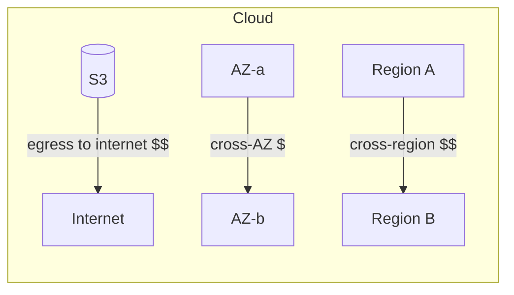

- **Inbound is free; outbound to the internet is billed** (~$0.05–0.09/GB on AWS, tiered down at volume). Cross-region (~$0.02–0.09/GB) and cross-AZ (~$0.01/GB each way) transfer also cost.
- This is why **data gravity** is real and why **CDN caching** (CloudFront) saves egress — cached bytes served from edge are cheaper than origin egress, *and* CloudFront-to-internet egress is discounted versus direct S3/EC2 egress, *and* it offloads origin.
- **The classic surprise bills:**
  - Chatty cross-AZ microservice traffic (a service in AZ-a calling a cache/DB in AZ-b on every request — at scale this is thousands of dollars/month of pure data movement).
  - Replicating data cross-region for DR (budget it; don't discover it).
  - Serving large media straight from S3 to users without a CDN (full internet egress on every byte, every time).
  - NAT Gateway data-processing charges on high-egress private subnets.

### Saving levers

| Lever | Saving | Trade-off |
|-------|--------|-----------|
| Reserved Instances / Savings Plans | up to ~72% | 1–3 yr commitment |
| Spot instances | up to ~90% | Interruptible (2-min notice) |
| Rightsizing | 20–50% | Requires usage data + discipline |
| Auto-scaling / scale-to-zero | Variable | Cold-start latency |
| Storage tiering (S3 IA/Glacier) | up to ~95% on cold data | Retrieval latency/cost |
| Egress reduction (CDN, co-location, compression, VPC endpoints) | Variable | Architecture effort |
| Graviton/ARM instances | ~20–40% price-perf | Recompile/test |
| Cross-AZ reduction (AZ-affinity routing, co-locate chatty pairs) | Variable, often large | Slightly more complex routing |

### Serverless vs containers at scale — with the crossover number

- **Serverless (Lambda)** is cheapest at **low/spiky duty cycle** — you pay nothing when idle.
- At **sustained high throughput**, per-invocation + GB-second pricing exceeds the cost of a well-utilized container fleet (Fargate/EKS) or reserved EC2.
- **Worked crossover:** a 512 MB function at 200ms/call costs ~$1.70 per million calls. At a steady 500 req/s that's ~1.3B calls/month ≈ **~$2,200/month** in Lambda compute. Two always-warm Fargate tasks (1 vCPU/2 GB each) sized to handle 500 req/s run **~$120/month** — more than an order of magnitude cheaper *because the load is continuous*. Flip the traffic to bursty (500 req/s for 1 hour/day, idle otherwise) and Lambda wins decisively because you pay nothing for the idle 23 hours. **The shape, not the volume, decides.**

> **Staff-level insight:** FinOps is an **architecture concern, not a billing afterthought** — and saying so is itself the differentiator, because most candidates never mention money. Cost-aware design means: tag everything (cost allocation), pick the right purchasing model per workload shape, treat **egress and cross-AZ traffic as first-class design constraints** (co-locate chatty services, cache aggressively, use VPC endpoints, route with AZ-affinity), and revisit serverless-vs-container as load grows with an actual crossover number. The Staff move in an interview: when you propose an architecture, **say what it costs and where the bill concentrates in one sentence** — "the spend here concentrates in cross-AZ traffic between the fan-out tier and the presence store, and in DynamoDB write capacity; the compute is noise." That sentence wins Director-level rounds where you own a budget.

---

## 15. IaC & Containers

### Infrastructure as Code

| Tool | Model | Notes |
|------|-------|-------|
| **Terraform** | Declarative, multi-cloud, HCL, state file | De-facto standard; cloud-agnostic; mind state locking (remote backend + lock) |
| **Pulumi** | Declarative in real languages (TS/Go/Python) | Good for engineers who want loops/types/tests |
| **CloudFormation / ARM / Bicep** | Cloud-native declarative | Tight integration, single-cloud |
| **CDK** | Imperative → CFN/TF | Higher-level constructs |

**Decision:** *Terraform as the default — it's the portable, ubiquitous standard and the seam where you keep multi-cloud optionality cheap. Reach for CDK/Pulumi when teams want real-language constructs and you're single-cloud anyway.*

**Immutable infrastructure:** never patch a running server — build a new image (golden AMI / container) and replace. Eliminates config drift, makes rollback = redeploy previous image. Pairs with blue-green / canary deploys.

### Containers & Kubernetes (concise)

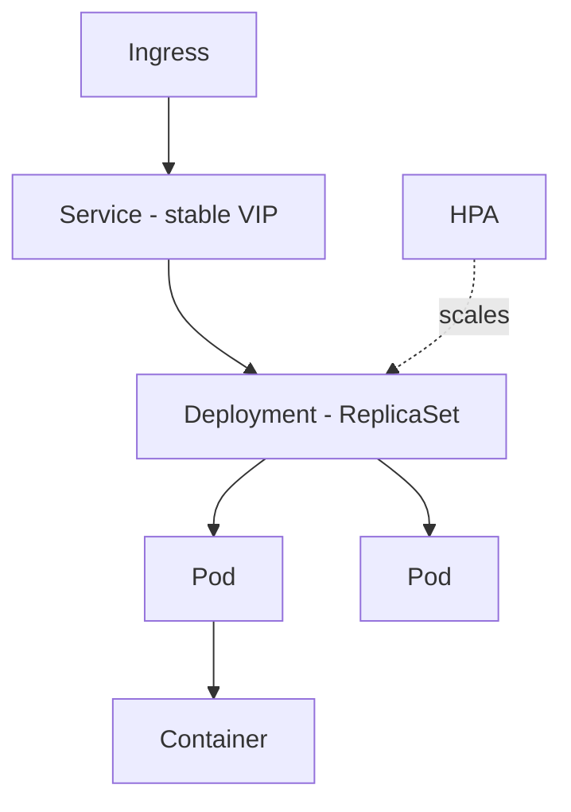

| Concept | What it is |
|---------|-----------|
| **Pod** | Smallest deployable unit; one or more co-located containers sharing network/storage |
| **Deployment** | Declarative desired state for a set of pods; rolling updates, rollback |
| **Service** | Stable network endpoint (ClusterIP/NodePort/LoadBalancer) load-balancing to pods |
| **Ingress** | L7 HTTP routing into the cluster (host/path), TLS termination |
| **HPA** | Horizontal Pod Autoscaler — scales replica count on CPU/custom metrics |
| **ConfigMap / Secret** | Externalized config and credentials |
| **Namespace** | Logical isolation/multi-tenancy within a cluster |

**Docker** packages app + dependencies into an immutable image → consistent across environments ("works on my machine" solved).

> **Altitude cue:** Name these objects, don't define them at length — k8s vocabulary is assumed shared at Staff level. The *decision* worth voicing is whether you need k8s at all (see ECS-vs-EKS above): a couple of stateless services don't justify the operational tax.

### GitOps

Git is the **single source of truth** for both app *and* infra. A controller (**Argo CD / Flux**) continuously reconciles cluster state to match the repo. Benefits: auditable (every change is a PR), easy rollback (revert commit), declarative, no manual `kubectl apply`.

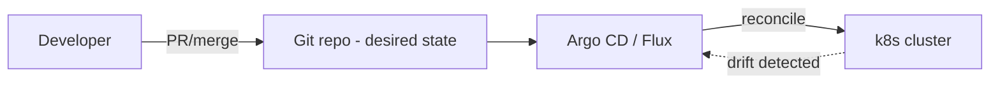

> **Staff-level insight:** The mature platform story ties these together: **IaC (Terraform) for the cloud substrate + immutable container images + GitOps reconciliation = a fully declarative, auditable, self-healing delivery pipeline** where the desired state lives in Git and humans never touch production directly. At Staff/Director level the win is **organizational**: this model gives you change traceability, easy rollback, reduced blast radius, and a paved road that lets dozens of teams ship safely without each reinventing deployment. That's platform leverage, which is what they're really probing for. But apply YAGNI here too — a five-person startup doesn't need Argo CD and a service mesh on day one; the paved road earns its keep once you have enough teams that inconsistency becomes the bottleneck.

---

## 16. Worked Example — Real-Time Chat on the Cloud

> A full worked design applying the decision frameworks above, in a real-time chat domain. This is what "deciding decisively, attaching a requirement to each choice, and naming where cost/risk concentrate" looks like end to end.

**Requirement (assume, state it):** 10M DAU, 1M concurrent WebSocket connections, p99 message-send < 100ms, 99.95% availability, single primary region with regional DR.

### The architecture

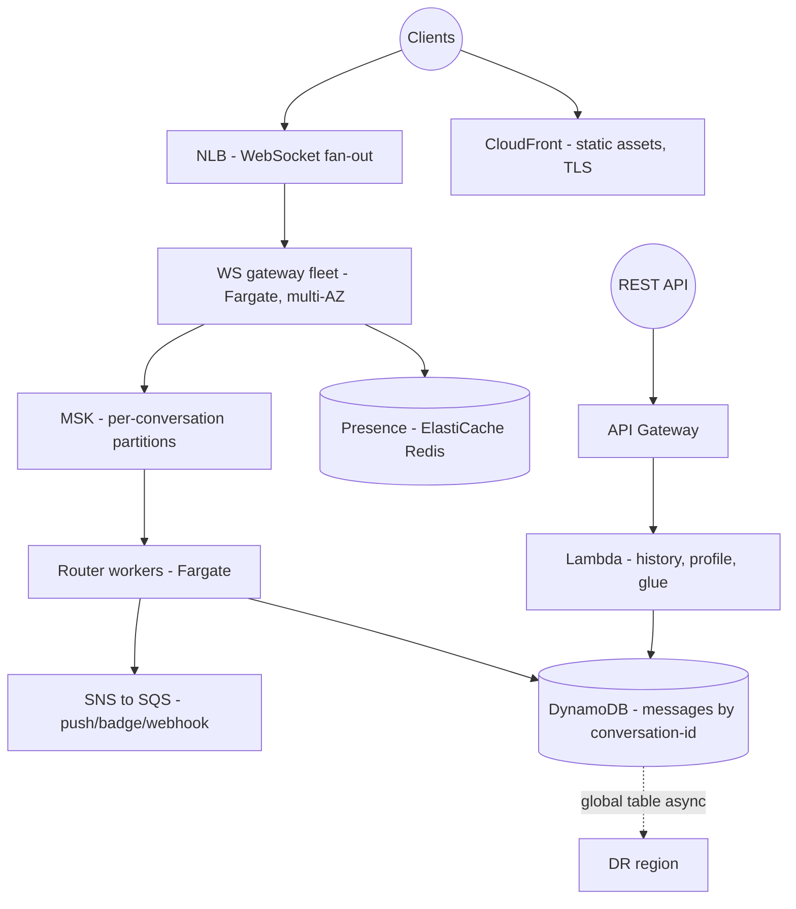

### Decisions, each with a requirement and a trigger

| Component | Decision | Because | Revisit if |
|-----------|----------|---------|-----------|
| WS fan-out LB | **NLB**, not ALB | 1M long-lived connections need L4 connection scale + static IPs + low overhead | — |
| WS gateway compute | **Fargate, always-warm**, not Lambda | p99 < 100ms can't tolerate cold starts; connections are long-lived (not request-per-invoke) | — |
| Message bus | **MSK (Kafka), partitioned by conversation-id** | need per-conversation ordering + replay for late-joining consumers (search indexer) | drop to Kinesis if ops burden of MSK isn't justified at this scale |
| Message store | **DynamoDB**, key = conversation-id | known access pattern, single-digit-ms at any scale, serverless | move to Aurora if rich relational queries emerge |
| Presence | **ElastiCache Redis**, AZ-affinity reads | ephemeral, ultra-low-latency, high-churn state | — |
| Push fan-out | **SNS → SQS** per worker type | transient fan-out to push/badge/webhook with per-consumer buffering | — |
| REST/history/glue | **Lambda + API Gateway** | spiky, low-baseline, not latency-critical | provisioned concurrency if a path gets a tight p99 |
| Multi-region | **active-passive DR** via DynamoDB global tables | 99.95% + regional DR doesn't require active-active; avoid the CAP tax | go active-active only at 99.99%+ or true global-latency need |

### Where cost and risk concentrate (the sentence that wins)

*"The bill concentrates in two places — cross-AZ traffic between the WS fleet and the presence/Kafka tier, which I mitigate with AZ-affinity routing and co-location, and DynamoDB write capacity, which I'd buy as provisioned + auto-scaling rather than on-demand at this volume. The risk concentrates in the scale-up storm on the WS tier during reconnect thunders, so I scale on connection-accept rate with a warm buffer, not CPU. Everything else — CDN, the REST glue — is commodity."*

That paragraph is the whole interview compressed: decisive choices, requirements attached, cost and risk named, basics dismissed fast.

---

## Interview Cheat-Sheet

- **In the room:** Decide, don't enumerate. Every choice = "`<choice>` because `<requirement>`; revisit if `<trigger>`." Name-and-move-on the service catalog; deep-dive cost/egress, auto-scaling, multi-region consistency, managed-vs-self. YAGNI until a quantified requirement forces complexity. Never end on "it depends." Link [Staff-Level Execution](20-staff-execution.md).
- **Service models:** IaaS → PaaS → FaaS → SaaS = increasing managed-ness, decreasing control. Delegate undifferentiated heavy lifting; own your differentiator. One sentence each — don't lecture.
- **Region / AZ / Edge:** AZ = fault isolation in region (sync replication, <2ms). Region = geo/DR boundary (async, ~70-90ms). Edge = CDN/DNS, hundreds of PoPs. Cross-AZ transfer is *billed*.
- **Reliability ladder:** Single-AZ → Multi-AZ (default prod) → Multi-region active-passive → active-active (consistency tax). Multi-region is a *business* decision driven by SLO/RTO/RPO — decide from the number, don't list all four.
- **Shared responsibility:** provider = security *of* cloud; you = security *in* cloud. Most breaches = your misconfig (public buckets, broad IAM). Use guardrails (SCPs, secure TF modules) over gates.
- **AWS must-knows:** EC2 (spot/reserved/on-demand + Graviton), ECS vs EKS, Lambda (15min/concurrency/cold start), Fargate; S3/EBS/RDS(Multi-AZ≠read replica)/Aurora/DynamoDB; VPC/CloudFront/Route53/ALB-vs-NLB/API GW/NAT-cost; SQS/SNS/EventBridge/Kinesis/MSK/Step Functions.
- **Integration choice = 3 axes:** delivery semantics, ordering, replayability. Name them; the service falls out.
- **GCP differentiators:** BigQuery (serverless DW, storage/compute separation, ~$5/TB scanned), Spanner (global + strongly consistent SQL). Azure: Cosmos 5 consistency levels.
- **Equivalence:** name the *capability* ("an object store like S3/GCS/Blob"), not the product. Don't recite the whole table.
- **Well-Architected pillars:** Operational Excellence, Security, Reliability, Performance, Cost, Sustainability — pick the *two* where risk concentrates and go deep, don't recite six.
- **Auto-scaling:** target-tracking / scheduled / predictive; scale on leading signals (queue depth, connection-accept rate); beware the scale-up storm; the DB is usually the real ceiling.
- **Managed vs self-hosted:** default managed; self-host only for control/cost-at-scale/lock-in/compliance — and count engineer-hours and pages, not instance price.
- **Multi-cloud:** lock-in is a managed cost, not a disease. Single cloud + portability at the seams (TF, k8s, open formats) buys an exit option without the full tax. Multi-cloud-by-reflex is an anti-pattern — say so.
- **6 Rs:** Rehost, Replatform, Repurchase, Refactor, Retire, Retain (+Relocate). Retire dead weight first; refactor only what earns it; sequence by risk and data gravity.
- **Cost:** egress + cross-AZ are hidden killers; serverless cheap when spiky, containers cheaper at sustained load (know the crossover number); tag everything; *state where the bill concentrates* in one sentence.
- **Delivery:** Terraform + immutable images + GitOps (Argo/Flux) = declarative, auditable, self-healing paved road — but YAGNI for tiny teams.

---

## Common Interview Questions

**Q1. When would you choose serverless (Lambda) over containers (ECS/EKS), and where's the crossover?**
*Staff answer:* Decide by **traffic shape and duty cycle**, not by preference. Serverless wins for spiky, event-driven, low-baseline workloads — zero idle cost, automatic scaling, minimal ops, fast time-to-market. Containers win for sustained high throughput, long-running or stateful work, predictable latency (no cold starts), and fine runtime control. The crossover is concrete: a 512 MB/200ms function at a steady 500 req/s is ~$2,200/month in Lambda compute; two always-warm Fargate tasks sized for the same load are ~$120/month — an order of magnitude cheaper *because the load is continuous*. Flip it to bursty and Lambda wins outright. So: serverless because this path is bursty; containers once it goes continuous at real concurrency; I'd confirm with the actual request rate and execution time.

**Q2. Multi-AZ vs multi-region — how do you decide, and what changes?**
*Staff answer:* Multi-AZ is the default for production — synchronous replication, <2ms, survives a DC failure at ~1.3-2x cost; no real downside, so I don't deliberate it. Multi-region is a **business decision driven by the SLO and RTO/RPO**, not a technical default. Its real cost isn't infrastructure — it's that active-active forces every stateful component to confront CAP (conflict resolution, global tables, quorum). For 99.9-99.95% with minutes of RTO tolerance I'd do multi-AZ + region-level DR (pilot light/warm standby) and stop there. I reserve active-active for 99.99%+ global products that genuinely need it and call out the consistency tax explicitly. And if someone wants multi-region purely for provider-outage resilience, multi-region-within-one-cloud delivers most of that far cheaper than multi-cloud.

**Q3. Is multi-cloud a good idea?**
*Staff answer:* As a reflexive default, no — and I'll say that plainly. It forces lowest-common-denominator architecture (forgoing the best managed services that are often the reason you're on a cloud), duplicates tooling and expertise, adds cross-cloud egress and networking complexity, and doubles operational surface. The mature position is "lock-in is a cost you pay for leverage; manage it, don't fear it." Use proprietary managed services where they create disproportionate value, and apply **portability discipline only at the seams that matter** — Terraform, Kubernetes, open data formats (Parquet), vendor SDK behind your own interface. That preserves a credible exit option without paying the full multi-cloud tax. Genuine multi-cloud is justified mainly by regulatory/sovereignty requirements, an acquisition, or true hyperscale — not by "no lock-in" as a slogan.

**Q4. Walk me through diagnosing and reducing a surprise cloud bill.**
*Staff answer:* First, tag and attribute (cost allocation tags, Cost Explorer) to find where the spend concentrates — you can't fix what you can't see. The usual culprits, in order I'd check: **egress and cross-AZ data transfer** (chatty microservices across AZs, replicating cross-region, serving media straight from S3 without a CDN, NAT data-processing charges), idle/over-provisioned instances, and serverless at sustained scale past its crossover. Fixes: AZ-affinity routing and co-locating chatty pairs, CDN in front of egress-heavy paths, VPC endpoints to bypass NAT for S3/DynamoDB, rightsize from utilization data, move steady baseline to Savings Plans and fault-tolerant batch to Spot, tier cold storage to IA/Glacier, adopt Graviton. Going forward I make egress and cross-AZ first-class *design* constraints, not a billing afterthought — that's the structural fix.

**Q5. Explain the shared responsibility model and why most cloud breaches happen.**
*Staff answer:* The provider secures the cloud (physical, hypervisor, managed-service internals); the customer secures what they put in it (data, IAM, network config, and for IaaS the OS). The line moves with the service model — for S3/Lambda you own essentially just code, data, and access policy. Nearly all breaches are **customer-side misconfiguration**: public buckets, over-broad IAM (`*:*`), unencrypted data, `0.0.0.0/0` on admin ports. As a Staff/Director the leverage is guardrails over gates — org-level SCPs, account-wide S3 Block Public Access, Terraform modules with secure defaults, and automated config scanning (Config, GuardDuty, Security Hub). You scale security by making the secure path the easy path, not by reviewing every PR — gates don't scale to dozens of teams.

**Q6. Design the data/messaging layer for an event-driven system — how do you pick SQS vs SNS vs Kinesis vs EventBridge?**
*Staff answer:* I decide on three axes: **delivery semantics** (at-least-once vs exactly-once/FIFO), **ordering** (per-key, global, or none), and **replayability** (can a new consumer re-read history?). SQS is a durable point-to-point work queue for buffering and smoothing spikes. SNS is fan-out pub/sub — and the canonical pattern is SNS→multiple SQS queues for fan-out plus per-consumer buffering. Kinesis or Kafka is for ordered, **replayable** streams with multiple independent consumers. EventBridge is for schema-based routing and decoupled domain events with SaaS integrations. Step Functions if I need orchestration of a multi-step workflow or saga. The common mistake is a queue when you need replay, or a stream when a simple work queue would do. For a chat backend: Kafka partitioned by conversation-id for ordered, replayable message flow; SNS→SQS for transient push/badge/webhook fan-out.

**Q7. How do you approach migrating a large on-prem portfolio to the cloud?**
*Staff answer:* Portfolio thinking with the 6/7 Rs, sequenced to manage risk — not one R applied uniformly. Start with **discovery and dependency mapping**. **Retire** dead weight first for instant savings and finance credibility. **Rehost** simple low-risk apps to build migration muscle and momentum. **Replatform** where a quick win exists (self-managed DB → RDS). **Repurchase** non-differentiating apps as SaaS. **Refactor** selectively and last — it's the most expensive R, so each refactor needs a business case, reserved for high-traffic differentiating services. **Retain** what compliance or data gravity keeps on-prem. Staged "rehost-then-optimize" beats big-bang re-architecture on risk, and I'd watch data gravity and egress when sequencing so I move data and its chatty compute together.

**Q8. Managed RDS vs running Postgres yourself on EC2/k8s?**
*Staff answer:* Default to managed and make self-hosting earn its place. The real cost of self-hosting isn't the EC2 bill — it's the on-call rotation, the 3am page, version upgrades, security patching, and bus-factor expertise. RDS gives Multi-AZ failover, automated backups, and patching for a ~20-50% per-unit premium. Legitimate reasons to self-host: a Postgres extension/version the managed service lacks, cost at extreme scale where the premium is millions/year, avoiding lock-in for a core capability, or compliance/data-residency the managed offering can't meet. I'd frame it as "self-hosting saves ~$X/month but costs ~1.5 FTE and a new on-call rotation — not worth it until we hit Y scale." Also note Multi-AZ is HA (sync standby), read replicas are read scaling (async, can serve stale reads) — not interchangeable.

**Q9. What does a modern, scalable delivery/platform pipeline look like?**
*Staff answer:* Terraform for the cloud substrate, immutable container images (never patch live — replace and roll back by redeploying the prior image), and GitOps reconciliation via Argo CD or Flux where Git is the single source of truth for app and infra. The result is fully declarative, auditable (every change is a PR), self-healing (controller reconciles drift), with easy rollback and reduced blast radius. At Staff/Director level the win is organizational: this paved road lets dozens of teams ship safely without each reinventing deployment — that's platform leverage. I'd add the YAGNI caveat: a small team doesn't need Argo plus a service mesh on day one; the paved road earns its keep once team count makes inconsistency the bottleneck.

**Q10. Why is BigQuery (or Snowflake) architecturally different from a traditional data warehouse, and when does it matter?**
*Staff answer:* It **fully decouples storage from compute** and runs queries on a serverless, shared pool — you never provision or resize a cluster, you submit SQL and get massive on-demand parallelism, paying per TB scanned (~$5/TB) or via slots. That means zero-ops analytics and elastic scale, versus a self-managed Redshift/Hadoop cluster you size, vacuum, and babysit. It matters for spiky or unpredictable analytical workloads and lean teams. The cost watch-item is the per-query model — a runaway `SELECT *` on a petabyte table is a $5,000 query, so you partition, cluster, select only needed columns, and set scan quotas as a guardrail. Naming this paradigm (and Spanner when you need global scale *and* strong consistency together) signals modern-data-stack fluency rather than defaulting to a cluster you operate.

**Q11. (Meta/altitude) You're 20 minutes into a cloud design and the interviewer hasn't said much. How do you know you're spending time well?**
*Staff answer:* I'd self-check against risk-weighting: am I deep-diving the boxes where state, consistency, and cost live, and moving fast through the commodity ones? If I catch myself explaining what S3 is or listing every messaging service, that's wasted altitude — I'd cut it and redirect to the two or three decisions that actually carry the design's risk (here, the data-layer consistency model and the cross-AZ cost). I also narrate my prioritization out loud — "the compute and CDN are commodity, let me spend our time on the data layer and the cost model" — so the interviewer can steer me if their priorities differ. Earmarking the hard parts early and proportioning time to risk is the signal; uniform thoroughness is the anti-signal.

**Q12. (Meta/delivery) An interviewer pushes back hard on your single-cloud recommendation, insisting on multi-cloud for resilience. How do you respond?**
*Staff answer:* I don't retreat to "it depends" and I don't fold — I'd restate the decision with its requirement and engage their specific concern. Provider-wide outages are rare; multi-*region* within one cloud captures most of that resilience at a fraction of multi-cloud's cost and complexity, while keeping the managed services that justify being on the cloud. I'd quantify the multi-cloud tax — lowest-common-denominator architecture, doubled ops surface, cross-cloud egress, two security postures — and offer the middle path: portability discipline at the seams (Terraform, containers, open data formats) buys a credible exit option without paying the full tax up front. If they have a hard requirement I missed — a regulatory mandate, a contractual one — I'd fold that in and adjust. That's the difference between a considered position I'll defend and stubbornness: I change my mind for a new requirement, not for pressure.

---

*Cross-references: [Staff-Level Execution](20-staff-execution.md) · [Storage](08-storage.md) · [Databases](06-databases.md) · [Load Balancing](05-load-balancing.md) · [Architecture Patterns](15-architecture-patterns.md) · [Reliability](11-reliability.md) · [Cost — Module 19](19-leadership-tradeoffs.md)*
