# Module 15 — Architecture Patterns

> The Staff Engineer's definitive reference for choosing, defending, and evolving system architectures.

## What you'll master

By the end of this module you will be able to **name, draw, and defend** every major architecture pattern an interviewer can throw at you — and, more importantly, **explain when each is wrong**. Senior candidates list patterns. Staff/Director candidates make *choices*: they tie an architecture to team topology, domain complexity, scale, and time-to-market, and they articulate the **reversibility cost** of the decision. This module is built around that meta-skill.

You'll cover:

- **System-level styles**: Monolith, Modular Monolith (the Staff-level default), Microservices, SOA, Event-Driven Architecture, Serverless/FaaS, Cell-based/Bulkhead/Shuffle-Sharding.
- **Component-level patterns**: Layered, Hexagonal (Ports & Adapters), Clean/Onion, Microkernel/Plugin, Pipes & Filters.
- **Data/behavioral patterns**: CQRS, Event Sourcing, Materialized View, Strangler Fig, Saga, Outbox, Sidecar/Ambassador, BFF, API Gateway, Anti-Corruption Layer, Sharding, Scatter-Gather, Choreography vs Orchestration.
- **Multi-tenancy**: Silo vs Pool vs Bridge.
- **A decision framework** for choosing — the centerpiece every Staff candidate needs, built on **one-way vs two-way doors**.

Cross-references: [Microservices](10-microservices.md) · [Messaging & Event-Driven](04-messaging-event-driven.md) · [Distributed Systems](02-distributed-systems.md) · [Cloud](14-cloud.md) · [Leadership & Trade-offs](19-leadership-tradeoffs.md) · [Staff-Level Execution](20-staff-execution.md)

---

## Table of Contents

1. [In the Room — Staff-Level Delivery](#in-the-room--staff-level-delivery)
2. [The Staff-Level Framing: Architecture Is Trade-offs](#1-the-staff-level-framing-architecture-is-trade-offs)
3. [Monolith](#2-monolith)
4. [Modular Monolith — The Best Default](#3-modular-monolith--the-best-default)
5. [Microservices](#4-microservices)
6. [SOA vs Microservices](#5-soa-vs-microservices)
7. [Event-Driven Architecture (EDA)](#6-event-driven-architecture-eda)
8. [Serverless / FaaS](#7-serverless--faas)
9. [Cell-Based / Bulkhead Architecture](#8-cell-based--bulkhead-architecture)
10. [Component-Level: Layered (n-tier)](#9-component-level-layered-n-tier)
11. [Hexagonal — Ports & Adapters](#10-hexagonal--ports--adapters)
12. [Clean / Onion Architecture](#11-clean--onion-architecture)
13. [Microkernel / Plugin](#12-microkernel--plugin)
14. [Pipes and Filters](#13-pipes-and-filters)
15. [CQRS](#14-cqrs)
16. [Event Sourcing](#15-event-sourcing)
17. [Materialized View Pattern](#16-materialized-view-pattern)
18. [Strangler Fig](#17-strangler-fig)
19. [Saga, Outbox, Sidecar, BFF, API Gateway, ACL](#18-integration--decomposition-patterns)
20. [Sharding, Scatter-Gather, Choreography vs Orchestration](#19-sharding-scatter-gather-choreography-vs-orchestration)
21. [Multi-Tenancy: Silo vs Pool vs Bridge](#20-multi-tenancy-silo-vs-pool-vs-bridge)
22. [Choosing an Architecture — Decision Framework](#21-choosing-an-architecture--decision-framework)
23. [Interview Cheat-Sheet](#interview-cheat-sheet)
24. [Common Interview Questions](#common-interview-questions)

---

## In the Room — Staff-Level Delivery

> Read this section first and last. It is the lens that turns a *correct* answer into a *Staff-level* answer. Everything below in the module is detail; this is how you **deliver** it. Cross-link: [Staff-Level Execution](20-staff-execution.md).

The difference between a senior and a Staff answer on architecture is almost never knowledge of more patterns. It's **judgment under uncertainty, delivered decisively**. A senior candidate enumerates options and lists pros and cons; a Staff candidate names a default, ties it to a requirement, and states the trigger that would change their mind. Architecture interviews are a *signal* exercise — the interviewer is sampling how you'd make a million-dollar, hard-to-reverse call with incomplete information, and whether you'd over-engineer when nobody's watching.

### Decisions to make decisively (memorize these defaults)

State these as defaults, not as the end of the conversation. The pattern is always: **`<choice>` because `<requirement>`; revisit if `<trigger>`.** Never say "it depends" and stop — "it depends" is the *question*, the requirement is the *answer*.

| Decision | Default (state this first) | Because (requirement) | Revisit when (trigger) |
|---|---|---|---|
| System style for a new product | **Modular monolith, enforced boundaries, per-module data ownership** | Pre-PMF boundaries are unknown; a function call beats a network call on every axis | A concrete forcing function appears: independent scaling, independent deploy cadence, or a hard team-ownership boundary |
| When EDA pays off | **Synchronous request/response by default; EDA at high-fan-out seams** | Sync gives you a stack trace and immediate consistency | One event must fan out to many independent, evolving consumers, or you need temporal decoupling |
| When CQRS pays off | **CQRS-lite (separate read models, same DB) or nothing** | Read and write rarely diverge enough to justify two stores | Read scale/shape diverges sharply from write, OR you need many specialized projections |
| When event sourcing pays off | **Don't, unless forced** | Event versioning is forever; immutability fights GDPR | Hard audit/temporal-query/rebuild requirement (finance, compliance, ledgers) |
| Multi-tenancy model | **Pooled shared-schema + `tenant_id` with Row-Level Security** | Cheapest, scales to millions of small tenants | Enterprise tenant demands physical isolation/residency → Silo for *that tier* (tiered/hybrid) |
| Monolith vs microservices *deployment* | **Keep it a monolith; keep boundaries clean** | Deployment topology is a two-way door if modules are clean | Team count or load shape forces extraction — then it's a refactor, not a rewrite |

### Altitude — what to name-and-move-on vs deep-dive

Uniform thoroughness is an anti-pattern. Spend your words where the risk is.

- **Name-and-move-on (assume known; one sentence each):** the existence and shape of layered/n-tier, hexagonal/ports-and-adapters, clean/onion. These are component-organization basics — say "I'd structure each module as a hexagon so the domain is testable and infra is swappable" and move on. Do **not** explain what a port is for three minutes.
- **Deep-dive (this is where the crux lives):**
  - **The architecture *choice* and its reversibility** — one-way vs two-way doors. This is the whole interview.
  - **CQRS / event-sourcing trade-offs** — specifically event versioning (forever) and GDPR-vs-immutability (crypto-shredding). This is where over-engineering hides.
  - **Multi-tenancy isolation** — cross-tenant data leakage is a security incident, not a bug. RLS, not discipline.

### YAGNI default + trigger

**YAGNI ("You Aren't Gonna Need It") is the central discipline of this module.** Architecture patterns are seductive precisely because they're impressive, and the most expensive mistakes are *speculative* generality.

- **Default:** the simplest thing that satisfies the *stated, current* requirement. Modular monolith. Single database. Synchronous calls. CQRS-lite at most. No event sourcing. Pooled tenancy.
- **Trigger to add complexity:** a *concrete, named* forcing function — a number, an SLA, a team-count, a compliance clause — not a hypothetical ("what if we go viral?"). If you can't name the trigger, you don't add the pattern.

The Staff move is to say out loud: *"I'm deliberately not doing X yet, because the trigger for X is Y, and we haven't hit Y. When we do, the modular boundary makes adding X a refactor."* That sentence demonstrates restraint *and* forethought simultaneously.

### Top anti-patterns (the things that quietly fail an interview)

| Anti-pattern | What it sounds like | The fix |
|---|---|---|
| **Event sourcing because it's cool** | "I'd event-source everything for the audit trail" on a CRUD app | Event-source only ledgers/compliance domains; otherwise an `audit_log` table |
| **CQRS everywhere** | Separate read/write stores by reflex | CQRS-lite (same DB) until read scale forces separation |
| **Microservices for a 5-person team** | "I'd split this into a dozen services" pre-PMF | Modular monolith; microservices solve a people-scaling problem you don't have |
| **Resume-driven architecture** | Reaching for Kafka/Temporal/service-mesh to use them | Start from the requirement; let the trigger pull the tech in |
| **Option-listing without choosing** | "We could do A, or B, or C…" then stopping | Pick one, tie it to a requirement, name the trigger to switch |
| **Over-explaining basics** | Three minutes on what a layer is | One sentence, then move to the crux |
| **False humility** | "I'm not really sure, it could be anything" | You have the judgment — use it; hedge with triggers, not with timidity |
| **Uniform thoroughness** | Equal depth on every pattern | Triage: deep on the irreversible crux, shallow on basics |

### Experience hooks (cite real operational scars, not blog posts)

Staff signal comes from *operational* memory. Drop these naturally — they prove you've *run* systems, not just read about them. For an engineer with a real-time chat background, the credible hooks are:

- **Fan-out at the seam, not everywhere:** "On our chat infra, message delivery fan-out (presence, push, unread counts, moderation) was the one place async EDA earned its keep — everything else stayed a synchronous call so we kept a stack trace."
- **The dual-write scar:** "We lost events early on when a DB commit succeeded but the broker publish failed — the Outbox pattern with CDC was the fix. I'd never 'save then publish' without it again."
- **Pooled tenancy + the leak you fear:** "Multi-tenant chat is pooled shared-schema with `tenant_id`; the one incident class that keeps you up is a missing tenant filter leaking messages across customers — we enforced it with Row-Level Security and a tenant-scoped data layer, not code review."
- **The re-shard you never want to do twice:** "Picking the conversation/room shard key is the one-way door — I've watched a re-shard of live message history eat a quarter."
- **Idempotency everywhere:** "At-least-once delivery means every consumer in a chat pipeline must be idempotent — dedupe on message ID — or you double-deliver under retry."
- **Cold start on the hot path:** "We kept serverless for spiky glue (webhooks, media transcode) and off the synchronous send-message path, because a cold start on message send is a user-visible stutter."

Use one or two per answer — they're seasoning, not the meal. The point is to ground a decision in a remembered consequence.

---

## 1. The Staff-Level Framing: Architecture Is Trade-offs

Before any pattern, internalize the mental model that separates a Staff candidate from a senior one.

**Architecture is the set of decisions that are hard to change later.** Everything else is just code. So the central question is never "which pattern is best?" — it's **"how expensive is it to be wrong?"**

Amazon's framing of **one-way doors vs two-way doors** is the single most valuable phrase you can deploy in an interview, and it is the **centerpiece of this entire module** — every other decision hangs off it:

- **Two-way door (reversible)**: choosing a web framework, a queue technology, a caching layer, a serverless-vs-container deployment for a given module. If it's wrong, you walk back through the door. Move fast, decide with a small group, don't over-analyze, don't write a 12-page doc.
- **One-way door (irreversible or very costly)**: your data model, your service boundaries, your consistency model, your multi-tenancy isolation strategy, your shard key, splitting a monolith into 40 services. Wrong here costs quarters or years. Slow down, prototype, write an ADR (Architecture Decision Record), get senior review.

> **Staff-level insight:** The most expensive architectural mistake is treating a one-way door like a two-way door — e.g., prematurely shattering a monolith into microservices before domain boundaries are understood. The boundaries *are* the one-way door; the deployment topology is mostly a two-way door. Get the boundaries right inside a modular monolith first, then deployment is a refactor, not a rewrite.

### The reversibility spectrum (the lens to apply to every pattern below)

Most decisions aren't purely one-way or two-way — they sit on a spectrum, and a big part of Staff judgment is *converting* one-way doors into two-way doors by design.

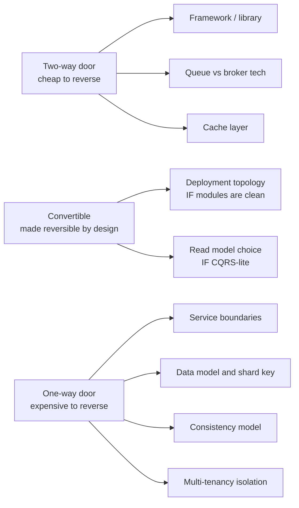

The middle column is where Staff engineers earn their title: **a modular monolith deliberately moves "deployment topology" from one-way to two-way.** That's the highest-leverage move in the book — you spend design effort once to keep a future decision reversible.

**The two forces every architecture balances:**

| Force | Pulls toward | Cost when over-applied |
|---|---|---|
| **Coupling reduction** | More services, more async, more isolation | Operational complexity, distributed-systems failure modes, latency |
| **Cohesion / simplicity** | Fewer deployables, synchronous calls, shared DB | Scaling ceilings, team contention, blast radius |

Every pattern below is a point on this spectrum. Your job in an interview is to **locate the requirements on this spectrum** and pick accordingly — and to say *out loud* what you're trading away. The phrase "I'm trading X to buy Y, and that's the right trade here because `<requirement>`" is the single most repeatable Staff signal.

---

## 2. Monolith

### Definition
A single deployable unit containing all application logic, sharing one process, one codebase, and typically one database.

### How it works
All modules call each other via in-process function calls. One build, one artifact, one deploy. Horizontal scaling = run N identical copies behind a load balancer.

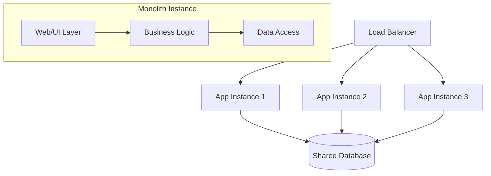

### When to use — decisive
**Default for early-stage products and small teams (1–15 engineers).** Choose it because time-to-market dominates and boundaries are unknown; revisit when team contention on the deploy pipeline or divergent scaling appears.

- Pre-product-market-fit; domain boundaries still being discovered.
- Strong transactional consistency requirements (one DB, ACID transactions are free).
- Time-to-market dominates; you need to ship and iterate.

### When NOT to use
- Independent scaling of components is required (e.g., one CPU-bound subsystem vs one I/O-bound).
- Multiple teams stepping on each other in the same deploy pipeline.
- Different parts need different tech stacks or release cadences.

### Real examples
- **Shopify** runs a famously large Rails monolith ("the majestic monolith") serving millions of merchants — proof a monolith scales far further than folklore admits.
- **Stack Overflow** served enormous traffic on a small number of monolithic servers (famously ~9 web servers for the whole network at peak).
- **Basecamp / 37signals** — DHH's "Majestic Monolith" essay is the canonical defense.

### Pitfalls
- "Big ball of mud": without internal discipline, in-process calls let any module reach into any other's internals. The *real* failure of monoliths is **lack of internal boundaries**, not the single deployable. (This is exactly the gap the modular monolith closes — see §3.)
- Deploy coupling: a one-line change forces a full redeploy and full regression.
- Scaling is all-or-nothing — you scale the whole app even if only one path is hot.
- **Build/CI time** balloons as the codebase grows — a multi-team monolith with a 40-minute test suite becomes a productivity tax. (Mitigate with test sharding, affected-target builds via Bazel/Nx, not by splitting services.)

> **Staff-level insight:** The honest pro of the monolith that candidates forget: **a function call is the most reliable, lowest-latency, fully-transactional RPC ever invented.** Microservices replace in-process calls (nanoseconds, can't fail partially, ACID) with network calls (milliseconds, fail partially, no distributed transactions). Never apologize for a monolith — apologize for a monolith *without internal modularity*. The altitude move: name the big-ball-of-mud risk in one sentence, then pivot immediately to the modular monolith as the fix.

---

## 3. Modular Monolith — The Best Default

> This is the section to over-prepare. Advocating the modular monolith correctly is one of the clearest Staff-level signals you can send. It is the **default answer** to nearly every "how would you architect X?" question.

### Definition
A single deployable unit, but internally decomposed into **well-defined modules with enforced boundaries**. Modules communicate through explicit, published interfaces — not by reaching into each other's tables or internals. It's a monolith with the *organizational* and *coupling* benefits of microservices, minus the network.

### How it works
- Each module owns its domain, its data (logically — even if physically the same DB, modules don't read each other's tables), and exposes a narrow public API.
- Boundaries are **enforced** by tooling: package/module visibility, ArchUnit tests (Java), dependency-cruiser (JS/TS), Java modules (JPMS), .NET internal access modifiers, Packwerk (Ruby), or build-tool module graphs (Gradle/Bazel/Nx).
- **Vertical slices**: organize by feature/domain (Orders, Billing, Catalog) rather than by technical layer (Controllers, Services, Repos). Each slice is a candidate future microservice.

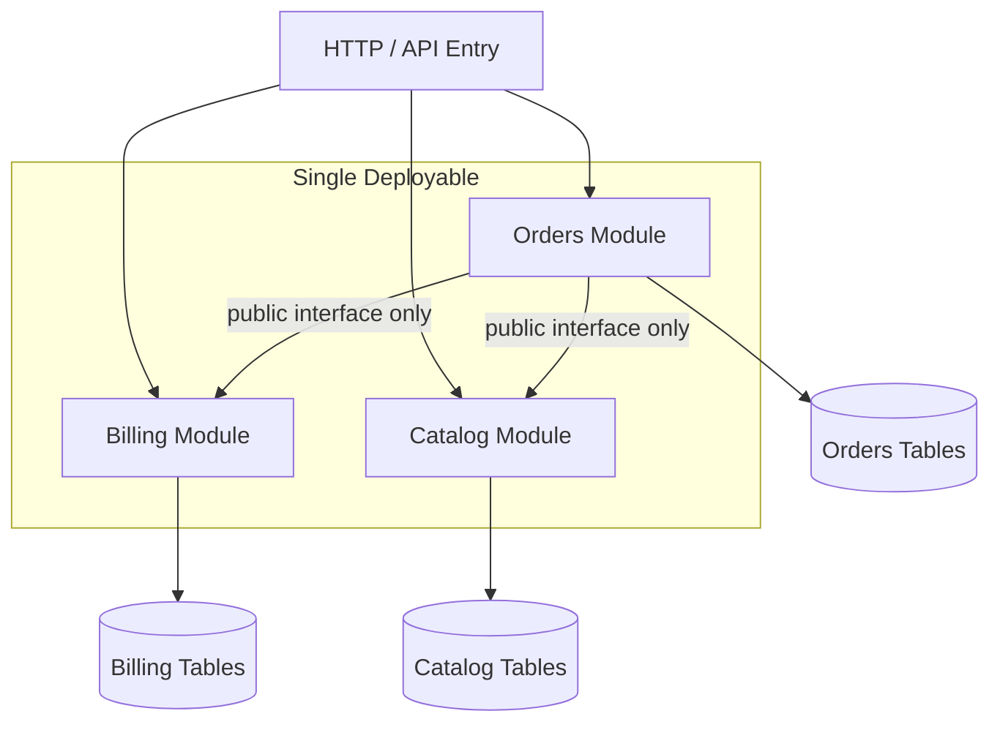

### When to use — decisive
**The default for most teams and most new systems.** Choose it because it buys ~90% of the decoupling of microservices for ~10% of the operational cost; revisit (extract a module) only on a concrete forcing function.

- Domain complexity is real but team is small-to-mid (up to ~30–50 engineers across a few teams).
- You want clean boundaries and the *option* to extract services later, without paying distributed-systems tax now.
- You value transactional integrity but still need internal decoupling.

### When NOT to use
- You genuinely need independent scaling, independent deploy cadence per module, or polyglot stacks — and have the platform/ops maturity to run distributed systems.
- Organizational scale forces independent team ownership of deploy pipelines (Conway's Law pressure becomes overwhelming).

### Real examples
- **Shopify** explicitly evolved into a *componentized* modular monolith ("Componentization" project, enforced boundaries via **Packwerk**).
- **GitLab** runs a large modular Rails monolith.
- Many companies that "did microservices" and regretted it (the famous **Amazon Prime Video** 2023 case study) collapsed services *back* into a more consolidated, modular deployable for ~90% cost savings.

### Pitfalls
- Boundaries decay without enforcement. If your "modules" are just folders with no tooling preventing cross-imports, you have a ball of mud with extra steps. **Enforcement is the whole point** — make it a CI failure to cross a boundary, not a code-review comment.
- Shared database is the sneaky coupling: if Billing queries the Orders tables directly, your modules are joined at the hip. Give each module logical data ownership (separate schemas, no cross-schema joins) so extraction is cheap.
- **Shared transactions become a future migration cost.** If two modules participate in one DB transaction today, extracting one into a service later forces you to replace that transaction with a Saga. Worth knowing which cross-module calls are inside a transaction boundary — those are your future Saga seams.

### Migration path it enables (the centerpiece reversibility story)
Because each vertical slice already has a narrow interface and owns its data, **extracting a module into a service is a refactor, not a rewrite**: replace the in-process call with a network call behind the same interface, move the tables. This is why the modular monolith is the highest-leverage architectural decision — it keeps the one-way door (boundaries) right and the two-way door (deployment) open.

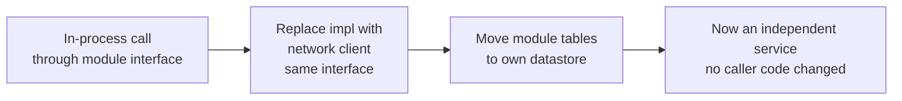

> **Staff-level insight:** The strongest thing you can say in an interview is: *"I'd start with a modular monolith with enforced module boundaries and per-module data ownership. This gets us ~90% of the decoupling benefit of microservices for ~10% of the operational cost, and it keeps the door open to extract any hot module into a service later as a refactor rather than a rewrite. I'd only extract a service when there's a concrete forcing function — independent scaling, independent deploy cadence, or a team-ownership boundary — not speculatively."* That single answer signals you've felt the pain of premature microservices. **Earmark for the interviewer that this is you converting a one-way door into a two-way door — that's the meta-move.**

---

## 4. Microservices

### Definition
An architecture where the application is a suite of small, independently deployable services, each owning its data and communicating over the network (sync RPC/HTTP or async messaging). Covered in depth in [Microservices](10-microservices.md) — this is a recap focused on *when justified*.

### How it works

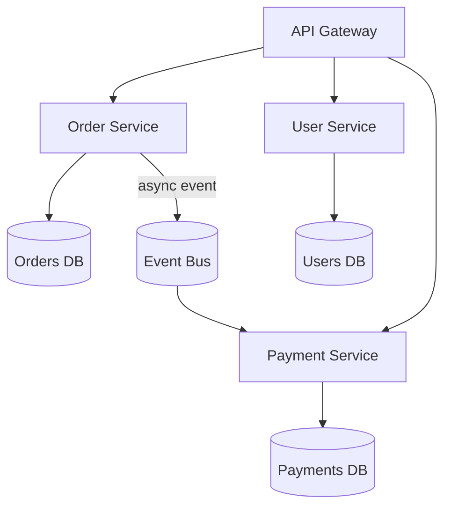

### When justified — decisive (the forcing functions)
Adopt microservices **only** when at least one concrete forcing function is present and you have the operational maturity to pay the tax:

1. **Independent scaling** — a subsystem has wildly different load/resource profile.
2. **Independent deployability** — teams must ship without coordinating a shared pipeline (Conway's Law at scale).
3. **Fault isolation** — failure in one domain must not take down others.
4. **Polyglot needs** — ML in Python, low-latency core in Go, etc.
5. **Team autonomy at scale** — typically once you exceed ~3–4 teams contending on one codebase.

### When NOT to use
- Pre-PMF, small team, undiscovered boundaries — you'll cement the wrong boundaries (the one-way-door mistake).
- You lack platform maturity: no CI/CD per service, no distributed tracing, no service mesh, no on-call rotation. Microservices are an *organizational and operational* commitment, not just a code structure.

### Pitfalls
- **Distributed monolith**: services that must be deployed together = worst of both worlds. The tell: you can't deploy service A without also deploying B and C.
- No distributed transactions → you need Sagas, eventual consistency, idempotency everywhere.
- Operational explosion: tracing, service discovery, retries, circuit breakers, versioning, schema registries.
- **Nano-services / over-decomposition**: splitting so finely that a single user action crosses ten services makes latency and debugging unbearable. Service boundaries should follow *bounded contexts*, not nouns.

> **Staff-level insight:** Microservices are a solution to a *people-scaling* problem disguised as a technical one. The primary benefit is independent deployment by autonomous teams. If you don't have enough teams to need autonomy, you're paying the distributed-systems tax to solve a problem you don't have. Quote: *"Microservices buy you team independence with the currency of operational complexity."* In the room, if asked "would you use microservices here?", the decisive answer for any small-team scenario is **"no — modular monolith, because the forcing function for microservices is team autonomy at scale and we don't have the team count; I'd revisit when we cross ~4 teams contending on the pipeline."**

---

## 5. SOA vs Microservices

### Definition
**Service-Oriented Architecture (SOA)** is the older, enterprise-grade predecessor: services organized around business capabilities, communicating through a centralized **Enterprise Service Bus (ESB)** that handles routing, transformation, and orchestration. Microservices are often called "SOA done right" / "fine-grained SOA without the ESB."

### How it works

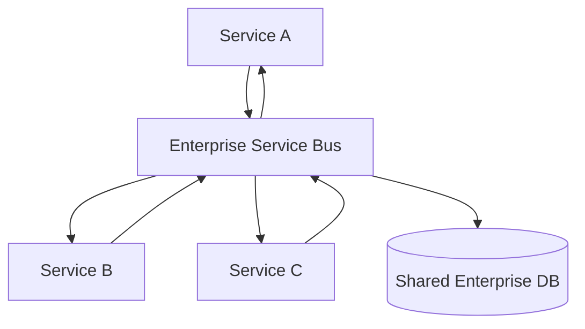

### Trade-off table: SOA vs Microservices

| Dimension | SOA | Microservices |
|---|---|---|
| Communication | Centralized ESB (smart pipes) | Dumb pipes, smart endpoints |
| Service size | Coarse-grained, enterprise services | Fine-grained, single-capability |
| Data | Often shared enterprise DB | DB-per-service |
| Governance | Centralized, heavy (WS-*, SOAP) | Decentralized, per-team |
| Coupling | Logic in the bus → bus becomes bottleneck/SPOF | Logic in services |
| Reuse philosophy | Maximize reuse | Maximize independence |
| Era / protocols | SOAP, XML, WSDL | REST, gRPC, JSON, events |

### When to use which — decisive
- **SOA-style** still appears in large enterprises integrating legacy systems where a mediation/transformation layer is genuinely needed (iPaaS, MuleSoft, Apache Camel as a modern ESB). Use it when integration/transformation across heterogeneous legacy systems is the dominant problem.
- **Microservices** for greenfield cloud-native, autonomous teams. This is the default of the two for new builds.

> **Staff-level insight:** The ESB is SOA's fatal flaw: it centralizes business logic and orchestration into a single team-owned platform, recreating the bottleneck microservices were meant to remove. Microservices learned the lesson: **"smart endpoints, dumb pipes."** When you see an architecture proposing a central bus that *transforms and routes business logic*, flag it — you're rebuilding the ESB. The same anti-pattern reappears as an over-smart API Gateway (§18) — same lesson, keep the pipes dumb.

---

## 6. Event-Driven Architecture (EDA)

### Definition
An architecture where components communicate by producing and consuming **events** — immutable records of something that happened — rather than by direct request/response calls. Producers don't know who consumes. See [Messaging & Event-Driven](04-messaging-event-driven.md).

### Decisive framing — where EDA actually pays off
**Default to synchronous request/response; introduce EDA at high-fan-out seams.** Choose EDA because one event must trigger many independent, evolving reactions, or because you need temporal decoupling (consumers can be down and catch up); revisit toward sync when you need an immediate answer or strong immediate consistency. The anti-pattern is making *everything* an event "for decoupling" and losing every stack trace in the system.

### The three flavors (know all three — this is a common deep-dive)

| Flavor | What the event carries | Coupling | Use when |
|---|---|---|---|
| **Event Notification** | Just "X happened" + an ID | Loosest; consumer calls back for details | Trigger downstream work; minimal payload |
| **Event-Carried State Transfer (ECST)** | Full state snapshot in the event | Consumers keep local replicas, no callback needed | Reduce read load on producer; availability |
| **Event Sourcing** | The event *is* the source of truth | State is derived by replaying events | Audit, temporal queries, rebuild-ability |

A common edge case: **notification vs ECST** is itself a trade-off. Notification keeps payloads small but creates a callback storm (every consumer queries the producer back — a thundering herd on the producer). ECST eliminates the callback but bloats events and risks staleness in the carried snapshot. For a chat presence/unread-count fan-out, ECST (carry the count in the event) usually wins because the read-back would hammer the producer.

### Brokers vs Streams (critical distinction)

| | Message Broker (queue) | Event Stream (log) |
|---|---|---|
| Examples | RabbitMQ, SQS, ActiveMQ | Kafka, Kinesis, Pulsar |
| Semantics | Message consumed and removed | Append-only log, retained, replayable |
| Consumers | Compete for messages | Each reads at own offset, multiple consumer groups |
| Replay | No (once acked, gone) | Yes (rewind offset) |
| Ordering | Per-queue, limited | Per-partition guarantee |
| Best for | Task distribution, RPC-ish work | Event sourcing, stream processing, fan-out |

**Decisive rule:** choose a **log/stream (Kafka)** when replay, audit, or multiple independent consumer groups matter; choose a **broker (SQS/RabbitMQ)** for transient task distribution where once-consumed-is-gone is fine. For chat message fan-out where new consumers (analytics, moderation) get added over time and may need to replay history, the log wins.

### How it works

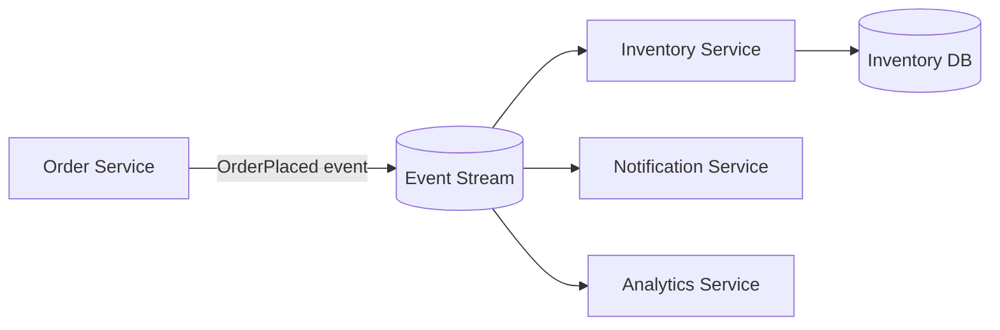

### When to use
- High fan-out: one event, many independent reactions.
- Decoupling producers from an unknown/growing set of consumers.
- Temporal decoupling: consumers can be down and catch up.
- Real-time data pipelines, audit trails.

### When NOT to use
- You need a synchronous answer *now* (request/response semantics).
- Strong, immediate consistency is required.
- Small system where the indirection adds more cognitive load than value.

### Pitfalls
- **Eventual consistency** is now everyone's problem — UIs must handle "not yet reflected."
- **Debuggability**: no stack trace across an async hop. You *must* invest in distributed tracing (correlation IDs propagated through events), a schema registry, and a dead-letter strategy.
- **Hidden coupling via schemas**: producers and consumers are coupled to the event schema. Version events carefully; favor additive, backward-compatible changes.
- **Ordering and duplicates**: design every consumer to be idempotent. Streams give per-partition ordering only — if global order matters, you've mis-partitioned.
- **Poison messages**: one malformed event can wedge a partition; you need a DLQ and a skip/replay strategy or the whole consumer group stalls.

### Worked example — chat message fan-out
A `MessageSent` event published to a partitioned log (partition key = conversation/room ID, so per-conversation order is preserved) drives presence updates, push notifications, unread-count increments, search indexing, and moderation — each an independent consumer group reading at its own offset. Adding "compliance archive" later is a new consumer group replaying from offset zero, zero changes to the producer. This is the textbook case where EDA earns its tax: high fan-out, evolving consumer set, replay needed.

> **Staff-level insight:** The interview trap is treating EDA as "just adding a queue." The real shift is **inverting the dependency**: producers no longer know consumers, which is liberating for evolution but devastating for debuggability and reasoning about system state. State EDA's tax explicitly: *"We trade synchronous reasoning and a stack trace for decoupling and resilience. To pay that tax we need correlation-ID tracing, a schema registry with compatibility rules, idempotent consumers, and a DLQ + replay strategy — those aren't optional, they're the cost of admission."* And earmark the risk concentration: **the schema is now your contract; an un-versioned breaking change silently corrupts every consumer.**

---

## 7. Serverless / FaaS

### Definition
**FaaS (Functions-as-a-Service)**: deploy individual functions that run in response to events; the platform handles provisioning, scaling (to zero and to thousands), and you pay per invocation/GB-second. **BaaS (Backend-as-a-Service)**: managed backend primitives (auth, DB, storage) consumed directly. "Serverless" = FaaS + BaaS, no servers *you* manage.

### How it works

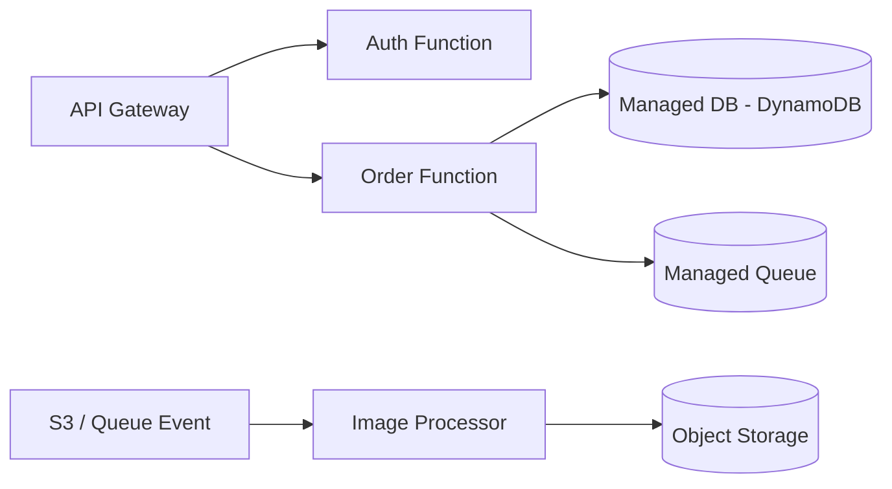

### Decisive framing
**Serverless is a cost/ops optimization for a workload *shape*, not a default architecture.** Choose it for spiky/event-driven/glue workloads because scale-to-zero means you pay nothing at idle; revisit toward containers when utilization becomes steady and high (per-invocation pricing crosses over) or when a synchronous path can't tolerate cold starts.

### When it shines
- **Spiky / unpredictable traffic** — scales to zero, you pay nothing at idle.
- **Event-driven glue** — react to S3 uploads, queue messages, cron, webhooks.
- **Small teams / fast time-to-market** — no infra to manage.
- **Embarrassingly parallel** batch (e.g., 10,000 image thumbnails).

### When it bites
- **Cold starts**: first invocation after idle pays init latency (tens of ms for Go/Node to seconds for heavy JVM/.NET or large dependency trees). Killer for latency-sensitive synchronous paths. Mitigations: provisioned concurrency (costs money, defeats scale-to-zero), lighter runtimes, SnapStart.
- **Statelessness**: no in-memory state survives between invocations; you push state to external stores → more network hops, more latency, connection-pool exhaustion against databases (use proxies like RDS Proxy / Data API).
- **Execution limits**: max duration (e.g., 15 min on Lambda), memory caps, payload size limits.
- **Vendor lock-in**: event formats, IAM, and primitives are provider-specific.
- **Observability** is harder; local dev/testing is awkward.

### The cost crossover (a Staff-level number to know)
Serverless is cheapest at **low and bursty utilization**. As **steady-state utilization rises**, per-invocation pricing crosses over and a reserved/containerized always-on deployment (ECS/EKS/VMs) becomes dramatically cheaper.

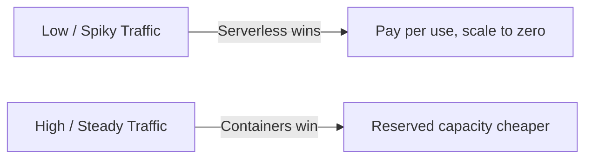

Rule of thumb: if a function runs **near-continuously**, you're renting a server at a markup. The crossover is often cited around the point where you'd keep an instance busy a large fraction of the day. **The famous Prime Video case** moved a serverless (Step Functions + Lambda) pipeline to a monolithic ECS deployment and cut cost ~90% — because it was a high-throughput, steady workload, exactly serverless's worst case.

### Trade-off table

| Dimension | Serverless/FaaS | Containers / VMs |
|---|---|---|
| Ops burden | Minimal | You own orchestration |
| Scaling | Automatic, to zero | Manual/auto-scaling groups |
| Cost at low/spiky load | Excellent | Wasteful (idle capacity) |
| Cost at high/steady load | Poor (markup) | Excellent |
| Latency floor | Cold starts | Predictable, low |
| Long-running jobs | Limited | Unlimited |
| Lock-in | High | Lower |
| State | External only | Can hold in-process |

> **Staff-level insight:** Serverless is a **cost/ops optimization for the workload shape, not a default architecture.** The question isn't "serverless vs not" — it's "what's the traffic shape and utilization?" Spiky/event-driven → serverless. Steady/high-throughput → containers. The mature answer is *hybrid*: serverless for glue, cron, and spiky edges; containers/modular-monolith for the steady-state core. And always mention the cold-start tax on synchronous, latency-sensitive paths — for real-time chat, you keep serverless *off* the message-send path and *on* the spiky edges (media transcode, webhook ingestion). Note: serverless-vs-container *for a given module* is a **two-way door** — name it as such and don't over-agonize.

---

## 8. Cell-Based / Bulkhead Architecture

> Advanced/Staff topic. Mentioning this unprompted signals real operational maturity — but only deploy it when the requirement is blast-radius control at scale, never as decoration.

### Definition
Partition the entire system — compute, data, and routing — into independent, isolated **cells**, each a complete, self-contained instance of the stack serving a subset of users/tenants. A failure or bad deploy is **contained within one cell**, dramatically reducing **blast radius**. The **bulkhead** metaphor comes from ships: watertight compartments so one breach doesn't sink the vessel.

### How it works
- Each cell runs the full application stack independently (no shared fate).
- A thin **cell router** maps each request/tenant to a cell (by hashing a partition key, e.g., account ID).
- Cells are capped in size; you scale by **adding cells**, not growing one.
- Deploys roll cell-by-cell — a bad release blasts one cell, not everyone.

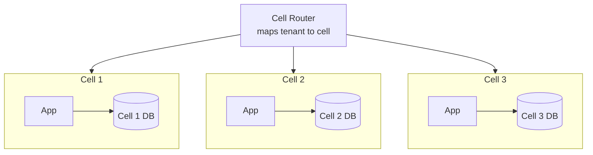

### Shuffle sharding (the clever bit)
Naive sharding: customer mapped to one cell → if that cell is poisoned (e.g., a single noisy tenant), all its customers are affected. **Shuffle sharding** assigns each customer to a *random small subset* of nodes/cells. Because each customer's subset is a different random combination, a single bad actor or failure only overlaps with a tiny fraction of *other* customers' subsets — so the probability any two customers share their *entire* assigned set is vanishingly small. This is how AWS isolates customers so one abusive workload can't take down neighbors.

**Worked intuition:** with 8 nodes and each customer assigned a subset of 2, there are C(8,2) = 28 possible subsets. A single bad customer degrades the 2 nodes in *their* subset; any *other* customer is *fully* knocked out only if their **entire** subset falls inside the bad actor's subset (full overlap) — for subset size 2 that means the identical pair, roughly a 1-in-28 chance, and in general ≈ 1/C(N,k). Crucially, *partial* overlap (sharing only one node) is felt but **survivable**: the client retries onto a remaining good node in its subset, so shuffle sharding must be **paired with retry across the subset** to deliver its isolation. Scale the node count and subset size and the full-overlap probability collapses toward zero. That combinatorial dilution — plus retry over the non-overlapping nodes — is the entire magic.

### When to use — decisive
Adopt cells **only** when blast-radius control is an explicit top-tier requirement at large multi-tenant scale; otherwise this is over-engineering.

- Very large multi-tenant SaaS where blast-radius control is a top-tier requirement.
- Systems with strict availability SLAs where "all customers down" is unacceptable.
- Strong tenant isolation / noisy-neighbor containment needs.

### When NOT to use
- Small/early systems — the operational and routing complexity is enormous overkill. (Classic resume-driven-architecture trap.)
- Workloads needing cross-cell joins/transactions (cells are deliberately isolated; cross-cell ops are expensive).

### Real examples
- **AWS** uses cell-based architecture pervasively (documented in the AWS Well-Architected / Builders' Library "cell-based architecture" and "shuffle sharding" articles).
- **Slack**, **Roblox**, and large SaaS platforms adopt cells for blast-radius control.

### Pitfalls
- Cell sizing and rebalancing (moving a hot tenant between cells) is genuinely hard — and rebalancing live tenants is itself a one-way-door-flavored migration.
- Cross-cell observability and the routing layer become critical SPOFs — the router must be simpler and more reliable than anything it routes to.
- Capacity planning per cell; stranded capacity across cells.

> **Staff-level insight:** Cell-based architecture is the ultimate expression of **"reduce blast radius."** Tie it to a metric: instead of one incident affecting 100% of users, a cell of size 1/N caps any single failure at 1/N of users, and shuffle sharding makes correlated multi-tenant failure exponentially unlikely. In an availability-critical design, proposing cells with cell-by-cell deploys is exactly the kind of resilience thinking interviewers probe for at Staff+. But earmark the YAGNI line: *"I'd only reach for cells once blast radius is an explicit SLA requirement — for a smaller system this is operational overkill I'd defer."*

---

## 9. Component-Level: Layered (n-tier)

> Altitude note: this is a name-and-move-on basic. Know it cold, spend one sentence on it, pivot to the dependency-direction insight that motivates hexagonal/clean.

### Definition
Organize code into horizontal layers — typically Presentation → Application/Service → Domain/Business → Data Access → Database — where each layer only depends on the one below it.

### How it works

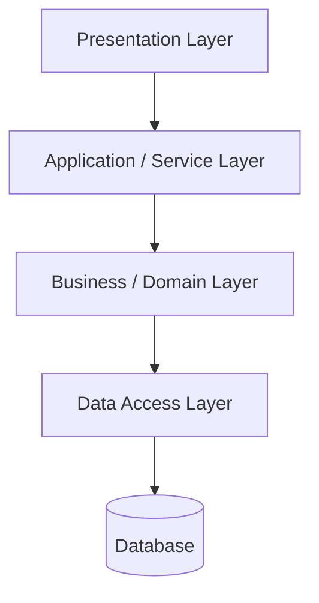

### When to use
- Simple-to-moderate apps; the default mental model most engineers share (low onboarding cost).
- CRUD-heavy systems.

### When NOT to use
- Complex domains where business logic gets smeared across layers and the DB ends up driving the design ("database-centric" design).
- Highly testable, swappable-infrastructure requirements (layered tends to couple domain to the data layer's direction).

### Trade-off table

| Pro | Con |
|---|---|
| Familiar, low cognitive load | Risk of "anemic domain" — logic leaks into services |
| Clear separation of concerns | Layers often become a pass-through; "lasagna code" |
| Easy to staff | Domain depends downward on infrastructure → harder to test/swap |

> **Staff-level insight:** Layered architecture's hidden flaw is **dependency direction**: the domain depends *downward* on the database. This is exactly what Hexagonal and Clean invert. If an interviewer asks why you'd choose Hexagonal over Layered, the one-liner is: *"Layered makes the database the foundation; Hexagonal makes the domain the foundation and the database a detail."* That single sentence is the whole component-architecture conversation — don't belabor the rest.

---

## 10. Hexagonal — Ports & Adapters

### Definition
Put the **domain at the center**, and isolate it from the outside world via **ports** (interfaces the domain defines) and **adapters** (implementations that plug into those ports). The outside (UI, DB, message bus, external APIs) depends on the domain — never the reverse.

### How it works
- **Driving (primary) adapters** call *into* the application through input ports (e.g., REST controller, CLI, test harness).
- **Driven (secondary) adapters** are called *by* the application through output ports (e.g., a repository, an email sender, a payment gateway).
- The domain knows only the port interfaces; you swap adapters freely (real DB in prod, in-memory in tests).

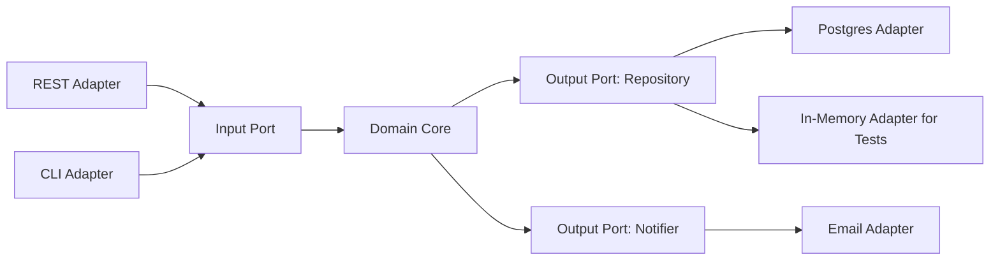

### When to use — decisive
Use hexagonal as the **per-module internal structure inside a modular monolith** when the domain is rich and infra is likely to change; skip the ceremony for trivial CRUD.

- Rich domains where business logic is the crown jewel and must be testable in isolation.
- Infrastructure likely to change (DB swap, new transport, external vendor swap).
- Strong unit-testing culture.

### When NOT to use
- Trivial CRUD — the ceremony (interfaces + adapters for everything) outweighs benefit.

### Trade-off table

| Pro | Con |
|---|---|
| Domain testable with zero infra (in-memory adapters) | More boilerplate (ports + adapters) |
| Swap DB/transport/vendor without touching domain | Over-engineering risk for simple apps |
| Clear dependency direction (inward) | Team must understand the pattern |

> **Staff-level insight:** Hexagonal's payoff is **test speed and infrastructure optionality**: your entire domain test suite runs in milliseconds against in-memory adapters, and "we need to swap Postgres for DynamoDB" becomes a new adapter, not a rewrite. Pair it with the modular monolith — each module is its own hexagon — and you get fast tests *and* extractability. That pairing (modular monolith of hexagons) is the single most quietly-impressive structural answer you can give.

---

## 11. Clean / Onion Architecture

### Definition
A family closely related to Hexagonal. Concentric layers — **Entities (core) → Use Cases → Interface Adapters → Frameworks & Drivers** — governed by **the Dependency Rule: source-code dependencies point only inward.** Inner layers know nothing about outer layers.

### How it works
Outer layers (frameworks, DB, web) depend on inner (use cases, entities). Crossing inward you use interfaces + dependency inversion. The database, web framework, and UI are all "details" at the outermost ring.

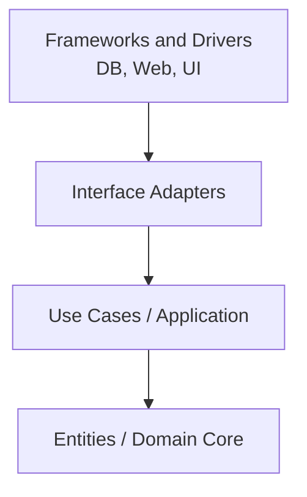

### When to use / NOT to use
Same envelope as Hexagonal — rich domains, longevity, testability. Avoid for thin CRUD. Onion and Clean and Hexagonal are *variations on the same theme* (dependency inversion toward the domain); don't get caught arguing they're fundamentally different.

### Trade-off table

| Pro | Con |
|---|---|
| Framework/DB are replaceable details | Indirection; many small classes/interfaces |
| Highly testable core | Onboarding/cognitive cost |
| Long-lived, change-tolerant | Easy to over-apply |

> **Staff-level insight:** Clean, Onion, and Hexagonal all encode the same one rule: **dependencies point toward the domain; infrastructure is a plugin.** Interviewers love when you collapse the buzzwords: *"They're three names for the Dependency Inversion Principle applied at architecture scale — keep business rules pure and push frameworks to the edge."* Collapsing three buzzwords into one principle is itself the altitude signal — you're showing you won't waste the room's time on a distinction that doesn't pay.

---

## 12. Microkernel / Plugin

### Definition
A minimal **core (kernel)** provides only essential functionality and an extension mechanism; all feature-specific behavior lives in **plug-ins** loaded around the core. New capabilities arrive as plug-ins without changing the kernel.

### How it works

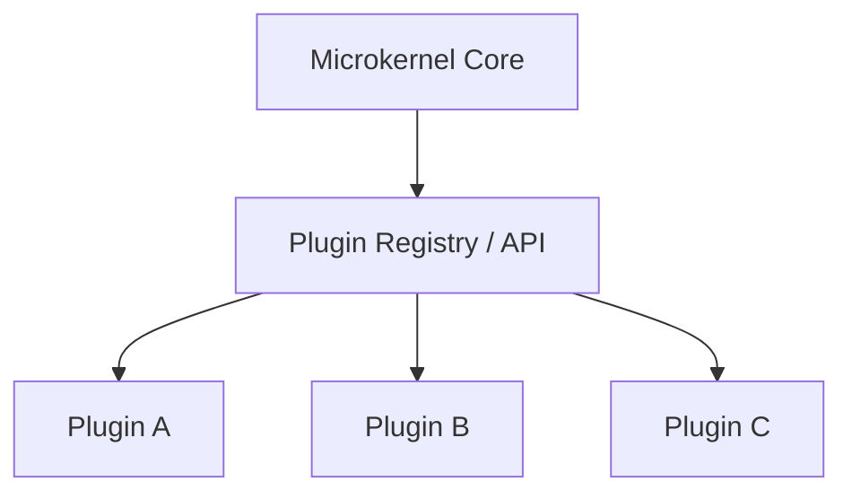

### When to use — decisive
Use microkernel when **third-party or per-customer extensibility is a product requirement** — and be ready to invest heavily in API stability up front, because the plugin contract is a one-way door.

- Product platforms with third-party or per-customer extensibility: IDEs (VS Code, Eclipse), browsers, CI tools, payment/rules engines, CMSs.
- Variability across deployments/customers handled by enabling different plug-in sets.

### When NOT to use
- Highly interdependent features that can't be cleanly isolated into plug-ins.
- When the plug-in API surface would be enormous/unstable.

### Trade-off table

| Pro | Con |
|---|---|
| Extensible without touching core | Designing a stable plugin API is hard (one-way door) |
| Feature isolation, optional capabilities | Plugin versioning / compatibility matrix |
| Per-customer customization | Cross-plugin coordination is awkward |

> **Staff-level insight:** The microkernel's hard part — and the thing to call out — is that **the plugin contract is a one-way door**: once third parties build against your API, you can't change it freely. Invest disproportionately in API design and versioning before exposing it. VS Code's success is largely an *API stability* story, not a kernel story. For a chat platform, a webhook/extension API for customers is exactly this pattern — and the same warning applies: version it from day one or you'll freeze your roadmap to avoid breaking integrations.

---

## 13. Pipes and Filters

### Definition
Decompose processing into a chain of independent **filters** (transform steps) connected by **pipes** (channels). Each filter consumes input, transforms, emits output; filters are composable and reusable.

### How it works

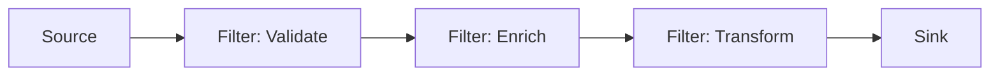

### When to use — decisive
Use pipes-and-filters for **data/stream processing where steps are independent and individually scalable**; avoid it for low-latency request/response where pipeline hops add overhead.

- Data/stream processing, ETL, compilers, media transcoding, log/event pipelines.
- Steps are independent, reorderable, and individually scalable.
- Unix philosophy (`grep | sort | uniq`) is the canonical example; Kafka Streams / Flink / Spark, AWS Step Functions, and CI/CD pipelines all embody it.

### When NOT to use
- Tight inter-step coupling or shared mutable state across steps.
- Low-latency request/response where pipeline hops add overhead.

### Trade-off table

| Pro | Con |
|---|---|
| Composable, reusable, individually scalable filters | Latency adds up across stages |
| Easy to parallelize each stage | Error handling across stages is tricky |
| Clear data flow | Backpressure must be managed |

> **Staff-level insight:** Pipes-and-filters scales *per stage* — you can give the CPU-bound transcoding filter 50 workers and the I/O-bound enrich filter 5. The architectural risk is **backpressure**: a slow downstream filter must signal upstream to slow down, or you get unbounded buffering and OOM. Naming backpressure handling (bounded queues, reactive streams, consumer-lag-based throttling) shows you've run real pipelines. Earmark it as the risk crux — everything else about this pattern is mechanical.

---

## 14. CQRS

### Definition
**Command Query Responsibility Segregation**: separate the model that **writes** (commands — mutate state) from the model that **reads** (queries — return data). They can be different code paths, different schemas, even different databases.

### How it works
- Commands go through the write model (validation, domain rules, normalized store).
- Reads hit denormalized read models optimized for query shapes, often kept in sync asynchronously (frequently via events → eventual consistency).

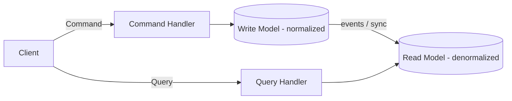

### Decisive framing — the YAGNI front line
**Default: CQRS-lite (separate read models/queries, *same* database, no eventual consistency) — or nothing at all.** Reach for *full* CQRS (separate stores, async projections) only when read scale or projection variety genuinely forces it. CQRS is the single most over-applied pattern in system-design interviews; reaching for separate stores by reflex is a textbook over-engineering tell.

### When the complexity pays off
- Read and write workloads have **vastly different scale/shape** (read-heavy with complex query patterns).
- Read side needs multiple specialized projections (search index, dashboard, mobile shape).
- Pairs naturally with Event Sourcing and collaborative domains with high contention.

### When NOT to use
- Simple CRUD — CQRS doubles your models and introduces eventual consistency for no benefit.

### Trade-off table

| Pro | Con |
|---|---|
| Independent scaling/optimization of reads vs writes | Two models to maintain |
| Tailored read projections | Eventual consistency between write and read |
| Plays well with Event Sourcing | Added complexity, sync machinery |

> **Staff-level insight:** CQRS is not "all or nothing." Most real wins come from **CQRS-lite**: same database, separate read models/queries optimized for the screen, without separate stores or eventual consistency. Reach for *full* CQRS (separate stores, async projections) only when read scale or projection variety genuinely forces it. Conflating "I separated my read and write code" with "I need separate event-sourced stores" is a classic over-engineering tell. The decisive line: *"I'd do CQRS-lite — same DB, query-shaped read models — and only split stores when read throughput exceeds what one DB serves, which I'd revisit on the metric, not speculatively."*

---

## 15. Event Sourcing

### Definition
Persist state as an **immutable, append-only sequence of events** (facts of what happened). Current state is *derived* by replaying events. The event log — not a snapshot table — is the source of truth.

### How it works
- Every state change is an event appended to the log (`AccountOpened`, `MoneyDeposited`, `MoneyWithdrawn`).
- Current state = fold/replay all events for an aggregate.
- **Snapshots** periodically materialize state to avoid replaying from the beginning every time.
- Projections build read models (often CQRS read side) from the event stream.

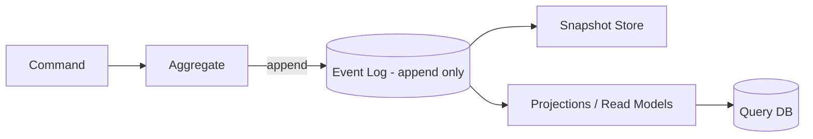

### Decisive framing — the strongest YAGNI line in the module
**Default: do NOT event-source.** Choose it only when a complete audit trail, temporal queries, or retroactive rebuildability is a *hard requirement* (finance, ledgers, compliance). For "I want an audit log," the right answer is almost always an append-only `audit_log` table, not a full event-sourced rewrite of your domain. **Event-sourcing-because-it's-cool is the #1 over-engineering anti-pattern in this entire module.**

### When to use
- Full **audit trail** is a hard requirement (finance, healthcare, compliance, ledgers).
- **Temporal queries** — "what was the state at time T?" / time-travel debugging.
- Need to rebuild read models or derive new projections retroactively.
- High-contention collaborative domains; pairs with CQRS.

### When NOT to use
- Simple CRUD; teams without strong distributed-systems maturity.
- Domains where the event model churns constantly (versioning pain, below).

### The gotchas (interviewers probe these hard — this is the deep-dive crux)
- **Event versioning / schema evolution**: events live *forever*; you must handle old event shapes for all time. Strategies: **upcasting** (transform old events on read into the current shape), weak/additive schemas, versioned event types. This is the #1 long-term pain and the question that exposes whether someone has *operated* an event-sourced system.
- **GDPR / right-to-be-forgotten vs immutable log**: you can't delete from an append-only log, but law requires erasing personal data. Solutions: **crypto-shredding** (encrypt each subject's PII with a per-subject key; delete the key → the data is permanently unrecoverable even though the ciphertext remains in the log), keeping PII *out* of events (store a reference/ID and put PII in a mutable side store you *can* delete), or tombstone/compaction strategies. *Mentioning crypto-shredding unprompted is one of the strongest Staff signals in this module.*
- **Replay cost / snapshots**: long streams are slow to replay; snapshots are mandatory at scale.
- **Eventual consistency** on the read side (projections lag the log).

### Trade-off table

| Pro | Con |
|---|---|
| Complete audit log, time travel | Event versioning is forever |
| Rebuild/derive any read model | GDPR deletion conflicts with immutability |
| Natural fit with CQRS, debugging | Replay cost; snapshots needed |
| No lost information | High complexity, steep learning curve |

> **Staff-level insight:** Event sourcing's superpower (immutability + replay) is also its curse (you can never change or delete the past). The two questions that expose whether someone has *operated* an event-sourced system: **"How do you version events?"** (upcasting) and **"How do you comply with GDPR right-to-be-forgotten on an immutable log?"** (crypto-shredding + keep-PII-out). Answer both and you've demonstrated you've lived it, not just read about it. The decisive framing to lead with: *"I wouldn't event-source by default — the requirement that justifies it is a hard audit/compliance mandate. Absent that, an append-only audit table gives 80% of the value without the versioning-and-GDPR tax."*

---

## 16. Materialized View Pattern

### Definition
Precompute and store the result of an expensive query/join as a **read-optimized view**, refreshed (eagerly via events or on a schedule) so reads are fast lookups instead of live computation.

### How it works

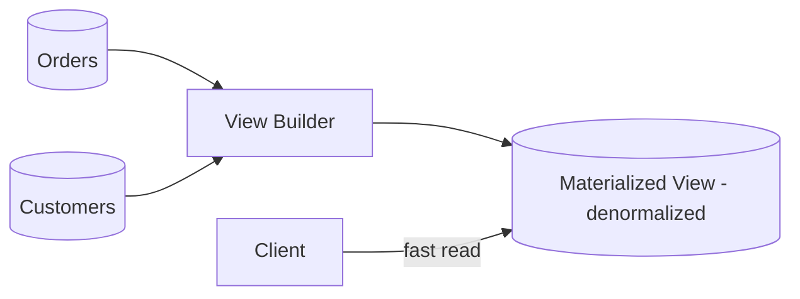

### When to use — decisive
Use materialized views when reads over expensive joins/computation are hot and a defined staleness is acceptable; the decision hinges entirely on **naming the freshness SLA** up front.

- Read-heavy paths over data that's expensive to compute/join live.
- The read side of CQRS / projections in event sourcing.
- Dashboards, leaderboards, feed pre-computation, chat unread-count rollups.

### When NOT to use
- Data changes faster than you can refresh and strong freshness is required.
- Storage cost of duplicated data outweighs the read savings.

### Trade-off table

| Pro | Con |
|---|---|
| Fast reads, offloads source | Staleness (refresh lag) |
| Tailored to query shape | Extra storage + refresh machinery |
| Resilient to source load spikes | Invalidation complexity |

> **Staff-level insight:** Materialized views are the concrete mechanism behind CQRS read models and event-sourcing projections — frame them as "**precompute the answer; trade storage + staleness for read latency.**" The hard part is always **invalidation/refresh strategy**, not the view itself. Name your freshness SLA explicitly (e.g., "the unread-count badge can be 5s stale; the account balance must be live") — that single sentence converts a vague pattern into a decided engineering choice.

---

## 17. Strangler Fig

### Definition
Incrementally migrate a legacy system by **wrapping it with a routing facade** and replacing functionality piece by piece — new pieces handle some routes, the legacy handles the rest — until the legacy is fully "strangled" and removed. Named after the strangler fig vine that grows around a tree and eventually replaces it. (Coined by Martin Fowler.)

### How it works

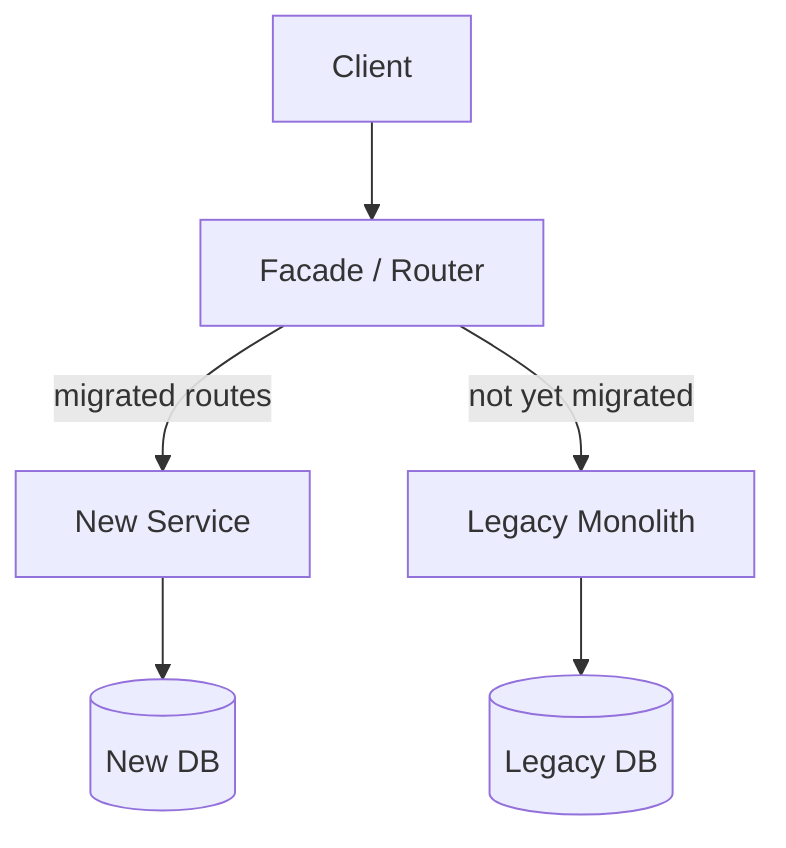

- Stand up a facade in front of the legacy system.
- Move one capability at a time behind the facade; route that traffic to the new implementation.
- Repeat until nothing routes to legacy; delete legacy.

### When to use — decisive
**Default migration strategy for any non-trivial legacy system. Never a big-bang rewrite.** Choose Strangler Fig because it delivers value continuously and stays reversible per step; the only time to skip it is when the legacy is small enough to rewrite safely in one short cycle.

- Migrating a risky legacy monolith without a big-bang rewrite (which famously fails).
- You need continuous delivery of value during a multi-quarter migration.

### When NOT to use
- The legacy is small enough to rewrite quickly and safely.
- Capabilities are so entangled you can't carve off a coherent slice (fix the boundaries first).

### Trade-off table

| Pro | Con |
|---|---|
| Incremental, low-risk, reversible per step | Facade + dual-running costs |
| Delivers value continuously | Data sync between old/new during transition |
| Avoids catastrophic big-bang rewrite | Migration can drag on for years |

> **Staff-level insight:** Strangler Fig is the *responsible* migration story — and the keyword interviewers want is **"avoid the big-bang rewrite."** The genuinely hard, under-discussed part is **data**: while both systems run, who owns the data, and how do you keep them in sync (dual writes, CDC, the [Outbox](#18-integration--decomposition-patterns) pattern)? Lead with that and you sound like someone who's actually done a migration, not read a blog. Earmark the risk concentration explicitly: **the facade and the routing are easy; the data ownership and sync during the dual-run window is where migrations actually die.**

---

## 18. Integration & Decomposition Patterns

A rapid-fire tour of the patterns that glue and split distributed systems. Each is a tool; the skill is knowing *which problem it solves* — and not reaching for them until the problem exists.

### Saga
Manage a distributed transaction as a sequence of **local transactions**, each publishing an event/command that triggers the next; failures trigger **compensating transactions** to undo. The answer to "no distributed ACID across services." Deep dive in [Distributed Systems](02-distributed-systems.md).

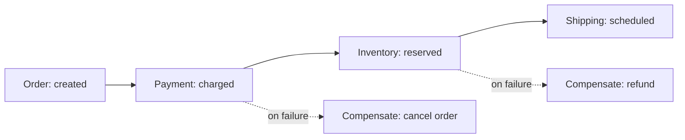

**Trade-off:** eventual consistency + must design compensations + harder reasoning; vs. the only realistic way to coordinate state across services without a 2PC bottleneck. **Decisive note:** you only need a Saga once you've *split* into services — inside a modular monolith, this is a local DB transaction. The need for Sagas is itself a cost of microservices to weigh.

### Outbox
Atomically write business state **and** an "event to publish" row in the **same local DB transaction**, then a relay/CDC process publishes the outbox rows to the broker. Solves the **dual-write problem** (DB commit + message publish can't be atomic otherwise → lost or phantom events).

```mermaid
flowchart LR
    SVC[Service] -- one tx --> DB[(DB + Outbox table)]
    DB --> REL[Relay / CDC]
    REL --> BUS[(Message Broker)]
```

**Trade-off:** extra table + relay infra and at-least-once delivery (consumers must be idempotent); vs. guaranteed consistency between state change and event emission. **Essential whenever you "save then publish" — this is non-negotiable, not optional.** The dual-write scar is one of the most common real-world data-loss bugs.

### Sidecar / Ambassador
Deploy cross-cutting concerns (proxying, retries, mTLS, telemetry, service discovery) as a **separate process co-located** with the app (the sidecar) rather than in the app. The **Ambassador** variant specifically proxies *outbound* network calls. Basis of the **service mesh** (Envoy/Istio/Linkerd). See [Microservices](10-microservices.md).

```mermaid
flowchart LR
    subgraph Pod
        APP[App Container] <--> SC[Sidecar Proxy]
    end
    SC <--> NET[Network / Other Services]
```

**Trade-off:** per-pod resource overhead + operational complexity of the mesh; vs. polyglot, language-agnostic, uniform networking/observability without touching app code. **Decisive note:** a service mesh earns its keep at many-service polyglot scale; for a handful of services it's overhead you don't need yet.

### Backends-for-Frontends (BFF)
A dedicated backend per frontend experience (web BFF, iOS BFF, partner BFF), each tailoring/aggregating downstream calls to that client's exact needs — instead of one generic API serving all.

```mermaid
flowchart TB
    WEB[Web App] --> WBFF[Web BFF]
    IOS[iOS App] --> IBFF[Mobile BFF]
    WBFF --> S1[Service A]
    WBFF --> S2[Service B]
    IBFF --> S1
    IBFF --> S2
```

**Trade-off:** BFF proliferation/duplication; vs. each client gets an optimized, decoupled API (mobile sends one request instead of six, gets exactly the fields it needs). Owned by the frontend team — that ownership alignment is the real win.

### API Gateway
A single entry point fronting many services, handling cross-cutting edge concerns: routing, auth, rate limiting, TLS termination, request aggregation, caching. (Kong, AWS API Gateway, NGINX, Apigee.)

```mermaid
flowchart LR
    C[Clients] --> GW[API Gateway<br/>auth, rate limit, routing]
    GW --> A[Service A]
    GW --> B[Service B]
    GW --> CC[Service C]
```

**Trade-off:** potential bottleneck/SPOF + risk of becoming a logic-laden ESB; vs. centralized edge concerns and a clean client contract. **Keep it dumb** — routing and policy, *not* business logic (the SOA/ESB lesson again). The moment business logic creeps into the gateway, you've rebuilt the ESB you were avoiding.

### Anti-Corruption Layer (ACL)
A translation layer between your clean domain model and an external/legacy system, so the foreign model's concepts and quirks **don't leak** into and corrupt your domain. A DDD pattern; vital during Strangler Fig migrations and third-party integrations.

```mermaid
flowchart LR
    DOM[Your Clean Domain] --> ACL[Anti-Corruption Layer<br/>translate / adapt]
    ACL --> LEG[Legacy / External System]
```

**Trade-off:** extra mapping code/layer; vs. protecting domain integrity from a messy external model. The defensive boundary that keeps a migration from infecting your new system.

> **Staff-level insight:** These patterns chain together in a real migration story: *Strangler Fig facade* routes traffic, an *Anti-Corruption Layer* shields the new service from the legacy model, the *Outbox* keeps old and new data in sync via CDC, *Sagas* coordinate cross-service writes, and a *BFF/API Gateway* stabilizes the client contract throughout. Telling that integrated narrative — rather than reciting patterns in isolation — is what reads as Staff-level. The altitude discipline: don't enumerate all six unprompted; introduce each *as the problem that needs it arises* in your design.

---

## 19. Sharding, Scatter-Gather, Choreography vs Orchestration

### Sharding / Partitioning as an architectural pattern
Split data (and load) **horizontally** across nodes by a **partition/shard key**, so each shard holds a subset. This is the foundational scaling pattern when a single node can't hold the data or serve the write throughput. (More in [Distributed Systems](02-distributed-systems.md).)

```mermaid
flowchart TB
    R[Router by shard key] --> S1[(Shard 1<br/>keys A-H)]
    R --> S2[(Shard 2<br/>keys I-P)]
    R --> S3[(Shard 3<br/>keys Q-Z)]
```

- **Shard key choice is a one-way door** — re-sharding live data is one of the most painful operations in distributed systems. Invest the most design effort here of anything in §19.
- Watch for **hotspots** (skewed keys), **cross-shard queries/joins** (expensive — avoid in your access patterns), and **rebalancing** (consistent hashing minimizes data movement).

**Trade-off:** near-linear scale + isolation; vs. lost cross-shard transactions/joins, hotspot risk, and operational complexity of rebalancing.

**Decisive note for chat:** the shard key for messages is the one-way door — typically the conversation/room ID (keeps a conversation's history co-located and ordered). Picking user ID instead scatters a single conversation across shards and makes loading a chat a cross-shard fan-out. Get this right before launch; re-sharding live message history is a quarter you don't want to spend.

### Scatter-Gather
Fan a request **out** to many nodes/shards in parallel, then **aggregate** their partial results into one response. The read counterpart to sharding (and how search engines work).

```mermaid
flowchart TB
    Q[Query] --> AGG[Aggregator]
    AGG --> N1[Node 1]
    AGG --> N2[Node 2]
    AGG --> N3[Node 3]
    N1 --> AGG
    N2 --> AGG
    N3 --> AGG
    AGG --> RES[Merged Result]
```

**Trade-off:** parallelism + queries across all shards; vs. **tail-latency amplification** — the slowest node bounds the whole response (the "tail at scale" problem). Mitigate with timeouts, hedged/speculative requests, and returning partial results. **Earmark tail latency as the risk crux** — at 100 shards, your p99 is dominated by the slowest shard's p99, so the math gets brutal fast.

### Choreography vs Orchestration
Two ways to coordinate a multi-service workflow (e.g., a Saga):

```mermaid
flowchart TB
    subgraph Orchestration
        ORCH[Central Orchestrator] --> SA[Service A]
        ORCH --> SB[Service B]
        ORCH --> SC[Service C]
    end
    subgraph Choreography
        EA[Service A] -- event --> EB[Service B]
        EB -- event --> EC[Service C]
    end
```

| | Orchestration | Choreography |
|---|---|---|
| Control | Central conductor commands each step | Services react to events, no central brain |
| Visibility | Explicit, easy to see/monitor the flow | Emergent, harder to trace end-to-end |
| Coupling | Orchestrator coupled to all services | Loosely coupled, but implicit dependencies |
| Change | Change one place (orchestrator) | New behavior = new subscriber, no central change |
| Risk | Orchestrator = SPOF / god-object | "Where is the workflow?" — no single answer |
| Tools | Temporal, AWS Step Functions, Camunda | Kafka events, pub/sub |

**When to use which — decisive:** Orchestration for complex, business-critical flows that need visibility/SLA tracking and a single source of truth (most multi-step business workflows — and durable engines like **Temporal** make it resilient *and* observable). Choreography for simple fan-out reactions where maximum decoupling and evolvability matter more than central visibility.

> **Staff-level insight:** The pendulum has swung back toward **orchestration** for complex business workflows because *observability and debuggability* matter more than maximal decoupling — "where is the order in the workflow?" must have an answer at 3am. Durable orchestrators (Temporal, Step Functions) give you choreography-like resilience with orchestration's visibility. State the trade explicitly: choreography optimizes for *evolvability and decoupling*; orchestration optimizes for *visibility and control*. Decisive line: *"Orchestration with Temporal for the business-critical multi-step flow because I need to answer 'where is this right now?' on call; choreography only for the simple fan-out edges."*

---

## 20. Multi-Tenancy: Silo vs Pool vs Bridge

How you isolate tenants in a SaaS is a **one-way door** with huge cost, security, and compliance implications. The three canonical models map to **separate DB / separate schema / shared schema with `tenant_id`**. (Tie to [Leadership & Trade-offs](19-leadership-tradeoffs.md) — this is often a business decision as much as a technical one.)

```mermaid
flowchart TB
    subgraph Silo
        T1[Tenant A] --> DB1[(DB A)]
        T2[Tenant B] --> DB2[(DB B)]
    end
    subgraph Bridge
        T3[Tenant C] --> SCHEMA1[Schema C]
        T4[Tenant D] --> SCHEMA2[Schema D]
        SCHEMA1 --> SHDB[(Shared DB)]
        SCHEMA2 --> SHDB
    end
    subgraph Pool
        T5[Tenant E] --> SHARED[(Shared Tables<br/>tenant_id column)]
        T6[Tenant F] --> SHARED
    end
```

### Decisive framing
**Default: Pool (shared schema + `tenant_id`) with Row-Level Security enforced at the database.** Choose it because it scales to millions of small tenants at the lowest cost per tenant; revisit toward Silo *for a specific tier* when an enterprise tenant demands physical isolation or data residency. Real platforms are tiered/hybrid, not single-model — say that out loud.

### Trade-off table

| Dimension | Silo (DB per tenant) | Bridge (schema per tenant) | Pool (shared schema + tenant_id) |
|---|---|---|---|
| **Isolation** | Strongest (physical) | Strong (logical) | Weakest (row-level) |
| **Cost per tenant** | Highest | Medium | Lowest |
| **Noisy neighbor** | None | Limited | High risk |
| **Blast radius** | Tiny (one tenant) | One schema | All tenants |
| **Scalability (# tenants)** | Poor (DB sprawl) | Medium (schema limits) | Excellent (millions) |
| **Per-tenant customization/backup/restore** | Easy | Medium | Hard |
| **Compliance/data residency** | Easy (place DB anywhere) | Medium | Hard |
| **Ops/maintenance (migrations)** | Painful (N databases) | Medium (N schemas) | Easy (one migration) |
| **Onboarding cost** | Heavy (provision DB) | Medium | Trivial (insert row) |

### When to use which
- **Silo**: enterprise/regulated tenants, strict data-residency or isolation requirements, premium tiers, few large tenants. The danger you must guard against in Pool — accidental cross-tenant data leakage via a missing `tenant_id` filter — is structurally impossible here.
- **Pool**: high-volume, many small tenants (freemium/SMB), cost-sensitive, where per-tenant ops would be unmanageable. The critical risk: a single missing `WHERE tenant_id = ?` leaks data across tenants — enforce with Row-Level Security (RLS), a mandatory tenant-scoped data layer, and tests.
- **Bridge**: middle ground; logical isolation, easier per-tenant backup/restore than pool, but schema-count limits cap how far it scales.

### The deep-dive crux — cross-tenant leakage
This is the one place in multi-tenancy where you must slow down and go deep, because it's a **security incident, not a bug**. In Pool, every query touching tenant data needs a tenant scope, and "every developer remembers the `WHERE` clause" is not a control — it's a hope. The defenses, in order of strength:

1. **Database Row-Level Security (RLS)** — Postgres RLS policies that the DB enforces regardless of the query the app sends. The tenant context is set per-connection/session; the database itself refuses to return other tenants' rows. This is the structural control.
2. **A mandatory tenant-scoped data-access layer** — no raw query path that bypasses tenant injection; the repository physically cannot build a query without a tenant context.
3. **Tests that assert isolation** — fixtures with two tenants, asserting tenant A can never read tenant B.

> **Staff-level insight:** Real SaaS platforms are **tiered/hybrid**: Pool for the SMB long tail (cost), Silo for enterprise tenants who pay for and demand isolation/residency — exactly the cell-based idea applied to tenancy. Combine with [cell-based architecture](#8-cell-based--bulkhead-architecture) to cap blast radius even within the pool. And always name the Pool model's silent killer: **cross-tenant data leakage from a forgotten tenant filter — mitigated by Row-Level Security, not developer discipline.** For a real-time chat platform this is existential: leaking one tenant's messages to another is the kind of incident that ends contracts. State that you'd enforce isolation at the database, not the application.

---

## 21. Choosing an Architecture — Decision Framework

> This is the centerpiece. A Staff Engineer doesn't memorize patterns — they run a *decision process* and justify trade-offs out loud. Use this flowchart to drive any "how would you architect X?" question. The whole framework rests on the **one-way vs two-way door** lens from §1.

### The decision flowchart

```mermaid
flowchart TD
    START[New system or major evolution] --> Q1{Team size<br/>and number of teams?}
    Q1 -- 1 to 2 teams --> MOD[Modular Monolith<br/>enforced boundaries]
    Q1 -- many autonomous teams --> Q2{Domain boundaries<br/>well understood?}
    Q2 -- No --> MOD
    Q2 -- Yes --> Q3{Need independent<br/>scaling or deploy?}
    Q3 -- No --> MOD
    Q3 -- Yes --> MICRO[Microservices<br/>per bounded context]
    MOD --> Q4{Traffic spiky<br/>or event-driven glue?}
    MICRO --> Q4
    Q4 -- Yes --> SVL[Add Serverless / FaaS<br/>for edges and glue]
    Q4 -- No --> Q5{Read/write skew<br/>or audit needs?}
    SVL --> Q5
    Q5 -- Heavy read skew --> CQRS[Apply CQRS / Materialized Views]
    Q5 -- Audit / time-travel --> ES[Event Sourcing + CQRS]
    Q5 -- Neither --> DONE[Ship and measure]
    MICRO --> Q6{Blast radius<br/>critical at scale?}
    Q6 -- Yes --> CELL[Cell-based + shuffle sharding]
```

### The dimensions to reason over (say these out loud)

1. **Team topology / size** (Conway's Law). Architecture mirrors org structure. Few teams → monolith. Many autonomous teams → services. *Choose the architecture you can staff and operate.*
2. **Domain complexity & maturity of boundaries.** Unknown boundaries → modular monolith (cheap to refactor). Stable, well-understood bounded contexts → safe to split.
3. **Scale & load shape.** Uniform → monolith scales fine. Divergent per-component load → independent scaling (services/serverless). Spiky → serverless. Steady & high → containers.
4. **Time-to-market.** Early/pre-PMF → simplest thing that works (monolith). Cementing boundaries early is the costliest mistake.
5. **Consistency & data needs.** Strong transactional → monolith/single DB. Tolerant of eventual consistency → EDA/CQRS/sagas.
6. **Operational maturity.** No tracing/CI-per-service/on-call? You're not ready for microservices regardless of scale.
7. **Compliance / isolation** (multi-tenancy, residency) → silo/cells.

### The meta-point: reversibility (the centerpiece)

For every choice, classify it. This table is the single most important artifact in the module — internalize it.

| Decision | Door type | Implication |
|---|---|---|
| Web framework, queue tech, cache | Two-way | Decide fast, low ceremony |
| Serverless vs containers for a module | Two-way | Decide on workload shape, don't agonize |
| Service boundaries / bounded contexts | **One-way** | Prototype, ADR, senior review |
| Data model & shard key | **One-way** | Hardest to reverse — invest most here |
| Consistency model (sync vs eventual) | **One-way (mostly)** | Propagates through whole design |
| Multi-tenancy isolation model | **One-way** | Migration is a major project |
| Event-sourcing your domain | **One-way (very)** | Events are forever; versioning + GDPR tax forever |
| Monolith vs microservices *deployment* | Two-way *if* boundaries are clean | Modular monolith keeps it reversible |

> **Staff-level insight:** The single most important meta-skill: **make the one-way doors right and keep the two-way doors open.** Concretely, that's: *invest in getting domain boundaries and the data model correct (one-way), and choose a modular monolith so deployment topology stays a reversible refactor (two-way).* When asked "monolith or microservices?", never answer with a pattern — answer with: *"It depends on team count, boundary maturity, and load shape. My default is a modular monolith with enforced boundaries and per-module data ownership, extracting services only when a concrete forcing function appears. That gets the irreversible decisions right while keeping the reversible ones open."* That answer is the difference between a senior and a Staff candidate — note it deploys the decisive pattern (`default` + `because` + `trigger`) rather than the forbidden bare "it depends."

---

## Interview Cheat-Sheet

**One-liners to deploy:**

- **Default**: "Modular monolith with enforced boundaries + per-module data ownership. Extract services only on a concrete forcing function."
- **Microservices justification**: "Independent deployability for autonomous teams — a people-scaling solution, paid for in operational complexity."
- **Monolith honesty**: "A function call is the most reliable, lowest-latency, transactional RPC ever made."
- **SOA vs micro**: "Smart endpoints, dumb pipes. The ESB centralizes logic and becomes the bottleneck."
- **EDA tax**: "We trade a stack trace and synchronous reasoning for decoupling; the price is tracing, schema registry, idempotency, and a DLQ + replay."
- **Serverless**: "Cost optimization for spiky/event-driven workloads; crosses over to containers at steady high utilization (see Prime Video ~90% saving)."
- **Cells**: "Cap blast radius to 1/N of users; shuffle sharding makes correlated multi-tenant failure exponentially unlikely."
- **Hexagonal/Clean/Onion**: "Three names for dependency inversion toward the domain — infrastructure is a plugin."
- **CQRS**: "Usually you want CQRS-lite (separate read models, same DB) — full CQRS only when read scale/variety forces it."
- **Event Sourcing gotchas**: "Don't, unless audit forces it. Event versioning is forever; GDPR via crypto-shredding."
- **Strangler Fig**: "Avoid the big-bang rewrite; the hard part is data sync (CDC/Outbox), not routing."
- **Outbox**: "Never save-then-publish without it — the dual-write problem loses events."
- **Orchestration vs choreography**: "Pendulum swung to orchestration for complex flows — visibility beats decoupling at 3am; use Temporal."
- **Multi-tenancy**: "Tiered/hybrid — Pool for SMB long tail, Silo for enterprise; Pool's killer is cross-tenant leakage, fix with RLS not discipline."
- **Meta**: "Make the one-way doors right, keep the two-way doors open."
- **YAGNI**: "I'm deliberately not doing X; the trigger for X is Y, and the modular boundary makes adding X a refactor when we hit Y."

**Pattern → problem it solves (rapid recall):**

| Pattern | Solves |
|---|---|
| Modular Monolith | Decoupling without distributed-systems tax |
| Microservices | Team autonomy at scale |
| EDA | Producer/consumer decoupling, fan-out |
| Serverless | Spiky load, ops elimination |
| Cells + shuffle sharding | Blast radius |
| Hexagonal/Clean | Testability, infra optionality |
| CQRS | Read/write scale & shape divergence |
| Event Sourcing | Audit, time travel, rebuildable state |
| Materialized View | Fast reads over expensive computation |
| Strangler Fig | Safe incremental legacy migration |
| Saga | Cross-service transactions sans 2PC |
| Outbox | Atomic state-change + event publish |
| Sidecar | Polyglot cross-cutting concerns |
| BFF | Client-tailored APIs |
| API Gateway | Edge concerns, single entry |
| ACL | Protect domain from legacy model |
| Sharding | Horizontal data/write scale |
| Scatter-Gather | Parallel query across shards |

---

## Common Interview Questions

**Q1. "Monolith or microservices for a new product — how do you decide?"**
Don't pick a pattern; run the framework. Default to a **modular monolith with enforced boundaries and per-module data ownership** because pre-PMF the domain boundaries (a one-way door) are unknown, and the modular monolith keeps deployment topology (a two-way door) reversible. Extract a service only on a concrete forcing function — independent scaling, independent deploy cadence, or a hard team-ownership boundary. Microservices solve a *people-scaling* problem; if you don't have enough teams to need autonomy, you're paying the distributed-systems tax for nothing. Cite Prime Video / Shopify as evidence the industry over-corrected toward microservices.

**Q2. "When does the complexity of CQRS or Event Sourcing actually pay off?"**
CQRS pays off when read and write workloads diverge sharply in scale or shape, or you need multiple specialized read projections — but most teams only need **CQRS-lite** (separate read models, same DB, no eventual consistency). Full CQRS (separate stores, async projections) only when read scale forces it. Event Sourcing pays off when a complete **audit trail**, **temporal queries**, or **rebuildable read models** are hard requirements — finance, compliance, ledgers. By default I wouldn't event-source: an append-only audit table gives most of the value without the tax. The tax: event versioning is *forever* (handle via upcasting), and immutability conflicts with **GDPR right-to-be-forgotten**, which you solve with **crypto-shredding** (per-subject encryption keys you can delete) and keeping PII out of events. Don't reach for either on plain CRUD — that's the most common over-engineering tell in this space.

**Q3. "How would you migrate a large legacy monolith to a new architecture?"**
**Strangler Fig**, never a big-bang rewrite (which has a famously high failure rate). Put a routing facade in front, carve off one coherent capability at a time, route its traffic to the new implementation, repeat until legacy is fully strangled, then delete it. Protect the new code from the legacy model with an **Anti-Corruption Layer**. The genuinely hard part is **data**: while both run, keep stores in sync via CDC or the **Outbox** pattern, and decide ownership per slice. Sequence by value and risk: highest-value, lowest-coupling slices first to prove the approach.

**Q4. "Design a multi-tenant SaaS — how do you isolate tenants?"**
Three models: **Silo** (DB per tenant — strongest isolation, highest cost, best for regulated/enterprise/residency), **Bridge** (schema per tenant — logical isolation, schema-count limits), **Pool** (shared tables + `tenant_id` — lowest cost, scales to millions, weakest isolation). My default is **Pool with Row-Level Security**, going **tiered/hybrid**: Pool for the SMB long tail, Silo for enterprise tenants who pay for isolation. Pool's silent killer is **cross-tenant data leakage** from a forgotten `tenant_id` filter — mitigate structurally with **Row-Level Security at the database**, not developer discipline. Layer in **cell-based architecture** to cap blast radius even within the pool. This is a one-way door, so I'd align it with the business/GTM tiering up front.

**Q5. "When is serverless the right choice, and when does it bite?"**
Serverless wins for **spiky, unpredictable, or event-driven** workloads — scale to zero, pay nothing at idle, minimal ops — and embarrassingly parallel batch. It bites on **steady high-throughput** workloads where per-invocation pricing crosses over and containers become far cheaper (Prime Video cut ~90% moving off Lambda+Step Functions to ECS). Other landmines: **cold starts** on latency-sensitive synchronous paths, **statelessness** forcing external state and DB connection exhaustion, **execution limits**, and **vendor lock-in**. The mature answer is hybrid: serverless for glue/cron/spiky edges, containers or a modular monolith for the steady core. And it's a two-way door per module, so I wouldn't over-agonize it.

**Q6. "How do you reduce blast radius in a large, availability-critical system?"**
**Cell-based architecture**: partition the whole stack — compute, data, routing — into independent cells, each serving 1/N of users, so a failure or bad deploy is contained to one cell. Deploy cell-by-cell. Add **shuffle sharding** so each customer maps to a random small subset of capacity — making it exponentially unlikely that one noisy/abusive tenant affects the same neighbors, which is how AWS isolates customers. Combine with bulkheads (isolated resource pools), circuit breakers, and the Saga/Outbox patterns for safe state coordination. The router must be simpler and more reliable than anything it routes to. I'd flag that I'd only reach for cells once blast radius is an explicit SLA requirement — for a smaller system it's overkill I'd defer.

**Q7. "Orchestration or choreography for a multi-service workflow?"**
**Choreography** (services react to events, no central brain) maximizes decoupling and evolvability — add a subscriber, no central change — but the workflow is emergent and hard to trace: "where is the order right now?" has no single answer. **Orchestration** (a central conductor) gives visibility, explicit control, and easier SLA tracking, at the cost of coupling and a potential god-object. The industry pendulum has swung toward orchestration for complex business flows because **observability beats decoupling at 3am** — and durable orchestrators like **Temporal** or **Step Functions** give you resilience without the central SPOF. I'd use choreography for simple fan-out reactions, orchestration for business-critical multi-step flows.

**Q8. "Explain Hexagonal vs Clean vs Onion — are they different?"**
They're three names for the same idea: **dependency inversion applied at architecture scale** — keep business rules pure at the center and push frameworks, DB, and transport to the edge as replaceable plugins. Hexagonal frames it as **ports** (interfaces the domain defines) and **adapters** (implementations); Clean/Onion frame it as concentric rings with the **Dependency Rule** (source dependencies point only inward). The payoff is identical: a domain you can test in milliseconds against in-memory adapters and infrastructure you can swap without touching business logic. Pair each module of a modular monolith as its own hexagon and you get fast tests plus extractability. I wouldn't spend the room's time on the differences — the shared principle is what matters.

**Q9. "What's the most expensive architectural mistake you can make?"**
Treating a **one-way door like a two-way door** — committing early and irreversibly to something hard to change. The classic example: prematurely shattering a monolith into many microservices before the domain boundaries are understood, cementing the *wrong* boundaries and paying the distributed-systems tax to fix them. The boundaries and data model are the one-way doors; deployment topology is mostly a two-way door if your modules are clean. So: invest disproportionately in getting boundaries and the data/shard model right, and choose architectures (modular monolith) that keep reversible decisions reversible.

**Q10. "How do you keep an Event-Driven Architecture debuggable?"**
EDA inverts dependencies — producers don't know consumers — which is great for evolution and terrible for reasoning about system state; there's no stack trace across an async hop. The non-negotiable investments: **correlation/trace IDs** propagated through every event (distributed tracing), a **schema registry** with enforced compatibility rules so producers can't silently break consumers, **idempotent consumers** (events arrive at-least-once and out of order), and a **dead-letter queue + replay** strategy for poison messages. I'd also choose a **log/stream** (Kafka) over a transient broker when replay and audit matter. Stating these as the *cost of admission* — not optional extras — is the point.

**Q11. (Meta/delivery) "We've got 30 minutes and you've named six patterns you could use. How do you decide what to actually go deep on?"**
I triage by **reversibility and risk**, not by completeness. I go deep on the one-way doors — service boundaries, data model and shard key, consistency model, multi-tenancy isolation — because those are the decisions that cost quarters to undo, and shallow on the two-way doors (framework, queue tech, serverless-vs-container for a given module) because I can change them cheaply later. Concretely: I'd spend most of the time on the shard key and tenant-isolation model, name-and-move-on the component patterns (each module is a hexagon), and explicitly *defer* the patterns I don't need yet — stating the trigger that would pull each one in. Uniform thoroughness is a trap; the signal is knowing where the risk concentrates and spending the budget there.

**Q12. (Meta/delivery) "How do you avoid over-engineering when you clearly know all these patterns?"**
I anchor every pattern to a **named, current requirement** and refuse to add one on a hypothetical. My defaults are deliberately boring — modular monolith, single DB, synchronous calls, CQRS-lite at most, no event sourcing, pooled tenancy — and I add complexity only when a concrete forcing function appears: a number, an SLA, a team count, a compliance clause. The phrase I use out loud is *"I'm not doing X yet; the trigger for X is Y, and the modular boundary makes adding X a refactor when we hit Y."* That demonstrates I know the pattern, know its cost, and am choosing restraint on purpose. The tells I actively avoid: event-sourcing for a plain audit log, CQRS with separate stores by reflex, microservices for a small team, and reaching for Kafka/Temporal/service-mesh to use them rather than because the requirement pulled them in.
