# Module 16 — Data Processing & Data Engineering

> The definitive system-design reference for batch/stream processing, modern data architecture, and pipeline design — written for Staff Engineer, Senior EM, and Director interviews.

## What you'll master

By the end of this module you will be able to walk into a system-design interview and reason fluently about **how data moves, transforms, and lands** at scale. Specifically:

- The real trade-offs between **batch and stream** processing (latency vs throughput vs completeness) and why "micro-batching" exists.
- The hard parts of streaming that interviewers probe: **event time vs processing time**, **watermarks**, **windowing**, **late data**, **exactly-once**, **backpressure**, and **stream-table duality**.
- When to reach for **Spark**, **Flink**, **Kafka Streams/ksqlDB**, **Beam**, and what MapReduce taught us.
- **ETL vs ELT**, the **modern data stack**, and orchestration (**Airflow/Dagster/Prefect**) with idempotency and backfills.
- The big architecture debates: **Lambda vs Kappa**, **Warehouse vs Lake vs Lakehouse vs Mesh**, **OLTP vs OLAP**, columnar storage, and **CDC**.
- How to **design a real-time analytics pipeline** end-to-end and defend every choice.

This module assumes you already understand the building blocks in [Messaging & Event-Driven](04-messaging-event-driven.md), [Storage](08-storage.md), and [Databases](06-databases.md). It feeds directly into [AI Systems](17-ai-systems.md), where these pipelines become feature/embedding/training pipelines. For how to *deliver* these answers under interview pressure — altitude control, decisiveness, and signal density — see [Staff-Level Execution](20-staff-execution.md).

---

## Table of Contents

1. [In the Room — Staff-Level Delivery](#in-the-room--staff-level-delivery)
2. [Batch vs Stream Processing](#1-batch-vs-stream-processing)
3. [Stream Processing Concepts (Deep)](#2-stream-processing-concepts-deep)
   - [Event Time vs Processing Time vs Ingestion Time](#21-event-time-vs-processing-time-vs-ingestion-time)
   - [Watermarks](#22-watermarks)
   - [Windowing](#23-windowing)
   - [Late Data & Allowed Lateness](#24-late-data--allowed-lateness)
   - [Triggers](#25-triggers)
   - [State Management](#26-state-management)
   - [Checkpointing & Exactly-Once](#27-checkpointing--exactly-once)
   - [Backpressure](#28-backpressure)
   - [Stream-Table Duality](#29-stream-table-duality)
   - [Joins in Streams](#210-joins-in-streams)
4. [Technologies](#3-technologies)
   - [Apache Spark](#31-apache-spark)
   - [Apache Flink](#32-apache-flink)
   - [Kafka Streams & ksqlDB](#33-kafka-streams--ksqldb)
   - [Beam, Storm, Samza, MapReduce](#34-beam-storm-samza-mapreduce)
5. [ETL vs ELT & the Modern Data Stack](#4-etl-vs-elt--the-modern-data-stack)
6. [Orchestration](#5-orchestration-airflow-dagster-prefect)
7. [Data Architecture Patterns](#6-data-architecture-patterns)
   - [Lambda vs Kappa](#61-lambda-vs-kappa-architecture)
   - [Warehouse vs Lake vs Lakehouse vs Mesh](#62-warehouse-vs-lake-vs-lakehouse-vs-mesh)
   - [OLTP vs OLAP & Columnar Storage](#63-oltp-vs-olap--columnar-storage)
   - [Change Data Capture (CDC)](#64-change-data-capture-cdc)
   - [Schema Evolution & the Registry](#65-schema-evolution--the-registry)
8. [Worked Example: Real-Time Clickstream Analytics Pipeline](#7-worked-example-real-time-clickstream-analytics-pipeline)
9. [Interview Cheat-Sheet](#interview-cheat-sheet)
10. [Common Interview Questions](#common-interview-questions)

---

## In the Room — Staff-Level Delivery

Data processing is the section where strong candidates *lose* the room by enumerating every streaming engine and time-semantic without ever **deciding**. A Staff engineer is hired to make a call and own it. This section is your delivery playbook for this module; the principles generalize in [Staff-Level Execution](20-staff-execution.md).

### Decisions to make decisively

Don't say "it depends." Say "**`<choice>` because `<requirement>`; I'd revisit if `<trigger>`.**" Here are the calls this module demands, with the defaults I lead with:

| Decision | Default call | Because | Revisit if |
|---|---|---|---|
| **Batch vs stream** | **Batch** | Most "real-time" requirements are "within a few minutes"; batch is 5–10× cheaper per TB and trivially correct | A business action must fire in **seconds** (fraud, alerting, live personalization, abuse) |
| **Spark vs Flink** | **Spark** (if already on it) / **Flink** for true low-latency | Seconds-grade freshness + ML + existing Databricks → Spark; sub-second, heavy event-time state, CEP → Flink | Latency SLO drops below ~1s, or state/sessionization gets complex |
| **Lambda vs Kappa** | **Kappa** (unified-code) | One codebase, no batch/stream logic drift; replay the log to reprocess | Massive historical recompute dominates and replay is too slow/costly to be the only path |
| **Warehouse vs Lakehouse** | **Lakehouse** (Iceberg/Delta) for new platforms | Lake economics + warehouse ACID/governance; one copy serves BI *and* ML | Pure structured BI at modest scale → a plain cloud warehouse is simpler |
| **Exactly-once mechanism** | **At-least-once + idempotent upserts** | Cheaper, simpler, rescales better; analytics tolerate restatements | Money movement / ledgers → transactional 2PC exactly-once |
| **ETL vs ELT** | **ELT** | Cloud DW decoupled storage/compute; raw retention buys reprocessability | PII or heavy ML feature logic → pre-transform/mask *before* landing |

### Altitude — name-and-move-on vs deep-dive

**Name-and-move-on (basics — say it in one breath, don't lecture):** "Events land in **Kafka**, a stream processor consumes them, results go to a **columnar OLAP store** for dashboards and to a **lakehouse** for history." That's the skeleton; spending five minutes explaining what Kafka is signals the wrong altitude.

**Deep-dive (the crux — this is where the interview is won or lost):**

- **Event-time + watermarks** — the heuristic that bounds waiting, and how you handle the data it inevitably drops.
- **Exactly-once** — that it's *effectively-once* on **state**, only as strong as the **sink**.
- **The Lambda-vs-Kappa choice** — the dual-codepath drift tax and how unified-code Kappa dissolves it.
- **Schema evolution** — the registry + compatibility rules that keep a 50-team pipeline from breaking on a field rename.

These four are where you *slow down*, draw on the whiteboard, and earmark "this is the hard part."

### YAGNI default + trigger

**Default to the simplest thing that meets the SLO.** A nightly Spark batch with idempotent partitions answers 70% of "data pipeline" prompts. Reach for streaming **only when a stated latency requirement forces it** — and make the interviewer say the latency number out loud. The trigger to escalate complexity is always a *named requirement*, never "to be safe."

### Top anti-patterns (do not do these)

- **Streaming by reflex.** Proposing Flink + exactly-once + watermarks for a daily revenue report. A nightly batch suffices; streaming here is pure cost and operational tax.
- **Lambda's dual-codepath maintenance.** Designing two codebases (batch + stream) and not mentioning they *will* drift and produce inconsistent numbers. If you draw Lambda, you must name the drift tax.
- **Ignoring late data.** Drawing event-time windows and treating output as append-only. Late re-fires demand **upsert-by-key** sinks and restatement-tolerant consumers — say it.
- **Exactly-once hand-waving.** Claiming "exactly-once" without naming the sink mechanism (idempotent upsert or 2PC). Interviewers pounce on this.
- **Uniform thoroughness.** Explaining row-vs-column storage with the same depth as watermarks. Risk-weight: basics get a sentence, crux gets the whiteboard.

### Experience hooks (cite operational reality, not textbook)

When you've *run* these systems, drop the war story — it's the single strongest staff signal:

- "We monitored **Postgres replication-slot lag** like a hawk — an unconsumed slot grows WAL until it fills the disk and takes the primary down. I've seen that outage."
- "Our 'real-time' dashboard requirement was really 'within 2 minutes' — we replaced a Flink job with a 1-minute micro-batch and cut infra cost ~60% with no complaints."
- "Sliding-window state on a high-volume stream OOM'd us until we reformulated it as an incremental aggregate."
- "A single idle Kafka partition stalled our global watermark and froze every window — we added idle-source detection."

> **Delivery insight:** The whole module reduces to one driving question: *"What latency does the business actually need, and what does each tier cost?"* A Staff engineer makes the interviewer name the SLO, then picks the cheapest architecture that meets it — and only escalates to streaming/exactly-once/Lambda when a concrete requirement forces it. Lead with the decision, justify with the requirement, name the revisit trigger. Everything below is ammunition for that conversation.

---

## 1. Batch vs Stream Processing

**Definition.** *Batch processing* computes results over a **bounded** dataset — a finite, complete chunk of data that has a defined start and end (e.g., "yesterday's 4 TB of order events"). *Stream processing* computes results over an **unbounded** dataset — an infinite, continuously arriving sequence of events with no defined end. The distinction is not "fast vs slow"; it is **bounded vs unbounded data**, and the latency characteristics fall out of that.

**How it works.**

- **Batch:** You collect data into storage (HDFS/S3, a warehouse), then run a job that reads the whole partition, shuffles, aggregates, and writes output. Throughput-optimized: you amortize startup cost over huge volumes, sort/shuffle efficiently, and get **completeness** (you waited for all the data). Latency = batch interval + job runtime (minutes to hours).
- **Stream:** A long-running process consumes events as they arrive (from Kafka, Kinesis, Pulsar), updates in-memory/on-disk state, and emits results continuously. Latency-optimized: results in milliseconds-to-seconds. The cost is that you must reason about **incompleteness** — at any instant you've only seen *some* of the data, and more (possibly out-of-order) is coming.
- **Micro-batching (the middle ground):** Treat the stream as a sequence of tiny bounded batches (e.g., every 200 ms–1 s). This is Spark Structured Streaming's classic model. You get most of streaming's freshness with batch's simpler fault model and exactly-once semantics, at the cost of latency floor equal to the batch interval.

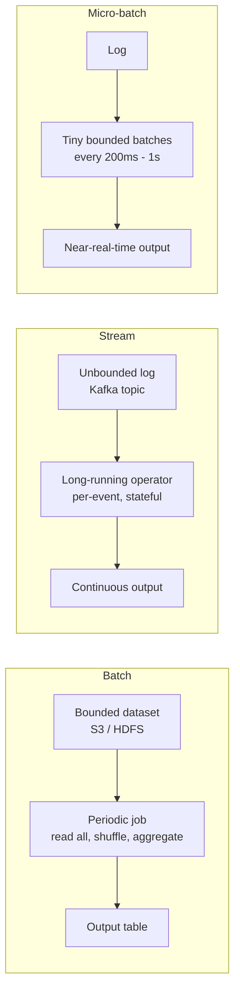

**Comparison table.**

| Dimension | Batch | Micro-batch | Stream (true) |
|---|---|---|---|
| Data model | Bounded | Unbounded chunked into mini-batches | Unbounded |
| Latency | Minutes–hours | ~Seconds (≥ batch interval) | Milliseconds–seconds |
| Throughput | Highest (amortized) | High | High, but per-record overhead |
| Completeness | Strong (waited for all data) | Good | Best-effort, watermark-bounded |
| Out-of-order handling | Trivial (sort whole set) | Per-batch | First-class (event time + watermarks) |
| Fault model | Re-run job (idempotent) | Re-process mini-batch | Checkpoint + replay |
| Cost efficiency | Best $/TB | Medium | Highest $/event |
| Operational tax | Low (cron + retries) | Medium | High (state, checkpoints, watermarks) |
| Examples | Spark/MapReduce nightly ETL | Spark Structured Streaming | Flink, Kafka Streams |

**When each is appropriate.**

- **Batch:** training data prep, daily financial reconciliation, large backfills, anything where freshness < cost matters and correctness/completeness is paramount.
- **Stream:** fraud detection, real-time dashboards, alerting, personalization, anomaly detection, anything where seconds of staleness costs money.
- **Micro-batch:** when you want streaming freshness but your team already knows Spark, or you need exactly-once with simpler operational semantics.

**Decisive recommendation.** **Default to batch unless a stated latency requirement forces streaming.** The trigger to escalate is a concrete business action that must fire in seconds (a fraud block, an alert page, a live personalization decision). If the answer to "what breaks if this is 5 minutes stale?" is "nothing," you have a batch problem wearing a streaming costume. *Revisit if* the SLO tightens below ~1 minute or out-of-order correctness becomes load-bearing.

**Worked sizing.** At large-scale real-time chat, message-delivery is genuinely streaming (sub-second, stateful presence/typing). But the *analytics* on those messages — daily active conversations, retention cohorts, channel-growth dashboards — are almost all batch or micro-batch. Conflating the two (running everything through the low-latency path) is the classic over-engineering trap: you pay streaming's per-event cost for numbers a PM reads once a morning.

**Pitfalls.**

- Treating "streaming" as a magic latency fix when your *sink* (a warehouse) only refreshes every 5 minutes — the bottleneck moves, not disappears.
- Choosing streaming for everything and paying 5–10× the cost for data nobody reads in real time.
- Ignoring that batch and stream produce **different results** at the boundary unless your stream layer handles event-time correctly (see Lambda's duplication problem).

> **Staff-level insight:** The interview-winning framing is "**batch and stream are the same computation over bounded vs unbounded data.**" This is the Beam/Dataflow thesis. Once you say that, the conversation shifts from "which tool" to "what are your latency SLO, completeness requirements, and cost budget" — which is exactly the conversation a Staff engineer should drive. The follow-up that separates senior from staff: *"What latency does the business actually need, and what does each tier of latency cost us?"* Most "real-time" requirements are really "within a few minutes," and that distinction changes the architecture. **Make the interviewer say the latency number out loud before you pick an engine.**

---

## 2. Stream Processing Concepts (Deep)

This is the section interviewers use to find the ceiling of your knowledge. Streaming is "easy" until you confront **time** and **state**. **Altitude cue:** §2.1, §2.2, §2.4, and §2.7 (event-time, watermarks, late data, exactly-once) are the **risk crux** — slow down and go deep here. §2.5 (triggers) and §2.9 (duality) you can name and connect quickly.

### 2.1 Event Time vs Processing Time vs Ingestion Time

**Definition.** Every event has multiple notions of "when":

- **Event time** — when the event *actually occurred* in the real world (embedded in the payload, e.g., the timestamp on a mobile click). This is the truth.
- **Ingestion time** — when the event *entered the streaming system* (e.g., when Kafka received it).
- **Processing time** — when the operator *processes* the event (wall-clock on the worker).

**How it works / why it matters.** A user clicks at 12:00:00 (event time) on a phone that's in a tunnel. The event is buffered on-device, uploads at 12:05:00 (ingestion time), and your Flink operator processes it at 12:05:02 (processing time). If you bucket "clicks per minute" by **processing time**, this click lands in the 12:05 bucket — *wrong*. If you bucket by **event time**, it correctly lands in 12:00 — but now you need a mechanism to know when the 12:00 window is "done," because more late clicks might arrive. That mechanism is the **watermark**.

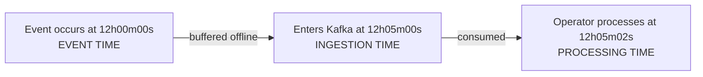

| Time semantics | Determinism on replay | Out-of-order correct | Latency | Use when |
|---|---|---|---|---|
| Processing time | No (depends on speed) | No | Lowest | You only care about "now," ordering irrelevant |
| Ingestion time | Partially | No | Low | Source has no good timestamp |
| Event time | Yes (reproducible) | Yes | Higher (must wait) | Correctness over wall-clock; analytics, billing |

**Decisive recommendation.** **Default to event time** for anything reported, billed, or reprocessed; use processing time only for liveness signals where "now" is the entire point (a presence heartbeat, a live ops gauge) and reproducibility is irrelevant. *Revisit if* the source genuinely has no trustworthy timestamp — then ingestion time is the honest fallback, and you document that windows are approximate.

**Pitfalls.** Using processing time for anything billed or reported externally — results become non-reproducible (a replay yields different buckets). Mobile/IoT data is *heavily* out-of-order; processing-time windows silently corrupt metrics. Clock skew across mobile devices means event timestamps can be *ahead* of server time — guard with a sanity clamp or the future-dated events poison your watermark.

> **Staff-level insight:** "Event time gives you **reproducibility**" is the line to deliver. If you reprocess the same Kafka log a year later, event-time windows produce *identical* results; processing-time windows do not. Reproducibility is what lets Kappa architecture work and what lets you trust backfills. Interviewers love when you connect event-time semantics to the broader architectural ability to reprocess history — that single connection links §2.1 to §6.1.

### 2.2 Watermarks

**Earmark: this is a hard part.** Watermarks are where most candidates reveal they've read about streaming but never operated it. Slow down here.

**Definition.** A **watermark** is a heuristic, monotonically advancing marker in event time that asserts: *"I believe I have seen all events with event time ≤ W."* It is the system's answer to the unanswerable question "is the data complete?" for unbounded streams.

**How it works.** The source emits watermarks (e.g., "current watermark = max event time seen − 10s allowed-skew"). As watermark W passes a window's end, the window is considered complete and fires. A common generator: `bounded out-of-orderness` = `maxEventTimeSeen - delay`. Watermarks are *heuristics*: set the delay too small and you drop real late data; too large and you add latency to every result.

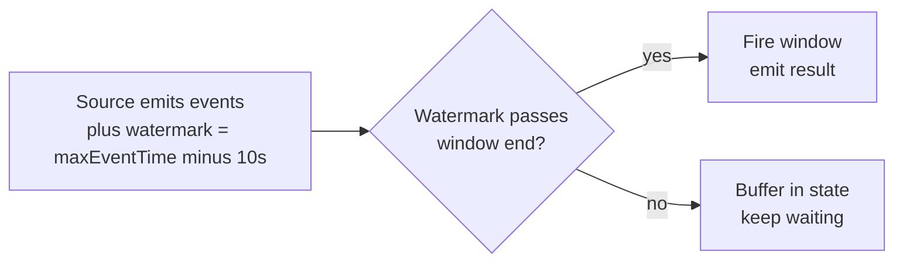

| Watermark delay | Latency | Late-data loss | Best for |
|---|---|---|---|
| Aggressive (small) | Low | High (drops stragglers) | Dashboards tolerant of approximation |
| Conservative (large) | High | Low | Billing, compliance |
| Adaptive/percentile-based | Medium | Tuned | Variable network conditions (mobile) |

**Numbers to anchor on.** For mobile clickstream, a typical p99 upload delay is single-digit seconds online but can be *hours* for offline-buffered events. A watermark of `max − 10s` covers the online p99; the long tail (offline) is deliberately *not* covered by the watermark and is instead caught by allowed lateness (§2.4) and a side output. Trying to set a watermark that covers the offline tail would add hours of latency to every result — the wrong trade.

**Pitfalls.** A single idle/slow Kafka partition can stall the global watermark (it's the *min* across partitions), freezing all windows — you need *idle source detection*. Per-key vs global watermark confusion. Watermarks that go backward (they must be monotonic). Future-dated events (mobile clock skew) yank the watermark forward and prematurely close windows.

> **Staff-level insight:** Frame watermarks as a **latency-vs-completeness knob you tune, not a correctness guarantee.** The deep answer: "The watermark is a heuristic; for correctness-critical paths I pair a moderate watermark with **allowed lateness + a late-data side output** so I never silently drop data — late events get reconciled in a slow path." This shows you understand watermarks don't eliminate late data, they just bound *waiting*. The operational war story that lands: *"A single idle partition once stalled our global watermark and froze every window — idle-source detection is not optional at scale."*

### 2.3 Windowing

**Definition.** Windowing slices an unbounded stream into finite chunks over which you compute aggregates. Four canonical types:

- **Tumbling** — fixed-size, non-overlapping (every event in exactly one window). "Count per 1-minute."
- **Sliding (hopping)** — fixed-size, overlapping by a slide interval (an event can be in multiple windows). "5-minute count, updated every 1 minute."
- **Session** — dynamic, data-driven; a window closes after a gap of inactivity (e.g., 30 min of no activity ends a user session). Variable length per key.
- **Global** — a single window for all data; you control firing entirely via triggers (e.g., custom count-based windows).

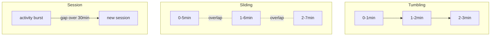

| Window type | Overlap | Size | Typical use |
|---|---|---|---|
| Tumbling | None | Fixed | Per-minute metrics, billing buckets |
| Sliding | Yes | Fixed | Moving averages, rolling alerts |
| Session | None | Dynamic (gap-defined) | User sessions, clickstream grouping |
| Global | N/A | Infinite | Custom trigger logic, count windows |

**Decisive recommendation.** **Default to tumbling** for metrics and billing buckets — it's the cheapest in state and the easiest to reconcile against batch. Reach for **session** windows only when the grouping is genuinely activity-defined (user sessions, conversation threads) and **cap them with a max-session-duration TTL** or they become an unbounded-state OOM. Reformulate **sliding** windows as incremental/cumulative aggregates when the slide is small relative to the size, to avoid fan-out.

**Worked fan-out example.** A 1-hour sliding window with a 1-second slide places **each event in 3600 windows** — 3600× the state and output volume. If you actually need a continuously-updated 1-hour rolling count, compute it incrementally (maintain a single running total with per-second deltas added and the expiring second subtracted), not as 3600 overlapping windows. This single reformulation is a common staff-level "fix the design" moment.

**Pitfalls.** Sliding windows with a tiny slide and large size **multiply state and output**. Session windows require *merging* state when a late event bridges two sessions — non-trivial and state-heavy. Misaligned tumbling-window boundaries across systems cause off-by-one reconciliation pain (align everyone to UTC epoch boundaries).

> **Staff-level insight:** Session windows are the "tell" question. The staff answer notes that session windows are **stateful and require window merging** when out-of-order events arrive between two would-be-separate sessions, and that their unbounded-per-key state is a common OOM/scaling failure. Mention you'd cap session state with a TTL or max-session-duration. For sliding windows, the staff move is to *reformulate* heavy sliding aggregates as incremental/cumulative computations to avoid the fan-out — naming that reformulation unprompted signals you've hit this wall in production.

### 2.4 Late Data & Allowed Lateness

**Earmark: this is a hard part** — and the place candidates most often hand-wave. Late data is *guaranteed* in any real stream; how you handle it is the design.

**Definition.** **Late data** = an event whose event time is *behind* the current watermark (it "should have" already been counted, but the window already fired). **Allowed lateness** = a grace period after the watermark passes during which the window stays in state and *re-fires* upon receiving late events.

**How it works.** Lifecycle of a window: (1) accumulating, (2) watermark passes → fires first result, (3) within allowed-lateness → late events trigger *updates* (re-fire with corrected value), (4) after allowed-lateness expires → window state is purged; further late events go to a **late-data side output** (dead-letter) or are dropped.

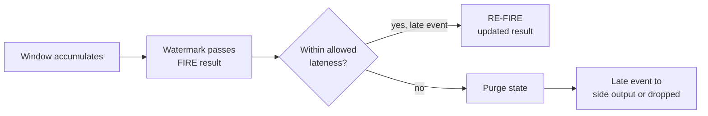

| Strategy | Correctness | Cost | When |
|---|---|---|---|
| Drop late (no lateness) | Lowest | Cheapest (purge fast) | Best-effort dashboards |
| Allowed lateness + re-fire | High | State held longer | Metrics that must converge |
| Side-output + slow reconcile | Highest | Two paths | Billing, finance |

**Decisive recommendation.** **Default to: moderate watermark + bounded allowed lateness + a side output for the truly-late tail.** This never silently drops data — the side output is reconciled in the batch/lake path. The result is a **provisional-then-final** pattern: the dashboard shows a fast provisional number that converges as late events arrive and re-fire, and the lake produces the authoritative final. *Revisit if* the path tolerates approximation (pure liveness dashboard) — then drop-late is fine and cheaper.

**Pitfalls.** Downstream sinks must handle **retractions/updates** when a window re-fires (idempotent upsert by window key, not append). Holding allowed-lateness state for many windows × keys blows up memory — bound the lateness and the key cardinality.

> **Staff-level insight:** The senior failure mode is treating window output as append-only. State the rule: **"late re-fires mean your sink must be upsert-by-key, and your downstream consumers must tolerate restatements."** Connect it to accounting: "this is why finance pipelines produce *provisional* and *final* numbers — the final is the watermark + allowed-lateness-closed value." This is also the precise reason a real pipeline routes the late tail to the *batch* path (§7): the lake, with full completeness, is the system of record; the stream is the fast-but-provisional view.

### 2.5 Triggers

**Definition.** A **trigger** decides *when* a window emits results — decoupling *when you compute* from *what window you compute over*. Triggers can fire on watermark, on processing-time intervals, on element count, or combinations (early/on-time/late firings).

**How it works.** Beam/Flink model: a window can fire **early** (speculative results before the watermark, for low latency), **on-time** (at the watermark — the "complete" result), and **late** (during allowed lateness, corrections). Each firing is accompanied by an *accumulation mode*: **accumulating** (each firing is the full running total) or **discarding** (each firing is the delta since last).

| Trigger | Fires when | Use |
|---|---|---|
| Event-time (watermark) | Watermark crosses window end | Default correctness |
| Processing-time | Every N seconds wall-clock | Low-latency speculative output |
| Count-based | Every N elements | Global windows, micro-aggregation |
| Composite (early/late) | Early + on-time + late | Best of both: fast then correct |

**Pitfalls.** Confusing accumulation mode → double counting (accumulating, but treated as deltas) or partial sums treated as totals (discarding). Early firings that downstream treats as final.

> **Staff-level insight:** Triggers are the lever to **resolve the latency/correctness tension explicitly**: "I'll emit an *early speculative* count every 2 seconds for the live dashboard, and an *on-time* count at the watermark that overwrites it, plus *late* corrections." That single sentence demonstrates you understand you don't have to choose between fast and correct — you can deliver fast-then-correct with retractions. **Altitude note:** name this capability and move on; don't enumerate every Beam trigger combinator unless asked.

### 2.6 State Management

**Definition.** **State** is the data a stream operator remembers across events — running counts, window contents, join buffers, dedup sets, ML features. Stream processing is fundamentally *stateful*; the hard engineering is making large state fast, fault-tolerant, and queryable.

**How it works.** State is **keyed** (partitioned by key so it scales horizontally) and stored either **on-heap** (fast, GC-pressured, size-limited) or in an **embedded LSM store like RocksDB** (Flink/Kafka Streams default) which spills to local disk, supporting state far larger than RAM. State is periodically snapshotted to durable storage (S3/HDFS) for recovery. Types: value state, list state, map state, aggregating/reducing state, window state.

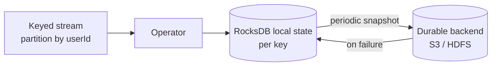

| State backend | Capacity | Latency | Recovery | Use |
|---|---|---|---|---|
| Heap/memory | < RAM | Fastest | Snapshot to DFS | Small state, low latency |
| RocksDB (embedded) | >> RAM (disk) | Fast (LSM) | Incremental snapshots | Large keyed state (default) |
| External (Redis/DB) | Huge | Network hop | DB-managed | Shared state, anti-pattern for hot path |

**Decisive recommendation.** **Default to RocksDB** for any non-trivial keyed state — it scales past RAM and supports *incremental* checkpoints, which keeps checkpoint duration bounded as state grows. Use heap state only for small, latency-critical operators. **Never put hot-path state in an external store** (Redis/DB) — the network hop per event destroys throughput; external stores are for *shared* state across jobs, not per-event lookups.

**Pitfalls.** Unbounded state growth (no TTL on dedup keys → infinite memory). Rebalancing/rescaling requires **re-partitioning state** (Flink does this via key groups; many systems can't rescale stateful jobs easily). Putting hot-path state in an external store kills throughput. Huge state → slow checkpoints → backpressure.

> **Staff-level insight:** The differentiator is naming **state TTL and rescaling** as the two operational killers. "Every keyed state needs a TTL or it grows forever" and "you cannot trivially change parallelism of a stateful streaming job — Flink solves this with key groups + savepoints, which is a major reason it beats hand-rolled consumers." Tie state size to checkpoint duration: huge state → slow checkpoints → backpressure, so incremental checkpointing (RocksDB) matters at scale. **This is the section that links §2.6 → §2.7 → §2.8 as one causal chain.**

### 2.7 Checkpointing & Exactly-Once

**Earmark: this is the hard part interviewers probe hardest.** Get the precision right or you lose credibility.

**Definition.** **Checkpointing** periodically snapshots all operator state + input positions (Kafka offsets) to durable storage so the job can recover to a consistent point after failure. **Exactly-once** means each event affects state *exactly once* despite failures and replays — no double counting, no loss.

**How it works.** Flink's **Chandy-Lamport distributed snapshot**: the source injects **checkpoint barriers** into the stream. Operators snapshot their state when the barrier passes; barriers flow through the DAG; when all sinks acknowledge, the checkpoint is complete. On failure, the whole job rewinds to the last complete checkpoint (state restored, source offsets reset). **Exactly-once** *internally* comes from this atomic state+offset snapshot. **End-to-end exactly-once** to external sinks requires either (a) **idempotent writes** (upsert by deterministic key) or (b) **transactional/two-phase-commit sinks** (e.g., Kafka transactions, transactional JDBC) coordinated with checkpoints. **Savepoints** = manually triggered, durable checkpoints for upgrades/migrations.

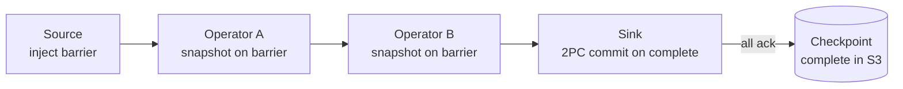

| Guarantee | Meaning | Cost | How achieved |
|---|---|---|---|
| At-most-once | May lose data | Cheapest | Fire and forget |
| At-least-once | No loss, may duplicate | Medium | Replay on failure |
| Exactly-once (effective) | Each event counts once | Highest | Checkpoint + idempotent/2PC sink |

**Decisive recommendation.** **Default to at-least-once + idempotent upserts.** It's simpler, cheaper, rescales better, and most analytics tolerate it. Reserve **transactional 2PC exactly-once for money movement** (ledgers, payments, billing) where a duplicate is a financial defect. *Revisit if* the sink genuinely cannot be made idempotent and duplicates are unacceptable — then pay the 2PC tax.

**Pitfalls.** "Exactly-once" is **effectively-once** — events may be *processed* multiple times, but their *effect* is once. You cannot get exactly-once with a non-idempotent, non-transactional sink (e.g., a plain HTTP POST that increments a counter). Large state → slow checkpoints → backpressure; tune interval and use incremental/unaligned checkpoints. Unaligned checkpoints trade a larger snapshot for not blocking on slow barriers under backpressure.

> **Staff-level insight:** Be precise: **"Exactly-once is a property of the *effect on state*, not of message delivery."** The end-to-end guarantee is only as strong as the sink. The staff-level recommendation: "Default to **at-least-once + idempotent upserts** — it's simpler, cheaper, and rescales better than full 2PC exactly-once, and most analytics tolerate it. Reserve transactional exactly-once for money movement." This shows judgment, not just knowledge. **The anti-pattern to avoid is claiming "exactly-once" without naming the sink mechanism — that's the hand-wave interviewers pounce on.**

### 2.8 Backpressure

**Definition.** **Backpressure** is the mechanism by which a slow downstream operator signals upstream operators (and ultimately the source) to slow down, preventing unbounded buffering and OOM.

**How it works.** In a pipeline source → map → window → sink, if the sink slows (e.g., the OLAP store is busy), its input buffers fill. Flink's **credit-based flow control** propagates this: the slow operator stops granting buffer credits upstream, which throttles the previous operator, cascading back to the source, which stops pulling from Kafka. Kafka acts as a durable buffer, so the system degrades to *higher latency* rather than data loss. Spark/micro-batch handles it via dynamic batch sizing and rate limits.

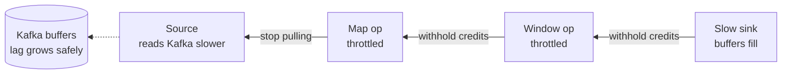

| Symptom | Cause | Fix |
|---|---|---|
| Growing Kafka lag, stable memory | Healthy backpressure | Scale out, optimize sink |
| OOM, no backpressure | No flow control (naive consumer) | Use a real stream engine |
| Latency spike but no loss | Backpressure absorbing burst | Often fine; alert on sustained |

**Pitfalls.** Mistaking backpressure (a *symptom*) for the *root cause* — the fix is the slow operator, not "turn off backpressure." A single slow sink stalls the entire job. Backpressure can mask a slowly failing downstream until lag explodes.

> **Staff-level insight:** Reframe backpressure as a **feature, not a bug**: "It's the system trading latency for stability so you never lose data — Kafka's durable log is what makes graceful degradation possible." The Staff diagnostic move: "Backpressure on the *sink* means scale the sink or batch writes; backpressure on a *map* means it's CPU-bound — different fixes. I'd look at the Flink backpressure metrics to find the bottleneck operator before touching parallelism." **Naming *where* the backpressure originates — and that the fix differs by location — is the depth signal.**

### 2.9 Stream-Table Duality

**Definition.** A **stream** is a sequence of *changes* (an append-only changelog); a **table** is a *snapshot* of current state (the result of applying all changes). They are two views of the same data: **a table is a materialized stream; a stream is a table's changelog.**

**How it works.** Apply a stream of events to an empty table → you get a table (aggregation/`GROUP BY`). Emit every change to a table → you get a stream (CDC/changelog). Kafka Streams/ksqlDB make this explicit: `KStream` (changelog, every event) vs `KTable` (latest value per key, compacted). A compacted Kafka topic *is* a table keyed by message key. This duality is why CDC works: a database table's WAL is a stream.

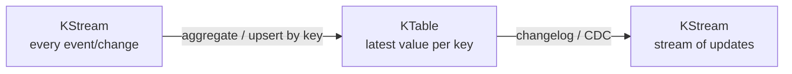

| View | Semantics | Storage | Example |
|---|---|---|---|
| Stream (KStream) | Append-only, every record | Log (retention) | Page-view events |
| Table (KTable) | Upsert, latest per key | Compacted log / state store | Current user profile |

**Pitfalls.** Joining a KStream to a KStream (windowed) vs KStream to KTable (lookup) have totally different semantics (next section). Forgetting that a "table" in streaming is *continuously updated* — there is no static snapshot.

> **Staff-level insight:** This duality is the conceptual key to modern data systems. The line that lands: **"Every table is a stream and every stream is a table — CDC, materialized views, and event sourcing are all consequences of this duality."** It explains why [Messaging](04-messaging-event-driven.md) (Kafka) and [Databases](06-databases.md) (CDC, materialized views) converge. Mention **Kappa architecture is literally betting on this**: keep the stream as source of truth, materialize tables on demand. **Altitude: this is a name-and-connect concept — state it crisply and move to where the design risk actually lives.**

### 2.10 Joins in Streams

**Definition.** Joining unbounded streams is hard because you can't hold all of both sides in memory forever. Three patterns:

- **Stream-Stream join (windowed):** join two event streams within a time window (e.g., join `impressions` and `clicks` where click is within 30 min of impression). Requires buffering both sides' state for the window duration.
- **Stream-Table join (lookup/enrichment):** enrich each event with the *current* value from a table (e.g., enrich an order event with the user's current profile). The table is a KTable/materialized lookup; no windowing — temporal join on "latest known value."
- **Table-Table join:** join two changelog tables to produce a materialized joined table (foreign-key joins, continuously updated).

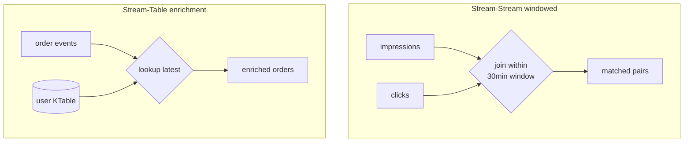

| Join type | State held | Time semantics | Use case |
|---|---|---|---|
| Stream-Stream | Both sides for window | Windowed (event-time) | Ad impression→click attribution |
| Stream-Table | Table only (latest) | Temporal (as-of) | Enrich events with dimensions |
| Table-Table | Both tables (full) | Continuous upsert | Materialized FK joins |

**Pitfalls.** Stream-stream join state grows with window size × throughput — a wide window on a high-volume stream is a memory bomb; bound it tightly. **Temporal correctness:** for stream-table enrichment you usually want the table value *as of the event's time*, not "current" — naive lookups cause non-reproducible results on replay. Late events on either side miss the join window.

> **Staff-level insight:** The senior trap is doing a stream-table join with a *mutable current* table and then being surprised replays differ. The staff answer: **"For reproducible enrichment, you need a *temporal/versioned* join — join against the dimension value as-of the event's event-time, not the latest."** This is exactly the SCD (slowly-changing-dimension) problem from the warehouse world reappearing in streaming. Naming that connection signals depth — and ties §2.10 back to event-time reproducibility (§2.1).

---

## 3. Technologies

**Altitude cue:** the *only* question that matters in this section is **Spark vs Flink vs Kafka Streams**, and the decision axis is **latency SLO + state complexity + where the data already lives**. Keep the Spark-vs-Flink and Kafka-Streams-vs-cluster tables ready; everything else (Beam, MapReduce, Storm) is context you name to show lineage, not deep-dive.

### 3.1 Apache Spark

**Definition.** Spark is a general-purpose distributed compute engine for **batch, SQL, streaming (micro-batch), and ML**, built around an in-memory, lazily-evaluated **DAG** of transformations. It replaced MapReduce by keeping intermediate data in memory and optimizing the whole job graph.

**How it works.**

- **RDD (Resilient Distributed Dataset):** the low-level immutable, partitioned, fault-tolerant collection. Fault tolerance via **lineage** — Spark remembers the transformations and recomputes lost partitions rather than replicating.
- **DataFrame / Dataset:** higher-level, schema-aware API. Goes through the **Catalyst optimizer** (logical → optimized → physical plan) and **Tungsten** (code-gen, off-heap memory). Almost always preferred over raw RDDs.
- **Lazy evaluation:** transformations (`map`, `filter`, `join`) build a DAG but don't run; an **action** (`count`, `collect`, `write`) triggers execution. This lets Catalyst optimize the whole graph (predicate pushdown, column pruning).
- **Narrow vs wide transformations:** *Narrow* (`map`, `filter`) — each output partition depends on one input partition; no data movement, pipelined. *Wide* (`groupByKey`, `join`, `reduceByKey`) — output partitions depend on many input partitions, requiring a **shuffle** (network + disk write of intermediate data). Shuffles are the dominant cost. Stages are split at shuffle boundaries.
- **Spark SQL:** SQL over DataFrames, same Catalyst engine.
- **Structured Streaming:** treats a stream as an *unbounded table*; computes incrementally in **micro-batches**. Supports event-time windows, watermarks, exactly-once via checkpoint + idempotent sinks. (A separate **continuous processing mode** exists but is **experimental/limited** — only map-like operations, at-least-once semantics — so treat micro-batch as the production model, not continuous.)

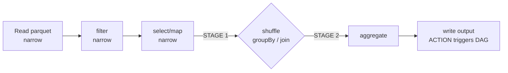

| Spark vs MapReduce | MapReduce | Spark |
|---|---|---|
| Intermediate data | Written to HDFS each step | Kept in memory, lineage recompute |
| Programming model | Map + Reduce only | Rich DAG, SQL, ML, streaming |
| Iterative jobs (ML) | Very slow (disk per iter) | Fast (cache in RAM) |
| Latency | Minutes+ | Seconds–minutes |
| Streaming | No (Hadoop ecosystem hacks) | Yes (Structured Streaming) |

**When to use.** Large-scale batch ETL, ad-hoc SQL on lakes, ML feature engineering, unified batch+stream where micro-batch latency (seconds) is acceptable, teams standardized on Databricks/EMR.

**Pitfalls.** **Shuffle** is the silent killer — `groupByKey` materializes everything; prefer `reduceByKey`/`aggregateByKey`. **Data skew** (one hot key) stalls one task forever — fix with salting. Small files problem. Over-caching → memory eviction. Structured Streaming's latency floor = batch interval (not true low-latency).

> **Staff-level insight:** The shuffle is the whole game. "Performance tuning Spark is 80% **minimizing and de-skewing shuffles** — pushing filters down, broadcasting small dimension tables to avoid shuffle joins, salting hot keys, and right-sizing partitions." For the streaming question, the honest staff take: "Spark Structured Streaming is *micro-batch* — excellent for ETL-grade freshness (seconds) and dead simple if you're already in Spark, but for sub-second, true event-at-a-time, complex event-time state, I reach for Flink." **The skew war story — "one hot key stalled a single task for an hour until we salted it" — is the operational proof point.**

### 3.2 Apache Flink

**Definition.** Flink is a **true streaming** engine — it processes events one at a time as they arrive (batch is treated as a *bounded stream*, the inverse of Spark's model). It has **first-class event-time, watermarks, and large keyed state**, with exactly-once via distributed snapshots.

**How it works.** Long-running operator graph; events flow continuously (no micro-batch). **State** lives in RocksDB (huge, on-disk) keyed by partition. **Event-time + watermarks** are core primitives, not bolt-ons. **Exactly-once** via Chandy-Lamport **checkpoints**; **savepoints** enable stateful upgrades/rescaling. APIs: DataStream (low-level), Table API & **Flink SQL** (declarative, same engine for batch & stream). The **CEP** library handles complex event patterns (e.g., "A then B within 5 min without C").

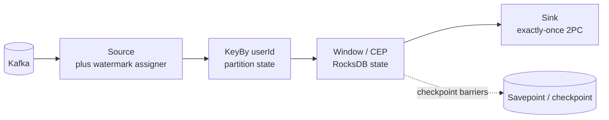

| Dimension | Spark Structured Streaming | Apache Flink |
|---|---|---|
| Core model | Micro-batch (batch is native) | True streaming (batch = bounded stream) |
| Latency | Seconds (≥ batch interval) | Milliseconds |
| Event-time / watermarks | Supported, batch-centric | First-class, native |
| State | Manageable, less mature for huge state | Mature, large keyed RocksDB state |
| Exactly-once | Checkpoint + idempotent sink | Checkpoint + 2PC, savepoints |
| Rescaling stateful jobs | Limited | Strong (savepoints + key groups) |
| Ecosystem / ML / batch | Huge (Databricks, MLlib) | Streaming-first, batch growing |
| Best for | Unified batch+stream ETL, ML | Low-latency, complex event-time, large state |

**When to use Flink over Spark.** Sub-second latency, complex event-time windowing/sessionization, very large mutable state, CEP/pattern detection, stateful apps that must rescale and upgrade safely, true event-at-a-time semantics.

**Decisive recommendation.** **Spark if you're already on Databricks/EMR and your SLO is seconds; Flink when the SLO is sub-second or event-time state is complex.** Both can be right — *dogma is the wrong answer*. The decision is the latency budget and the state model, not vendor preference. *Revisit if* a "seconds" requirement quietly becomes "sub-second" or sessionization/CEP enters scope — that's the trigger to graduate to Flink.

**Pitfalls.** Steeper operational curve (state, checkpoint tuning, savepoint discipline). Checkpoint duration grows with state — tune incremental/unaligned checkpoints. Watermark/idle-partition gotchas. Smaller batch/ML ecosystem than Spark.

> **Staff-level insight:** The crisp distinction: **"Spark is a batch engine that does streaming via micro-batch; Flink is a streaming engine that does batch as a bounded stream."** That single framing answers the inevitable "Spark or Flink?" question. The decision rule: latency budget and state complexity. "Seconds and we're already on Databricks → Spark. Sub-second, heavy event-time state, CEP → Flink. Both can be right; the wrong move is dogma." **Say the framing, state the default, name the trigger — then stop. Don't relitigate it for five minutes.**

### 3.3 Kafka Streams & ksqlDB

**Definition.** **Kafka Streams** is a *client library* (a JAR you embed in your Java/Scala app) for stream processing directly on Kafka — no separate cluster. **ksqlDB** is a SQL layer on top of Kafka Streams: you write `CREATE STREAM ... SELECT ...` and it runs as a managed streaming engine.

**How it works.** Kafka Streams reads from Kafka topics, processes with the same primitives (KStream/KTable, windowing, joins, RocksDB-backed state, exactly-once via Kafka transactions), and writes back to Kafka. **No cluster to manage** — it scales by running more instances of your app in the same consumer group; Kafka's partition assignment handles parallelism and state-store re-partitioning. ksqlDB adds a SQL/REST interface and runs ksqlDB servers.

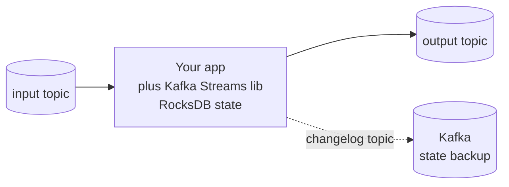

| Tool | Form factor | Scaling | Best for |
|---|---|---|---|
| Kafka Streams | Library in your app | Add app instances | Per-service stream logic, microservices, no extra cluster |
| ksqlDB | SQL + server | ksqlDB cluster | Quick SQL transforms, prototyping, lightweight pipelines |
| Flink | Dedicated cluster | Cluster parallelism | Complex, large-state, cross-source, low-latency |
| Spark | Dedicated cluster | Cluster | Batch + micro-batch unified, ML |

**Decisive recommendation.** **If the workload is Kafka-in/Kafka-out and owned by one team, default to Kafka Streams** — it's a library dependency, not a cluster to operate, and at real-time-chat microservice architectures that operational saving is real. **Graduate to Flink** the moment you need non-Kafka sources/sinks, multi-TB state, true sub-second CEP, or a central platform team owning processing. Recognizing that the *less powerful* tool is often the right one is a maturity signal.

**When to use over Flink/Spark.** When your data is **already in Kafka**, your processing is **Kafka-to-Kafka**, and you want **no separate cluster** — embed Kafka Streams in your microservice. Ideal for enrichment, filtering, per-service aggregations, event-driven microservices. Choose ksqlDB for SQL-only, low-ceremony transforms. Avoid for cross-system batch, huge multi-TB shuffles, or sources/sinks outside Kafka.

**Pitfalls.** State lives *with your app instance* — scaling/rebalancing moves partitions and restores state from changelog topics (can be slow). Heavy joins/large state strain app memory. Not for batch or non-Kafka sources. Operationally simpler but couples processing lifecycle to your service deploys.

> **Staff-level insight:** The decision axis is **"library vs cluster."** "If the workload is Kafka-in/Kafka-out and owned by one team, Kafka Streams avoids a whole cluster's operational tax — it's just a dependency. The moment I need non-Kafka sources, multi-TB state, true low-latency CEP, or a central platform team owning processing, I graduate to Flink." Recognizing that the *right* answer is often the *less* powerful tool (no cluster) is a maturity signal.

### 3.4 Beam, Storm, Samza, MapReduce

**Altitude: name these to show lineage, then move on.** None of them is your recommended engine in 2026; their value in the interview is demonstrating you optimize from principles, not cargo-cult.

**Apache Beam — the unified model.** Beam is a **portable programming model**, not an engine. You write a pipeline once (Java/Python/Go) using its event-time/windowing/trigger abstractions (the "Dataflow model"), then run it on a **runner**: Flink, Spark, or Google Cloud Dataflow. Its thesis — *"batch and stream are one model over bounded vs unbounded PCollections"* — is the intellectual foundation of this whole module. Trade-off: portability vs lowest-common-denominator features and an extra abstraction layer. **Beam is also the cleanest realization of unified-code Kappa (§6.1)** — the same pipeline runs as bounded batch for backfills and unbounded stream for live.

**Apache Storm / Apache Samza (legacy).** Storm was the first widely-used low-latency streaming engine (true tuple-at-a-time, at-least-once via acking, "Trident" for exactly-once) — largely superseded by Flink. Samza (LinkedIn) pioneered Kafka-coupled stateful stream processing and influenced Kafka Streams. Know them as *history*: they proved the patterns Flink/Kafka Streams productized.

**Hadoop MapReduce (historical context).** The original big-data batch model: **Map** (parallel transform), **Shuffle/Sort** (group by key across the cluster — the expensive, defining phase), **Reduce** (aggregate per key). Every step writes to HDFS for fault tolerance, making iterative/interactive work painfully slow. Its lasting legacy is the **shuffle-and-sort** concept that every engine since (Spark, Flink, warehouses) had to optimize.

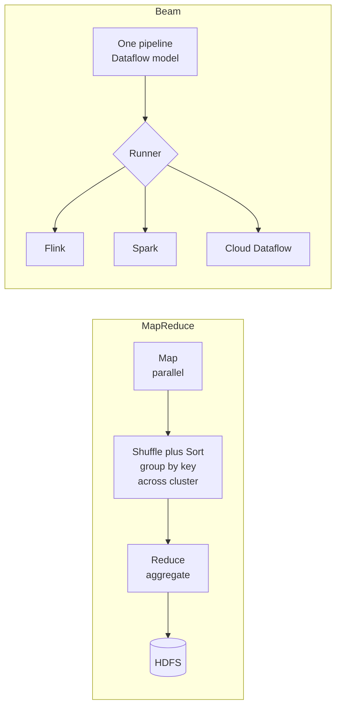

| Tech | Status | Key contribution / use |
|---|---|---|
| Beam | Current | Write once, run on any runner; the unified model |
| MapReduce | Legacy/historical | Defined shuffle-sort; foundation of batch |
| Storm | Legacy | First low-latency streaming |
| Samza | Legacy/niche | Kafka-coupled stateful processing |

> **Staff-level insight:** Cite Beam's model even if you'd run Flink — it shows you understand the *concepts* are engine-independent. And invoke MapReduce's shuffle to ground modern tuning: "Spark's wide transformations, a warehouse's `GROUP BY`, and Flink's keyBy are all the same shuffle MapReduce made expensive — minimizing data movement across the network is the eternal optimization." Knowing the lineage signals you optimize from principles, not cargo-cult.

---

## 4. ETL vs ELT & the Modern Data Stack

**Definition.**

- **ETL (Extract → Transform → Load):** extract from sources, **transform in a dedicated processing tier** (Spark, an ETL server), then load *clean, modeled* data into the warehouse. The transform happens *before* landing.
- **ELT (Extract → Load → Transform):** extract, **load raw data into the warehouse/lake first**, then **transform in-place** using the warehouse's own compute (SQL, dbt). Transform happens *after* landing.

**How it works / why ELT won in the cloud-DW era.** When warehouses were expensive, fixed-capacity appliances (Teradata, on-prem), you couldn't afford to dump raw data and transform inside them — so you transformed *outside* first (ETL). Cloud warehouses (**Snowflake, BigQuery, Redshift, Databricks SQL**) changed the economics: **storage is cheap and decoupled from elastic, on-demand compute**. Now it's cheaper and faster to load everything raw and transform with SQL inside the warehouse — you get scalability, you keep the raw data for reprocessing, and analysts (not just data engineers) can build transforms in SQL via **dbt**.

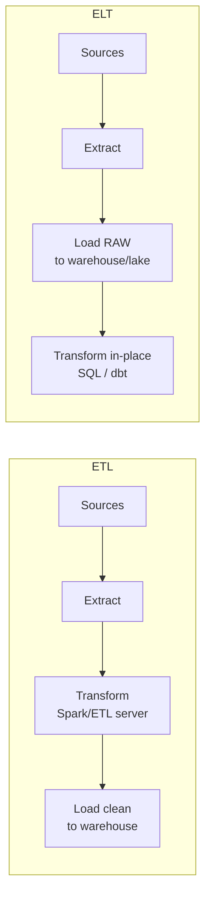

**The modern data stack (ELT-centric):**

- **Ingestion/EL:** Fivetran, Airbyte, Stitch (managed connectors) + Kafka/Debezium for streaming/CDC.
- **Storage/compute:** Snowflake, BigQuery, Databricks, Redshift (cloud DW/lakehouse).
- **Transform (T):** **dbt** — version-controlled SQL models, tests, lineage, the de-facto transformation layer.
- **Orchestration:** Airflow, Dagster, Prefect.
- **BI/serving:** Looker, Tableau, Mode; reverse-ETL (Census, Hightouch) back to operational systems.

| Dimension | ETL | ELT |
|---|---|---|
| Transform location | Separate compute tier | Inside warehouse/lake |
| Raw data retained | Often not | Yes (reprocessable) |
| Compute model | Fixed ETL servers | Elastic warehouse compute |
| Who builds transforms | Data engineers | Analysts + engineers (SQL/dbt) |
| Best era/fit | On-prem, expensive DW | Cloud DW, cheap storage |
| Schema-on | Write (modeled before load) | schema-on-write destination; transformation/modeling deferred (done in-warehouse, e.g. dbt) |

**Decisive recommendation.** **Default to ELT** on a cloud warehouse/lakehouse — load raw, transform in-place with dbt, keep the raw for reprocessing. The one carve-out: **pre-transform/mask PII and heavy ML feature logic *before* landing.** PII landing raw is a governance and compliance liability; mask or tokenize at ingest. *Revisit if* warehouse compute bills explode from un-pruned full-table scans — then push expensive transforms back upstream or incrementalize them.

**Data pipeline anatomy (ingest → transform → serve):** **Ingest** (batch loaders, CDC, streaming) → **transform** (clean, dedupe, model into staging/marts) → **serve** (BI, APIs, ML features, reverse-ETL). Each stage needs idempotency, schema handling, and quality checks.

**Pitfalls.** ELT can create a **swamp of raw, ungoverned data**. Loading everything raw + transforming in an expensive warehouse can blow up compute bills (un-pruned, full-table re-scans). "Transform in SQL" hits limits for complex/ML logic. PII landing raw raises governance/compliance issues (must transform/mask early).

> **Staff-level insight:** The defensible position: **"ELT won because cloud warehouses decoupled storage from compute and made raw-data retention cheap — which buys reprocessability."** Then add nuance: "But ELT isn't free — it shifts cost into warehouse compute and demands governance, or you get a swamp. I keep raw + transform-in-place for analytics, but I still pre-transform/mask PII and heavy ML feature logic *before* landing." That balance (knowing the trend *and* its failure modes) is exactly the Director/Staff register.

---

## 5. Orchestration (Airflow, Dagster, Prefect)

**Definition.** Orchestrators schedule, sequence, monitor, and retry the steps of data pipelines, modeling them as **DAGs** (directed acyclic graphs) of tasks with dependencies. They answer: *what runs, in what order, on what schedule, and what happens when something fails?*

**How it works.** You define a DAG (tasks + dependencies). The scheduler triggers runs on a **schedule** (cron) or trigger (sensor/event). Each task should be **idempotent** (safe to re-run → same result) so retries and backfills are safe. **Backfills** re-run the DAG for historical date ranges (e.g., "reprocess all of last quarter"). Key concepts: **data interval / logical date** (each run owns a time window), **sensors** (wait for upstream data/files), **retries with backoff**, **SLAs/alerting**, and **partitioned/asset-based** runs.

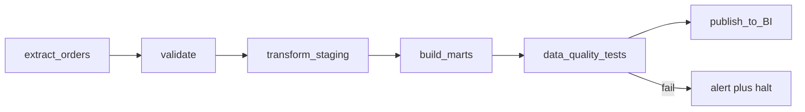

| Tool | Model | Strengths | Best for |
|---|---|---|---|
| Airflow | Task-centric DAGs | Mature, huge ecosystem, ubiquitous | Established, broad integrations |
| Dagster | Asset/data-centric | Data assets, types, testability, lineage, local dev | Modern data platforms, software-defined assets |
| Prefect | Pythonic flows | Dynamic flows, lightweight, hybrid exec | Dynamic/ML pipelines, devex-first |

**Decisive recommendation.** **Default to Airflow if it already exists** (ubiquity and integrations win), **Dagster for a greenfield modern platform** (its asset-centric model with lineage and tests is the right abstraction for data, not tasks). Either way, the orchestrator is a **control plane** that triggers Spark/dbt/Flink — *not a data plane*. Putting heavy compute inside the orchestrator is the cardinal anti-pattern.

**Idempotency, scheduling, backfills (the interview core).**

- **Idempotency:** write with `INSERT OVERWRITE`/upsert by partition, *not* append; a re-run must replace, not duplicate. Partition by the run's date so each run owns a deterministic output slice.
- **Scheduling:** cron + data-interval semantics; avoid wall-clock coupling so backfills produce correct historical results (event-time, not "now").
- **Backfills:** because tasks are idempotent and partitioned, you can re-run any historical range safely — this is what makes "fix the bug, reprocess 90 days" tractable.

**Pitfalls.** Non-idempotent tasks → duplicated/corrupted data on retry (the #1 orchestration bug). Putting heavy compute *inside* the orchestrator instead of delegating to Spark/warehouse (orchestrators should orchestrate, not crunch). Hidden cross-DAG dependencies. Backfills that hammer source systems without rate limiting. Schedule/timezone bugs around DST.

> **Staff-level insight:** Say the magic word — **idempotency** — early and often. "An orchestrator's value is only realized if every task is idempotent and partition-scoped; otherwise retries and backfills corrupt data. I partition outputs by logical date and write with overwrite/upsert, so any run — including a 90-day backfill — is deterministic and re-runnable." Then position the orchestrator correctly: "It's a control plane, not a data plane — it triggers Spark/dbt/Flink; it doesn't move the data itself." Dagster's *asset-centric* model is worth flagging as the modern shift from "tasks" to "data assets with lineage and tests."

---

## 6. Data Architecture Patterns

### 6.1 Lambda vs Kappa Architecture

**Earmark: this is a crux decision** — the architecture-level call that distinguishes a tool tour from a designed system. Go deep.

**Definition.**

- **Lambda:** run **two parallel paths** — a **batch layer** (recomputes accurate views over all historical data) and a **speed/streaming layer** (computes low-latency approximate views over recent data) — and a **serving layer** merges them at query time. Batch provides correctness; speed provides freshness.
- **Kappa:** **one path** — *everything* is a stream. Treat the immutable log (Kafka) as the source of truth; (re)compute all views by (re)processing the log. To "recompute," replay the log from the start. No separate batch layer.

**How it works.** Lambda's premise (circa 2011): streaming couldn't be made accurate (no good event-time/exactly-once), so you used streaming for speed and batch to *correct* it nightly. Kappa's premise (2014+): modern stream engines (Flink) *can* be correct (event-time, exactly-once, watermarks) and logs are durable/replayable, so the batch layer is redundant — just reprocess the stream.

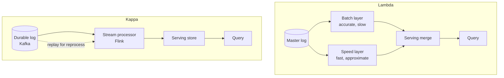

| Dimension | Lambda | Kappa |
|---|---|---|
| Code paths | Two (batch + stream) — **duplicated logic** | One (stream) |
| Correctness source | Batch layer | Event-time stream + replay |
| Reprocessing | Re-run batch | Replay log through stream |
| Complexity | High (sync two systems) | Lower (one system) |
| Maintenance burden | Two codebases, drift risk | Single codebase |
| Best fit | Legacy, heavy batch analytics, huge historical recompute | Modern stream-first, replayable log |

**The duplication problem (Lambda's central flaw).** You implement the *same business logic twice* — once in batch (Spark/SQL) and once in streaming — and they **drift**: subtle differences produce inconsistent numbers between the live dashboard and the corrected report. Reconciling them is a perpetual tax. Kappa exists specifically to eliminate this.

**Decisive recommendation.** **Default to Kappa — specifically *unified-code Kappa*** (Beam/Flink where the *same* pipeline runs as a bounded batch for backfills and an unbounded stream for live). You get Kappa's single-codebase win without Lambda's drift *and* without pure-Kappa's historical-recompute pain. *Revisit if* massive historical recompute genuinely dominates and replay-through-stream is too slow/costly to be the only reprocessing path — then a dedicated batch recompute lane is justified, but keep the *logic* shared.

**Pitfalls.** Lambda: logic drift, double the code/ops, hard reconciliation. Kappa: reprocessing huge history through a stream can be slow/expensive (mitigate with tiered storage, parallel replay, or a "bounded stream" batch run on the same code — exactly what Flink/Beam enable). Kappa also needs *long* log retention or a replayable archive (Kafka tiered storage, or replay from a lake).

> **Staff-level insight:** The decisive point: **"Lambda's defining flaw is maintaining the same logic in two engines that inevitably drift; Kappa eliminates the batch layer by betting that the stream engine is correct and the log is replayable."** Then the *nuanced* staff add: "Pure Kappa struggles with massive historical recompute, so in practice I run a **'Kappa with unified code'** — Beam/Flink where the *same* pipeline runs as a bounded batch for backfills and unbounded stream for live, giving Kappa's single-codebase win without Lambda's drift." That synthesis (not picking a side dogmatically) is the Director-level answer. **If you ever draw Lambda, you must name the drift tax in the same breath — drawing it silently is the anti-pattern.**

### 6.2 Warehouse vs Lake vs Lakehouse vs Mesh

**Definition.**

- **Data Warehouse:** structured, schema-on-write, optimized for SQL analytics/BI. Curated, governed, columnar. (Snowflake, BigQuery, Redshift.)
- **Data Lake:** raw files (Parquet/JSON/CSV) in cheap object storage (S3), schema-on-read, holds *everything* (structured + unstructured), feeds ML and ad-hoc. Risk: becomes a **data swamp** without governance.
- **Lakehouse:** lake storage (open files on S3) + **warehouse features** (ACID transactions, schema enforcement, time travel, performance) via a **table format** — **Delta Lake, Apache Iceberg, Apache Hudi**. One copy of data serves BI *and* ML. (Databricks, Iceberg + engines.)
- **Data Mesh:** an **organizational/architectural paradigm**, not a tool — **decentralized, domain-owned data products**, with self-serve platform infrastructure and federated computational governance. Each domain owns its data end-to-end as a product with SLAs.

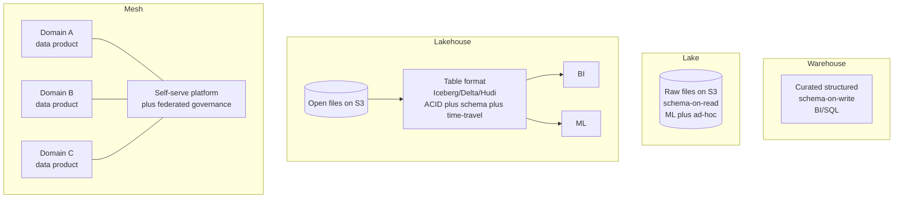

| Pattern | Structure | Governance | ML support | When |
|---|---|---|---|---|
| Warehouse | Schema-on-write, curated | Strong | Limited (export) | BI/reporting, clean structured data |
| Lake | Schema-on-read, raw | Weak (swamp risk) | Strong (raw access) | Cheap storage, ML, diverse data |
| Lakehouse | Open format + ACID | Strong (enforced) | Strong (one copy) | Unify BI+ML, avoid two copies |
| Mesh | Decentralized domains | Federated | Per-domain | Large orgs, central team bottleneck |

**Decisive recommendation.** **Default to a lakehouse (Iceberg or Delta) for any new platform** — it gives lake economics plus warehouse ACID/governance and ends the "two copies for BI and ML" problem. Use a **plain cloud warehouse** when the workload is purely structured BI at modest scale (simpler, less to operate). Treat **data mesh as an *org* decision, not a purchase** — adopt it only when a central data team has become the demonstrable bottleneck at large org scale. *Revisit Iceberg-vs-Delta* based on your engine ecosystem (Iceberg for multi-engine openness, Delta if you're Databricks-centric).

**When each / governance.** Small/mid org, structured BI → **warehouse**. Lots of raw/ML/unstructured + cost pressure → **lake**, but enforce a table format → **lakehouse** (the current default for new platforms). When a *central data team becomes the org bottleneck* and domains know their data best → **mesh** (organizational fix, not a tech you buy). Governance moves from central (warehouse/lakehouse with a catalog like Unity Catalog/Glue) to **federated** (mesh: standards centrally, ownership locally).

**Pitfalls.** Lakes without catalogs/quality → swamps. "We'll do data mesh" as a tech purchase — it's an org redesign; without platform maturity it produces *inconsistent* silos, the opposite of the goal. Lakehouse table-format lock-in/maturity differences (Iceberg vs Delta vs Hudi compaction, small files, concurrent writes).

> **Staff-level insight:** Two crisp lines. (1) **"Lakehouse = lake storage economics + warehouse ACID/governance via an open table format (Iceberg/Delta); it ends the 'two copies for BI and ML' problem."** (2) **"Data mesh is an *organizational* answer to a *scaling* problem — central data teams becoming a bottleneck — not a technology. Recommending mesh to a 30-person company is an anti-pattern; recommending it to a 5000-person org with 40 domains may be exactly right."** Distinguishing org patterns from tech is a strong Director signal.

### 6.3 OLTP vs OLAP & Columnar Storage

**Definition.**

- **OLTP (Online Transaction Processing):** many small, low-latency reads/writes of *individual rows* (Postgres, MySQL). Row-oriented, normalized, indexed for point lookups. Powers the application.
- **OLAP (Online Analytical Processing):** large scans/aggregations over *many rows but few columns* (warehouses, ClickHouse, Druid). Column-oriented, denormalized, optimized for `SUM/GROUP BY` over billions of rows.

**How it works — row vs columnar.** Row stores keep a record's fields contiguous → great for "fetch this whole order." Analytics queries touch *few columns across millions of rows* (`SELECT region, SUM(amount) ... GROUP BY region`); a row store reads every column of every row (wasteful). **Columnar storage** stores each column contiguously, so you read only the columns you need. Columnar wins because:

- **I/O reduction:** read only referenced columns.
- **Compression:** same-type, often-repeating values compress enormously (run-length, dictionary, delta) — 5–20×.
- **Vectorized execution:** process columns in batches through CPU SIMD, far faster than row-at-a-time.

Formats: **Parquet** and **ORC** (on-disk columnar for lakes); warehouses/ClickHouse use internal columnar engines.

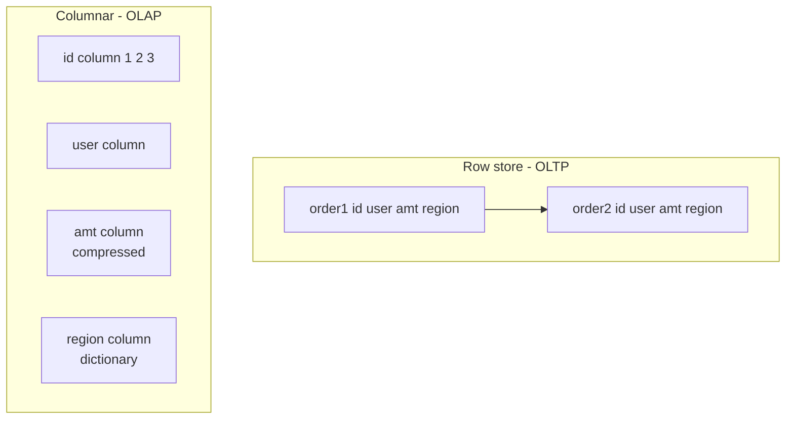

| Dimension | OLTP (row) | OLAP (columnar) |
|---|---|---|
| Access pattern | Point read/write, full row | Scan few columns, many rows |
| Storage | Row-contiguous | Column-contiguous |
| Compression | Modest | Very high (typed columns) |
| Execution | Row-at-a-time | Vectorized / SIMD |
| Writes | Fast single-row | Batch-oriented, slow single-row |
| Examples | Postgres, MySQL | Snowflake, BigQuery, ClickHouse, Parquet |

**Pitfalls.** Running heavy analytics on the OLTP primary (locks, cache pollution, replica lag) — separate OLAP. Columnar stores are bad at single-row updates/point lookups — don't use ClickHouse as an app DB. Small Parquet files kill scan performance (compaction needed). Over-normalizing OLAP defeats scan efficiency (star/denormalized schemas win).

> **Staff-level insight:** Nail the *why*: **"Columnar wins analytics for three compounding reasons — read only the columns you touch, compress typed columns 10×+, and run vectorized SIMD over them. That's the entire reason Parquet/Snowflake/ClickHouse exist."** Then the architectural rule: "OLTP and OLAP are different physics — never serve dashboards off your transactional primary. CDC the changes into a columnar OLAP store (next section) and let each engine do what it's built for." That row-vs-column physics + CDC bridge is the complete answer. **Altitude: this is a one-paragraph name-and-move-on — say the three reasons and the CDC bridge, then go.**

### 6.4 Change Data Capture (CDC)

**Definition.** **CDC** captures **row-level changes** (inserts/updates/deletes) from a source database **as they happen** and streams them as events — turning a database table into a real-time event stream. The premier method reads the database's **transaction log / WAL** (Postgres logical replication, MySQL binlog), not polling.

**How it works.** **Debezium** (the standard) connects to the DB's replication log, decodes each committed change into a structured event (before/after image, op type, timestamp, LSN), and publishes to Kafka. Because it reads the WAL, it's **low-overhead** (no query load on the source), **ordered**, **complete** (captures every change incl. deletes), and **low-latency**. This is the stream-table duality (§2.9) made operational: the table's changelog *is* the stream. Initial **snapshot** + ongoing log streaming gives a complete history.

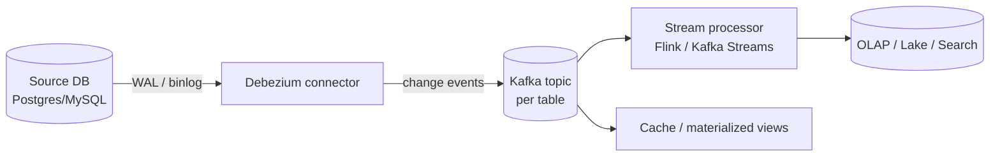

| CDC method | Source load | Latency | Completeness | Notes |
|---|---|---|---|---|
| Log-based (WAL/binlog) | Very low | Low (real-time) | Full (incl. deletes) | Best — Debezium |
| Query-based (poll updated_at) | High (queries) | Polling interval | Misses deletes/intermediate | Simple but lossy |
| Trigger-based | High (write amp) | Low | Full | Intrusive, slows writes |

**Decisive recommendation.** **Default to log-based CDC (Debezium reading the WAL/binlog).** Query-based polling misses deletes and intermediate states and adds query load; trigger-based amplifies writes. Log-based is the only one that is complete, ordered, and low-overhead. *Revisit if* the source DB has no accessible replication log (some managed/legacy systems) — only then fall back to query-based, and document the lossiness.

**As a pipeline source.** CDC is *the* modern way to feed data warehouses, lakes, search indexes (Elasticsearch), caches, and other services from operational databases **without dual writes or batch dumps** — keep an OLAP/search copy continuously in sync from OLTP, decoupling analytics from the transactional DB.

**Pitfalls.** **Schema evolution** in the source breaks downstream — pair with a schema registry (§6.5). WAL retention/replication-slot management (an unconsumed Postgres slot can fill the disk and take the DB down — a classic outage). Handling deletes/tombstones and out-of-order on rebalance. Snapshot of huge tables can be heavy. Ensuring *exactly-once* into the sink (idempotent upsert by primary key + LSN).

> **Staff-level insight:** Position CDC as **the bridge that retires dual writes and nightly dumps**: "Instead of the app writing to both the DB and a queue (dual-write — racy and inconsistent), I let the DB be the single source of truth and CDC the WAL into Kafka — one ordered, transactionally-consistent stream feeding the warehouse, search, and caches." Then flag the operational landmine that separates those who've *run* it: **"The Postgres replication slot is a footgun — if the consumer lags, WAL retention grows and can fill the disk and crash the primary. You monitor slot lag like a hawk."** That war-story detail is gold in a Staff interview.

### 6.5 Schema Evolution & the Registry

**Earmark: this is a crux for any multi-team pipeline.** A field rename by one team should not break fifty downstream consumers. Schema evolution is how you make a pipeline *changeable* without coordinated lockstep deploys — interviewers probe it to see if you've operated data platforms at organizational scale.

**Definition.** **Schema evolution** is the disciplined process of changing the structure of your event/record schemas over time *without breaking* producers or consumers that are on different versions. A **schema registry** (Confluent Schema Registry, AWS Glue Schema Registry, Apicurio) is a central service that stores versioned schemas and **enforces compatibility rules** at produce/consume time.

**How it works.** Events are serialized with a schema-aware format — **Avro** (compact, schema-required, the streaming default) or **Protobuf** (strong typing, cross-language, gRPC-native). The producer registers/looks up the schema in the registry and embeds a small **schema ID** in each message (not the full schema — that would bloat every record). The consumer fetches the schema by ID to deserialize. The registry **rejects** a new schema version that violates the configured compatibility mode:

- **Backward compatible** — new consumers can read old data (you may *add optional fields / remove fields*). Lets you upgrade consumers first. The common default.
- **Forward compatible** — old consumers can read new data (you may *add fields / not remove required ones*). Lets you upgrade producers first.
- **Full compatible** — both directions hold; the safest, most restrictive.
- **None** — no checks; the swamp path.

```mermaid
flowchart LR
    P[Producer<br/>serialize with schema ID] -->|register / validate| SR[Schema Registry<br/>versioned + compatibility rules]
    P -->|message + schema ID| K[(Kafka)]
    K --> C[Consumer]
    C -->|fetch schema by ID| SR
    SR -->|reject incompatible change| P
```

| Compatibility mode | Allowed changes | Upgrade order | Use when |
|---|---|---|---|
| Backward | Delete fields, add optional (with defaults) | Consumers first | Default; consumers many, evolve gradually |
| Forward | Add fields, delete optional fields | Producers first | Producers lead schema changes |
| Full | Add optional + delete optional (both directions) | Either order | High-stakes, many independent teams |
| None | Anything | Coordinated lockstep | Never at scale |

**Decisive recommendation.** **Default to Avro + a schema registry in `BACKWARD` compatibility mode.** Backward lets you roll out consumers ahead of producers and tolerate old data, which matches how most teams actually deploy. Use **Protobuf** instead when you need strong cross-language typing or are already gRPC-centric. Escalate to **`FULL`** for the highest-stakes, many-team topics where either deploy order must be safe. *Revisit if* a breaking change is genuinely required — then version the *topic/subject* (v2) and dual-write during migration rather than forcing an incompatible change through.

**Worked example.** Your clickstream `ClickEvent` v1 has `{userId, pageId, ts}`. Marketing wants `campaignId`. Under backward compatibility you add it as an **optional field with a default** — old consumers ignore it, new consumers read it, no coordinated deploy. Contrast the anti-pattern: *renaming* `pageId` to `pageUrl` is a breaking change the registry rejects; you'd add `pageUrl` as new-optional, backfill, and deprecate `pageId` over a release cycle.

**Pitfalls.** Treating schema changes as free — a rename or type-narrowing breaks readers. No registry → consumers deserialize garbage or crash on the first unexpected field. Embedding the full schema per message (use the ID). Forgetting that **CDC sources evolve too** — an `ALTER TABLE` on the source must propagate through the registry or Debezium output breaks downstream.

> **Staff-level insight:** The line that signals platform maturity: **"Schema evolution with a registry and backward compatibility is what lets fifty teams ship independently without a coordinated deploy — a field add is safe, a rename is a migration."** Connect it to the rest of the module: schema evolution is the *governance* counterpart to idempotency (§5) and CDC (§6.4) — together they make a pipeline both *re-runnable* and *changeable*. The anti-pattern to call out: **shipping a breaking schema change with no registry and discovering it when downstream dashboards go blank at 2 a.m.**

---

## 7. Worked Example: Real-Time Clickstream Analytics Pipeline

**The problem.** Design a pipeline for a high-traffic web/mobile product: ingest **clickstream events** (~500K events/sec peak, ~30 KB after enrichment), power (a) **real-time dashboards** (per-page/region counts, funnels, sub-5-second freshness), (b) **historical analytics & ML** in the warehouse/lake, and (c) tolerate out-of-order mobile data, schema changes, and reprocessing.

**Drive the requirements first (staff move).** Before drawing a box, pin the numbers: *"Sub-5-second dashboards force a streaming speed path; historical/ML is a batch concern; mobile means heavily out-of-order event-time data; and 'reprocessing' means I need a replayable log. That combination points at one durable log feeding two consumers — a Flink speed path and a lakehouse batch path. Let me confirm the 5-second SLO is real before I commit to streaming."* That single framing earns more credit than the diagram.

**Back-of-envelope sizing.** 500K events/s × 30 KB ≈ **15 GB/s** at peak enriched — but you partition and the *raw* ingest is far smaller (events are ~1 KB raw, enrichment happens downstream, so ingest ≈ 500 MB/s). Partition Kafka by `sessionId` at enough partitions to keep per-partition throughput under ~10 MB/s → ~50+ partitions, sized for consumer parallelism. State: session windows over active sessions — bound with a max-session-duration TTL so state doesn't grow unbounded with a long-tail of zombie sessions.

**Architecture.**

```mermaid
flowchart TB
    subgraph Ingest
      SDK[Web/Mobile SDK<br/>event-time stamped] --> GW[Collector / API GW<br/>validate plus Avro encode]
      GW --> K[(Kafka<br/>partitioned by sessionId<br/>tiered storage)]
      SR[Schema Registry<br/>Avro backward-compat] -.-> GW
    end
    subgraph Speed[Speed path - real-time]
      K --> FL[Flink<br/>event-time windows<br/>watermarks, sessionization<br/>RocksDB state, exactly-once]
      FL --> OLAP[(OLAP store<br/>ClickHouse / Druid / Pinot)]
      OLAP --> DASH[Real-time dashboards]
      FL -.late tail.-> SO[Side output<br/>reconciled in batch]
    end
    subgraph Batch[Lake/Warehouse path]
      K --> SINK[Kafka Connect / Flink sink<br/>idempotent]
      SINK --> LAKE[(Lakehouse - S3<br/>Iceberg/Delta, Parquet)]
      LAKE --> DBT[dbt transforms<br/>orchestrated by Airflow/Dagster]
      DBT --> DW[(Warehouse marts)]
      DW --> BI[BI / ML features]
    end
    K -.replay for reprocess.-> FL
```

**Walkthrough of decisions.**

1. **Ingestion (Kafka).** SDK stamps **event time** at the source. A collector validates and **Avro-encodes** against a **Schema Registry** (backward-compat, §6.5), then writes to Kafka **partitioned by `sessionId`** (keeps a session's events ordered and co-located for sessionization). Kafka is the **durable buffer + replayable log** (enables backpressure absorption and Kappa-style reprocessing); enable **tiered storage** so we can replay weeks of history without paying for hot brokers. *Why sessionId and not userId:* sessionization is the dominant stateful op; co-locating a session's events on one partition makes the session window local and cheap.

2. **Speed path (Flink → OLAP).** Flink consumes with **event-time + watermarks** (moderate allowed lateness ~tens of seconds for mobile stragglers), does **session windows** (TTL-capped) and tumbling per-minute aggregates in **RocksDB-backed keyed state**, and writes to a columnar **OLAP store (ClickHouse / Druid / Pinot)** for sub-second dashboard queries. **Exactly-once** is achieved as **at-least-once + idempotent upsert by (window, key)** — simpler and cheaper than full 2PC, and dashboards tolerate restatements from late re-fires. The truly-late tail (offline-buffered mobile events past allowed lateness) goes to a **side output** reconciled in the batch path — nothing silently dropped.

3. **Batch/lake path.** The *same* Kafka topic is also sunk **idempotently** (partitioned by event date) into a **Lakehouse** (S3 + Iceberg/Delta, Parquet). **dbt** models clean/dedupe/build marts; **Airflow/Dagster** orchestrates, with **idempotent, partition-scoped** tasks enabling safe **backfills**. This serves historical BI and ML feature pipelines (→ [AI Systems](17-ai-systems.md)). The lake, with full completeness, is the **system of record**; the stream is the fast-but-provisional view.

4. **One log, two consumers (Kappa-leaning).** Rather than Lambda's two *codebases*, both paths consume the same log. For corrections/recompute, **replay Kafka** through Flink (or run the same logic as a bounded batch — unified-code Kappa, §6.1) — single source of truth, minimal logic drift.

**Cross-cutting concerns (call these out — interviewers reward them):**

- **Idempotency & reprocessing:** every sink upserts by a deterministic key (`(window, dimension)` or primary key); lake writes are partitioned by date with overwrite semantics. Reprocessing = replay the log; outputs converge, no duplicates.
- **Schema evolution:** **Avro/Protobuf + Schema Registry** with **compatibility rules** (backward) so producers and the SDK can evolve without breaking Flink/dbt consumers. New optional fields don't break old readers; renames/removals are gated by the registry (§6.5).
- **Late data:** watermark + allowed lateness in Flink; truly-late events go to a **side output** reconciled in the batch path so nothing is silently lost — the provisional-then-final pattern.
- **Data quality:** validation at ingest (schema), dbt **tests** (not-null, uniqueness, referential), and **freshness/volume anomaly** monitors with alerting; quarantine bad records to a dead-letter topic.
- **Backpressure & scaling:** Flink credit-based backpressure absorbs bursts into Kafka lag (degrade latency, not lose data); autoscale Flink and OLAP independently.

**Cost-aware sanity check (the staff close).** Before committing to streaming for *everything*, separate the SLOs: the dashboards need 5-second freshness (streaming), but the daily/weekly cohort and retention marts do **not** — they're batch and would be pure waste on the speed path. *Run streaming only for the sub-5s dashboard aggregates; run everything else as batch on the lake.* This is the YAGNI discipline applied to the design itself.

**What to say in the interview (the closing summary):** "One **durable, replayable Kafka log** as the spine; a **Flink speed path** to a **columnar OLAP store** for sub-5s dashboards; the **same log** sunk to a **lakehouse** for historical/ML, transformed by **dbt** under **idempotent orchestration**. I lean **unified-code Kappa** — replay the log to reprocess — to avoid Lambda's dual-codebase drift, use **at-least-once + idempotent upserts** rather than expensive 2PC, govern change with a **schema registry** (backward-compat), and keep batch-only work off the expensive streaming path. Every component scales independently and degrades to *higher latency*, never data loss. SLOs: 5-second freshness, exactly-once-by-effect, graceful degradation to lag under burst, reproducible reprocessing."

> **Staff-level insight:** The differentiator isn't the boxes (everyone draws Kafka→Flink→OLAP) — it's the **cross-cutting reasoning**: idempotency strategy, schema-registry compatibility rules, late-data side outputs, replay-based reprocessing, and *cost-aware* exactly-once and batch-vs-stream choices. End by stating the **SLOs and failure modes**: "5-second freshness, exactly-once-by-effect, graceful degradation to lag under burst, and reproducible reprocessing." Naming the SLO and the degradation behavior — and *separating which workloads actually need streaming* — is what makes it a *staff* answer rather than a tool tour.

---

## Interview Cheat-Sheet

**One-liners to deploy:**

- "Batch and stream are the **same computation over bounded vs unbounded data**." (Beam thesis.)
- "**Default to batch unless a stated latency requirement forces streaming** — most 'real-time' is really 'within a few minutes.'"
- "Event time gives you **reproducibility**; processing time doesn't."
- "A **watermark** is a heuristic latency/completeness knob, *not* a correctness guarantee — pair it with allowed lateness + a late-data side output."
- "**Exactly-once** is a property of the *effect on state*, not message delivery — and only as strong as your sink (idempotent upsert or 2PC). Default to at-least-once + idempotent; reserve 2PC for money."
- "**Backpressure** is a feature: it trades latency for stability so you never lose data."
- "Every **table is a stream and every stream is a table** — CDC, materialized views, event sourcing all follow."
- "**Spark** is batch that streams via micro-batch; **Flink** is streaming that does batch as a bounded stream."
- "**ELT won** because cloud warehouses decoupled storage from compute and made raw retention (reprocessing) cheap — but mask PII before landing."
- "**Lambda's** flaw is two codebases that drift; **Kappa** replays one log — I run *unified-code Kappa* (Beam/Flink batch+stream) to get the win without the historical-recompute pain."
- "**Lakehouse** = lake economics + warehouse ACID via Iceberg/Delta; **mesh** is an *org* pattern, not a tool."
- "**Columnar wins** for three reasons: read fewer columns, compress typed data 10×+, vectorized SIMD."
- "**CDC** (Debezium/WAL) retires dual writes and nightly dumps — but watch the replication-slot disk footgun."
- "**Schema evolution** with a registry + backward compatibility lets fifty teams ship independently — a field add is safe, a rename is a migration."
- "Orchestration value = **idempotent, partition-scoped tasks** that make retries and backfills safe; the orchestrator is a control plane, not a data plane."

**Decision quick-reference:**

| Need | Reach for |
|---|---|
| Daily/weekly metrics, reports, training data | **Batch** (default — cheapest, simplest) |
| Sub-second, big event-time state, CEP | Flink |
| Unified batch+stream, ML, already on Databricks | Spark |
| Kafka-in/Kafka-out, no cluster | Kafka Streams / ksqlDB |
| Portable, engine-agnostic pipeline | Beam |
| DB → warehouse/search/cache in real time | CDC (Debezium) |
| Unify BI + ML, one data copy | Lakehouse (Iceberg/Delta) |
| Decentralize when central team is the bottleneck | Data Mesh |
| Sub-second analytical queries | Columnar OLAP (ClickHouse/Druid/Pinot) |
| Safe multi-team schema change | Avro + registry, backward compatibility |
| Reprocess history without two codebases | Unified-code Kappa (replay the log) |

---

## Common Interview Questions

**Q1. What's the real difference between batch and stream processing, and how do you decide?**
*Staff answer:* It's **bounded vs unbounded data**, and latency/cost/completeness fall out of that. Batch waits for complete data → highest throughput, cheapest $/TB, strong completeness, minutes-to-hours latency. Stream processes unbounded data per-event → milliseconds, but must reason about incompleteness via watermarks. **I default to batch and only escalate to streaming when a stated requirement forces it** — a business action that must fire in seconds. Most "real-time" needs are "within minutes," so I push back and right-size; streaming-by-reflex is a 5–10× cost mistake. Micro-batch (Spark) is the middle ground.

**Q2. Walk me through event time, watermarks, and late data.**
*Staff answer:* Event time = when it happened (truth, in the payload); processing time = when we handle it. Mobile data is heavily out-of-order, so I bucket by **event time** for reproducibility. The **watermark** asserts "I've seen everything up to time W" — a *heuristic* trading latency for completeness, not a correctness guarantee. When the watermark passes a window, it fires; **allowed lateness** keeps it in state to re-fire on stragglers; after that, late events go to a **side output** I reconcile in batch so nothing's silently dropped — the provisional-then-final pattern. Crucially, re-fires mean my **sink must be upsert-by-key**, and downstream must tolerate restatements. The operational gotcha: a single idle partition stalls the global watermark — you need idle-source detection.

**Q3. What does exactly-once actually mean, and how is it achieved?**
*Staff answer:* It's **effectively-once** — each event affects *state* exactly once despite replays, not "delivered once." Flink gets it internally via **Chandy-Lamport checkpoints** (barriers snapshot state + Kafka offsets atomically). **End-to-end** requires either idempotent writes (upsert by deterministic key) or a transactional/2PC sink. You *cannot* get it with a non-idempotent, non-transactional sink — and claiming "exactly-once" without naming the sink mechanism is the hand-wave I'd never make. My default is **at-least-once + idempotent upserts** — cheaper, simpler, rescales better; I reserve full 2PC for money movement.

**Q4. Spark or Flink — when and why?**
*Staff answer:* Spark is a **batch engine that streams via micro-batch**; Flink is a **true streaming engine** (batch = bounded stream). Decision axis is **latency and state complexity**: seconds of freshness, ML, already on Databricks → Spark (and minimize/de-skew shuffles, the dominant cost — I've watched one hot key stall a task for an hour until we salted it). Sub-second, complex event-time windowing/sessionization, very large keyed state, CEP, safe stateful rescaling via savepoints → Flink. Both can be right; **dogma is the wrong answer** — I state the default and the trigger to switch, then stop.

**Q5. Why did ELT replace ETL, and what are its downsides?**
*Staff answer:* Cloud warehouses **decoupled storage from compute** and made raw-data retention cheap, so loading raw and transforming in-place (SQL/dbt) became cheaper, more scalable, and **reprocessable** — and lets analysts build transforms. Downsides: cost shifts into warehouse compute (un-pruned scans get expensive), and raw dumping risks a **swamp** without governance. So I keep raw + transform-in-place for analytics, but still **mask PII and do heavy ML feature logic before landing**.

**Q6. Lambda vs Kappa — which would you build today?**
*Staff answer:* Lambda's defining flaw is the **duplication problem** — the same logic in two engines that drift, producing inconsistent numbers between the live dashboard and the corrected report. That drift is a perpetual reconciliation tax. Kappa keeps one stream codebase and reprocesses by **replaying the log**, relying on modern event-time/exactly-once correctness. Pure Kappa struggles with massive historical recompute, so I build **unified-code Kappa**: Beam/Flink where the *same* pipeline runs as a bounded batch for backfills and an unbounded stream for live — single codebase, no drift, replayable, and history-friendly. If I ever draw Lambda, I name the drift tax in the same breath.

**Q7. Explain CDC and how you'd use it. What can go wrong?**
*Staff answer:* CDC streams row-level changes from a DB's **WAL/binlog** (Debezium) as ordered events — low source overhead, captures deletes, real-time. It's the **stream-table duality** operationalized and the modern replacement for **dual writes and nightly dumps**: the DB stays the single source of truth, and one consistent stream feeds the warehouse, search, and caches. Default to log-based, not polling — polling misses deletes. Footguns: a lagging consumer leaves the **Postgres replication slot** unconsumed, growing WAL until the disk fills and the primary crashes — monitor slot lag religiously; and pair with a **schema registry** so source schema changes don't break consumers.

**Q8. Why is columnar storage faster for analytics?**
*Staff answer:* Three compounding reasons: (1) **read only the columns** a query touches (analytics scans few columns over many rows); (2) **compression** — typed, repetitive columns compress 10×+ via dictionary/RLE/delta; (3) **vectorized SIMD** execution over column batches. That's why Parquet, Snowflake, and ClickHouse exist. The corollary: columnar stores are terrible at single-row updates/point lookups, so OLTP and OLAP are different physics — never run dashboards on your transactional primary; CDC the changes into a columnar OLAP store.

**Q9. How do you make a data pipeline safe to retry and backfill?**
*Staff answer:* **Idempotency + partition-scoping.** Each run owns a deterministic output slice keyed by its **logical/event date**, and writes with **overwrite or upsert-by-key**, never append — so a retry replaces rather than duplicates, and a 90-day backfill is just re-running idempotent partitions. The orchestrator (Airflow/Dagster/Prefect) is a **control plane** that triggers Spark/dbt — it shouldn't crunch data itself. I also use event-time (not wall-clock) semantics so historical runs produce correct results.

**Q10. How do you evolve schemas across many teams without breaking everyone?**
*Staff answer:* **Avro/Protobuf + a schema registry in backward-compatibility mode.** Producers embed a schema ID; consumers fetch by ID; the registry *rejects* incompatible changes at registration. A **field add (optional, with default) is safe** and needs no coordinated deploy — old consumers ignore it, new ones read it. A **rename or type-narrowing is a breaking change** the registry blocks; I handle it as a migration — add the new field, backfill, deprecate the old over a release. This is what lets fifty teams ship independently, and it's the governance counterpart to idempotency and CDC.

**Q11. Design a real-time clickstream analytics pipeline.**
*Staff answer:* First I pin the SLOs: sub-5s dashboards force a streaming speed path; historical/ML is batch; mobile means out-of-order event-time; "reprocess" means a replayable log. So: one **durable, replayable Kafka log** partitioned by session as the spine, with **Avro + schema registry (backward-compat)** at ingest. A **Flink speed path** (event-time, watermarks, TTL-capped sessionization, RocksDB state) writes to a **columnar OLAP store** (ClickHouse/Druid/Pinot) for sub-5s dashboards via **idempotent upserts**, late tail to a side output. The **same log** is sunk idempotently to a **lakehouse** (Iceberg/Delta) and transformed by **dbt** under idempotent orchestration for historical BI/ML — and I keep batch-only marts *off* the streaming path to avoid paying streaming cost for data read once a day. I lean **unified-code Kappa**, use **at-least-once + idempotent** over expensive 2PC, and state the SLOs: 5-second freshness, exactly-once-by-effect, graceful degradation to lag (never data loss), reproducible reprocessing.

**Q12 (meta/delivery). There are five streaming engines and three architectures here — how do you keep an answer at the right altitude instead of touring all of them?**
*Staff answer:* I lead with the **decision and the requirement that drives it**, not a catalog. I name the basics in one breath — "Kafka in, process, OLAP store out" — and spend my time on the two or three places real design risk lives: event-time/watermarks/late-data, the exactly-once sink mechanism, and the Lambda-vs-Kappa drift tax. For every fork I give "`<choice>` because `<requirement>`; revisit if `<trigger>`" rather than "it depends." And I actively *de-escalate* — if a nightly batch meets the SLO, I say so and don't reach for Flink. The signal isn't how many engines I can name; it's that I made a defensible call, weighted the risky parts, and didn't over-engineer. (More on this in [Staff-Level Execution](20-staff-execution.md).)

---

*Continue to [AI Systems](17-ai-systems.md) — where these pipelines become feature, embedding, and training data pipelines. Review [Messaging & Event-Driven](04-messaging-event-driven.md) for Kafka internals, [Storage](08-storage.md) for object stores and file formats, and [Databases](06-databases.md) for OLTP/replication that CDC builds on. For delivering all of this at Staff/Director altitude, see [Staff-Level Execution](20-staff-execution.md).*
