# Module 17 — AI Systems Design

> The definitive, current (2025/2026-era) reference for designing LLM-powered systems at a Staff / Senior EM / Director altitude. This is now one of the most common system-design interview tracks — "design a RAG chatbot", "design an AI agent platform", "design our LLM serving infra". This module gives you the depth, the trade-offs, the real numbers, and the exact phrasing to use in the room.

## What you'll master

By the end of this module you will be able to reason about an LLM as a *system component* — with its latency budget, cost-per-token economics, non-determinism, and failure modes — and architect the systems around it: retrieval-augmented generation (RAG), vector databases and ANN search, agents and tool calling, memory, evaluation, serving/optimization, and inference infrastructure. You'll be able to defend build-vs-buy, draw a production RAG pipeline from memory, and explain why your design choices hold under scale, cost, and quality pressure.

This module assumes you've internalized [Search](07-search.md), [Caching](03-caching.md), [Data Processing](16-data-processing.md), and [Databases](06-databases.md) — AI systems are mostly those systems wearing a new hat. It pairs directly with [Staff-Level Execution](20-staff-execution.md): this module is the *technical depth*, that module is the *delivery posture*. Read them together.

---

## Table of Contents

1. [In the Room — Staff-Level Delivery](#in-the-room--staff-level-delivery)
2. [LLM Application Fundamentals](#1-llm-application-fundamentals)
3. [RAG Architecture (Deep)](#2-rag-architecture-deep)
4. [Vector Databases & Search](#3-vector-databases--search)
5. [Agents & Tool Calling](#4-agents--tool-calling)
6. [Memory Systems](#5-memory-systems)
7. [Evaluation Systems](#6-evaluation-systems)
8. [Serving & Optimization](#7-serving--optimization)
9. [Inference Infrastructure](#8-inference-infrastructure)
10. [Worked Design: RAG-Powered Support Assistant](#9-worked-design-rag-powered-support-assistant)
11. [Interview Cheat-Sheet](#10-interview-cheat-sheet)
12. [Common Interview Questions](#11-common-interview-questions)

---

## In the Room — Staff-Level Delivery

> This section is the lens. Everything below it applies the lens. If you read only one section before an AI-systems interview, read this one — then [Staff-Level Execution](20-staff-execution.md) for the general delivery posture.

The AI-systems interview is *not* a quiz on transformer internals. It's a test of whether you can take a probabilistic, expensive, non-deterministic dependency and wrap it in a system that's correct, cheap, fast, and safe enough to ship — and whether you know which 20% of that surface area actually carries the risk. Junior candidates enumerate the whole pipeline at uniform depth. Staff candidates *decide*, name the risk crux, and move on.

### Decisions to make decisively

Don't say "it depends." Say "X because Y; revisit if Z." Here are the defaults you walk in with — each is a decision, not a menu:

| Decision | Default | Because | Revisit if |
|---|---|---|---|
| Ground knowledge: RAG vs fine-tune vs long-context | **RAG** | Knowledge is dynamic/private/large; you need freshness and citations without retraining | Behavior/format/tone is the gap (→ fine-tune), or the relevant context is small and fixed per call (→ long-context) |
| Model: managed API vs self-host | **Managed API — Claude Opus 4.x via the Anthropic API** | Hours to value, frontier quality, zero GPU ops, prompt caching controls cost | You hit a *quantified* driver: very high steady volume past the cost crossover, hard data-residency/BAA, or custom weights |
| Vector store | **pgvector** (Postgres) | One fewer system to operate; transactional joins + metadata filtering + tenant ACLs for free | Vector count / QPS / filtering complexity outgrows Postgres (~10M+ vectors or high concurrent ANN QPS) → dedicated DB |
| Agent vs single call vs workflow | **Single call, or a deterministic workflow** | Agents are the most expensive, least predictable option | The task genuinely needs multi-step, open-ended tool use the model must sequence itself |
| Model tier per task | **Route by difficulty** — Haiku-tier for classify/extract/route, Opus-tier for hard reasoning | Output tokens dominate cost; most traffic is easy | A cascade's escalation rate makes the blended cost worse than just using one model |

> **Staff-level insight:** Every one of these defaults is a *cost/quality/latency/safety* trade, and naming which pressure your choice relieves is worth more than the choice itself. "Default RAG because we need freshness + citations; if the bottleneck turns out to be *tone* not *facts*, that's a fine-tune, not a retrieval fix" — that sentence is the entire RAG-vs-finetune answer, decided.

### Altitude — name and move on vs deep-dive

The RAG happy path is five words you say in one breath and never linger on:

> **"Embed, store in a vector DB, retrieve top-k, stuff the prompt, generate."**

That's the part everyone knows. Spend your altitude on the parts that actually fail in production:

- **Retrieval quality** — hybrid (vector + BM25), reranking, query rewriting, HyDE, parent-doc. *This is where RAG quality lives.*
- **Evaluation** — golden set + regression CI, LLM-as-judge calibrated to humans, RAGAS retrieval-vs-generation split. *This is what separates a demo from a product.*
- **Cost & latency** — prompt caching, model routing/cascades, output-length control, TTFT/TPOT budgets. *This is what makes it survivable at scale.*
- **The failure modes** — hallucination, lost-in-the-middle, stale index, prompt injection, cross-tenant leakage, agent runaway. *This is what gets you paged.*

### YAGNI default + trigger

Start with the **simplest thing that could possibly work**: single managed-model call → add RAG when you need grounded private knowledge → add reranking when retrieval precision is the measured bottleneck → add an agent only when a single call genuinely can't sequence the task → self-host only when a number forces it. The trigger to add a layer is always *a measured problem*, never *a hypothetical*. "We added the reranker because context precision was 0.4 on the eval set" is a Staff sentence; "we should probably add reranking" is not.

### Top anti-patterns (these read as junior in the room)

1. **Fine-tuning by reflex.** Reaching for fine-tuning when RAG or better prompting solves it. Fine-tuning is for *behavior*, not *knowledge*, and it's the expensive, opaque, hard-to-update option. Default RAG; justify the fine-tune.
2. **Agents when one call works.** Wrapping a deterministic task in an autonomous loop. Agents add cost, latency, and a whole class of failure modes (loops, runaway spend, unsafe actions). Justify the autonomy.
3. **Ignoring eval.** Describing a system with no way to measure whether it's good or whether a change made it worse. Non-deterministic software shipped blind. A golden set + regression CI is the non-negotiable.
4. **No caching / no cost control.** Treating tokens as free. At scale, cost *is* the product constraint. Prompt caching + routing is almost always the dominant lever — name it.
5. **Hallucination hand-waving.** Saying "we'll fix hallucination" instead of "we *mitigate* it with grounding, citations, a faithfulness eval, and a confidence/grounding gate that escalates." Hallucination is an inherent property you manage, not a bug you fix.
6. **Uniform thoroughness.** Explaining embeddings for three minutes and the eval loop for ten seconds. Spend depth where the risk is.

### Experience hooks (cite real operational reality)

These are the lines that signal you've actually shipped this, not just read about it:

- *"In a real-time chat product, the LLM call is just one more dependency with a latency budget and a billing meter — you instrument it like any other, with p99 TTFT, tokens-per-request, and cost-per-conversation on a dashboard, or the bill surprises you."*
- *"When a RAG demo is wrong, juniors reach for a bigger model; I instrument retrieval first — measure context recall before touching the prompt, because nine times out of ten the right chunk was never retrieved."*
- *"The first time an agent loops on a paid model overnight, you learn that bounded autonomy — max steps, token ceiling, per-step trace — is not optional, it's the design."*
- *"Cross-tenant leakage in shared vector stores is a security bug wearing a relevance-tuning costume. Tenant-filtered ANN is the boundary; I treat it like a row-level-security requirement, not a search feature."*

With the lens established, the rest of the module is the depth — read decisively, and apply the defaults above as you go.

---

## 1. LLM Application Fundamentals

### Definition

An LLM is a stochastic, latency-heavy, token-priced function: text (and increasingly images/audio) in, text out. Treating it as "just another API call" is the single most common mistake — it has properties no other component you've designed has: non-determinism, an unbounded-but-billed input, a hard context window, and a probability of being confidently wrong (hallucination).

### How it works (the system view)

> **Altitude:** name the token model and the two latency metrics, then move on. The depth here is *which lever relieves which pressure* — don't lecture on transformers.

The unit of everything is the **token** (~4 characters / ~0.75 words in English; code and non-English run more tokens per word). Every request has two token streams with different cost and latency profiles:

- **Prompt (input) tokens** — your system prompt, retrieved context, conversation history, the user's message. Processed in one parallel "prefill" pass. Cheaper per token.
- **Completion (output) tokens** — generated one at a time, autoregressively. Each token depends on all prior tokens (the "KV cache"). More expensive per token (typically ~3-5× input price; ≈5× on the Claude family) and the dominant latency driver.

Two latency metrics matter and you should name both in interviews:

- **TTFT (time to first token)** — dominated by prefill, which scales with input length. Long prompts = slow first token. Order of magnitude: a few hundred ms for a short prompt; **1–3s+ for a long RAG prompt** (tens of thousands of input tokens) before prompt caching, dropping back toward a few hundred ms on a cache hit.
- **TPOT / ITL (time per output token / inter-token latency)** — the streaming rate, typically **~10–30ms/token** on a frontier hosted model (i.e. ~30–100+ tokens/sec; the slow end, ~20 tok/s, is a long-context worst case). Total latency ≈ TTFT + (output_tokens × TPOT). A 500-token answer at 25ms/token is ~12.5s of generation *on top of* TTFT — which is exactly why you stream.

**Streaming** sends tokens as they're generated so perceived latency ≈ TTFT, not full generation time. Essential for any interactive UX. **Temperature** controls sampling randomness (0 = near-deterministic/greedy, higher = more diverse) — but note that even temperature 0 is not bit-reproducible across hardware/batching. Current frontier models (the **Claude Opus 4.x family** — e.g. `claude-opus-4-8`) have moved to *adaptive* reasoning/thinking and an `effort` control rather than fixed sampling knobs; on those models the older `temperature`/`top_p`/`budget_tokens` parameters are removed. Mention this to signal you're current: *"On the latest models you don't tune a temperature, you set an effort level and let adaptive thinking decide depth."*

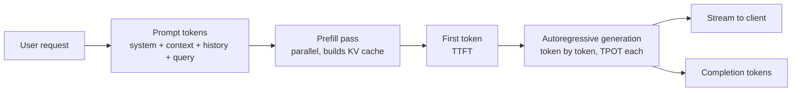

### Token economics — the numbers to have ready

You should be able to do back-of-envelope cost math in the room. Current managed-API ballpark, per 1M tokens (Anthropic Claude family, 2025/2026-era):

| Tier | Model (example) | Input $/1M | Output $/1M | Use for |
|---|---|---|---|---|
| Small/fast | Haiku-tier (`claude-haiku-4-5`) | ~$1 | ~$5 | Classify, extract, route, the easy majority |
| Balanced | Sonnet-tier (`claude-sonnet-4-6`) | ~$3 | ~$15 | High-volume production reasoning |
| Frontier | Opus-tier (`claude-opus-4-8`) | ~$5 | ~$25 | Hard reasoning, agents, the hard tail |

Two derived facts to keep in your pocket: **output tokens cost more than input — typically ~3-5× (≈5× on the Claude family)**, so output-length control is the highest-leverage per-call cost lever; and **prompt caching cuts the cached prefix to ~0.1× input price** (a ~90% discount on the repeated portion), at a one-time ~1.25× write premium. A RAG system with a 10K-token stable prefix and a 200-token question pays full price on the prefix once, then ~10% of it on every subsequent hit — that's the difference between a viable and an unviable cost structure at volume. (Batch/async APIs add another ~50% discount for non-latency-sensitive work.)

### Build vs Buy: API vs self-hosted

This is the canonical opening trade-off. **Decide: buy (a hosted API) by default; self-host only with a specific, quantified reason.** Lead with the decision, then the table.

| Dimension | Hosted API (e.g. Anthropic Claude, OpenAI) | Self-hosted open model (Llama, Mistral, Qwen via vLLM) |
|---|---|---|
| Time to first value | Hours | Weeks (infra, ops, eval) |
| Quality ceiling | Highest (frontier models) | Below frontier, closing on narrow tasks |
| Cost at low/medium volume | Pay-per-token, cheap | GPU rental dominates, expensive |
| Cost at very high volume | Can get expensive | Cheaper per token once GPUs saturated |
| Latency control | Provider-bound, but prompt caching helps | Full control (batching, quantization) |
| Data residency / privacy | Needs vendor trust / BAA / zero-retention | Data never leaves your VPC |
| Fine-tuning / custom weights | Limited / managed | Full control |
| Ops burden | ~None | GPU scheduling, OOM, autoscaling, upgrades |

**Self-hosting levers** worth naming: **vLLM** (continuous batching + PagedAttention serving engine), **quantization** (FP16 → INT8/INT4/FP8 to cut memory and cost ~2–4× at a small quality hit), and **GPU economics** (an A100 80GB runs ~$1.5–3/hr cloud; an H100 more — a 70B model in FP16 needs ~140GB+ just for weights, so 2× A100/H100 minimum before you've served a single token).

> **Earmark the hard part:** the build-vs-buy *crossover* is a number, not a vibe. The honest Staff answer is "buy until I can show the GPU-saturated cost-per-token beats the API at our steady volume — and that crossover is usually further out than people think, because self-hosting also costs you an on-call rotation, eval infra, and model-upgrade churn that the API absorbs for free."

### Pitfalls

- **Ignoring non-determinism in tests** — golden-output exact-match tests flake. Test for properties/structure, not string equality.
- **Unbounded context cost** — naively stuffing all history/context grows cost and latency every turn and eventually overflows the window.
- **Treating hallucination as a bug to "fix"** — it's an inherent property; you *mitigate* it (grounding, citations, retrieval, guardrails), you don't eliminate it.
- **Underestimating tail latency** — p99 on a 2000-token completion can be 10–30s. Design timeouts and streaming around it.
- **No cost observability** — shipping without per-request token/cost metrics. The first you hear of a regression is the monthly bill.

> **Staff-level insight:** Frame the LLM as a *probabilistic dependency with a billing meter*. Every architectural decision — RAG, caching, model routing, eval — exists to manage one of four pressures: **quality** (reduce hallucination), **cost** (reduce tokens/calls), **latency** (reduce TTFT/output), or **safety** (reduce harmful output). When you justify a design, name which pressure it relieves. Interviewers reward that framing more than any specific tech choice. (This is the same "name the pressure, decide, move on" discipline from [Staff-Level Execution](20-staff-execution.md).)

---

## 2. RAG Architecture (Deep)

> This is **the** most-asked AI system-design question. Know it cold, end to end, with both the indexing pipeline and the query-time path. **Default: RAG for grounded private/dynamic knowledge.** Decide it in the first sentence, then spend your depth on retrieval quality and the failure modes — not on re-explaining "stuff the prompt."

### Definition

**Retrieval-Augmented Generation** grounds an LLM's answer in retrieved, authoritative documents instead of relying solely on parametric (training-baked) knowledge. You retrieve relevant chunks at query time, inject them into the prompt as context, and ask the model to answer *using only that context*, with citations. It is the primary defense against hallucination and the way to give a model access to private, fresh, or large knowledge bases without retraining.

### How it works — the full pipeline

RAG is two pipelines: an **offline ingestion/indexing** pipeline (batch, looks like [Data Processing](16-data-processing.md)) and an **online query** pipeline (request path, latency-sensitive).

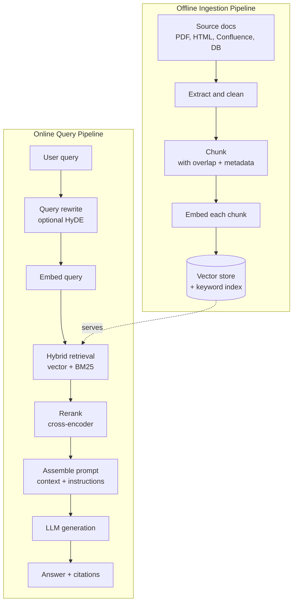

Query-time sequence:

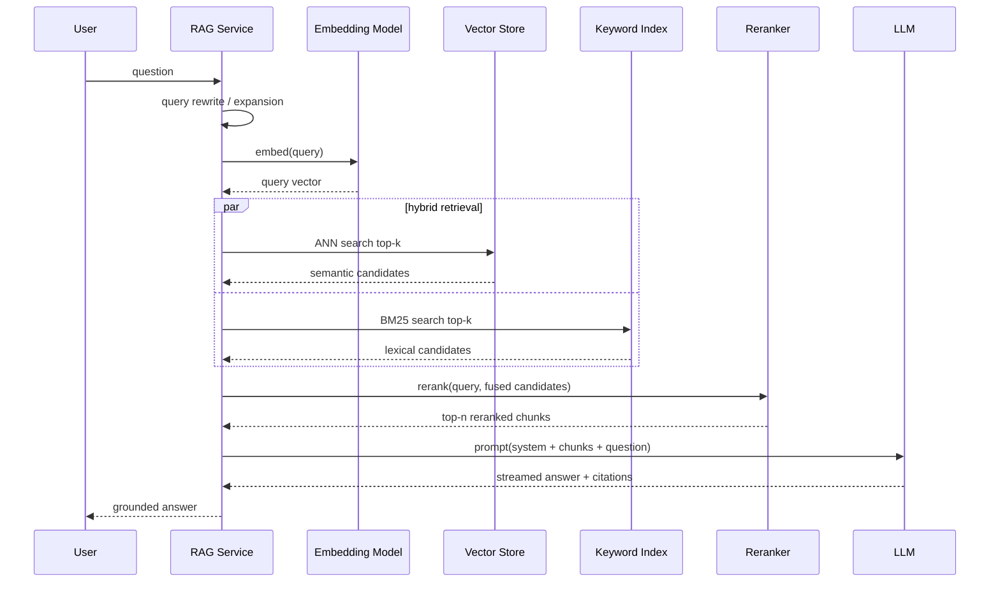

#### Stage 1 — Ingestion & chunking

You can't embed a whole document — embeddings represent a bounded span, and the LLM has a finite context window. **Chunking** splits docs into retrievable units. **This is where most RAG quality is won or lost** — earmark it as a risk crux, not a name-and-move-on basic.

| Strategy | How it works | Pros | Cons | Use when |
|---|---|---|---|---|
| Fixed-size | N tokens per chunk, sliding | Trivial, fast | Splits mid-sentence/idea | Baseline, homogeneous text |
| Fixed + overlap | N tokens, overlap M (~10–20%) | Preserves boundary context | Some duplication/cost | **Default starting point** |
| Recursive/structural | Split on headings → paragraphs → sentences | Respects document structure | Needs structured source | Markdown, docs, code |
| Semantic | Split where embedding similarity drops | Topically coherent chunks | Compute-heavy at ingest | High-value, heterogeneous corpora |
| Parent-document | Embed small chunks, retrieve their larger parent | Precise match + rich context | More storage/plumbing | Long docs where context matters |

**Decide:** start with **fixed-size + ~15% overlap, ~256–512 tokens per chunk**, recursive/structural if the source has clean headings; revisit to semantic or parent-doc only if the eval shows retrieval precision is the bottleneck. **Metadata** attached at chunk time (source URL, title, section, author, timestamp, ACL/tenant) is non-negotiable — it powers filtering, citation, freshness, and access control. **Overlap** (~10–20%) prevents losing meaning split across a boundary.

#### Stage 2 — Embedding & indexing

Each chunk → a dense **embedding** vector (see §3). Store the vector + the original text + metadata in a vector store, and (for hybrid) also build a keyword/BM25 index. Indexing is batch and idempotent; design it to be re-runnable when you change embedding models. **Earmark:** an embedding model change requires a **full re-index** of the entire corpus — call this out explicitly, it's a frequently-missed operational cost and it means embedding-model choice is a sticky decision.

#### Stage 3 — Retrieval (semantic + hybrid)

At query time: embed the query, do ANN search for the top-k semantically nearest chunks. **Hybrid search** also runs lexical (BM25 — see [Search](07-search.md)) and fuses results (typically Reciprocal Rank Fusion). **Decide: hybrid by default.** Pure vector search misses exact tokens — error codes, product SKUs, proper nouns, acronyms, version strings — that lexical search nails; pure lexical misses paraphrase and synonymy. In a support/chat product you have *both* kinds of query, so you need both retrievers.

#### Stage 4 — Reranking

Retrieval is recall-oriented (cast a wide net, k=50–100). A **cross-encoder reranker** then scores each (query, chunk) pair jointly for precision and keeps the top n (3–8). Cross-encoders are far more accurate than the bi-encoder used for retrieval but too slow to run over the whole corpus — hence the two-stage retrieve-then-rerank pattern. **This is the single highest-ROI quality lever in most RAG systems** — typically buys more quality per dollar than upgrading the LLM. Decide it in, then note the cost: a rerank pass over 50 candidates adds tens to ~100ms of latency, which is cheap relative to the quality gain.

#### Stage 5 — Prompt assembly & generation

Assemble: system instructions ("answer only from the context; if the answer isn't present, say you don't know"), the reranked chunks (each tagged with its source ID for citation), and the question. The model generates a grounded answer with **citations** mapping claims back to chunk IDs — this is what makes the answer auditable and trustworthy. **Caching note:** put the stable system prompt + tool schemas first (cacheable prefix), the volatile retrieved chunks and the question last — see §7. Watch **lost-in-the-middle** (below) when ordering chunks.

### Failure modes & fixes

> Spend your altitude here. This table is the part of RAG that actually pages you.

| Failure mode | Symptom | Fix |
|---|---|---|
| Poor retrieval | Right answer exists but isn't retrieved | Hybrid search, better chunking, reranking |
| Lost-in-the-middle | Model ignores chunks placed in the middle of a long context | Put best chunks at start/end; rerank; fewer chunks |
| Stale index | Answers reflect old docs | Incremental re-index, TTL, freshness metadata + filtering |
| Vague/ambiguous query | Embedding too diffuse to retrieve | Query rewriting, multi-query, **HyDE** |
| Acronym/exact-term miss | Semantic search misses literal token | Hybrid (BM25) |
| Context overflow | Too many chunks blow the window/cost | Rerank to top-n, parent-doc, compression |
| Hallucinated citation | Cites a source that doesn't support the claim | Faithfulness eval, constrain to provided IDs |
| Cross-tenant leakage | Tenant A's answer pulls Tenant B's docs | Hard tenant filter on the ANN query (filtered ANN) — a security boundary, §3 |

**Advanced techniques to name (decisively, with a trigger):**
- **Query rewriting / expansion** — rewrite a conversational/ambiguous query into a retrieval-optimized one (resolve pronouns, add synonyms). *Add when conversational multi-turn queries retrieve poorly.*
- **HyDE (Hypothetical Document Embeddings)** — have the LLM draft a *hypothetical answer*, embed *that*, and retrieve against it; the hypothetical sits closer in embedding space to real answer-documents than the question does. *Add when short/vague queries under-retrieve; costs one extra LLM call per query.*
- **Parent-document retrieval** — match on small precise chunks, feed the larger parent for context. *Add for long docs where the precise match needs surrounding context.*
- **Multi-query / fan-out** — generate several query variants, retrieve for each, fuse. *Add when single-query recall is the measured gap; costs N retrievals.*

Each of these is a *YAGNI* candidate: you don't ship them upfront, you add the one your eval tells you to.

### RAG vs fine-tuning vs long-context

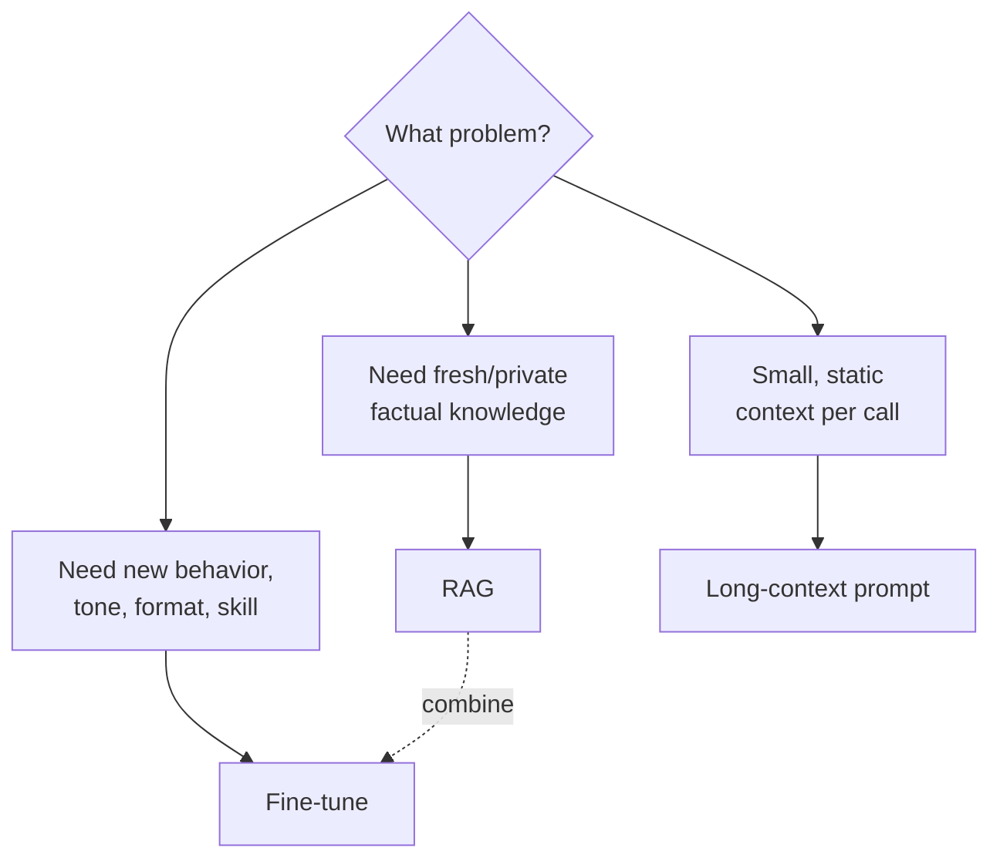

| | RAG | Fine-tuning | Long-context |
|---|---|---|---|
| Best for | Dynamic, large, private knowledge | Behavior/style/format, narrow skill | Small fixed context, simplest setup |
| Freshness | Update index, instant | Retrain to update | Re-paste each call |
| Cost model | Retrieval + per-query tokens | Training cost upfront, cheaper inference | High per-call token cost |
| Auditability | Citations, traceable | Opaque | Traceable but no retrieval |
| Hallucination control | Strong (grounding) | Weak | Moderate (in-context) |
| Setup complexity | High (pipeline) | Medium-high (data + training) | Low |

**The Staff answer:** **default RAG for knowledge** because it's fresh, citable, and updatable without retraining; **fine-tune only when the gap is behavior/format/tone**, not facts; **long-context only when the relevant span is small, fixed, and retrieval can't isolate it.** And they're **not mutually exclusive** — most production systems use RAG, optionally over a fine-tuned base, reserving giant-context calls for the cases retrieval can't isolate. Note that with 1M-token context windows now standard on frontier models (the Claude Opus 4.x family), "just stuff everything in the prompt" is *technically* possible for mid-size corpora — but it's expensive (you pay for the full context every call, partially offset by prompt caching) and it degrades retrieval precision (lost-in-the-middle gets worse the more you stuff). Long-context is a complement to RAG, not a replacement for it. Naming this current trade-off signals you're tracking 2025/2026 reality.

> **Staff-level insight:** "RAG quality" is mostly a *retrieval* problem, not a *generation* problem. When a RAG demo fails, juniors reach for a bigger model; the experienced engineer instruments retrieval first — measure context precision/recall (did we retrieve the right chunks at all?) before touching the prompt or model. Reranking + hybrid search typically buys more quality per dollar than upgrading the LLM. Say this and you've signaled you've actually shipped RAG.

---

## 3. Vector Databases & Search

> **Default: pgvector until scale forces a dedicated DB.** Name the ANN happy path, deep-dive the recall/latency/memory triangle and filtered ANN with tenant ACLs — that's where the correctness bugs and latency cliffs live.

### Definition

A **vector database** stores high-dimensional **embeddings** and serves **approximate nearest neighbor (ANN)** queries — "find the k vectors closest to this query vector" — fast, at scale, with metadata filtering. Embeddings are learned dense representations (typically 384–3072 dimensions) where semantic similarity ≈ geometric proximity.

### Embeddings & similarity metrics

An embedding model maps text to a fixed-length float vector. Closeness is measured by:

| Metric | Formula intuition | Notes |
|---|---|---|
| Cosine similarity | Angle between vectors | Most common for text; magnitude-invariant |
| Dot product | Cosine × magnitudes | Fast; assumes vectors normalized → equals cosine |
| Euclidean (L2) | Straight-line distance | Used by some indexes; sensitive to magnitude |

In practice most text embeddings are normalized, so cosine and dot product coincide. Dimension is a real trade-off: more dims = more expressive but more memory and slower search. Have the storage math ready: **1M vectors × 1536 dims × 4 bytes ≈ 6 GB raw**, before index overhead (HNSW graph overhead scales with M, the connections per node — often ~10-50% of raw for typical M=16-64 on high-dim vectors, more at large M). At 100M vectors you're at ~600GB+ raw — which is exactly when "just use pgvector" stops being free and quantization stops being optional.

### ANN algorithms

Exact nearest-neighbor over millions of vectors is too slow (O(N) per query). ANN trades a small recall loss for massive speedup.

| Algorithm | Idea | Recall | Latency | Memory | Build cost |
|---|---|---|---|---|---|
| Flat (brute force) | Compare to all | 100% | Slow | Low | None |
| IVF | Cluster vectors; search nearest clusters only | Tunable | Fast | Low-med | Medium |
| IVF-PQ | IVF + product quantization (compress vectors) | Lower | Fast | Very low | Medium |
| HNSW | Navigable small-world graph | Very high | Very fast | High | High |
| HNSW + PQ | Graph + compressed vectors | High | Fast | Medium | High |

**How HNSW works** — it builds a multi-layer proximity graph. Upper layers are sparse "express lanes" for long hops; lower layers are dense for fine-grained search. A query enters at the top, greedily hops toward the nearest neighbor, descends a layer, repeats — like a skip list in vector space. It gives the best recall/latency trade-off, at a memory cost (the graph itself is large). **Decide: HNSW is the workhorse default** for in-memory ANN; reach for IVF-PQ / HNSW+PQ only when memory at billion-scale forces compression.

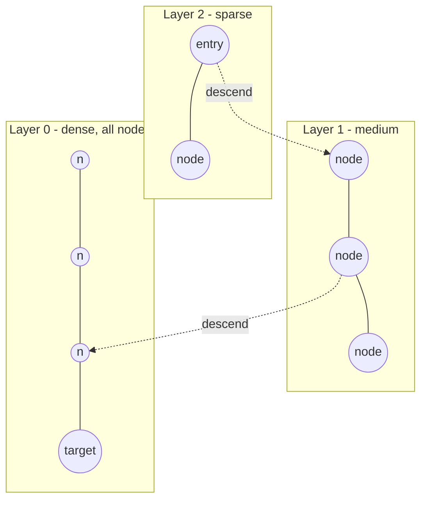

The core trade-off triangle: **recall ↔ latency ↔ memory**. HNSW's `ef_search` parameter and IVF's `nprobe` let you slide along it at query time — raise them for recall, lower them for speed. Concrete shape: pushing recall from ~0.90 to ~0.99 on HNSW can cost 2–5× the query latency (you widen `ef_search`), so **"what recall do you actually need?"** is a real design question, not a "set it to max." For most RAG/support use cases, ~0.95 recall is plenty and not worth the latency to chase higher. **Product Quantization (PQ)** compresses vectors into compact codes (e.g. 1536 floats → 96 bytes), slashing memory ~16–32× at a recall cost — essential at billion-vector scale, unnecessary below it (YAGNI).

### Vector DB options

| Option | Type | Strengths | Watch-outs |
|---|---|---|---|
| pgvector | Postgres extension | Use your existing DB, transactional, joins + filters | Scales to ~millions–low-tens-of-millions, not billions; tune index |
| Pinecone | Managed SaaS | Zero-ops, serverless, fast | Cost, vendor lock-in |
| Weaviate | OSS + managed | Hybrid search built in, modules | Operational footprint |
| Milvus | OSS, distributed | Billion-scale, GPU indexing | Heavy to run yourself |
| Qdrant | OSS + managed (Rust) | Fast, great filtering, payload-rich | Younger ecosystem |
| Elasticsearch / OpenSearch kNN | Search engine + kNN | Hybrid (BM25 + vector) in one system, mature ops | Vector perf behind dedicated DBs |

**The Staff default:** **pgvector** — one fewer system to operate, transactional consistency, metadata filtering, and joins for free (see [Databases](06-databases.md)). Reach for a dedicated DB (Qdrant/Pinecone/Milvus/Weaviate) **when vector count (~10M+), QPS, or filtering complexity outgrows Postgres**; reach for **OpenSearch/Elasticsearch kNN** when you specifically want hybrid BM25+vector in one mature search stack and already run it. Pick the *number that triggers the switch*, don't enumerate all six and shrug.

### Filtering + ANN (pre vs post filter)

Real queries filter ("only docs this tenant can see", "only from last 30 days"). **This is the risk crux of vector search — deep-dive it.** Two strategies:

- **Pre-filter** — restrict the candidate set *before* ANN. Correct results, but can break the index's graph/cluster assumptions and blow up latency if the filter is very selective (the HNSW graph traversal stalls when most neighbors are filtered out).
- **Post-filter** — ANN first, then drop non-matching results. Fast, but you may get back fewer than k after filtering (or zero), forcing over-fetch.

Modern engines do **filtered ANN** that integrates the predicate into the traversal — the right default when available. **Always discuss multi-tenant ACL filtering** — it's a frequent real-world correctness *and security* requirement, and it's where cross-tenant data leakage happens. Treat the tenant filter like row-level security: it's a hard boundary, not a relevance knob, and it must be impossible to bypass (e.g. enforced in a query-builder layer, not left to the caller to remember).

### Hybrid search

Combine vector (semantic) + BM25 (lexical) and fuse with Reciprocal Rank Fusion. This directly relates to [Search](07-search.md) — RAG retrieval *is* a search problem, and the best RAG systems lean on classic IR (BM25, fusion, reranking) as much as on embeddings. Don't treat "we have embeddings now" as a reason to throw away 30 years of IR; the senior move is using both.

> **Staff-level insight:** Pick the index by your *recall target and scale*, not by hype. Below ~1M vectors, brute force or pgvector is often fine and simpler. HNSW is the workhorse but its memory cost is real — at billion scale you'll need IVF-PQ or HNSW+PQ and you must budget RAM explicitly. The interview win is showing you understand index choice is a quantified recall/latency/memory/cost decision, and that "filtered ANN with tenant ACLs" is where correctness bugs and latency cliffs actually live.

---

## 4. Agents & Tool Calling

> **Default: don't build an agent.** Use a single call or a deterministic workflow unless the task genuinely needs the model to sequence multi-step, open-ended tool use itself. When you do build one, the entire design is *bounded autonomy* — budget, safety boundary, observability. That's where the depth goes.

### Definition

An **agent** is an LLM in a control loop that can *take actions* — call tools/functions, observe results, and decide what to do next — to accomplish a multi-step goal, rather than producing a single response. Tool calling is the mechanism: the model emits a structured request to invoke a named function with arguments; your code executes it and feeds the result back.

### When to build an agent — the gate

Run this gate *out loud* before designing one:

- **Complexity** — Is the task multi-step and hard to fully specify in advance? ("Turn this design doc into a PR" yes; "extract the title from this PDF" no.)
- **Value** — Does the outcome justify higher cost and latency?
- **Viability** — Is the model actually capable at this task type?
- **Cost of error** — Can errors be caught and recovered from (tests, review, rollback)?

If any answer is "no," drop to a simpler tier (single call or a code-orchestrated workflow). Saying *"I'd start with a deterministic workflow and only reach for an autonomous agent if the task can't be expressed as a fixed sequence"* is the Staff move; reflexively designing a multi-agent swarm is the anti-pattern.

### How tool calling works

You describe tools to the model as schemas (name, description, JSON-schema parameters). The model decides *whether* and *which* tool to call and produces the arguments; **your application executes the tool** (the model never runs your code) and returns the result; the loop repeats until the model produces a final answer. Name-and-move-on: this loop is the basic mechanic; the depth is in governing it.

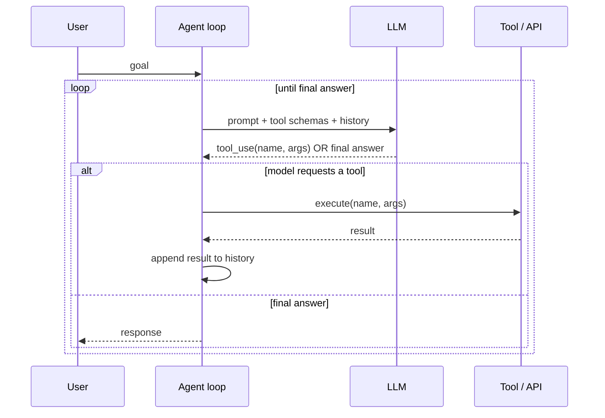

### Agent architectures

| Pattern | How it works | Strengths | Weaknesses | Reach for it when |
|---|---|---|---|---|
| ReAct | Interleave Reason → Act → Observe each step | Simple, transparent, adaptive | Can loop, myopic | Default for adaptive single-agent tasks |
| Plan-and-execute | Plan all steps first, then execute | Fewer LLM calls, structured | Brittle if plan is wrong | The task decomposes cleanly upfront |
| Reflection | Generate → critique own output → revise | Higher quality | More cost/latency | Quality matters more than cost (code, writing) |
| Orchestrator-worker | A supervisor delegates subtasks to specialized workers | Parallelism, separation of concerns | Coordination overhead | Independent subtasks to fan out |
| Supervisor / router | Route each request to the right sub-agent/tool | Scales to many capabilities | Routing errors cascade | Many distinct capabilities behind one entry |

**Decide:** start with **ReAct** for a single adaptive agent; go **orchestrator-worker** only when you have genuinely independent subtasks to parallelize. Don't multi-agent by reflex — every extra agent is extra cost, latency, and coordination failure surface.

### Multi-agent patterns

For complex systems, decompose into an **orchestrator** (plans, delegates, synthesizes) and **workers** (specialized: a search agent, a code agent, a SQL agent). This mirrors map-reduce / fan-out from [Data Processing](16-data-processing.md): parallelize independent subtasks, then aggregate.

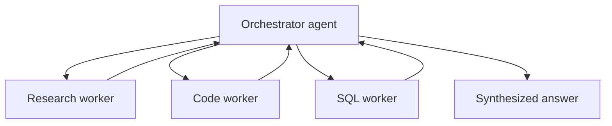

### MCP (Model Context Protocol)

**MCP** is an open standard for connecting models to tools and data sources via a uniform protocol — think "USB-C for AI tools." Instead of bespoke integration per tool, a model/agent speaks MCP to any compliant **MCP server** (filesystem, GitHub, a database, an internal API). It standardizes tool discovery, invocation, and resource access, which decouples agent logic from integration plumbing and lets you reuse tool servers across agents. Mention it as the emerging (2025/2026) interoperability layer for agentic systems — but treat MCP tool output as **untrusted input** (prompt-injection surface), same as any retrieved content.

### Guardrails & failure modes

> This is the deep-dive. Agents fail in ways single calls don't, because they act and loop.

| Failure mode | Cause | Control |
|---|---|---|
| Infinite/oscillating loops | Model never converges | Max-step / max-iteration cap, loop detection |
| Hallucinated tool calls | Calls nonexistent tool or bad args | Strict schema validation, reject + reprompt |
| Cost runaway | Each step is an LLM call | Token/step budgets, cost ceiling, cheaper model for routing |
| Destructive actions | Agent deletes/sends irreversibly | Human-in-the-loop approval for high-risk tools, dry-run, allowlists |
| Prompt injection via tool output | Retrieved/tool content hijacks the agent | Treat tool output as untrusted; sandbox; output filtering |
| Stuck waiting | Tool hangs | Per-tool timeouts, retries with backoff |

Guardrails span **input** (validate/redact user input), **action** (allowlist tools, gate destructive ones behind approval, sandbox execution), and **output** (safety/PII filters before returning).

> **Staff-level insight:** The defining engineering challenge of agents is **bounded autonomy** — they're powerful precisely because they decide their own trajectory, which is also exactly why they run away on cost, loop, or take unsafe actions. Every serious agent design needs three governors: a **budget** (max steps + token/cost ceiling), a **safety boundary** (allowlisted tools, human approval on irreversible actions, untrusted-by-default tool output), and **observability** (trace every step, with per-step token/cost). And don't reach for an agent when a deterministic workflow or a single tool call would do — agents are the most expensive, least predictable option; justify the open-ended autonomy. *Experience hook: the first agent you run that loops on a paid model overnight teaches you this is the design, not a nice-to-have.*

---

## 5. Memory Systems

> Memory is a token-budget allocation problem wearing a product-feature costume. The depth is: per turn, how do you spend a fixed context budget across system prompt, retrieved knowledge, conversation window, and long-term memory — and how do you keep it tenant-isolated.

### Definition

LLMs are stateless between calls — every request re-sends all context. **Memory** is the architecture that gives an agent or assistant continuity: what was said earlier (short-term), what it has learned about the user/domain (long-term), and relevant past episodes. It exists because the context window is finite and expensive, so you can't just keep appending forever.

### Types of memory

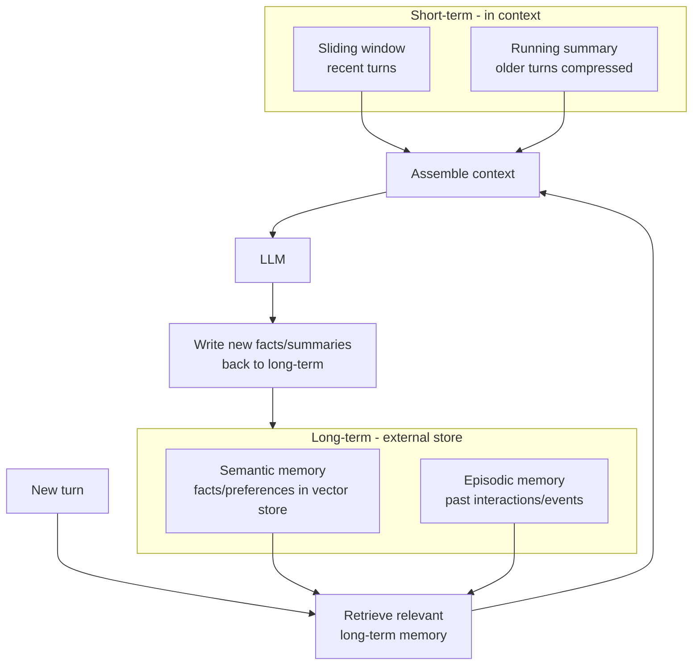

| Memory type | What it holds | Mechanism | Lifetime |
|---|---|---|---|
| Short-term (working) | Current conversation | Context window: recent turns | Single session |
| Long-term semantic | Facts, user preferences, domain knowledge | Vector store, retrieved on relevance | Persistent |
| Long-term episodic | Specific past events/interactions | Logged + retrievable by time/topic | Persistent |

### Conversation memory strategies

- **Sliding window** — keep the last N turns verbatim, drop the oldest. Simple, bounded, but loses early context.
- **Summarization / compaction** — when history grows, compress older turns into a running summary the model carries forward. Keeps the thread without unbounded token growth. (Frontier providers increasingly offer **server-side compaction** that auto-summarizes earlier context once it crosses a configurable trigger threshold (default ~150K tokens), well before the window limit — name this as the current, 2025/2026 way to handle long sessions without rolling your own summarizer.)
- **Vector-backed retrieval** — embed past turns/facts; retrieve only the relevant ones for the current turn (this is RAG applied to conversation history).

**Decide:** a robust assistant combines all three — recent turns verbatim (window) + a rolling summary of older turns (or server-side compaction) + retrieval of relevant long-term facts — within a fixed token budget. The naive "append everything" is a cost and latency time bomb.

### How to architect agent memory

Treat memory as a read/write subsystem around the LLM: **on read**, retrieve relevant long-term memory + assemble short-term context within a token budget; **on write**, extract durable facts/summaries and persist them (with the same ACL/tenant scoping discipline as your vector store). Long-term memory is just a vector store + metadata — so everything from §3 (filtering, freshness, multi-tenancy) applies.

### Pitfalls

- **Unbounded growth** — without summarization, cost/latency rise every turn until overflow.
- **Memory poisoning** — writing wrong/injected "facts" that then resurface authoritatively. Validate before persisting.
- **Cross-user leakage** — long-term memory without strict tenant scoping leaks one user's data into another's context. A correctness *and* security bug — the same boundary as filtered ANN in §3.
- **Stale memory** — outdated preferences resurface. Use recency weighting / TTLs.

> **Staff-level insight:** Memory is a **token-budget allocation problem disguised as a product feature**. Your real job is deciding, per turn, how to spend a fixed context budget across system prompt, retrieved knowledge, conversation window, and long-term memory — each competing for the same tokens. The naive "append everything" approach is a cost and latency time bomb. And the moment memory is persistent and cross-session, it inherits every multi-tenant data-isolation requirement of a real database — scope it, or you've built a data-leak.

---

## 6. Evaluation Systems

> **This is the layer that separates a demo from a product, and ignoring it is the top anti-pattern.** The non-negotiable: a golden set + regression suite wired into CI. Spend real altitude here — it's what makes everything else shippable.

### Definition

**Evaluation** is how you measure whether an LLM system is good and whether changes make it better or worse — without it, you're shipping non-deterministic software blind. It's hard precisely because outputs are open-ended and non-deterministic: there's rarely one correct string, so exact-match testing doesn't work.

### Offline vs online eval

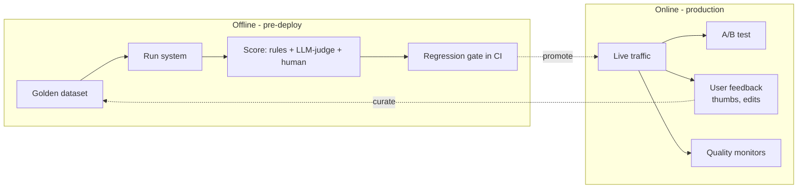

- **Offline** — run against a curated **golden dataset** (inputs + expected properties) before deploy; gate releases on a **regression suite** so a prompt/model change can't silently degrade quality. **Decide: this is mandatory, not optional.** No prompt tweak or model upgrade ships without a measured quality delta.
- **Online** — measure on real traffic: **A/B tests** (does variant B improve task success / satisfaction / deflection?), **human feedback** (thumbs, edits, escalations), and continuous quality monitors. You need both — offline gates regressions cheaply, online catches what your golden set didn't anticipate.

### LLM-as-judge

You use a strong LLM to score outputs against criteria (correctness, relevance, faithfulness, tone). It scales far beyond human grading, but has **biases** you must control for:

| Bias | Effect | Mitigation |
|---|---|---|
| Position bias | Prefers first (or last) option | Randomize/swap order, average |
| Verbosity bias | Prefers longer answers | Normalize for length, explicit criteria |
| Self-preference | Favors outputs from same model family | Use a different judge model; calibrate vs human labels |
| Leniency | Scores everything "pretty good" | Rubric with concrete anchors, force reasons |

Always **calibrate the judge against a human-labeled sample** and report agreement (e.g. Cohen's kappa or % agreement) — an uncalibrated judge is a confident liar. Saying "I'd calibrate the judge to humans and report agreement" is the line that signals you've actually run LLM-as-judge in anger, not just read the term.

### RAG-specific eval (RAGAS-style)

RAG needs metrics that separate *retrieval* quality from *generation* quality — and this split is what lets you actually debug:

| Metric | Question it answers | Catches |
|---|---|---|
| Context precision | Are the retrieved chunks relevant? | Noisy retrieval |
| Context recall | Did we retrieve all needed info? | Missing chunks |
| Faithfulness | Is the answer supported by the context? | Hallucination |
| Answer relevance | Does the answer address the question? | Off-topic answers |

Splitting these is what lets you debug: **low context recall → fix retrieval** (chunking, hybrid, reranking); **high recall but low faithfulness → fix the prompt/model** (grounding instructions, constrain to provided IDs). This maps directly back to the §2 "RAG quality is a retrieval problem" insight — you only know it's a retrieval problem because the eval told you context recall was low.

### Guardrail / safety eval

Separately test for harmful output, jailbreaks, PII leakage, and prompt injection — red-team with adversarial inputs and track **attack success rate** as a release gate. For an agent, this includes injection via tool/retrieved output (§4).

### Tooling

Observability/eval platforms (**LangSmith, Langfuse**, and similar) capture traces, run eval suites, and track regressions — treat them like your test + APM stack for LLM apps. Name them to show you know the 2025/2026 ecosystem, but the *discipline* (golden set + regression gate + calibrated judge) matters more than the specific vendor.

> **Staff-level insight:** Eval is the discipline that separates a demo from a product. The non-negotiable is a **golden dataset + regression suite wired into CI**, so no prompt tweak or model upgrade ships without a measured quality delta. Use LLM-as-judge to *scale* grading but *anchor it to human labels* — report judge-vs-human agreement or the metric is theater. And measure offline AND online: offline gates regressions cheaply; online (A/B + feedback) catches what your golden set didn't anticipate. If you can describe this loop, you're answering at Director level.

---

## 7. Serving & Optimization

> At scale, **cost and latency are the product constraints.** The dominant levers are prompt caching + model routing — name them with numbers. Ignoring caching/cost control is a top anti-pattern.

### Definition

Serving optimization is everything that makes an LLM feature fast enough and cheap enough to run at scale: caching, batching, model routing, and observability. At volume, *cost and latency are the product constraints*, and these levers are how you hit them.

### LLM caching

| Cache type | What it caches | Win | Caveat |
|---|---|---|---|
| Exact-match | Identical request → identical response | Skip the call entirely | Only repeated identical queries |
| Semantic cache | Embedding-similar query → prior answer | Catch paraphrases | Risk of wrong-but-similar hits; needs threshold tuning |
| Prompt prefix / KV cache | The shared prompt prefix (system + context) | Skip re-processing the prefix; cheaper + faster TTFT | Provider/engine-specific; prefix must be stable |

**Prompt (prefix) caching is the highest-leverage cost lever in RAG/agent systems.** A large, stable prefix (system prompt + tool schemas + sometimes retrieved docs) is processed once and reused, cutting the cached portion to **~0.1× input price (a ~90% discount)** at a one-time ~1.25× write premium, and reducing TTFT (cache hit → first token in hundreds of ms instead of seconds). **The design rule: put stable content first, volatile content (the user's varying question, timestamps, per-request IDs) last** — any byte change in the prefix invalidates the cache from that point on (it's a prefix match). Major API providers (including Anthropic, on the Claude Opus 4.x family) expose explicit prompt caching for exactly this. This is the LLM analog of [Caching](03-caching.md): cache the expensive, reusable prefix.

> **Earmark the trap:** the silent cache-miss. If your "stable" system prompt interpolates `datetime.now()` or a session UUID at the front, *nothing caches* and you won't see an error — just a bill that didn't drop. Verify with the provider's `cache_read` token counter; if it's zero across identical-prefix requests, you have a silent invalidator. This is a real, recurring production gotcha — naming it signals operational experience.

### Batching & the latency/throughput trade-off

GPUs are throughput machines — they're far more efficient processing many requests at once (relevant when self-hosting; the managed API does this for you). **Continuous batching** (vLLM-style) dynamically adds/removes requests from the running batch as they arrive/finish, maximizing GPU utilization without making early requests wait for a full batch. The trade-off: larger batches raise throughput (lower cost/token) but can raise per-request latency. You tune batch size against your latency SLO.

### Speculative decoding (TPOT lever)

A standard production technique for cutting **TPOT** (per-token latency), alongside continuous batching and quantization. A small, fast **draft model** proposes several tokens ahead, and the large target model **verifies** them in a single parallel forward pass — accepted tokens are emitted for the cost of one big-model step, so you generate multiple tokens per step when the draft guesses well. Self-speculative / **Medusa-style** variants drop the separate draft model and instead add lightweight extra heads to the target model to predict ahead. It speeds up generation with **no quality loss** (the target model still validates every token), at the cost of extra compute and complexity; the win depends on the draft's acceptance rate.

### Cost optimization: model routing / cascades

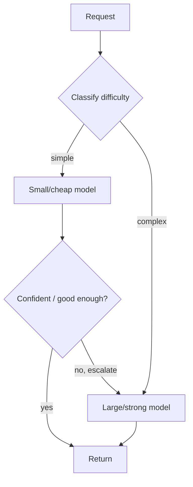

- **Model routing / cascade** — try a cheap, fast model first; escalate to a stronger (pricier) model only when needed. A small model often handles the easy majority of traffic, slashing cost. **Watch the trigger:** if escalation rate is high, the cascade's blended cost can exceed just using one model — measure it.
- **Right-size by task** — classification/extraction → small model; deep reasoning → large model. Across the Claude family: route routine tasks to **Haiku-tier (`claude-haiku-4-5`)** and hard reasoning to **Opus-tier (`claude-opus-4-8`)**.
- **Prompt compression** — trim redundant context tokens.
- **Output length control** — cap `max_tokens`, instruct for brevity; **output tokens are ~5× input cost**, so this is the highest-leverage per-call lever.
- **Token budgets** — enforce per-request/per-session ceilings.
- **Caching** (above) and **batch APIs** (async, ~50% cheaper for non-latency-sensitive jobs).

**Worked cost estimate (have this ready):** suppose 70% of traffic is simple and routed to a model ~5× cheaper, and the RAG prefix is 90%-cached. The cheap model absorbs the easy majority at a fraction of the cost, and the expensive model's repeated prefix is nearly free after the first hit — blended cost-per-request drops several-fold versus naively sending everything to the frontier model at full price. Being able to sketch this on a whiteboard is the Staff signal.

### Rate limits & quotas

Hosted APIs enforce requests-per-minute and tokens-per-minute limits. Design for them: client-side rate limiting, **exponential backoff with jitter on 429s**, request queuing, and provisioning headroom for the fallback model in a cascade (a refusal/escalation surge can hit the bigger model's quota). In a real-time chat product this is a reliability concern, not a nicety — a quota exhaustion mid-conversation needs graceful degradation, not a 500.

### Observability for LLM apps

You can't optimize what you can't see. **Tracing** captures the full chain (retrieval → rerank → prompt → generation → tool calls) per request; track **token usage and cost per request**, latency (TTFT, total), cache hit rate, and quality signals. LangSmith / Langfuse are the common platforms. This is APM for LLM systems — without it, cost and latency regressions are invisible until the bill arrives.

> **Staff-level insight:** At scale the dominant cost lever is almost always **prompt caching + model routing**, not buying a cheaper model wholesale. A cascade lets cheap models absorb the easy majority while the expensive model handles only the hard tail; prompt caching makes the large, repeated RAG/agent prefix nearly free after the first hit. Quantify it: "if 70% of traffic is simple and routed to a model 5× cheaper, and the RAG prefix is 90%-cached, blended cost drops several-fold." Naming caching, routing, batching, and per-request cost/latency observability in one breath is the Staff signal.

---

## 8. Inference Infrastructure

> Keep this at system-design altitude — you're not expected to write CUDA, but you must speak the language of GPU serving. **The meta-point leads: for most teams, don't self-host.** The depth is the VRAM mental model.

### Definition

Inference infrastructure is the hardware + serving stack that actually runs the model: GPUs, the memory model (weights + KV cache), batching, quantization, and parallelism. Relevant when self-hosting, or when reasoning about a provider's latency/cost behavior.

### Key concepts

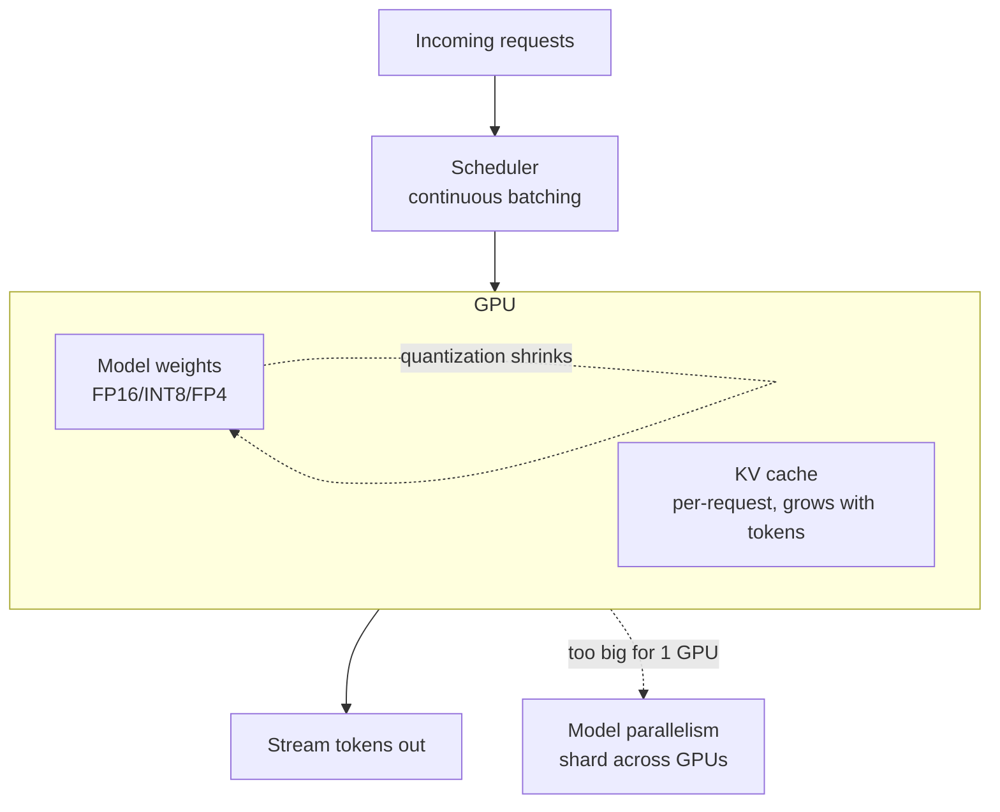

- **GPUs** — LLM inference is memory-bandwidth-bound. Weights must fit in VRAM (a 70B model in FP16 ≈ 140GB → multiple GPUs). VRAM is the binding constraint.
- **KV cache** — the per-request attention state, growing with sequence length. It competes with weights for VRAM and limits how many concurrent requests fit. **PagedAttention** (vLLM) manages it like virtual memory pages to reduce fragmentation and pack more requests.
- **Continuous batching** — covered in §7; the core throughput mechanism (vLLM, TGI).
- **Quantization** — store weights in fewer bits (FP16 → INT8/INT4/FP8). Cuts VRAM and cost ~2–4×, raises throughput, at a small (often acceptable) accuracy hit. The main lever to fit bigger models on cheaper hardware.
- **Model parallelism** — when a model exceeds one GPU: **tensor parallelism** (shard each layer across GPUs) and **pipeline parallelism** (different layers on different GPUs). Adds inter-GPU communication cost.

| Lever | Optimizes | Cost |
|---|---|---|
| Continuous batching | Throughput / cost-per-token | Some latency at high batch |
| PagedAttention | Concurrency (KV memory efficiency) | Engine complexity |
| Quantization | VRAM, cost, throughput | Small accuracy loss |
| Tensor/pipeline parallelism | Fits large models | Communication overhead, complexity |

### Prefill/decode disaggregation (the 2026 serving frontier)

The subtle point most candidates miss: **prefill and decode have opposite hardware profiles.** Prefill (processing the whole input prompt in one parallel pass, building the KV cache) is **compute-bound** and bursty; decode (generating tokens one at a time) is **memory-bandwidth-bound** and steady. Run them on the *same* GPUs and they interfere — a big prefill burst stalls everyone's token-by-token decode, wrecking TPOT (inter-token latency). The frontier answer (DistServe / vLLM disaggregated, 2024–2025) is **disaggregated serving**: a pool of **prefill workers** and a separate pool of **decode workers**, with the KV cache handed off between them. This lets you scale and tune each independently and isolates the two SLOs (TTFT vs TPOT). Say it as: *"prefill is compute-bound, decode is bandwidth-bound; co-locating them makes a prefill burst stall decode, so at scale you disaggregate the two into separate worker pools and transfer the KV cache between them."* Related lever: **KV-cache-aware routing** — route a request to the worker that already holds its prefix's KV cache (a session's follow-ups, a shared RAG prefix), turning prefix caching into a routing decision.

### Serving many fine-tunes: LoRA adapters

"Fine-tune it" is not monolithic, and an interviewer will push here. **Full fine-tuning** updates all weights — a whole new model to store and serve (expensive; a fresh ~140GB for a 70B). **PEFT / LoRA (Low-Rank Adaptation)** instead freezes the base model and trains tiny **low-rank adapter matrices** (often <1% of the parameters); **QLoRA** does it on top of a quantized base to fit training on one GPU. The serving payoff is the real Staff point: with **multi-adapter serving** (S-LoRA / vLLM multi-LoRA), **one base model in VRAM serves many tenants' adapters simultaneously** — each request names its adapter, the tiny adapter weights are swapped in per request, so 50 per-tenant fine-tunes cost ~one base model's VRAM instead of 50. That's how you offer per-customer fine-tunes economically. Name the risk too: fine-tuning (full *or* LoRA) can cause **catastrophic forgetting** of general capability, which is why RAG-for-knowledge / fine-tune-for-behavior stays the default split.

> **Staff-level insight:** The mental model is "**weights + KV cache must fit in VRAM, and the GPU is a throughput machine, so batch aggressively and quantize to fit.**" That single sentence explains why continuous batching and quantization dominate self-hosted serving economics, and why KV cache (not just weights) caps your concurrency. But lead with the meta-point: for most teams, **don't self-host** — you take on GPU scheduling, OOM, and autoscaling to chase a cost crossover you may never reach. Self-host only with a quantified driver: very high steady volume, hard data-residency requirements, or a need for custom weights. **Knowing *when not to build* the infra is the more senior signal than knowing how to** — the same YAGNI discipline as the rest of this module.

---

## 9. Worked Design: RAG-Powered Support Assistant

> The canonical interview prompt. This worked example ties every prior section together and *demonstrates the lens* — lead with requirements, decide each layer with a default + trigger, spend depth on retrieval quality, the grounding gate, eval, and cost.

A canonical interview prompt: *"Design a customer-support assistant that answers from our help docs and ticket history, with citations."* Here's the end-to-end architecture.

**Requirements (state these first — this is the Staff opening move):** grounded answers with citations (no hallucinated policy), **<2s perceived latency** (streaming), **multi-tenant isolation** (each customer sees only their data — a security boundary), fresh docs (new articles searchable within minutes), cost-controlled at scale, graceful **"I don't know / escalate to human"** fallback, and measurable quality.

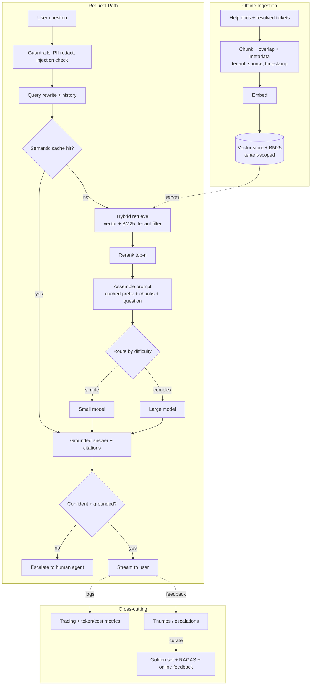

**How each module maps back — decided, with the default + trigger:**

- **Ingestion (§2, §16):** chunk docs + tickets with tenant/source/timestamp metadata; embed; index into a **tenant-scoped vector store + BM25**. Incremental re-index for freshness (new article searchable within minutes). *Default pgvector* (one fewer system, transactional, tenant joins for free); revisit to a dedicated DB if vector count or QPS outgrows Postgres.
- **Retrieval (§2, §3, §7):** **hybrid** (semantic + lexical) — support tickets are full of error codes and SKUs that pure-vector misses — with a **hard tenant filter (filtered ANN — the security boundary)**, then **cross-encoder rerank to top-n** (the highest-ROI quality lever). This is where I'd spend my retrieval-quality depth.
- **Prompt + generation (§1, §7):** stable **cached prefix** (system + tool schemas → ~90% off on the repeat, faster TTFT) + reranked chunks + question; **stream** to hit the <2s perceived-latency target; **route** simple-vs-complex (most "where's my refund" questions are Haiku-tier; gnarly policy reasoning is Opus-tier) to control cost; constrain to provided context with citations.
- **Memory (§5):** conversation window + summary for multi-turn tickets; long-term per-user preferences (tenant-scoped — same boundary as retrieval).
- **Guardrails & fallback (§4):** input PII/injection checks; a **confidence/grounding gate** that escalates to a human when the answer isn't supported by retrieved context — *this is what makes it shippable*, because it converts "hallucinate a wrong refund policy" into "escalate to a human." Treat retrieved/tool content as untrusted (injection surface).
- **Eval & observability (§6, §7):** golden dataset + RAGAS metrics (context precision/recall vs faithfulness/answer-relevance) in CI; online A/B + thumbs/escalation feedback curating the golden set; full tracing with **per-request cost/latency** so a regression is visible before the bill.

**The delivery sequence:** Lead with requirements, draw the two pipelines, then walk **retrieval → rerank → cached-prefix prompt → routed generation → grounding gate**, and close with **eval + observability**. That sequence demonstrates you can build the thing *and* keep it correct, cheap, and safe in production — which is exactly the Staff signal. Don't enumerate every option at every step; *decide* each layer with a default and a trigger, and concentrate your depth on retrieval quality, the grounding gate, and eval.

---

## 10. Interview Cheat-Sheet

- **Lead with the delivery lens.** Decide, don't enumerate. "X because Y; revisit if Z." Name the pressure each choice relieves (quality / cost / latency / safety). Spend depth where the risk is. See [Staff-Level Execution](20-staff-execution.md).
- **Frame the LLM as a probabilistic, token-billed dependency.** Every design choice relieves one of: quality, cost, latency, safety.
- **Latency vocabulary:** TTFT (prefill, scales with input, 1–3s+ on a long prompt) + output_tokens × TPOT (~10–50ms/token). Stream to mask it.
- **Cost vocabulary:** input vs output tokens (output typically ~3-5×, ≈5× on the Claude family), prompt caching (~90% off the cached prefix, ~1.25× write), model routing/cascade, batch API (~50% off). Ballpark: Haiku ~$1/$5, Sonnet ~$3/$15, Opus ~$5/$25 per 1M.
- **RAG = retrieval + grounding. Default RAG for knowledge.** Two pipelines (ingest offline, query online). Win quality at retrieval (hybrid + rerank) before touching the model.
- **Chunking** is where RAG quality is won; overlap + metadata are mandatory; parent-document for long docs. Embedding-model change = full re-index.
- **RAG vs fine-tune vs long-context:** knowledge → RAG (default), behavior → fine-tune, small fixed context → long-context. Combine, don't pick dogmatically. Don't fine-tune by reflex.
- **Vectors:** cosine/dot/L2 similarity; ANN trades recall for speed; HNSW = best recall/latency (high RAM, default), IVF-PQ for billion-scale; recall↔latency↔memory triangle (~0.95 recall is usually enough).
- **Vector DB default: pgvector until ~10M+ vectors / high QPS forces a dedicated DB.** Always handle tenant-ACL filtered ANN — the security/correctness crux.
- **Agents = LLM in a loop with tools. Don't build one unless the task needs open-ended multi-step tool use.** ReAct / plan-execute / reflection / orchestrator-worker. Govern with budget + safety boundary + observability. MCP standardizes tools (treat its output as untrusted).
- **Memory** = token-budget allocation: window + summary (or server-side compaction) + vector retrieval. Scope per-tenant or leak data.
- **Eval = the non-negotiable.** Golden set + regression CI + LLM-as-judge (calibrated to humans, biases controlled) + online A/B. RAGAS: context precision/recall (retrieval) vs faithfulness/answer-relevance (generation).
- **Serving:** prompt caching + routing + continuous batching; observability (trace, token/cost). Don't ignore caching/cost.
- **Infra:** weights + KV cache must fit VRAM; quantize + batch; vLLM/PagedAttention. Don't self-host without a quantified reason.
- **Top anti-patterns to avoid sounding like a junior:** fine-tuning by reflex, agents when one call works, ignoring eval, no caching/cost control, hallucination hand-waving, uniform thoroughness.

---

## 11. Common Interview Questions

> Answers are in the decisive Staff voice: decide, name the pressure, earmark the risk, give the trigger to revisit.

**Q1. Design a RAG chatbot over our internal docs. Walk me through it.**
Lead with requirements (grounded + cited, latency, freshness, multi-tenant, cost, fallback). Draw the two pipelines: offline (extract → chunk with overlap+metadata → embed → index into vector + BM25); online (query rewrite → hybrid retrieve with tenant filter → cross-encoder rerank to top-n → assemble cached-prefix prompt → stream generation with citations → grounding gate that escalates). Close with eval (golden set + RAGAS in CI) and observability (trace + per-request cost). **The senior move is leading with retrieval quality (hybrid + rerank) and the grounding/fallback gate, not the model choice — and concentrating depth there rather than narrating every stage at equal length.**

**Q2. RAG, fine-tuning, or long-context — how do you choose?**
**Default RAG** for dynamic/large/private knowledge — you update the index for freshness and get citations. **Fine-tune only when the gap is behavior/tone/format/narrow skill** — it's the expensive, opaque, hard-to-update option, for *behavior not knowledge*. **Long-context only when the relevant span is small, fixed, and retrieval can't isolate it** — pricey per call (mitigated by prompt caching), and lost-in-the-middle worsens as you stuff more. They compose: fine-tune the base for behavior, RAG for knowledge, reserve giant-context for what retrieval can't isolate. Red flag I'd avoid: presenting them as mutually exclusive, or fine-tuning by reflex when prompting + RAG would do.

**Q3. Our RAG answers are wrong even though the info is in the docs. Debug it.**
This is a *retrieval* failure, not generation — and I know that because I'd instrument **context recall first** (are the right chunks retrieved at all?) before touching the prompt or model. Likely culprits: poor chunking (split mid-idea), pure-vector search missing exact terms (add BM25/hybrid), or no reranking (relevant chunk buried below k). Also check lost-in-the-middle (reorder/rerank, fewer chunks) and stale index. Only after retrieval is fixed do I look at the prompt (faithfulness). The discipline of separating context precision/recall from faithfulness — via RAGAS — is the signal that I've debugged real RAG, not just read about it. The junior move here is reaching for a bigger model first.

**Q4. How do you keep LLM costs under control at scale?**
Layered, dominant levers first: **prompt/prefix caching** (stable content first → ~90% off the repeated RAG/agent prefix, ~1.25× write) and **model routing/cascade** (cheap model absorbs the easy majority, escalate the hard tail) — these two usually swamp everything else. Then **output-length control** (output tokens are ~5× input, so this is the biggest per-call lever), prompt compression, token budgets, **batch API for async jobs (~50% off)**, and semantic caching for paraphrase hits. I'd quantify a blended estimate (70% simple → 5×-cheaper model + 90%-cached prefix → several-fold drop). And the prerequisite line: **you can't manage what you can't see — per-request token/cost observability is non-negotiable**, or the first you hear of a regression is the bill. Watch the cascade escalation rate — if it's high, the cascade can cost more than one model.

**Q5. Design the agent that can take actions (search, query DB, send email).**
First, the gate: **does this actually need an agent, or would a deterministic workflow do?** If it genuinely needs open-ended sequencing, then: tool schemas → model emits tool_use → app executes → feed result back → loop. Architecture: **ReAct** for adaptive, orchestrator-worker only if there are independent subtasks to parallelize. Then I spend most of the answer on **bounded autonomy** — max-step + token/cost budget (loop/runaway control), allowlisted tools with **human-in-the-loop on irreversible actions** (send_email, delete), **untrusted-by-default tool output** (prompt-injection defense), per-tool timeouts, and full per-step tracing. Mention MCP for tool interoperability (its output is also untrusted). The framing to nail: bounded autonomy — and not reaching for an agent when one call works.

**Q6. Which vector index and database would you pick, and when?**
Index by **recall target + scale**, not hype: brute force/pgvector below ~1M vectors; **HNSW as the workhorse default** (best recall/latency, high RAM); **IVF-PQ or HNSW+PQ at billion scale** to control memory. Pick the recall you actually need (~0.95 is usually enough; chasing 0.99 can cost 2–5× latency). DB: **pgvector by default** (one fewer system, transactional joins/filters, tenant ACLs for free); **dedicated (Qdrant/Pinecone/Milvus/Weaviate) when count (~10M+)/QPS/filtering outgrows Postgres**; **OpenSearch/Elasticsearch kNN** when I want hybrid BM25+vector in one mature search stack. Always raise **filtered ANN with tenant ACLs** as the correctness/security crux — that's where leakage and latency cliffs live.

**Q7. How do you evaluate a non-deterministic LLM feature before and after shipping?**
Offline: a **golden dataset** of inputs + expected properties, scored by rules + **LLM-as-judge (calibrated against human labels, with position/verbosity bias controls)**, wired into **CI as a regression gate** so no prompt/model change ships without a measured delta. For RAG, split metrics: context precision/recall (retrieval) vs faithfulness/answer-relevance (generation). Online: A/B tests on task success/deflection/satisfaction, plus thumbs/edit/escalation feedback that curates the golden set. The mandatory lines: **judge calibrated to humans (report agreement), regression gate in CI, both offline and online.** Shipping non-deterministic software with no eval is the top anti-pattern.

**Q8. Build vs buy the model — hosted API or self-host an open model?**
**Default to buy:** hours to value, frontier quality (Claude Opus 4.x via the Anthropic API), no GPU ops, and prompt caching controls cost. **Self-host only with a quantified driver** — very high steady volume (a real cost crossover I can show, not a vibe), hard data-residency/privacy/BAA, or custom weights. Self-hosting means owning GPU scheduling, VRAM (weights + KV cache), quantization, continuous batching (vLLM), autoscaling, and OOM/upgrade ops — plus an on-call rotation the API absorbs for free. The senior signal is treating it as a cost/latency/control/risk trade with a **crossover analysis** — and knowing when *not* to take on the infra.

**Q9. How do you handle conversation memory in a long-running assistant?**
It's **token-budget allocation**: keep recent turns verbatim (sliding window), compress older turns into a rolling summary (or use **server-side compaction** near the window limit — the current way), and retrieve relevant long-term facts from a vector store (RAG over history). Combine all three within a fixed budget. I'd flag the hazards: unbounded growth (cost/latency time bomb), memory poisoning (validate before persisting), and — critically — **cross-user leakage once memory is persistent** (it inherits all multi-tenant isolation requirements of a database — the same boundary as filtered ANN). The framing: memory is a token-budget problem wearing a product-feature costume.

**Q10. What latency and reliability concerns are unique to LLM systems?**
Latency: high and variable; **TTFT scales with input length** (1–3s+ on a long RAG prompt before caching), total = TTFT + output×TPOT (~10–50ms/token); **p99 on long generations is seconds** — stream to mask it, cap output, cache the prefix. Reliability: provider **rate limits (429s → backoff+jitter, queueing, fallback-model headroom)**, non-determinism (test properties not strings), hallucination (grounding + citations + fallback gate), and **cost as a reliability concern** (runaway agents). Design timeouts, retries, graceful degradation (fall back to a cheaper model, or to "escalate to human"), and full tracing so regressions are visible before the bill. In a real-time chat product this is operational reality, not theory — the LLM is one more dependency on the latency/cost dashboard.

**Q11. (Meta / delivery) This is a huge surface area — you have 40 minutes. How do you scope a "design an AI system" answer so you don't drown?**
Decide a default architecture in the first two minutes (RAG + managed model + pgvector + grounding gate, for most prompts), state requirements, then **deliberately spend depth on the risk crux — retrieval quality, eval, cost/latency, and the failure modes — and name-and-move-on the happy path** ("embed, store, retrieve, stuff, generate" in one breath). The anti-pattern is uniform thoroughness: explaining embeddings for three minutes and the eval loop for ten seconds. I'd explicitly say "the interesting part here is retrieval quality and the grounding gate, so let me go deep there" — signaling I know where the risk is *is itself the Staff signal*. If the interviewer wants more on a basic, they'll ask; I won't pre-spend my budget there. (This is the [Staff-Level Execution](20-staff-execution.md) altitude principle applied to AI systems.)

**Q12. (Meta / delivery) The interviewer pushes back: "Why not just fine-tune?" or "Why not just use a 1M-context model and skip retrieval?" How do you respond without either caving or stonewalling?**
I steelman the pushback, then decide with a trigger rather than defending dogmatically. "Fine-tuning is the right call *if the gap is behavior or format* — but for fresh, private, citable *knowledge*, RAG wins on updatability and auditability, and fine-tuning can't cite its sources. If you tell me the real gap is tone, I'll switch to fine-tune." For long-context: "Technically viable now that 1M windows are standard — but you pay for the full context every call (partly offset by caching) and lost-in-the-middle degrades precision as you stuff more, so I'd use long-context as a *complement* for spans retrieval can't isolate, not a replacement." The Staff move is holding a decision *and* naming the condition under which I'd change it — never "it depends," never a brittle "my way is the only way." That calibrated confidence is exactly what [Staff-Level Execution](20-staff-execution.md) calls signal over solution.
