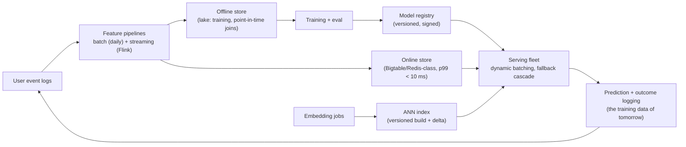

# Module 17b — Practical ML & Serving Infrastructure at Scale

> Companion to [17 — AI Systems Design](17-ai-systems.md) (which owns RAG/LLM/agents). This module is the **L6 recommendation-infrastructure round**: "design the serving stack for YouTube recommendations / ads ranking / feed ranking." The bar is *not* modeling — no interviewer at L6 cares about your loss function. The bar is the **infrastructure that keeps a model correct, fast, and cheap under production traffic**: feature pipelines without skew, serving under an SLA, and vector retrieval that survives updates.
> Cross-links: [DD-11 — Vector DBs](../Deep%20Dives/11-vector-databases.md) · [DD-07 — Flink](../Deep%20Dives/07-flink.md) · [16 — Data Processing](16-data-processing.md) · [CS-27](../Deep%20Dives/27-topk-music-analytics.md) (the logging half of this loop) · [37 — Experimentation](37-design-feature-flags.md).

## What you'll master

- The **reference serving architecture** and the four-stage funnel (retrieve → filter → rank → re-rank) with its latency budget.
- **Point-in-time correctness**: why training-serving skew is the #1 production ML bug and the feature-store machinery that prevents it.
- **Dynamic batching** mechanics on CPU/GPU/TPU, SLA-bound fallback cascades, and the memory math of serving.
- **HNSW vs IVF-PQ** as an operational decision, and embedding updates without invalidating the index.
- The Staff/EM overlay: model rollback as config, canary-by-metric, GPU capacity planning, and the feedback-loop risks.

## 1. The reference architecture



**The four-stage funnel with a 150 ms budget** (say the numbers): candidate **retrieval** from millions → ~1K (ANN + heuristic sources, ~20 ms) → **filtering** (policy/dedup/seen, ~5 ms) → **ranking** with the heavy model on ~500 candidates (~50–80 ms, the batching problem) → **re-ranking** (diversity/business rules, ~5 ms). The funnel exists because you cannot run a 100 ms model on a million candidates — *each stage buys precision with a smaller N*. This shape is the whole design; every box below is one of its organs.

## 2. Feature ingestion & point-in-time correctness

**The skew problem, stated precisely:** the model trains on features computed *offline* from logs and serves on features computed *online* at request time. Any divergence — different code paths, different freshness, different null handling — and the model you deployed is not the model you trained. Symptoms are silent: offline AUC improves, online CTR drops.

The two mechanisms that prevent it:

1. **One feature definition, two materializations.** Each feature is *declared once* (a transformation over events) and the feature store materializes it to both the offline lake and the online store. Hand-written "the same logic in the serving service" is the disease — two implementations of `clicks_last_7d` will disagree within a quarter.
2. **Point-in-time (time-travel) joins for training.** A training example for a click at `T` must join feature values *as they were at T* — not today's values. Joining today's `follower_count` onto last month's impressions leaks the future into training (label leakage via features); the model looks brilliant offline and dies online. The offline store is therefore **versioned/timestamped per feature**, and the training join is `feature_value WHERE ts ≤ T ORDER BY ts DESC LIMIT 1` — expensive, batch-computed, and non-negotiable.

**Streaming vs batch features — a freshness ladder, priced:**

| Tier | Example | Pipeline | Staleness | Cost |
|---|---|---|---|---|
| Batch (daily) | user's 90-day category affinity | Spark over the lake | 24 h | cheapest; most features live here |
| Near-real-time | clicks in last 30 min | Flink windowed counters ([DD-07](../Deep%20Dives/07-flink.md)) → online store | seconds–minutes | state + on-call; reserve for features whose *signal decays in minutes* |
| Request-time | current session, candidate ID crosses | computed in the server | 0 | CPU on the hot path — budget jealously |

> **Staff & EM insight #1:** the L5 answer names a feature store ("we'll use Feast"). The L6 answer states the *invariant* the feature store exists to enforce — *training must never see a feature value the server couldn't have seen at that timestamp, and both must run the same transformation* — and then treats the product as an implementation detail. The EM overlay: feature pipelines are the majority of ML on-call load; every streaming feature you approve is a pager commitment, so the default answer to "can this be a batch feature?" is yes.

## 3. Low-latency serving

**Dynamic batching (the core mechanic):** accelerators are throughput machines — a GPU scoring 1 request costs nearly the same as scoring 64. The server queues incoming requests and fires a batch when **either** `max_batch_size` (e.g., 64) **or** `max_queue_delay` (e.g., 5–8 ms) is hit. The delay knob *is* the latency-vs-utilization trade: 0 ms delay = GPU at 15% utilization; 10 ms = 70%+ at +10 ms p50. Tune per model against its SLA; autoscale on **queue depth**, not CPU (a GPU service at 40% "CPU" can be drowning).

**The fallback cascade (SLA-bound serving):** the SLA outranks the model. Design the degradation *before* peak traffic finds it:

```
full ranker (80 ms budget) → [breach/pressure] → distilled model (10× smaller, ~8 ms)
→ [still breaching] → popularity/recency heuristic from cache (~1 ms)
→ [total failure] → last-good precomputed results per user segment
```

Each step is a *known, measured* quality drop (e.g., −3% CTR at tier 2) — you're trading revenue for availability with numbers, not hoping. The cascade is the ML twin of the flash-sale load-shed order: pre-decided, tested on game days, never invented during the incident.

**Memory math (do it out loud):** a 10B-parameter ranker in fp16 = **20 GB** — doesn't fit an A100-40GB twice, so no naive replica-per-GPU games; quantize to int8 (10 GB, ~1% quality loss, measure it) or shard. But in recsys the *embedding tables* dominate: 500M users × 128 dims × fp32 = **256 GB** — they live sharded in parameter servers / the online store, **not** in the model binary; the dense layers (a few GB) replicate per server, embeddings are fetched per request. Saying "the embeddings are the storage problem, the dense net is the compute problem" is the sentence that shows you've operated one.

> **Staff & EM insight #2:** L5 says "use Triton/TF-Serving with batching." L6 designs the *failure economics*: the fallback cascade with measured quality deltas, canary-by-online-metric (a model canary watches CTR/latency, not just errors — ship it through the [experiment platform](37-design-feature-flags.md), never as a plain deploy), and **rollback as a registry pointer flip** — the previous model stays warm; model rollback is config, not a binary rollout. EM overlay: GPU capacity is procured in quarters, not autoscaled in minutes — the capacity plan (peak QPS × ms-per-inference ÷ batching efficiency) is a budget document, and the distilled-model tier is also your *cost* story: serving 30% of traffic on the small model at equal-ish quality is free money.

## 4. Vector search & embedding lifecycle

**The index decision ladder** (mechanics in [DD-11](../Deep%20Dives/11-vector-databases.md)):

- **Choose HNSW** when: corpus per shard ≤ ~100M vectors, recall ≥ 95% matters, memory is affordable (HNSW is RAM-hungry: vectors + graph ≈ 1.5× raw), and updates are *incremental inserts* (HNSW inserts fine; it's deletes/rebuilds that hurt).
- **Choose IVF-PQ** when: billions of vectors, memory is the constraint (PQ compresses 10–30×: 512-byte vector → ~32–64 bytes), batch/GPU scoring, and you can afford periodic centroid retraining as the distribution drifts. Recall ceiling is lower; re-rank the top-K with exact vectors to claw it back.
- **Hybrid default at scale:** IVF-PQ (or disk-ANN) for the big cold corpus + a small HNSW **delta index** for fresh items, union at query time.

**Embedding updates without invalidating the index — the trap the question is fishing for:** when the *model* that produces embeddings retrains, old and new vectors are in **incompatible spaces** — you cannot incrementally update your way across a model version. The machinery:

1. **Versioned index builds:** embeddings carry `model_version`; a new model triggers a full re-embed + index rebuild *offline*; serving does an atomic pointer swap (the [CS-29](../Deep%20Dives/29-typeahead-autocomplete.md) artifact discipline). During transition, query embeddings must be computed by the *same* version as the index they hit — pin per request.
2. **Within a model version:** new items → delta HNSW index (searchable in seconds); updated items → insert new + tombstone old; deletes → tombstone, physically dropped at the next periodic rebuild (daily/weekly). Tombstone ratio is a monitored metric — past ~20% recall and latency degrade, forcing the rebuild.
3. **Two-tower discipline:** document embeddings precomputed offline; the *query* tower runs online (small, cacheable for repeated queries). Never run the doc tower on the hot path.

> **Staff & EM insight #3:** the L5 answer picks HNSW "because it's fastest." The L6 answer treats the index as a *versioned, rebuildable artifact with a freshness SLA* — the same projection-not-truth posture as every serving store in this repo — and states the incompatible-spaces rule unprompted. EM overlay: re-embedding a billion-item corpus is a real bill (embedding inference at corpus scale often costs more than a month of serving) — batching model upgrades quarterly, not weekly, is an economic decision the EM owns against the ML team's enthusiasm.

## 5. The feedback loop (close it or it closes on you)

Predictions logged with outcomes become tomorrow's training data — which means **the model trains on a world it shaped** (position bias: top-ranked items get clicks *because* they were shown). Log the *position and propensity* with every impression; without them, retraining amplifies yesterday's ranking into a self-fulfilling prophecy. Also budget for **drift monitoring** (feature distributions + online metric vs a holdout) — the model that was right in March is quietly wrong by June. This is a two-sentence flag in the interview that separates people who've run one from people who've read about one.

## Interview Cheat-Sheet

**30-second architecture:** four-stage funnel (retrieve→filter→rank→re-rank) inside 150 ms · feature store enforcing one-definition-two-materializations + point-in-time training joins · online store p99 < 10 ms · dynamic batching (size OR delay) with queue-depth autoscaling · fallback cascade with measured quality deltas; rollback = registry pointer · ANN: HNSW small/fresh, IVF-PQ big/compressed, delta index + tombstones within a model version, full versioned rebuild across versions · log position + propensity; canary by online metric.

| Probe | Answer |
|---|---|
| "Training-serving skew?" | One feature definition, two materializations; point-in-time joins so training never sees a value serving couldn't have seen |
| "GPU is expensive/slow?" | Dynamic batching (delay knob = latency↔utilization), int8 quantization, distilled-model tier; autoscale on queue depth |
| "Peak traffic breaches SLA?" | Pre-designed cascade: full → distilled → heuristic → precomputed; each step's quality delta measured, not hoped |
| "Embeddings change?" | Within version: delta index + tombstones. Across versions: incompatible spaces — full rebuild, atomic swap, query pinned to index version |
| "How do you ship a model?" | Through the experiment platform: canary by CTR/latency, rollback = pointer flip, previous model kept warm |

**Say-verbatim:**
- *"Training must never see a feature value the server couldn't have seen at that timestamp — everything in the feature store exists to enforce that sentence."*
- *"The SLA outranks the model: I pre-design the fallback cascade with measured quality deltas, so peak traffic degrades revenue predictably instead of availability suddenly."*
- *"Embeddings from different model versions are incompatible spaces — the index is a versioned artifact with an atomic swap, not a mutable store."*
- *"The embedding tables are the storage problem; the dense net is the compute problem — they scale on different axes."*
