# Module 18a — Full Design Walkthroughs: Chat & Social Systems

These are **complete, study-ready design playbooks** for the six systems that show up most in Staff / Senior EM / Director system-design interviews. Each one is a self-contained walkthrough you can run end-to-end on a whiteboard: problem framing → requirements → capacity math → API → data model → architecture → deep dives → scaling → trade-offs → what's really being tested.

These are *playbooks*, not lectures. The goal is that you can sit down, pick one, and reproduce the whole thing under interview pressure — including the back-of-envelope math and the one or two hard sub-problems that separate a senior answer from a staff answer.

> **Read this module with the delivery lens on.** The interviewer is grading **how you drive the design**, not whether you can recite a reference architecture. Start with [How to Deliver a Design Problem at Staff Level](#0-how-to-deliver-a-design-problem-at-staff-level) below — it's the operating system; the six systems are the programs you run on it. Pair this with [Module 20 — Staff-Level Execution](20-staff-execution.md) and the R.E.S.H.A.D.E.D. framework.

A few cross-cutting themes recur in almost every design. Rather than repeat them six times, internalize them once — and notice that each one resolves to a **decision**, not a menu:

- **Fan-out-on-write vs fan-out-on-read** (push vs pull). The single most important decision in social systems. The staff move is never "it depends" — it's "**push here because the producer is in the tail of the distribution; pull for the head because the cost is unbounded.**" See [Caching](03-caching.md) and [Messaging](04-messaging-event-driven.md).
- **The celebrity / hot-key problem.** A single producer (celebrity, mega-group, busy channel, supernode) whose fan-out cost or read load is orders of magnitude above the median. This breaks naive designs every time. Earmark it out loud in minute five, every time.
- **The inbox / timeline model.** Precomputed per-recipient lists vs computed-on-read merges.
- **Presence and the connection gateway.** Stateful long-lived connections are a different beast from stateless request/response. See [Real-Time](09-realtime-systems.md).
- **Ordering and consistency.** Per-conversation ordering, sequence numbers, logical clocks. See [Distributed Systems](02-distributed-systems.md).

When in doubt in an interview: state the read:write ratio, **decide** a fan-out strategy with a one-line reason, name the hot-key mitigation, and you're already ahead of most candidates.

---

## Table of Contents

0. [How to Deliver a Design Problem at Staff Level](#0-how-to-deliver-a-design-problem-at-staff-level) — **read first; the operating system**
0b. [Google Mode — Build It, Don't Name It](#0b-google-mode--build-it-dont-name-it) — **build the primitive, don't name the product**
1. [WhatsApp / Messenger — 1:1 + Group Chat](#1-whatsapp--messenger--11--group-chat) — **flagship, deepest**
2. [Slack — Channels, Workspaces, Enterprise Chat](#2-slack--channels-workspaces-enterprise-chat)
3. [Instagram — Photos, Feed, Stories](#3-instagram--photos-feed-stories)
4. [Twitter / X — Timeline & Hybrid Fan-out](#4-twitter--x--timeline--hybrid-fan-out)
5. [Facebook News Feed — Ranking & Aggregation](#5-facebook-news-feed--ranking--aggregation)
6. [LinkedIn — Professional Graph & Feed](#6-linkedin--professional-graph--feed)
7. [Cross-System Cheat Sheet — the reusable decisive playbook](#7-cross-system-cheat-sheet--the-reusable-decisive-playbook)

---

# 0. How to Deliver a Design Problem at Staff Level

> This section applies the [Staff-Level Execution](20-staff-execution.md) lens to **design rounds specifically**. The systems below are content; this is *delivery*. At staff level, the room already assumes you can draw the boxes — what's being screened is judgment, decisiveness, and risk-sense. The candidate here lives in real-time chat infra, so the WhatsApp/Slack sections are specialty area: lean into operational war-stories there.

## 0.1 The core shift: signal, not solution

A design interview is not a test of whether you can produce *a* working system — almost any senior engineer can. It's a test of **how you drive the design**: what you choose to go deep on, what you wave past, and whether every fork in the road ends in a *decision with a reason* rather than a list of options. The interviewer is extracting a small number of signals:

- Do you **scope** or boil the ocean?
- Do you **find the risk** and spend your time there, or distribute attention uniformly?
- Do you **decide**, or do you enumerate and leave the choosing to them?
- Can you **operate at the right altitude** — naming boring CRUD and moving on, descending only where it matters?
- Do you have **real operational scars** to cite?

## 0.2 The R.E.S.H.A.D.E.D. flow, run at staff altitude

R.E.S.H.A.D.E.D. is *what* you do; here's *how* to do each step so it reads as staff, not senior. Every section below is structured to mirror this flow.

| Step | Senior version | **Staff version (do this)** |
|---|---|---|
| **R**equirements (5m) | List every feature you can think of | Scope ruthlessly to 3-4 functional + the non-functionals that *drive architecture* (scale, read:write, consistency, latency). State what you're **explicitly cutting**. |
| **E**stimate (3m) | Skip it or hand-wave | Do the math out loud, round aggressively, and **extract the one number that dictates the design** (concurrent connections, fan-out amplification, ranking QPS). |
| **S**ystem interface (2m) | Exhaustive REST catalog | A few signatures that reveal the data flow. Note where it's *not* REST (persistent protocol, event stream). |
| **H**igh-level (5m) | Draw all the boxes | Draw the *simplest viable* skeleton fast, then **verbally earmark the 2-3 hard boxes** before diving. |
| **A**PI + data model (5m) | Rabbit-hole the user table | Name the boring entities and move on; spend the time on the **shard/partition key** — that's the make-or-break for scale. |
| **D**eep-dive (10m) | Cover every component evenly | Spend the **bulk** here on the risk crux you earmarked. Decide decisively at every fork. |
| **E**volve / scale (5m) | Generic "add caching + replicas" | Scale the *specific* bottleneck your math surfaced. |
| **D**efend (5m) | Wait to be asked what breaks | Volunteer the failure modes; show you've run this in prod. |
| **E**dge cases (5m) | Forget them | Hot keys, thundering herd, idempotency, abuse, GDPR — the ones that actually page you. |

## 0.3 Earmark the crux in minute five

The single highest-leverage staff behavior: within the first five minutes, after requirements and the capacity number, **say out loud what the hard parts are** and that you'll spend your time there. Example openers you'll see reused below:

- *"Three things will make or break this: the 100M concurrent connections, the delivery guarantee under a lossy multi-device world, and the presence fan-out. The user CRUD and auth are boring — I'll name them and move on. Sound right?"*
- *"The whole game here is the fan-out amplification. Let me compute it, because the number is what forces the design. Everything else is plumbing."*

Then **ask "sound right?"** It converts your monologue into a collaboration and lets the interviewer steer you to the signal they want. Senior candidates perform *at* the interviewer; staff candidates work *with* them.

## 0.4 Decide, don't enumerate

Banish "it depends." The staff pattern is a one-liner with a trigger:

> **`<choice>` because `<the one requirement that forces it>`; revisit if `<the trigger that would change it>`.**

Examples you'll see made decisively, every time, in the sections below:

- *"Fan-out-on-write here because the system is read-heavy and the median producer has a few hundred followers — cheap writes buy O(1) reads. Switch to pull the moment a producer crosses ~tens of thousands of followers, because then write-amp is unbounded."*
- *"Shard by `conversation_id` because ordering only has to hold within a conversation, so the sequencer never needs cross-partition coordination."*
- *"Server-authoritative storage because the product needs search and compliance — which means no E2E, and I'm accepting that trade explicitly."*

Listing options without choosing is the clearest senior tell. If you genuinely need two paths, **pick a default and name the trigger that flips it.**

## 0.5 Altitude control — name-and-move-on vs deep-dive

Calibrate altitude to the *interviewer*, not a script. The rule of thumb:

- **Name and move on** (the boring 80%): user/auth tables, signup, the load balancer, standard CRUD, "yes it's behind a CDN." Spending more than a sentence here is an anti-pattern — it's where weak candidates feel safe and burn their clock.
- **Deep-dive** (the risk crux, ~60% of your time): the connection plane, the fan-out strategy, the hot-key mitigation, the ranking funnel, the graph traversal. This is where the signal lives.

If the interviewer nods and says "yep," accelerate. If they look skeptical, *that's* your earmark to descend.

## 0.6 Risk-weight the deep-dive

Uniform thoroughness is a senior trait and a staff anti-pattern. Each system below has **2-3 hard parts that deserve the bulk of your time**, and a long tail of plumbing that deserves a sentence each. The per-system "earmark" callout tells you where to spend.

## 0.7 Cite real operational experience

Nothing signals staff faster than a war-story attached to a decision. A real-time-chat background is a weapon here — use it:

- *"In real-time chat infra I've watched presence fan-out melt a Redis cluster — a mega-group's members all flapping online/offline at once. We debounced flaps and scoped presence to open conversations; that's why I'd build it pull-on-demand for big audiences from day one."*
- *"We learned the hard way that 'delivered' is a distributed-systems problem, not a push: the durable inbox + ACK-or-retry + client dedup is what stops the 3am 'I lost a message' page."*

## 0.8 The anti-patterns that cap you at senior

| Anti-pattern | What it looks like | The fix |
|---|---|---|
| Over-explaining basics | Three minutes on how WebSockets work | One sentence, move on |
| Rabbit-holing the user table | Designing the auth schema in depth | Name it, partition it, move on |
| Option-listing without choosing | "We could do A or B or C…" then silence | Decide + trigger |
| Over-engineering | Multi-region active-active in v1 | YAGNI; earn complexity |
| Uniform thoroughness | Equal depth on every box | Risk-weight; 60% on the crux |

> **Staff-level insight:** The design round is won in the *first ten minutes and the deep-dive* — scope tightly, surface the one capacity number that dictates the architecture, earmark the crux, then spend your clock there making decisive calls. Everything in the six playbooks below is structured to let you do exactly that.

---

# 0b. Google Mode — Build It, Don't Name It

> Google's own design rubric warns against answers that "use a standard database and query it" and asks instead: *how do you **build it from scratch**?* Naming a managed product is not a wrong answer — but it must be a **deliberate, justified** one, immediately followed by the primitive underneath. See [Build From Scratch](21-build-from-scratch.md) for the underlying primitives (append-only logs, LSM trees, consistent hashing, gossip) and the [Google SD Playbook](26-google-sd-playbook.md) for the full graded-attribute lens.

The staff pattern at Google is a single sentence: *"I'd reach for **managed X** because `<operational reason — I don't want to run consensus / durability / rebalancing myself>`, but here's how I'd **build it**: `<the log / index / partitioner underneath>`."* You earn the right to name the product by showing you could replace it. If you only have the product name, you have nothing — that's exactly the answer the rubric screens out.

| System | Tempting off-the-shelf answer | What to build / discuss from scratch instead |
|---|---|---|
| **WhatsApp / Messenger** | "Kafka + Redis + Cassandra" | The **per-user inbox on an append-only replicated log** (offsets = read cursors), the **connection registry** (which gateway holds which socket), the **fan-out service**, and **presence via TTL + heartbeats**. Explain the log / LSM-tree underneath, not the product name. |
| **Slack** | "Postgres + Elasticsearch + Kafka" | The **per-channel ordered message log** with a monotonic sequencer, the **workspace-sharded storage** and routing layer, and an **inverted index** you build (tokenize → postings lists → merge) — describe the index, not "ES." |
| **Instagram** | "S3 + CDN + Cassandra" | The **blob store** (content-addressed chunks + metadata index + replication/erasure coding), the **media pipeline** (transcode/thumbnail fan-out), and the **timeline as a precomputed per-user list** on a partitioned key-value store you describe by its LSM/compaction behavior. |
| **Twitter / X** | "Redis timelines + Kafka" | The **hybrid fan-out** itself — write-path inbox materialization vs read-path merge, the **celebrity pull-on-read split**, and the **in-memory timeline cache** as a sharded, replicated ring (consistent hashing + eviction), not "Redis." |
| **Facebook News Feed** | "Some graph DB + ranking service" | The **social graph store** (adjacency lists, sharded by node, with edge indexes), the **aggregator / leaf fan-out** for multi-source merge, and the **ranking funnel** (candidate gen → feature fetch → model scoring) as stages you own, not a managed graph query. |
| **LinkedIn** | "Neo4j + a feed service" | The **graph traversal primitive** — BFS to 2nd/3rd degree over sharded adjacency lists, **degree caching**, and the **hybrid feed** materialization. Discuss partitioning the graph and bounding traversal cost, not the database brand. |

> **Google-signal:** When you reach for an off-the-shelf option, **name it *and* its internals** ("Kafka — i.e., a partitioned, replicated append-only log with consumer offsets"), then resolve the design with the **mechanism**, not the brand. Fold in Google's other graded attributes as you go: **detect-and-defend a failure mode per design** (gateway loss → reconnect + replay from inbox offset; fan-out worker death → at-least-once + client dedup; index node loss → rebuild from the log) — volunteer it, don't wait to be asked. Prefer a **coherent design over a locally-correct trade-off**: a slightly worse choice that fits the whole system beats a textbook-optimal one that fights it. And surface the **cross-DC / privacy NFRs** these systems carry: chat implies **E2E privacy** (server can't read payloads → no server-side search/ranking on content) and **message-residency / geographic** constraints (GDPR, data-locality, regional failover) that shape your partition key and replication topology from minute one.

---

# 1. WhatsApp / Messenger — 1:1 + Group Chat

> **This is the flagship.** It's also a real-time-chat specialty area. Interviewers will probe deeper here, so this section goes deepest: connection gateway, delivery semantics, presence, offline sync, ordering, group fan-out, the inbox model, E2E encryption, and multi-device.

> **Earmark — say this in minute five:** *"The hard parts here are (1) the connection plane — 100M concurrent stateful sockets, a fundamentally different problem from stateless QPS; (2) the delivery guarantee — making 'delivered' reliable over a lossy, offline-first, multi-device world; and (3) presence at scale, which is its own hot-key problem. The user/contacts/auth CRUD is boring — I'll name it and move on. E2E encryption is an architectural constraint I'll call out because it deletes whole categories of server-side features. I'll spend my time on those three. Sound right?"* That sentence alone separates staff from senior.

## 1.1 Problem framing

Build a planet-scale messaging system that delivers 1:1 and group messages in near-real-time, with delivery/read receipts, presence, offline buffering, and end-to-end encryption — to clients that are frequently offline, on flaky mobile networks, and increasingly multi-device.

**Altitude cue:** do not design the contacts list, phone-number registration, or profile photos. Name them ("standard CRUD behind the API gateway") and spend the clock on the connection plane and delivery semantics.

## 1.2 Requirements

**Functional**
- 1:1 messaging and group messaging (groups up to ~256, "communities"/broadcast larger).
- Delivery states: **sent** (server got it), **delivered** (recipient device got it), **read** (recipient opened it).
- Online/last-seen **presence** and **typing indicators**.
- **Offline message queue**: buffer messages for offline users, sync on reconnect.
- Media messages (images/video/voice) via separate blob path.
- **Multi-device**: same account on phone + web + desktop, consistent history.
- Push notifications for offline users (APNs/FCM).
- **E2E encryption** (Signal protocol / double ratchet).

**Explicitly cut for v1 (state this):** voice/video calling (different subsystem — WebRTC/SFU), payments, status/stories. Name them as out of scope so the interviewer knows you're scoping, not forgetting.

**Non-functional**
- **Scale**: ~2B users, ~500M+ DAU, peak ~100B messages/day. Tens of millions of concurrent long-lived connections.
- **Latency**: message send→deliver p50 < 200ms when both online; p99 < 1s.
- **Consistency**: per-conversation ordering must be preserved; exactly-once *delivery to user* (dedup), at-least-once on the wire.
- **Availability**: 99.99%+. A message accepted by the server must never be lost.
- **Durability**: messages survive until delivered to all recipient devices (then optionally purged — WhatsApp historically does not store delivered messages server-side).

> **Decisive call on the consistency model:** *at-least-once on the wire + client-side dedup = effectively-once to the user.* I'm choosing this over trying for true exactly-once delivery because exactly-once over a lossy network is a distributed-systems myth — you pay enormous coordination cost for a guarantee you can get cheaply by making delivery idempotent. Revisit only if a regulator demands provable single-delivery semantics.

## 1.3 Capacity estimation (show the math)

Round aggressively. The point is order-of-magnitude, not precision. **The number that dictates the design is the concurrent-connection count — say so before you compute the rest.**

```
Users / DAU
  Total users:        2B
  DAU:                500M
  Concurrent online:  ~20% of DAU at peak = 100M concurrent connections   <-- THE number

Messages
  Messages/day:       100B  (≈ 200 msgs/DAU/day)
  Avg msgs/sec:       100B / 86,400s ≈ 1.16M msgs/sec
  Peak (3x avg):      ~3.5M msgs/sec write

Read amplification
  1:1 message → 1 deliver. Group avg 10 members → ~9 deliveries each.
  Assume 50% of traffic is group, avg fan-out 10:
    deliveries/sec ≈ 0.5*1.16M*1 + 0.5*1.16M*10 ≈ 6.4M deliveries/sec avg
    peak ≈ ~19M deliveries/sec

Connections / gateway
  100M concurrent connections.
  If one gateway box holds ~500K sockets → need ~200 gateway boxes (min).
  Realistically 1M+ boxes-worth of headroom across regions; call it a few thousand
  gateway instances globally for HA + regional locality.
  Memory check: 100M sockets * ~tens of KB/socket (buffers, TLS state, app state)
    ≈ several TB of RAM spread across the fleet. RAM, not CPU, caps a gateway box.

Storage (undelivered queue only — delivered msgs purged)
  Avg message payload (encrypted text): ~1KB incl. metadata.
  Assume worst case 10% of messages sit in offline queue for a while:
    10B msgs/day buffered * 1KB = 10 TB/day of transient queue storage.
  This is a QUEUE, not an archive — it drains. Steady-state maybe tens of TB.
  Media stored in blob store, not here.

Media
  Say 10% of messages carry media, avg 500KB:
    10B media/day * 500KB = 5 PB/day ingest → CDN + blob store, dedup helps a lot.

Bandwidth (gateway)
  6.4M deliveries/sec * 1KB ≈ 6.4 GB/sec ≈ 51 Gbps just for message bodies,
  before TLS overhead, presence, receipts, keepalives. Multiply ~2-3x for the
  control-plane chatter (acks, presence, typing). Spread across regions.

Keepalive cost (the hidden one)
  100M sockets each heartbeating every ~30s = ~3.3M pings/sec just to keep
  connections alive — pure overhead before a single message moves. This is why
  keepalive interval is a tuned battery-vs-freshness knob, not a default.
```

**Takeaways for the interview:** writes are ~3.5M/s peak, *deliveries* are ~5x that due to group fan-out, and the dominant scaling axis is **concurrent stateful connections (100M)**, not raw QPS — and RAM per gateway box, not CPU, is what caps it. Storage is dominated by **media**, not text — text is mostly a transient queue.

## 1.4 API design

The "API" here is mostly a **persistent bidirectional protocol** (WebSocket / MQTT-like), not REST — *say that explicitly, it's a signal*. Conceptual message frames:

```
// Client → Server (over persistent connection)
SEND {
  client_msg_id: uuid,          // client-generated, for idempotency/dedup
  conversation_id: cid,
  recipient(s): [...],
  ciphertext: bytes,            // E2E encrypted payload (server can't read)
  timestamp: client_ts
}
ACK   { server_msg_id }          // client confirms it received a delivered msg
READ  { conversation_id, up_to_msg_id }
TYPING{ conversation_id, state }
PRESENCE_SUBSCRIBE { user_ids: [...] }

// Server → Client
MSG       { server_msg_id, conversation_id, sender, ciphertext, server_ts, seq }
RECEIPT   { server_msg_id, state: sent|delivered|read, by: device_id }
PRESENCE  { user_id, status: online|offline, last_seen }
SYNC_RESP { messages: [...], cursor }   // backlog after reconnect

// Auxiliary REST (out-of-band)
POST /v1/media          → upload, returns blob_id + CDN url (encrypted blob)
GET  /v1/keys/{user}    → fetch prekey bundle for session setup (E2E)
POST /v1/devices        → register a new device (multi-device linking)
GET  /v1/sync?cursor=   → pull missed messages (fallback to WS)
```

**Idempotency** is non-negotiable: `client_msg_id` lets the server dedup retried sends; `server_msg_id` lets the client dedup re-delivered messages. Flaky mobile networks retry constantly. **Decisive framing:** idempotency keys are not optional polish — they are the load-bearing mechanism that turns at-least-once into effectively-once.

## 1.5 Data model

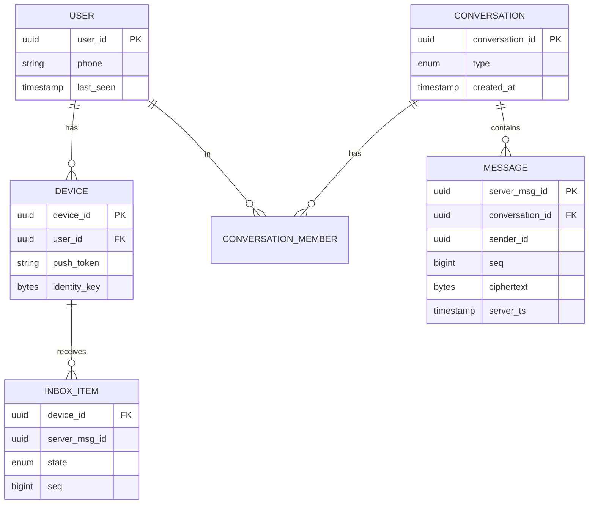

**The KEY CHOICE — partition keys (this is where you spend your data-model time, not on the USER table):**

| Data | Store | Partition / shard key | Why |
|---|---|---|---|
| **Per-device offline queue (inbox)** | Wide-column (Cassandra/HBase) or Kafka-per-shard | `device_id` (or `user_id`) | All of a recipient's undelivered messages co-located; drain on reconnect is a single-partition scan. |
| **Messages (transient)** | Cassandra | `conversation_id` | Per-conversation ordering & range scans live in one partition. |
| **Presence** | In-memory (Redis) | `user_id` | Hot, ephemeral, TTL'd. |
| **Connection routing** | Redis / consistent-hash registry | `user_id → gateway_id` | Find which gateway holds a user's socket. |
| **Sequence numbers** | Per-conversation counter | `conversation_id` | Monotonic ordering within a conversation. |

> **Decisive call:** shard the inbox by `device_id` because the drain-on-reconnect path — the hottest, most latency-sensitive read — becomes a single-partition sequential scan. Shard messages by `conversation_id` because ordering only has to hold within a conversation, so the sequencer is per-partition and never coordinates cross-shard. These two keys fall directly out of the two access patterns; I'm not going to agonize over the USER table, which is a trivial keyed-by-`user_id` lookup.

> **Inbox model is the heart of it.** Each *recipient device* has a queue. Sending a message = appending to each recipient device's inbox + attempting live push. This is **fan-out-on-write** at the inbox level. Compare to [Twitter](#4-twitter--x--timeline--hybrid-fan-out), where fan-out-on-write also dominates but the celebrity problem forces a hybrid.

## 1.6 High-level architecture

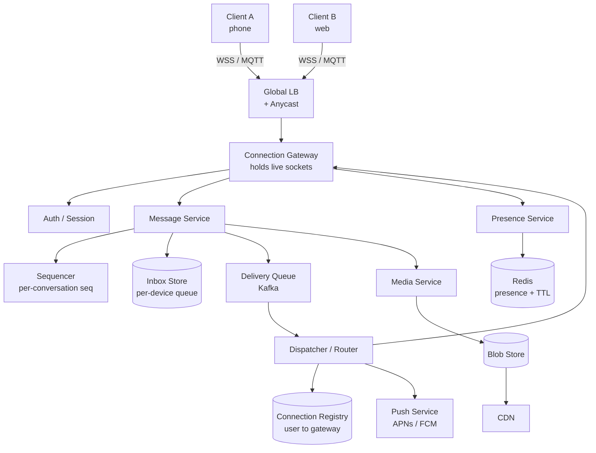

**Flow in words:** Client opens a persistent encrypted connection to the nearest **gateway**. On SEND, the message service assigns a **sequence number**, writes to each recipient's **inbox**, and publishes a delivery event. The **dispatcher** looks up where each recipient is connected (**connection registry**); if online, it pushes to that gateway; if offline, it triggers a **push notification** and leaves the message in the inbox for sync-on-reconnect.

> **Altitude cue while drawing this:** the LB, Auth, and Media boxes get one sentence each. Then say *"the three boxes I care about are the Gateway, the Inbox Store, and the Dispatcher+Registry — let me go deep there."*

## 1.7 Deep dives (the hard parts — spend 60% of your time here)

### Deep dive A — The connection gateway & presence

The defining challenge: **100M concurrent stateful connections.**

- **Stateful, long-lived**: unlike HTTP, each user holds an open socket for hours. The LB must be connection-aware (L4 + TLS passthrough, or a thin L7). You can't round-robin requests; the connection *is* the state. **Decisive call:** L4 load balancing with TLS terminating *at the gateway*, not at the LB — because the LB has no useful per-request routing to do (the connection is sticky for hours) and terminating TLS at the edge box keeps the LB stateless and cheap.
- **Protocol**: WhatsApp historically used a customized **XMPP/MQTT-like** binary protocol over a persistent TCP/TLS connection — chosen for low overhead and good behavior on mobile (small frames, efficient keepalives). **Decisive call:** MQTT-style binary framing over WebSocket-as-fallback, because on mobile the per-message and per-keepalive byte overhead directly costs battery and data, and at 3.3M pings/sec the overhead is real money. Revisit toward plain WebSocket only if you need to ride existing HTTP infra/proxies.
- **Connection registry**: when a user connects to gateway G, you write `user_id → {gateway_id, device_id}` into a fast registry (Redis cluster or a gossip/consistent-hash layer). To deliver to user B, the dispatcher asks the registry "where is B?" and forwards to that gateway. On disconnect, the entry is removed (or TTL'd via heartbeat).
- **Heartbeats / keepalives**: mobile networks silently drop idle connections (NAT timeouts). Clients ping every ~30-60s; missed heartbeats → mark offline. Tuning this is a battery-vs-freshness trade-off. **War-story framing:** in real-time chat infra the keepalive interval is the single knob that generates the most production tickets — too aggressive drains battery and users complain; too slow and presence lies for a minute. We landed on adaptive heartbeats (back off when the app is backgrounded).
- **Presence** is *derived* from connection state: connected = online, last heartbeat = last_seen. Presence is stored in Redis with a short TTL so a crashed gateway naturally expires its users to offline. **Presence fan-out is itself a hot-key problem** — if a celebrity has 1M people subscribed to their presence, every status flip is a 1M fan-out. **Decisive call:** make presence **pull-on-demand and scoped to open conversations** rather than push-to-all-subscribers, because the push model has unbounded fan-out for popular users and most subscribers don't even have the chat open. Debounce flaps (a 2s settle window) so a flaky connection doesn't emit a fan-out storm per flap.

> **War-story:** I've watched presence fan-out melt a Redis cluster — a mega-group whose members all reconnected at once after a regional blip, each flip fanning out to the whole group. The fix was exactly the above: debounce + scope-to-open-conversation + pull-on-demand for large audiences. I'd build it that way from day one rather than discover it in prod.

> See [Real-Time](09-realtime-systems.md) for the general connection-gateway pattern and backpressure handling.

### Deep dive B — Message delivery semantics & the three checkmarks

The **sent → delivered → read** state machine, and how to make it reliable over lossy networks. **This is the crux — the interviewer wants to see you treat "delivered" as a distributed-systems problem.**

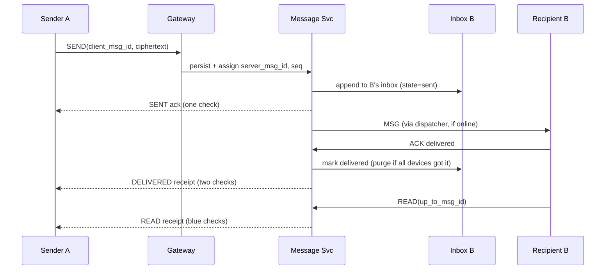

Key engineering points:
- **At-least-once on the wire + dedup = effectively exactly-once to the user.** The server may re-push a message if it didn't get an ACK (client crashed mid-delivery). The client dedups on `server_msg_id`.
- **A message is only purged from the inbox once every target device ACKs delivery.** This is what guarantees "accepted = never lost." Until then it's durable in the queue.
- **Receipts are themselves messages** flowing back through the same pipeline — they need ordering and dedup too. Read receipts can be batched (`read up_to seq N`) to avoid one-receipt-per-message storms. **Decisive call:** batch read receipts by high-water-mark (`up_to`) rather than per-message, because a user scrolling through 200 unread messages must not emit 200 receipt events back to the sender.

**Edge cases to volunteer (Defend step):**
- **Sender crashes after SEND but before SENT ack** → client retries with the same `client_msg_id`; server dedups, returns the existing `server_msg_id`. No duplicate.
- **Recipient receives MSG but crashes before ACK** → server never got the ACK, re-pushes on reconnect; client dedups on `server_msg_id`. At-least-once + dedup holds.
- **Recipient is offline** → message stays in inbox + push fires (APNs/FCM). On reconnect, B pulls the backlog (SYNC) ordered by `seq`, then ACKs.
- **Push notification delivered but app never opened** → message remains durably in the inbox; it's not "delivered" until a device ACKs. The push is a *hint*, not the delivery.
- **Sender's "delivered" receipt is itself lost** → the message *was* delivered (recipient ACKed); only the sender's checkmark lags. Re-derive receipt state on the sender's reconnect from the inbox metadata.

### Deep dive C — Ordering, the offline queue & sync-on-reconnect

- **Per-conversation ordering** via a monotonic `seq` assigned by the message service when the message is accepted. Server timestamp is unreliable for ordering across clock skew; the `seq` is the source of truth. The client renders by `seq`, not by `client_ts`. **Decisive call:** order by server-assigned `seq`, never by client timestamp, because client clocks are adversarially wrong (skew, manual changes, timezone bugs) and ordering must be deterministic.
- **Why not global ordering?** Unnecessary and impossibly expensive. Ordering only needs to be consistent *within a conversation*. This is why `conversation_id` is the partition key — the sequencer is per-partition and never needs cross-partition coordination. (Contrast with systems that need a global log; see [Distributed Systems](02-distributed-systems.md) on logical clocks.) **This is a YAGNI win — name that you're deliberately *not* building global ordering.**
- **Sync-on-reconnect**: the client stores a cursor (`last_seq` it has seen per conversation). On reconnect it sends the cursor; the server returns everything after it from the inbox/conversation store. This is a clean **resumable stream** — idempotent, ordered, and bounded.
- **Multi-device complication**: each device has its *own* delivery cursor. A message is "delivered" to the account when *any* device gets it, but it must be fanned to *all* the user's devices. So the inbox is keyed by `device_id`, and a message lives until *all* devices ACK. Web/desktop that's been offline for days must catch up independently.

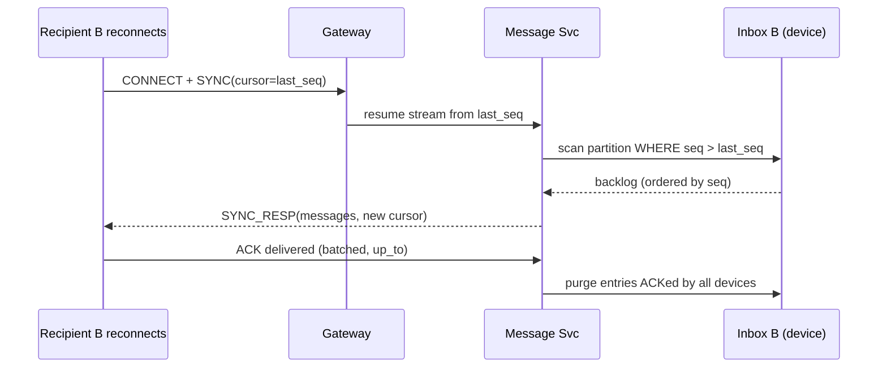

**Edge case to volunteer:** a device offline for 30 days reconnects with a stale cursor — the backlog may be huge. Bound it: page the SYNC, and if the gap exceeds a threshold, fall back to a snapshot+tail rather than replaying every message. Also handle the inbox having purged messages that *other* devices already ACKed — the late device may legitimately miss messages no longer buffered, which is why long-offline devices rely on encrypted backups, not the transient queue.

### Deep dive D — E2E encryption (Signal / double ratchet), conceptual

The server **cannot read message contents** — it routes ciphertext. **This shapes the whole design, and saying so unprompted is the senior move.**

- **Session setup (X3DH)**: each device publishes a **prekey bundle** (identity key + signed prekey + one-time prekeys) to the server. To start a conversation, the sender fetches the recipient's bundle and derives a shared secret *without the recipient being online*. The server stores and hands out keys but never sees private keys.
- **Double ratchet**: every message advances a ratchet, giving a **new message key per message**. This provides **forward secrecy** (compromise of one key doesn't expose past messages) and **post-compromise security** (future messages re-secure). The server just sees opaque ciphertext + routing headers.
- **Group encryption**: naive approach = encrypt separately to each member (pairwise), which is O(N) per message. Signal uses **sender keys**: the sender distributes one symmetric sender-key to each member once (pairwise, encrypted), then broadcasts a single ciphertext encrypted with that sender key. Fan-out cost drops from O(N) encryptions PER MESSAGE to O(1) per message (one symmetric encrypt broadcast to all), plus an O(N) sender-key distribution ONCE per rotation (membership change). **Decisive call:** sender keys over pairwise for groups, because pairwise re-encryption per message is O(members) crypto work on the sender's phone — unacceptable battery cost in a chatty 256-member group.
- **Multi-device + E2E** is genuinely hard: each *device* is its own crypto identity. Sending to a 3-device user = 3 encrypted copies. Linking a new device requires securely transferring keys (QR-code-based key exchange in WhatsApp's "linked devices").
- **Implication for the backend (state this as a constraint, not a feature):** server-side search, server-side spam filtering on content, and server-side message storage are all *impossible by design*. Features must move client-side or rely on metadata only. **This is precisely why Slack (next section) makes the opposite call.**

### Deep dive E — Group fan-out: write vs read (decide, don't enumerate)

For groups, you choose where the fan-out cost lands — and you **decide**, with a crossover trigger:

- **Fan-out-on-write (the call for groups ≤256)**: when a group message arrives, write it into every member's inbox. For groups ≤256 this is cheap (≤256 inbox appends per message) and gives instant delivery + simple per-user sync. **This is WhatsApp's model and the right default**, because the fan-out is bounded by the group-size cap and the read path stays trivially simple.
- **Fan-out-on-read (the call for broadcast/channels)**: store one copy in the conversation, let each member pull. Cheaper writes, but you lose the clean per-device delivery/queue semantics. **Switch to this the moment audience size blows past the group cap** — WhatsApp "Channels"/Telegram channels with millions of subscribers, where 256-style write fan-out would explode.
- **The decisive rule (memorize this phrasing):** *"Fan-out-on-write for groups because the size cap bounds the cost and it buys clean per-device sync; switch to fan-out-on-read for broadcast channels the moment the audience exceeds the cap, because then write-amp is unbounded — at which point a channel is just a feed, and I'd design it like [Twitter](#4-twitter--x--timeline--hybrid-fan-out)."* The crossover is where write amplification × message frequency exceeds the read-side cost.

## 1.8 Scaling & bottlenecks (Evolve step — scale the *specific* bottleneck)

- **Concurrent connections** are the #1 axis (your capacity math proved it). Shard users across thousands of gateways; use consistent hashing so a gateway failure only re-homes its slice. The connection registry must survive gateway churn — TTL + heartbeat, never trust stale routing.
- **Hot conversations / mega-groups**: a 256-member group with a chatty membership creates a write-fan-out hot spot. Cap group size; for larger, switch to read fan-out. Sequencer for that conversation can become a hot partition — keep sequence assignment cheap (single counter, in-memory with periodic persist).
- **Presence storms**: debounce, scope to open conversations, pull-on-demand for celebrities (see Deep dive A).
- **Push notification fan-out**: offline group message → N push notifications. Batch and rate-limit; collapse multiple unread into one notification.
- **Media**: never flows through the message path. Upload to blob store, get a `blob_id`, send the (encrypted) reference in the message. CDN for delivery. Dedup identical media by content hash (forwarded memes are sent millions of times — content-hash dedup turns 5 PB/day of ingest into a fraction of that stored).
- **Regional locality**: keep the socket and the inbox near the user; cross-region delivery only when participants are in different regions.

## 1.9 Trade-offs & failure modes (Defend step — volunteer these)

| Decision | Trade-off |
|---|---|
| Inbox model (fan-out-on-write) | Fast delivery + simple sync, but write amplification on big groups. |
| Purge-on-delivery | Tiny storage footprint, but no server-side history/search; lost device = lost history (unless backed up). |
| E2E by default | Privacy + can't lose user trust, but no server-side moderation/search/multi-device convenience. |
| Per-conversation `seq` | Cheap, scalable ordering, but no global ordering (rarely needed). |
| Presence via heartbeat TTL | Self-healing on crashes, but last-seen can lag by the TTL window. |
| MQTT binary protocol | Low battery/bandwidth, but custom infra vs riding standard HTTP/WS proxies. |

**Failure modes:** gateway crash → its users re-connect to another gateway, inbox is durable so nothing is lost; dispatcher can't find recipient → fall back to push + inbox; duplicate delivery → client dedups on `server_msg_id`; clock skew → ignored, `seq` is authority; split brain in registry → at worst a message is delivered to the wrong/old gateway and re-routed; **regional outage** → users re-home to another region's gateway, inbox replicated cross-region for the durability guarantee; **push provider (APNs/FCM) outage** → messages stay durably in inbox, users get them on next foreground/reconnect (push is a hint, not the delivery).

## 1.10 What the interviewer is really testing

They want to see that you understand **stateful long-lived connections are a fundamentally different scaling problem than stateless QPS**, that you reach for the **inbox/queue model with idempotent sync**, and that you can reason about **delivery semantics (at-least-once + dedup = effectively-once)** as a distributed-systems problem rather than a fire-and-forget push.

> **Staff-level insight:** The hardest part of WhatsApp is not throughput — it's the *connection plane and delivery guarantees under a lossy, multi-device, offline-first world*. The interviewer is checking whether you treat "delivered" as a distributed-systems problem (durable inbox, ACK-or-retry, dedup, resumable cursor) rather than a fire-and-forget push. And the genuinely senior move is recognizing that **E2E encryption is an architectural constraint that removes entire categories of server-side features** — and saying so unprompted, in minute five, as part of your earmark. Given the candidate's a real-time chat platform background, lean hard into the connection-gateway and presence-at-scale war-stories; that's where the interviewer expects this candidate specifically to go deepest, and where a generic answer would actually *underperform* expectations.

---

# 2. Slack — Channels, Workspaces, Enterprise Chat

> **Focus:** multi-tenant workspaces, channel message fan-out, presence at scale, message search, threading, per-workspace WebSocket gateway, notifications, enterprise scale. Where WhatsApp is offline-first and E2E, Slack is **server-authoritative, searchable, multi-tenant, and persistent**.

> **Earmark — say this in minute five:** *"Slack is WhatsApp with the opposite constraints, so the hard parts move. They are (1) the enterprise hot channel — a #general with 100K+ members, the fan-out hot key; (2) ACL-aware full-text search, which is a separate async system; and (3) multi-tenancy and isolation. The connection plane is real but it's the WhatsApp problem solved, so I'll move faster there. I'll spend my time on the hot channel and search. Sound right?"*

> **The framing that lands:** *"The first decision is server-authoritative vs E2E. Slack needs search, compliance, and eDiscovery, so I'm choosing server-authoritative storage and explicitly giving up E2E. That one call cascades into everything — it's why search is even possible and why I store once instead of per-device."*

## 2.1 Problem framing

Build a multi-tenant team chat: organizations ("workspaces") contain channels; members post messages that all channel members see, with threads, search, presence, and notifications — fully persisted and searchable server-side.

## 2.2 Requirements

**Functional**
- Workspaces (tenants), channels (public/private), DMs, group DMs.
- Real-time message delivery to all online channel members.
- **Threading** (replies hang off a parent message).
- **Full-text search** across all messages the user can see.
- Presence, typing, reactions, mentions.
- **Notifications** (mentions, DMs, keywords) with per-channel mute/preferences.
- Message history is permanent and server-readable (compliance/eDiscovery in enterprise).

**Explicitly cut for v1:** huddles/calls (WebRTC subsystem), Slack Connect cross-org federation, the app/bot platform. Name them as out of scope.

**Non-functional**
- **Scale**: millions of workspaces; the largest single workspace ~1M+ users (enterprise grid). Billions of messages.
- **Multi-tenancy**: strong isolation between workspaces; noisy-neighbor protection.
- **Latency**: sub-200ms delivery to online members.
- **Consistency**: read-your-writes within a channel; durable ordering per channel.
- **Availability**: 99.99%; degrade gracefully (read-only mode beats outage).

> **Decisive call on consistency:** read-your-writes within a channel is the bar — when I post, I must see my own message immediately and in order. I'm *not* promising cross-channel or cross-workspace global ordering (YAGNI). The per-channel `ts` ordering key gives read-your-writes for free.

## 2.3 Capacity estimation

```
Workspaces:           ~1M active workspaces
DAU:                  ~30M
Avg channels/user:    ~50; avg active channel size: ~20
Messages/day:         ~2.5B  (heavy in-channel chatter)
  writes/sec avg:     2.5B / 86,400 ≈ 29K msgs/sec
  peak (3x):          ~90K msgs/sec write

Fan-out (online delivery)
  Avg channel ~20 members, ~half online → ~10 live deliveries per msg
  deliveries/sec avg ≈ 29K * 10 ≈ 290K/sec; peak ~900K/sec
  Note: enterprise #general with 100K members is the hot-key problem.    <-- THE hard part
  One message to a 100K-member channel = up to 100K live pushes from ONE write.

Storage (messages are PERMANENT — unlike WhatsApp)
  Avg message ~1KB (text + metadata, no media):
    2.5B/day * 1KB = 2.5 TB/day → ~900 TB/year (text alone)
  Plus search index (inverted index ~ same order as raw text) → roughly doubles it.
  Plus files/media in blob store.

Connections
  ~half of DAU online concurrently → ~15M concurrent WebSockets.
  Sharded per-workspace gateway (NOT a global registry — tenant sharding simplifies this).
```

**Takeaway:** lower raw scale than WhatsApp, but **permanent storage + full-text search + multi-tenancy + giant enterprise channels** make it harder in different dimensions. The number that dictates the design is the **100K-member channel fan-out**, not the aggregate QPS.

## 2.4 API design

```
POST /api/chat.postMessage   { channel, text, thread_ts? }   → { ts, channel }
GET  /api/conversations.history { channel, cursor, limit }
POST /api/conversations.replies { channel, thread_ts }       → thread messages
GET  /api/search.messages    { query, sort, filters }        → ranked results
POST /api/reactions.add      { channel, ts, emoji }

// Real-time (WebSocket "RTM"-style event stream, scoped to a workspace)
EVENT message       { channel, user, text, ts, thread_ts? }
EVENT presence_change{ user, presence }
EVENT reaction_added { ... }
```

`ts` (a high-resolution timestamp) doubles as the **message ID and ordering key** within a channel — a nice Slack design touch worth naming: one field gives you identity, ordering, and the read cursor.

## 2.5 Data model

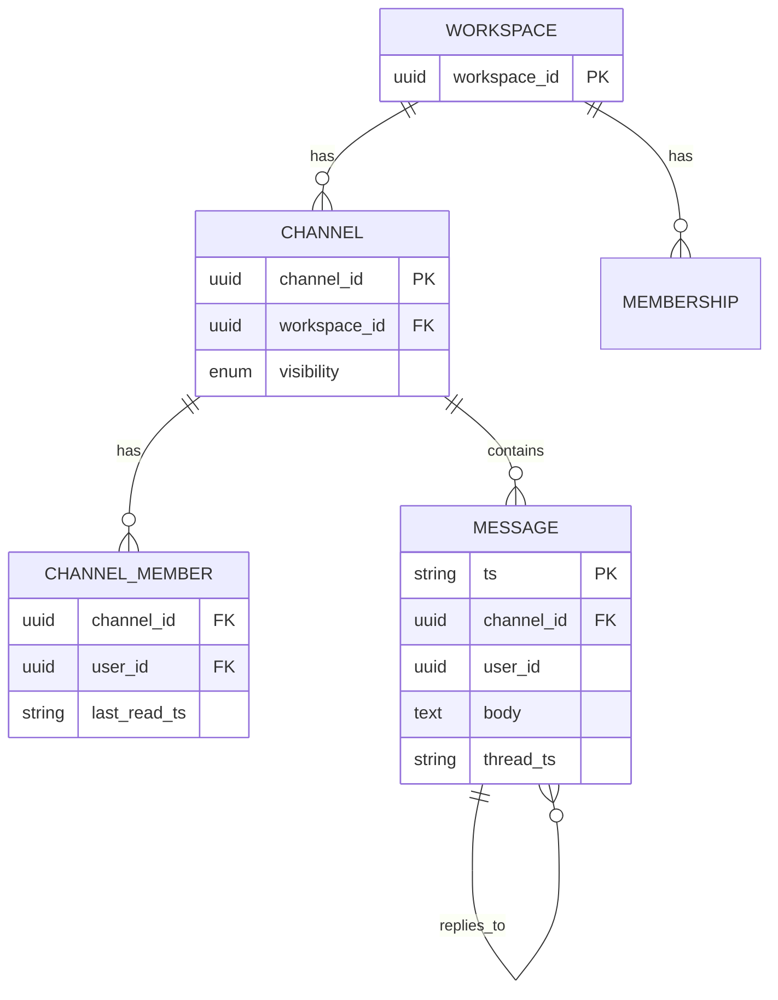

**The KEY CHOICE — shard by `workspace_id` (tenant). Decide this fast and explain why it cascades:**

- **Multi-tenancy → shard by tenant.** Each workspace's data lives together; cross-workspace queries are rare/forbidden. This gives natural isolation, lets you migrate/scale a hot workspace independently, simplifies compliance (a workspace's data is a unit), **and — the non-obvious payoff — lets the WebSocket gateway be per-workspace, which keeps channel fan-out local instead of needing WhatsApp's global registry.** One shard-key decision solves three problems.
- Within a workspace, messages partition by `channel_id`; ordering key is `ts`.
- **Read-state per (channel, user)**: `last_read_ts` drives unread counts — a per-user cursor, exactly like WhatsApp's inbox cursor but read-side.

> **Decisive call:** shard by `workspace_id` over sharding by `channel_id` because the tenant is the natural unit of isolation, scaling, and compliance — and revisit only for the one-in-a-million enterprise grid that's too big for a shard, which I sub-shard by channel.

## 2.6 High-level architecture

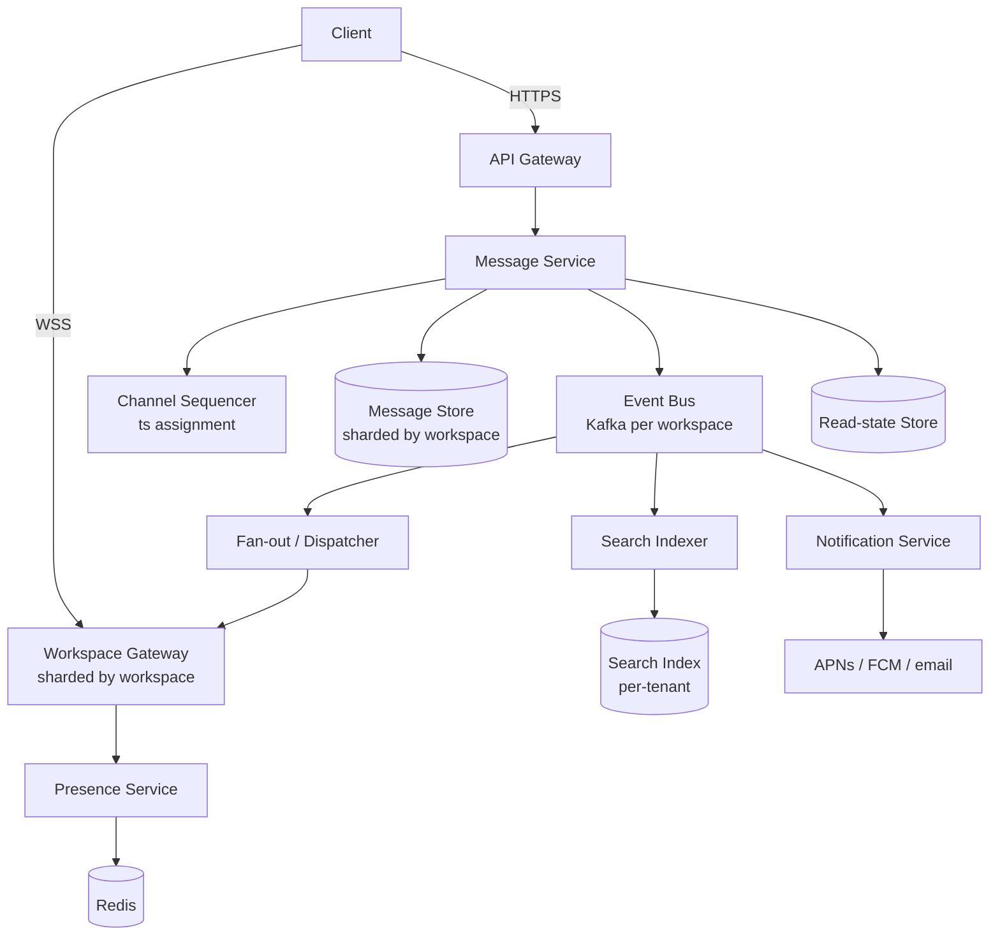

## 2.7 Deep dives (spend 60% here — the hot channel and search)

### Deep dive A — Channel fan-out & the enterprise hot channel

- **Default: fan-out-on-write to online members, store-once for offline.** A message posts once to the channel store, then the dispatcher pushes it over WebSocket to every *currently-online* channel member's gateway. Offline members just see it on next history fetch (server stores everything — no per-user inbox copy needed). **Decisive call:** store-once + push-to-online + read-on-demand-for-offline, *not* WhatsApp's per-device inbox write — because the server is authoritative and persistent, so there's no reason to pay per-recipient write amplification when offline users can read from the durable store.
- **The hot-key problem = the enterprise `#general` channel** with 100K+ members. One message → up to 100K live pushes. **This is where you spend your time.** Mitigations, decided:
  - **Gateway-side fan-out tree (the primary call)**: the dispatcher sends **one message per *gateway* that holds ≥1 member**, and the gateway fans out locally to its sockets. Turns 100K central point-to-point pushes into ~(#gateways, maybe dozens) messages. *Decisive because* it moves the multiplication to the edge where the sockets actually live, which is the only place it's cheap.
  - **Subscription model**: clients subscribe to channels; the gateway maintains `channel → sockets` maps so a single channel event explodes locally, not centrally.
  - **Rate-limit / coalesce** for extremely chatty broadcast channels; collapse presence/typing.
- **Per-workspace WebSocket gateway**: because data is tenant-sharded, you route a user's socket to the gateway pool serving their workspace. This keeps channel fan-out *local to a workspace's gateways* — a huge simplification vs WhatsApp's global registry. **Name this as the payoff of the tenant-sharding decision.**

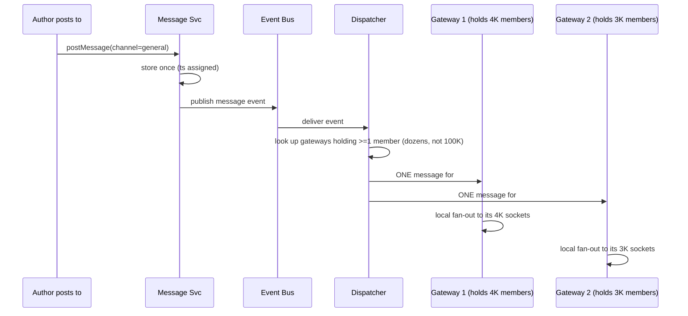

### Deep dive B — Search over messages (the thing WhatsApp *can't* do)

This is what WhatsApp's E2E *forbids* and Slack must deliver — and it's a **separate async system**, which is itself the staff insight.

- **Inverted index** (Elasticsearch/OpenSearch) populated **asynchronously off the event bus**, decoupled from the write path. Every posted message → index document with `{workspace_id, channel_id, user, text, ts, acl}`. **Decisive call:** async indexing off Kafka, not synchronous-on-write, because nobody expects to search a message the instant it posts, and coupling index latency to send latency would make posting slow and fragile.
- **ACL-aware search is the hard part** — a user may only search messages in channels they're a member of (plus public channels). **Decided approach:**
  - **Filter by the user's channel set at query time** — index `channel_id` into the document, fetch the user's channel membership (cached), and constrain the query to that set. *Chosen over* indexing per-user visibility (which would explode the index by membership count).
  - **Per-tenant indices** for isolation and to bound query scope — a query never scans another tenant's data.
  - **Membership-change consistency:** eventual is acceptable — a just-left user briefly seeing a result is tolerable, or you re-check membership at result-render time. **Don't over-engineer strict consistency here.**
- **Freshness vs cost:** near-real-time indexing (seconds) is fine; async indexing off Kafka decouples write latency from index latency.

### Deep dive C — Threading & read state

- **Threads** are messages with a `thread_ts` pointing at the parent. A thread is just a filtered view (`WHERE thread_ts = parent`). Replies can optionally "also send to channel." The tricky part is **notification semantics**: a reply in a thread you're *following* should notify you even if you're not @-mentioned. **Decisive call:** track explicit per-user thread subscriptions (you auto-subscribe by replying or by the author's choice), because deriving "should this notify me" from implicit signals is unreliable and users hate both false silence and notification spam.
- **Read state & unread counts**: per `(user, channel)` store `last_read_ts`. Unread count = messages in channel with `ts > last_read_ts`. For huge channels this exact count is expensive → **approximate (cap at "99+") for the badge, but keep mentions exact** in a separate counter, because users care precisely about mentions and only vaguely about total unread. *Decide the split: approximate where it's cheap to be wrong, exact where it isn't.*

## 2.8 Scaling & bottlenecks

- **Tenant sharding** isolates noisy neighbors; a hot workspace scales independently. Watch for the *one giant workspace* that doesn't fit a shard → split by channel within it (enterprise grid = federation of workspaces).
- **Hot channel** → gateway-local fan-out tree (Deep dive A).
- **Search index** is a parallel system sized like the primary store; shard by tenant, async-fed.
- **Presence** at workspace scale: scope presence to channels the user is viewing; don't broadcast every member's presence globally. (Same lesson as WhatsApp presence storms.)
- **Notifications**: dedup and batch; respect per-channel mute. A mention in a 100K channel must not page 100K people — only the mentioned/subscribed.

## 2.9 Trade-offs & failure modes

| Decision | Trade-off |
|---|---|
| Server-authoritative + persistent | Enables search/compliance/multi-device, but more storage + no E2E privacy. |
| Tenant sharding | Clean isolation + per-workspace gateway, but giant single tenants need sub-sharding. |
| Store-once + push-online | No per-user inbox write amplification, but offline users rely on history fetch. |
| Gateway-local fan-out tree | Bounds central fan-out cost, but gateways need channel→socket maps. |
| Async search indexing | Cheap & decoupled, but search lags posting by seconds. |
| Approximate unread, exact mentions | Cheap badges + precise where users care, but two code paths. |

**Failure modes:** gateway loss → reconnect, history fetch fills the gap (nothing lost, it's all persisted); search index lag/outage → search degraded but chat works (graceful degradation — read-only/no-search beats an outage); hot channel storm → local fan-out + rate limit; tenant overload → throttle that tenant only (noisy-neighbor containment); event bus lag → delivery and indexing both lag uniformly, but the durable store keeps it consistent.

## 2.10 What the interviewer is really testing

Whether you handle **multi-tenancy and isolation**, recognize the **enterprise hot-channel fan-out** and solve it at the edge, and can design **ACL-aware search** as a separate async system.

> **Staff-level insight:** The senior framing is "Slack is WhatsApp with the opposite constraints" — server-authoritative (so search/compliance are possible), tenant-sharded (so isolation and the per-workspace gateway fall out naturally), and the hot key is the *enterprise broadcast channel*, solved by **moving fan-out to the edge gateways** rather than a central dispatcher. Making the server-authoritative-vs-E2E call explicitly in minute five, then naming the gateway-local fan-out tree and ACL-in-index search, is what separates staff from senior. The trap is treating it as "just another chat app" and re-deriving WhatsApp; the win is recognizing the constraints inverted and letting that one inversion cascade through every decision.

---

# 3. Instagram — Photos, Feed, Stories

> **Focus:** photo upload + blob/CDN storage, feed (timeline) generation via fan-out-on-write vs read, the follower graph, the **celebrity problem**, stories, likes/comments at scale.

> **Earmark — say this in minute five:** *"Two hard parts, and one trap. Hard part one: the feed is a fan-out problem with a power-law follower distribution, so a single strategy is wrong by construction — I'll go hybrid. Hard part two — and this is where most candidates underspend — the photos are petabytes; the feed is cheap (it's just post-IDs in a cache), the bytes are the actual cost, and that's a CDN/blob problem. The trap is spending all my time on the feed merge and ignoring where the system's money actually goes. Sound right?"*

## 3.1 Problem framing

Build a photo-sharing social network: users upload photos, follow others, and see a feed of recent posts from people they follow — plus ephemeral stories and engagement (likes/comments).

## 3.2 Requirements

**Functional**
- Upload photos/videos with captions.
- Follow/unfollow (directed graph).
- **Home feed**: recent posts from followees (ranked or reverse-chron).
- Stories (24h ephemeral).
- Likes, comments, follower/following counts.

**Explicitly cut for v1:** DMs (that's the WhatsApp problem), Reels recommendation ranking (that's the Facebook problem), Explore. Name them as out of scope.

**Non-functional**
- **Scale**: ~2B users, ~500M DAU, ~100M photos/day.
- **Read-heavy**: read:write ≈ 100:1 (people browse far more than they post).
- **Latency**: feed load < 200ms; image load via CDN < 100ms.
- **Availability**: feed must always render (stale is OK); uploads must be durable.
- **Consistency**: eventual is fine for feed/counts; uploads durable.

> **Decisive call on consistency:** eventual consistency for the feed and counts — a feed that's a few seconds stale or a like count that's briefly off is invisible to users and saves enormous coordination cost. Uploads, by contrast, must be durable-once-acked. *Decide where you need strong vs eventual; don't apply one uniformly.*

## 3.3 Capacity estimation

```
DAU:                  500M
Photos/day:           100M  → ~1,200 uploads/sec avg, ~3,500/sec peak
Feed reads
  Each DAU opens feed ~10x/day, ~30 posts each pull, infinite scroll:
    feed requests ≈ 500M * 10 = 5B/day ≈ 58K feed-requests/sec avg
    peak ~175K/sec
  Read:write ≈ 5B reads : 100M writes ≈ 50:1 (higher with likes/comments)

Storage (photos) — THE cost center
  Avg photo (multiple resolutions): ~2MB total across thumbnails:
    100M/day * 2MB = 200 TB/day → ~70 PB/year. Blob store + CDN, tiered to cold.
  Metadata (post rows): ~1KB * 100M = 100 GB/day → cheap relative to blobs (2000x smaller).

Feed cache (fan-out-on-write inbox) — cheap by comparison
  Precompute each user's feed list (post IDs only, ~ a few hundred entries):
    500M users * 500 post-ids * ~16 bytes ≈ 4 TB in Redis-like store. Manageable.

Celebrity fan-out (THE write number)
  A 100M-follower account posting, fanned out naively = 100M feed-cache writes
  per post. At even a few posts/day from many such accounts, this dwarfs all
  organic write traffic. → pure push is impossible; hence hybrid.

Bandwidth (image delivery, dominated by CDN)
  Feed images served: huge — this is why ~99% is offloaded to CDN edge.
  The 4 TB feed cache vs 70 PB/yr of images tells you where to spend: the bytes.
```

**Takeaway:** massively **read-heavy** and **blob-dominated**. The feed is a fan-out problem (solved by hybrid); the bytes are a CDN problem (solved by edge + multi-res + content-hash URLs). The 4 TB feed cache vs 70 PB of images is the number that tells you the photos, not the feed, are where the system lives.

## 3.4 API design

```
POST /v1/media/upload         → presigned URL flow → blob_id (multi-res)
POST /v1/posts                { media_id, caption }     → post_id
GET  /v1/feed?cursor=         → ranked/recent posts (page)
POST /v1/follow               { target_user }
POST /v1/posts/{id}/like
POST /v1/posts/{id}/comments  { text }
GET  /v1/stories              → active stories from followees
```

> **Note the upload flow is a presigned URL, not bytes-through-the-API** — that decouples the blob path from the app servers. Say this out loud; it's a signal.

## 3.5 Data model

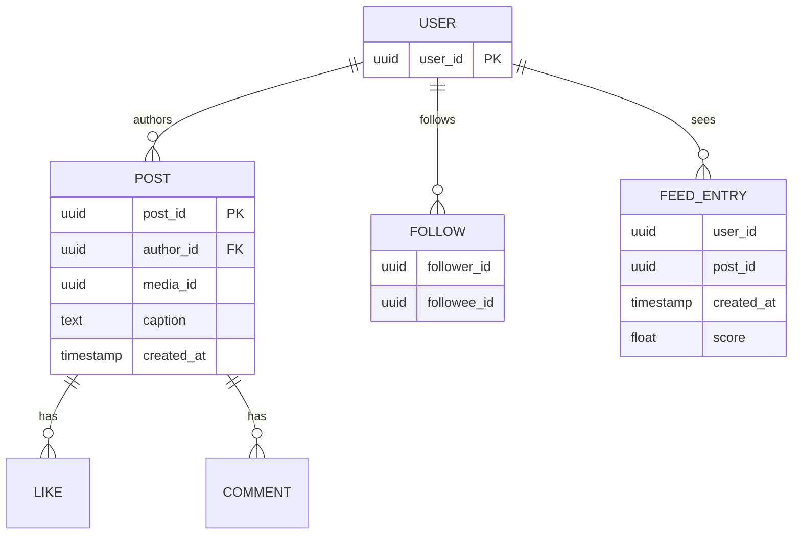

**The KEY CHOICE:**
- **Posts** partition by `author_id` (a user's posts together — gives cheap user-profile reads and celebrity pull).
- **Follow graph**: store *both directions* — `followers(user)` and `following(user)` — because you query both (fan-out needs followers; the celebrity read-merge needs following). Partition each index by its subject. **Decisive call:** dual-index the graph despite the 2x write cost, because both access patterns are hot and a single-direction index would force a scatter-gather on the other.
- **Feed/inbox** (`FEED_ENTRY`): partition by `user_id` — each user's precomputed feed is one partition. This is the **fan-out-on-write inbox**.

## 3.6 High-level architecture

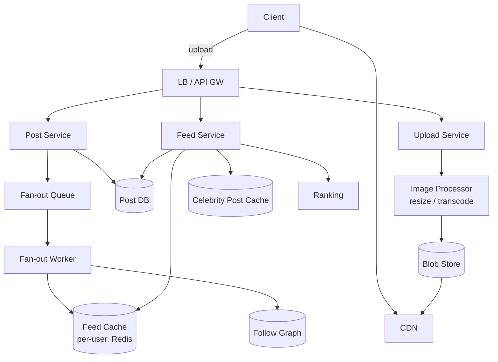

## 3.7 Deep dives (60% here — the hybrid and the CDN)

### Deep dive A — Feed generation: fan-out-on-write vs read, and the celebrity problem (DECIDE)

**This is THE recurring theme. Get it cold — and make the call, don't list options.**

- **Fan-out-on-write (push) — the call for normal users**: when user U posts, immediately write `post_id` into the **feed cache of every follower**. Feed reads are then trivial (read your own precomputed list — one partition). **Right default for the tail of the distribution** because the system is 50:1 read-heavy and a normal user has hundreds of followers — cheap writes buy O(1) reads.
  - **Cost**: write amplification = number of followers. Fine for normal users.
  - **Disaster at celebrity scale**: a user with 100M followers posting = **100M writes** per post. That's the celebrity / hot-key problem, and it also wastes work on inactive followers.
- **Fan-out-on-read (pull) — the call for celebrities**: store the post once; at feed-read time, fetch recent posts from the (few) celebrities you follow and merge. No write amplification.
- **The decisive hybrid (memorize the phrasing):** *"The follower distribution is power-law, so a single strategy is wrong by construction — I branch on producer size. Push for normal users (the tail); pull for celebrities above ~tens-of-thousands of followers (the head). Feed read = the precomputed cache MERGED with a live pull of the handful of celebrities I follow. This bounds write cost (no 100M-write storms) AND read cost (you only live-pull from the few celebrities you follow, and those caches are shared across millions of readers so they're trivially cacheable). Identical pattern to [Twitter](#4-twitter--x--timeline--hybrid-fan-out)."*

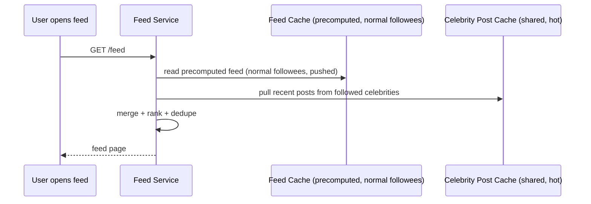

### Deep dive B — Photo upload & CDN (where the system actually lives)

- **Decouple upload from posting.** Client requests a **presigned URL**, uploads bytes **directly to blob storage**, bypassing app servers. Then creates the post referencing `media_id`. **Decisive call:** presigned direct-to-blob upload, *not* bytes-through-the-API, because routing petabytes through app servers would make them the bottleneck for no reason — the app servers should only ever touch metadata.
- **Async processing**: a worker generates multiple resolutions/thumbnails, transcodes video, strips EXIF, runs safety/ML checks. Originals tiered to cold storage; serving sizes pushed to CDN.
- **CDN is mandatory**: ~99% of image bytes are served from edge caches. **Use content-hash URLs** for immutability and infinite cacheability — the same content always has the same URL, so it's cacheable forever and forwarded/re-shared media is free. This is the single biggest cost and performance lever — see [Caching](03-caching.md) on CDN strategy.

### Deep dive C — Stories, likes & counts at scale

- **Stories** are ephemeral (24h TTL). Store with a TTL; the "stories tray" is a small fan-out (your followees' active stories) — small, bounded list. **Decisive call:** pull-on-read for the stories tray, not push, because it's a small recent set computed cheaply at read time and pushing 24h-expiring entries into follower inboxes is wasted write work.
- **Like/comment counts** are a classic hot-counter problem on viral posts. **Decisive call:** never `UPDATE count = count+1` on a single row (lock contention, hot row) — use **sharded counters** (N sub-counters summed) for hot posts, plus **approximate display counts** with async reconciliation. The like *event* is durable; the displayed *count* can be eventually consistent. See [Databases](06-databases.md) on counter patterns.

## 3.8 Scaling & bottlenecks

- **Celebrity fan-out** → hybrid (Deep dive A). The single most-tested point.
- **Hot post (viral)** → CDN for media + cached counts + sharded counters.
- **Feed cache size** → store post-IDs not bodies; cap feed length; **evict inactive users' precomputed feeds** (recompute on next visit — saves writing to dormant accounts, a real win since most accounts are dormant on any given day).
- **Image bytes** → CDN, multi-res, content-hash immutable URLs, cold tiering.
- **Don't fan out to inactive followers** — only push to recently-active users; backfill others on read. (Same optimization recurs in Twitter.)

## 3.9 Trade-offs & failure modes

| Decision | Trade-off |
|---|---|
| Fan-out-on-write (normal users) | Cheap reads, but write amplification → needs celebrity exception. |
| Hybrid push/pull | Bounds both costs, but feed assembly logic is more complex. |
| Eventually-consistent counts | Scales to viral, but counts can be briefly wrong. |
| Precomputed feed cache | Fast feeds, but stale until next fan-out; recompute for dormant users. |
| Presigned direct upload | Keeps bytes off app servers, but client handles the upload handshake. |

**Failure modes:** fan-out worker backlog → feed staleness (acceptable, degrade gracefully); feed cache miss → recompute via pull; celebrity post → never write-fanned, always pulled from the shared hot cache; CDN miss → origin fetch (rare); blob store partial outage → durable originals survive, re-derive serving sizes.

## 3.10 What the interviewer is really testing

Whether you reach for **fan-out-on-write for a read-heavy feed**, then **correctly identify the celebrity problem and propose the hybrid decisively**, and whether you keep **blobs off the app path (presigned upload + CDN)**.

> **Staff-level insight:** The non-obvious staff move is recognizing that the *follower count distribution is power-law*, so a single fan-out strategy is wrong by construction — you must branch on producer size, and you say that *as the reason*, not as a hedge. The second, and the one most candidates miss, is that **the feed is cheap (4 TB of post-IDs in cache); the photos are the cost (70 PB/yr)**, so 90% of the real engineering is the CDN/blob tier, not the feed merge. Candidates who spend all their clock on the feed and wave past the petabytes of images are optimizing the wrong order of magnitude — and at staff level, getting the order of magnitude right *is* the signal.

---

# 4. Twitter / X — Timeline & Hybrid Fan-out

> **Focus:** the home timeline, the **hybrid fan-out** (push for normal, pull for celebrities), the tweet write path, the fan-out service, the social graph, trending topics, search, ranking. **This is the canonical fan-out interview** — go deepest on the hybrid model.

> **Earmark — say this in minute five:** *"This is the canonical fan-out problem, so the whole game is one number: the fan-out amplification. Let me compute it, because the number is what forces the design — and it'll show that pure push is impossible because of celebrities. The hard part is the hybrid (push for the tail, pull for the head) and articulating WHY both costs end up bounded. Trending and search are secondary stream-processing systems — I'll name them and move on. Sound right?"*

## 4.1 Problem framing

Build a microblogging timeline: users post short tweets, follow others, and see a **home timeline** of recent tweets from followees — at extreme read scale with a power-law follower distribution.

## 4.2 Requirements

**Functional**
- Post tweets (text + media), follow/unfollow.
- **Home timeline** (tweets from followees, ranked or reverse-chron).
- **User timeline** (a single user's tweets).
- Likes, retweets, replies, quote-tweets.
- Search, trending topics, notifications.

**Explicitly cut for v1:** DMs, Spaces (audio), ads ranking. Name them.

**Non-functional**
- **Scale**: ~400M users, ~250M DAU, ~500M tweets/day.
- **Extremely read-heavy**: read:write ≈ 1000:1 when counting every timeline ENTRY served via fan-out (one tweet write materializes into hundreds of follower-timeline entries read); at the request level it's ≈ 10:1 (see §4.3).
- **Latency**: timeline load < 200ms p99.
- **Consistency**: eventual; timelines can be slightly stale.
- **Availability**: timeline must always render.

## 4.3 Capacity estimation

```
DAU:                  250M
Tweets/day:           500M → ~5,800 tweets/sec avg, ~15K/sec peak
Timeline reads
  Each DAU loads timeline ~20x/day:
    250M * 20 = 5B/day ≈ 58K reads/sec avg, ~175K/sec peak
  With infinite scroll & ranking re-fetches, multiply a few x.
  Read:write ≈ 5B : 0.5B ≈ 10:1 at request level, but per-byte/per-fan-out far higher.

Fan-out amplification (THE number — compute this FIRST, out loud)
  Avg followers ~ a few hundred, but power-law: top accounts 100M+ followers.
  If every tweet fanned out to all followers naively:
    500M tweets * (avg, say 700 followers) = 350B timeline writes/day
    ≈ 4M timeline-writes/sec avg.
  And the celebrities BLOW THIS UP: one 100M-follower account's single tweet
    = 100M timeline writes in one shot. A handful of such accounts dominate
    the entire write budget.
  → This is exactly why pure fan-out-on-write is impossible. Hence hybrid.

Storage
  Tweet row ~300 bytes * 500M/day = 150 GB/day metadata.
  Timeline cache (post-IDs): 250M users * ~800 ids * 16B ≈ 3 TB in Redis.
  Media → blob/CDN as usual.
```

**Takeaway:** the headline number is the **fan-out amplification (~4M timeline-writes/sec, unbounded by celebrities)**. Controlling it *is* the design — everything else is plumbing around that one decision.

## 4.4 API design

```
POST /v1/tweets               { text, media_ids? }     → tweet_id
GET  /v1/timeline/home?cursor=                          → ranked timeline page
GET  /v1/timeline/user/{id}?cursor=
POST /v1/follow               { target }
POST /v1/tweets/{id}/retweet
GET  /v1/trends?location=
GET  /v1/search?q=
```

## 4.5 Data model

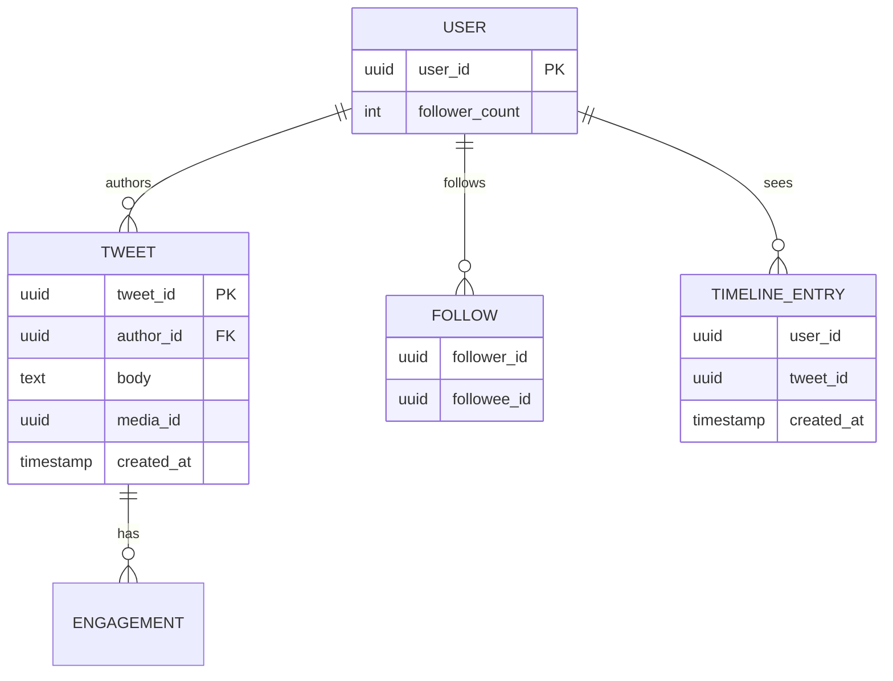

**The KEY CHOICE:**
- **Tweets** partition by `tweet_id` (or `author_id` for user-timeline range scans). Use **Snowflake-style time-sortable IDs** so IDs encode order — *name this, it's a nice signal*: the ID is the sort key, so you never need a separate ordering column.
- **Graph**: dual indexes — `followers(user)` (for fan-out) and `following(user)` (for the celebrity pull/merge). Partition each by its subject.
- **Home timeline** (`TIMELINE_ENTRY`): partition by `user_id`. The precomputed inbox. **Capped length** (e.g., latest ~800) — bounded storage, deep scroll falls back to pull.

> **Decisive call:** store `follower_count` denormalized on the USER row so the fan-out service can branch on producer size with a single read, not a graph count. The threshold check happens on every tweet, so it must be O(1).

## 4.6 High-level architecture

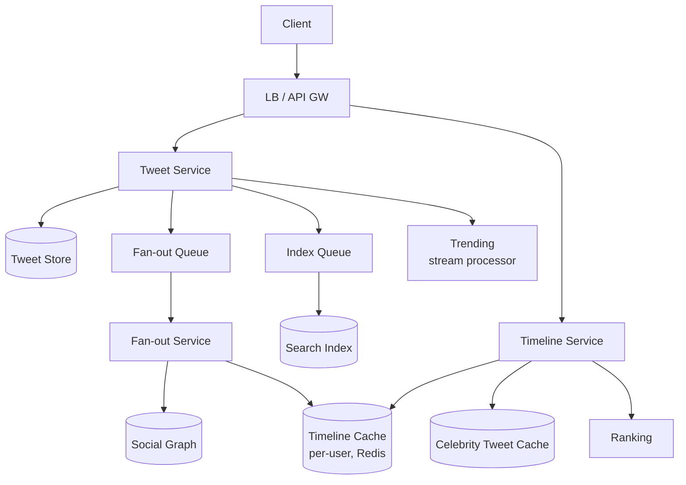

## 4.7 Deep dives (spend 60%+ here — this is THE fan-out interview)

### Deep dive A — The hybrid fan-out (the centerpiece)

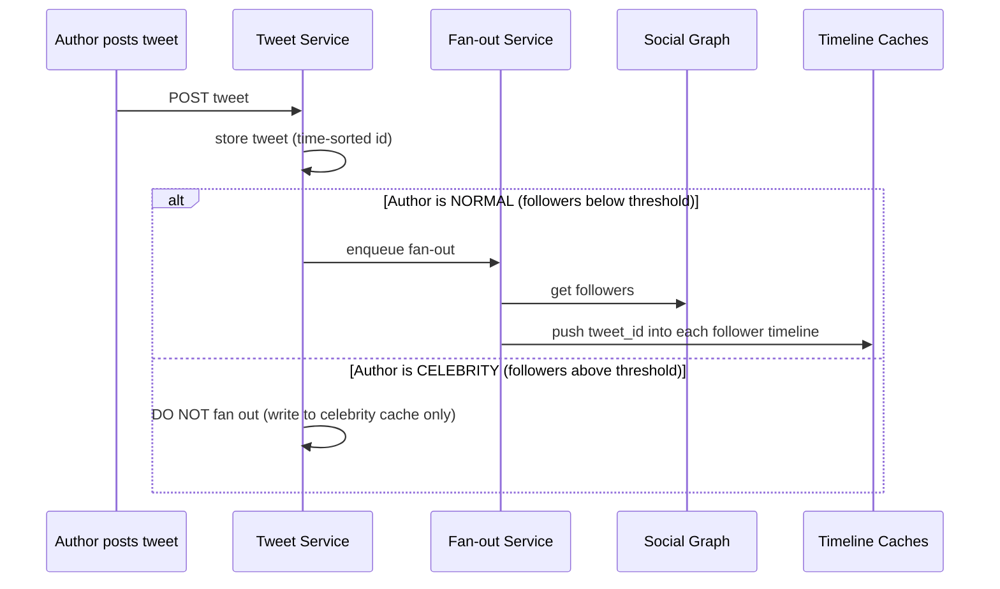

**On read (the merge):**
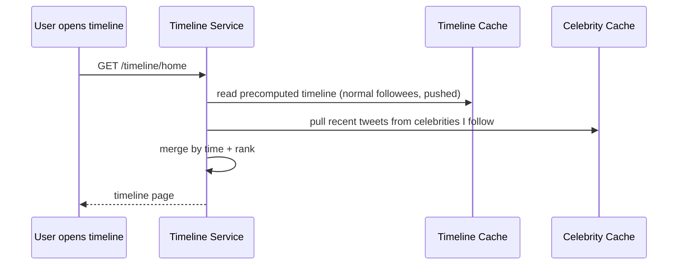

**Why this is the right answer — and articulate BOTH halves of the bound (this is the depth signal):**
- **Write fan-out is bounded** because you never fan out for the 100M-follower accounts — the exact ones that would dominate the 4M writes/sec. Removing the head of the distribution from the write path is what caps write cost.
- **Read fan-in is bounded** because a user follows only a *handful* of celebrities — pulling their recent tweets is a few cache reads. And here's the economic key: **those celebrity caches are shared across all readers.** One celebrity's recent tweets are read by millions of followers, but it's *the same few objects*, so a tiny cache absorbs enormous read load. Pull is cheap precisely *because* the head of the distribution has huge shared read locality.
- **The decisive phrasing:** *"Power-law distribution → branch on producer size → push for the tail (cheap writes, O(1) reads), pull for the head (no write storm, and the shared celebrity cache makes the reads nearly free). The threshold is a tunable knob balancing write-amp against read-fan-in — typically tens of thousands of followers — and I'd also skip inactive followers on the push side, backfilling them on read."*

### Deep dive B — The fan-out service & write path

- **Async fan-out**: the tweet write returns as soon as the tweet is durably stored; fan-out happens via a queue ([Messaging](04-messaging-event-driven.md)). **Decisive call:** async fan-out, not synchronous, because posting must be fast and reliable while timeline propagation can lag a second or two without anyone noticing.
- **Fan-out workers** read the author's follower list (possibly millions of IDs, chunked/streamed) and batch-write `tweet_id` into each follower's timeline cache.
- **Backpressure**: a sudden burst (a semi-celebrity going viral) can flood the queue. Workers must be horizontally scalable and the queue must absorb spikes. If fan-out lags, timelines are simply slightly stale — acceptable. **Volunteer this failure mode:** the tweet is durable *before* fan-out, so a queue backlog delays timelines but never loses tweets.
- **Timeline truncation**: each user's timeline cache is capped (latest N). Old entries fall off; deep scroll falls back to pulling from the tweet store.

### Deep dive C — Trending topics & search (name-and-move-on, they're secondary)

- **Trending**: a **streaming aggregation** ([Messaging](04-messaging-event-driven.md)) over the tweet firehose — count hashtags/phrases in sliding windows, compare to a baseline to find *acceleration* (not just raw volume), per-geo. **Decisive call:** approximate counting (Count-Min Sketch, top-K heavy hitters) over exact, because at firehose scale exact per-term counts are wasteful and trending only needs the heavy hitters.
- **Search**: async inverted index off the tweet stream; ranked by recency + engagement + relevance. Real-time search index must ingest at write rate. ACL is simpler than Slack (most tweets are public — no per-result membership check needed).

## 4.8 Scaling & bottlenecks

- **Celebrity fan-out** → hybrid (the whole point).
- **Hot timeline cache shards** → consistent hashing + replication; the few celebrity caches are read-hot → replicate widely / push to edge.
- **Fan-out queue backlog** → scale workers; tolerate staleness.
- **Inactive followers** → don't pre-push; recompute on return (most followers of any account are inactive on a given day).
- **Search/trending** → parallel stream systems sized to the firehose; approximate algorithms.

## 4.9 Trade-offs & failure modes

| Decision | Trade-off |
|---|---|
| Hybrid fan-out | Bounds write & read cost, but merge logic + threshold tuning complexity. |
| Async fan-out | Fast posts, but timeline staleness during backlog. |
| Capped timeline | Bounded storage, but deep history needs pull fallback. |
| Approximate trending | Cheap at firehose scale, but not exact counts. |
| Denormalized follower_count | O(1) threshold check, but must keep it roughly fresh. |

**Failure modes:** fan-out lag → stale timeline (fine); celebrity cache hot → replicate; queue overflow → shed/slow, never drop the tweet (tweet is durable pre-fan-out); search index lag → slightly delayed searchability; a normal user suddenly going viral mid-fan-out → cap the fan-out and convert them to pull on the fly.

## 4.10 What the interviewer is really testing

This is *the* fan-out interview. They're testing whether you (1) compute the fan-out amplification number first, (2) recognize pure push fails on celebrities, (3) propose the **hybrid** and explain *why both costs are bounded*, and (4) handle it asynchronously.

> **Staff-level insight:** The depth signal is articulating the **read-side economics of the celebrity cache**: a celebrity's recent tweets are pulled by millions but are *the same few objects*, so a tiny shared cache absorbs enormous read load — which is precisely why pull is cheap for the head of the distribution and push is cheap for the tail. Most candidates can say "hybrid"; the staff candidate explains *why each half is bounded* and names the **threshold as a tunable knob balancing write-amp against read-fan-in**, plus skipping inactive followers. Saying "hybrid" is senior; explaining the two-sided bound is staff.

---

# 5. Facebook News Feed — Ranking & Aggregation

> **Focus:** feed **ranking** (EdgeRank → ML), aggregation from many heterogeneous sources, the pull + ranking pipeline, edge/affinity, ads insertion, feed caching. Where Twitter/IG are mostly about *delivery* of a homogeneous stream, News Feed is about *ranking* a heterogeneous one.

> **Earmark — say this in minute five:** *"The key reframe: Twitter and Instagram are delivery problems; News Feed is a RANKING problem. The bottleneck isn't fan-out, it's ranking compute — scoring hundreds-to-thousands of candidates per request at ~1M req/sec. The hard part is the multi-stage funnel that makes that tractable, plus the feature store that feeds it. And the senior note I'll make unprompted: pure engagement optimization is a known failure mode, so integrity/diversity guardrails are first-class stages, not afterthoughts. Sound right?"*

## 5.1 Problem framing

Build a ranked, personalized feed aggregating many content types (friends' posts, pages, groups, recommendations, ads) and ordering them by predicted relevance to maximize engagement.

## 5.2 Requirements

**Functional**
- Aggregate candidate content from many sources (friends, followed pages, groups, recommended, ads).
- **Rank** the candidate set per user (ML model).
- Mix in ads at the right slots.
- Engagement actions (like/comment/share/react) that feed back into ranking.

**Explicitly cut for v1:** the post composer/upload path (it's the Instagram blob problem), Marketplace, Groups infra. Name them.

**Non-functional**
- **Scale**: ~2B DAU; huge candidate sets per request.
- **Read-heavy**, ranking-compute-heavy.
- **Latency**: feed render < a few hundred ms despite scoring hundreds–thousands of candidates.
- **Consistency**: eventual; freshness matters but exactness doesn't.
- **Availability**: always render *something* (degrade to recency, never blank).

## 5.3 Capacity estimation

```
DAU:                  2B
Feed sessions/day:    2B * ~15 = 30B/day ≈ 350K feed-requests/sec avg, ~1M peak
Candidates per request: hundreds to low thousands fetched, ranked down to ~tens shown
  → ranking must score ~10^2–10^3 items per request at ~1M req/sec peak
  → ~10^8–10^9 candidate-scorings/sec at peak — RANKING is the compute bottleneck.   <-- THE number
Feature store reads: every candidate needs feature hydration → feature-store read
  latency directly bounds feed latency. Reads/sec ~ candidates/sec ~ 10^8-10^9.
Storage: posts/edges in graph store; feature store for ranking signals (huge).
```

**Takeaway:** the bottleneck is **ranking compute** (scoring a large candidate set per request), not delivery. This is fundamentally an **ML-systems-at-scale** problem, and the funnel is what makes the 10^8-10^9 scorings/sec tractable.

## 5.4 API design

```
GET  /v1/feed?cursor=         → ranked, ad-injected feed page
POST /v1/posts                { content, audience }
POST /v1/posts/{id}/react     { type }
GET  /v1/feed/refresh         → top-of-feed new content
```

## 5.5 Data model & ranking pipeline (conceptual)

| Stage | What it does |
|---|---|
| **Candidate sources** | Friends' recent posts, followed pages, groups, recommendations, ads — each a producer. |
| **Candidate generation** | Gather a few hundred–thousand candidates (recent + eligible) for this user. |
| **Feature hydration** | Pull features: affinity (you–author), content type, recency, predicted engagement signals, from a **feature store**. |
| **Ranking (ML)** | Score each candidate; predict p(like), p(comment), p(share), p(dwell); combine into a value. |
| **Filtering/policy** | Integrity, dedup, diversity, ad-load rules. |
| **Mixing** | Interleave organic + ads at policy slots. |

**EdgeRank → ML (the evolution worth naming — shows you know the history):**
- **Classic EdgeRank** ≈ `affinity × weight × time_decay` per "edge" (interaction). Simple, interpretable.
- **Modern**: a multi-task **ML model** predicting several engagement probabilities, combined into a value score, continuously retrained. Affinity and recency are now *features*, not the whole formula.

## 5.6 High-level architecture

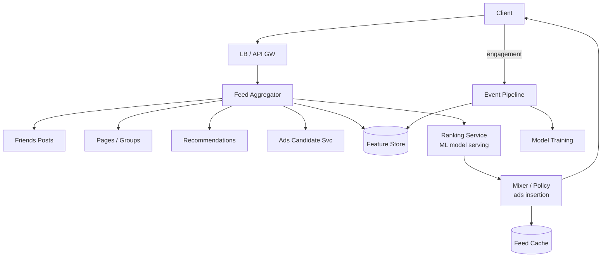

## 5.7 Deep dives (60% here — the funnel and the feature store)

### Deep dive A — Aggregation + the multi-stage ranking funnel (the centerpiece)

The pipeline is a **funnel**: cheaply narrow a huge universe to a manageable candidate set, then spend expensive compute only on survivors. **Naming the funnel is the strongest signal in this design.**

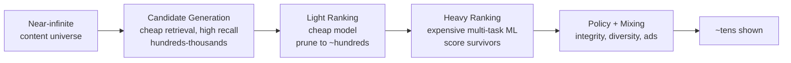

1. **Candidate generation (cheap, high recall)**: gather hundreds–thousands of eligible items from all sources. Mostly retrieval/cache lookups, not scoring. Aggressive caching here.
2. **Light ranking (cheap model)**: a fast model prunes candidates to the top ~hundreds. Keeps the expensive model's input bounded.
3. **Heavy ranking (expensive ML)**: full multi-task model scores only the survivors.
4. **Policy/mixing**: integrity filters, diversity, dedup, ad insertion.

**Decisive call:** the multi-stage funnel over single-stage scoring, because you can *never* run the expensive model on the whole universe at 1M req/sec — the funnel is what keeps p99 latency bounded by ensuring the heavy model only ever sees a few hundred pre-pruned candidates. *This is the decision that makes the whole system tractable; state it as such.*

### Deep dive B — Edge/affinity & feature store

- **Affinity** = how connected you are to a source (interaction history, closeness). A key feature; high-affinity friends surface more.
- **Feature store**: precomputed + real-time features served at low latency to the ranker. **Two tiers, decided:** **offline/batch** features (affinity aggregates, embeddings, recomputed periodically) and **online/real-time** features (you reacted 2s ago). **The feature store's read latency directly bounds feed latency** — so it must be a low-latency KV store with heavy caching and co-location, not a database join at request time.
- **Freshness loop (name this closed loop — it's a staff signal):** engagement events flow back through the event pipeline into both the feature store (online features) and model training (offline) — **the feed learns from itself.** See [Messaging](04-messaging-event-driven.md) for the event backbone.

### Deep dive C — Ads insertion & caching

- **Ads** run a *parallel auction* (ranked by bid × predicted relevance) and are **interleaved** into organic results at policy-defined slots, subject to ad-load limits. **Decisive call:** score organic and ads in *separate* pipelines, then mix — keeping ad economics and organic relevance independent, so neither corrupts the other's objective function.
- **Caching a ranked feed is subtle**: you can't cache the final ranked list for long (it goes stale as new content/engagement arrives), but you *can* cache candidate sets, features, and even partial scores. **Decisive call:** compute the feed per-session with a short-lived cache plus a "load more"/"new posts" mechanism, *not* a long-lived precomputed feed — because a ranked feed's value decays in seconds and a stale ranking is worse than a fresh re-rank. Trade-off accepted: re-rank cost per session.

## 5.8 Scaling & bottlenecks

- **Ranking compute** is the bottleneck → multi-stage funnel + model-serving infra (GPU/accelerator fleets, request batching).
- **Feature store** read latency → heavy caching, co-location, precomputation.
- **Candidate explosion** for highly-connected users → cap candidates, sample.
- **Hot content (viral post)** → it's a candidate for millions; cache its features/score (the same post scored against many users shares feature computation); serve media from CDN.

## 5.9 Trade-offs & failure modes

| Decision | Trade-off |
|---|---|
| ML ranking vs simple recency | Higher engagement, but opaque, compute-heavy, needs training infra + integrity guardrails. |
| Multi-stage funnel | Bounds latency/cost, but tuning recall vs precision at each stage. |
| Short-lived feed cache | Fresh feeds, but re-rank cost per session. |
| Separate organic + ads pipelines | Clean economics, but a mixing layer to tune. |
| Engagement-optimized ranking | Drives metrics, but risks filter bubbles/integrity issues — needs guardrails. |

**Failure modes:** ranking service down → fall back to a simple recency feed (degrade, never blank); feature store slow → use cached/default features (degraded ranking beats no feed); candidate source down → drop that source, render the rest; model regression → fast rollback + shadow evaluation before promotion.

## 5.10 What the interviewer is really testing

Whether you understand the feed as a **ranking/ML-systems problem with a multi-stage funnel and a feature store**, not just a fan-out delivery problem — i.e., whether you can *reframe* away from Twitter's delivery framing.

> **Staff-level insight:** The differentiator is the **funnel** (cheap candidate gen → light rank → heavy rank) as the mechanism that makes per-request ranking tractable at 1M req/sec, plus the **closed engagement→feature→model loop**. And the genuinely senior note — make it unprompted — is naming the **integrity/guardrail tension**: pure engagement optimization is a known, documented failure mode, so a staff design includes diversity, integrity filtering, and ad-load policy as first-class pipeline stages, not afterthoughts bolted on at the end. Recognizing that "the feed learns from itself" is a control loop that needs guardrails is what separates a staff ML-systems answer from a senior one.

---

# 6. LinkedIn — Professional Graph & Feed

> **Focus:** the professional **graph** (connections, degrees of separation), "People You May Know" via graph traversal, the feed, who-viewed-your-profile, search, and graph-database considerations. The distinguishing feature: the **symmetric graph and degree-of-separation queries**.

> **Earmark — say this in minute five:** *"The trap here is treating LinkedIn as 'Twitter with a relabeled graph.' It isn't — the distinctive challenge is the SYMMETRIC, multi-hop graph. The hard parts are (1) showing 1st/2nd/3rd degree on every search result and profile at scale, which can NOT be live BFS; and (2) the supernode — the graph version of the celebrity hot-key. The feed is the same hybrid fan-out I've already covered, so I'll move fast there. The graph is where I'll spend my time. Sound right?"*

## 6.1 Problem framing

Build a professional network centered on a **bidirectional connection graph**, supporting graph-derived features (degrees of separation, PYMK, search relevance by network distance), a feed, and profile-view tracking.

## 6.2 Requirements

**Functional**
- **Connections** (symmetric, mutual-accept) — distinct from Twitter/IG's directed *follow*.
- **Degrees of separation** (1st / 2nd / 3rd) shown in search & profiles.
- **People You May Know (PYMK)** recommendations.
- Feed (posts, articles, job/activity updates).
- **Who viewed your profile.**
- Search (people/jobs/companies) ranked by relevance + network distance.

**Explicitly cut for v1:** messaging/InMail (WhatsApp problem), jobs marketplace ranking, the feed *ranking* internals (covered under Facebook — name it and reuse). Scope tightly to the graph.

**Non-functional**
- **Scale**: ~1B members, ~hundreds of M DAU.
- Graph queries (2nd/3rd degree) are expensive and frequent.
- **Latency**: search/feed < a few hundred ms; degree annotation must be fast.
- **Consistency**: eventual for feed/PYMK; graph reasonably fresh.

## 6.3 Capacity estimation

```
Members:              1B
Avg connections:      ~500 (1st degree)
2nd-degree reach:     ~500 * 500 = 250K (with overlap, ~tens of thousands)
3rd-degree:           into the millions — DO NOT traverse live at query time.

Edges in graph:       1B members * ~500 = ~500B directed edges (250B symmetric).   <-- a dedicated storage problem
  → This is not a table; it's a graph-storage problem.

Search QPS:           DAU * a few searches → tens of thousands/sec, each needing
  degree annotation for EVERY result → if degree were live BFS, that's tens of
  thousands of multi-hop graph traversals per second. Impossible interactively.
  → degree distance must be precomputed/cached, not BFS'd live.   <-- THE constraint

PYMK:                 batch-computed offline (friend-of-friend + features) for ~1B members.
  A live FoF computation per request at 1B-member scale is a non-starter.
```

**Takeaway:** the headline is the **graph**: ~500B edges and the fact that **2nd/3rd-degree queries cannot be live BFS** at interactive latency — they must be precomputed, indexed, or bounded. The number that dictates the design is "tens of thousands of degree-annotations/sec, each a multi-hop query" — which forces precomputation.

## 6.4 API design

```
GET  /v1/connections?user=                 → 1st-degree connections
GET  /v1/network/degree?from=&to=          → 1|2|3|out-of-network (precomputed/cached)
GET  /v1/pymk?user=                         → recommendations (batch-served)
GET  /v1/feed?cursor=
GET  /v1/profile/{id}/viewers               → who viewed me
GET  /v1/search/people?q=&filters=          → ranked, degree-annotated
POST /v1/connect                            { target }  → pending → accept
```

## 6.5 Data model

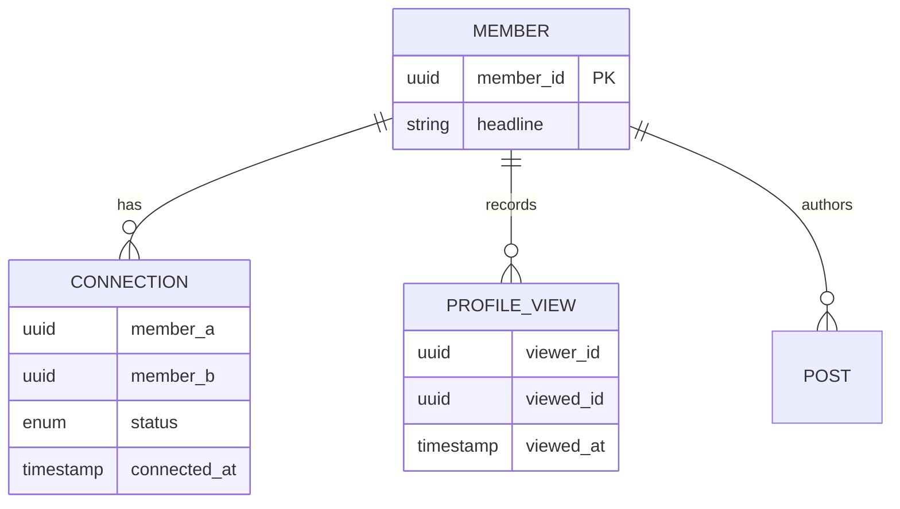

**The KEY CHOICE:**
- **Connection graph**: a symmetric edge stored **both directions** (`member_a→member_b` and `member_b→member_a`), partitioned by `member_id` so a member's adjacency list is one partition (fast 1st-degree fetch). **Decisive call:** a purpose-built **distributed graph store** (or a wide-column store tuned as adjacency lists) over a relational join table, because 500B edges with frequent multi-hop neighbor lookups is exactly the workload relational stores choke on.
- **Degree-of-separation** is *not* stored per-pair (1B² pairs is physically impossible — name this to show you've thought about it). It's computed via **bounded traversal + heavy caching** (see Deep dive A).
- **Profile views**: time-series, partitioned by `viewed_id`; recent window only.

## 6.6 High-level architecture

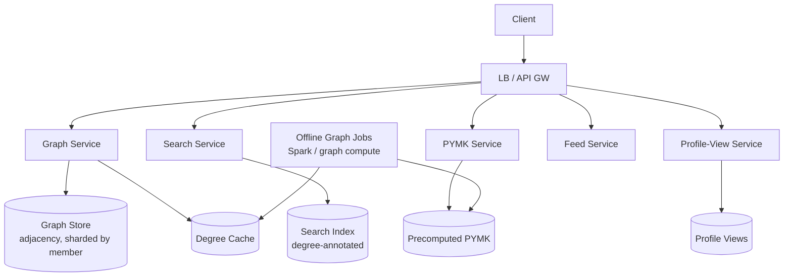

## 6.7 Deep dives (60% here — the graph is the whole point)

### Deep dive A — Degrees of separation without live BFS (the centerpiece)

The core graph challenge: every search result and profile must show 1st/2nd/3rd degree, at scale, fast.

- **1st degree**: direct adjacency lookup — one partition read. Easy; name and move on.
- **2nd degree**: intersection of "my connections" and "their connections" (friend-of-friend). Doable with set operations on cached adjacency lists, but a 500×500 intersection *per query* is too expensive at tens-of-thousands QPS.
- **3rd degree+**: reach is in the millions — **never traverse live.** Treat as "in network ≤3 / out of network."
- **The decisive technique:** *"Convert graph traversal into cached set-membership. Precompute and cache each member's 2nd-degree set — or a compact Bloom filter of it. To annotate a search result, I check: is target in my 1st-degree set? in my cached 2nd-degree set? else 3rd/out. That turns a multi-hop traversal into O(1) set-membership checks at query time. The 2nd-degree sets are refreshed in batch as the graph changes — I pay the cross-shard traversal cost OFF the request path."*
- **Bloom filters** keep the per-member 2nd-degree set compact (tolerating rare false positives in degree labeling). **Decisive call:** Bloom filter over an exact set, because tens of thousands of these sets per member-base must be cheap to store, and a rare mislabel of "2nd degree" is a harmless UX nit, not a correctness bug. This is the kind of pragmatic approximation staff candidates are expected to *propose unprompted*.

### Deep dive B — People You May Know (PYMK)

- **Core signal**: friend-of-friend (2nd-degree connections you're not yet connected to) — high mutual-connection count is the strongest predictor.
- **Decisive call: computed offline in batch** (graph-parallel compute, e.g., Spark/Pregel-style) for ~1B members; serving is a precomputed lookup. You *cannot* compute FoF recommendations live per request at this scale — the batch/serve split is forced by the math, not a preference.
- **Beyond FoF**: shared employer/school, co-views, contact-book imports, embeddings — blended via an ML ranker, same funnel idea as [Facebook](#5-facebook-news-feed--ranking--aggregation).
- **The triangle-closing insight (name this — it's the staff framing):** PYMK is fundamentally about **predicting which graph triangles will close**, which is why mutual-connection count dominates and why it's a batch graph-compute job, not an online query.

### Deep dive C — Graph storage & the supernode (the graph hot-key)

- **Why not just a relational table?** 500B edges with frequent multi-hop traversal and adjacency-list reads stress relational stores. A **distributed graph store** (or a sharded adjacency-list store tuned as a graph) gives fast neighbor lookups.
- **Supernode problem (the graph hot-key) — name it as the graph version of the celebrity problem:** influencers/recruiters/open-networkers with hundreds of thousands of connections are **supernodes** — their adjacency list is enormous, and any traversal through them explodes. **Decisive mitigations:** cap/paginate adjacency reads; special-case supernodes; and crucially **avoid traversing *through* them for FoF** (a supernode would make almost everyone falsely look "2nd degree"). This is the exact analogue of not fanning out a celebrity's tweets.
- **Sharding a graph is hard**: edges cross shard boundaries by nature, so a 2nd-degree query may fan across many shards. **This is precisely *why* precomputation + caching (Deep dive A) beats live traversal** — you pay the cross-shard cost in batch, off the request path. Name this causal link; it ties the three deep dives together.

## 6.8 Scaling & bottlenecks

- **Degree queries** → precomputed 2nd-degree sets + Bloom filters + cache (never live BFS).
- **Supernodes** → cap/paginate, special-case, don't traverse through (graph hot-key).
- **PYMK** → offline batch, precomputed serving.
- **Search** → degree-annotated index; relevance blends text + network distance + activity.
- **Profile views** → time-series, recent window, async write.

## 6.9 Trade-offs & failure modes

| Decision | Trade-off |
|---|---|
| Precomputed 2nd-degree sets | Fast degree annotation, but staleness + storage for ~1B sets. |
| Bloom filters for degree | Compact, but rare false positives in degree labels. |
| Offline PYMK | Scales to 1B, but recommendations lag recent connections. |
| Dedicated graph store | Fast traversal, but operational complexity + supernode handling. |
| Don't traverse through supernodes | Bounds FoF cost, but slightly less complete 2nd-degree sets. |

**Failure modes:** degree cache miss → fall back to "out of network" or a bounded live check; supernode traversal → capped/skipped; PYMK staleness → acceptable (a recent connection not yet reflected is a minor lag); graph shard down → degrade that slice; batch job lag → degree/PYMK freshness lags but the interactive path keeps serving from the last good precompute.

## 6.10 What the interviewer is really testing

Whether you recognize that **multi-hop graph queries can't be live at scale** and reach for **precomputation + caching + approximation (Bloom filters)**, and whether you handle the **supernode (graph hot-key)** problem — i.e., whether you see LinkedIn's *distinctive* challenge rather than re-running Twitter.

> **Staff-level insight:** The defining move is converting **graph traversal into cached set-membership** — precompute each member's 2nd-degree set so the interactive path is O(1) lookups, paying the cross-shard traversal cost in batch. That, plus naming the **supernode as the graph version of the celebrity hot-key** (and refusing to traverse through it), shows you see LinkedIn's distinctive challenge — the symmetric, multi-hop graph — rather than treating it as "Twitter with a different label." Recognizing that PYMK is *triangle-closing prediction* run as offline graph compute is the cherry on top. The trap that caps you at senior is relabeling Twitter's follow-graph; the win is seeing that symmetric multi-hop changes everything about what's precomputable.

---

# 7. Cross-System Cheat Sheet — the reusable decisive playbook

This is the reusable decision engine. Memorize the *decisions and their triggers*, not just the labels — that's what lets you walk into any chat/social variant and drive it decisively.

## 7.1 The systems side by side

| System | Core problem | Fan-out **decision** | The hot-key / hard part | Storage choice |
|---|---|---|---|---|
| **WhatsApp** | Stateful delivery, offline-first | **Write** (per-device inbox) because group cap bounds it; read for big broadcast | 100M connections, presence storms, E2E, delivery semantics | Transient inbox queue (purge on delivery) |
| **Slack** | Multi-tenant, searchable chat | **Store-once + push-online**; edge fan-out tree for the hot channel | Enterprise hot channel; ACL-aware search | Permanent, tenant-sharded + search index |
| **Instagram** | Read-heavy photo feed | **Hybrid** (push tail / pull celebrity head) | Celebrity fan-out; petabytes of media | Feed-IDs in cache; blobs in CDN |
| **Twitter/X** | Timeline at extreme read scale | **Hybrid** (the canonical example; both costs bounded) | Celebrity fan-out amplification; trending | Capped timeline cache; tweet store |
| **FB News Feed** | Ranking a heterogeneous feed | **Pull + multi-stage ranking funnel** | Ranking compute; feature store; integrity guardrails | Graph + feature store; short-lived feed cache |
| **LinkedIn** | Symmetric multi-hop graph | **Precompute graph features offline** (no live BFS) | Multi-hop degree queries; supernodes | Distributed graph store + precomputed sets |

## 7.2 The recurring decisive rules (lift these verbatim under pressure)

- **Fan-out:** *push for the tail, pull for the head; the trigger is producer size crossing ~tens of thousands of followers, because past that, write-amp is unbounded.* (Twitter/IG hybrid, WhatsApp groups-vs-broadcast.)
- **Hot key:** *every social system has one — celebrity, mega-group, enterprise #general, supernode. Name it in minute five and bound its cost (don't fan out the head; fan out at the edge; cap/paginate; precompute off the request path).*
- **State location:** *stateful sockets → connection registry + heartbeat TTL; precomputed inbox → per-recipient partition; ranking → feature store; graph → precomputed set-membership. Each fails differently; name the recovery.*
- **Ordering:** *per-conversation `seq`, never global, never client-clock. Global ordering is YAGNI.*
- **Storage tier:** *text/metadata is cheap; media is the cost — push it to a blob store + CDN with content-hash URLs, and never let bytes flow through app servers.*
- **Counts at scale:** *sharded counters + approximate display + async reconcile; never `count = count + 1` on a hot row.*
- **Search/ranking:** *async off the event bus; ACL-filter at query time; funnel the ranking so the expensive model never sees the whole universe.*
- **Consistency:** *decide per-surface — strong/read-your-writes where users notice (your own send, mentions), eventual where they don't (feeds, counts, presence). Never apply one uniformly.*

## 7.3 The three questions to answer for ANY chat/social design

1. **What's the read:write ratio, and where does fan-out go — write or read?** Then: *is the distribution power-law? If so, hybrid — push the tail, pull the head, and state the threshold as a tunable knob.*
2. **What's the hot key** (celebrity / mega-group / enterprise channel / supernode), **and how do you bound its cost?** Earmark it in minute five.
3. **Where does state live** (stateful connections? precomputed inbox? feature store? graph?) **and how does it stay consistent and recover from failure?**

## 7.4 The delivery overlay (the actual differentiator)

Knowing the six systems gets you in the room. Delivering them at staff altitude wins it:

- **Earmark the crux in minute five** and ask "sound right?" — turn the monologue into collaboration.
- **Decide, don't enumerate** — every fork ends in `<choice> because <requirement>; revisit if <trigger>`.
- **Control altitude** — name the boring CRUD and the user table, move on; spend 60% on the 2-3 hard parts.
- **Risk-weight** — the capacity number tells you where the system lives; spend your clock there.
- **Cite experience** — attach a war-story to a decision (for this candidate: presence storms, delivery guarantees, connection-plane scars from real-time chat infra).

Answer the three questions crisply with the math behind them, make the recurring decisions decisively with their triggers, and run the delivery overlay — and you're operating at the Staff level the interview is screening for.

---

*Cross-references: [Staff-Level Execution](20-staff-execution.md) · R.E.S.H.A.D.E.D. Framework · [Real-Time Systems](09-realtime-systems.md) · [Databases](06-databases.md) · [Messaging & Event-Driven](04-messaging-event-driven.md) · [Caching](03-caching.md) · [Distributed Systems](02-distributed-systems.md)*
