# Module 18b — End-to-End Design Playbooks: Media & Productivity

> A complete, study-ready playbook for the canonical **media & productivity** system design questions. Each design follows the same 10-step skeleton so you can pattern-match under interview pressure — but this rewrite threads a **staff-level delivery lens** through every section: earmark the crux early, decide instead of enumerate, hold altitude on boring CRUD, and spend your minutes on the one or two hard parts that actually carry the question. The recurring themes here — **large blob handling, CDN/edge delivery, transcoding/encoding pipelines, collaborative-editing consistency (OT/CRDT), and file sync/dedup** — show up in 80% of staff-level media interviews. Master these and you can derive the rest.
>
> **This is meant to be the only thing you study for this question class.** It is intentionally long. Read the delivery primer once, then for each system: read the *earmark* line, the *decisive choices*, the deep dives, and the *what they're really testing* close. The capacity math is there so you can reproduce a number under pressure, not memorize it.

**Cross-references:** [Staff-Level Execution](20-staff-execution.md) · [Storage](08-storage.md) · [Caching](03-caching.md) · [Real-Time Systems](09-realtime-systems.md) · [Distributed Systems](02-distributed-systems.md) · [Data Processing](16-data-processing.md) · sibling design modules: [Chat & Social](18a-design-chat-social.md) · [Marketplace & Money](18c-design-marketplace-money.md) · [Infra Primitives](18d-design-infra-primitives.md)

---

## Table of Contents

0. [How to Deliver a Design Problem at Staff Level](#0-how-to-deliver-a-design-problem-at-staff-level)
- [Google Mode — Build It, Don't Name It](#google-mode--build-it-dont-name-it)
1. [YouTube — Video Platform](#1-youtube--video-platform)
2. [Netflix — Video Streaming (VOD)](#2-netflix--video-streaming-vod)
3. [Spotify — Music Streaming](#3-spotify--music-streaming)
4. [Zoom — Video Conferencing](#4-zoom--video-conferencing)
5. [Google Docs — Collaborative Editing](#5-google-docs--collaborative-editing)
6. [Dropbox / Google Drive — File Sync & Storage](#6-dropbox--google-drive--file-sync--storage)
7. [Gmail — Email System](#7-gmail--email-system)
8. [Cross-Cutting Patterns Cheat Sheet](#cross-cutting-patterns-cheat-sheet)

---

# 0. How to Deliver a Design Problem at Staff Level

Before the systems, internalize *how* a staff engineer runs the 45 minutes. The systems below are the *content*; this section is the *delivery*. Full treatment in [Staff-Level Execution](20-staff-execution.md) — here is the operating model applied specifically to media/productivity design.

The interviewer is not scoring whether you can name a CDN. They are scoring whether they would trust you to *own* an ambiguous problem, *partition* it into what's hard and what's plumbing, and *commit* to decisions a team can build against. Every habit below serves that.

### The seven moves

1. **Earmark the crux out loud by minute five.** Before drawing a single box, say which one or two sub-problems carry the question and which are commodity. "This is YouTube — the metadata CRUD is a standard read-heavy web stack, I'll lay it out in two minutes; the real engineering is the chunked transcoding pipeline and the egress/CDN strategy, and that's where I'll spend my time." This single sentence is the strongest staff signal in the whole interview because it proves you can *triage*. A senior engineer designs everything uniformly; a staff engineer knows where the bodies are buried and goes straight there.

2. **Decide, don't enumerate.** Never end on "it depends." The format is always **`<choice> because <requirement>; revisit if <trigger>`**. "HLS/DASH adaptive bitrate, client-driven, because only the endpoint knows real-time throughput; revisit toward server-side ABR only if we need tight per-device DRM control." Listing OT *and* CRDT *and* last-writer-wins and shrugging is a junior tell. Pick OT, justify it from the topology, and name the trigger that would flip you to CRDT. Options without a decision is the single most common reason strong-on-paper candidates stall at senior.

3. **Hold altitude — name-and-move-on the boring parts.** "Auth, the user/profile tables, the comment service, the like button — these are standard CRUD behind a load balancer and a cache, I'm not going to spend time there." Then *don't*. Rabbit-holing into how comments paginate while the transcoding pipeline goes undesigned is the fastest way to fail a media question. Altitude is a skill: zoom out to name the box, zoom in only where risk lives.

4. **Risk-weight your depth.** Your minutes are a budget; spend them proportional to *risk × difficulty*, not uniformly. In Zoom, the SFU-vs-MCU decision and simulcast/SVC are 60% of the answer — spend 60% of the time there. The signaling REST endpoints are 5%. Uniform thoroughness — giving the data model the same airtime as the consistency algorithm — is an anti-pattern that reads as "can't prioritize."

5. **Earmark the hard parts before you can solve them.** It's better to say "the part I'm worried about is tombstone garbage collection in the CRDT and convergence under offline merge — let me come back to that" *early*, even before you have the answer, than to pretend the whole thing is easy. Naming a risk you haven't solved yet is a leadership signal; discovering it only when the interviewer pushes is not.

6. **Cite real operational experience.** Draw on real-time chat infrastructure experience. "In our chat fan-out we learned that long-poll-trigger-plus-pull beats pushing payloads, because reconnect storms after a deploy will melt you if every reconnect re-pushes state — same pattern applies to Dropbox sync notifications." Concrete war stories ("we got paged for this," "this melted under a thundering herd") are worth more than any textbook citation and are something only a real practitioner can offer.

7. **Treat consistency as a *chosen* property, not a default.** The recurring staff move across this entire module is saying *out loud* where you deliberately pick approximate + eventual over exact + strong, and *why the business doesn't pay for the difference*. View counts: approximate. Billing: strong. Collaborative doc state: convergent. Email: store-and-forward eventual. Naming the choice and its blast radius is the whole game.

### Anti-patterns that cap you at senior

| Anti-pattern | What it looks like | The fix |
|---|---|---|
| Over-explaining basics | Three minutes on what a load balancer does | Name it, move on |
| Rabbit-holing | Designing comment pagination while transcoding is undesigned | Risk-weight; budget minutes to the crux |
| Option-listing without choosing | "We could use OT or CRDT or LWW…" then no decision | `<choice> because <req>; revisit if <trigger>` |
| Over-engineering | Multi-region active-active for a doc with 10 editors | YAGNI — match the mechanism to the real load |
| Uniform thoroughness | Equal airtime to data model and the hard algorithm | 60% of time to the 60%-of-the-answer problem |
| Solving, not signaling | Quietly building the right thing without narrating *why* | Narrate the trade-off; the reasoning is the score |

### The delivery arc for any system here

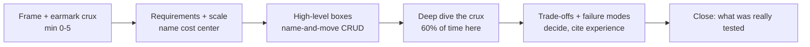

Keep this arc in your head. The systems below each instantiate it. Now the playbooks.

---

## Google Mode — Build It, Don't Name It

Google's single strongest system-design rule: **avoid "use a standard database and query it" — show how you'd BUILD the primitive from scratch.** Naming a managed product (S3, BigTable, a managed CDN) is fine *as a framing move*, but it can never be the answer. The credible staff form is: **"I'd reach for managed X because `<reason>`, but here's how I'd build it — the metadata index, the placement, the replication, the consistency protocol."** Discussing *why* a managed product would or wouldn't fit earns points; substituting its name for the engineering does not. Treat the product as a label for machinery you must still be able to draw. Full treatment in [Build From Scratch](21-build-from-scratch.md) and the [Google SD Playbook](26-google-sd-playbook.md).

| System | Tempting off-the-shelf answer | What to build / discuss from scratch instead |
|---|---|---|
| **YouTube** | "S3 + a CDN + ffmpeg" | The chunked blob store (metadata service + chunk servers, replication / erasure coding), the transcoding job queue + worker pool with **idempotent re-execution**, segment-based ABR packaging (HLS/DASH manifests), and edge cache placement / fill — explain the machinery, not the SKU. |
| **Netflix** | "managed CDN + S3 for masters" | The pre-positioning / open-connect appliance fill algorithm, popularity-driven catalog placement per PoP, per-title encode ladder, and origin-shield tiering to keep origin egress flat. |
| **Spotify** | "object store + a CDN for audio" | Audio chunk/segment store with predictive prefetch, the offline-license / DRM key flow, gapless-playback buffering, and edge cache eviction tuned to the long-tail catalog. |
| **Zoom** | "WebRTC + a managed SFU" | The SFU forwarding engine itself: subscription routing, simulcast/SVC layer selection per receiver, jitter-buffer + bandwidth estimation, and cascaded-SFU cross-region relay. |
| **Google Docs** | "a database with a `content` column + websockets" | The **OT or CRDT engine yourself**: operation transform/merge, the convergence + intention-preservation proof, tombstone GC, and the per-doc sequencer/log for ordering. |
| **Dropbox / Drive** | "sync files to S3" | **Content-addressable chunking** (rolling-hash dedup), the chunk/manifest metadata store, and the **sync / delta protocol** — diff computation, conflict resolution, and notify-then-pull change feeds. |
| **Gmail** | "a relational DB + full-text search product" | The append-only message store, the per-user inverted index for search (build it), thread reconstruction, the SMTP store-and-forward queue with retry/backoff, and idempotent delivery. |

> **Google-signal:** resolve every sub-problem with the **mechanism, not the product**. Pair it with the other Google reflexes: **detect-and-defend** each failure mode (chunk-server loss → re-replicate; transcode worker dies mid-job → idempotent retry; SFU region partition → cascade re-route), prefer a **coherent design over a locally-correct trade-off** (the pieces must compose), and make the **cross-DC / geographic NFRs explicit** — for media that means edge placement, geo-routing, and **content residency / data-locality** constraints. Saying "managed CDN" hides all of this; building it surfaces exactly the engineering they are scoring.

---

# 1. YouTube — Video Platform

## 1.1 Problem framing

Build a platform where users upload videos of arbitrary size/format, the system transcodes them into many resolutions and codecs, and billions of viewers stream them globally with adaptive quality and low startup latency. The system is **massively read-heavy** (views ≫ uploads), and the hard engineering is the **ingest/transcoding pipeline** and the **global delivery (CDN + adaptive bitrate)** path. Everything else (metadata, comments, recommendations) is a relatively standard read-heavy web stack.

The core mental model: **two pipelines that meet at object storage.** A *write pipeline* (upload → transcode → store many renditions) that is throughput-oriented and can be slow (minutes), and a *read pipeline* (manifest → segments → CDN) that is latency-oriented and must be fast (sub-second start).

> **Earmark — say this at minute five.** "The hard parts here are exactly two: **(A) the chunked parallel transcoding pipeline** — how a 3-hour 4K upload gets turned into 15 renditions reliably and fast — and **(B) global delivery via CDN + client-driven adaptive bitrate** — how I serve ~1.3 EB/day of egress without going bankrupt. The metadata, comments, subscriptions, and search are a boring read-heavy web stack; I'll name them and move on. View counting is a third, smaller hard part — a hot-key write problem I'll solve with sharded counters. Let me spend my time on A and B."

That earmark *is* the staff signal. It triages the question before drawing a box.

## 1.2 Requirements

**Functional**
- Upload a video (resumable, large files up to 100s of GB for creators).
- Transcode to a ladder of resolutions (144p → 4K/8K) and codecs (H.264, VP9, AV1).
- Stream with **adaptive bitrate (ABR)** over HLS/DASH.
- Generate thumbnails (auto + creator-uploaded) and a storyboard/scrubbing preview.
- View counts, likes, comments, subscriptions, search, recommendations.

**Non-functional**
| Dimension | Target |
|---|---|
| Scale | ~2B MAU, ~500 hrs uploaded/min, billions of views/day |
| Playback start latency | < 1–2 s (manifest + first segment from edge) |
| Rebuffer ratio | < 0.5% of playback time |
| Upload availability | High; uploads must be **durable** once acknowledged (11 9s via object store) |
| Consistency | Metadata: read-your-writes for the creator, eventual for the world. View counts: **approximate, eventually consistent** |
| Durability | Master + key renditions never lost; low-res renditions can be re-derived |

**Decisive scoping (don't enumerate — commit):**
- **Resumable direct-to-object-store upload** because creator files can be 100s of GB and app-tier proxying would melt the app tier; revisit only if we need server-side virus scanning inline (do it async instead).
- **Eventual consistency for the public view of metadata** because a new video appearing 2 seconds late globally is invisible to users; **read-your-writes for the creator** because they expect their own upload to show instantly.

## 1.3 Capacity estimation

State the cost center *first*, then derive it, so the math has a point.

**Upload/ingest**
- 500 hours/min uploaded = 500 × 60 = **30,000 video-seconds per real second** ingested.
- Raw source bitrate (creator upload, lightly compressed 1080p): ~10 Mbps avg.
- Ingest bandwidth ≈ 30,000 × 10 Mbps = **300 Gbps** of inbound just for source (bursty; provision ~2–3× for spikes).

**Transcoding compute**
- Each uploaded video is transcoded into ~6–8 renditions × 2–3 codecs ≈ ~15 outputs.
- Transcoding is roughly real-time-to-several-× per stream on a CPU core; with chunked parallelism you trade cores for latency. If a 10-min video uses ~50 cores for 2 min to hit all renditions, then **per minute of upload ≈ a few core-minutes × 15 renditions**. Across 500 hrs/min that's a farm of **tens of thousands of cores** continuously busy. This is why YouTube/Netflix build dedicated transcoding hardware/ASICs (YouTube's "Argos" VCU).

**Storage**
- Say 1 hour of 1080p H.264 ≈ ~2 GB. With the full ladder + multiple codecs, stored footprint per source hour ≈ ~4–6 GB (low-res is cheap, 4K/AV1 dominate).
- 500 hrs/min × 60 × 24 = **720,000 hrs/day** uploaded.
- 720,000 hrs/day × ~5 GB = **~3.6 PB/day** → **~1.3 EB/year** of new encoded video (plus masters). Storage tiering is mandatory.

**Read/delivery bandwidth (the real cost)**
- Billions of views/day; assume 1B hours watched/day at avg ~3 Mbps ≈ 1B × 3600 × 3 Mbit = **~10.8 Eb/day ≈ ~1.35 EB/day egress**. Egress is the dominant cost and the reason for a deep CDN/peering strategy.

**The ratio that frames the whole design:** egress (~1.35 EB/**day**) dwarfs new storage (~3.6 PB/day) by ~370×. So **every optimization that reduces bits-on-the-wire pays ~370× what a storage optimization pays.** That's why per-title encoding and AV1 (each ~30% fewer bits) matter so much, and why CDN offload is non-negotiable.

**Takeaway for the interview:** state up front that **egress bandwidth and transcoding compute are the cost centers**, and that the design optimizes both via CDN offload, codec efficiency (AV1 saves ~30% bits), and tiered storage. Saying "egress is 370× storage so I optimize bits-on-wire first" is the line that lands.

## 1.4 API design

```
# Upload — resumable, two-phase
POST   /v1/videos                      -> create video metadata, returns videoId + uploadUrl (presigned)
PUT    /v1/upload/{uploadId}           -> resumable chunk upload (Content-Range), to object store directly
POST   /v1/videos/{videoId}/finalize   -> mark upload complete, enqueue transcoding

# Read
GET    /v1/videos/{videoId}            -> metadata (title, owner, status, renditions)
GET    /v1/videos/{videoId}/manifest.m3u8   -> HLS master manifest (or .mpd for DASH)
GET    /cdn/.../segment_{n}.ts         -> media segment (served by CDN)

# Engagement
POST   /v1/videos/{videoId}/view       -> register a view (debounced, watch-time gated)
POST   /v1/videos/{videoId}/like
GET    /v1/feed                        -> recommendations
```

Key design choice: clients upload **directly to object storage via presigned URLs**, not through the app tier. The app tier only handles small metadata + auth; the bytes never traverse application servers. (This is the same instinct as Dropbox's block-vs-metadata split in §6 — keep big bytes off the control path.)

## 1.5 Data model

```
videos
  video_id (PK, partition key)   uuid
  owner_id                       indexed
  title, description, tags
  status                         {uploading, processing, ready, failed}
  duration_sec, created_at
  master_object_key              S3-style key for the source/mezzanine

renditions
  video_id (PK part) + rendition_id (sort)
  resolution, codec, bitrate
  manifest_key, segment_prefix

view_counts (approximate)
  video_id (PK)                  exact-ish counter, see deep dive
  view_count_approx
```

**Partition key choice:** `video_id`. Reads are always by `video_id` (you watch one video at a time), so hashing on it spreads load and avoids hot partitions. The exception is **hot videos** (a viral video on one partition) — solved at the *delivery* layer (CDN absorbs reads) and the *counting* layer (sharded counters), not by re-sharding metadata. Owner-centric queries ("my videos") use a secondary index or a separate `videos_by_owner` table.

> **Altitude cue.** This data model is commodity. Name it, show the partition-key reasoning (that's the one interesting decision), and move on. Do *not* spend three minutes on comment threading — it's a standard adjacency list, and it isn't what's being tested.

## 1.6 High-level architecture

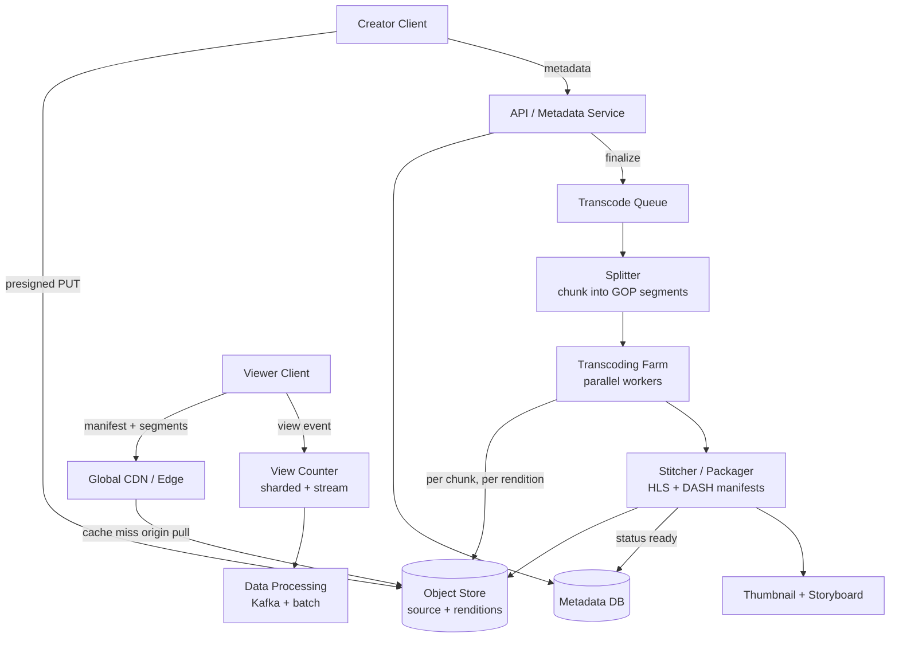

The two pipelines are visible: the write path (top, Client→OS→Split→Farm→Stitch) is slow and durable; the read path (bottom, Viewer→CDN→OS) is fast and cacheable. They meet only at the object store. This *is* the design.

## 1.7 Deep dive A — the transcoding pipeline (chunked, parallel)

> **This is hard part A. Spend real time here.** The whole question can be won or lost on whether you reach for chunk → fan-out → stitch with idempotency, or naively say "transcode the file."

This is the heart of a YouTube answer. The naive approach — "transcode the whole file on one big machine" — fails because (a) a 3-hour 4K video would take hours serially, and (b) a single machine failure loses all progress. The solution is **split → fan-out → stitch.**

**Step 1: Validation & mezzanine.** On `finalize`, the source is validated (codec, integrity) and optionally normalized into a high-quality intermediate ("mezzanine"/master) format. All renditions derive from this single, lossless-ish master so you never re-decode the lossy upload repeatedly. *Decision:* always produce a mezzanine because re-decoding the original for every rendition multiplies decode cost and compounds generation loss; skip only for tiny clips where the overhead isn't worth it.

**Step 2: Split into chunks at GOP boundaries.** The video is cut into independently-decodable segments — crucially, **on keyframe (GOP) boundaries** (typically 2–10 s each). Each chunk is a self-contained unit: it can be transcoded by any worker without needing neighboring frames. This is what makes parallelism correct; cutting mid-GOP would create artifacts at the seams because inter-frames (P/B-frames) reference frames that would land in a different chunk. **This GOP-boundary detail is the single most load-bearing sentence in the deep dive — say it explicitly.**

**Step 3: Fan-out to the transcoding farm.** Each (chunk × target rendition) pair becomes a task on a queue. A 10-min video → ~60 chunks × ~15 renditions = ~900 independent tasks. Workers pull tasks; a slow/dead worker just means its task is retried (idempotent — output keyed by chunk+rendition). This gives:
- **Massive parallelism:** a long video finishes in roughly the time of its longest chunk × ladder, not its full duration. A 3-hour video can be done in the time of a single ~10 s chunk's encode, given enough workers.
- **Fault isolation:** one bad chunk retries; the job doesn't restart. **Idempotency comes for free** because the output object key is a deterministic function of `(chunk_id, rendition_id)` — a retried task overwrites itself harmlessly.
- **Priority lanes:** premium/Shorts/livestream get fast lanes; back-catalog re-encodes (e.g., adding AV1) run on spare/preemptible capacity.

**Step 4: Stitch + package.** Per-chunk outputs are concatenated per rendition, then the **packager** wraps them into delivery formats: HLS (`.m3u8` + `.ts`/`fMP4`) and DASH (`.mpd`). It writes a **master manifest** listing all renditions (the ABR ladder) and per-rendition media playlists listing segment URLs.

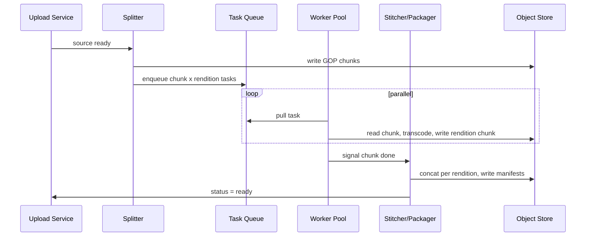

**Codec/ladder strategy (staff nuance):** Don't encode a fixed ladder for every video. **Per-title / per-shot encoding** analyzes content complexity — a static talking-head needs far fewer bits than fast sports — and picks bitrates that hit a target quality (VMAF) at minimum bits. This is the single biggest egress saver Netflix/YouTube deploy. *Decision:* per-title encoding because (from §1.3) egress is 370× storage so spending extra encode compute to shave bits is wildly net-positive; a fixed ladder only makes sense for low-view long-tail content where the encode cost won't be amortized. Mention VMAF and per-title encoding to signal depth.

**Failure modes to name proactively:**
- **Splitter produces a corrupt chunk?** That chunk's tasks fail validation and retry; only that chunk re-splits, not the whole video.
- **A rendition's encoder consistently OOMs on a pathological chunk?** Dead-letter the task, alert, and ship the video with the renditions that succeeded (graceful partial — 4K can be missing while 1080p ships).
- **Worker fleet is starved during a viral-upload spike?** Priority queue keeps interactive uploads ahead of back-catalog re-encodes; autoscale the farm; this is exactly where spot/preemptible capacity for non-urgent work buys headroom.

> **Cite experience.** "This is the same shape as a chat media pipeline — we chunked large attachment uploads and made each chunk's processing idempotent on a content key, so a worker dying mid-batch never corrupted state and retries were free. The GOP-boundary insight is the video-specific version of 'make your unit of work independently processable.'"

## 1.8 Deep dive B — delivery: CDN + adaptive bitrate (ABR)

> **This is hard part B — the cost center. This is where the money is. Spend time here.**

**The manifest is the API of streaming.** The player fetches the master manifest, sees the available renditions (e.g., 240p@0.4M, 480p@1M, 720p@2.5M, 1080p@5M), and **the client decides** which rendition to fetch for each ~2–10 s segment based on measured throughput and buffer level. This is ABR: the server is dumb (serves bytes), the client is smart (picks quality). HLS and DASH are both segment + manifest schemes; HLS dominates Apple, DASH is codec-agnostic — YouTube serves both.

*Decision:* **client-driven ABR over HLS/DASH because only the endpoint knows its instantaneous throughput and buffer health, and a dumb server caches trivially at the edge; revisit toward server-guided ABR (SAND / common-media-client-data hints) only if we need centralized control for DRM or content steering.**

**Why client-driven ABR wins:** the only entity that knows the real, instantaneous network conditions and buffer health is the client. Server-side switching can't react fast enough. The player's logic: start low (fast startup), ramp up if buffer fills and throughput is high, drop down before the buffer drains to avoid a rebuffer. The control law balances two competing objectives — **maximize quality** vs **minimize rebuffer** — and rebuffer is weighted far higher because users abandon on a stall, not on a slightly soft 720p.

**CDN tiering:** segments are immutable and cacheable forever (content-addressed by rendition+segment). Delivery is a multi-tier cache:
- **Edge PoP** (closest to user) — serves the long tail of hot content from RAM/SSD.
- **Regional/mid-tier cache** — absorbs edge misses, shields origin.
- **Origin (object store)** — pulled only on cold content.

Because the catalog is enormous, you can't cache everything everywhere. Hot content (new viral uploads, trending) lives at edges; cold content is fetched on demand. The **80/20 rule is extreme here** — a tiny fraction of videos drive most views, so edge cache hit rates exceed 95%. *This reactive-pull model is the explicit contrast with Netflix's proactive predictive fill (§2.7): YouTube's catalog is an unknown firehose, so it must cache on miss.*

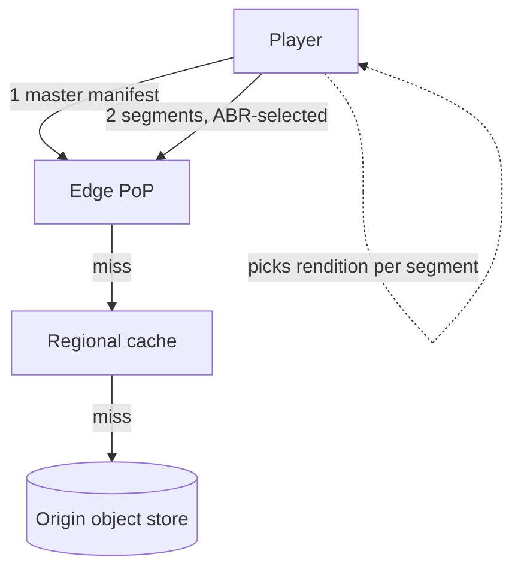

**Startup latency optimization:** serve the **lowest rendition first segment** instantly, prefetch the master manifest, keep the first few segments hot at the edge, and use **low-latency HLS/DASH** (chunked transfer / partial segments) for near-live. State the start-of-play budget: DNS + manifest + first segment, all from edge, < 1 s. The first segment being low-res is a deliberate trade: a slightly soft first two seconds that *starts instantly* beats a crisp first frame that takes three seconds to appear.

**Failure modes:**
- **Edge PoP down?** Player retries / falls back to another edge or a lower rendition; manifests are cheap to refetch and segments are content-addressed so any PoP serves them.
- **Origin stampede on a sudden viral video?** Mid-tier cache + request coalescing (collapse N concurrent misses for the same segment into one origin fetch) shields the origin — name request coalescing explicitly; it's the thing that prevents a thundering herd from melting origin.
- **Throughput collapses mid-stream?** ABR drops rendition before the buffer drains; if it can't keep even the lowest rendition fed, the player rebuffers (the metric we minimize) rather than failing.

## 1.9 Deep dive C — the view-count problem (approximate counting at scale)

> **Smaller hard part — name it as a hot-key write problem and solve decisively, don't agonize.**

Counting views *exactly* for a video getting 100K views/sec would hammer a single counter row — a classic **hot-key write** problem. You cannot do `UPDATE views SET count = count+1 WHERE id=...` at that rate; it serializes on one row.

Techniques (state the trade-off, then commit):
1. **Sharded counters:** maintain N counter shards per video (`count_0..count_N`); each increment hits a random shard; reads sum the shards. Spreads write contention by N×. Cost: read is a fan-out sum (cache it).
2. **Write to a stream, aggregate in batch:** view events go to Kafka, a stream/batch job (see [Data Processing](16-data-processing.md)) aggregates and periodically writes the count back. Counts are **eventually consistent** and slightly delayed — perfectly acceptable for a view count.
3. **Approximate cardinality for unique viewers:** use **HyperLogLog** to estimate unique viewers in fixed memory (~12 KB) with ~2% error, instead of storing every viewer ID.
4. **De-duplication / fraud:** a "view" is gated (e.g., ≥30 s watched, rate-limited per user/IP) to prevent inflation — the counting pipeline does dedup before incrementing.

*Decision:* **stream-to-Kafka + batch aggregation as the primary path, sharded counters only if we need a near-real-time displayed count; because a view count's business value of exactness is ~zero and the cost of strong consistency is enormous; revisit toward exact only for billing-relevant metrics (monetized impressions), which ride a separate strongly-consistent path.**

The staff insight: **view count is a place where you deliberately choose approximate + eventual over exact + strong.** Compare with the *like* count on the creator's own dashboard, where they expect read-your-writes — handled by a separate, smaller, strongly-consistent path. Naming *both* paths (cheap-eventual for the world, strong for the owner's own view) is the differentiator.

## 1.10 Scaling & bottlenecks
- **Transcoding farm** is the throughput bottleneck; solved by chunked parallelism, priority queues, spot/preemptible compute for back-catalog, and custom silicon (VCUs).
- **Egress** is the cost bottleneck (370× storage); solved by CDN offload, per-title encoding, and better codecs (AV1).
- **Hot videos** stress counters (sharded counters) and metadata reads (CDN + cache), never the DB directly for bytes.
- **Storage growth** is unbounded; tier aggressively (hot SSD → warm HDD → cold/archive for masters of unpopular videos). See [Storage](08-storage.md) for tiering mechanics.

## 1.11 Trade-offs & failure modes
- **Lose a low-res rendition?** Re-derive from master — cheap. **Lose the master?** Catastrophic — store masters with max durability/replication.
- **Transcoder crashes mid-job?** Idempotent chunk tasks retry; no full restart.
- **CDN edge down?** Player retries / falls back to another edge or lower rendition; manifests are cheap to refetch.
- **Counting pipeline lag?** Counts are stale, not wrong — acceptable.
- **Origin stampede?** Request coalescing + mid-tier shield.

## 1.12 What the interviewer is really testing
Can you **separate the slow durable write path from the fast cacheable read path**, design a **fault-tolerant parallel batch pipeline** (chunk/fan-out/stitch with idempotency), and reason about **where eventual consistency and approximation are correct choices**? The strongest signal is naming the real cost centers (egress at 370× storage, transcode compute) and optimizing them (CDN, per-title encoding, codecs) rather than over-engineering metadata. The *delivery* signal is earmarking A and B at minute five and visibly spending your time there.

---

# 2. Netflix — Video Streaming (VOD)

## 2.1 Problem framing

Netflix looks like YouTube but is a fundamentally different problem because the **catalog is curated, finite, and known in advance.** There are no user uploads; content is professionally produced and **pre-encoded offline at leisure**. That single fact flips the design: instead of a real-time transcoding farm racing the upload firehose, you have an **offline, quality-maximizing encode pipeline** and a delivery problem dominated by **predictive placement of a known catalog onto edge appliances close to ISPs (Open Connect).**

The interview pivot — *lead with this* — "How is this different from YouTube?" → Netflix optimizes **delivery and edge economics for a known catalog**; YouTube optimizes **ingest and transcoding throughput for an unknown firehose.** State that contrast in your first thirty seconds; it proves you understand both questions, not just one.

> **Earmark.** "Two hard parts: **(A) Open Connect predictive edge caching** — pre-positioning a known catalog inside ISP networks overnight, which is where Netflix's egress economics come from, and **(B) control-plane / data-plane separation + graceful degradation** — keeping playback alive even when cloud services wobble. Encoding is solved offline and is largely the YouTube per-title story without the time pressure; recommendations are an ML lecture the interviewer doesn't want. I'll spend my time on A and B."

## 2.2 Requirements

**Functional:** browse catalog, play any title with ABR, resume across devices, per-profile recommendations, multi-DRM, downloads for offline.

**Non-functional**
| Dimension | Target |
|---|---|
| Scale | ~250M+ subscribers, peak ~hundreds of Tbps global egress |
| Start latency | < 1 s; minimize rebuffer (the key UX metric) |
| Availability | Very high; degrade gracefully (lower bitrate) rather than fail |
| Consistency | Catalog/metadata eventual; billing strong; viewing position eventual-ish |

**Decisive scoping:** **degrade gracefully, never hard-fail** because a subscriber who sees a slightly worse row layout still watches, but a subscriber who sees an error screen churns; this principle drives the whole resilience design.

## 2.3 Capacity estimation
- Catalog: tens of thousands of titles. Each encoded into a full ABR ladder × multiple codecs × multiple audio/subtitle tracks → a title can be **hundreds of files**, total catalog **multiple PB**, but **bounded and known** — this is the key.
- Peak concurrent streams: tens of millions. At ~4 Mbps avg → tens of millions × 4 Mbps = **hundreds of Tbps** at peak. This is why Netflix is a huge fraction of internet traffic and must push bytes *inside ISP networks*.
- Because the catalog is finite, you can **pre-position the entire popular catalog at every major edge** — cache hit rates approach ~95–100% for the hot set, and origin/internet-transit traffic is minimized.

**The number that justifies Open Connect:** hundreds of Tbps of egress, if hauled across paid transit/peering, is a budget-ending cost. Moving it inside the ISP (where the ISP *wants* it, because it saves *them* transit too) converts the single biggest line item into commodity local delivery. That economic argument *is* the design rationale — say it.

## 2.4 API design

```
GET  /v1/browse?profile=...           -> personalized rows (control plane / AWS)
GET  /v1/titles/{id}                   -> metadata + available renditions
GET  /v1/play/{id}                     -> licensing + steering: returns manifest URL + best Open Connect server
GET  <oca>/.../manifest                -> served from Open Connect Appliance (data plane)
GET  <oca>/.../segment_{n}             -> media segment (data plane, in-ISP)
POST /v1/telemetry                     -> QoE metrics (rebuffer, bitrate) back to control plane
```

The crucial split: **control plane lives in the cloud (AWS); data plane lives in Open Connect.** A play request hits AWS for auth/licensing/steering, which returns *which OCA* and *which manifest*; the actual video bytes never touch AWS. This is the same plane-separation instinct as Zoom's signaling-vs-media split (§4.4) — recognize it as a recurring pattern.

## 2.5 Data model (catalog-centric)

```
titles            title_id (PK), name, type, metadata, encode_profile_id
encodes           title_id + rendition_id, codec, bitrate, drm, file_key
viewing_state     profile_id + title_id, position_sec, updated_at   (eventual)
oca_placement     title_id + oca_id, present?, popularity_rank      (driven by predictive caching)
```
**Partition key:** `title_id` for catalog (read by title). `viewing_state` partitions on `profile_id` (a profile reads its own resume points). The `oca_placement` table is the materialized output of the fill planner — it's the bridge between control and data planes.

## 2.6 High-level architecture

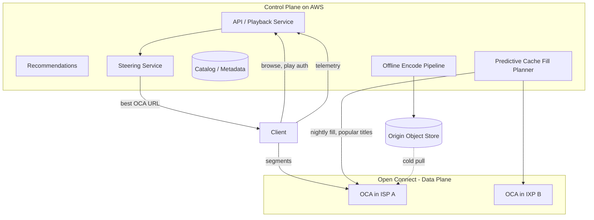

## 2.7 Deep dive A — Open Connect: predictive edge caching (the bulk)

> **This is hard part A and the differentiator from YouTube. Spend the most time here.**

**Open Connect Appliances (OCAs)** are Netflix-built caching servers placed **inside ISP networks and at internet exchange points (IXPs)**, for free, by agreement with ISPs. The strategic insight: it is cheaper for everyone to serve Netflix bytes from a box *inside* the ISP than to haul them across expensive transit/peering links. This converts Netflix's biggest cost (egress) into commodity local delivery.

**Predictive / proactive cache fill — the core idea.** Because the catalog is known and viewing patterns are predictable, Netflix **fills OCAs during off-peak hours (overnight)** with the content it predicts will be watched in each region the next day. This is the opposite of YouTube's reactive pull-on-miss CDN:
- A new season launching tomorrow is pushed to every relevant OCA tonight, so launch-day traffic is served entirely locally with **no origin stampede** — contrast YouTube §1.8, where a surprise viral video *does* stampede origin and must be shielded reactively.
- Popularity is regional and time-shifted; the fill planner ranks titles per OCA and fills to capacity by predicted regional popularity (a title huge in Brazil may be cold in Korea).
- During peak hours, OCAs **only serve, never fill** — no fill traffic competes with playback. Fill is a strictly off-peak activity.

This **trades storage and overnight bandwidth (cheap) for peak egress and rebuffer (expensive)** — a textbook example of moving cost from a constrained resource to an abundant one.

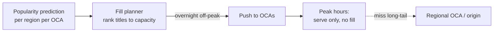

**Steering (server selection).** When a client plays, the steering service picks the best OCA using: which OCAs have the title, network proximity (BGP/topology, same ISP), current OCA load/health, and the client's measured throughput. It returns a **ranked list** so the client can fail over. If the local OCA lacks a title (rare, long-tail), it falls back to a regional OCA or origin.

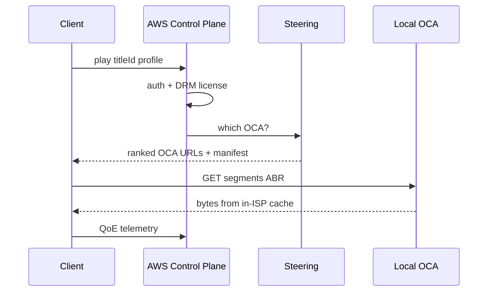

**Failure modes:**
- **Mispredicted fill (surprise viral title not pre-cached)?** First viewers in a region take a regional/origin pull (slower start) that warms the local OCA; thereafter it's local. Graceful, self-healing.
- **OCA hardware failure?** Steering's health signal drops it from the ranked list; clients are steered to the next-best OCA. The ranked-list design *is* the failover mechanism.
- **Fill didn't complete before peak?** Planner prioritizes the highest-predicted-popularity titles first, so a partial fill still covers most demand; the tail spills to regional.

## 2.8 Deep dive B — control plane vs data plane + microservices/chaos

> **This is hard part B — resilience. The staff line here is "failure is constant, design for graceful degradation, not failure avoidance."**

**Separation of planes** is the architectural backbone:
- **Control plane (AWS):** stateless microservices for browse, search, recommendations, auth, licensing, steering, A/B testing, billing. Scales elastically; can tolerate partial failure with **graceful degradation** (e.g., serve a generic row if the personalization service is down).
- **Data plane (Open Connect):** dumb, fast, cacheable byte delivery. Decoupled from cloud availability — **even if a control-plane service degrades, in-flight playback continues because bytes flow from OCAs.** The play already has its manifest and OCA URL; it doesn't need the cloud again until the next title.

**Microservices + resilience.** Hundreds of services behind an API gateway, communicating async where possible, with **circuit breakers, bulkheads, timeouts, and fallbacks** (the Hystrix pattern). The famous **Chaos Engineering** practice (Chaos Monkey killing instances in production) forces every service to be resilient by default.

*Decision:* **graceful degradation over failure avoidance because at this scale instances die constantly and dependencies wobble continuously, so the only viable posture is "every dependency can fail and the critical path survives"; never let a non-critical dependency (recommendations) take down a critical path (playback).** The concrete mechanism: recommendations is a *fallback-able* dependency — if it times out, serve a cached/editorial row and move on; playback never calls it on the hot path.

> **Cite experience.** "In real-time chat we ran the same posture — presence and read-receipts are best-effort dependencies that must never block message delivery. We wrapped them in circuit breakers with cheap fallbacks, because the one time presence-service latency leaked onto the send path, it took down messaging during an incident. Plane separation is the same discipline: never couple the thing that *can* fail to the thing that *can't*."

## 2.9 Deep dive C — encoding & recommendations (name and move on)
- **Encoding:** offline, leisurely, quality-maximizing. **Per-title and per-shot encoding** with VMAF targets — because there's no time pressure, Netflix invests heavily to minimize bits at a quality target, directly cutting delivery cost. Multiple codecs (H.264/HEVC/AV1) per device class. This is the YouTube §1.7 story minus the latency pressure — name the overlap and don't re-derive it.
- **Recommendations:** the homepage *is* the product — personalized rows, ranked per profile, A/B tested relentlessly. Mention collaborative filtering + learned ranking, but **keep it brief**; the interviewer wants delivery depth, not an ML lecture. *Altitude:* one sentence, then back to the crux.

## 2.10 Scaling, trade-offs, failure modes
- **Bottleneck:** peak egress → solved by in-ISP OCAs + predictive fill. **Long-tail titles** not on local OCA → regional/origin fallback (acceptable, rare).
- **Control plane outage:** browsing degrades, but playback in progress survives (plane separation). New plays may fail → degrade gracefully.
- **Mispredicted fill:** a surprise viral title not pre-cached → origin pull / regional cache absorbs it (slower start until warm).
- **Trade-off:** Netflix spends storage + overnight bandwidth to buy peak performance; YouTube can't (unknown catalog) so it caches reactively. *This is the single most important contrast to articulate.*

## 2.11 What the interviewer is really testing
Do you recognize that **a known, finite catalog enables proactive placement** and that **plane separation + edge economics** are the levers? The differentiator vs a junior answer is articulating *predictive caching* (and why it beats reactive pull *for a known catalog*) and *control/data plane decoupling*, and reasoning about cost (transit vs in-ISP delivery) and resilience (chaos, graceful degradation) — not just "use a CDN." The delivery signal is leading with the YouTube contrast.

---

# 3. Spotify — Music Streaming

## 3.1 Problem framing

Music streaming is **video streaming's easier cousin on delivery** (audio files are small — a song is ~3–10 MB, vs GB for video) but a **harder problem on metadata, personalization, and instant playback feel.** The defining UX requirement is **gapless, instant playback** — tapping a song must start audio in well under a second, including when skipping. The signature feature, **Discover Weekly**, is a recommendation/discovery problem at the scale of a 100M+ track catalog and 600M+ users.

> **Earmark — and reframe the obvious.** "The trap here is treating this like YouTube and spending time on audio delivery — but audio is tiny and CDN-cacheable, it's essentially solved. The two hard parts are actually **(A) instant playback feel via prefetch** — exploiting the strong sequential predictability of a play queue — and **(B) the multi-signal recommendation/discovery engine** behind Discover Weekly. I'll name the delivery in one sentence and spend my time on A and B." Reframing away from the obvious-but-wrong crux is itself a staff signal.

## 3.2 Requirements

**Functional:** play any track with instant start; playlists (create/share/collaborative); search; offline downloads; **personalized discovery** (Discover Weekly, Radio, recommendations); cross-device handoff; social (follow, shared playlists).

**Non-functional**
| Dimension | Target |
|---|---|
| Scale | ~600M users, ~100M tracks, billions of streams/day |
| Playback start | < ~250–500 ms perceived (prefetch makes it feel instant) |
| Availability | High; offline mode means client works without network |
| Consistency | Playback eventual; playlist edits read-your-writes for the editor |

## 3.3 Capacity estimation
- Catalog: ~100M tracks × ~3 encodings (e.g., 96/160/320 kbps) × ~5 MB ≈ **~1.5 PB** of audio. Small and bounded vs video → the **entire hot catalog fits in CDN edges easily**, and even cold tracks are cheap to serve. Audio delivery is essentially a solved CDN problem.
- Streams: billions/day, but each is small. Egress is modest compared to video — *this is why delivery is not the crux.*
- The scale pressure is on **metadata + personalization**: 600M users × dozens of playlists × billions of track-play events feeding the recommendation pipeline. **Event volume (every play, skip, like) is the big-data firehose**, not the audio bytes. At billions of events/day this is ~tens of thousands of events/sec sustained — a Kafka-scale stream, and *that's* where the engineering lives.

## 3.4 API design

```
GET  /v1/tracks/{id}                 -> metadata + stream URLs (per bitrate)
GET  /v1/audio/{id}/{bitrate}        -> audio file/segments (CDN)
GET  /v1/me/playlists                -> user playlists
POST /v1/playlists/{id}/tracks       -> add track (collaborative -> realtime fanout)
GET  /v1/discover/weekly             -> personalized playlist
POST /v1/events                      -> play/skip/like telemetry (firehose -> Kafka)
GET  /v1/search?q=...
```

## 3.5 Data model

```
tracks      track_id (PK), title, artist_id, album_id, duration, audio_keys{bitrate->key}
playlists   playlist_id (PK), owner_id, name, collaborative?
playlist_tracks  playlist_id + position (sort), track_id
user_library  user_id (PK) + track_id, added_at
events (stream)  user_id, track_id, action{play,skip,seek,complete}, ts, context
```
**Partition keys:** `track_id` for catalog reads; `playlist_id` for playlist reads; `user_id` for library; events partitioned by `user_id` (or track for aggregation) in Kafka. Playlists read-by-owner → partition by owner for "my playlists."

## 3.6 High-level architecture

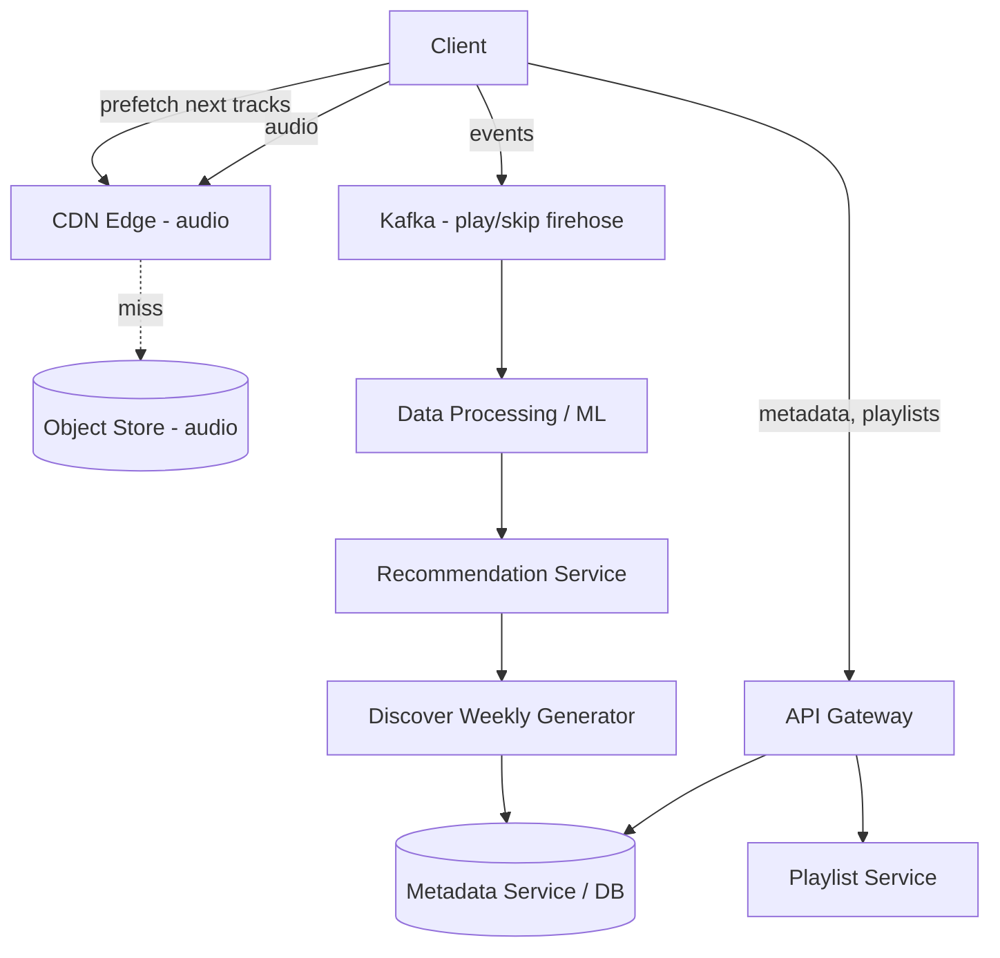

## 3.7 Deep dive A — instant playback: caching, prefetch, low-latency

> **Hard part A. The staff insight is "the latency budget is met by prediction, not by making the network faster."**

The "instant" feel is engineered:
1. **Prefetch the next track(s).** Within a playlist/album/radio queue, the client predicts and **pre-downloads the beginning of upcoming tracks** (and often the whole next track) before you press skip/next. The audio is already local when you tap. *This is the whole trick* — you exploit the fact that a play queue is strongly sequentially predictable.
2. **Start the current track from a small prebuffer.** Begin playback after a few hundred KB are buffered; continue fetching in the background. Audio at 320 kbps = 40 KB/s, so a couple seconds of buffer is tiny (~80 KB).
3. **Aggressive client + CDN caching.** Recently/likely-played tracks are cached on-device (LRU) and at the edge. Because the catalog is small and per-user listening is repetitive, cache hit rates are very high.
4. **Adaptive bitrate (lighter than video).** Pick 96/160/320 kbps by network and user tier; audio ABR is simpler — switching is rare and seamless because the bitrate gaps are small and a whole track easily buffers.

*Decision:* **aggressive prefetch of the queue head over network optimization, because the queue is sequentially predictable and prefetch hides latency entirely; revisit only for truly random-access surfaces (search-then-play a single obscure track) where there's nothing to predict — there you optimize first-byte latency instead.**

> **Cite experience.** "This is the same lever as preloading the next page of a chat history before the user scrolls — predictable sequential access means you fetch ahead and the user never waits. The win comes from the *access pattern*, not from a faster pipe."

## 3.8 Deep dive B — the recommendation / discovery engine (Discover Weekly)

> **Hard part B. Name all three signals — naming collaborative filtering AND its cold-start weakness AND the content-based fix is the differentiator.**

Discover Weekly blends multiple signals:
1. **Collaborative filtering (the core).** Build a huge user×track interaction matrix from play/skip/save events; factorize it (matrix factorization / embeddings) so users and tracks live in the same latent space. Recommend tracks whose embeddings are near a user's taste vector — i.e., "users like you also loved." This is the workhorse: find tracks in playlists/listening histories of taste-similar users that *you* haven't heard.
2. **Content-based (audio) analysis.** Analyze the raw audio (tempo, timbre, energy, learned embeddings) so new/obscure tracks with little interaction data can still be recommended (**cold start**). Complements CF, which *cannot* recommend an unplayed track. Naming this as the fix for CF's cold-start hole is the staff move.
3. **NLP / cultural signals.** Mine the web, blogs, and playlists for how tracks/artists are described, capturing context CF and audio miss.

Pipeline: the **event firehose (Kafka) → batch/stream processing → model training → precomputed per-user recommendation playlists** (Discover Weekly is generated weekly as a batch job, stored, then served). See [Data Processing](16-data-processing.md) for the batch/stream split.

*Decision:* **precompute Discover Weekly as a weekly batch job rather than computing recommendations online, because the freshness requirement is "weekly" by product definition and batch is far cheaper than real-time inference per request; the lighter, online Radio path uses a cheaper model for real-time personalization. You trade freshness for cost, matched to the product's actual freshness need.**

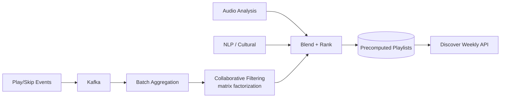

## 3.9 Deep dive C — offline downloads & metadata scaling
- **Offline:** download encrypted audio + a license to the device; client plays locally with DRM, enforcing subscription validity (periodic re-check). Sync playback state when back online.
- **Metadata scaling:** the metadata graph (tracks/artists/albums/playlists/relationships) is read-heavy and highly cacheable. Serve from a cache tier ([Caching](03-caching.md)) over a partitioned store; collaborative playlists need realtime fanout of edits to co-editors (a lightweight pub/sub, see [Real-Time](09-realtime-systems.md)). *Altitude:* this is commodity caching — name it, move on.

## 3.10 Scaling, trade-offs, failure modes
- **Bottleneck:** not audio egress (small, cacheable) but the **event/personalization pipeline** and **metadata read fanout**.
- **Trade-off:** Discover Weekly is **precomputed weekly (batch)** — fresh recommendations cost compute; real-time personalization (Radio) uses lighter online models. You trade freshness for cost.
- **Cold start:** new users/tracks lack interaction data → lean on content-based + popularity.
- **Failure:** recommendation service down → fall back to editorial/popular playlists; playback unaffected (separate path — the same plane-separation discipline as Netflix).

## 3.11 What the interviewer is really testing
Recognizing that **audio delivery is the easy part** (and *saying so* to reframe away from the obvious crux), then steering depth toward **prefetch-driven instant playback** and a **multi-signal recommendation pipeline** (CF + content + NLP, batch-precomputed). Naming collaborative filtering *and* its cold-start weakness (fixed by content-based audio analysis) is the staff-level signal.

---

# 4. Zoom — Video Conferencing

## 4.1 Problem framing

Video conferencing is a **real-time, low-latency, many-to-many media** problem — the opposite of YouTube's store-then-stream. Media must flow with **<150–200 ms end-to-end latency** for natural conversation, there is no time to transcode-then-cache, and the central architectural decision is the **media topology: Mesh vs MCU vs SFU.** Get the SFU right and you've answered the question.

> **Earmark.** "This is the most 'do you actually understand real-time media' question in the set. The crux is one decision — **(A) the media topology, Mesh vs MCU vs SFU**, and the mechanism that makes the winner work, **simulcast/SVC**. Secondary: **(B) network adaptation under loss/jitter** and audio-first degradation. The signaling REST endpoints and meeting-state CRUD are plumbing — I'll name them and spend 60% of my time on the topology decision."

This is the cleanest example in the module of **risk-weighting**: one decision is most of the answer.

## 4.2 Requirements

**Functional:** multi-party audio/video calls; screen share; mute/video toggle; recording; chat; large webinars (thousands of viewers); network adaptation (it must work on bad WiFi).

**Non-functional**
| Dimension | Target |
|---|---|
| Latency | Mouth-to-ear < ~150 ms ideal, < ~300 ms acceptable |
| Scale | Millions of concurrent meetings; meetings of 2 → thousands |
| Quality | Adapt to packet loss/jitter; degrade video before audio |
| Availability | Reconnect seamlessly; survive a server failure mid-call |

## 4.3 Capacity estimation
- A single video stream ≈ ~1–2.5 Mbps (HD). In an N-person call, each participant *sends* 1 stream up and must *receive* up to N−1 streams down.
- **Mesh:** each client sends N−1 copies → upload = (N−1) × stream. At N=10 that's ~9× upload — a client's uplink dies fast. Mesh only works for ~2–4 people.
- **SFU:** each client sends **1** stream up; the SFU forwards copies. Client upload stays at 1× regardless of N. Server downlink per participant ≈ (N−1) streams.
- Server bandwidth for one SFU meeting of N: it receives N streams and sends ~N×(N−1) streams. At N=25, ~25 in, ~600 out — this is why SFUs are bandwidth-heavy servers and why **simulcast/SVC** is needed to keep it sane (you forward a *low* layer to most receivers, not full HD to everyone).

This N×(N−1) fan-out is the WORST-CASE all-to-all full-rate upper bound — the number that makes the topology decision concrete; quote it, but note selective forwarding (§4.7 simulcast/SVC) cuts it hard in practice (forward a low layer to most receivers, full HD to none-or-few).

## 4.4 API / protocols

```
Signaling (WebSocket / HTTPS) — control plane:
  POST /meetings                 -> create meeting
  WS   /signal                   -> join, SDP offer/answer, ICE candidates, mute events, participant list

Media (WebRTC) — data plane:
  SRTP over UDP (DTLS-encrypted) -> audio/video packets to/from SFU
  RTCP                           -> feedback: packet loss, NACK, PLI (keyframe request), REMB/TWCC (bandwidth)
```

**Signaling vs media split (critical concept):** signaling is the *control plane* — establishing who's in the call, exchanging SDP (codec/capability negotiation) and ICE candidates (network paths via STUN/TURN) over a reliable channel (WebSocket). Media is the *data plane* — SRTP packets over UDP, prioritizing low latency over reliability (a late packet is useless; drop it). The two never mix. This is the same control/data plane discipline as Netflix Open Connect (§2.7) — recognize the recurring pattern.

## 4.5 Data model

```
meetings        meeting_id (PK), host_id, sfu_node, started_at, settings
participants    meeting_id + user_id, role, media_state{audio,video,screen}, connection_id
recordings      meeting_id, status, storage_key      (post-processing pipeline)
```
State is mostly **ephemeral/in-memory** (a live call), with durable records for scheduling, billing, and recordings. Partition by `meeting_id` — a meeting is the unit of locality (all its participants on the same SFU/cluster). *Altitude:* this is trivial; name it and move to the topology.

## 4.6 High-level architecture

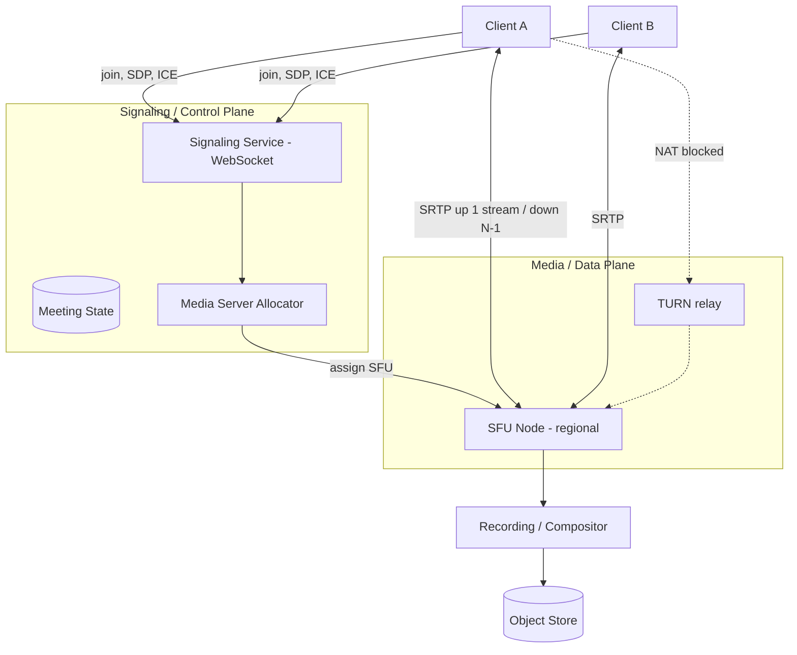

## 4.7 Deep dive A — SFU vs MCU vs Mesh (the core decision)

> **This is the crux. 60% of the answer. The decision plus the simulcast/SVC mechanism is what's being tested.**

| Topology | How media flows | Client uplink | Server CPU | Server bandwidth | Good for |
|---|---|---|---|---|---|
| **Mesh (P2P)** | Every client sends directly to every other | (N−1)× (terrible) | none (no server) | none | 2–4 people |
| **MCU** | Server **decodes all streams, composites into one**, re-encodes, sends 1 stream to each | 1× | very high (decode+mix+encode) | low downlink | Low-end clients, telephony bridges |
| **SFU** | Server **forwards** (routes) each stream to others **without decoding** | 1× | low (just routing) | high downlink | Modern WebRTC conferencing (Zoom-style) |

*Decision:* **SFU + simulcast as the default because it keeps client uplink at 1× (solving the mesh uplink explosion) while avoiding the MCU's per-meeting transcode CPU (which doesn't scale and adds latency); revisit toward MCU only for very weak clients or telephony bridges that genuinely cannot decode N streams, and toward mesh only for 2-person calls where a server is pure overhead.**

**Why SFU is the modern default (deep):**
- **Client uplink stays at 1×** — solves the mesh uplink explosion.
- **Server doesn't transcode** — it only selectively *forwards* RTP packets, so CPU per participant is low and a node scales to many participants/meetings. (Contrast MCU, which must decode+mix+encode every stream — CPU-bound, doesn't scale, adds latency, but produces one composited stream that's friendly to weak clients.)
- **"Selective"** is the key word: the SFU decides *which* streams and *which quality layers* to forward to each receiver based on their bandwidth and what's on screen (e.g., don't send full-res video of someone not currently visible — only the active speaker and visible tiles get high quality).

**Simulcast & SVC — how the SFU forwards the right quality without transcoding (the mechanism):**
- **Simulcast:** the sender encodes its camera into **multiple independent resolutions/bitrates simultaneously** (e.g., 180p, 360p, 720p) and sends all of them up. The SFU **picks which layer to forward** to each receiver based on that receiver's downlink — full HD to a strong network, 180p to a weak one — *without any transcoding*. This is the trick that lets a non-transcoding router still do quality adaptation. The cost is the sender's extra uplink and encode for the redundant layers.
- **SVC (Scalable Video Coding):** a single layered bitstream where higher layers refine lower ones; the SFU **drops upper layers** to downgrade. More bandwidth-efficient than simulcast (no redundant encodes) and more robust, at the cost of codec/CPU complexity on the encoder.

*Decision between them:* **simulcast for broad device compatibility (it works with any codec); SVC when the codec supports it and you want to cut the sender's redundant-layer overhead.** Name both; commit to simulcast as the safe default and SVC as the optimization.

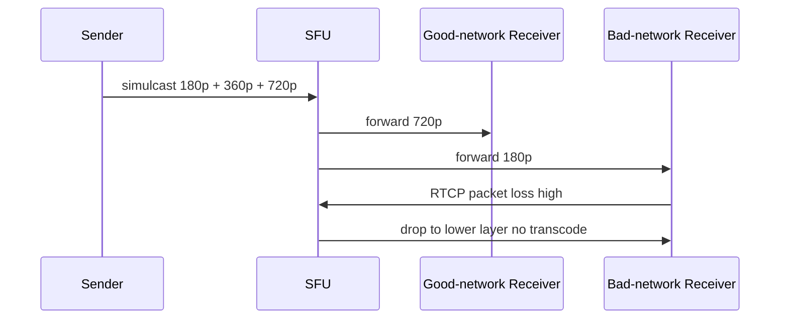

## 4.8 Deep dive B — network adaptation, jitter, loss

> **Hard part B. The staff line: "audio is sacred — degrade video before audio."**

Real networks lose and reorder packets; UDP doesn't retransmit by default. Techniques (name several, then state the degradation order):
- **Jitter buffer:** a small adaptive buffer absorbs variable arrival timing so playback is smooth; trades a few ms of latency for stability.
- **NACK + selective retransmission:** for important packets, request a resend — but only if it'll arrive in time; otherwise skip (late = useless).
- **PLI/FIR (keyframe request):** on bad corruption, ask the sender for a fresh keyframe to resync decoding.
- **FEC (Forward Error Correction):** send redundant data so some loss is recoverable without a round-trip.
- **Bandwidth estimation (TWCC/REMB):** continuously estimate available bandwidth and tell senders to raise/lower bitrate.
- **Graceful degradation order:** drop video resolution/framerate *before* audio — **audio is sacred** in a conversation; a frozen video is tolerable, choppy audio is not.

*Decision:* **UDP + jitter buffer + selective NACK/FEC, never blocking on retransmission, because in real-time media a late packet is worthless so reliability must be best-effort and time-bounded; and when bandwidth collapses, sacrifice video before audio because conversation survives on audio alone.**

## 4.9 Deep dive C — scaling, global routing, recording
- **Global media routing:** assign each meeting to an SFU **geographically close to its participants**; for globally spread meetings, **cascade SFUs** (SFU-to-SFU forwarding across regions) so each participant talks to a nearby node and inter-region traffic is one hop, not N. This bounds latency and keeps per-node fanout manageable. *Decision:* cascade because a single central SFU would force half the planet onto a long-latency path; revisit only for small single-region meetings where one SFU suffices.
- **Large webinars (thousands of viewers):** a few active speakers go through the SFU in real time; passive viewers receive a **fan-out tree of SFUs** or even switch to an **HLS/low-latency stream** for the audience portion (back to the YouTube model for one-way viewers). Interactive core + broadcast edge — this hybrid is the staff answer for the "scale to thousands" twist.
- **Recording:** a server-side participant (a "bot") joins, the SFU forwards it all streams, and a **compositor** lays them out and encodes a single MP4 (this *is* an MCU-style mix, done off the hot path) → stored in object storage and post-processed (transcripts, etc.). Note the elegance: you use MCU-style mixing *only* off the latency-critical path.
- **Failure of an SFU node:** signaling detects the drop and **re-allocates the meeting to another SFU**; clients re-ICE and reconnect within seconds. Meeting state is light enough to re-establish (it's ephemeral, in §4.5).

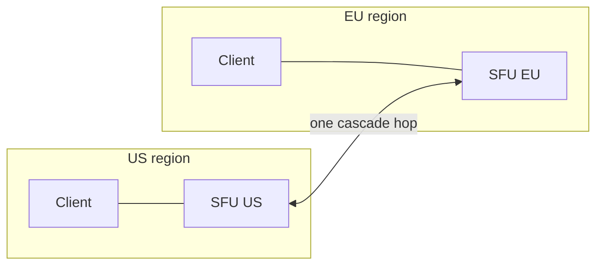

## 4.10 Trade-offs & failure modes
- **SFU vs MCU:** SFU = low server CPU, high downlink, N streams to decode on client (weak clients struggle); MCU = high server CPU, weak-client-friendly, more latency. Zoom-scale uses SFU + simulcast, with selective layer forwarding to protect weak receivers.
- **Latency vs reliability:** UDP + jitter buffer + selective NACK/FEC — never block on retransmission.
- **TURN relay:** when NAT/firewall blocks P2P/UDP, fall back to a **TURN relay** (and TCP/443 as last resort) — works everywhere but adds a hop. Provision TURN generously; in practice a meaningful fraction of clients are behind symmetric NAT and *require* it.

## 4.11 What the interviewer is really testing
Do you know the **media topologies and *why* the SFU dominates** (client uplink 1×, no server transcode), and can you explain **simulcast/SVC** as the mechanism for quality adaptation without transcoding? Plus the **signaling/media plane split**, **audio-first degradation**, and **geographic SFU routing/cascading**. This is the single most "do you actually understand real-time media" question — and the delivery signal is *risk-weighting hard*: putting 60% of your time on the one decision that is 60% of the answer.

---

# 5. Google Docs — Collaborative Editing

## 5.1 Problem framing

Multiple users edit the **same document simultaneously**, each sees others' changes within ~100 ms, and despite concurrent conflicting edits, **everyone's document converges to the identical final state.** The hard core is the **concurrency-control algorithm: Operational Transformation (OT) vs CRDTs.** This is a consistency/convergence problem, not a scale problem (a single doc has few editors), so the depth lives entirely in the algorithm and the document model.

> **Earmark.** "This question is *almost entirely* about one thing — **(A) the convergence algorithm, OT vs CRDT** — and I want to flag the part I'm worried about up front: getting transformation correct for concurrent insert/delete, and (for CRDT) tombstone garbage collection. There is no scale crux here — a doc has ~10 editors — so I'm not going to talk about sharding throughput. Secondary parts are **(B) offline merge and the op-log-as-history**. I'll spend almost all my time on A."

Naming the worry (transformation correctness, tombstone GC) *before* solving it is the leadership move from primer rule 5.

## 5.2 Requirements

**Functional:** real-time concurrent editing; live cursors/presence; offline edits that sync on reconnect; full version history/undo; comments/suggestions; access control/sharing.

**Non-functional**
| Dimension | Target |
|---|---|
| Latency | Local edits instant (optimistic); remote edits visible < ~100–200 ms |
| Consistency | **Strong convergence** — all replicas reach identical state |
| Scale | Per-doc: small (a handful of concurrent editors). Global: hundreds of millions of docs |
| Availability | Edit offline; never lose a keystroke |

## 5.3 Capacity estimation
- Per document the concurrency is tiny (rarely >10–20 simultaneous editors), so the algorithm doesn't need to scale to thousands of writers — it needs to be **correct**. *Say this explicitly:* the scale axis is breadth (many docs), not depth (many writers per doc), which is why the engineering is the algorithm, not the throughput.
- The scale is **breadth**: hundreds of millions of docs, each a small object + an operation log. Shard by `doc_id`; each doc is an independent unit handled by one authoritative coordinator at a time.
- Op rate per doc: humans type ~5–10 chars/sec each; even 10 editors = ~100 ops/sec — trivial throughput, but every op must be transformed/merged correctly and in order.

## 5.4 API design

```
WS   /docs/{id}/session         -> join editing session (presence, cursor broadcast)
WS   send: {revision, op}       -> submit an operation against a known server revision
WS   recv: {revision, op}       -> receive transformed remote ops + new revision
GET  /docs/{id}                 -> load snapshot + recent ops
GET  /docs/{id}/history         -> version history
POST /docs/{id}/share           -> permissions
```
The protocol is **op-based and revision-numbered**: a client sends an op tagged with the server revision it was based on; the server transforms it against any ops it has since seen, applies it, assigns a new revision, and broadcasts.

## 5.5 Data model

```
documents     doc_id (PK), title, owner_id, current_revision, snapshot_ref
operations    doc_id + revision (sort), client_id, op (insert/delete with position+content), ts
snapshots     doc_id + revision, content        (periodic, to avoid replaying all ops)
acl           doc_id + principal, role
presence      doc_id -> {user, cursor_pos, selection}   (ephemeral, in-memory)
```
The document is **content + an append-only operation log**; periodic **snapshots** let you load without replaying every op since creation. Partition by `doc_id`.

## 5.6 High-level architecture

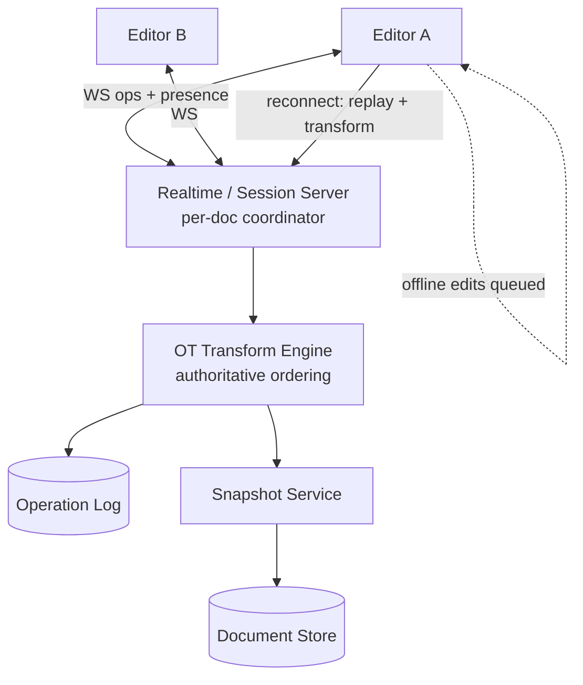
A given document is served by a **single authoritative coordinator** (the session server) that imposes a total order on operations — this serialization point is what makes OT tractable. *This single-coordinator-per-doc choice is load-bearing for the OT decision below.*

## 5.7 Deep dive A — OT vs CRDT (the convergence problem)

> **The crux. Walk the concrete insert/delete example, pick OT, and justify it from the topology. "Topology dictates the choice" is the staff sentence.**

**The convergence problem.** Two users edit "ABC" concurrently: User 1 inserts "X" at position 0 → "XABC"; User 2 deletes the char at position 0 → "BC". If you naively apply each op as-received at the other replica, the *positions are now wrong* — User 2's "delete position 0" was meant for the old "ABC", not for the new "XABC". Applied blindly, replicas diverge. The whole field exists to fix this: make concurrent ops commute to the **same final state regardless of arrival order.**

### Operational Transformation (OT) — what Google Docs uses
**Idea:** when an op arrives that was generated against an older state, **transform** it against the ops that have happened since, adjusting its parameters (e.g., shift an insert's position) so it applies correctly to the current state.

- Op A = insert "X" @0; Op B = delete @0, both based on "ABC".
- Server applies A → "XABC" at revision r+1.
- B arrives based on revision r. Server **transforms B against A**: since A inserted a char at position 0, B's delete position shifts by +1 → delete @1 → "XBC".
- Every replica, applying ops in the server's order with transforms, converges to "XBC".

**Why Google uses OT (decide from the topology):**
- It pairs naturally with a **central server that imposes a total order** — Google Docs already has an authoritative coordinator per doc, so the "hard" part of OT (the transformation function for every op-pair) is manageable and you avoid OT's notorious complexity in fully peer-to-peer settings.
- The data model is compact: positions + a log of small ops. **No per-character metadata overhead** (the CRDT tax).
- It was the mature, proven approach when Docs was built (Jupiter/Wave lineage), tuned for the central-server topology.

**OT's weakness:** the transformation functions are **subtle and hard to get correct** for rich content (formatting, tables); a fully decentralized OT (no central order) is extremely hard to prove correct. OT essentially *requires* a serialization point.

### CRDTs (Conflict-free Replicated Data Types)
**Idea:** design the data structure so concurrent operations **commute by construction** — no transformation needed; merging is automatic and order-independent. For text, each character gets a **unique, immutable, totally-ordered identifier** (e.g., a fractional position / dense order ID), so an insert says "place char with ID between IDs p and q" — a statement true regardless of what else happened. Deletes are **tombstones** (mark, don't remove) so a concurrent insert-relative-to-a-deleted-char still has a valid anchor.

- **Pro:** no central coordinator needed → great for **peer-to-peer, offline-first, local-first** apps; merging is mathematically guaranteed to converge.
- **Con:** **metadata overhead** — every character carries a unique ID; **tombstones accumulate** (deleted chars linger), so memory/garbage-collection is a real problem at scale (this is the worry I earmarked). Historically heavier than OT for large docs (modern CRDTs like Yjs/Automerge have largely closed this gap).

### The comparison the interviewer wants
| | OT | CRDT |
|---|---|---|
| Convergence mechanism | Transform op against concurrent ops | Ops commute by construction |
| Needs central server? | Effectively yes (total order) | No (works P2P/offline) |
| Metadata per char | None (positions) | Unique ID + tombstones |
| Complexity | Transform functions hard to verify | Data structure complex, merge simple |
| GC concern | None (ops are ephemeral after apply) | Tombstones must be GC'd carefully |
| Best for | Server-coordinated editing (Google Docs) | Local-first / P2P / offline (Yjs/Automerge apps, Apple Notes) |

*Decision (the whole point):* **OT for Google Docs because it already has a single authoritative coordinator per doc, which neutralizes OT's hardest cases and gives a compact, tombstone-free model; choose CRDT instead the moment the topology becomes P2P or offline-first with no central serialization point — that trigger flips the decision.** Topology dictates the choice. *Knowing why the topology dictates the choice is the signal* — not which algorithm is "better" in the abstract (neither is; they fit different topologies).

## 5.8 Deep dive B — offline edits, presence, history
- **Offline edits:** the client applies edits locally (optimistic UI) and **queues ops with the revision they were based on**. On reconnect, it replays the queue; the server **transforms each queued op against everything that happened while offline** (OT) and integrates them. The user's offline work merges without loss. *This is exactly where OT's "transform against intervening ops" earns its keep — a long offline session is just a big batch of transforms.*
- **Presence/cursors:** ephemeral, high-frequency, lossy — broadcast over the realtime channel ([Real-Time](09-realtime-systems.md)), *not* stored in the op log. Cursor positions must also be transformed as the doc changes underneath them. *Decision:* never persist presence — it's worthless a second later and would pollute the durable log.
- **Versioning/history:** the op log *is* the history; snapshots + op ranges let you reconstruct any past state, show named versions, and undo (undo = apply the inverse op, itself transformed against intervening ops).

## 5.9 Scaling, trade-offs, failure modes
- **Bottleneck:** single coordinator per hot doc — fine because per-doc concurrency is small. Scale **across** docs by sharding `doc_id` over many session servers. *Do not over-engineer per-doc scaling — YAGNI.*
- **Coordinator failure:** another server takes over by reloading snapshot + op log (the durable log is the source of truth); clients reconnect and replay un-acked ops. The op log being the source of truth makes failover clean.
- **Trade-off:** optimistic local apply (great UX) means transient divergence between replicas, reconciled by the server's authoritative transform → **eventual but guaranteed convergence**. Name this: it *looks* eventually consistent on screen for a moment but *converges deterministically* — **Strong Eventual Consistency (SEC)**: replicas that have seen the same set of ops reach identical state, with deterministic conflict-free merge (a specific guarantee within the eventual-consistency family, not a tier above it).

## 5.10 What the interviewer is really testing
Deep understanding of **OT vs CRDT and the convergence problem** — can you walk the concrete insert/delete example, explain transformation, and articulate *why topology (central server vs P2P) dictates the choice*? Plus optimistic UI, op-log-as-history, and offline merge. This question is almost entirely about **consistency reasoning**, not scale — and the delivery signal is *not* wasting time on throughput sharding and instead going deep on the one algorithm that is the answer.

---

# 6. Dropbox / Google Drive — File Sync & Storage

## 6.1 Problem framing

Sync the same files across many devices for many users: detect changes anywhere, propagate them efficiently, resolve conflicts, and store petabytes durably and cheaply. Two ideas carry the whole design: **content-addressable, chunked storage with deduplication** (storage efficiency + delta sync) and the **sync engine** (change detection + conflict resolution + the notification protocol). The architectural backbone is the **strict separation of a metadata service from a block storage service.**

> **Earmark.** "Two hard parts: **(A) content-addressable chunking + dedup + delta sync** — and specifically *content-defined* chunking, because fixed-size chunking quietly breaks dedup the moment you insert a byte — and **(B) the sync engine**: change detection, the notification protocol, and conflict resolution. The metadata/block split is the backbone that makes both work. I'll name the CRUD and spend my time on A and B. The detail I most want to get right is the boundary-shift problem in chunking."

## 6.2 Requirements

**Functional:** upload/download files; sync across devices in near-real-time; offline edits that reconcile; sharing + permissions; version history; large files (GBs).

**Non-functional**
| Dimension | Target |
|---|---|
| Scale | Hundreds of millions of users, exabytes of data |
| Sync latency | Change visible on other devices in seconds |
| Durability | 11+ nines (no data loss, ever) |
| Efficiency | Upload only the changed bytes (delta sync); store each unique chunk once (dedup) |
| Consistency | Metadata strongly consistent (a file is "there" or not); blocks immutable |

## 6.3 Capacity estimation
- 500M users × ~50 GB avg = **~25 EB** logical. With **dedup**, physical storage is far less — many users store identical files (the same OS installer, shared docs, photos). Dedup commonly saves a large fraction of physical bytes. This is *the* reason to chunk + content-address.
- Change events: every save on every device is a sync event → a high-volume **notification firehose**, but each event is tiny (metadata). This is the long-poll-trigger-plus-pull pattern's reason for being — you cannot afford to push full payloads at this event rate.
- Bandwidth saver: editing 1 byte in a 1 GB file should upload **one 4 MB chunk, not 1 GB** — delta sync. Without it, sync is unusable for large files. That ~256× saving on a single-byte edit is the headline number — quote it.

## 6.4 API design

```
# Metadata service
GET  /v1/metadata/{path}            -> file/dir metadata, version, chunk list (hashes)
POST /v1/commit                      -> commit a new file version: {path, ordered chunk hashes}
GET  /v1/changes?cursor=...          -> delta of changes since cursor (long-poll)

# Block service
POST /v1/blocks/check                -> given chunk hashes, return which are MISSING (dedup probe)
PUT  /v1/blocks/{hash}               -> upload a chunk (only if missing)
GET  /v1/blocks/{hash}               -> download a chunk
```
The two-call upload — **check which hashes are missing, then upload only those** — is the dedup + delta-sync mechanism in the API. This `check` then `PUT-only-missing` shape *is* the design expressed as endpoints.

## 6.5 Data model

```
files        user_id + path (PK), file_id, latest_version, is_dir
file_versions  file_id + version, ordered_chunk_hashes[], size, modified_by, ts
blocks       chunk_hash (PK)  -> physical_location, refcount       (content-addressed, global dedup)
shares       file_id + principal, role
device_cursor  device_id -> last_synced_change_id
```
**Partition keys:** metadata partitioned by `user_id` (a user reads their own tree); **blocks partitioned by `chunk_hash`** — a global, content-addressed, deduplicated store shared across all users. Refcount tracks how many file-versions reference a chunk (for safe GC).

## 6.6 High-level architecture

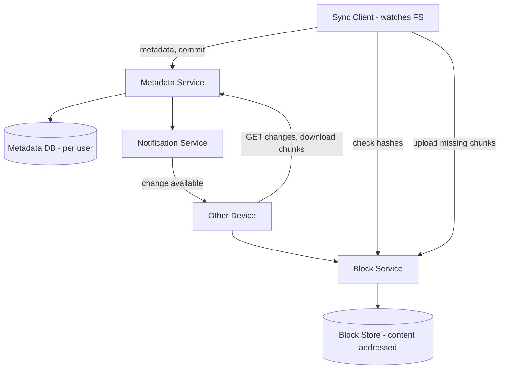

## 6.7 Deep dive A — chunking, content-addressable storage, dedup (the bulk)

> **Hard part A. The content-defined-chunking / boundary-shift insight is what separates senior from staff — make sure it lands.**

**Chunking.** Split each file into chunks (e.g., ~4 MB). Each chunk is hashed (SHA-256); **the hash is the chunk's address** — content-addressable storage. A file becomes an **ordered list of chunk hashes** (stored in metadata); the chunks live in the block store keyed by hash.

**Fixed-size vs content-defined chunking (the key nuance — decide):**
- **Fixed-size chunks** are simple but suffer the **boundary-shift problem**: insert one byte near the start of a file and *every* subsequent fixed boundary shifts, so every chunk's content (and hash) changes → no dedup benefit, you re-upload everything. This is the silent killer of naive designs.
- **Content-defined chunking (CDC)** uses a rolling hash (Rabin fingerprint) to place boundaries based on *content patterns*, not byte offsets. Now an insertion only changes the one chunk around it; all others keep their hashes. This is what makes delta sync robust to edits anywhere in the file.

*Decision:* **content-defined chunking because fixed-size chunking destroys dedup/delta-sync the instant content is inserted mid-file (boundary shift), and edits-anywhere is the normal case; accept CDC's extra rolling-hash CPU because it's cheap relative to the bandwidth it saves.**

**Deduplication.** Because chunks are addressed by content hash, **identical chunks are stored exactly once globally**, no matter how many users/files contain them. Before uploading, the client asks "which of these hashes do you already have?" and uploads **only the missing chunks**. Benefits:
- **Cross-user dedup:** the popular file uploaded by a million users is stored once (privacy/security: convergent-encryption considerations apply — worth a sentence; cross-user dedup can leak existence-of-file information, so privacy-sensitive deployments scope dedup per-namespace).
- **Delta sync:** editing a file re-uploads only changed chunks.
- **Cheap versioning:** a new version just references the new chunk list; unchanged chunks are shared with the old version.

**Garbage collection:** chunks are deleted only when **refcount drops to zero** across all file-versions — never delete a chunk another file still points at. *This refcount-GC is the analog of the CRDT tombstone-GC worry in §5 — both are "when is it safe to actually delete the thing everyone might still reference."*

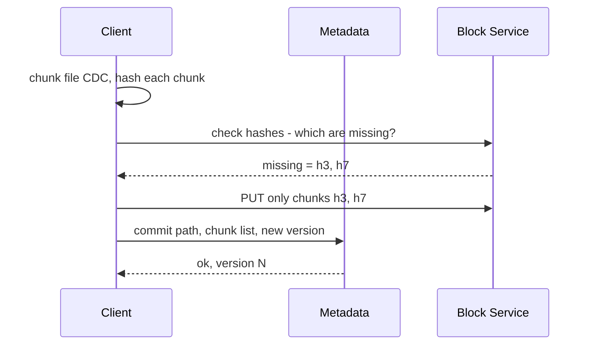

## 6.8 Deep dive B — the sync engine: change detection, delta sync, conflicts

> **Hard part B. The notification protocol (long-poll trigger + pull data) and the conflicted-copy policy are the two decisions.**

- **Change detection (local):** a client watches the filesystem (OS file-watch APIs) for modifications; on change it re-chunks the affected file and computes new hashes, diffing against the last-known chunk list to find changed chunks.
- **Notification/sync protocol (remote → local):** rather than every device polling constantly, devices keep a **long-poll / push connection** to a notification service. When any device commits a change, the notification service tells the user's *other* online devices "you have changes since cursor X." Each device then calls `GET /changes?cursor=` to pull the delta and downloads only the new chunks. This is **long-poll for the trigger + pull for the data**.

  *Decision:* **long-poll trigger + pull data because pushing full change payloads over the notification channel would couple a high-fanout firehose to large transfers and melt under reconnect storms; the trigger is tiny and the device pulls only what it needs, when it's ready.**

  > **Cite experience.** "We learned this the hard way in chat: after a deploy, every client reconnects at once, and if reconnect re-pushes state per client you get a thundering herd that takes the fleet down. Long-poll-trigger-plus-pull lets clients pull at their own pace and lets you rate-limit the pull side. Same shape exactly as Dropbox sync."

- **Conflict resolution:** if two devices edit the same file concurrently (each based on the same base version), the commits collide. Unlike Google Docs, Dropbox does **not** merge file *contents* (files are opaque blobs) — instead it keeps both: the winner becomes the new version and the loser is saved as a **"conflicted copy" (e.g., `report (Alice's conflicted copy).docx`)**. Detection uses version vectors / base-version checks (optimistic concurrency: commit specifies the base version; server rejects if it moved).

  *Decision:* **conflicted-copy over content merge because files are opaque blobs the system cannot semantically merge (contrast Google Docs §5, where the content is structured text and OT *can* merge); conflicted-copy is dumb but never loses data and punts the merge to the human who understands the file.** This contrast with Google Docs is the cleanest "consistency model follows the data model" example in the module.

## 6.9 Deep dive C — metadata/block separation & scaling
**Why split metadata from blocks?** They have opposite characteristics:
- **Metadata** is small, structured, transactional, strongly consistent (the namespace/tree, versions, permissions) → a sharded relational/transactional DB partitioned by user.
- **Blocks** are large, immutable, content-addressed, write-once → a flat, infinitely-scalable object store partitioned by hash, dedup'd globally.

Separating them lets each scale and be consistent on its own terms: metadata gets transactions and strong consistency cheaply (it's small); blocks get cheap, durable, dumb storage (immutability means no consistency headaches — a hash always maps to the same bytes). **Blocks are immutable → trivially cacheable at edges/CDN and safe to replicate widely.** This is the same metadata-plane-vs-blob-plane split as YouTube renditions and Gmail attachments — recognize the recurring pattern (see [Storage](08-storage.md)).

Scale knobs: shard metadata by user; the block store scales horizontally by hash; the notification service scales with persistent connections (see [Real-Time](09-realtime-systems.md)); cold versions/chunks tier to archival storage.

## 6.10 Trade-offs & failure modes
- **Dedup vs privacy:** cross-user dedup can leak existence-of-file info; mitigate with per-namespace dedup or convergent encryption — a real trade-off to acknowledge, not hand-wave.
- **Conflict policy:** "conflicted copy" is dumb but **never loses data** — the right default for opaque files (vs OT/CRDT merge for structured docs).
- **Partial upload failure:** chunks are independent and idempotent (content-addressed) → resume by re-checking which are present. No "restart the upload" — the `check` call makes resume free.
- **Metadata is the source of truth:** if a block is missing but referenced, that's corruption; refcounting + verification guards against premature GC.
- **Reconnect storm after deploy:** long-poll trigger + paced pull + jittered reconnect backoff (the war story above).

## 6.11 What the interviewer is really testing
Do you reach for **content-addressable chunking + dedup + delta sync** and explain **content-defined chunking** (boundary-shift problem)? Do you cleanly **separate the strongly-consistent metadata plane from the immutable block plane** and design an **efficient notification (long-poll trigger + pull data) sync protocol** with a sane (data-preserving) conflict policy? These four moves are the entire answer — and the delivery signal is earmarking the boundary-shift problem early as the detail you most want to get right.

---

# 7. Gmail — Email System

## 7.1 Problem framing

Email is a **distributed, asynchronous, store-and-forward messaging system** built on open protocols (SMTP/IMAP), bolted to a **massive per-user storage + search problem** and a **spam-filtering arms race.** The read/write pattern is mailbox-centric: heavy reads of one's own inbox, append-heavy writes, and the killer feature is **instant search over a multi-gigabyte mailbox.** The interesting tension is **interoperating with the chaotic global email ecosystem (SMTP)** while delivering a fast, search-driven product experience on top.

> **Earmark.** "Three hard parts, in priority order: **(A) the sending pipeline as store-and-forward with durable queues + retry/backoff** — because email is the original eventually-consistent messaging system and people get this wrong by treating it as synchronous RPC; **(B) instant search over a multi-GB mailbox via a per-user inverted index**; and **(C) spam-before-storage + dedup'd attachment blobs**. The recurring backbone is *partition-by-user for locality and isolation*. The IMAP/folder CRUD is plumbing."

## 7.2 Requirements

**Functional:** send/receive email (SMTP with the world); read inbox (IMAP + web); search huge mailboxes instantly; threading (conversations); labels/folders; attachments; spam/phishing filtering; sync across devices.

**Non-functional**
| Dimension | Target |
|---|---|
| Scale | ~1.5B+ users, mailboxes up to many GB, billions of messages/day |
| Delivery | Async; "sent" may take seconds–minutes (store-and-forward, retries) |
| Search latency | < ~200 ms over a multi-GB mailbox |
| Durability | Never lose a delivered message; strong durability |
| Availability | High for read; sending tolerates delay (queued + retried) |

## 7.3 Capacity estimation
- 1.5B users × ~10 GB avg ≈ **~15 EB** of mail+attachments. Attachments dominate bytes → store them as **deduplicated blobs** (same idea as Dropbox), separate from message metadata.
- Send/receive: tens of billions of messages/day → ~hundreds of thousands of messages/sec, hugely spiky and **spam-dominated** (a large fraction of inbound is spam, rejected/filtered before storage). Filtering before storage is therefore not just a UX feature — it's a *storage and index cost* control.
- Read pattern: read-heavy on your own mailbox; the **search index** is a big cost — an inverted index over every user's mail, per user.

## 7.4 API / protocols

```
Inbound:  SMTP (port 25)  -> MX servers receive mail from the world
Outbound: SMTP submission (587) -> queue -> deliver to recipients' MX
Access:   IMAP/POP (sync mailbox to clients) + internal HTTPS/gRPC API for web/mobile

App API:
  GET  /v1/messages?label=inbox&q=...   -> list / search
  GET  /v1/threads/{id}                  -> conversation view
  POST /v1/messages/send                 -> enqueue for delivery
  POST /v1/messages/{id}/labels          -> apply/remove labels
```

## 7.5 Data model

```
mailboxes    user_id (PK)
messages     user_id + message_id (sort), thread_id, headers, body_ref, label_ids[], flags{read,starred}, ts
threads      user_id + thread_id, subject, message_ids[], participants
attachments  blob_hash (PK) -> location, refcount        (dedup'd blob store)
labels       user_id + label_id, name
search_index user_id -> inverted index (terms -> message_ids)
```
**Partition key: `user_id`.** Everything is mailbox-scoped — a user reads/searches *their own* mail — so partitioning by user gives perfect locality and isolation. **Labels, not folders:** a message has a set of `label_ids` (Inbox, Important, custom); "folders" are just a label view. Threading groups messages by `thread_id` (subject + References/In-Reply-To headers). *Altitude:* labels-vs-folders is a one-sentence insight, not a deep dive.

## 7.6 High-level architecture

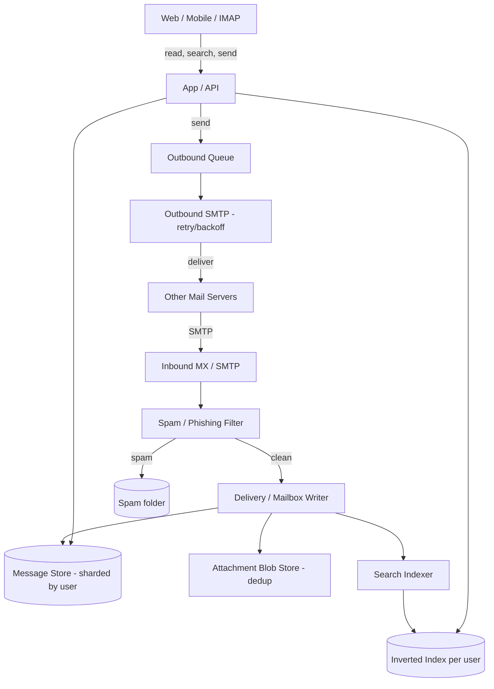

## 7.7 Deep dive A — the sending pipeline + queues (store-and-forward)

> **Hard part A. The staff line: "email's reliability comes from durable queuing + idempotent retry, not synchronous delivery — it's the original eventually-consistent messaging system."**

Email delivery is **asynchronous and unreliable by nature** — the recipient's server may be down, slow, or greylisting you. So sending is **store-and-forward with durable queues + retries**:
1. **Submission:** client sends to the outbound service (SMTP submission/API); the message is **durably enqueued** and the user gets an immediate "sent." *Durably* is the key word — ack only after the message is on durable storage, never before.
2. **MX lookup + delivery attempt:** the outbound worker resolves the recipient domain's MX records and attempts SMTP delivery.
3. **Retry with backoff:** on transient failure (4xx, timeout, greylisting) it **retries with exponential backoff** over hours; on permanent failure (5xx) it generates a **bounce (NDR)**. This is why "message delayed/undeliverable" emails arrive hours later.
4. **Reputation/throttling:** outbound is rate-limited per destination and uses warmed IPs with good reputation (SPF/DKIM/DMARC signing) so receivers don't mark you as spam.

*Decision:* **store-and-forward with durable queue + exponential-backoff retry + idempotent Message-ID, because recipient servers are unreliable and out of our control, so synchronous delivery would block the user on someone else's downtime; idempotency via Message-ID prevents duplicate delivery when a retry races a slow success.**

> **Cite experience.** "This is the same discipline as reliable message delivery in chat — ack on durable enqueue, retry with backoff, dedupe on a client-supplied idempotency key. The failure we always design against is the retry that races a slow first success and double-delivers; the Message-ID/idempotency-key is what makes retry safe."

## 7.8 Deep dive B — search over a huge mailbox

> **Hard part B. The partitioning insight — *per-user* inverted index — is what makes it scale to 1.5B mailboxes.**

Searching a 10 GB mailbox by scanning is impossible at <200 ms. The answer is a **per-user inverted index**:
- On delivery, the indexer **tokenizes** each message (subject, body, sender, etc.) and updates an **inverted index** (term → list of message IDs) **scoped to that user**. Search is then an index lookup + intersection, not a scan.
- **Per-user indexes** keep each index small (one mailbox), enable the `user_id` shard to hold both messages and their index together (locality), and isolate one user's huge mailbox from another's.
- Structured filters (label:inbox, from:, has:attachment, after:) combine with full-text terms — the index stores these as additional postings/fields.
- Indexing is **async** off the delivery path (a message is searchable a moment after arrival), so it never slows delivery.

*Decision:* **per-user inverted index, indexed async off the delivery path, because the access unit is always one mailbox so a global index would be needless cross-user contention, and async indexing keeps the delivery path fast; accept that a just-arrived message is unsearchable for a moment (acceptable).** This is the same search machinery as a web search engine, but **partitioned per user** rather than global — the partitioning is the whole trick.

## 7.9 Deep dive C — spam filtering, storage, threading
- **Spam/phishing filtering (arms race):** a layered pipeline at ingest — connection-level checks (IP reputation, RBLs, rate), authentication (SPF/DKIM/DMARC), content-based ML classifiers (constantly retrained on user "report spam" signals), and URL/attachment sandboxing. **Filtering happens before storage** so spam never bloats the mailbox/index — this is both a UX and a cost decision (a large fraction of inbound is spam; storing/indexing it would be a massive waste). It's adversarial → models retrain continuously on fresh labels (a [Data Processing](16-data-processing.md) feedback loop).
- **Storage model & attachments:** message headers/body are small structured records sharded by user; **attachments are large blobs stored once via content-hash dedup** (a forwarded 10 MB PDF among 50 recipients is stored once), referenced by message — exactly the Dropbox blob pattern (§6.7). Cold mail tiers to cheaper storage; recent mail stays hot.
- **Threading & labels:** threads built from `References`/`In-Reply-To` headers + subject; labels (many-to-one per message) replace folders, so the same message appears under Inbox, Important, and a custom label without duplication — a *view* over a label set, not physical copies.

## 7.10 Scaling, trade-offs, failure modes
- **Shard by user** → near-perfect horizontal scaling and isolation; a hot mailbox affects only its shard. Hard part: a few mailboxes are enormous (mailing-list archives) → may need intra-user partitioning of the index. *Name this edge case proactively — it's the one place the clean per-user story breaks.*
- **Read vs write:** reads (inbox/search) dominate and are cache-friendly; writes (deliver+index) are async and queue-buffered. Send path tolerates seconds–hours; read path must be fast.
- **Failure modes:** outbound queue absorbs recipient outages (retry); inbound MX must **accept-then-process** so it never loses mail under load (accept to durable queue first, filter/index after); index lag means a just-arrived mail is momentarily unsearchable (acceptable).
- **Consistency:** a delivered message must be **durably stored before ack** (no loss); labels/read-flags are per-user and can be eventually consistent across devices (IMAP sync reconciles).

## 7.11 What the interviewer is really testing
Do you treat email as **async store-and-forward messaging (durable queues + retry/backoff)** rather than synchronous RPC, design a **per-user-sharded mailbox + per-user inverted index** for instant search, and handle **spam-before-storage** plus **dedup'd attachment blobs**? The recurring senior signal is **partition-by-user for locality/isolation** and recognizing email's protocol-driven eventual consistency. The delivery signal is leading with "email is the original eventually-consistent messaging system" rather than reaching for a synchronous request/response mental model.

---

# Cross-Cutting Patterns Cheat Sheet

These themes recur across the whole module — recognizing which applies is half the battle, and *naming the pattern by name* while you apply it is a top-tier delivery signal.

| Theme | Where it appears | The core move |
|---|---|---|
| **Separate slow durable write path from fast cacheable read path** | YouTube (transcode vs deliver), Netflix (encode vs OCA) | Bytes go to immutable object store once; reads served from CDN forever |
| **Chunk → fan-out → stitch (idempotent parallel pipeline)** | YouTube transcoding | GOP-boundary chunks, per-chunk tasks, retry-safe, then concat |
| **CDN / edge as the egress optimizer** | YouTube, Netflix, Spotify, Dropbox blocks | Cache immutable, content-addressed objects close to users |
| **Reactive pull-CDN vs proactive predictive fill** | YouTube (unknown catalog→pull) vs Netflix (known catalog→push overnight) | Known + finite catalog ⇒ pre-position; unknown firehose ⇒ cache on miss |
| **Control plane vs data plane separation** | Netflix (AWS vs OCA), Zoom (signaling vs media) | Keep stateful/critical byte/media path independent of orchestration |
| **Graceful degradation over failure avoidance** | Netflix (chaos, fallbacks), Spotify (editorial fallback) | At scale failure is constant; never let a soft dependency kill a hard path |
| **Approximate + eventual where exactness is worthless** | YouTube view counts (sharded counters, HLL) | Don't pay for strong consistency the business doesn't need |
| **Adaptive delivery driven by the client** | YouTube/Netflix ABR, Spotify bitrate, Zoom simulcast/SVC | The endpoint knows real conditions; server stays dumb |
| **Real-time media topology: SFU** | Zoom | 1× client uplink, no server transcode, selective layer forwarding |
| **Convergence: OT vs CRDT** | Google Docs (OT) | Topology dictates choice: central server ⇒ OT; P2P/offline ⇒ CRDT |
| **Conflict policy follows data model** | Docs (merge structured text) vs Dropbox (conflicted-copy for opaque blobs) | Mergeable content ⇒ OT/CRDT; opaque blob ⇒ keep-both, never lose data |
| **Content-addressable chunking + dedup + delta sync** | Dropbox, Gmail attachments | Hash = address; store each unique chunk once; upload only missing |
| **Content-defined (vs fixed) chunking** | Dropbox | Rolling-hash boundaries survive byte inserts; fixed-size shifts everything |
| **Metadata plane vs blob plane** | Dropbox, Gmail, YouTube | Small/strongly-consistent metadata; large/immutable blobs |
| **Refcount/tombstone GC of shared immutable state** | Dropbox chunks (refcount), CRDT (tombstones) | Only delete when nothing can still reference it |
| **Long-poll trigger + pull data (sync/notify)** | Dropbox, Gmail | Push the "you have changes" event; client pulls the delta |
| **Store-and-forward + durable queue + retry/backoff** | Gmail send pipeline | Reliability via idempotent async retry, not synchronous delivery |
| **Partition-by-user for locality + isolation** | Gmail, Dropbox metadata, Spotify library | The access unit is one user's data ⇒ shard on user_id |
| **Per-user inverted index** | Gmail search | Global search machinery, partitioned per user, async off write path |
| **Prefetch exploits sequential predictability** | Spotify next-track, video segment prefetch | Predict the queue, fetch ahead, hide latency |
| **Request coalescing shields origin** | YouTube/Netflix CDN miss | Collapse N concurrent misses for one object into one origin fetch |

## The decision-table version (for fast recall under pressure)

| If the question has… | Reach for… | Because |
|---|---|---|
| Large user-uploaded media, unknown catalog | Chunked transcode pipeline + reactive pull-CDN | Can't pre-position what you don't know |
| Large curated/finite catalog | Offline encode + proactive predictive edge fill | Known content ⇒ pre-position overnight |
| Many-to-many real-time media | SFU + simulcast/SVC | 1× uplink, no transcode, selective forwarding |
| Concurrent edits, central server, structured text | OT | Coordinator gives total order; compact, no tombstones |
| Concurrent edits, P2P / offline-first | CRDT | Ops commute without coordination |
| Concurrent edits, opaque files | Conflicted-copy keep-both | Can't semantically merge blobs |
| Sync files efficiently across devices | CDC chunking + dedup + delta sync + long-poll-trigger | Upload only changed bytes; store unique chunks once |
| Per-user data, instant search | Partition-by-user + per-user inverted index | Locality + isolation; access unit is one user |
| Unreliable cross-system delivery | Store-and-forward durable queue + idempotent retry | Caller can't depend on callee uptime |
| A counter under viral write load | Sharded counters / stream-aggregate / HLL | Approximate + eventual where exact is worthless |

**Final framing for the interview:** every system here is some combination of *(a)* moving large immutable blobs efficiently (chunk, dedup, content-address, CDN), *(b)* a pipeline that transforms those blobs (transcode/encode/index), and *(c)* a consistency model chosen to fit the access pattern (strong for metadata/billing, eventual+approximate for counts/feeds, convergent OT/CRDT for collaborative state, store-and-forward for messaging). The *content* skill is naming the pattern, justifying the consistency choice, and identifying the real cost center. The *delivery* skill — the thing that actually separates staff from senior in the room — is **earmarking the crux at minute five, deciding instead of enumerating at every fork, holding altitude over the CRUD, risk-weighting your depth onto the one or two hard parts, and citing real operational scars.** Do both and you are giving a staff-level answer. See [Staff-Level Execution](20-staff-execution.md) for the cross-cutting delivery framework these playbooks instantiate.
