# Module 18c — Marketplace & Money: Full End-to-End Design Playbooks

> **Audience:** Experienced engineers preparing for Staff Engineer / Senior EM / Director system-design interviews.
>
> This module is the **marketplace & money playbook** — seven full designs where the *defining tension* is **consistency**. Some sub-systems (money, inventory, seat/room) demand **strong consistency, ACID, idempotency, and exactly-once semantics**; everything around them (location pings, search, recommendations, ad counters) is happily **eventually consistent** and optimized for throughput and latency. Knowing *which is which*, and defending the boundary, is the Staff-level skill these problems test.
>
> **Reference modules:** [Databases](06-databases.md) · [Distributed Systems](02-distributed-systems.md) · [Messaging / Event-Driven](04-messaging-event-driven.md) · [Caching](03-caching.md) · [Reliability](11-reliability.md) · [Staff-Level Execution](20-staff-execution.md)

---

## How to Deliver a Design Problem at Staff Level

> Read this once before the seven playbooks. It is the *delivery technique* that turns correct knowledge into a strong interview signal. The content below applies the [Staff-Level Execution](20-staff-execution.md) lens specifically to marketplace & money systems. Every system that follows is written to *demonstrate* these moves, not just describe them.

A Staff candidate and a strong Senior candidate often *know the same things*. The difference an interviewer feels in the first ten minutes is **how the knowledge is delivered**: what you earmark, what you skip, what you decide, and where you go deep. Marketplace and money problems are unusually good at exposing this, because they all contain the same trap — a firehose of cheap, eventual data wrapped around a small, sacred core of strongly-consistent state. The signal is whether you can find that core fast, defend it, and refuse to over-engineer the rest.

### The seven moves

**1. Signal, not solution.** The interviewer is not grading whether your design would compile. They are sampling your judgment. You do not need to enumerate every component of a payment system; you need to show that you know *the ledger is double-entry and append-only, balance is derived not mutated, and idempotency is enforced by a unique constraint claimed before any side effect*. Three load-bearing sentences beat thirty descriptive ones. Lead with the sentence that only a Staff engineer would say.

**2. Decide, don't enumerate.** The weakest phrase in a design interview is "it depends." It is technically true and conversationally worthless. Replace every "it depends" with a committed call in this shape:

> **`<choice>` because `<requirement>`; revisit if `<trigger>`.**

For example: *"Saga, not two-phase commit, across payment and inventory, because the payment gateway is an external service that won't enlist in our transaction and we can't hold inventory row-locks across a 4-second network call; revisit if both sides ever live in the same NewSQL cluster, which they won't."* You may still surface the alternative — but you name your choice first, justify it with the requirement, and give the explicit condition that would change your mind. That is what "engineering judgment" looks like as a sentence.

**3. Altitude — name boring CRUD and move on; deep-dive the crux.** Uniform thoroughness is an anti-signal: spending equal time on the user-profile table and the double-entry ledger tells the interviewer you can't tell which one is hard. So fly high over the commodity parts — *"catalog is a read-heavy document store behind a CDN, search is Elasticsearch fed by CDC, both eventually consistent, nothing interesting there"* — and **drop altitude hard** on the one or two genuinely difficult sub-problems. Spend your minutes where the risk is.

**4. Risk-weighting.** Inside the crux, weight your time by *consequence*. In a payment system, the timeout-during-charge case (you don't know if the customer was charged) deserves more airtime than the happy path, because that single case is where real money is lost and real on-call pages originate. In e-commerce, the flash-sale hot key deserves more than the catalog. Find the case that hurts and live there.

**5. YAGNI.** Resist building for scale or generality the requirements don't demand. A payment system doing 10M txns/day is ~1,000 TPS at peak — that is *modest*, and the correct, confident call is "the volume is small enough that I can afford strong ACID consistency; the challenge here is correctness under failure, not throughput." Reaching for sharded eventually-consistent ledgers at 1,000 TPS is over-engineering, and the interviewer clocks it. Match the machinery to the load.

**6. Earmark the hard parts out loud, early — by minute five.** Before you draw a single box, say what the hard parts are. *"Two things are going to be hard here: preventing double-booking of the last room under concurrency, and running the inventory+payment booking as a saga because we can't 2PC across a payment gateway. Everything else — search, catalog, profiles — is standard read-scaling. I'll frame the system, then spend most of our time on those two."* This single sentence does three things: it proves you can triage, it sets the agenda so the interviewer follows you instead of steering you, and it pre-commits you to depth where it counts. **Every system below opens with exactly this earmark.**

**7. Cite real operational experience.** Anchor abstract claims in things you have actually seen break. *"In real-time chat infra, teams learn the hard way that at-least-once delivery plus a non-idempotent consumer double-applies on every broker redelivery — so for anything that mutates state, the dedup key isn't optional, it's the design."* You have distributed-systems scar tissue; a single concrete war story about a retry storm, a hot partition, a lost ack, or a reconciliation mismatch is worth a page of textbook recall. Use it.

### The eight anti-patterns (do not do these)

| Anti-pattern | What it sounds like | Do instead |
|---|---|---|
| Over-explaining basics | A paragraph on what a load balancer is | Name it, move on |
| Rabbit-holing | 15 minutes on geohash bit-interleaving | Pick S2/geohash, justify in 2 sentences, move to the matching crux |
| Option-listing without choosing | "We could use A, B, or C…" then stopping | Decide-don't-enumerate (move 2) |
| Over-engineering | Sharded ledger at 1,000 TPS | YAGNI (move 5) |
| Uniform thoroughness | Equal depth on profiles and the ledger | Altitude (move 3) |
| Burying the crux | Reaching consistency at minute 40 | Earmark at minute 5 (move 6) |
| Abstract-only | Textbook recall, no scars | Cite experience (move 7) |
| Hedging | "It depends" / "there are trade-offs" | Commit with a revisit-trigger (move 2) |

### The one call that matters most in this module

Across all seven systems, the recurring decisive moment — **the single sentence the interviewer is waiting for** — is where you draw the line between **strong** and **eventual** consistency, and *defend why eventual is categorically wrong on the strong side*:

> **Money and committed inventory get strong, serializable, ACID consistency, because eventual consistency on a balance or a seat-count permits a concurrent double-spend or an oversell — a correctness bug a customer notices and a regulator fines you for. Everything that is a hint, a count, a position, a prediction, or a display — locations, surge, search results, impression counters, recommendations — is eventually consistent, because being a few seconds stale there is a UX nit, not a correctness violation. The art is putting the boundary in exactly the right place and wiring the two sides together with idempotency, sagas, and reconciliation.**

Say that, mean it, and apply it precisely per-datum, and you have delivered the module's core signal. The four cross-cutting moves that wire the boundary together — **boundary, idempotency, saga, reconciliation** — recur in every design and are synthesized in the closing table.

---

## Recurring themes (read this first)

These five ideas thread through every design below. Spot them, name them, and you sound like a Staff engineer:

1. **Strong consistency for money & inventory; eventual everywhere else.** A double-charge or an oversell is a *correctness* bug a customer notices and a regulator fines you for. A stale "drivers nearby" count is a UX nit. Put your ACID transactions, locks, and ledgers around the former; relax for the latter. **This is the decisive call in every problem — earmark it early and defend the boundary precisely.**
2. **Idempotency.** Networks retry. Phones retry. Queues retry. Any operation that moves money or decrements inventory **must** be safe to call twice — via an idempotency key, a unique constraint, or a dedup table. "Exactly once" is achieved as **at-least-once delivery + idempotent processing**. (See [Distributed Systems](02-distributed-systems.md) for the delivery-semantics theory.)
3. **Saga pattern** for multi-step distributed transactions (reserve inventory → charge card → confirm order). You cannot hold a 2PC lock across a third-party payment gateway for 4 seconds. Instead: a sequence of local transactions with **compensating actions** (refund, release seat) on failure.
4. **Geospatial indexing** (geohash / S2 / QuadTree) to turn "find things near me" from an O(n) scan into an O(log n) lookup.
5. **Low-latency serving** via the **two-stage retrieve → rank** pattern (cheap candidate generation, then expensive scoring on a small set) and aggressive caching — the backbone of ads, recs, and search.

---

## Table of Contents

0. [Google Mode — Build It, Don't Name It](#google-mode--build-it-dont-name-it)
1. [Ride-Sharing — Uber / Lyft / Ola](#1-ride-sharing--uber--lyft--ola)
2. [Food Delivery — DoorDash / Swiggy / Uber Eats](#2-food-delivery--doordash--swiggy--uber-eats)
3. [Hotel / Flight Booking — Booking.com / Airbnb / Expedia](#3-hotel--flight-booking--bookingcom--airbnb--expedia)
4. [E-commerce Platform — Amazon-style](#4-e-commerce-platform--amazon-style)
5. [Payment System / Wallet](#5-payment-system--wallet)
6. [Ad Serving Platform](#6-ad-serving-platform)
7. [Recommendation Engine](#7-recommendation-engine)
8. [Closing synthesis — the consistency spectrum](#closing-synthesis--the-consistency-spectrum)

> **Per-system structure (10 parts):** problem framing · requirements · capacity · API · data model · architecture · three deep dives · scaling · trade-offs/failure modes · "what the interviewer is really testing." Each system opens with a **staff earmark** naming the crux up front.

---

## Google Mode — Build It, Don't Name It

> Read this if your interviewer is at Google. Google's #1 system-design rule is **"avoid 'use a standard database and query it'; how do you BUILD it FROM SCRATCH?"** Naming a managed product (PostGIS, Stripe, DynamoDB, a vector DB) is a *non-answer* — it hides the exact primitive the interview is testing. You may absolutely *discuss* whether a managed product fits (that's good judgment), but you must then **build the primitive yourself** and defend its internals. See [Build From Scratch](21-build-from-scratch.md) for the catalogue of primitives and [Google SD Playbook](26-google-sd-playbook.md) for the broader Google delivery lens.

| System | Tempting off-the-shelf answer | What to build / discuss from scratch instead |
|---|---|---|
| **Ride-sharing (Uber/Lyft/Ola)** | "Use PostGIS / Redis GEO for nearest-driver." | Build the **geospatial index** yourself — geohash / S2 cells / QuadTree, the cell→driver inverted map, neighbor-cell fan-out for radius search — **and** the **matching engine**: per-cell candidate gen, then a single strongly-consistent assignment that pairs one rider↔one driver without double-dispatch. |
| **Food delivery (DoorDash/Swiggy)** | "Use a routing API + a queue." | Build the **dispatch/assignment optimizer** (batching, courier-to-order matching under SLA), the **two-sided state machine** (order ↔ courier), and the saga across restaurant-accept → payment → courier-assign with compensations. |
| **Hotel / flight booking** | "Just use the DB's row locks / SELECT FOR UPDATE." | Build the **inventory-reservation primitive**: how the *last seat/room* is held without oversell — atomic decrement, hold-with-TTL, expiry sweeper — and the **saga** wiring hold → pay → confirm, releasing on failure. |
| **E-commerce (Amazon-style)** | "Use Elasticsearch + a relational DB." | Build the **cart + inventory-decrement** path under a flash-sale **hot key** (atomic counter, sharded/queued decrements), the **idempotent order pipeline**, and the read/write split (eventual catalog vs. strong inventory). |
| **Payment system / wallet** | "Use Stripe / a payments provider." | Build the **double-entry ledger** (append-only, balance *derived* not mutated) with **idempotency** (unique-key claimed before any side effect) and the **saga coordinator** with compensations. **Strong, serializable consistency is non-negotiable** — this is the one place you never relax. Discuss Stripe as the *gateway* you call, not as the ledger you skipped building. |
| **Ad serving / RTB** | "Use a managed ad server / key-value store." | Build the **low-latency in-memory auction** (candidate retrieval → ranking → second-price selection in single-digit ms) and **budget pacing** (distributed counters, near-real-time spend with controlled overspend tolerance). |
| **Recommendation engine** | "Use a vector DB / a managed rec service." | Build the **two-stage candidate-gen → ranking** pipeline (cheap ANN/co-occurrence retrieval, then expensive scoring on a small set) and the **feature store** (online/offline parity, point-in-time-correct features) — not a single magic API call. |

> **Google-signal:** Resolve every "use X" into the *mechanism* underneath — own the primitive, don't name the product. The decisive move is the **strong-consistency call on money & committed inventory**: a *coherent* design that owns that boundary decisively beats a "correct" laundry list of tradeoffs — pick serializable ACID there and defend why eventual is categorically wrong. Then **detect-and-defend the failure path**: reconciliation jobs, idempotency keys, and exactly-once-for-money (at-least-once delivery + idempotent apply). Finally, name the **cross-DC and legal NFRs** the product answer silently assumed away: payments imply **PCI** scope and **data residency / regulatory** constraints, and cross-datacenter replication forces an explicit consistency-vs-latency choice. Building the primitive *is* how you surface all three.

---

# 1. Ride-Sharing — Uber / Lyft / Ola

> **Staff earmark (say this at minute five):** *"Two things are hard here, and I'll spend our time on them. First, the location firehose — five million drivers pinging every four seconds is over a million writes per second, which must never touch my transactional database; it's a decoupled, lossy, eventually-consistent geo pipeline. Second, the match — pairing exactly one rider with exactly one driver under concurrency, which is the only strongly-consistent thing in the whole system. Everything else — ETA, surge, routing — sits on top and is approximate. Let me frame it, then go deep on geospatial indexing and the matching engine."* That sentence is the whole interview in miniature: it earmarks the crux, draws the consistency boundary, and sets the agenda.

## 1.1 Problem framing

Match **riders** to nearby **drivers** in real time, in seconds, across a city. The hard problems are (a) ingesting a *firehose* of driver-location updates, (b) answering "find me the nearest available drivers" geospatially in single-digit milliseconds, and (c) the **matching/dispatch** decision that pairs one rider with one driver without double-assigning. Surge pricing, ETA, and routing sit on top.

The system is mostly **read-heavy on location, write-heavy on pings, and consistency-sensitive only at the moment of match** (one driver, one trip).

**Altitude note:** routing/ETA on a road graph (Dijkstra/A*/contraction hierarchies over OSM data with a traffic overlay) is a deep field in its own right, but in *this* interview it is a named dependency — *"ETA comes from a routing service over a contracted road graph with live traffic; I'll treat it as a black box that returns seconds"* — and you move on. Do not rabbit-hole into shortest-path algorithms; the crux is geo-indexing and matching.

## 1.2 Requirements

**Functional**
- Drivers stream their GPS location continuously while online.
- Rider requests a ride; system finds nearby available drivers, computes ETA & price, dispatches.
- A driver may be offered a trip and accept/decline; on accept the trip is exclusively theirs.
- Trip lifecycle: requested → matched → driver en route → arrived → in progress → completed → paid.
- Surge pricing reflecting local supply/demand.

**Non-functional**
- **Scale:** ~5M active drivers globally, peak. Each pings every **4s** → ~1.25M location writes/sec globally; tens of thousands/sec per large city.
- **Latency:** "find nearby" p99 < 50ms; end-to-end match offer < a few seconds.
- **Consistency:** location data is **eventually consistent / best-effort** (a 4-second-old position is fine). **The match itself is strongly consistent** — a driver must be assigned to exactly one trip. Trip-state transitions are strongly consistent.
- **Availability:** very high. A regional outage strands riders; degrade gracefully (wider search radius, stale locations) rather than fail.

## 1.3 Capacity estimation

```
Active drivers (peak)           = 5,000,000
Ping interval                   = 4 s
Location writes/sec (global)    = 5,000,000 / 4 = 1,250,000 writes/sec

Per-ping payload                = driverId(8) + lat(8) + lng(8) + ts(8) + status(1) ≈ 40-100 bytes
Ingest bandwidth                = 1.25M * 100 B ≈ 125 MB/s ≈ 1 Gbps (pre-overhead)

Ride requests: say 15M rides/day at 2x peak factor
  avg rps  = 15,000,000 / 86,400 ≈ 175 rps
  peak rps ≈ 175 * 5 (commute spikes) ≈ ~900 rps   (tiny vs location writes!)

Hot-state storage (live driver positions): 5M * ~100 B ≈ 500 MB
  → fits comfortably in an in-memory geospatial store (Redis / custom), sharded by city.

Trip records: 15M/day * ~2KB = 30 GB/day → ~11 TB/yr → durable store, partitioned by time/city.

Single hot city (e.g. NYC peak): ~100k active drivers / 4s ≈ 25,000 writes/sec on ONE city shard.
  → a single city's geo index must itself sustain ~25k updates/sec + thousands of queries/sec in memory.
```

**Key insight from the math:** location *writes* dwarf ride *requests* by ~1000×. The location pipeline is its own beast and should **not** hit your transactional trip database. Trip writes are modest and can afford strong consistency. **Decide-don't-enumerate:** *"Because ride requests are only ~900/sec globally, the trip DB can be a single strongly-consistent relational/NewSQL store partitioned by city+time — I do not need an exotic write-scaling story for trips; I need it only for the location firehose. Revisit only if a single city's trip rate ever approaches the firehose scale, which it doesn't."*

## 1.4 API design

```
# Driver location ingest (high QPS, fire-and-forget-ish)
POST /v1/drivers/{driverId}/location   { lat, lng, heading, ts, status }   → 202

# Rider requests
POST /v1/rides            { riderId, pickup{lat,lng}, dropoff{lat,lng}, productType }
                          → { rideId, etaSeconds, fareEstimate, surgeMultiplier }
GET  /v1/rides/{rideId}   → { state, driver{...}, driverLocation, eta }
POST /v1/rides/{rideId}/cancel

# Driver-side dispatch
POST /v1/dispatch/{offerId}/accept   (idempotent; first-writer-wins)
POST /v1/dispatch/{offerId}/decline

# Trip state transitions (driver app)
POST /v1/rides/{rideId}/arrived
POST /v1/rides/{rideId}/start
POST /v1/rides/{rideId}/complete    → triggers fare finalization + payment
```

**Note:** location ingest returns `202 Accepted`, not `200` — it is fire-and-forget into a queue, and the API contract should *say so*. Dispatch accept is idempotent on `offerId` so a retried accept (lost ack) never double-assigns.

## 1.5 Data model

| Store | Data | Partition / shard key | Consistency |
|---|---|---|---|
| **Live location** (in-memory, e.g. Redis GEO / custom) | driverId → {geohash, lat, lng, status, ts} | **City / geo-cell** | best-effort, TTL'd |
| **Geo index** (per-city) | geohash bucket → set of driverIds | geo-cell | best-effort |
| **Trips** (RDBMS / NewSQL) | trip, state, rider, driver, fare, timestamps | **rideId** (or city+time) | strong (ACID) |
| **Driver state** | driverId → online/offline/on_trip | driverId | strong at match |
| **Surge** (cache) | geo-cell → multiplier | geo-cell | eventual, ~minutes |

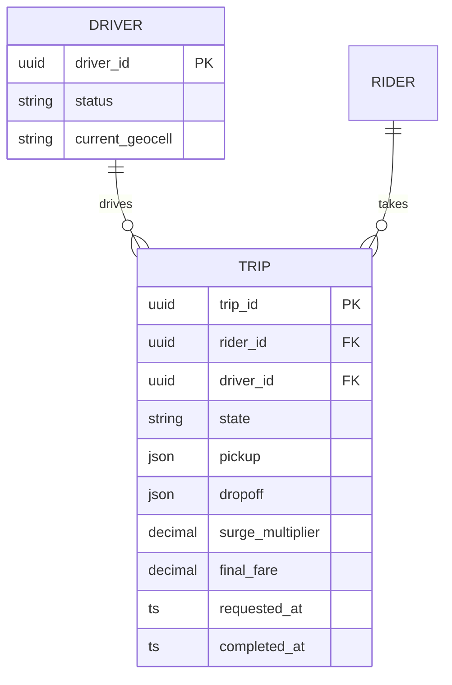

## 1.6 High-level architecture

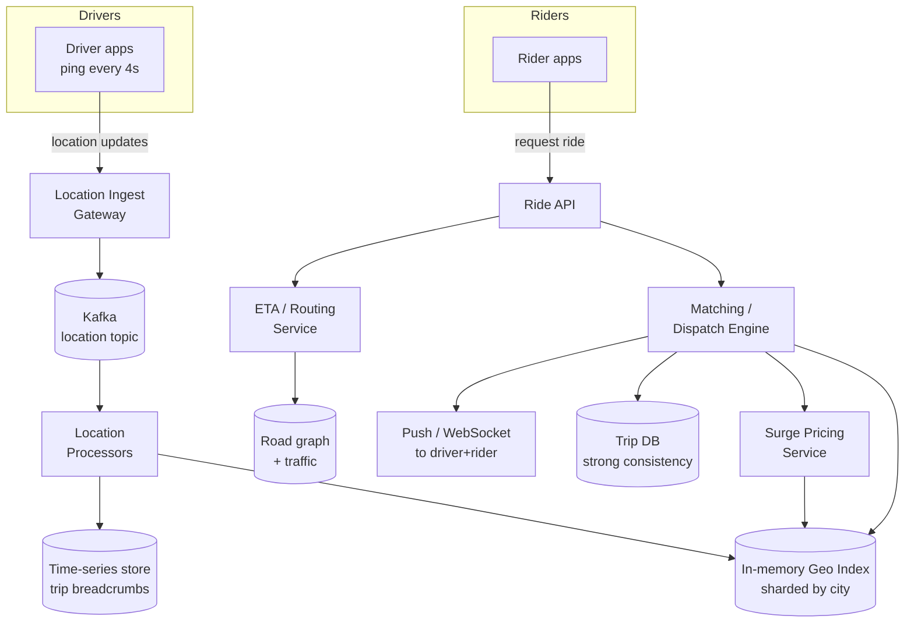

## 1.7 Deep dive A — Geospatial indexing

The core query: *given a rider's point, return the K nearest available drivers fast.* Three classic approaches:

**Geohash.** Interleave lat/lng bits into a base-32 string; a shared prefix ⇒ spatial proximity. A 6-char geohash ≈ 1.2km × 0.6km cell. To find nearby drivers: compute the rider's geohash, query that bucket **plus the 8 neighboring buckets** (drivers near a cell edge can be closer than ones in the same cell), then do exact Haversine distance and sort.
- Pros: trivial to shard (prefix = shard), works in plain Redis/KV, human-readable.
- Cons: fixed-resolution cells; uneven density (a downtown cell may hold 10k drivers, a rural one 2); the boundary problem needs the 8-neighbor patch.

**S2 (Google).** Projects the sphere onto a cube, uses a **Hilbert curve** to linearize cells into 64-bit cell IDs at 30 levels of resolution. Better distance properties than geohash, adaptive resolution (cover a region with variable-size cells), no abrupt boundary distortion. Used by Uber/Tinder historically.

**QuadTree.** Recursively subdivide space; a node splits when it exceeds a capacity (say 100 drivers). This **adapts to density** automatically — dense downtown = deep tree, sparse suburb = shallow. Range query = descend to the rider's leaf and gather neighbors. Cost: rebalancing as drivers move, and it's a stateful in-memory structure that's trickier to shard/replicate than a flat geohash KV.

**Uber's H3** (hexagonal grid) is worth a name-drop: hexagons have **uniform adjacency** (6 equidistant neighbors vs squares' 4-edge/4-corner asymmetry), which makes ring-based "expand the search radius" queries cleaner.

**Decide-don't-enumerate (the call to make out loud):** *"I'll use a geohash/S2 grid sharded by city, not a QuadTree, because the grid is a flat KV that shards and replicates trivially and rebuilds from a Kafka replay, whereas a QuadTree is a stateful in-memory tree that's painful to rebalance under a 25k-writes/sec firehose and painful to replicate. I trade the QuadTree's automatic density-adaptation for operational simplicity, and recover adaptivity by sub-sharding hot cells. Revisit if driver density were so wildly skewed that fixed cells became unusable — but cities don't behave that way."* That is the Staff move: pick one, justify by the operational requirement, name the trigger to reconsider. Do **not** spend ten minutes on bit-interleaving mechanics — that is the rabbit-hole anti-pattern.

**The query algorithm (defend this concretely):** compute the rider's cell; gather candidates from that cell plus the surrounding ring; if fewer than K available drivers, expand outward ring-by-ring until satisfied or a max radius; compute exact Haversine distance on the small candidate set; sort; return top-K. Updates are O(1) — a driver moving cells is a remove-from-old-set + add-to-new-set.

**Why the firehose must be decoupled (the load-bearing point):** 1.25M writes/sec cannot touch your trip DB. Pattern: pings → ingest gateway → **Kafka** (partitioned by city) → location processors → update **in-memory** geo index (and a TTL'd hot store) and asynchronously persist breadcrumbs to a time-series store for ETA/audit. The geo index is *intentionally lossy and eventually consistent* — last-write-wins per driver, TTL evicts stale drivers. **Cite experience:** *"This is the same shape as ingesting presence/typing-indicator events in chat infra — you never write a 'user is typing' event to your durable message store; it goes through a lossy, TTL'd, eventually-consistent path, and only the actual message is persisted transactionally. Location is the rideshare equivalent of a presence ping."*

## 1.8 Deep dive B — Matching / dispatch engine

When a rider requests:
1. Geo-query the index for available drivers within a radius (expand rings if too few).
2. Score candidates: ETA-to-pickup (not straight-line — route-aware), driver rating, direction-of-travel, fairness/utilization. This is an **optimization**, not just nearest.
3. **Dispatch** the offer to the top driver and **lock** the trip↔driver pairing.

The hard part is **exclusivity under concurrency** (this is the strongly-consistent core — risk-weight your time here): two riders must not both get driver D; driver D must not be offered two trips simultaneously. Approaches:

- **Optimistic with conditional write:** `UPDATE drivers SET status='offered', trip=:t WHERE driver_id=:d AND status='available'`. First writer wins; the loser re-queries. Idempotent accept via the same conditional update keyed on `offerId`.
- **Batched matching (Uber's approach at scale):** instead of greedy first-come-first-served, **accumulate requests over a short window (a few seconds) per region and solve a bipartite assignment** (Hungarian algorithm / min-cost matching) globally. This produces a *better global* outcome (lower total wait time) than greedy and naturally avoids races because one solver owns the region's assignments. The region is a single-writer to avoid cross-shard contention.

**Offer state machine with timeouts (draw this):**

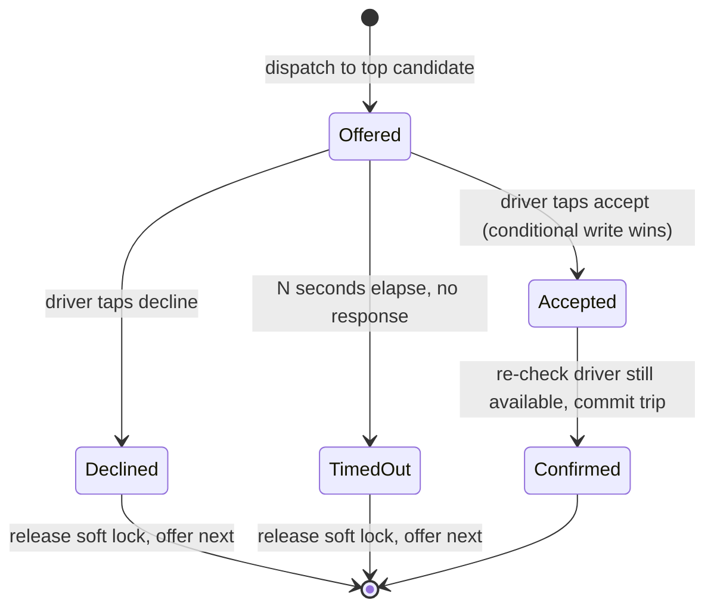

**Offer timeout & re-dispatch:** driver has N seconds to accept; on decline/timeout, release the soft lock and offer the next candidate. Use a **state machine** with timeouts (a delay queue / timer service) so a non-responding driver never wedges a rider. The soft lock on `status='offered'` prevents that driver from being offered elsewhere; the timeout guarantees the lock is never held forever.

**Decide-don't-enumerate:** *"For matching I'll default to batched per-region global assignment over a 2–5 second window, not greedy nearest-driver, because greedy creates the concurrency races and produces a worse marketplace outcome — total rider wait time is materially lower under global min-cost matching. The single-writer-per-region also dissolves the race for free. I trade a few seconds of dispatch latency for both correctness and efficiency. Revisit to greedy only in ultra-low-density regions where batching has nothing to batch."*

## 1.9 Deep dive C — Surge pricing & trip state machine

**Surge** = supply/demand imbalance per geo-cell. Compute the ratio of open requests to available drivers per cell over a sliding window; map to a multiplier; cache per cell with a short TTL. This is **eventually consistent and approximate** by design — but the multiplier shown at request time must be **locked to that ride** so the rider isn't surprised at the end. (Quote-then-honor: pricing estimate is eventually consistent, but the *committed fare quote* is pinned to the trip record.) This quote-then-honor split — *eventual for the estimate, strong for the committed quote* — is the same pattern you'll see for price in booking (§3.9) and is worth naming as a reusable move.

**Trip state machine** (strongly consistent, single source of truth = Trip DB):

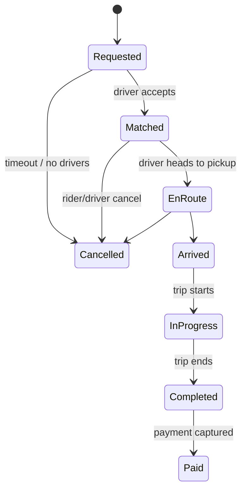

Each transition is a guarded, idempotent operation. `complete` triggers fare finalization → **payment** (a saga; see §5). Cancellations may incur a fee (another money flow). **Edge case to name:** a cancellation after `Matched` but before `InProgress` must atomically release the driver back to `available` *and* post any cancellation fee through the payment saga — two effects that must not partially apply.

## 1.10 Scaling & bottlenecks

- **Location ingest** is the dominant load — scale Kafka partitions by city; stateless processors scale horizontally. Backpressure: drop to a coarser ping cadence under load (drivers ping every 8s instead of 4s) — a clean, graceful degradation lever.
- **Geo index** sharded by city; hot cities (NYC, Mumbai) need finer sub-sharding. A single city's index lives in memory on a few replicas; rebuildable from Kafka replay.
- **Matching** per-region single-writer caps throughput per region but isolates contention; add regions to scale.
- **Cross-region edge cases:** trips near city/region boundaries need a merged view of adjacent shards.

## 1.11 Trade-offs & failure modes

| Failure / edge case | Consequence | Mitigation |
|---|---|---|
| **Stale locations** (driver went offline, still in index until TTL) | Match offered to an absent driver | Short TTL + heartbeat; *match-then-confirm re-checks availability* so a ghost is caught at the Accepted→Confirmed step |
| **Geo index loss** (node crash) | Region can't match | Rebuild from Kafka replay; meanwhile widen radius / fall back to last durable snapshot |
| **Double-dispatch** | Two riders get one driver | Conditional-write lock serializes; real risk is *driver accepted but ack was lost* → idempotency on `offerId` makes the retry safe |
| **Surge gaming / oscillation** | Prices flap, riders churn | Hysteresis + caps; smooth the multiplier |
| **Kafka lag under spike** | Geo index goes stale | Backpressure to coarser ping cadence; staleness is tolerable (eventual) — never block ingest |
| **Cross-region trip** | Driver in shard A, rider in shard B | Merged adjacent-shard view at boundaries |

## 1.12 What the interviewer is really testing

They want to see you **separate the firehose from the transaction**: that you do *not* write 1.25M pings/sec into Postgres, that location is eventually consistent and lossy, and that the *only* strongly-consistent thing is the trip↔driver assignment and the trip state machine. The geospatial indexing question (geohash vs S2/H3 vs QuadTree, and the boundary/neighbor problem) is the technical-depth probe — show depth, then *get out of it* with a decisive choice rather than rabbit-holing. **Staff-level insight:** the *best* answer to matching isn't greedy nearest-driver — it's **batched global assignment**, which trades a few seconds of latency for materially better marketplace efficiency and dodges the concurrency races greedy dispatch creates. Recognizing that the matching problem is fundamentally an **optimization over a marketplace**, not a lookup, is the differentiator.

---

# 2. Food Delivery — DoorDash / Swiggy / Uber Eats

> **Staff earmark (minute five):** *"This is a three-sided marketplace, so the hard parts are different from rideshare. First, the order is the single source of truth tying three actors and money together — it must be a rigorously modeled, strongly-consistent state machine, and order placement is a saga across order + payment + assignment. Second, courier assignment is harder than ride matching because of two couplings: temporal — pick up food when it's ready, not before — and batching — one courier, multiple orders. Everything else — menu, availability, location, ETA — is eventually consistent and I'll move fast over it. Deep dives go to the order state machine, the assignment optimizer, and the authorize-early/capture-late payment trick."*

## 2.1 Problem framing

A **three-sided marketplace**: customers order, restaurants prepare, couriers deliver. The system orchestrates an **order lifecycle** that spans three independent actors with their own timelines, plus a **courier-assignment** problem that's harder than ride-sharing because of **batching** (one courier carries multiple orders) and **timing** (pick up food when it's ready, not before — hot food, idle courier).

## 2.2 Requirements

**Functional**
- Browse restaurants & menus (with real-time availability — items sell out, restaurants close).
- Place an order; restaurant accepts and gives a prep-time estimate.
- Assign a courier (possibly batching nearby orders).
- Real-time tracking of courier; ETA prediction.
- Handle the full lifecycle including failures (restaurant rejects, courier cancels, customer cancels).

**Non-functional**
- **Scale:** millions of orders/day; ~10–50K concurrent active orders at peak.
- **Latency:** menu/browse fast (read-heavy, cacheable); assignment within seconds; tracking near-real-time.
- **Consistency:** **order state is strongly consistent** (one source of truth; no order stuck in two states; payment tied to it). Menu/availability and courier location are eventually consistent. Inventory of menu items is soft (best-effort) compared to e-commerce.
- **Availability:** high; degrade gracefully (e.g., show last-known menu if availability service is down).

## 2.3 Capacity estimation

```
Orders/day                = 20,000,000
avg orders/sec            = 20M / 86,400 ≈ 230 /s
peak (lunch+dinner ~5x)   ≈ 1,150 /s

Concurrent active orders  = orders/sec * avg lifecycle (~40 min = 2400s)
                          ≈ 230 * 2400 ≈ 550,000 active orders steady;
                            at peak ~1150 * 2400 ≈ 2.7M concurrent in flight (global)

Couriers active (peak)    ≈ 500,000  → location pings every 4-5s
                          ≈ 100,000+ location writes/sec (same firehose pattern as §1)

Menu reads                = browse-heavy; 50:1 read:order ⇒ ~50k+ menu reads/sec peak
                          → CDN + cache the menus aggressively
```

**Insight worth stating:** order *writes* are ~1,150/sec at peak — modest, so the order DB can be strongly consistent without breaking a sweat (YAGNI on exotic write-scaling). The courier-location stream is the only firehose, and it reuses the §1 pattern wholesale. Don't redesign it; point at §1 and move on.

## 2.4 API design

```
GET  /v1/restaurants?lat&lng&cuisine        → ranked list (availability-filtered)
GET  /v1/restaurants/{id}/menu              → menu + item availability (cached)

POST /v1/orders        { customerId, restaurantId, items[], address, idempotencyKey }
                       → { orderId, state:CREATED, total }
GET  /v1/orders/{id}                         → { state, courier, eta, tracking }
POST /v1/orders/{id}/cancel

# Restaurant-facing
POST /v1/orders/{id}/accept   { prepTimeMinutes }
POST /v1/orders/{id}/reject   { reason }
POST /v1/orders/{id}/ready

# Courier-facing
POST /v1/assignments/{id}/accept
POST /v1/orders/{id}/picked_up
POST /v1/orders/{id}/delivered
```

## 2.5 Data model

| Store | Data | Partition key | Consistency |
|---|---|---|---|
| **Orders** (RDBMS/NewSQL) | order, state, items, totals, refs | **orderId** (region-affinity) | strong |
| **Menu / Catalog** | restaurant, menu, items, prices | restaurantId | eventual (cached) |
| **Availability** | item/restaurant open/closed, 86'd items | restaurantId | eventual, short TTL |
| **Courier location** (in-memory) | courierId → geo | geo-cell | best-effort |
| **Assignments** | order ↔ courier batch | region | strong at assign |

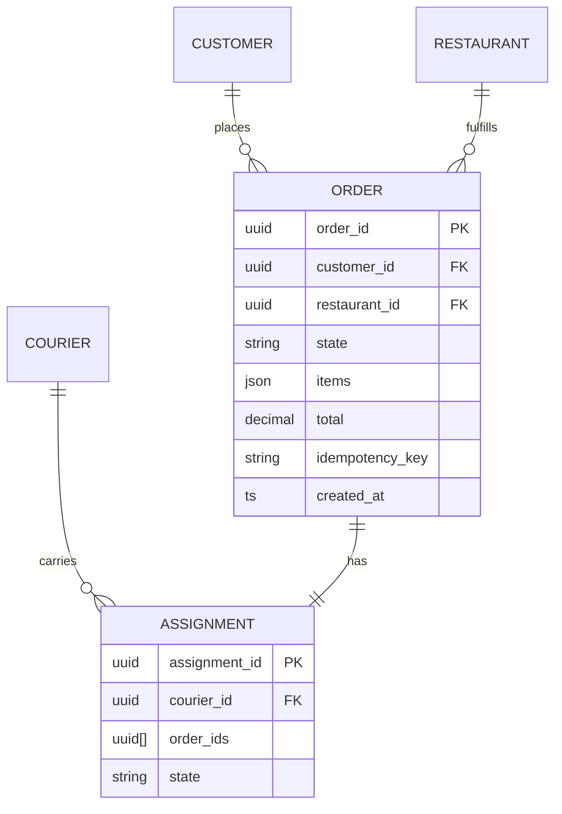

## 2.6 High-level architecture

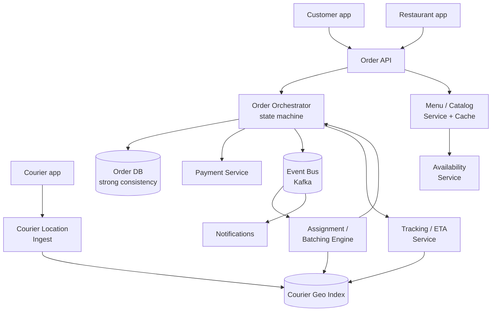

## 2.7 Deep dive A — Order lifecycle state machine

The order is the **single source of truth** and must be strongly consistent — money is attached to it and three parties act on it. Model it as an explicit state machine, persisted transactionally, with each transition guarded and idempotent.

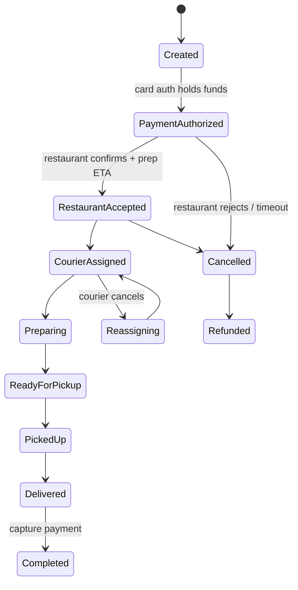

Key design points:
- **Authorize early, capture late.** Auth the card at order placement (hold funds); **capture** only on delivery. If the restaurant rejects, **void the auth** (no charge appears). This is a payment **saga** (see §5) — order placement is a multi-step transaction across order + payment + assignment, each with a compensation. **This is the elegant move to surface out loud:** you never charge a customer for food that never cooks, because you held funds rather than took them, and you release the hold on rejection.
- **Idempotency key** on order creation prevents the double-tap / retry from creating two orders.
- Every transition emits a **domain event** to Kafka (`order.accepted`, `order.ready`) that drives assignment, notifications, and tracking — **event-driven** decoupling (see [Messaging / Event-Driven](04-messaging-event-driven.md)) so the orchestrator stays simple and the read-side (tracking, analytics) is eventually consistent off the log.
- Restaurant rejection and courier cancellation are **first-class states with compensations**, not exceptions. *"Model the unhappy paths as states, not catch-blocks"* is the Staff framing.

## 2.8 Deep dive B — Courier assignment & batching

Harder than ride matching because:
1. **Timing.** Pick up food when it's *ready*. Assign a courier to arrive ~when prep finishes — too early = idle courier holding the slot; too late = cold food. So assignment is a function of **predicted prep time + courier ETA-to-restaurant**.
2. **Batching.** One courier can carry 2–3 orders from nearby restaurants going to nearby drop-offs. Batching cuts cost per delivery dramatically but risks delaying the first order.
3. **Prediction-heavy.** Prep-time prediction, courier-travel prediction, and demand forecasting all feed the assignment.

**The timing coupling, made concrete:**

```
delivery time = prep_time + courier_to_restaurant + wait_at_restaurant + restaurant_to_customer

dispatch goal: courier departs so that
   now + courier_to_restaurant ≈ order_ready_time
   ⇒ minimize wait_at_restaurant (idle courier) AND minimize food_sitting_cold
```

**Approach (decide-don't-enumerate):** *"Like ride-sharing, I'll do windowed batched optimization per region rather than greedy nearest-courier, because greedy ignores both the timing coupling and the batching economics. Every few seconds I solve an assignment over {orders ready soon} × {available couriers}, objective = minimize total lateness + delivery cost, subject to batching constraints — orders combinable if within X minutes and Y km. It's a min-cost-flow / VRP-flavored problem solved heuristically at scale. Revisit to greedy only in sparse regions."*

The interview gold is articulating this **timing coupling** — assignment is not "nearest courier," it's "right courier at the right time, possibly batched." That sentence is the differentiator; risk-weight your minutes onto it.

## 2.9 Deep dive C — Menu, availability & ETA

- **Menu/catalog** is read-heavy and slow-changing → **CDN + cache**, eventually consistent. Restaurants edit menus infrequently; invalidate on change. *Name it and move on — there's no crux here.*
- **Availability** (restaurant open? item "86'd" / sold out?) is more dynamic → separate service, short TTL cache, push updates. It's still **soft consistency** — briefly showing a just-sold-out item is recoverable (restaurant rejects, refund), unlike e-commerce hard inventory. **This is the key contrast to draw with §4:** food "inventory" is soft because the restaurant-accept step is a natural re-validation gate, so you don't need ACID on menu items; e-commerce physical stock has no such forgiving gate, so it needs strong consistency. Naming *why* the same word ("inventory") gets different consistency in two systems is a strong signal.
- **ETA prediction** is an ML problem fed by prep-time history, courier location, traffic, time-of-day. It's a *prediction*, not a guarantee — eventually consistent and continuously refined as the order progresses.

## 2.10 Scaling & bottlenecks

- Menu reads → cache/CDN; never let browse traffic hit the order DB.
- Order DB partitioned by orderId with region affinity; modest write rate, so strong consistency is affordable.
- Courier-location firehose → same Kafka + in-memory geo pattern as §1.
- Assignment optimizer per region → horizontal by region; hot regions sub-shard.

## 2.11 Trade-offs & failure modes

| Failure / edge case | Consequence | Mitigation |
|---|---|---|
| **Restaurant doesn't accept** | Order stuck, funds held | Timeout → cancel + **void auth** + notify customer |
| **Courier cancels mid-flight** | Food prepared, no carrier | Re-enter assignment with urgency boost (food already hot) |
| **No couriers available** | Order can't be delivered | Queue, surge courier pay, or delay; worst case cancel + refund |
| **Saga partial failure** (auth ok, order write failed) | Money held, no order | Compensate by voiding auth; idempotency key makes retry safe |
| **Availability stale** (item just 86'd) | Customer orders sold-out item | Restaurant rejects → refund; soft consistency tolerates this |
| **Double-tap order submit** | Two orders, two charges | Idempotency key on order creation dedups |

## 2.12 What the interviewer is really testing

That you can model a **three-sided marketplace with a rigorous order state machine**, recognize where **strong consistency** lives (order + payment) vs **eventual** (menu, availability, location, ETA), and use the **saga pattern** for the place-order flow with proper compensations. **Staff-level insight:** the assignment problem's defining feature is **temporal coupling to prep time** plus **batching economics** — and like ride-sharing, the right answer is **windowed optimization, not greedy nearest**. Bonus depth: *authorize-early/capture-late* with auth-voiding on rejection is the elegant way to avoid charging customers for food that never cooks — and recognizing that menu "inventory" is *soft* (re-validated at restaurant-accept) unlike e-commerce's hard stock is the cross-system judgment that lands.

---

# 3. Hotel / Flight Booking — Booking.com / Airbnb / Expedia

> **Staff earmark (minute five):** *"The whole system splits cleanly in two, and I'll say so up front. Browse and search are a vast, slow-changing, eventually-consistent read problem — billions of availability cells served from Elasticsearch and a cache. Booking is a small, sacred, strongly-consistent write problem — never double-book the last room. The two hard parts are: preventing double-booking under concurrency, and running the booking as a saga across inventory and an external payment gateway. The elegant connective tissue is a two-phase soft-hold that keeps availability honest during a slow human checkout without holding DB locks. Search is standard; I'll go deep on double-booking, the saga, and the hold."*

## 3.1 Problem framing

Search a vast, slow-changing **inventory** (rooms/seats/listings) by date and attributes, then **book** a specific unit for specific dates — and **never double-book it**. The defining challenge is the **double-booking problem**: two users trying to grab the last room for the same night. This is a **strong-consistency, locking, idempotency** problem wrapped in a **search-at-scale, caching-vs-accuracy** problem, with a **saga across inventory + payment**.

## 3.2 Requirements

**Functional**
- Search by location, dates, guests, filters; ranked results with prices & availability.
- View a property/flight; see real-time availability & price.
- **Reserve → pay → confirm** a booking for specific dates, exclusively.
- Cancel / modify; release inventory back.

**Non-functional**
- **Scale:** millions of properties × 365 days × room-types = billions of availability cells. Search QPS high (browse-heavy, ~100:1 read:book).
- **Latency:** search p99 < 300ms; booking can be slower (seconds) but must be correct.
- **Consistency:** **booking/inventory is STRONGLY consistent** — no double-booking, ever. Search/availability display is **eventually consistent / cached** (a slightly stale price or "available" is acceptable *as long as the final booking step re-checks authoritatively*). Idempotency mandatory.
- **Availability (uptime):** high; an outage costs bookings directly.

## 3.3 Capacity estimation

```
Properties                 = 5,000,000
Room types per property    ≈ 5
Horizon                    = 500 days
Availability cells         = 5M * 5 * 500 = 12.5 billion (date × room-type cells)
  each cell ~ a few bytes (count available)  → ~tens of GB authoritative; cacheable subsets hot

Searches/day               = 500,000,000  (browse-heavy)
  avg                      = 500M / 86,400 ≈ 5,800 /s
  peak                     ≈ ~25,000 /s
Bookings/day               = 5,000,000  → ~60/s avg, ~300/s peak
  → read:write ≈ 100:1   ⇒ cache search hard, keep booking authoritative
```

**Insight:** search is 100× booking. Serve search from **read-optimized, cached, eventually-consistent** stores (Elasticsearch + availability cache). Reserve the expensive **strongly-consistent transaction** for the actual booking on a tiny fraction of traffic. **The math licenses the decisive call:** at ~300 bookings/sec, even with the slowest correct locking strategy, a single relational/NewSQL inventory store partitioned by propertyId is plenty — *do not* over-engineer the write path.

## 3.4 API design

```
GET  /v1/search?location&checkin&checkout&guests&filters
     → ranked [{ propertyId, price, available }]  (cached, eventually consistent)

GET  /v1/properties/{id}/availability?checkin&checkout
     → authoritative availability for booking step

# Two-phase booking
POST /v1/reservations    { userId, propertyId, roomType, checkin, checkout, idempotencyKey }
     → { reservationId, holdExpiresAt, price }      # soft hold, e.g. 10-15 min

POST /v1/bookings        { reservationId, paymentToken, idempotencyKey }
     → { bookingId, status: CONFIRMED }             # saga: charge + commit inventory

POST /v1/bookings/{id}/cancel
```

The two-phase API — a `reservation` (hold) endpoint distinct from a `booking` (commit) endpoint — is itself the answer to "how do you keep availability honest during a slow human checkout." Make that explicit; the API *is* the design.

## 3.5 Data model

| Store | Data | Partition key | Consistency |
|---|---|---|---|
| **Search index** (Elasticsearch) | property docs, geo, attrs, cached price/avail | geo / propertyId | eventual |
| **Inventory** (RDBMS/NewSQL) | (property, roomType, date) → units_total, units_held, units_booked | **propertyId** (co-locate a property's calendar) | **strong (ACID)** |
| **Reservations** | reservationId, status, hold_expiry | reservationId | strong |
| **Bookings** | bookingId, refs, payment_ref, status | bookingId | strong |

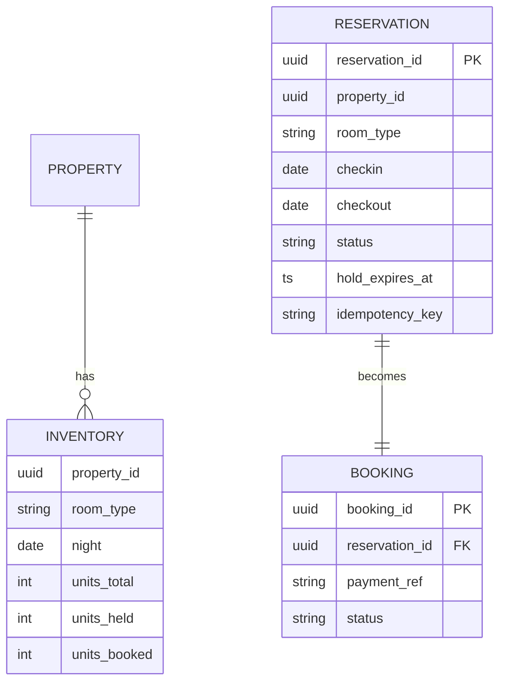

**Partition by propertyId** so all nights/room-types of one property live together — the booking transaction (which spans the consecutive nights of a stay) is then a **single-shard ACID transaction**, avoiding distributed commits. **This is a deliberate, defendable schema decision, not an accident:** you choose the partition key to make the strongly-consistent operation single-shard, because a multi-night stay touches consecutive date rows and you want them in one transaction on one node. State *why* you partitioned this way.

## 3.6 High-level architecture

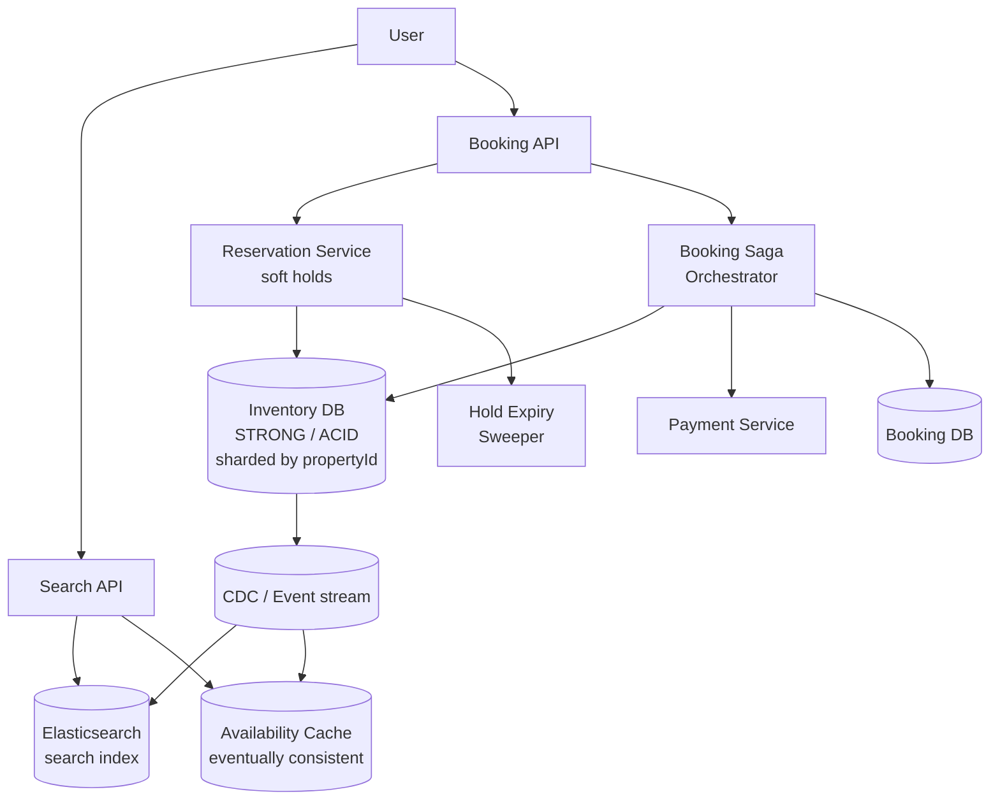

Note the **CDC stream**: the authoritative inventory DB publishes changes that asynchronously update the search index and availability cache. Search is thus **eventually consistent** off the source of truth — fast and scalable, occasionally stale, always reconciled at booking time. This is the canonical *"source-of-truth writes, eventually-consistent read replicas via change-data-capture"* pattern (see [Databases](06-databases.md)).

## 3.7 Deep dive A — Preventing double-booking

This is *the* question — risk-weight most of your time here. Multiple correct answers; defend trade-offs and then **commit to one**:

**1. Atomic conditional decrement (the workhorse — this is my default).** Availability is a counter per (property, roomType, night). Booking = a single transaction that conditionally decrements all nights of the stay:
```sql
BEGIN;
UPDATE inventory SET units_held = units_held + 1, hold_key = :hk
 WHERE property_id=:p AND room_type=:rt AND night >= :ci AND night < :co   -- checkout exclusive
   AND (units_total - units_held - units_booked) >= 1
   AND hold_key IS DISTINCT FROM :hk;   -- idempotent: a retried hold won't re-increment
-- assert affected_rows == number_of_nights, else ROLLBACK
COMMIT;
```
**The all-or-nothing property is NOT automatic — it is enforced by the application-level affected-rows assert inside the transaction.** A multi-row `UPDATE` silently **skips** the nights whose `avail >= 1` condition fails and does **not** roll back on its own; if even one night is full you get a *partial* hold that will happily COMMIT. So the application must check `affected_rows == number_of_nights` and issue `ROLLBACK` otherwise — *a forgotten assert commits a partial hold* (a real, subtle correctness bug). Note the date predicate is `night >= :ci AND night < :co` — **checkout-exclusive** (you don't occupy the checkout night), not a `BETWEEN ... :co-1` bind-arithmetic expression, which isn't valid bind syntax. The `UPDATE` also incorporates the **idempotency / hold key** (`hold_key`) so a retried reservation request matches the already-held rows instead of double-incrementing `units_held`. Because it's one shard (partitioned by propertyId), this is a clean local ACID transaction. The DB's row locks serialize the two racers; first commits, second sees the condition fail. **This is the answer to lead with** — it is correct, simple, and uses the database's own concurrency control rather than inventing your own — *provided you don't forget the affected-rows assert.*

**2. Two-phase hold (reservation) + commit.** Real flows insert a human step (enter card details). You don't want to hold a DB row lock for 10 minutes. So: **phase 1** create a *soft hold* (increment `units_held`, set `hold_expires_at`); **phase 2** on payment success convert hold → booking (`units_held--`, `units_booked++`). A **sweeper** expires abandoned holds, releasing inventory. The hold makes availability honest during checkout without long-lived DB locks. *(This is the elegant move — see Deep dive on the hold below.)*

**3. Optimistic concurrency / version column.** Read availability + version, write with `WHERE version=:v`; on conflict, retry. Good for low-contention; degrades under hot contention (last room, flash sale).

**4. Pessimistic `SELECT ... FOR UPDATE`.** Lock the inventory rows for the stay inside the transaction. Simple and correct; reduces concurrency on that property but bookings-per-property are low, so fine.

**Decide-don't-enumerate:** *"My default is the atomic conditional decrement inside a single-shard ACID transaction (option 1), wrapped in the two-phase hold (option 2) to handle the slow human checkout. I avoid a distributed lock (Redis Redlock keyed on property+night) because a lock without a fencing token plus a non-transactional store risks lost updates — I'd rather the database own correctness than bolt correctness onto a cache. Revisit toward bucketing/queuing only for a flash-sale-grade hot property, which I'll handle the same way as e-commerce in §4."*

**The golden rule (say this verbatim):** *the search index and availability cache may lie (eventual consistency), but the booking transaction always re-validates against the authoritative inventory DB.* Stale "available" in search just becomes a "sorry, just booked" at commit — acceptable and rare. Eventual on the display, strong on the commit.

## 3.8 Deep dive B — The booking saga (inventory + payment)

You cannot run a 2PC across your inventory DB and a third-party **payment gateway** — you'd hold inventory locks across a multi-second external call, and gateways don't enlist in your transaction. **Saga, not 2PC, because the gateway is external and won't participate in a coordinator; revisit never (this constraint is permanent).**

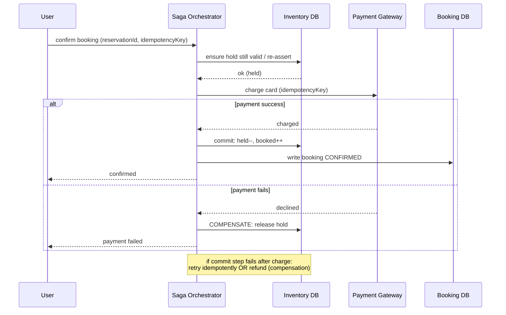

- **Order matters:** hold inventory → charge → commit. If you charge first and inventory is gone, you must refund. By holding *first*, the inventory is reserved before money moves. State the ordering rationale explicitly — it's a Staff-level subtlety.
- **Idempotency keys** on both the charge and the booking write make every step retry-safe (the saga *will* retry).
- **Compensations:** payment fail → release hold; commit fail after charge → either retry the commit (preferred, idempotent) or refund.
- **Exactly-once illusion** = at-least-once saga steps + idempotent operations. See §5 for the money depth.

## 3.9 Deep dive C — Search & the cache-vs-accuracy trade-off

- **Search index (Elasticsearch/Lucene):** denormalized property docs with geo, amenities, ratings, *and a cached price/availability snapshot*. Enables sub-300ms ranked geo + filter queries over millions of properties. *Name it; it's standard.*
- **Availability cache:** authoritative inventory is huge (billions of cells) and changes constantly; you can't query it for every search result. So cache availability per (property, date-range) with short TTL, fed by **CDC** from the inventory DB.
- **The trade-off:** showing stale availability is *cheap to be wrong about* (recovered at booking), so favor freshness-vs-cost tuning, not strict correctness, in search. **Price** similarly is cached/estimated in search and **re-quoted authoritatively** at the reservation step (and pinned to the reservation). This separation — *eventual for browse, strong for commit* — is the whole architecture in one sentence. Note this is the same **quote-then-honor** pattern as rideshare surge (§1.9): the estimate is eventual, the committed quote is pinned strong.

## 3.10 Scaling & bottlenecks

- **Search** scales horizontally (ES shards by geo); add replicas for read QPS; CDN cache popular queries.
- **Inventory DB** sharded by propertyId — bookings per property are low, so no single-property hot shard except *flash sales / a famous listing*; that hot-key case borrows from §4 (queue/segment the contention).
- **Hold sweeper** must keep up with hold creation; partition by property.

## 3.11 Trade-offs & failure modes

| Failure / edge case | Consequence | Mitigation |
|---|---|---|
| **Stale search availability** | "Available" in search, gone at book | Graceful "just booked" at commit re-validation; acceptable & rare |
| **Abandoned holds** | Phantom unavailability | Sweeper releases on TTL; tune hold length (too long = phantom unavail, too short = user loses cart) |
| **Charge succeeded, commit lost** | Money taken, no booking | Idempotent retry of commit, else refund saga; never leave money taken without a booking |
| **Deliberate overbooking** (airlines) | Not a bug — a business policy | Model as `units_total` inflated by no-show factor + bump/compensation flow |
| **Hot property** (famous listing flash) | Single-shard contention | Borrow §4 bucketing/queue; rare enough to not over-engineer the common case |

## 3.12 What the interviewer is really testing

Whether you can **cleanly separate eventually-consistent search from strongly-consistent booking** and articulate a **correct, concrete double-booking solution** (atomic conditional decrement / hold + commit, single-shard ACID via propertyId partitioning). And whether you reach for a **saga (not 2PC)** across inventory + external payment, with **idempotency and compensations**. **Staff-level insight:** the elegant move is the **two-phase soft-hold** — it makes availability honest during a slow human checkout *without holding DB locks*, decouples the payment latency from inventory contention, and turns the rare race into a clean, recoverable compensation rather than a correctness violation. Choosing your partition key *so that the strong operation is single-shard* is the design judgment that separates Staff from Senior.

---

# 4. E-commerce Platform — Amazon-style

> **Staff earmark (minute five):** *"The boring 90% — catalog, search, cart, recommendations — is all eventually consistent, cached, and high-scale-but-easy; I'll name it and move past it. The hard 10% is two things: inventory must never oversell a physical good — strong consistency — and the checkout saga must never double-charge or double-order under retries — idempotency. And the one genuinely nasty case is the flash sale: thousands of requests per second all hitting one SKU's inventory row, which a naive single-row lock cannot survive. That hot-key problem is where I'll spend most of my time."*

## 4.1 Problem framing

Catalog + search + cart + checkout, where the consistency-critical core is **inventory** (don't oversell) and the **checkout saga** (cart → reserve inventory → pay → fulfill). The signature hard case is the **flash sale / hot item** — thousands of buyers contending for the last units of one SKU, a single hot key that breaks naive locking.

## 4.2 Requirements

**Functional**
- Product catalog + search/browse.
- Cart (add/remove, persistent).
- Checkout: reserve inventory, take payment, create order, hand to fulfillment.
- Idempotent order placement; cancellation/refund.

**Non-functional**
- **Scale:** hundreds of millions of SKUs; huge browse traffic; orders a small fraction.
- **Latency:** browse/search fast (cached); checkout seconds but correct.
- **Consistency:** **inventory STRONGLY consistent** (no oversell of physical goods). Order + payment strongly consistent. Catalog, search, recommendations, cart **eventually consistent**. Idempotency mandatory on checkout.
- **Availability:** very high; flash sales create extreme bursts.

## 4.3 Capacity estimation

```
SKUs                      = 300,000,000
Browse/search QPS (peak)  ≈ 1,000,000 /s   (Prime Day scale)  → CDN + cache catalog
Orders/day                = 50,000,000 → ~580/s avg, ~3,000/s peak normal day
Flash sale hot SKU        : 100,000 buyers in 60s for 1,000 units
                          ⇒ ~1,600 req/s averaged — but front-loaded:
                            most buyers hit in the FIRST 1-3s ⇒ PEAK is
                            TENS of thousands req/s ALL on ONE inventory key  ← the hard part
Cart writes               : moderate; eventually consistent KV (e.g. DynamoDB)
```

The flash-sale number is the one to highlight: ordinary inventory writes are spread across SKUs, but a hot SKU concentrates the contention on a **single row/key**. The crucial nuance: the ~1,600 req/s is only the 60-second *average* — and 1,600/s on one Postgres row is actually survivable, so that number alone doesn't justify the single-row-collapse argument. The spike is **front-loaded into the first 1-3 seconds** (everyone pounces the instant the drop opens), so the realistic **peak is tens of thousands of req/s on the one inventory key** — *that* is what kills a single-row lock. **This is the line to say out loud:** *"Normal inventory is trivially distributed across 300M SKUs. The entire difficulty is concentrated in one number — a single SKU drawing tens of thousands of writes/sec in the opening seconds of the drop — and that's where the design earns its money."* Risk-weighting in one sentence.

## 4.4 API design

```
GET  /v1/catalog/search?q&filters         → results (cached, eventual)
GET  /v1/products/{sku}                    → product detail (cached)
PUT  /v1/cart/{userId}/items               { sku, qty }
POST /v1/checkout   { userId, cartId, paymentToken, idempotencyKey }
                    → { orderId, status }
GET  /v1/orders/{id}
POST /v1/orders/{id}/cancel
```

## 4.5 Data model

| Store | Data | Partition key | Consistency |
|---|---|---|---|
| **Catalog** (doc store + ES) | product, attrs, media | sku | eventual (cached) |
| **Inventory** (RDBMS/NewSQL or sharded) | sku → available, reserved | **sku** | **strong** |
| **Cart** (KV, e.g. DynamoDB/Redis) | userId → items | userId | eventual |
| **Orders** (RDBMS) | order, lines, state, payment_ref | orderId / userId | strong |
| **Idempotency** | key → result | idempotencyKey | strong |

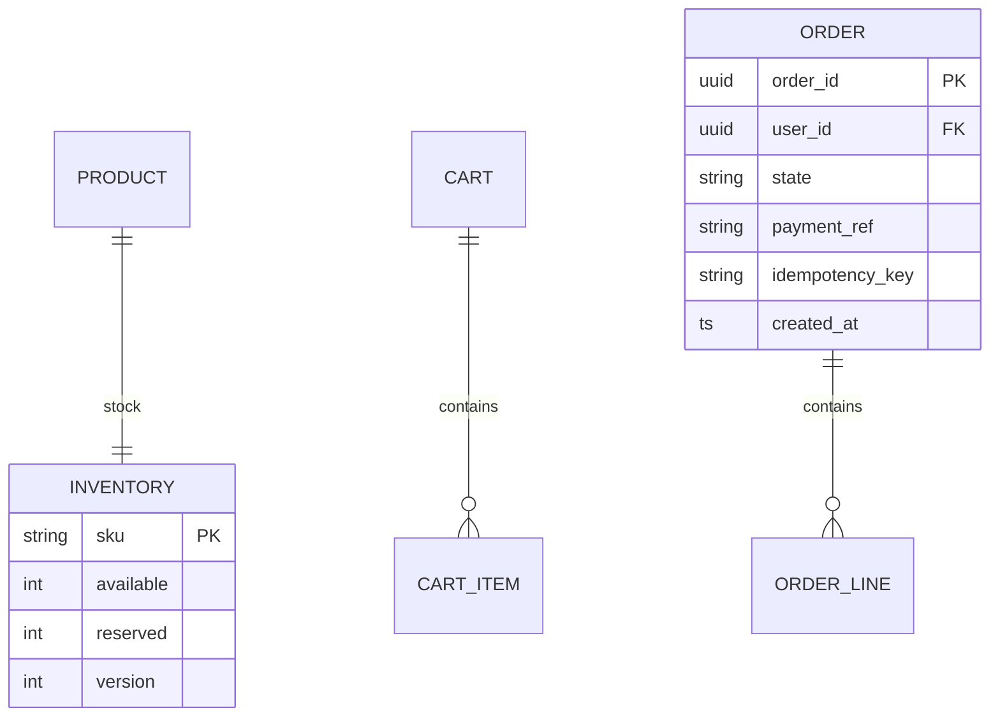

## 4.6 High-level architecture

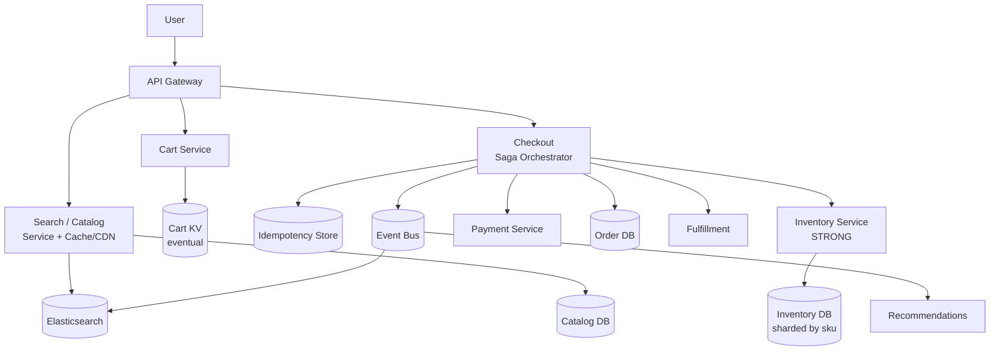

## 4.7 Deep dive A — Inventory & oversell prevention

Same toolkit as §3 (atomic decrement, reservations, optimistic/pessimistic), with one key pattern worth stating as a rule:

**Reserve-on-checkout, not on add-to-cart.** Adding to cart does *not* reserve stock (carts are abandoned constantly; reserving would phantom-deplete inventory). Reservation happens at checkout, with a short TTL, released if payment fails or the saga aborts. Authoritative decrement:
```sql
UPDATE inventory SET reserved = reserved + :qty
 WHERE sku=:sku AND (available - reserved) >= :qty;   -- 0 rows ⇒ out of stock
```
On fulfillment, `available -= qty; reserved -= qty`. On abort/timeout, `reserved -= qty`.

**Eventual vs strong here (the boundary, stated):** the *displayed* "in stock" on the product page is eventually consistent (cached); the *reservation* is strongly consistent. Showing "in stock" then failing at checkout is acceptable (rare, recoverable). Overselling a physical good is not — you'd have to cancel an order and apologize, a real customer-trust cost. That asymmetry *is* the reason the boundary sits exactly where it sits.

## 4.8 Deep dive B — The hot-item / flash-sale problem

This is the crux — spend your time here. A single SKU drawing **tens of thousands of req/s in the opening seconds of the drop** (not the modest 60-second average of ~1,600/s, which a single row would actually survive — the spike is front-loaded) defeats a single-row lock (lock convoy: every transaction serializes on one row, throughput collapses, latency explodes). Techniques (combine them):

1. **Inventory sharding / segmentation.** Split the SKU's N units into K logical buckets (e.g., 1000 units → 10 buckets of 100), each its own row, possibly on different shards. A request hashes to a bucket and decrements there. Spreads contention 10×. On empty bucket, fall through to another. Trade-off: harder to report exact remaining count; risk of "false out of stock" when units are stranded in buckets — mitigate by rebalancing.
2. **Front the inventory with a queue / token bucket.** Admit only as many checkout attempts as there are units (+ margin). A **request-admission gate**: issue N tokens for N units; only token-holders proceed to the inventory decrement. Excess users get "sold out" instantly without touching the DB. This converts a thundering herd into a controlled stream.
3. **In-memory atomic counter (Redis) as the front line.** `DECR` on a Redis key is atomic and handles ~100k+ ops/s on one key. Use Redis as the **reservation gate**; the durable DB is updated asynchronously and reconciled. Risk: Redis is not durable by default — pair with persistence/replication and treat the DB as the eventual source of truth, accepting a tiny reconciliation window. (Some teams accept Redis as authoritative for the *sale window* then settle to DB.)
4. **Virtual waiting room.** For mega-drops, a queue page admits users in batches, smoothing the spike before it reaches inventory at all.

**The interview-strong answer (commit to it):** *"My default is: add-to-cart doesn't reserve; checkout reserves. For a hot SKU I front the authoritative decrement with an in-memory atomic counter (Redis DECR) as the admission gate, and shard the stock into buckets so the contention never serializes thousands of requests on one DB row — while the durable DB remains the source of truth, reconciled asynchronously. I deliberately move the contention into an in-memory counter and accept a tiny reconciliation window, because the alternative — serializing the front-loaded tens-of-thousands of writes/sec on one Postgres row in the opening seconds — simply collapses. Revisit toward a full virtual waiting room only for mega-drops where even the gate is overwhelmed."*

**Cite experience:** *"This 'decouple the contention from the durable correctness' move is exactly what we did in chat for hot channels — a viral channel's message-counter / fan-out can't serialize on one durable row, so you front it with an in-memory aggregate and settle to the store of record. Same shape: the hot key is the enemy, and the fix is always to move contention off the durable row without losing durability."*

## 4.9 Deep dive C — The checkout saga

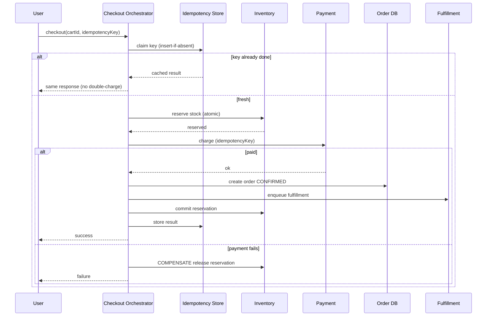

- **Idempotency key** claimed *before* any side effect; replays return the stored result → no double order, no double charge.
- **Saga, not 2PC** — payment is external; inventory, order, fulfillment are separate services with compensations (release stock, void/refund charge, cancel order).
- **Order of operations:** reserve → charge → confirm → fulfill → commit-reserve. Reserving before charging avoids charging for unavailable stock.

## 4.10 Scaling & bottlenecks

- Catalog/search → CDN + ES, fully decoupled from inventory; can absorb 1M QPS. *Name it, move on.*
- Cart → eventually-consistent KV, scales trivially.
- Inventory → sharded by sku; hot SKUs handled by §4.8 techniques.
- Checkout orchestrator → stateless, scales horizontally; the bottleneck is always inventory contention and payment latency.

## 4.11 Trade-offs & failure modes

| Failure / edge case | Consequence | Mitigation |
|---|---|---|
| **Reservation leak** (saga crashes mid-flight) | Stock stuck reserved | TTL sweeper releases; idempotent re-run |
| **Double charge** | Customer billed twice | Idempotency key on payment + checkout, claimed before side effects |
| **Oversell** | Physical good promised twice | Atomic conditional decrement; bucketing must reconcile stranded units |
| **Stale "in stock"** | Fail at checkout | Acceptable; rare, recoverable |
| **Payment slow/timeout** | Unknown charge state | Idempotent retry; never re-charge blindly (see §5.8) |
| **Stranded units in buckets** | False "sold out" | Periodic rebalance across buckets |

## 4.12 What the interviewer is really testing

Whether you (1) draw the **strong/eventual boundary** correctly (inventory + payment strong; catalog/cart/search/recs eventual), (2) reserve at **checkout not add-to-cart**, (3) build the **checkout saga with idempotency keys** to prevent double-charge/double-order, and (4) have a real answer for the **hot-key flash-sale** contention. **Staff-level insight:** flash sale is where junior answers ("just use a DB transaction") fall apart — the differentiator is recognizing single-row serialization as the bottleneck and applying **inventory bucketing + an in-memory atomic admission gate**, while keeping the durable DB as the reconciled source of truth. That "decouple the contention from the durable correctness" move is the Staff signal.

---

# 5. Payment System / Wallet

> **The most consistency-critical system in this module.** Eventual consistency is *not acceptable* for money. Every dollar must be accounted for; no double-charge, no lost charge, no phantom balance. This section goes deepest.

> **Staff earmark (minute five):** *"Let me set expectations on consistency immediately, because it's the whole game: this is the one system where eventual consistency is categorically wrong — a balance read that's stale lets two concurrent withdrawals both succeed and overdraw the account, and that is a correctness bug that loses real money and draws regulatory attention. So everything authoritative is strong, serializable ACID. The good news from the capacity math is that payment volume is small — about a thousand transactions per second — so I can afford full ACID; the challenge is not throughput, it's correctness under failure. The three hard parts: the double-entry ledger, idempotency to kill double-charges, and the timeout-during-charge case where I don't know if the customer was charged. That last one is where most of my time goes."*

## 5.1 Problem framing

Move money correctly: charge cards, hold balances, transfer between wallets, pay out — with **ACID guarantees, a double-entry ledger, idempotency (no double-charge), exactly-once effects, reconciliation against external providers, and PCI compliance**. The system orchestrates external payment providers (which can fail, time out, and lie about state) while keeping an internally consistent ledger.

## 5.2 Requirements

**Functional**
- Authorize / capture / void / refund card payments.
- Wallet: balance, top-up, transfer, withdraw.
- Idempotent payment intents.
- Reconciliation with provider settlement reports.
- Audit trail (immutable).

**Non-functional**
- **Scale:** millions of transactions/day; spikes during sales.
- **Latency:** payment authorization seconds (bounded by external gateways); ledger writes fast.
- **Consistency:** **STRONG / ACID, full stop.** The ledger must always balance (sum of debits = sum of credits). **Exactly-once** effect on balances. No partial writes.
- **Availability:** high, but **correctness trumps availability** — when in doubt, fail closed (don't move money) rather than risk a double-spend. *This is the rare system where you deliberately choose C over A in the CAP trade-off, and you should say so explicitly.*
- **Security:** PCI-DSS; never store raw PAN; tokenize.

## 5.3 Capacity estimation

```
Transactions/day        = 10,000,000
avg                     = ~116 /s
peak (sales)            ≈ ~1,000 /s
Ledger entries/txn      = 2+ (double-entry: ≥1 debit, ≥1 credit; often 4 with fees)
Ledger writes/s peak    ≈ 1,000 txn * 4 ≈ 4,000 entries/s   → very manageable for ACID
Storage                 : entries are append-only; 10M txn/day * 4 * ~300B ≈ 12 GB/day
                          → ~4 TB/yr, partitioned by account/time, NEVER deleted (audit)
```

**Insight (the YAGNI call):** payment *volume* is modest compared to the firehoses above — so you can **afford strong ACID consistency**. The challenge isn't throughput; it's **correctness under failure**. *"Reaching for an eventually-consistent sharded ledger here would be over-engineering a 4,000-writes/sec problem — and worse, it would sacrifice the exact property the system exists to guarantee."* Say that; it shows you match machinery to load and you understand the stakes.

## 5.4 API design

```
POST /v1/payment-intents
     { amount, currency, payerId, payeeId, idempotencyKey }
     → { intentId, status: REQUIRES_CONFIRMATION }

POST /v1/payment-intents/{id}/authorize  { paymentToken, idempotencyKey }
     → { status: AUTHORIZED }            # funds held, not captured

POST /v1/payment-intents/{id}/capture   { idempotencyKey }
     → { status: CAPTURED }             # money actually moves

POST /v1/payment-intents/{id}/void
POST /v1/payments/{id}/refund   { amount, idempotencyKey }

# Wallet
POST /v1/wallets/{id}/transfer  { toWalletId, amount, idempotencyKey }
GET  /v1/wallets/{id}/balance
```

Every mutating endpoint takes an **idempotencyKey**. No exceptions. *Say it as a hard rule, not a feature — "if it moves money, it carries an idempotency key, period."*

## 5.5 Data model — the double-entry ledger

The heart of the system — go deep here. Every money movement is recorded as **balanced entries**: total debits = total credits, always. You never `UPDATE balance SET balance = balance - x`; you **append entries** and derive balance. The append-only, derive-don't-mutate property is what makes the ledger auditable and what makes "exactly-once" enforceable.

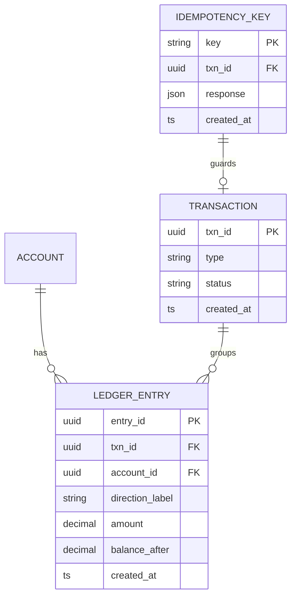

Each entry stores a **signed `amount`** — credits are positive, debits are negative — so the math is unambiguous regardless of account type (asset vs liability). A `direction_label` (DEBIT/CREDIT) may be kept for human readability, but it is *not* what the math reads; the sign is. Example: user pays merchant $100 (with $3 platform fee):

| txn_id | account | direction_label | amount (signed) |
|---|---|---|---|
| T1 | user_wallet | DEBIT | −100.00 |
| T1 | merchant_wallet | CREDIT | +97.00 |
| T1 | platform_fee | CREDIT | +3.00 |

**Per-transaction invariant:** `SUM(amount across all entries of a txn) = 0` (−100 + 97 + 3 = 0) — debits exactly offset credits. The transaction is **one ACID commit**; the invariant (sums to zero + non-negative resulting balance where required) is enforced inside it. An account's balance is `SUM(amount)` over its entries — credits add, debits subtract, with no account-type lookup needed.

**On `balance_after`:** the per-entry `balance_after` is *not* a free fast-read that contradicts "balance is derived, never mutated" — it is a **denormalized cache of the derivation**. It is only well-defined if appends to a given account are **serialized** (a per-account lock or sequence), because the running total depends on a deterministic append order; concurrent unordered appends would each compute a different, racy `balance_after`. So treat it as an optimization that *requires* a serialized per-account append, and have **reconciliation periodically assert** that each stored `balance_after` equals the running `SUM(amount)` up to that entry — it is a checkable cache, not an authoritative substitute for the derivation.

**Partition key:** `account_id` for entries (a wallet's history co-located → fast balance + single-account transactions are single-shard). Cross-account transfers span two accounts; co-locate hot pairs or accept a 2-shard distributed transaction within your own ACID store (NewSQL like Spanner/CockroachDB makes this clean). **Decide-don't-enumerate:** *"For cross-account transfers I'll use a NewSQL store (Spanner/CockroachDB) that gives me real distributed ACID transactions, rather than building a saga inside my own ledger, because both sides are my own data under my own transactional store — a saga is for crossing a trust/system boundary like an external gateway, not for two rows in my own database. Revisit to a saga only if the two accounts ever live in physically separate, non-transactional stores."* This is an important distinction to draw: **saga across external/untrusted boundaries; distributed ACID within your own store.**

## 5.6 High-level architecture

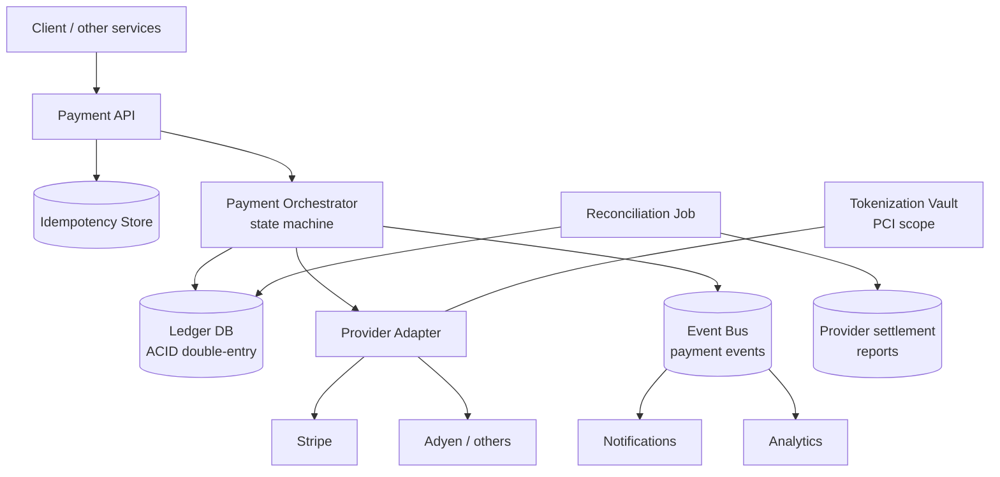

## 5.7 Deep dive A — Idempotency & preventing double-charge

The #1 money bug: a retried request charges twice. Defense:

**Idempotency key, claimed atomically before any side effect.**
```sql
INSERT INTO idempotency_keys(key, status) VALUES (:key, 'IN_PROGRESS');
-- unique constraint on key:
--   success ⇒ first time, proceed
--   conflict ⇒ already seen: return stored response (or wait if IN_PROGRESS)
```
The flow:
1. Client sends `idempotencyKey` (UUID per logical operation, reused across retries).
2. Server `INSERT`s the key. **Unique constraint** is the source of truth — DB enforces single execution.
3. On conflict + `COMPLETED`: return the **stored response** verbatim. Same effect, no re-charge.
4. On conflict + `IN_PROGRESS`: the original is still running — return 409/retry-later (avoid concurrent double execution).
5. On completion: store the response and mark `COMPLETED` **in the same transaction** as the ledger write.

The "store the response in the *same* transaction as the ledger write" detail is load-bearing: if you posted the ledger entries but crashed before recording the idempotency result, a retry would re-post. Atomic coupling of {ledger entries + idempotency record} closes that gap.

**Propagate idempotency to the provider too:** Stripe/Adyen accept idempotency keys — pass yours through so even a retried *gateway* call doesn't double-charge at the provider.

This is how you get **exactly-once money effects out of at-least-once delivery**: at-least-once retries + idempotent (dedup'd) processing = effectively-once. **Cite experience:** *"This is the same principle as message dedup in chat infra — the broker guarantees at-least-once, so the consumer must be idempotent or you double-deliver. The payment version just raises the stakes from a duplicate message to a duplicate charge, so the dedup record is committed atomically with the effect."*

## 5.8 Deep dive B — Authorize/capture & the provider saga (2PC vs Saga)

**Two-phase money (auth then capture):**
- **Authorize:** the gateway places a *hold* on the customer's funds (no money moves yet). Reversible via **void**.
- **Capture:** actually moves the money. Can capture less than authorized (partial), or void if the order is cancelled.

This is itself a built-in safety mechanism: auth at order time, capture at fulfillment, void on cancel — you only take money for goods that ship. (This is the same authorize-early/capture-late pattern used by food delivery §2.7 and e-commerce checkout.)

**Why Saga, not 2PC, across providers:** Two-phase **commit** needs all participants to hold prepared locks and support a coordinator — external gateways don't. And a network failure during 2PC's commit phase leaves you blocked. So a payment that touches your ledger + an external PSP is a **saga**:

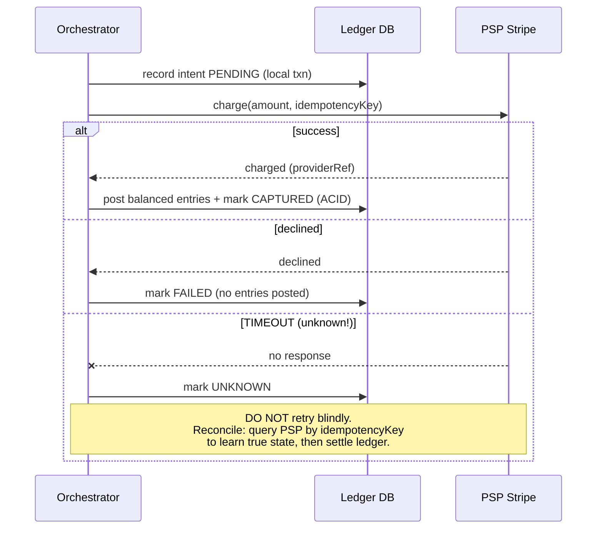

**The dangerous case is the TIMEOUT — this is where you risk-weight the most time.** You don't know if the charge happened. **Never** blindly retry a charge after a timeout (could double-charge). Instead: the idempotency key makes a retry *safe at the provider* (it returns the original result), OR you **query the provider** for the intent's status by your idempotency key and reconcile. Mark the intent `UNKNOWN`, resolve out-of-band. This explicit handling of the unknown is the Staff-level depth — *junior answers don't have an UNKNOWN state at all; they assume responses arrive.*

**Resolve UNKNOWN actively, in seconds-to-minutes — do not wait for the daily file.** Every `UNKNOWN` intent is enqueued to an **out-of-band reconciliation poller** that, with backoff, hits the PSP's status endpoint (querying by your idempotency key / intent ref) to learn the true outcome and then settles the ledger — CAPTURED or FAILED — closing the limbo within seconds to minutes. This is the *primary* resolver. **Settlement-file reconciliation (§5.9) is the end-of-day BACKSTOP, not the primary resolver** — relying on it alone would leave money in limbo for up to a day. The poller catches the common case fast; the settlement file catches anything the poller couldn't.

**Cite experience:** *"Anyone who's run distributed systems at scale has been burned by the ambiguous-timeout: the request succeeded on the far side but the ack was lost, so a naive retry double-applies. In money, you cannot 'just retry' — you must be able to ask the far side 'did my operation with key K happen?' and the answer must be authoritative. That's why the idempotency key is propagated to the provider and why reconciliation exists as a backstop."*

**Ledger writes are always local ACID.** You post ledger entries only when the external truth is known. The saga's compensations are **refunds/voids** (you can't "uncharge," so you compensate with an opposite money movement that's itself recorded in the ledger — money systems are append-only and auditable).

## 5.9 Deep dive C — Reconciliation, exactly-once & why eventual-consistency-is-NOT-OK

**Reconciliation** is the safety net that makes the whole thing trustworthy. Providers send **settlement reports** (daily files of what *actually* settled). A reconciliation job compares your ledger to the provider's truth and flags:
- Charges in your ledger missing from settlement (did it really go through?).
- Settlements with no matching ledger entry (a charge you didn't record — the UNKNOWN cases).
- Amount mismatches (fees, FX).

Discrepancies route to a **dispute/repair workflow**. This catches the residue that no amount of in-band idempotency can fully eliminate, because the external world is unreliable. *Reconciliation is not optional belt-and-suspenders — it is the only mechanism that can resolve the UNKNOWN cases definitively, because only the provider's settlement file is ground truth.*

**Why eventual consistency is unacceptable for the ledger (say this with conviction — it's the module's signature call):** if balances were eventually consistent, two concurrent withdrawals could each read an old balance and both succeed → **overdraft / double-spend**. Money requires that the invariant (balance ≥ 0, debits = credits) holds **at every committed instant**, which demands serializable/strong isolation on the affected accounts. The async, eventually-consistent parts are *downstream projections* (notifications, analytics, the user's balance *display* may lag by milliseconds) — never the authoritative balance check that gates a spend.

**Exactly-once for money** = idempotency keys (dedup) + ACID ledger (atomic balanced posting) + reconciliation (catch the unknowns) + append-only audit (never mutate history). There is no single magic primitive; it's this **layered** defense. *The Staff insight is that "exactly-once" is not a thing you turn on — it's an emergent property of four mechanisms cooperating.*

**PCI / security:** never store raw card numbers (PAN). Use a **tokenization vault** (or the provider's tokens) so your services handle only tokens; the PCI scope is isolated to the vault/adapter. Encrypt in transit and at rest; audit every access. *Name PCI scope-minimization and move on — it's important but not the algorithmic crux.*

## 5.10 Scaling & bottlenecks

- Volume is modest → ACID is affordable; scale the ledger by **sharding on account_id**, using NewSQL (Spanner/CockroachDB) for clean cross-account transactions, or carefully co-locating accounts.
- Hot accounts (platform fee/float account that every txn credits) → **shard the hot account** into sub-accounts and aggregate, same trick as flash-sale inventory (§4.8) and ad budget counters (§6.8). *Point out the recurring hot-key fix — it appears in three systems and recognizing the shared pattern is the cross-cutting signal.*
- Read scaling for balance display → materialized `balance_after` + cache (eventual); but `balance_after` is a **denormalized cache that requires a serialized per-account append** (per-account lock/sequence) to be well-defined, and reconciliation must periodically assert it equals the running `SUM(amount)` — it is not a free fast read. The *spend gate* always reads authoritatively (the derived `SUM`), never the cache.

## 5.11 Trade-offs & failure modes

| Failure / edge case | Consequence | Mitigation |
|---|---|---|
| **Double-charge** | Customer billed twice | Idempotency keys (yours + provider's), claimed before side effects |
| **Lost charge / unknown timeout** | Don't know if money moved | Mark UNKNOWN; reconcile via provider query + settlement; **never blind-retry** |
| **Overdraft** | Negative balance / double-spend | Strong (serializable) isolation on the balance check inside the txn |
| **Partial saga** | Money moved, no record (or vice versa) | Compensate with refund/void, recorded as *new* ledger entries |
| **Provider outage** | Can't reach gateway | **Fail closed** (don't move money); queue & retry idempotently on recovery |
| **Fraud / disputes / chargebacks** | Money clawed back later | Modeled as additional ledger transactions, never edits to history |
| **Hot float account** | Every txn contends on one row | Shard the account into sub-accounts, aggregate |

## 5.12 What the interviewer is really testing

This problem separates engineers who *say* "strong consistency" from those who can *build* it. They want: (1) **double-entry ledger** (append-only, always balanced, balance is derived not mutated), (2) **idempotency keys enforced by a unique constraint, claimed before side effects, stored with the response in the same ACID transaction**, (3) **saga not 2PC** across external providers with explicit **UNKNOWN/timeout handling** (never blind-retry a charge), (4) **reconciliation** against provider settlement as the backstop, and (5) **PCI/tokenization**. **Staff-level insight:** the deepest point is that **"exactly-once" for money is not a delivery guarantee — it's an emergent property of at-least-once + idempotent + ACID-ledger + reconciliation working together**, and that the correct posture under uncertainty is **fail-closed and reconcile**, not retry-and-hope. Stating "eventual consistency is categorically wrong for the authoritative balance, and here is exactly why (concurrent overdraft)" is the line that lands — it is *the* signature sentence of this entire module.

---

# 6. Ad Serving Platform

> **Staff earmark (minute five):** *"This system inverts the payment system, and that inversion is the whole insight. Here money is involved — advertiser budgets — but the real-time serving path absolutely cannot afford strong consistency: two million ad requests per second, a hard sub-100ms latency budget, 170 billion impression events a day. So I deliberately make budget counters eventually-consistent and sharded, accept a small bounded overspend, and move the strongly-consistent money guarantee OFF the hot path into offline billing reconciliation. The two hard parts: holding the 100ms budget on the serving path, and bounding the overspend on eventually-consistent budget counters. Knowing WHY the strong-consistency money guarantee belongs offline here — the exact opposite placement from §5 — is the signal."*

## 6.1 Problem framing

When a page/app requests an ad, run a **real-time auction** among candidate ads in **< ~100ms** end-to-end, pick a winner, serve it, and track the impression/click — while respecting **budgets** (don't overspend an advertiser), **pacing** (spend evenly over the day), **frequency caps** (don't show the same ad 50× to one user), and **fraud** detection. The tension: **brutal latency budget** + **eventually-consistent high-volume counters** (impressions/clicks) vs **money-adjacent budget control** that must not massively overspend.

## 6.2 Requirements

**Functional**
- Serve an ad per request via auction (or RTB to external bidders).
- Targeting: match ads to user/context.
- Budget enforcement + pacing.
- Frequency capping.
- Impression/click tracking + billing + fraud filtering.

**Non-functional**
- **Scale:** millions of ad requests/sec at large scale.
- **Latency:** **auction p99 < 100ms** (RTB callouts often capped at ~100ms hard); serving path is the tightest budget in this module.
- **Consistency:** counters (impressions, clicks, spend) are **eventually consistent** and approximate — small over/undercounts are tolerable and reconciled. Budget enforcement is "**strong-ish**": you may slightly overspend in a race, but not by a lot; final billing reconciles. *Money is involved but the real-time path trades exactness for speed.*
- **Availability:** very high; serve *something* always (fallback ads).

## 6.3 Capacity estimation

```
Ad requests/sec (peak)   = 2,000,000 /s
Latency budget           = 100 ms total; targeting+auction+serve within it
Candidate ads/request    : filter millions of ads → ~hundreds candidates → rank
Impressions/day          = 2M/s * 86,400 ≈ 170 billion events/day  ← counter firehose
Clicks (~0.5% CTR)       ≈ 850M/day
Spend updates            : per impression/click → must NOT hit a strongly-consistent
                           per-campaign row 2M times/sec → counters are sharded + async
```

**Insight (the inversion, stated):** the impression firehose (170B/day) is pure **eventually-consistent counting** — Kafka + stream aggregation, never a transactional row per event. Budget is decremented from **distributed, sharded counters** with periodic reconciliation, deliberately trading a sliver of overspend for the latency/throughput. *"Note this is the exact opposite call from the payment system: there, volume was tiny so I could afford ACID; here, volume is enormous so I cannot, and I push the strong guarantee offline. The math forces the placement."*

## 6.4 API design

```
# Serving (hot path, <100ms)
POST /v1/ad-request   { userId/ctx, slot, geo, device }
                      → { adId, creativeUrl, trackingTokens }

# RTB (if real-time bidding to external DSPs)
POST /rtb/bid         { bidRequest }  → { bidResponse }   (DSP side, ~100ms cap)

# Tracking (fire-and-forget, async)
GET  /track/impression?token
GET  /track/click?token

# Campaign mgmt (control plane, not hot path)
POST /v1/campaigns    { budget, dailyCap, targeting, bid }
```

## 6.5 Data model

| Store | Data | Partition key | Consistency |
|---|---|---|---|
| **Ad index** (in-memory, per serving node) | targeting → candidate ads | replicated | eventual (refreshed) |
| **Budget counters** (Redis / sharded) | campaignId → spent (sharded) | campaignId + shard | eventual, reconciled |
| **Frequency cap** (KV, TTL) | (userId, campaignId) → count | userId | eventual |
| **Events** (Kafka → OLAP) | impressions/clicks | time/campaign | eventual |
| **Billing ledger** (RDBMS) | reconciled spend | campaignId | strong (offline) |

## 6.6 High-level architecture

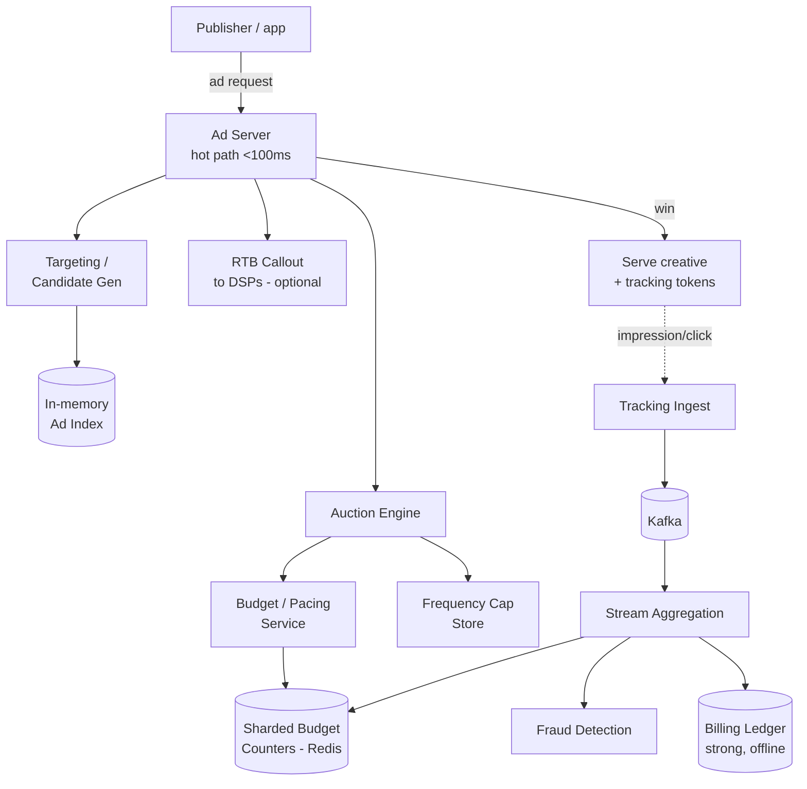

## 6.7 Deep dive A — The low-latency auction (the 100ms budget)

The serving path must fit a tight budget — this is one of the two cruxes. Decompose it:

```
Total ~100ms:
  network in/out         ~20ms
  candidate generation   ~10-20ms  (filter millions of ads → ~hundreds via index)
  RTB callout (if any)   ~50ms     (parallel fan-out to DSPs, HARD timeout)
  auction + ranking      ~10ms     (score candidates, pick winner)
  serve + log async      ~5ms
```
**These items OVERLAP — they do not sum.** Naively added they reach ~95-105ms and would blow the 100ms p99 if run serially; in reality the RTB fan-out is concurrent (callouts run in parallel with each other, behind a hard timeout), candidate gen and ranking pipeline, and logging is fire-and-forget after the response — so the critical path is roughly `network + max(RTB callout, local candidate-gen+rank) + serve`, comfortably inside the budget, not the arithmetic sum.

Techniques to hold the budget:
- **In-memory ad index** on every serving node (no DB call on the hot path). Targeting = an inverted index: candidate ads matching geo/segment/context, intersected fast.
- **Two-stage retrieve → rank** (same pattern as recs §7 and booking search §3): cheap targeting filter yields hundreds of candidates; expensive bid/quality scoring runs only on that small set. *Name the shared pattern explicitly.*
- **Hard timeouts on RTB callouts:** fan out to DSPs in parallel; whoever doesn't respond in ~80ms is dropped. Never let one slow bidder blow the budget. *"A hard deadline that drops slow participants rather than waiting is the only way to hold a p99 — you design for the tail, not the mean."*
- **Auction mechanics:** second-price (Vickrey) or first-price; winner = highest `bid × quality/pCTR`. pCTR comes from a lightweight model scored in-line.
- **Async everything non-essential:** logging, counter updates, fraud checks all happen *after* the response is sent (fire-and-forget to Kafka).

## 6.8 Deep dive B — Budget pacing & counters (eventual consistency for money-ish data)

This is the second crux, and the place the consistency judgment lives. Budget is *money*, but enforcing it with a strongly-consistent transaction per impression at 2M/s is impossible. **The deliberate, defendable trade-off: eventually-consistent sharded counters with a small, bounded overspend, reconciled offline.**

- **Spend counters are sharded** across N keys per campaign; each serving node decrements its local/assigned shard. Periodically sync to a global view. A campaign is "out of budget" when the *aggregate* hits the cap — there's a lag, so you might overspend by a small margin. **Bound it:** stop a bit *early* (e.g., 98% threshold) and reconcile. *State the bound explicitly — "I accept up to ~2% overspend in the race and stop early to cover it" is a Staff answer; "it might overspend a little" is not.*
- **Pacing control:** don't blow the whole daily budget in the first hour. Model it as a control loop — target spend rate = budget / time-remaining; throttle participation probability so spend tracks an even (or front/back-loaded) curve. PID-style controller adjusting a "bid throttle" based on actual-vs-target spend.
- **Frequency capping:** per-(user, campaign) counters with TTL in a fast KV; checked in the auction to exclude over-shown ads. Eventually consistent — a user might see one extra impression across data centers; tolerable.
- **Billing reconciliation:** the **authoritative** spend comes *offline* from the deduplicated, fraud-filtered event stream → billing ledger (strong consistency, but computed in batch/stream, not on the hot path). Advertisers are billed on this reconciled number, not the live approximate counters. **This is where "money strong consistency" actually lives — offline, not on the serving path. That sentence is the whole §6 insight; deliver it deliberately.**

## 6.9 Deep dive C — Tracking, fraud & exactly-once-ish counting

- **Impression/click tracking:** tracking pixels/tokens fire async → Kafka. At 170B events/day, this is a pure stream-processing problem.
- **Dedup:** each impression carries a unique token; the aggregation pipeline dedups (a retried pixel shouldn't double-count) — **idempotent counting** via the token, the same idempotency theme as §5 but for analytics rather than money. *Same primitive, lower stakes — worth noting the recurrence.*
- **Fraud:** bot traffic, click farms, impression stuffing. Filtered in the stream (rate anomalies, invalid signatures, known-bad IPs) *before* spend is billed. Fraud filtering is **why** billing must be offline/reconciled — you can't bill the raw firehose, because the raw firehose contains fraud you must strip first.
- **Approximate counts** (HyperLogLog for unique reach, sketches) are acceptable for reporting; exact dedup'd counts feed billing. *Reporting tolerates approximation; billing does not — another instance of placing the strong guarantee precisely.*

## 6.10 Scaling & bottlenecks

- Serving nodes scale horizontally and statelessly; the ad index is replicated to each.
- The counter firehose scales via Kafka partitioning + stream aggregation.
- Hot campaign counters → sharded keys (the recurring hot-key fix, same as §4.8 and §5.10).
- Bottleneck is the **latency budget** itself — everything is engineered to stay under 100ms.

## 6.11 Trade-offs & failure modes

| Failure / edge case | Consequence | Mitigation |
|---|---|---|
| **Overspend** (counter lag) | Advertiser billed past cap | Bounded; stop-early threshold (~98%); bill on reconciled offline numbers |
| **Slow RTB bidder** | Latency budget blown | Hard ~80ms timeout, exclude bidder; never block |
| **Lost tracking event** | Slight undercount | Reconciled offline; acceptable |
| **Fraud (bots/click farms)** | Advertiser billed for fake traffic | Filtered offline in the stream before billing |
| **Stale ad index** | Paused campaign serves once more | Refresh periodically; tolerable single extra serve |
| **Counter shard hot** | One campaign's shard overloaded | More shards per campaign; aggregate |

## 6.12 What the interviewer is really testing

That you can engineer a **hard sub-100ms serving path** (in-memory index, two-stage retrieve→rank, parallel RTB with hard timeouts, async logging) AND make the **right consistency call on money-adjacent data**: counters and budget are **eventually consistent and sharded** because exact per-impression transactions are infeasible at 2M/s — with the authoritative, strongly-consistent **billing computed offline** from a deduplicated, fraud-filtered stream. **Staff-level insight:** the nuance that separates Staff candidates is articulating *why a small bounded overspend is an acceptable engineering trade-off* (and how to bound it), and *moving the strong-consistency money guarantee off the hot path into offline reconciliation* — exactly the inverse placement from the payment system, and knowing *why* the inversion is correct here (the throughput math forces it). Seeing §5 and §6 as mirror images — same money concern, opposite consistency placement, both correct for their load — is the cross-system judgment that lands.

---

# 7. Recommendation Engine

> **Staff earmark (minute five):** *"I'll put this system firmly at the far end of the spectrum immediately: there is NOTHING strongly consistent here — every output is a prediction, not a fact, so no ACID anywhere, and the design goal is purely latency and throughput under a tight budget. The one architectural pattern that matters is two-stage retrieve→rank, because you cannot score ten million items with a heavy model in 150ms — you retrieve cheaply to hundreds, then rank expensively. The one subtle failure mode is training-serving skew, which a feature store with a single shared feature definition exists to prevent. Cold start is the third deep dive. Everything degrades gracefully to non-personalized popular content."*

## 7.1 Problem framing

Given a user and context, return a ranked list of items they'll likely engage with, in tens of milliseconds, chosen from millions of candidates. The canonical solution is the **two-stage architecture**: cheap **candidate generation (retrieval)** narrows millions → hundreds, then expensive **ranking** scores those hundreds precisely. Everything here is **eventually consistent** and **latency/throughput-optimized** — the opposite end of the spectrum from §5.

## 7.2 Requirements

**Functional**
- Personalized recommendations (feed, "you may like," related items).
- Blend collaborative-filtering, content-based, and contextual signals.
- Handle cold start (new users/items).
- Continuous learning from interactions.

**Non-functional**
- **Scale:** millions of items, hundreds of millions of users; high QPS.
- **Latency:** serving p99 < 100–200ms (often a tight budget shared with the rest of the page).
- **Consistency:** **eventually consistent throughout.** Models are trained offline; features are slightly stale; a recommendation is a *prediction*, not a fact. No ACID anywhere.
- **Availability:** high; degrade to non-personalized popular/trending on failure.

## 7.3 Capacity estimation

```
Items                    = 10,000,000
Users                    = 200,000,000
Rec requests/sec (peak)  ≈ 100,000 /s
Latency budget           ≈ 150 ms
  retrieval (ANN)        ~10-30ms   (millions → ~500 candidates)
  feature fetch          ~10-20ms   (feature store lookups)
  ranking model          ~20-50ms   (score ~500 candidates)
Embeddings               : 10M items * 128 dims * 4B ≈ 5 GB item vectors → fits ANN index in RAM
Interaction events       : clicks/views → Kafka → offline training + online feature updates
```

**Insight:** the 5 GB embedding index fits in RAM on a single node — so the ANN index is replicated to every serving node and there's *no network hop* for retrieval. *"The capacity math says the whole index fits in memory, so I replicate rather than shard — simpler, faster, and the data is small. Revisit only if the item catalog grows two orders of magnitude."* That's a clean YAGNI + decide-don't-enumerate call.

## 7.4 API design

```
GET /v1/recommendations?userId&context&slot&k=20
    → ordered [{ itemId, score }]

# (internal) feature + embedding services
GET /features/user/{userId}
GET /features/item/{itemId}
POST /ann/query  { queryVector, k }  → nearest item ids
```

## 7.5 Data model

| Store | Data | Key | Consistency |
|---|---|---|---|
| **Embeddings** (ANN index) | item/user vectors | itemId/userId | eventual (rebuilt) |
| **Feature store** | user/item/context features | userId / itemId | eventual (online+offline) |
| **Candidate sources** | precomputed user→items, item→items | userId/itemId | eventual |
| **Models** (registry) | ranking model versions | modelId | versioned |
| **Interaction log** (Kafka→lake) | events for training | time | append-only |

## 7.6 High-level architecture

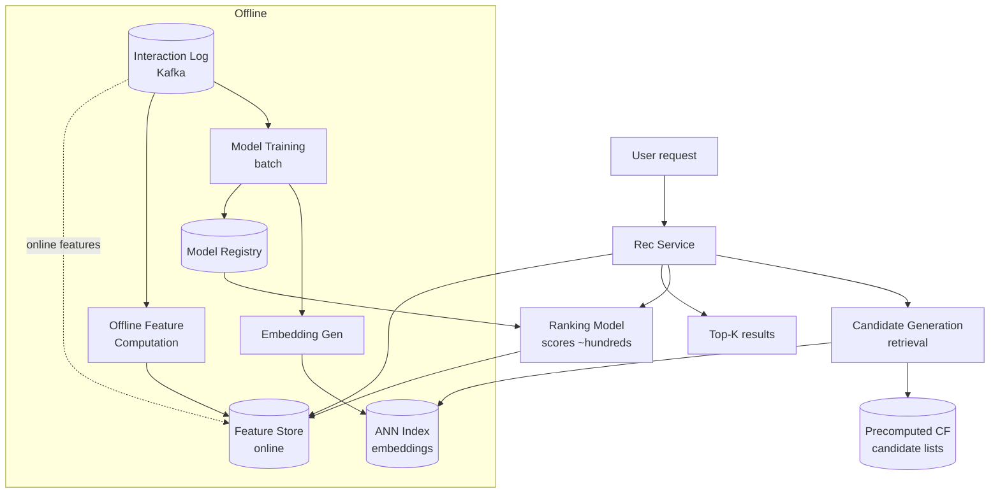

## 7.7 Deep dive A — Two-stage retrieve → rank

The unifying pattern of this whole module's serving systems (ads, search, recs) — naming it across systems is itself the Staff signal:

**Stage 1 — Candidate generation (retrieval).** Cheaply reduce millions of items to ~hundreds. Multiple sources unioned:
- **Collaborative filtering:** "users like you liked X" — from matrix factorization / co-occurrence; precomputed user→items and item→items lists.
- **Embedding ANN retrieval:** represent user & items as vectors; the user vector's **approximate nearest neighbors** (HNSW / IVF / ScaNN) in the item embedding space are candidates. Sub-30ms over millions of vectors.
- **Content-based:** items sharing attributes with the user's history.
- **Heuristic:** trending, recently-viewed, same-category.

These must be **cheap and high-recall** (don't miss good items) — precision is the ranker's job.

**Stage 2 — Ranking.** Now you have ~hundreds of candidates. Run an **expensive, accurate model** (gradient-boosted trees or a deep network) scoring each candidate with **many features** (user, item, context, cross-features) to predict engagement (pCTR, watch-time, conversion). Sort, apply business rules/diversity, return top-K.

**Why two stages (the load-bearing justification):** scoring millions with the heavy model is infeasible in 150ms; filtering to hundreds first makes it tractable. **Cheap-wide-then-expensive-narrow** is the same shape as the ad auction (§6) and booking search (§3) — recognize and name the pattern. *"This is the single most reused pattern across serving systems — ads, search, recs, even matching candidate generation in rideshare. Whenever you can't afford to score everything, you retrieve cheaply then rank expensively."*

## 7.8 Deep dive B — Feature store (online/offline parity)

The feature store is the backbone, and its hard problem is **online/offline consistency (the training-serving skew problem)** — this is the subtle failure mode to surface as the differentiator:
- **Offline store** (data warehouse): computes features over historical data for **model training** in batch.
- **Online store** (low-latency KV, e.g. Redis/DynamoDB): serves the *same* features at **inference** time with millisecond lookups.
- **The skew risk:** if a feature is computed differently in training vs serving, the model sees inputs at serving time it never trained on → silent quality degradation. The feature store enforces **a single feature definition** materialized to both stores, keeping them consistent. *"This is a different kind of consistency than the money systems — not ACID, but definitional consistency between two pipelines. Getting it wrong fails silently, which is worse than failing loud, because nothing pages you; engagement just quietly rots."*
- **Feature types:** batch features (updated daily — user's 30-day avg), streaming/near-real-time features (last-hour activity, updated from the Kafka event stream), and request-time features (current context). All fetched and assembled at serving in the latency budget.

This is **eventual consistency done right**: features lag reality by minutes-to-a-day, which is fine for a prediction, as long as training and serving see *consistent* (even if slightly stale) values.

## 7.9 Deep dive C — Online vs offline & cold start

**Offline (batch):**
- Train models on logged interactions (daily/hourly).
- Generate embeddings; rebuild the ANN index.
- Precompute CF candidate lists.
- Compute batch features.

**Online (serving):**
- Retrieve candidates, fetch features, rank, return — in the latency budget.
- Update streaming features from live events.
- Log interactions → close the loop (today's serves train tomorrow's model).

This **offline-train / online-serve** split is universal in ML systems: heavy computation offline (eventually consistent, can take hours), cheap lookups online.

**Cold start:**
- **New user:** no history → fall back to popular/trending, onboarding-declared interests, or context (geo/device); personalize as signals accumulate.
- **New item:** no interactions → rely on **content-based** features (attributes, embeddings from metadata) so it can be retrieved before it has engagement data; exploration (bandits) to gather signal.
- **Exploration vs exploitation:** multi-armed bandit / epsilon-greedy injection so new items get impressions and the system keeps learning rather than over-fitting to popular items.

## 7.10 Scaling & bottlenecks

- Serving is stateless and scales horizontally; ANN index replicated/sharded across nodes (fits in RAM, so replicate).
- Feature store online tier scales as a KV; hot users/items cached.
- Offline training scales on a batch cluster, independent of serving.
- Bottleneck: feature fetch fan-out and ranking-model latency within the budget → batch feature lookups, keep the ranker lean, cache aggressively.

## 7.11 Trade-offs & failure modes

| Failure / edge case | Consequence | Mitigation |
|---|---|---|
| **Stale model/features** | Slightly old prediction | Graceful; monitor for drift |
| **Training-serving skew** | Silent quality rot (no page!) | Feature store + single shared feature definition |
| **ANN recall vs latency** | Miss a few good candidates | Tune index params; retrieval is high-recall not exact, tolerable |
| **Feature store down** | Can't personalize | Serve defaults / non-personalized fallback |
| **Feedback loop / popularity bias** | Rich-get-richer runaway | Exploration (bandits / epsilon-greedy) |
| **Cold start (new user/item)** | No signal to personalize | Popular/trending + content-based + exploration |

## 7.12 What the interviewer is really testing

Whether you know the **two-stage retrieve→rank architecture** and *why* it exists (can't score millions in the budget), the **online/offline split** (train heavy offline, serve cheap online), the **feature store and training-serving skew** problem, **ANN/embeddings** for retrieval, and **cold start**. And crucially that you place this system firmly on the **eventually-consistent, latency-optimized** end — no ACID, predictions not facts, degrade gracefully. **Staff-level insight:** the differentiators are (1) naming **training-serving skew** as the subtle silent-failure mode and the **feature store's single-definition** answer to it, and (2) recognizing that **retrieve→rank is the same cheap-wide-then-expensive-narrow pattern** as the ad auction and booking search — the ability to see the shared structure across these serving systems is exactly the cross-cutting architectural judgment a Staff/Director interview probes.

---

## Closing synthesis — the consistency spectrum

Lay the seven systems on one axis and the whole module clicks into place. The Staff skill is reading this table *fluently* — knowing, for any datum in any system, which column it belongs in and why.

| System | Strongly consistent core | Eventually consistent periphery | The decisive call to verbalize |
|---|---|---|---|
| Ride-sharing | trip↔driver match, trip state | driver locations, surge, ETA | Firehose ≠ transaction; only the match is strong |
| Food delivery | order state, payment | menu, availability, courier loc, ETA | Menu "inventory" is *soft* (re-validated at accept) |
| Booking | inventory decrement, booking saga | search, availability cache, price display | Partition by propertyId → strong op is single-shard |
| E-commerce | inventory reservation, checkout saga, payment | catalog, cart, search, recs | Hot SKU: move contention off the durable row |
| **Payment** | **everything — ACID ledger** | downstream notifications/analytics only | Eventual = concurrent overdraft = categorically wrong |
| Ad serving | offline billing (reconciled) | counters, budget, freq cap, serving | Strong money guarantee pushed *offline* (inverts payment) |
| Recommendations | *(nothing)* | everything — it's all predictions | No ACID; skew is the silent failure, not consistency |

Moving left → right, you trade correctness guarantees for latency and throughput. **The Staff-level skill is not "always use strong consistency" or "always use eventual" — it's drawing the boundary in exactly the right place for each datum, defending it, and wiring the two sides together** with **idempotency** (the join that makes at-least-once safe), **sagas** (the pattern that spans the boundary across services), and **reconciliation** (the backstop that catches what slips through). See [Distributed Systems](02-distributed-systems.md) for the delivery-semantics and consensus theory these moves rest on.

### The four cross-cutting moves (master these and you can design any system on the spectrum)

| Move | What it does | Where it appears |
|---|---|---|
| **Boundary** | Place each datum in strong vs eventual, per its consequence of being wrong | Every system — the opening earmark |
| **Idempotency** | Make at-least-once safe; dedup retries via a unique key claimed before side effects | Payments (§5.7), bookings (§3.8), checkout (§4.9), order create (§2.7), dispatch accept (§1.4), impression counting (§6.9) |
| **Saga** | Span a multi-step transaction across services/external boundaries with compensations — *not* 2PC | Booking (§3.8), checkout (§4.9), payment provider (§5.8), order placement (§2.7) |
| **Reconciliation** | Backstop that catches the residue the in-band path can't — the only resolver of the UNKNOWN case | Payments (§5.9, the definitive one), ad billing (§6.8), inventory bucket rebalance (§4.8) |

### Delivery checklist — how to *perform* these designs at Staff level

A final reminder of the [Staff-Level Execution](20-staff-execution.md) moves, distilled to this module:

1. **Earmark the crux by minute five** — name the one or two hard parts before drawing boxes, and pre-commit your depth there.
2. **Decide, don't enumerate** — every choice in the shape *"`<choice>` because `<requirement>`; revisit if `<trigger>`"*; never "it depends."
3. **Altitude** — name-and-move-on the CRUD (catalog, profiles, search), drop hard on the consistency crux.
4. **Risk-weight** — most minutes on the case that loses money or pages on-call (the timeout-charge, the flash-sale hot key, the double-booking race).
5. **YAGNI** — match machinery to load; don't shard a 4,000-writes/sec ledger.
6. **Cite experience** — anchor abstractions in a real retry-storm / hot-partition / lost-ack scar.
7. **The signature sentence** — *"money and committed inventory get strong serializable consistency because eventual permits a concurrent double-spend or oversell, which is categorically wrong; everything else is eventual."* Say it, mean it, apply it per-datum.

Master those — *boundary, idempotency, saga, reconciliation*, delivered with *earmark, decide, altitude, risk-weight, YAGNI, experience* — and you can design any marketplace or money system on the spectrum, and *deliver* it like a Staff engineer.
