# Module 18d — Designing Infrastructure Primitives (End-to-End Walkthroughs)

> The building blocks that show up in *every* system design interview. A URL shortener is a warmup, but the *patterns* inside it — ID generation (KGS), consistent hashing, read-heavy caching, fan-out pipelines, ingestion buffering — are the same ones you'll bolt onto a 50-service architecture when the question gets big. This module is the definitive playbook for the primitives. Each design is full end-to-end so you can lift the relevant slice under interview pressure.
>
> **This module is meant to be the only thing you study for the primitives.** It is deliberately a *floor, not a ceiling*: every system, diagram, table, capacity calculation, and insight is here, expanded — and wrapped in a **staff-level delivery lens** so you don't just produce a correct design, you *deliver* it like a peer of the interviewer.

These designs assume familiarity with the foundational modules. Cross-references:
[Caching](03-caching.md) · [Messaging & Event-Driven](04-messaging-event-driven.md) · [Load Balancing](05-load-balancing.md) · [Databases](06-databases.md) · [Real-Time Systems](09-realtime-systems.md) · [Reliability](11-reliability.md) · [Observability](12-observability.md) · [Staff-Level Execution](20-staff-execution.md)

---

## Table of Contents

- [How to Deliver a Design Problem at Staff Level](#how-to-deliver-a-design-problem-at-staff-level)
- [Google Mode — Build It, Don't Name It](#google-mode--build-it-dont-name-it)
- [Cross-cutting patterns to watch for](#cross-cutting-patterns-to-watch-for)
1. [URL Shortener (TinyURL / bit.ly)](#1-url-shortener-tinyurl--bitly)
2. [Pastebin](#2-pastebin)
3. [Distributed Rate Limiter](#3-distributed-rate-limiter)
4. [Notification System (multi-channel)](#4-notification-system-multi-channel)
5. [Distributed Cache (Redis/Memcached-like)](#5-distributed-cache-redis--memcached-like)
6. [API Gateway](#6-api-gateway)
7. [Web Crawler & Search Indexing](#7-web-crawler--search-indexing)
8. [Logging / Metrics / Monitoring Platform](#8-logging--metrics--monitoring-platform-datadog--prometheus-like)
- [Closing: the patterns to carry forward](#closing-the-patterns-to-carry-forward)

---

## How to Deliver a Design Problem at Staff Level

> Read this once, then apply it to every system below. The full treatment is in [Staff-Level Execution](20-staff-execution.md); this is the operating checklist tuned for *infra primitives* specifically.

These eight primitives are unusually good practice ground for staff delivery, because each one has **exactly one or two genuinely hard parts and a lot of boring scaffolding around them.** The whole skill is recognizing the difference *out loud, in the first five minutes*, then spending your time accordingly. An interviewer watching you spend equal time on the load balancer and the consistent-hashing ring has already decided you're a senior, not a staff.

**The primitives are reusable building blocks.** Internalize the *decisive pattern*, not the specific system. When the big question ("design Twitter", "design Uber") arrives, you are going to drop these in almost verbatim: a KGS for ID generation, a consistent-hash ring for sharding, a fan-out pipeline for delivery, a Kafka buffer for ingestion, a fail-open/fail-closed call for any in-path dependency. The transferable, *decisive* patterns are the asset — see the [cross-cutting table](#cross-cutting-patterns-to-watch-for) and [closing](#closing-the-patterns-to-carry-forward).

### The five moves, applied to primitives

| Move | What it looks like on these problems |
|---|---|
| **1. Earmark the crux at minute 5** | Say it out loud before designing: *"The whole shortener hinges on collision-free key generation; everything else is read-heavy caching. Let me earmark that and come back to it."* Do this for every system below — each one names its crux up front. |
| **2. Decide, don't enumerate** | Never say "it depends." Say **"<choice> because <requirement>; I'd revisit if <trigger>."** E.g. *"KGS because it takes collision-checking off the write path; I'd switch to a distributed counter with a Feistel scramble if we couldn't afford the extra service."* |
| **3. Altitude — name and move on** | Boring parts get one sentence: *"Stateless API tier behind an L4 LB, standard, moving on."* The crux gets five minutes and a diagram. Indiscriminate thoroughness is a *negative* signal at this level. |
| **4. Risk-weight the deep dive** | 70% of your time on the 1–2 hard parts. For the rate limiter that's the atomic counter and fail-open/closed; for the cache it's consistent hashing + replication; for metrics it's cardinality + buffering. |
| **5. Cite real operational experience** | Pattern-match to systems you've actually run. From real-time chat infra experience: *"We fan out messages to millions of WebSocket connections; the per-channel-queue isolation in the notification design is exactly how we keep a slow APNs push from backing up in-app delivery."* One concrete war story outweighs a paragraph of theory. |

### The anti-patterns that cap you at senior (avoid in every section)

- **Over-explaining basics** — don't derive base62 or explain what a hash table is. Assume shared knowledge.
- **Rabbit-holing** — don't spend ten minutes on the analytics schema of a URL shortener. It's a bolt-on.
- **Option-listing without choosing** — comparing four ID schemes is fine *only if you then pick one and say why*.
- **Over-engineering / YAGNI violation** — don't add a queue, a second datastore, or a shard until a requirement or an identified bottleneck forces it. Say *"I'm not adding X yet because nothing requires it."*
- **Uniform thoroughness** — the single clearest senior tell. Selectivity is the staff skill.

> **Staff-level insight:** Each system below opens with an explicit **"Earmark — the hard parts are X and Y"** line. That sentence, delivered in the first two minutes, is worth more signal than the next twenty minutes of correct-but-uniform design. Lead with it every time.

---

## Google Mode — Build It, Don't Name It

> Google's #1 system-design rule: **avoid "use a standard database and query it" — show how you'd BUILD it from scratch.** These eight primitives are *exactly* the from-scratch building blocks Google fishes for; Google's own published example questions explicitly list **"distributed cache"** and **"ID generators"** as prompts. If your answer to "design a distributed cache" is "use Redis Cluster," you have failed the question — the cache *is* the thing to build. See [Build From Scratch](21-build-from-scratch.md) for the build-it muscle and the [Google SD Playbook](26-google-sd-playbook.md) for how Google grades. In a Google interview, treat every system below as "implement the engine," not "wire up the product."

| System | Tempting off-the-shelf answer | What to build/discuss from scratch instead |
|---|---|---|
| **URL shortener / TinyURL** | "Auto-increment PK in MySQL" | Build the **KGS** (pre-minted key pool) or counter+base62 with a **Feistel scramble** so IDs aren't enumerable; own the collision-free guarantee |
| **Pastebin** | "Drop the blob in Postgres" | Build the **metadata/blob split** (inline-small / externalize-large) and **atomic burn-after-read** via a conditional write — don't lean on a BLOB column |
| **Distributed rate limiter** | "Use an API-gateway plugin" | Build the **token bucket** with an **atomic Redis-Lua counter** (or your own replicated counter); reason about the read-modify-write race yourself |
| **Notification system** | "Use SQS + a Lambda" | Build the **multi-stage fan-out pipeline** (durable buffer → per-channel queues → workers) with **idempotency + DLQ + provider failover** |
| **Distributed cache** | "Use Redis Cluster / Memcached" | Build the **consistent-hashing ring + vnodes**, **replication**, **eviction (approx-LRU)**, and **gossip membership** yourself — this is the whole question |
| **API gateway** | "Deploy Kong / Envoy" | Build the **filter/plugin chain**, the **auth trust boundary**, and the **thin-stateless-HA** design that keeps the gateway from being a SPOF |
| **Web crawler** | "Use Scrapy + a queue" | Build the **two-tier URL frontier** (priority + per-host politeness) and **Bloom-filter dedup** at billion-page scale |
| **Logging / metrics platform** | "Use Datadog / Prometheus" | Build the **ingestion buffer** (Kafka shock-absorber) and the **TSDB** internals — compression, **downsampling/retention**, and the **cardinality** cost model |

> **Google-signal:** These are *pure* build-from-scratch problems — there is no "managed service" escape hatch, so resolve every hard part with a concrete **mechanism**, not a product name. Google weights four things: **detect-and-defend failure** (fail-open vs fail-closed for the rate limiter; the cache and gateway as SPOFs you must design around), **coherent design over a clever-but-isolated tradeoff** (the pieces must fit), capacity math you do **out loud**, and mechanisms that actually compose. A coherent from-scratch design that names its failure modes beats a "correct" answer that bolts on a black box.

---

## Cross-cutting patterns to watch for

Before the designs, the transferable patterns. When you spot one of these in a bigger design, you can drop in the corresponding primitive almost verbatim. **These are the decisive building blocks** the staff lens above keeps pointing at.

| Pattern | First appears in | Reused in |
|---|---|---|
| **Key / ID generation (KGS, Snowflake, counter+base62)** | URL Shortener | Pastebin, any system needing short unique IDs |
| **Consistent hashing** | Distributed Cache | Rate limiter sharding, crawler frontier, TSDB sharding |
| **Read-heavy → cache + CDN** | URL Shortener | Pastebin, any 100:1+ read system |
| **Fan-out pipeline (trigger → enrich → route → deliver → track)** | Notification System | Crawler, any event-driven workflow |
| **Ingestion buffering (agent → queue → stream-process → store)** | Metrics Platform | Crawler, notifications, any high-throughput write path |
| **Atomic counter under contention (Lua / CAS)** | Rate Limiter | Distributed cache, any shared-mutable-state design |
| **Fail-open vs fail-closed** | Rate Limiter | API Gateway, auth, any in-path dependency |
| **Don't share fate** | API Gateway / Monitoring | Limiter, gateway, monitoring — survive the failure of what you front/watch |
| **Inline-small / externalize-large** | Pastebin | Message queues, document DBs, any mixed-size payload store |

---

# 1. URL Shortener (TinyURL / bit.ly)

The most-asked warmup. If you can't do this cleanly and fast, the interviewer downgrades everything after. The whole design hinges on **one hard problem: how do you generate short, unique, collision-free keys at scale?** Everything else is a read-heavy caching exercise.

> **Earmark (say this at minute 2):** *"The hard parts here are (1) collision-free key generation at scale, and (2) making the redirect read path absurdly fast and HA. Everything else — the write API, the schema, analytics — is boring scaffolding I'll name and move past. This is 90% a caching problem and 10% an ID-generation problem."* That single sentence is the staff signal; deliver it before you draw a box.

## 1.1 Problem framing

Given a long URL, produce a short alias (`https://sho.rt/aZ3kP`) that, when visited, redirects to the original. Bias the entire design toward reads: shortening is rare, redirects are constant.

## 1.2 Requirements

**Functional**
- Shorten a long URL → short URL.
- Redirect short URL → long URL.
- Optional custom alias (`sho.rt/my-brand`).
- Optional expiration (link dies after a date).
- Analytics: click counts, geo, referrer (nice-to-have — *name it as a bolt-on, don't design it now*).

**Non-functional**
- **Scale:** 100M new URLs/day (write), read:write ratio ~100:1 → ~10B redirects/day.
- **Latency:** redirect p99 < 50ms (it's in the user's critical browsing path).
- **Availability:** 99.99% — a dead redirect breaks every embedded link forever. Reads must be HA even if writes degrade.
- **Consistency:** redirect mapping is immutable once created → eventual consistency is fine for reads; the key allocation must be strongly unique.
- **Durability:** never lose a mapping (a lost mapping = permanently broken links).

> **Decide, don't enumerate:** *"Eventual consistency on reads because the mapping is immutable once written; strong uniqueness only at key-allocation time. I'd revisit if we allowed editing a destination — then the cache TTL becomes a correctness lever, not just a performance one."*

## 1.3 Capacity estimation (show the math)

**Writes:** 100M/day ÷ 86,400s ≈ **1,160 writes/sec** avg, ~3K/sec peak.

**Reads:** 100× → ~116K reads/sec avg, ~300K/sec peak.

**Key length (the famous calc):** alphabet is base62 = `[A-Z, a-z, 0-9]` = 62 chars.
- 62^6 = ~56.8 **billion** combinations.
- 62^7 = ~3.5 **trillion**.
- At 100M/day we generate 36.5B/year. 62^7 covers ~95 years; 62^6 is exhausted in ~1.5 years.
- **Choose 7 characters.** Headroom for a decade-plus; only 1 char more than 6.
- **Base-58 variant:** drop the four look-alike characters (`0`, `O`, `I`, `l`) so codes survive being read aloud or typed by hand. 58^7 ≈ 2.2 trillion, still ~60 years at this rate. Pick it when links are printed or dictated; otherwise base62 is the default.

> **Altitude cue:** do this calculation fast and out loud, then *stop*. The base62 math is the one place uniform thoroughness is rewarded because it's the crux; don't then spend equal time deriving the storage number — state it and move on.

**Storage:** per row ≈ short_key (7B) + long_url (~500B) + metadata (~100B) ≈ ~600–700B.
- 100M/day × 700B ≈ **70 GB/day** → ~25 TB/year. Trivial; this is *not* a storage-bound problem. (Name it and move on.)

**Cache:** assume 20% of URLs drive 80% of traffic (hot set). Cache top ~100M hot mappings × ~700B ≈ **70 GB** — fits in a modest Redis cluster. This is the single most impactful lever.

**Bandwidth:** redirect response is tiny (301/302 + Location header, ~few hundred bytes). 300K/sec × ~500B ≈ 150 MB/s out. CDN absorbs most.

**Read QPS vs single-node Redis (sanity check):** 300K reads/sec peak ÷ ~150K ops/sec/Redis-node ≈ 2 nodes for throughput, but you'll run more for HA + headroom. The point: the cache, not the DB, carries the read load — so a cache miss-storm is the real risk, addressed in §1.7(B).

## 1.4 API design

```
POST /api/v1/shorten
  body: { long_url, custom_alias?, expires_at?, user_id? }
  → 201 { short_url: "https://sho.rt/aZ3kP", key: "aZ3kP" }

GET  /{key}
  → 301/302 redirect, Location: <long_url>
  (or 404 if not found / 410 if expired)

GET  /api/v1/analytics/{key}
  → { clicks, unique_visitors, top_referrers, geo_breakdown }

DELETE /api/v1/{key}   (owner only)
```

## 1.5 Data model

Key choice: **a KV store, not a relational DB.** The access pattern is a pure point lookup by primary key (`key → long_url`). No joins, no scans. Use DynamoDB / Cassandra / a sharded KV.

> **Decide:** *"KV store (DynamoDB/Cassandra) because the access pattern is a pure point lookup on a random key — no joins, no range scans, and random keys give even partition distribution for free. I'd only reach for a relational DB if owner dashboards needed rich multi-column queries, and even then I'd keep the hot redirect path on the KV store."*

```
Table: urls
  key          STRING  (PK, the base62 short code)
  long_url     STRING
  user_id      STRING  (nullable)
  created_at   TIMESTAMP
  expires_at   TIMESTAMP (nullable, TTL column)
  is_custom    BOOL

Table: analytics  (append-only events, separate store)
  key, ts, ip_hash, referrer, country, user_agent
```

`expires_at` maps to the store's native TTL (DynamoDB TTL / Cassandra TTL) — expired rows auto-evict, no cron needed.

## 1.6 High-level architecture

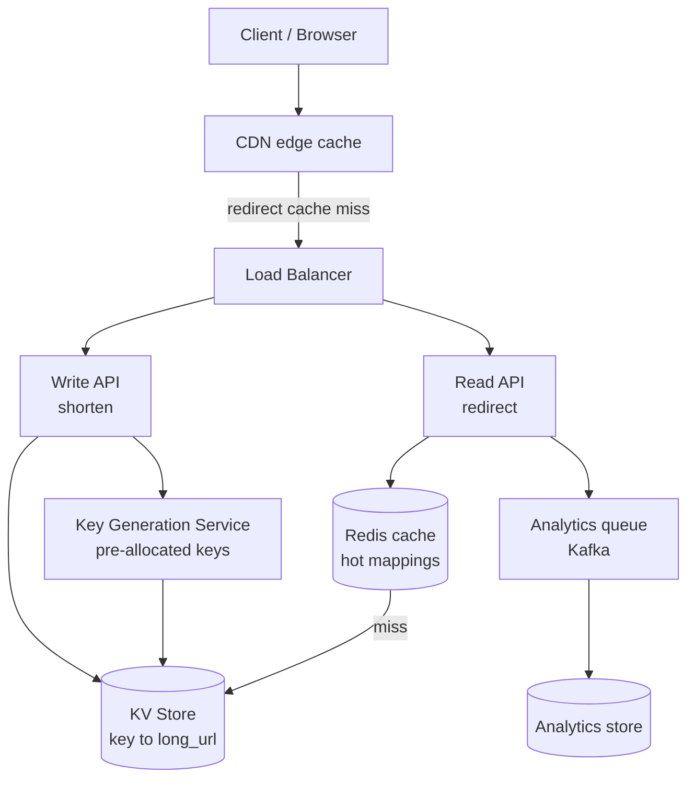

> **Altitude:** the LB, write API, and analytics queue each get one sentence ("stateless tier, fire-and-forget analytics off the hot path"). Spend your whiteboard time on KGS and the read path.

## 1.7 Deep dive — the hard parts

### (A) Key generation — the heart of the design

Four real approaches. Know all four and their failure modes; the interviewer wants the *comparison* — but **then you must pick one and own it.** Listing four without choosing is the senior anti-pattern.

**Option 1 — Hashing (MD5/SHA of the long URL, take first 7 chars).**
- Pro: stateless, deterministic, same URL → same key (free dedup).
- Con: **collisions.** Two different URLs can hash to the same 7-char prefix. You must check the DB on every insert and re-hash on collision (append salt, retry) — extra read per write, and collision rate grows as the table fills (birthday-bound: as the table approaches a meaningful fraction of 62^7, collision-check retries climb). Also leaks nothing useful and same-URL-dedup is rarely a real requirement (different users want their own analytics).

**Option 2 — Counter + base62 encoding.**
- A global atomic counter; encode its value in base62 → that's your key.
- Pro: **zero collisions by construction** (every counter value is unique), keys grow monotonically, no DB read needed to check uniqueness.
- Con: the counter is a **single point of contention.** And sequential keys are *guessable/enumerable* (security + competitive-scraping concern). Mitigate enumeration by base62-encoding a *scrambled* counter (e.g., multiply by a large coprime mod 62^7, or XOR/Feistel permutation) so consecutive IDs don't look consecutive.
- Distribute the counter with **range allocation**: a central service (or a row in ZooKeeper/etcd) hands each app server a *block* of 1,000 counter values. The server burns through its block locally (no coordination), then requests the next block. Contention drops by 1000×. If a server dies mid-block, you lose at most 1,000 IDs — totally acceptable (we have trillions).

**Option 3 — KGS (Key Generation Service) — the canonical answer.**
- A dedicated service **pre-generates random unique 7-char keys offline** and stores them in two tables: `available_keys` and `used_keys`.
- On shorten request: pop a key from `available_keys` (mark used). No collision check at request time — uniqueness was guaranteed at generation time.
- Each app server checks out a **batch** (e.g., 1,000 keys) into memory to avoid hitting KGS per request.
- **Concurrency:** two servers must never get the same key. KGS uses a row-level lock / atomic "move N keys from available to used" transaction.
- **Death of a server:** the in-memory batch is lost. Acceptable waste; keyspace is huge.
- **KGS HA:** it's a DB-backed service — replicate it, standby failover. The `available_keys` table is its durable state.
- This is the answer interviewers like because it decouples key generation from the write path entirely and has *predictable, collision-free* behavior.

**Option 4 — Snowflake-style distributed IDs.**
- 64-bit ID = `timestamp | machine_id | sequence`. Each node generates IDs locally, no coordination.
- Pro: fully distributed, no central counter, time-ordered.
- Con: 64-bit base62-encodes to ~11 chars — **longer than 7**. You can truncate/remap but then you reintroduce collision risk. Snowflake shines when you need IDs *everywhere* (e.g., Twitter tweet IDs) more than minimal length. Clock skew / NTP regression is its own failure mode (an ID generated "in the past" can collide with the sequence) — bound it with a monotonic clock check.

**Collision math — when does it actually bite?** With 62^7 ≈ 3.5T slots and the KGS approach there is *zero* collision risk by construction. With *hashing*, by the birthday approximation collisions become non-negligible once the populated keyspace reaches ~√(62^7) ≈ ~1.9M *random* draws into a 7-char space — but you're not drawing into the full space, you're drawing the *first 7 chars of a 128-bit hash*, so the *expected number of collisions* after N random draws ≈ N²/(2·62^7). At N = 36.5B/year against the 62^7 ≈ 3.5×10^12 space that's ≈ (3.65×10^10)²/(2·3.5×10^12) ≈ **1.9×10^8 expected collisions** — a count *far* greater than 1, so collisions aren't merely "possible," they're **certain**. (If you instead want a per-insert collision *probability*, it's ≈ N_existing/62^7 ≈ 36.5e9/3.5e12 ≈ **1% at year-end** and rising.) Either way the conclusion is the same: **collisions are real, so a per-write DB uniqueness check is mandatory.** **This is exactly why hashing forces a per-write DB read and KGS does not.**

**Verdict (own it):** **Lead with KGS.** *"KGS because it takes collision-checking off the write path entirely and gives predictable, collision-free behavior; the only cost is one more stateful service, which is cheap. If I couldn't run that service, I'd fall back to a distributed counter with range allocation and a Feistel scramble to defeat enumeration. I would not use hashing — it pays a DB read on every write and the collision rate grows with the table."*

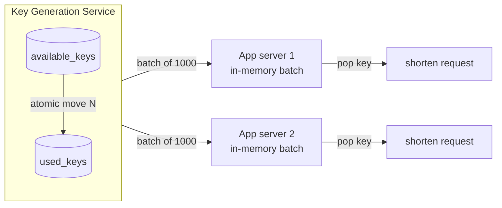

### (B) Read path — make it absurdly fast

Redirects are 99% of traffic. The read path:
1. **CDN / edge cache:** cache the redirect itself at the edge keyed by short code. For a 301 (permanent), browsers and CDNs cache aggressively → many redirects never even reach origin.
2. **Redis cache** (cache-aside): on miss, read KV store, populate cache. Hit ratio >95% given the hot-set math above.
3. **KV store:** point lookup, single-digit ms.

This is a textbook [caching](03-caching.md) layered design: edge → distributed cache → durable store.

**Cache-stampede / miss-storm edge case:** a viral link that *just* expired from cache, or a cold cache after a Redis restart, can dump hundreds of thousands of identical misses onto the KV store in the same second. Protect with **single-flight / request coalescing** (one origin fetch per key, others wait on it) and **negative caching** (cache 404s briefly so a scanned-for nonexistent key doesn't repeatedly hit the DB). Same single-flight pattern as the distributed-cache stampede protection in §5.9.

### (C) 301 vs 302 — a real decision, not trivia

- **301 (Permanent):** browsers/CDNs/proxies cache it. Subsequent clicks skip your server entirely → minimal load, lowest latency. **But** you lose per-click analytics (the redirect is served from cache), and you can't change the destination later (the cached redirect sticks).
- **302 (Found / temporary):** every click hits your server → you capture full analytics and can change the target, at the cost of more load.
- **Staff-level answer:** *"It's a business decision. bit.ly uses 302 because click analytics are their product. A pure-performance shortener uses 301."* Mentioning that the choice trades analytics for load is the signal they want — and calling it a *product* decision rather than a technical one is the staff move.

## 1.8 Scaling & bottlenecks

- **KV store** scales horizontally by partitioning on the short key (hash partition → even distribution). No hotspot because keys are random.
- **Write counter / KGS** — solved by batching (above).
- **Analytics** — never write analytics synchronously on the redirect path. Fire-and-forget to Kafka; aggregate async. Click counters use approximate counting or batched increments.
- **Hot keys** (one viral link) — handled by CDN/edge cache absorbing the read; the origin barely sees it.

## 1.9 Trade-offs & failure modes

| Decision | Trade-off |
|---|---|
| KGS vs counter | Extra service & state vs central-counter contention |
| 301 vs 302 | Performance vs analytics + mutability |
| Cache TTL | Stale (deleted/expired) links vs origin load |
| Custom alias | Must collision-check against generated keyspace (reserve a namespace, or check both tables) |

**Failure modes:**
- **Cache down** → fall back to KV store (slower but correct, **fail-open on reads**). Never fail a redirect because the cache is down.
- **KGS down** → app servers keep serving from their in-memory batch; only *new* shortens stall once batches drain. Never fail a redirect because the write side is down.
- **KV store partition unavailable** → that slice of keys returns errors; multi-AZ replicas keep reads up. Durability is the non-negotiable here — a lost mapping breaks links forever.
- **Custom-alias collision with a generated key** → reserve a separate namespace for custom aliases (e.g., they always start with an out-of-base62 marker, or KGS never mints keys in the custom prefix space), so the two pools can't collide.
- **Expired-but-not-swept row** → lazy read-time `expires_at` check returns 410 even before the TTL sweeper deletes it; don't rely on the sweeper for correctness.

## 1.10 What the interviewer is really testing

Can you (1) identify read-heavy and design for it, (2) reason about the **keyspace math** crisply, and (3) compare key-generation strategies with their failure modes — *and then choose one*. **Staff signal:** call 301-vs-302 a *product* decision, separate the immutable-mapping read path from the contended write path, and note that the analytics pipeline is a different system bolted on (don't pollute the redirect path). The truly senior move is saying *"this is 90% a caching problem and 10% an ID-generation problem"* in the first two minutes — and then *spending your time accordingly*.

---

# 2. Pastebin

Same DNA as the URL shortener (key gen + read-heavy), but the payload is **arbitrary, potentially large text/blobs** instead of a URL string. The added hard parts: where blobs live, size limits, expiration, and privacy. Use the contrast to show range.

> **Earmark:** *"Pastebin is 'URL shortener + blob storage + privacy'. I'll reuse the KGS and read-heavy caching wholesale — those are solved. The new hard parts are (1) the metadata/blob split and inline-vs-externalize decision, and (2) burn-after-read atomicity. And the real operational problem isn't throughput — it's storage economics and abuse."* Naming that the throughput is *easy* and the cost/abuse is *hard* is the staff signal here.

## 2.1 Problem framing

User pastes a block of text (code, logs, config), gets a short URL; anyone with the URL can read it. Optionally private, optionally self-destructing.

## 2.2 Requirements

**Functional:** create paste (text up to N MB), retrieve by key, optional expiration (10 min … never), optional privacy (unlisted / password / private), syntax highlighting (client-side), optional one-time read ("burn after reading").

**Non-functional:**
- **Scale:** ~10M new pastes/day (writes), ~100M reads/day (10:1 — less skewed than a shortener; pastes are often read once).
- **Size:** cap at e.g. **10 MB/paste** (reject larger; offer file upload separately).
- **Latency:** read p99 < 200ms (larger payloads, less hot).
- **Durability:** high for non-expiring pastes.

## 2.3 Capacity estimation

- Writes: 10M/day ≈ **116/sec**, ~350/sec peak.
- Avg paste size: assume ~10 KB (code snippets) but long-tail to 10 MB.
- Storage: 10M × 10 KB ≈ **100 GB/day** → ~36 TB/year. Unlike the shortener, **storage is real** → this drives the "blob in object store" decision.
- Reads: 100M/day ≈ 1.2K/sec; bandwidth dominated by payload size, so CDN matters.
- **Bandwidth:** 1.2K reads/sec × 10 KB avg ≈ 12 MB/s, but a single viral 10 MB paste read 1000×/sec is 10 GB/s — *which is precisely why public immutable pastes go through the CDN, not your origin.*

## 2.4 API design

```
POST /api/v1/paste
  body: { content, expires_in?, visibility?, password?, burn_after_read? }
  → 201 { key, url }

GET  /{key}            → HTML or raw content (404 / 410 if expired/burned)
GET  /api/v1/raw/{key} → raw text
DELETE /api/v1/{key}   (owner)
```

## 2.5 Data model — the key choice

**Split metadata from blob.** Small metadata in a KV/SQL store; the actual paste content in **object storage (S3)** when large.

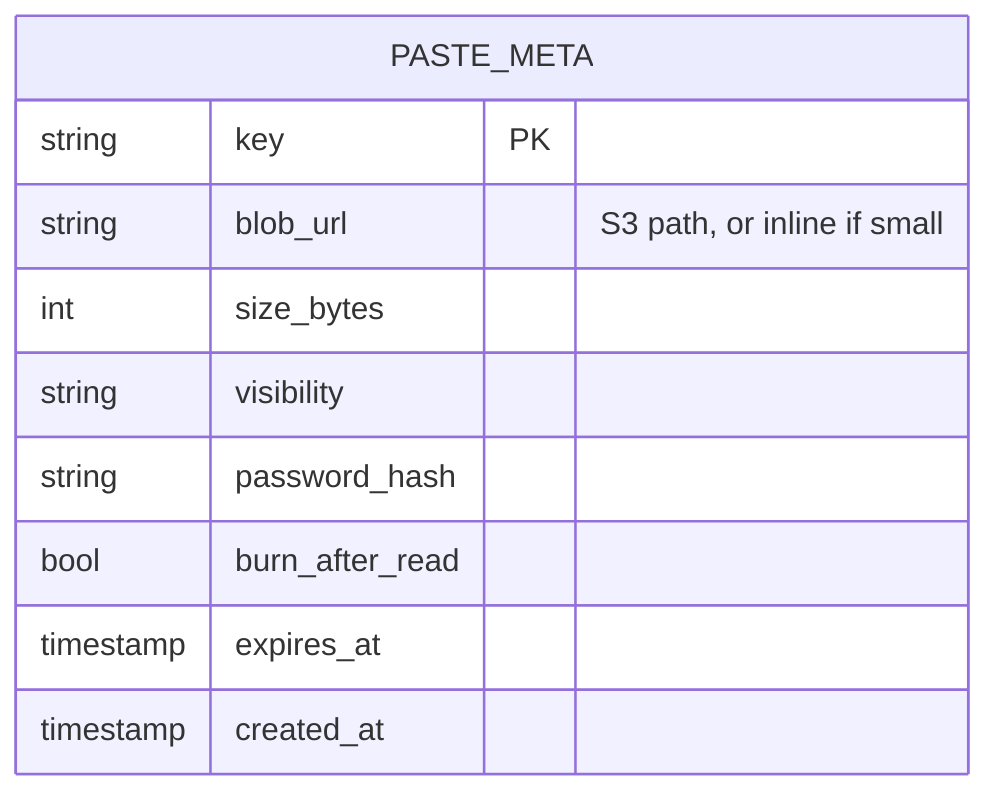

Rationale: a row store is terrible at storing 10 MB blobs (bloats pages, kills cache locality). **Object storage** is cheap, durable (11 nines on S3), and CDN-frontable. **Optimization:** inline small pastes (< 4 KB) directly in the metadata row to avoid an S3 round-trip; spill large ones to S3. (This "inline small, externalize large" pattern recurs everywhere — message queues, document DBs.)

> **Decide:** *"Metadata in a KV store, blob in S3, with a 4 KB inline threshold. Inline-small because the common case is a code snippet and the extra S3 round-trip would dominate p99 for the majority of reads; externalize-large because row stores choke on multi-MB blobs. I'd tune the 4 KB threshold off real size distribution."*

## 2.6 High-level architecture

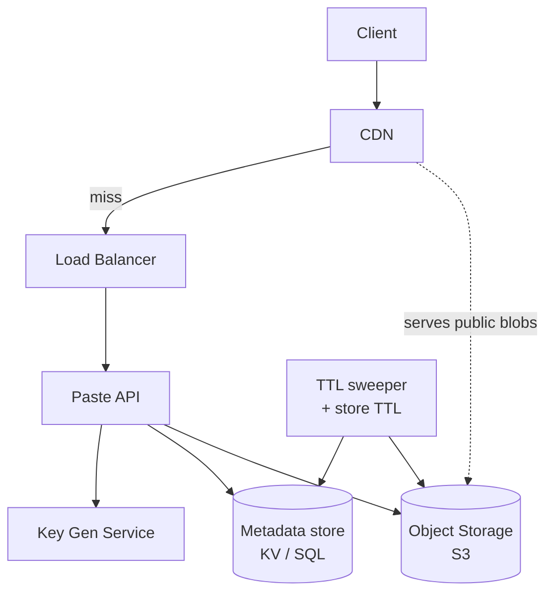

## 2.7 Deep dive

### (A) Read path & CDN
Public, non-expiring, non-burn pastes are **immutable and cacheable** → serve the blob straight from CDN/S3, origin barely involved. Private or burn pastes **bypass CDN** (must auth / must guarantee single read). This split — *cacheable public path vs un-cacheable private path* — is the whole read-path design; state it as one decisive sentence and move on.

### (B) Expiration & burn-after-read
- **TTL:** set object-store lifecycle policy + metadata `expires_at`. A lazy check at read time returns 410 if past expiry even before the sweeper deletes it (don't rely on the sweeper for correctness — rely on it for cleanup).
- **Burn-after-read** is the tricky one: it requires an **atomic read-then-delete.** Do a conditional update on metadata (`UPDATE ... SET read=true WHERE key=? AND read=false`); the winner serves content and triggers deletion, losers get 410. Without atomicity, two concurrent readers both see the paste — defeating the feature. **This is the same race-condition reasoning as the rate limiter's atomic counter (§3.7A) — the moment you hear "exactly once" or "single read", reach for a conditional/atomic write, unprompted.**

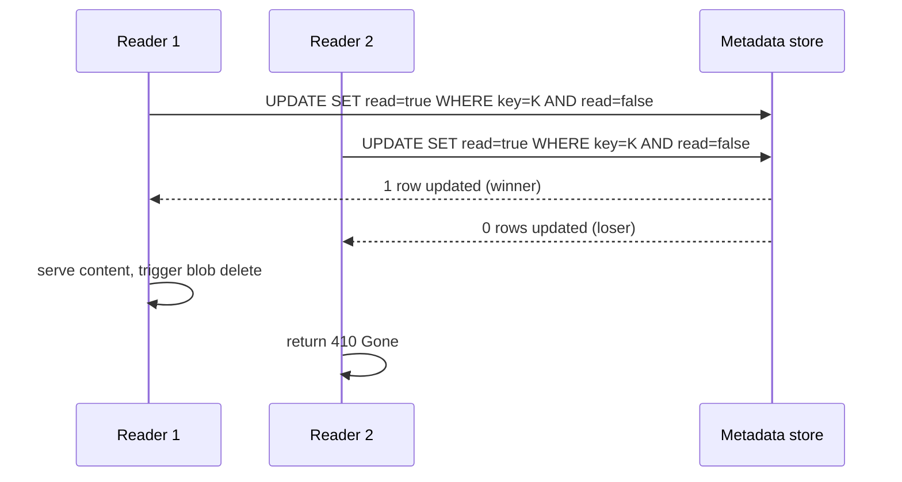

### (C) Size limits & abuse
- Enforce size at the **gateway** (reject >10 MB before buffering the whole body — use streaming/`Content-Length` check; a malicious client can lie about `Content-Length`, so also cap the bytes you'll actually read).
- Pastebins are spam/malware magnets → content scanning, rate limiting per IP (see §3), and abuse reporting. **This is the real operational load**, not request throughput.

## 2.8 Scaling & bottlenecks
- Metadata store partitions on key (random → even). Blob store scales itself.
- Hot paste (viral) → CDN absorbs it.
- The bottleneck is rarely throughput; it's **storage cost** and **abuse**, which is the senior insight that separates Pastebin from the shortener.

## 2.9 Trade-offs & failure modes

| Contrast vs URL shortener | Pastebin |
|---|---|
| Payload | KB–MB blob (→ object store) vs tiny URL string |
| Read skew | Less hot (read-once common) → CDN less dominant |
| Privacy | First-class (private/password/burn) vs usually public |
| Cost driver | Storage & abuse vs nothing |

**Failure modes:**
- **S3 unavailable** → reads fail for large pastes (mitigate with cross-region replication for critical data; inline-small pastes still serve from metadata).
- **Sweeper lag** → expired pastes linger; the read-time `expires_at` check prevents serving them.
- **Burn-after-read race** → handled by the atomic conditional update; only one reader ever wins.
- **Metadata/blob inconsistency** (metadata written, S3 write failed, or vice-versa) → write blob *first*, then metadata pointing at it; an orphaned blob with no metadata is harmless and the lifecycle policy reaps it. Never write metadata pointing at a blob that may not exist.

## 2.10 What's being tested
Whether you recognize Pastebin as "URL shortener + blob storage + privacy" and make the **metadata/blob split** and **inline-vs-externalize** decision. **Staff signal:** flag that the real operational problem is *abuse and storage economics*, not throughput, and handle burn-after-read with explicit atomicity. Reusing the shortener's KGS and caching *without re-deriving them* — "that part's solved, moving on" — is itself a strong altitude signal.

---

# 3. Distributed Rate Limiter

The canonical *correctness-under-concurrency* design. The single algorithm choice is easy; the hard part is making a **shared counter correct and cheap across many nodes.** This is where you show you understand race conditions, atomicity, and the CAP-flavored trade-off between accuracy and latency.

> **Earmark:** *"The algorithm choice is the easy 10%. The hard parts are (1) making the shared counter correct under concurrency across N nodes — that's an atomicity problem — and (2) the fail-open-vs-fail-closed call when the limiter's own backing store dies. I'll also flag the latency-vs-accuracy dial, because a Redis round-trip per request on a million-QPS path is itself a problem."* Reaching for *atomicity* the instant you hear "shared counter, many nodes" is the single thing being tested.

## 3.1 Problem framing

Limit how many requests a client (user / API key / IP) may make in a window. Reject or delay excess. Must work across a fleet of N gateway nodes that don't share memory.

## 3.2 Requirements

**Functional:** enforce limits per key across multiple dimensions (per-user, per-IP, per-endpoint, per-tier). Return `429 Too Many Requests` with `Retry-After`. Configurable rules; runtime updates.

**Non-functional:**
- **Scale:** must handle the *full* request rate of the system it protects (e.g., 1M req/s).
- **Latency:** the limiter is **in the request path** → adds < 1–2ms. Non-negotiable.
- **Accuracy vs availability:** strict accuracy needs coordination (slow); approximate is cheap. Pick deliberately.
- **Availability:** the limiter must not take down the service it protects → **fail-open vs fail-closed** is a core decision.

## 3.3 Capacity estimation

- 1M req/s, each needs ~1 counter op. A single Redis node does ~100K–200K ops/s → you need **sharding** (counter key hashed to one of ~10+ Redis shards) or **local-first counting** (below). At 1M req/s and 150K ops/s/node that's ~7 shards minimum for throughput alone, before HA replicas.
- Memory: per active key store a small counter/state (~100B). 10M active keys × 100B = **1 GB** — trivial; rate-limiter state is tiny and ephemeral. **The constraint is ops/sec and latency, never memory** — say this explicitly so you don't waste time on a storage estimate.

## 3.4 API / integration

It's middleware, not a public API, but conceptually:
```
allow(key, rule) -> { allowed: bool, remaining: int, retry_after: seconds }
```
Response headers on the protected API:
```
429 Too Many Requests
Retry-After: 12
X-RateLimit-Limit: 1000
X-RateLimit-Remaining: 0
X-RateLimit-Reset: 1718900000
```

## 3.5 Algorithms (recap, then the distributed twist)

| Algorithm | How | Pros | Cons |
|---|---|---|---|
| **Fixed window** | Counter per key per fixed interval | Trivial, cheap | **Burst at boundary** — 2× limit possible across the seam (limit at 0:59 and again at 1:00) |
| **Sliding window log** | Store timestamp of every request, count those in last window | Exact | Memory = O(requests); expensive at scale |
| **Sliding window counter** | Weighted blend of current + previous fixed window | Smooths the boundary burst, O(1) memory | Slight approximation |
| **Token bucket** | Bucket of N tokens, refills at rate R; each request takes 1 | Allows controlled bursts, intuitive | Two values (tokens + last-refill) to update atomically |
| **Leaky bucket** | Queue drains at fixed rate | Smooths output to constant rate | Adds queuing latency; can drop |

**Default recommendation (decide):** **token bucket because bursts are usually desirable** (a user who's been idle should be allowed a short burst); **switch to a sliding-window counter when** you specifically need a smooth, boundary-bug-free rate without bursts and want O(1) memory. Mention fixed-window's boundary bug — that detail signals you actually understand them — then explain why you're *not* defaulting to it.

## 3.6 High-level architecture

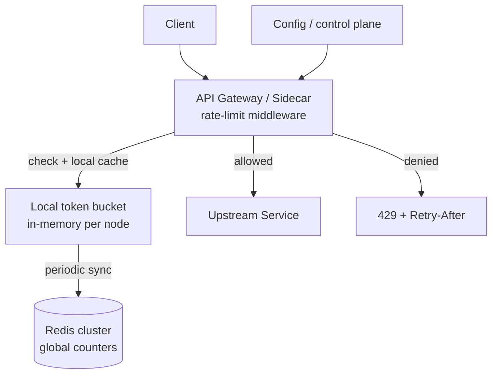

## 3.7 Deep dive — the hard parts

### (A) The race condition (the whole point of "distributed")

Naive approach: `GET counter; if < limit: INCR`. With N gateway nodes hitting the same Redis key concurrently, the classic **read-modify-write race** lets the counter overshoot — ten nodes each read "999 < 1000" and all increment → 1009.

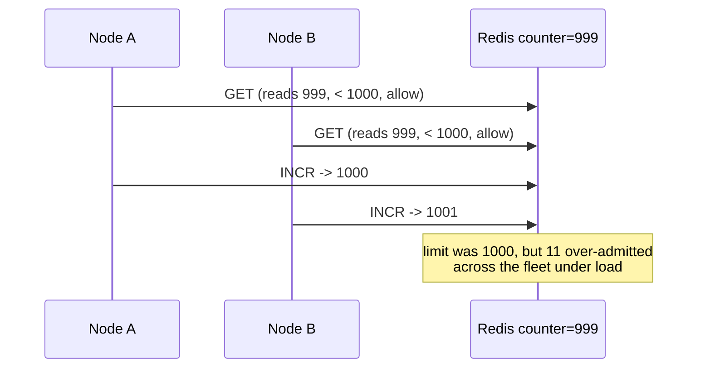

**Fixes, in order of quality:**

1. **Atomic INCR with TTL:** `INCR key` returns the new value atomically; set TTL on first increment (`EXPIRE key window NX`). If result > limit, reject. This works for **fixed window** because INCR is single-op atomic. Problem: the boundary burst remains.

2. **Lua script (the standard answer):** Redis executes a Lua script **atomically** (single-threaded, no interleaving). For token bucket you need to read tokens, compute refill, decrement, and write — *multiple* operations that must be atomic. A Lua script does all of it in one trip:
   ```lua
   -- token bucket, atomic
   -- read time from Redis itself so the clock is the single source of truth (units: seconds)
   local t   = redis.call('TIME')        -- {seconds, microseconds}
   local now = tonumber(t[1]) + tonumber(t[2]) / 1e6
   local ttl = math.ceil(capacity / rate)  -- idle bucket fully refilled after this long
   local tokens = redis.call('GET', key) or capacity
   local last   = redis.call('GET', key..':ts') or now
   local refill = (now - last) * rate
   tokens = math.min(capacity, tokens + refill)
   if tokens >= 1 then
     redis.call('SET', key, tokens - 1)
     redis.call('SET', key..':ts', now)
     redis.call('EXPIRE', key, ttl)        -- evict idle buckets instead of leaking forever
     redis.call('EXPIRE', key..':ts', ttl)
     return 1   -- allowed
   else
     redis.call('EXPIRE', key, ttl)
     redis.call('EXPIRE', key..':ts', ttl)
     return 0   -- denied
   end
   ```
   One round-trip, fully atomic, no race. **This is the answer the interviewer is fishing for.** Say "Lua script for atomicity" *before* they ask how you avoid the race.

3. **Sliding window log in Redis:** use a sorted set (`ZADD key now <unique-member>` — score is `now`, but the *member* must be unique, e.g. `now:requestId` or a UUID; using `now` as both score and member makes two requests in the same millisecond collide on the member so one silently overwrites the other → undercount), remove entries older than the window (`ZREMRANGEBYSCORE`), count (`ZCARD`). Exact, but O(log n) per op and more memory. Wrap in a Lua/MULTI for atomicity.

### (B) Local + global hybrid (latency vs accuracy)

A Redis round-trip per request (~0.5–1ms) on a 1M-req/s path is a lot of network + a Redis hotspot. **Hybrid:**
- Each node keeps a **local token bucket** and serves most decisions from memory (sub-microsecond).
- Nodes **periodically sync** their local consumption to Redis (every 100ms, or every N requests) to converge on the global limit.
- Trade-off: between syncs, the **global limit can be exceeded** by up to (per-node slack × node count). Accuracy is approximate but latency is near-zero.
- **Allocation strategy:** give each node a slice of the global limit (limit/N), or let nodes request "leases" of capacity from a central allocator. Slices are simplest; leases adapt to uneven traffic.
- This is the same accuracy-vs-coordination dial as distributed caching consistency. State the trade-off explicitly: *"Strict global limits require per-request coordination and cost latency; most production limiters accept ~few-percent overshoot for speed. I'd default to local+sync and only go per-request-Redis for limits guarding something where overshoot is genuinely dangerous."*

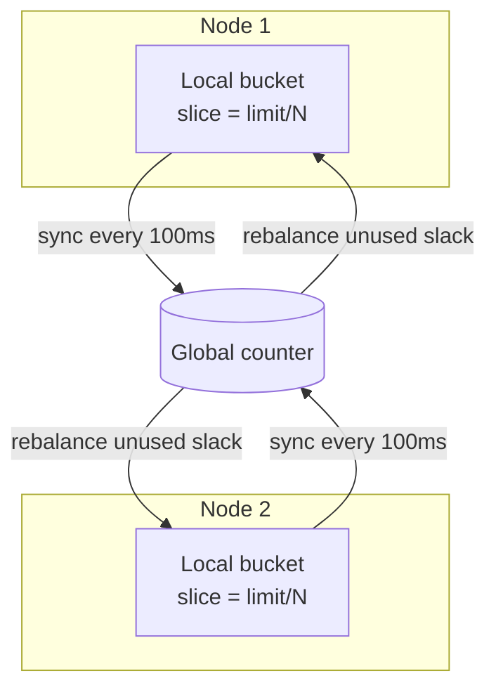

### (C) Where to deploy & fail-open vs fail-closed

- **Deployment (decide):** **at the API gateway** for centralized config and a single choke point, **switch to a sidecar** (Envoy + a rate-limit service) when you're in a service mesh and the central gateway would itself become the bottleneck. Library-in-app is cheapest but can't enforce cross-service global limits — name it and reject it for the multi-node requirement.
- **Fail-open vs fail-closed** when Redis is down — *make this a per-rule decision, not a global one*:
  - *Fail-open* (allow everything): availability over protection. Right for limits whose job is courtesy throttling — better to serve traffic than reject everyone because the limiter broke.
  - *Fail-closed* (reject): protection over availability. Right when the limit guards a fragile/expensive backend (e.g., a payment API) where a flood is worse than downtime.
  - Often: **fail-open with a conservative local fallback** (each node enforces a degraded local-only limit) — best of both.

> **Cite experience:** *"In real-time chat infra we fail *open* on the courtesy per-user message-rate limit — dropping every message because Redis hiccupped is worse than briefly letting a chatty user through — but we fail *closed* on the per-IP connection-storm limit, because that one guards the WebSocket layer from a reconnect thundering herd that would actually topple it. Fail-open/closed is per-rule, tied to what the rule protects."*

## 3.8 Scaling & bottlenecks
- **Hot key** (one giant tenant) → that single counter key bottlenecks one Redis shard. Mitigate by **sharding the counter** (split the limit across K sub-keys `key:0..K-1`, route by sub-hash, sum approximately) — same hot-key fix as a distributed cache (§5.7D).
- Redis itself scales via clustering; counters are tiny so memory is never the limit — **ops/sec** is.

## 3.9 Trade-offs & failure modes

| Decision | Trade-off |
|---|---|
| Per-request Redis vs local+sync | Accuracy vs latency & load |
| Fixed window vs sliding | Simplicity vs boundary-burst correctness |
| Fail-open vs closed | Availability vs protection |
| Gateway vs sidecar | Central config & SPOF vs distributed scaling |

**Failure modes:**
- **Redis down** → fail-open or fail-closed *per rule* (above), ideally with a degraded local fallback.
- **Hot-tenant counter** → shard the counter across sub-keys.
- **Clock skew between nodes** (sliding/token windows use timestamps) → use Redis's clock as the single source of truth inside the Lua script rather than each node's local clock; otherwise a node with a fast clock over-refills its bucket.
- **Config push error** (a bad limit value pushed to all gateways) → wide blast radius; canary config and validate ranges before propagation.

## 3.10 What's being tested
Do you reach for **atomicity** unprompted when you hear "shared counter, many nodes"? Do you know the **fixed-window boundary burst** and reach for a **Lua script**? **Staff signal:** articulate the accuracy-vs-latency dial (local+global hybrid), make fail-open/closed a *per-rule* decision tied to what the limit protects, and treat the hot-tenant counter as a hot-key problem with the same sharding fix you'd use anywhere.

---

# 4. Notification System (multi-channel)

The canonical **fan-out pipeline** design — and a reliability/idempotency showcase. The skill is decomposing one logical "notify the user" into a multi-stage pipeline where each stage has its own failure mode, retry policy, and scaling profile, while never double-sending.

> **Earmark:** *"This is a fan-out pipeline. The hard parts are (1) reliability — at-least-once delivery with idempotency so retries don't double-send, plus DLQ and provider failover, and (2) isolating quality-of-service classes so a 100M marketing blast can't delay a transactional OTP. The third-party providers, not my code, are the real reliability boundary."* Treating providers as the boundary and naming the QoS-class separation up front is the staff signal.

## 4.1 Problem framing

An event ("your order shipped") must reach a user across the right channels (push / SMS / email / in-app), respecting their preferences, without duplicates, at scale, with delivery tracking and resilience to flaky third-party providers.

## 4.2 Requirements

**Functional:** accept notification requests from many internal services; resolve user preferences (channel opt-in, quiet hours, frequency caps); render templates with localization; route to channels (APNs/FCM push, Twilio/SNS SMS, SES/SendGrid email, in-app/WebSocket); track delivery status; support priority (OTP vs marketing); dedup.

**Non-functional:**
- **Scale:** 10M–1B notifications/day; spiky (a marketing blast = 100M in minutes).
- **Latency:** transactional (OTP) p99 < a few seconds; marketing can be minutes.
- **Reliability:** at-least-once delivery for critical; **idempotent** so retries don't double-send.
- **Availability:** provider outages must not lose notifications → buffer + failover.

## 4.3 Capacity estimation
- 1B/day ≈ **11,500/sec** avg, but bursts to **100K–1M/sec** during campaigns → the system is **burst-driven**, which is *why* you put a durable queue (Kafka) up front to absorb spikes and decouple producers from the slower delivery side.
- Each provider has its own rate limits (APNs, Twilio) → you must **throttle per provider**, so the queue also acts as a shock absorber against downstream limits.
- **Worker math:** if SMS provider accepts 1K/sec and a campaign queues 100M SMS, that's ~28 hours of drain at the provider ceiling — so a "marketing blast" is inherently *rate-shaped over time*, not instant. Stating this reframes the whole design: you're not building for instant 1M/sec delivery, you're building a durable buffer that drips at provider limits.

## 4.4 API design

```
POST /api/v1/notify
  body: {
    user_id, event_type, template_id, data{},
    channels?: ["push","email"],   // optional override
    priority: "transactional"|"marketing",
    idempotency_key                // dedup
  }
  → 202 Accepted { notification_id }

GET /api/v1/status/{notification_id}
  → { per_channel: [{channel, state: queued|sent|delivered|failed|bounced}] }

PUT /api/v1/preferences/{user_id}
```

> **Decide:** *"Return 202 Accepted with a notification_id, not a synchronous result, because delivery is inherently async and provider-bound — making the caller wait would couple their latency to Twilio's. Status is polled or webhook'd separately."*

## 4.5 Data model

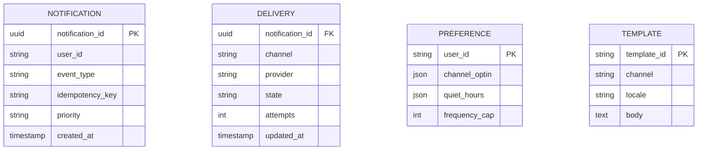

## 4.6 High-level architecture (the pipeline)

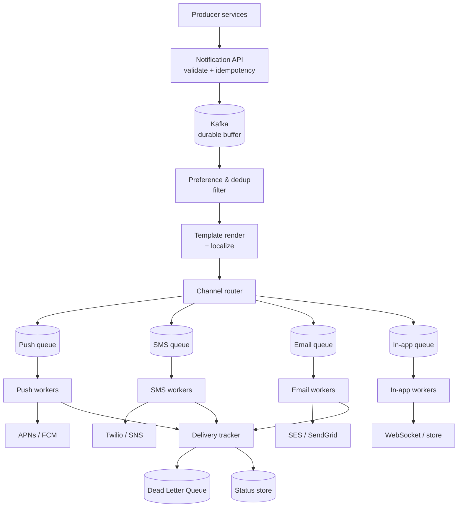

## 4.7 Deep dive — the hard parts

### (A) The pipeline stages & why they're separate
Each stage is an independently scalable consumer group:
1. **Ingest:** validate, assign `notification_id`, **dedup on `idempotency_key`** (write to a dedup store with TTL; if key seen → drop). This makes the whole system safe to retry.
2. **Preference & dedup filter:** drop channels the user opted out of, enforce **quiet hours** (defer, don't drop) and **frequency caps** (e.g., max 1 marketing email/day — a per-user rate limiter, see §3 — *another place the rate-limiter primitive drops in verbatim*).
3. **Template render:** fill template + localize. Separate so template changes don't touch routing.
4. **Channel router:** fan out to per-channel queues. **Per-channel queues are essential** — APNs being slow must not block email.
5. **Channel workers:** talk to providers, handle provider-specific rate limits, format, and auth.
6. **Delivery tracker:** consume provider webhooks/callbacks (delivered/bounced/clicked) and update status; route exhausted items to DLQ.

> **Cite experience:** *"This per-channel-queue isolation is exactly how we run fan-out in real-time chat. When APNs gets slow, you do not want the slow push to back-pressure your in-app WebSocket delivery — they're separate consumer groups with separate scaling. We learned that the hard way when a single slow provider once stalled an entire shared queue."*

### (B) Reliability: retries, DLQ, provider failover, idempotency
- **At-least-once + idempotency:** queues redeliver on failure; idempotency keys at ingest *and* at the provider call (most providers accept an idempotency token) prevent double-sends. This is the crux — *"at-least-once delivery, exactly-once **effect** via idempotency."* True exactly-once delivery is impossible in practice; say so explicitly.
- **Retries with backoff:** transient provider errors → exponential backoff + jitter, capped attempts. Permanent errors (invalid number, unsubscribed) → no retry, mark failed. (Distinguishing transient from permanent errors is the detail that separates a real design from a naive "just retry".)
- **DLQ:** after max attempts, park in a dead-letter queue for inspection/manual replay — never silently drop a transactional notification.
- **Provider failover:** abstract each channel behind a **provider interface** with primary/secondary (Twilio → fail over to SNS). Use a circuit breaker (see [Reliability](11-reliability.md)) per provider; trip on error-rate and shift traffic.

### (C) Priority & throttling
- **Priority queues / separate lanes:** transactional OTP must never queue behind a 100M marketing blast. Run separate queues (or a priority-aware consumer) so high-priority traffic preempts. A marketing campaign is *rate-shaped* (drip at provider limits); OTP is *immediate*. **Treat these as two quality-of-service classes with different SLAs sharing infrastructure — that framing is the staff move.**
- **Throttling per provider** to respect downstream rate limits — the queue depth naturally backpressures.

## 4.8 Scaling & bottlenecks
- Kafka partitions on `user_id` (ordering per user, parallelism across users).
- Worker pools scale per channel independently (email is cheap, SMS is expensive & limited).
- **Bottleneck = providers**, not your code → failover + throttling + buffering are the scaling levers.
- Marketing blasts: pre-materialize the recipient list, drip into the buffer; don't synchronously enqueue 100M.

## 4.9 Trade-offs & failure modes

| Decision | Trade-off |
|---|---|
| At-least-once + idempotency vs exactly-once | Simpler & robust vs impossible-in-practice exactly-once |
| Per-channel queues | More infra vs isolation of slow channels |
| Sync vs async delivery | API stays fast (202 Accepted) vs caller doesn't get instant confirmation |

**Failure modes:**
- **Provider outage** → failover to secondary / circuit-break / park in DLQ.
- **Duplicate event from producer** → idempotency-key drop at ingest.
- **Quiet-hours hit** → schedule a re-enqueue at the window's end (defer, don't drop).
- **Webhook lost** → status stuck "sent" not "delivered" → reconcile via periodic provider-API status polling.
- **Poison message** (a payload that always crashes a worker) → bounded retries then DLQ, so one bad message doesn't block the partition forever.

## 4.10 What's being tested
Can you design a **multi-stage fan-out pipeline** where each stage scales and fails independently, and do you reach for **idempotency + at-least-once + DLQ** as the reliability backbone? **Staff signal:** separate transactional from marketing as different *quality-of-service classes*, treat third-party providers as the real reliability boundary (failover + circuit breaker), and put a durable buffer up front so a campaign spike can't topple the system. Note that "exactly-once" is achieved as "at-least-once delivery + idempotent effect," never as true exactly-once.

---

# 5. Distributed Cache (Redis / Memcached-like)

This one tests **cache internals**, not cache *usage*. The hard parts are consistent hashing for sharding, what happens when nodes join/leave, replication, eviction, and hot keys. If you only know "use Redis," this exposes it.

> **Earmark:** *"This is about building the cache, not using it. The crux is (1) consistent hashing with virtual nodes so adding/removing a node only remaps ~1/N of keys instead of everything, and (2) replication + gossip membership for surviving node loss. Eviction and hot keys are the two follow-ups I'll have ready."* Saying "modulo hashing is a trap, here's why" before being asked is the fastest way to signal you've actually built one of these.

## 5.1 Problem framing

Build a horizontally scalable, low-latency in-memory KV cache: GET/SET/DEL with TTL, spread across many nodes, surviving node failures, minimizing reshuffling on topology change.

## 5.2 Requirements

**Functional:** GET/SET/DEL, TTL/expiry, eviction when full, cluster of N nodes, add/remove nodes online.

**Non-functional:**
- **Latency:** sub-millisecond (in-memory).
- **Scale:** millions of ops/sec; TBs of aggregate memory across nodes.
- **Availability:** node loss → minimal impact; no full-cluster reshuffle on a single node change.
- **Consistency:** typically eventual (it's a cache); strong is possible but costly.

## 5.3 Capacity estimation
- Want to cache 1 TB hot data; a node holds ~64 GB usable → **~16+ nodes** (plus replicas).
- 1M ops/s ÷ ~200K ops/s/node ≈ **5+ nodes** for throughput → memory dominates, so ~16–32 nodes total. Add replicas (×2–3) for HA.

## 5.4 API
```
GET key            -> value | nil
SET key val [TTL]  -> OK
DEL key            -> OK
```

## 5.5 Data model & key choice
In-memory hash table per node (O(1) lookup), values are opaque bytes. **Key decision: how to map keys → nodes.** Naive `hash(key) % N` is a trap (below). Use **consistent hashing**.

> **Decide:** *"Consistent hashing with virtual nodes, full stop. Modulo hashing is disqualified the moment topology can change, because it remaps almost every key on a single node add/remove and stampedes the backing store."*

## 5.6 High-level architecture

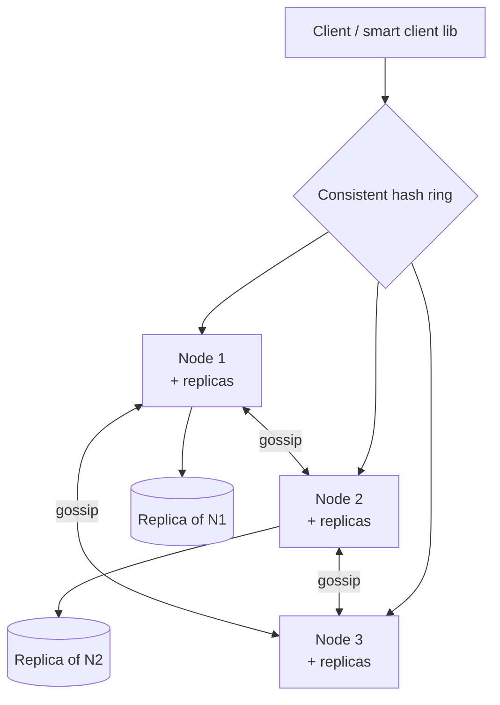

## 5.7 Deep dive — the hard parts

### (A) Consistent hashing (the centerpiece)
- **Problem with `hash(key) % N`:** add/remove one node and N changes → *almost every key remaps* → mass cache misses → thundering herd on the backing DB. Unacceptable.
- **Consistent hashing:** map both nodes and keys onto a ring (hash space 0…2^32). A key is owned by the **next node clockwise.** Adding/removing a node only remaps the keys between that node and its predecessor — **~1/N of keys move**, not all.
- **Virtual nodes (vnodes):** each physical node gets many points on the ring → smooths the distribution (without vnodes, 3 nodes can split the ring unevenly) and makes load rebalance gracefully when a node leaves (its keys spread across *many* nodes, not dumped on one neighbor). This is *the* detail interviewers want — mention vnodes unprompted.

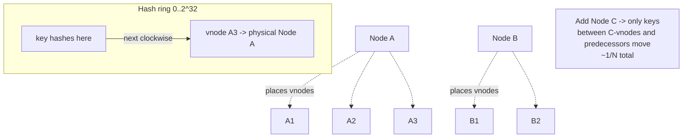

### (B) Replication & node failure
- Each key's data is replicated to the next **R** nodes clockwise (replication factor). On node failure, a replica serves the keys → no data loss for that shard.
- **Sync vs async replication (decide):** **async because it's a cache** — the backing store is the source of truth, so the worst case of losing a few recent writes on a node crash is a few cache misses, not data loss. *Switch to sync only* if the cache is being used as a primary store (e.g., a session store with no backing DB), where a lost write is a lost session.
- **Membership:** nodes detect failure and agree on topology via **gossip protocol** (each node periodically exchanges membership/health with random peers; failure detected by missed heartbeats). Redis Cluster uses gossip; Memcached pushes membership to clients. Gossip avoids a central coordinator SPOF.

### (C) Eviction (LRU and friends)
- When memory is full, evict. **LRU** is standard: track recency, evict least-recently-used.
- True LRU needs a doubly-linked list + hashmap (O(1) move-to-front on access) — but maintaining exact LRU per access is overhead. **Approximate LRU** (Redis): sample K random keys, evict the oldest among them → near-LRU at a fraction of the cost.
- Alternatives: **LFU** (least frequently used — better for skewed access), **TTL-based** (evict nearest-to-expire), random. **Decide:** *"Approximate-LRU by default because exact LRU's per-access bookkeeping isn't worth it; switch to LFU when access is highly skewed and you want to resist a one-off scan polluting the cache."*

### (D) Hot keys
- One key (a viral item) overwhelms its single owning node — consistent hashing doesn't help because it's *one* key on *one* node.
- Fixes: **client-side caching** of ultra-hot keys, **key replication/splitting** (`key#1..key#k` across nodes, read a random replica), or a small **L1 in-process cache** in front of the cluster. **Same hot-key problem as the rate limiter's hot counter (§3.8) — the fix (split the key across sub-keys) is identical.** Call that out: it shows you see the pattern, not just the instance.

## 5.8 Scaling & bottlenecks
- Scale by adding nodes to the ring → only ~1/N keys move (consistent hashing pays off).
- **Write/read path (decide):** **smart client** that hashes the key and contacts the owning node directly (no proxy hop) for lowest latency; **switch to a proxy** (twemproxy/Envoy) when you want dumb clients and centralized routing/observability, accepting one extra hop.
- Bottlenecks: hot keys, big values (cap value size), and rebalancing traffic during topology change (throttle key migration so a rebalance doesn't saturate the network and starve live traffic).

## 5.9 Trade-offs & failure modes

| Decision | Trade-off |
|---|---|
| Consistent hashing vs modulo | ~1/N remap vs total remap |
| Async vs sync replication | Latency vs durability of recent writes |
| Exact vs approximate LRU | Accuracy vs CPU/memory overhead |
| Smart client vs proxy | Latency & client complexity vs simplicity |

**Failure modes:**
- **Node death** → replica serves; if no replica, that shard's keys miss → backing-store load spike (mitigate with request coalescing / **cache stampede** protection — single-flight, the same protection as the URL shortener's miss-storm §1.7B).
- **Network partition** → split-brain in the gossip layer; require a quorum to accept topology changes so two halves don't both claim ownership and diverge.
- **Rebalance storm** (adding many nodes at once) → throttle migration, add nodes gradually.
- **Big-value / hot-key combination** → a 10 MB hot value can saturate one node's NIC; cap value size and split.

## 5.10 What's being tested
Do you know **why modulo hashing is wrong** and reach for **consistent hashing + vnodes** immediately? Can you discuss replication, gossip membership, and **approximate LRU**? **Staff signal:** treat the cache as *not the source of truth* (so async replication and eventual consistency are acceptable), call out the hot-key problem as orthogonal to sharding, and mention cache-stampede protection (single-flight / request coalescing) on miss. These internals (consistent hashing, gossip, vnodes) transfer directly to Cassandra/DynamoDB partitioning — say so, because seeing the transfer is the staff signal.

---

# 6. API Gateway

Tests breadth: routing, cross-cutting concerns (auth, rate limiting, observability), composition, and — the senior pivot — **how the gateway avoids being the SPOF/bottleneck for the whole platform.**

> **Earmark:** *"A gateway is breadth, not depth — routing, auth offload, rate limiting, a filter chain. The boring parts I'll name and move past. The two things that actually earn the staff grade are (1) it's the SPOF/bottleneck for the entire platform, so the design must make it thin, stateless, and HA, and (2) the auth trust-boundary subtlety — services must not trust a forged identity header from traffic that bypassed the gateway."* Proactively raising the SPOF problem *before* being asked is the whole game here.

## 6.1 Problem framing

A single entry point in front of many microservices that handles routing and cross-cutting concerns (auth, rate limiting, TLS, logging) so individual services don't each reimplement them.

## 6.2 Requirements

**Functional:** route by path/host/header to upstream services; offload **authn/authz** (validate JWT/API key); rate limiting (see §3); request/response transformation & **protocol translation** (REST↔gRPC, HTTP/1↔HTTP/2); **request aggregation/composition** (BFF — fan a client call out to several services, merge); TLS termination; service discovery integration; observability (logging, tracing, metrics).

**Non-functional:**
- **Latency:** thin — adds < a few ms (it's on every request).
- **Scale:** the aggregate of *all* traffic (highest-throughput component).
- **Availability:** if the gateway is down, *everything* is down → must be HA, no SPOF.

## 6.3 Capacity estimation
- If the platform serves 500K req/s, the gateway fleet handles 500K req/s → stateless, horizontally scaled behind an L4 load balancer. Size from per-instance throughput (~10–50K req/s) → ~10–50 instances + headroom.
- **Connection math:** 500K req/s with keep-alive and per-upstream connection pools means tens of thousands of open sockets per instance — *connection-pool exhaustion under a slow upstream, not CPU, is the subtle bottleneck.* Name this early; it's the non-obvious failure mode.

## 6.4 Conceptual config
```
route: /users/**   -> user-service        (auth: required, rate: 1000/min)
route: /orders/**  -> order-service        (auth: required, gRPC upstream)
route: /public/**  -> content-service      (auth: none, cache: 60s)
aggregate: /home   -> [profile, feed, notifications]  (BFF merge)
```

## 6.5 High-level architecture (the filter chain)

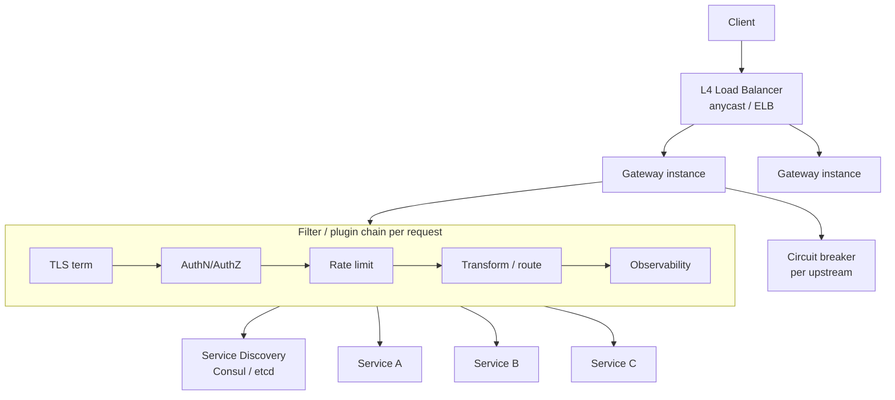

## 6.6 Deep dive — the hard parts

### (A) The plugin / filter chain
The gateway is fundamentally a **pipeline of pluggable filters** run per request: TLS → auth → rate limit → transform → route → response filters → observability. Each is independently configurable per route. This is what makes Envoy/Kong/Nginx/Spring Cloud Gateway extensible — you add a filter, you don't fork the gateway. **Ordering matters** (auth before rate-limit-by-user; cheap rejects early to shed load before expensive work). Name the chain, give the ordering insight, move on — this part is breadth, not depth.

### (B) Auth offload & the trust boundary
- The gateway validates JWT/API keys/OAuth tokens **once at the edge** so downstream services trust an internal identity header (often passed as a signed internal token). Centralizes auth, but creates a **trust-boundary** subtlety: services must reject external traffic that bypasses the gateway (mTLS / network policy) — otherwise a forged identity header is an authz bypass. **Mentioning this is a senior signal** — most candidates centralize auth and never notice they've created a "trust any caller who sets the header" hole.
- Heavy crypto (JWT verification) on every request → cache validation results / use lightweight tokens.

### (C) The SPOF / bottleneck problem (the senior pivot)
- The gateway sees *all* traffic → it's the highest-risk component. Mitigations:
  - **Stateless + horizontally scaled** behind an L4 LB / DNS / anycast; no shared state on the request path (rate-limit counters go to external Redis, not gateway memory — *this is why §3's hybrid local+global matters here*).
  - **Multi-region / multi-AZ** deployment.
  - **Keep it thin** — push business logic into services; the gateway does cross-cutting concerns only. A fat gateway becomes a deployment bottleneck (every team's change funnels through it) — an *organizational* SPOF as much as a technical one. **This is the deepest insight in the whole design; deliver it deliberately.**
  - **Isolate blast radius:** circuit breakers per upstream so one slow service doesn't exhaust the gateway's connection pool and stall *all* routes (head-of-line blocking). Bulkhead the connection pools per upstream so one upstream can't starve the others.
- **Fail-open vs fail-closed** for the gateway's own dependencies (auth service down? rate-limiter down?) — same per-rule decision as §3. *"Fail-open on the rate limiter, fail-closed on auth — you never want a broken auth dependency to admit unauthenticated traffic."*

### (D) Request aggregation / BFF
- A `/home` call fans out to profile + feed + notifications and merges — saves the client N round-trips on slow mobile networks. But it **couples the gateway to service response shapes** and can become a god-object. The cleaner pattern is a **separate BFF layer** per client type (mobile/web), keeping the core gateway dumb. **Decide:** *"Keep aggregation out of the core gateway and in a per-client BFF; put it in the gateway only for a tiny number of well-known composite endpoints where a separate service isn't worth it."*

## 6.7 Scaling & bottlenecks
- Stateless → scale out trivially; the L4 LB in front is the real entry point.
- Connection management to upstreams (pooling, keep-alive) is the subtle bottleneck — exhaustion under a slow upstream cascades.
- **Service discovery** integration (Consul/etcd/Kubernetes) keeps routes fresh as services scale; the gateway watches for endpoint changes.

## 6.8 Trade-offs & failure modes

| Decision | Trade-off |
|---|---|
| Centralized cross-cutting | DRY & consistent vs SPOF & org bottleneck |
| Thin vs fat gateway | Decoupled vs convenient aggregation |
| Aggregation in gateway vs BFF | Fewer hops vs coupling |
| Auth at edge | Performance & simplicity vs trust-boundary risk |

**Failure modes:**
- **Gateway fleet down** → total outage (so over-provision + multi-AZ; the LB, not the gateway, is the true entry point).
- **Slow upstream** → connection-pool exhaustion → cascade across all routes (circuit breakers + per-upstream bulkheads).
- **Config push bug** → wide blast radius (canary config rollouts, validate before propagate).
- **Auth dependency down** → fail-closed (reject), never admit unauthenticated traffic.
- **Identity-header forgery** → enforce mTLS/network policy so only the gateway can reach services.

## 6.9 What's being tested
Do you see the gateway as a **filter chain** offloading cross-cutting concerns, and — critically — do you proactively address it being a **SPOF/bottleneck**? **Staff signal:** keep it thin and stateless, treat the LB (not the gateway) as the true entry point, raise the auth trust-boundary issue (services must not trust forged identity headers), and isolate upstream failures with per-service circuit breakers. The deepest insight is that a fat gateway is an *organizational* bottleneck, not just a technical one.

---

# 7. Web Crawler & Search Indexing

Tests large-scale distributed coordination, politeness, dedup, and pipeline design at *billions of pages*. The deep part is the **URL frontier**: prioritization, politeness, and dedup under massive scale.

> **Earmark:** *"At a billion pages this is a distributed pipeline, but the one genuinely hard component is the URL frontier — it has to reconcile two competing goals at once: crawl high-priority pages first *and* never hammer a single host. The second hard part is dedup at billion-scale, which is a Bloom-filter problem. Indexing and ranking I'll name and hand to the search module."* Naming the frontier's two-competing-goals tension and the Bloom-filter dedup up front is the staff signal.

## 7.1 Problem framing

Discover and download the web (billions of pages), extract links to discover more, store content, dedup, respect politeness/robots.txt, keep content fresh, and build an inverted index for search.

## 7.2 Requirements

**Functional:** seed URLs → fetch → parse → extract links → enqueue new URLs → dedup → store → index. Respect `robots.txt` and rate limits per host (politeness). Re-crawl for **freshness**. Build inverted index + ranking.

**Non-functional:**
- **Scale:** crawl ~1B pages/week → fault-tolerant, distributed across many machines.
- **Politeness:** never hammer one host (you'll get banned / cause harm).
- **Freshness:** important pages re-crawled often; static pages rarely.
- **Robustness:** handle traps (infinite URL spaces), malformed pages, slow servers.

## 7.3 Capacity estimation
- 1B pages/week ≈ **1,650 pages/sec** sustained.
- Avg page ~100 KB → 1B × 100 KB = **100 TB/week** raw (compressed ~20–25 TB). Store in object storage + a doc store.
- Frontier: hundreds of millions of pending URLs in flight → URLs (~few hundred bytes each) → frontier is itself a **distributed, partly on-disk** queue.
- Dedup set: 1B+ URLs/content hashes → exact set is huge → **Bloom filter** (1B URLs at ~10 bits each ≈ **1.25 GB**, vs ~100+ GB exact) trades a tiny false-positive rate for massive memory savings.
- **Bloom sizing detail:** at 10 bits/element a Bloom filter's false-positive rate is ~1%. Tune bits/element to push that down — but note the asymmetry: a false positive means *skipping a genuinely new URL* (acceptable, we'll find it via other inlinks), never re-crawling everything. That asymmetry is *why* a probabilistic structure is the right call here.

## 7.4 Components / "API"
Internal pipeline, not a public API:
```
frontier.next() -> URL          // politeness + priority aware
fetcher.fetch(URL) -> content
parser.extract(content) -> {text, links}
dedup.seen(url|hash) -> bool     // bloom filter
indexer.index(doc)
```

## 7.5 High-level architecture

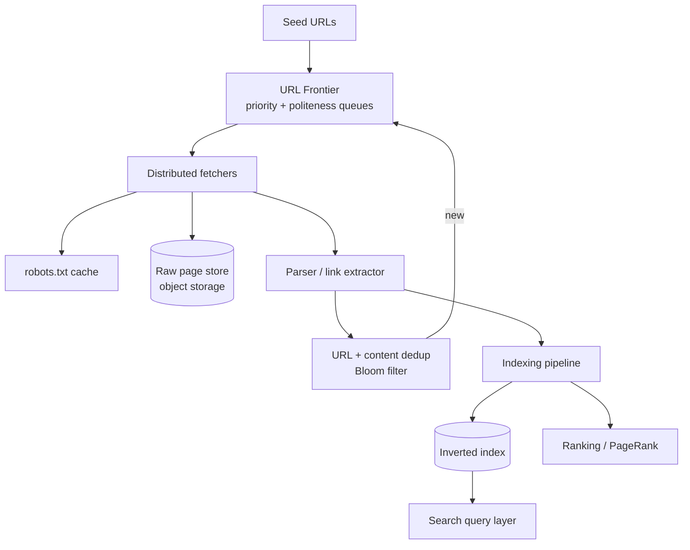

## 7.6 Deep dive — the hard parts

### (A) The URL frontier (the centerpiece)
The frontier must satisfy **two competing goals simultaneously**: crawl high-priority pages first, *and* never overload any single host. Classic **Mercator two-tier design**:
- **Front queues (prioritization):** N queues by priority (important/fresh pages → higher priority). A URL's priority comes from PageRank, update frequency, freshness needs.
- **Back queues (politeness):** M queues, **each mapped to a single host.** A worker only pulls from a back queue after a politeness delay (e.g., wait `k × page_download_time` between requests to the same host). A heap of "next-allowed-time per host" controls when each host can be hit again.
- This separation lets you prioritize globally while throttling per-host. **This two-tier structure is the answer the interviewer wants.**
- The frontier is huge → spill to disk; keep the active head in memory.

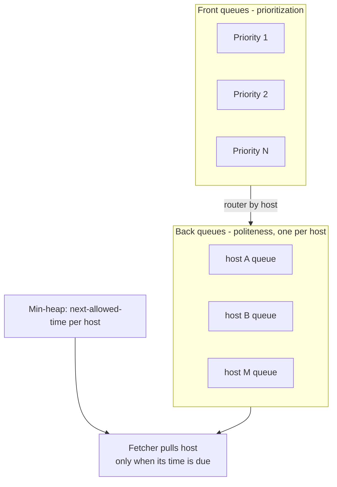

### (B) Politeness & robots.txt
- Fetch and **cache `robots.txt` per host** (respect disallow rules, crawl-delay). Never re-fetch per page.
- Rate-limit per host (back queues). Identify with a proper `User-Agent`.
- **Crawler traps:** infinite calendars, session-ID URLs generating endless pages → cap depth/pages per host, detect near-duplicate URL patterns, budget per domain.

### (C) Dedup with Bloom filters
- Two dedups: **URL dedup** (have we *seen this URL*?) and **content dedup** (is this *page content* a near-duplicate, e.g. mirror sites?).
- URL dedup at 1B+ scale → a **Bloom filter**: probabilistic set membership, O(1), tiny memory, **no false negatives** (never wrongly says "new" for a seen URL) but rare false positives (might skip a genuinely new URL — acceptable; we'll catch it via other links). The asymmetry is exactly right for crawling: skipping a few pages is fine; re-crawling everything is not.
- Content dedup uses **SimHash / MinHash** for *near*-duplicate detection (not exact hash) so mirrored/boilerplate pages collapse. **Decide:** *"Bloom for exact-URL dedup, SimHash for near-duplicate content — they're different problems and need different structures; conflating them is a common mistake."*

### (D) Distributed crawling & freshness
- Partition the frontier by **host hash** so one host is always handled by one node (preserves per-host politeness without cross-node coordination — **same consistent-hashing idea as §5**; partitioning to keep a constraint local is a recurring move).
- **Freshness:** re-crawl scheduling by change frequency (news sites hourly, static pages monthly). Track ETag/Last-Modified to skip unchanged pages cheaply (conditional GET).

### (E) Indexing & ranking (link to search)
- Parse → tokenize → build **inverted index** (term → posting list of docs), sharded across machines. (Deep inverted-index mechanics belong to the [search module](07-search.md) — name it and hand it off; don't rabbit-hole.)
- **Ranking:** PageRank-style link-graph analysis (a page is important if important pages link to it — an iterative eigenvector computation over the link graph) plus relevance signals (term frequency, freshness). MapReduce/Spark over the link graph computes it in batch.

## 7.7 Scaling & bottlenecks
- Fetchers are I/O-bound (network latency) → massive concurrency (async I/O, thousands of in-flight connections per node).
- DNS resolution is a hidden bottleneck → **cache DNS** aggressively.
- Frontier size and dedup-set size are memory pressures → Bloom filter + disk spill.
- Bottleneck is usually **politeness-imposed throughput per host**, not raw bandwidth. *Say this — it's the non-obvious insight: you're not bandwidth-limited, you're politeness-limited.*

## 7.8 Trade-offs & failure modes

| Decision | Trade-off |
|---|---|
| Bloom filter dedup | Tiny memory + rare false-skip vs exact set's huge memory |
| Priority vs politeness | Frontier two-tier complexity to satisfy both |
| Freshness re-crawl rate | Coverage/freshness vs crawl budget |

**Failure modes:**
- **Crawler trap** → per-host/per-domain budget caps; near-duplicate URL pattern detection.
- **Fetcher crash** → frontier re-issues the URL (idempotent; at-least-once crawl is fine — re-fetching a page is harmless).
- **Banned by host** → respect robots, exponential backoff, lower that host's priority.
- **Bloom false positive** → occasional missed page, recovered via other inlinks (the acceptable side of the asymmetry).
- **DNS outage** → cached DNS keeps the crawl going; uncached new hosts stall until resolution recovers.

## 7.9 What's being tested
Do you design the **frontier** to reconcile prioritization with politeness (two-tier), reach for a **Bloom filter** for billion-scale dedup, and respect robots.txt? **Staff signal:** partition by host hash to keep politeness local, treat the crawler as an **eventually-consistent, at-least-once pipeline** (re-crawls and rare skips are fine), recognize DNS/politeness — not bandwidth — as the real throughput limit, and separate near-duplicate content detection (SimHash) from exact URL dedup.

---

# 8. Logging / Metrics / Monitoring Platform (Datadog / Prometheus-like)

The ultimate **high-ingest pipeline** design and a masterclass in **time-series storage** and **cardinality**. The two deep parts: the ingestion path (buffering for millions of writes/sec) and the TSDB (downsampling, retention, the cardinality trap).

> **Earmark:** *"Two hard parts. (1) The ingestion path — millions of writes/sec that *spike hardest exactly during an incident*, so it needs a Kafka buffer as a shock absorber. (2) The TSDB internals — compression, downsampling/retention, and above all **cardinality**, which is the real cost killer, not data-point volume. And a non-negotiable: the monitoring system must not share fate with what it monitors."* Naming cardinality before being asked is the clearest senior tell in this design; lead with it.

## 8.1 Problem framing

Collect metrics, logs, and traces from thousands of hosts/services, store them efficiently, let users query and graph them, and alert on conditions — at millions of data points per second, cheaply.

## 8.2 Requirements

**Functional:** agents on hosts push metrics/logs; ingest at scale; store time-series (metrics) and searchable logs; query/aggregate (rate, p99, sum-by-tag); dashboards; **alerting** on thresholds/anomalies.

**Non-functional:**
- **Ingest scale:** millions of data points/sec (10K hosts × 1K metrics × 1/10s ≈ 1M points/sec).
- **Query latency:** dashboard queries < 1s over recent data; historical can be slower.
- **Retention:** raw at high resolution for days, downsampled for months/years.
- **Cost:** the dominant constraint — storage and cardinality cost is *the* design driver.
- **Availability:** monitoring must stay up *especially* when the monitored system is failing (don't share fate).

## 8.3 Capacity estimation
- 1M points/sec × 86,400s = **86.4B points/day.**
- Each raw point ~16 bytes (timestamp + value) before compression → ~1.4 TB/day raw; with TSDB compression (delta-of-delta + XOR, ~10×) → **~140 GB/day**. Compression is *why* TSDBs exist.
- Logs are far bigger (~1 KB each) → log volume dwarfs metrics → logs go to a search store (Elasticsearch/Loki), metrics to a TSDB. Different stores for different shapes.
- **Cardinality math (the real bomb):** 1M points/sec doesn't kill you; *series count* does. 10K hosts × 100 metrics = 1M series is fine. Add a `user_id` tag with 10M users and you get up to 10M × 100 = *1 billion* series, each needing an index entry — index memory and query cost explode. **The cost scales with cardinality, not throughput.** Say this number out loud.

## 8.4 API / ingest
```
POST /ingest/metrics   (agent push)  // or Prometheus pull /metrics scrape
  metric{tags...} value timestamp

POST /ingest/logs

Query: /query?expr=rate(http_requests{svc="api"}[5m])
Alert rule: when p99(latency) > 500ms for 5m -> page
```

## 8.5 Data model — the key choice
**Time-series:** a series is identified by `metric_name + set of tags/labels`; each series is an append-only stream of `(timestamp, value)`. Store **columnar / by-series**, heavily compressed, partitioned by time. **Logs:** documents in an inverted-index search store.

The critical concept: **cardinality** = number of distinct `metric+tag-combination` series. High cardinality (e.g., tagging by `user_id` or `request_id`) **explodes** the number of series and is the #1 way to blow up a TSDB.

## 8.6 High-level architecture

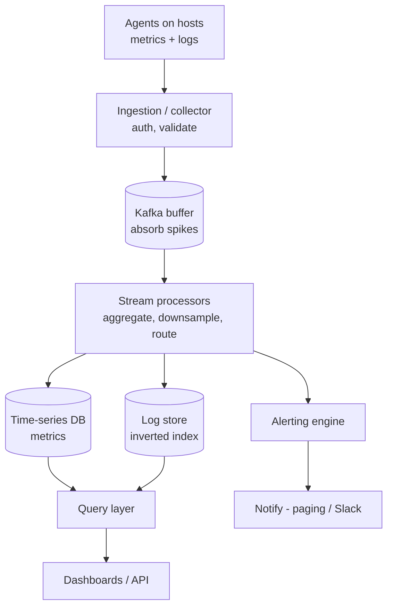

## 8.7 Deep dive — the hard parts

### (A) The ingestion pipeline (buffering)
- Agents (push model, e.g. Datadog/StatsD) or scrape (pull model, Prometheus). **Decide:** *"Pull (Prometheus-style) by default — the server controls load and discovers targets via service discovery, which is exactly what you want when scraping a known fleet. Switch to push for short-lived/serverless jobs and crossing network boundaries, where there's nothing stable to scrape."*
- **Kafka as a shock absorber:** ingest is spiky (an incident causes a metrics/log *storm* exactly when you need monitoring most). A durable buffer (Kafka) decouples collectors from storage so a write spike doesn't drop data or topple the TSDB → backpressure becomes queue depth, not data loss. *Same buffering pattern as the notification system (§4) — drop it in verbatim.*
- **Stream processors** consume Kafka: aggregate (pre-compute rollups), downsample, deduplicate, and route metrics→TSDB / logs→search store. Partition Kafka by series/metric for parallelism.

### (B) The TSDB internals
Three techniques that make time-series storage viable:
1. **Compression:** timestamps are regular → **delta-of-delta** encoding (store the change in the interval, usually 0). Values change slowly → **XOR** encoding (Gorilla/Facebook). Together ~10–12× compression. This is *the* TSDB superpower.
2. **Downsampling & retention tiers:** keep raw (10s resolution) for ~days; **roll up** to 1-min for weeks, 1-hour for months/years. Old data is auto-downsampled and raw expired → bounded cost. Retention policy per tier.
3. **Time-partitioned, append-only storage:** data written in time-ordered chunks/blocks (Prometheus's head block → immutable blocks). Recent data in memory, older flushed to disk/object storage. Queries prune by time range → only touch relevant blocks.

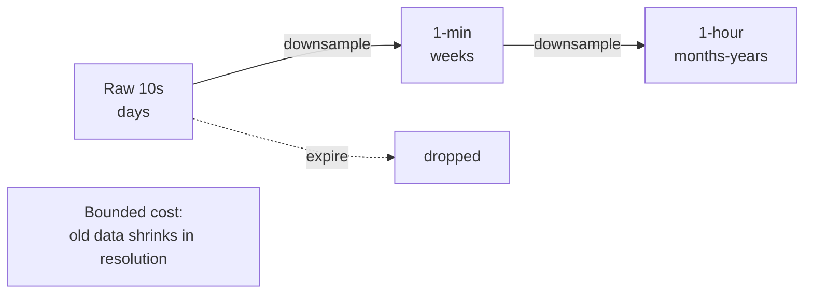

### (C) Cardinality — the cost bomb
- Each unique tag-combo = a separate series with its own index entry. Adding a high-cardinality tag (`user_id`, `pod_id` that churns, `url` with IDs) multiplies series count → **index memory and query cost explode.** Cardinality, not data-point volume, is what kills TSDBs.
- Mitigations: **restrict/validate labels** at ingest, drop high-cardinality tags, use **exemplars/traces** (not metrics) for per-request detail, set per-tenant series limits, and reject or sample offending series. **Articulating the cardinality trap *unprompted* is a strong senior signal — and proposing the per-tenant series limit as the operational guardrail is the staff follow-through.**

### (D) Logs & search (link to search module)
- Logs → an inverted-index store (Elasticsearch / Loki). Loki's trick: index only labels (cheap), store raw log lines compressed in object storage (don't full-text-index everything) → much cheaper than ES at scale. **Decide:** *"Loki-style label-only indexing when cost matters and queries are label-scoped; full Elasticsearch when users genuinely need ad-hoc full-text search across log bodies."* The full-text inverted-index mechanics belong to the [search module](07-search.md).

### (E) Querying & alerting
- **Query layer** fans a query across TSDB shards/time-blocks, aggregates, and merges. Cache common dashboard queries.
- **Alerting engine** continuously evaluates rules over the stream/recent TSDB. Key reliability concern: alerts must fire even during partial outages → **the alerting path should not share fate with the systems it monitors** (separate infra, separate region). Dedup/group alerts (Alertmanager) to avoid paging storms; support silences and routing (→ the notification system, §4 — *the notification primitive drops in here as the delivery layer*).

## 8.8 Scaling & bottlenecks
- Shard TSDB by series hash + time (**consistent hashing again** — §5). Recent vs historical tiers scale independently.
- Ingest scales via Kafka partitions + stream-processor parallelism.
- **Bottlenecks:** cardinality (index blowup), hot series (one super-busy metric), and query fan-out over huge time ranges (mitigate with pre-aggregated rollups).

## 8.9 Trade-offs & failure modes

| Decision | Trade-off |
|---|---|
| Push vs pull ingest | Serverless-friendly vs server-controlled load + discovery |
| Raw retention vs downsample | Fidelity vs cost |
| High-cardinality tags | Rich slicing vs index/cost explosion |
| Metrics vs logs vs traces | Cheap aggregates vs detail vs per-request, different stores |

**Failure modes:**
- **Ingest spike** → Kafka absorbs it; backpressure shows as queue depth, not dropped data.
- **TSDB node loss** → replicas serve, or re-ingest the affected window from Kafka's retained log.
- **Cardinality explosion** → per-tenant series limits + reject/sample offending series before they hit the index.
- **Monitoring shares fate with prod** → run it isolated (separate region/account) so it survives the incident it must report on. *The cardinal sin is your monitoring going down with the thing it was supposed to tell you about.*
- **Paging storm** (one incident fires 10K alerts) → dedup/group at the alerting layer (Alertmanager) before they reach the notification pipeline.

## 8.10 What's being tested
Do you design a **buffered high-ingest pipeline** (agents → Kafka → stream → store), understand **TSDB internals** (compression, downsampling, retention), and proactively raise **cardinality** as the cost killer? **Staff signal:** separate metrics/logs/traces into purpose-fit stores, use Kafka to survive the metrics-storm-during-an-incident, downsample for bounded cost, and insist that **monitoring must not share fate** with what it monitors. Naming cardinality before being asked is the clearest senior tell in this design.

---

## Closing: the patterns to carry forward

If you internalize nothing else, carry these into the *bigger* designs. Each is a **decisive, reusable building block** — when you spot the trigger, you drop in the primitive and state the choice in one line.

1. **ID/key generation** (KGS, Snowflake, counter+base62 with scramble) — any system minting short unique identifiers. *KGS when you can run the service; counter+Feistel when you can't.*
2. **Consistent hashing + vnodes** — sharding caches, DBs, frontiers, TSDBs without mass reshuffle on topology change. *Always over modulo the moment topology can change.*
3. **Read-heavy → layered caching (edge/CDN → distributed cache → store)** — anything above ~10:1 reads. *Plus single-flight stampede protection on miss.*
4. **Atomicity under contention (Lua / CAS / conditional writes)** — every shared-mutable-counter problem (rate limits, burn-after-read, click counts). *Reach for it the instant you hear "shared counter, many nodes" or "exactly once."*
5. **Durable buffer up front (Kafka)** — absorbs spikes, decouples fast producers from slow consumers (notifications, metrics, crawl). *Especially when the spike correlates with the incident.*
6. **Multi-stage fan-out pipeline with per-stage scaling + DLQ + idempotency** — notifications, crawling, any event workflow. *At-least-once delivery + idempotent effect = "exactly-once effect."*
7. **Fail-open vs fail-closed** — every in-path dependency (limiter, gateway auth). *Per-rule, tied to what the dependency protects.*
8. **Don't share fate** — limiters/gateways/monitoring must survive the failure of what they front or watch.

These eight recur across nearly every Staff-level design. The primitives above are where you practice them in isolation so you can compose them under pressure — and the [staff-delivery lens](#how-to-deliver-a-design-problem-at-staff-level) is how you *present* them: earmark the crux early, decide don't enumerate, control altitude, risk-weight the deep dive, and cite what you've actually run. See [Staff-Level Execution](20-staff-execution.md) for the full performance playbook.
