# Module 19 — Engineering Leadership & Architecture Decision Making

> The layer above pure system design. At Staff / Senior EM / Director / Head of Engineering level, interviewers stop asking *"can you design X?"* and start asking *"can you decide, justify, communicate, and lead the org through X — and would I trust you with a 50-person bet?"* This module is the strategy + leadership skin over everything in modules 1–18.
>
> **This is the leadership/strategy module. If you study one thing for a leadership round, study this — front to back.** Its companion is [Staff-Level Execution](20-staff-execution.md), which covers how you *operationalize* these decisions day-to-day.

## What you'll master

By the end of this module you will be able to:

- Treat **monolith vs microservices**, **build vs buy**, and **multi-tenancy** as *organizational and economic* decisions, not just technical ones — and articulate them the way a Staff/Director is expected to.
- **Drive** a strategy / architecture-decision conversation decisively: state the goal → lay out options → define criteria → **give a recommendation** → name risks → state a revisit trigger. Never stop at "it depends."
- Run a **trade-off conversation** with a repeatable framework, name the spectrum, give a recommendation, and pre-empt the risks — the single most-tested skill in senior interviews.
- Reason about **cost/FinOps**, **technical debt**, and **multi-tenant isolation** as first-class leadership concerns with real numbers and frameworks.
- Use **Conway's Law / Inverse Conway**, **Team Topologies**, **Platform Engineering**, and **DORA/SPACE** to scale an *organization*, not just a system.
- Lead the architecture *process*: RFCs/ADRs, design reviews, tech radar, alignment across teams, decisions under uncertainty, blameless incident leadership, raising the bar.
- Deliver scripted, confident answers to the leadership-flavored design and behavioral questions ("migrate the monolith", "cut cloud cost 30%", "a senior engineer disagrees with you", "set direction for a 50-person org").

This module cross-links heavily to: [Staff-Level Execution](20-staff-execution.md), [Architecture Patterns](15-architecture-patterns.md), [Microservices](10-microservices.md), [Cloud](14-cloud.md), and [Reliability](11-reliability.md).

---

## Table of Contents

**Orientation**

0. [In the Room — Staff-Level Delivery](#0-in-the-room--staff-level-delivery)

**Architecture Strategy**

1. [Monolith vs Microservices — an Org Decision](#1-monolith-vs-microservices--an-org-decision)
2. [Build vs Buy vs Adopt(OSS)](#2-build-vs-buy-vs-adoptoss)
3. [Multi-Tenant Architecture (Deep Dive)](#3-multi-tenant-architecture-deep-dive)
4. [Cost Optimization / FinOps as a Leadership Concern](#4-cost-optimization--finops-as-a-leadership-concern)
5. [Technical Debt Management](#5-technical-debt-management)

**Scaling Organizations**

6. [Conway's Law & the Inverse Conway Maneuver](#6-conways-law--the-inverse-conway-maneuver)
7. [Team Topologies](#7-team-topologies)
8. [Platform Engineering](#8-platform-engineering)
9. [Developer Productivity — DORA & SPACE](#9-developer-productivity--dora--space)

**Trade-off Discussions**

10. [The Trade-off Communication Framework](#10-the-trade-off-communication-framework)
11. [The Canonical Trade-off Spectrums](#11-the-canonical-trade-off-spectrums)
12. [Reversible vs Irreversible Decisions](#12-reversible-vs-irreversible-decisions)

**Leading the Architecture Process**

13. [RFCs, ADRs & Design Review Culture](#13-rfcs-adrs--design-review-culture)
14. [Tech Radar & Driving Technical Alignment](#14-tech-radar--driving-technical-alignment)
15. [Decisions Under Uncertainty & "Good Judgment"](#15-decisions-under-uncertainty--good-judgment)
16. [Incident Leadership & Blameless Postmortems](#16-incident-leadership--blameless-postmortems)
17. [Mentoring & Raising the Bar](#17-mentoring--raising-the-bar)

**Putting It Together**

18. [Scripts for Leadership-Flavored Design Questions](#18-scripts-for-leadership-flavored-design-questions)
19. [Interview Cheat-Sheet](#interview-cheat-sheet)
20. [Common Interview Questions](#common-interview-questions)

---

## 0. In the Room — Staff-Level Delivery

> Read this first. It's the lens for the entire module. The technical content below is *necessary but not sufficient*; what gets you the offer at Staff / Senior EM / Director / Head of Eng is **how you deliver it** — decisively, at altitude, risk-weighted, grounded in real operational scars.

### The one rule: decide, don't enumerate

The single most common failure in leadership rounds is **option-listing without a recommendation**. The candidate lays out silo/pool/bridge, or build/buy/adopt, narrates the pros and cons of each beautifully… and then stops. That reads as a *senior IC who can analyze*, not a *leader who can decide*.

At this level you are paid to make the call with incomplete information and own it. So every answer in this module follows the same spine:

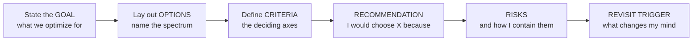

**Banned phrase:** "it depends" — full stop. **Permitted and powerful:** "it depends *on X* — and given what you've told me about X, I'd do Y, here's the risk, here's when I'd revisit." The difference between those two sentences is two title levels.

### Signal, not solution

Interviewers are reading for **signal** — evidence you've operated at this altitude — not a perfect solution. You do not need to design the whole system; you need to demonstrate judgment, prioritization, and the ability to lead others through ambiguity. Give the *headline* and the *reasoning*, earmark the hard parts, and let them pull on the threads they care about. A crisp recommendation with one sharp risk beats an exhaustive taxonomy.

### Altitude — talk like a peer, not an implementer

**Operate at org / strategy altitude.** When asked about microservices, a mid-level engineer talks about gRPC and service meshes; a Staff/Director talks about coordination cost, team ownership, and blast radius. When asked about cost, the IC says "reserved instances"; the leader says "make unit economics visible, then attack a portfolio of levers and institutionalize it so it doesn't regress."

Rule of thumb: if your answer could come from a strong senior engineer, you're too low. **Pull up.** Talk about teams, money, risk, customers, time-to-market, and the organization — and *delegate* the implementation detail down ("I'd have the team choose the queue tech; my concern is the boundary and the blast radius").

### Risk-weighting and YAGNI

Two reflexes that signal seniority:

- **Risk-weighting:** allocate your rigor — and the org's deliberation time — *proportional to the cost of being wrong*. This is the reversible/irreversible (two-way / one-way door) spine that runs through the whole module. Don't agonize over reversible decisions; don't rush irreversible ones.
- **YAGNI / build for 10x not 1000x:** resist over-engineering the *system* (premature scaling) *and* over-engineering the *org/process* (a platform team before you have teams to serve, an RFC process for a 4-person startup). The senior answer often *removes* complexity. "I wouldn't build that yet" is a power move when justified.

### Earmark the hard parts

Name where the real difficulty lives instead of glossing over it. "The hard part here isn't the happy path — it's cross-tenant data-leak prevention and the migration cutover; let me spend my time there." This shows you know where bodies are buried. It's the opposite of a junior who spends equal time on every box in the diagram.

### Experience hooks — scripted war-stories

Leadership answers land 10x harder when anchored in **real operational/org experience**. Have a small set of stories ready, each compressed to ~4 sentences (situation → decision → tension → outcome/lesson). Adapt these to your own history; below are scripted templates you can fill from a real-time B2B SaaS / chat-infra background.

| Hook | Scripted story (fill with your specifics) |
|---|---|
| **A migration** | "We had a monolithic message-delivery service that three teams contended on — every deploy was a coordinated release train. I led a strangler-fig extraction of presence and push-delivery first because they had the cleanest data boundary and the most cross-team pain. We formed the owning team *before* extracting. Result: those teams went from weekly coordinated deploys to independent daily ones; the lesson was that we sequenced by *org pain × boundary cleanliness*, not by what was technically interesting." |
| **A build-vs-buy** | "Push notification delivery — we debated building our own FCM/APNs orchestration. I called it as buy/adopt: it's context, not our differentiator, which is the real-time delivery engine. We wrapped the provider behind our own interface so we could swap it; 18 months later we did partially swap a provider with a two-week change instead of a re-platform. The anti-corruption layer paid for itself." |
| **A cost cut** | "Our cloud bill was growing faster than revenue and leadership wanted 30% out. I refused to start with tactics — first we tagged everything per-tenant and found cross-AZ data transfer and observability cardinality were the top two line items, not compute as everyone assumed. We co-located chatty services, sampled telemetry, and committed-use the baseline; hit ~34% without touching an SLO, then made cost a standing review item so it didn't regress." |
| **A disagreement** | "A respected staff engineer pushed hard for event-sourcing our core message store; I thought it was over-engineering for our scale. We re-anchored on the goal — auditability — and found a cheaper way to get it. On the one call where we still disagreed and it was reversible, I let him run his approach behind a flag; the data proved him partly right and we kept the good half. I didn't win by authority on a two-way door." |
| **Setting direction** | "Taking over a ~40-person org with eight snowflake deploy pipelines, I didn't mandate a standard top-down. I wrote a one-page technical vision, stood up a small platform team to build a paved road, and let teams opt out *with written justification* — the opt-out rate told me exactly where the platform was failing. Within two quarters most teams had adopted it voluntarily because it was the path of least resistance." |

> Deploy a hook the moment a question invites it. "Have you actually done this?" is what the interviewer is silently asking — answer it before they ask.

### Top anti-patterns in leadership answers (avoid these)

| Anti-pattern | What it sounds like | Do this instead |
|---|---|---|
| **Option-listing, no recommendation** | "There's silo, pool, and bridge, each with trade-offs…" *(then stops)* | End with "…so I'd default to pool with RLS, tier up for enterprise. Here's why." |
| **Can't quantify** | "It would save a lot of money." | "Egress was ~22% of the bill; co-locating cut it by half." Put numbers on it, even ranges. |
| **False humility / hedging** | "I'm not really sure, you'd know better, it could go either way." | "I'd make the call: X. I could be wrong if Y, and here's how I'd find out fast." |
| **Abdicating the decision to the panel** | "What would you want me to optimize for?" *(as a dodge)* | Ask *once* to clarify the real constraint, then decide: "If it's time-to-market, then X." |
| **Dodging conflict** | "I'd try to get everyone to agree." | "I'd drive to disagree-and-commit, document the dissent, and move." |
| **Over-engineering org/process** | "I'd set up an architecture review board, an RFC process, a guild…" *(for a 10-person team)* | "At this size, lightweight ADRs and one weekly design sync. I'd add structure only when team count forces it." |
| **Too low altitude** | Diving into gRPC vs REST when asked about org strategy. | Pull up to teams, cost, risk, customers. Delegate the tech choice down. |

### How to use the rest of this module

Every section below ends with a **decisive worked recommendation** and **actual phrasing you can say**. Read the framework, then read the script. In the room, lead with the recommendation, support it with the framework, and close with the risk + revisit trigger. That's the whole game.

---

# Architecture Strategy

## 1. Monolith vs Microservices — an Org Decision

### The concept

Most engineers debate monolith vs microservices on *technical* axes: scalability, latency, deployment. At Staff+ level the real axes are **organizational**: team size, cognitive load, deployment independence, and ownership boundaries. **Microservices are primarily a technique for scaling engineering organizations, not systems.** You adopt them when the *coordination cost* of many people working in one codebase exceeds the *operational cost* of running many services.

### Why it matters at scale

A single team of 6 shipping a monolith is *fast*. The same monolith with 120 engineers becomes a coordination nightmare: merge queues, shared release trains, one team's bug blocks everyone's deploy, and no one owns the whole thing. Microservices trade **in-process simplicity** for **deployment independence and clear ownership** — and import a tax: network calls, distributed transactions, observability, eventual consistency, versioning. (See [Microservices](10-microservices.md) for the technical mechanics; this section is about *when and why the org should pay that tax*.)

### The decision spectrum

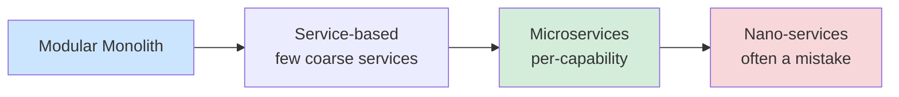

The honest default for most companies is **a well-modularized monolith** (a "modulith") — clear internal module boundaries, enforced dependencies, one deployable. You split out a service when a *specific* boundary earns it.

### When splitting HELPS vs HURTS

| Signal that splitting **helps** | Signal that splitting **hurts** |
|---|---|
| Multiple teams contend for the same code; deploys block each other | One team owns it all; coordination cost is low |
| A component has a *different scaling profile* (e.g. media transcoding vs auth) | Components are tightly chatty and transactional together |
| A component has a *different reliability/compliance need* (PCI scope isolation) | You'd be splitting a domain that isn't yet stable (boundaries still moving) |
| You need independent release cadence (mobile API vs batch jobs) | You'd create distributed monolith: services that must deploy in lockstep |
| Clear, stable domain boundary (DDD bounded context) | You're chasing résumé-driven architecture |

### The decision, the way I'd make it

**My default recommendation:** for any org under ~3–4 product-aligned teams on the same domain, stay on a **modular monolith** and enforce module boundaries in code (package structure, dependency rules, separate build targets). Extract a service only when a boundary is paying *one* of two specific taxes: (a) **org contention** — two teams blocking each other's deploys, or (b) a **genuinely divergent profile** — scaling, reliability, or compliance. Anything else is fashion, and I'd push back.

**The decisive trigger I'd verbalize:** *"Can team A ship a change to its area today without coordinating a release with team B? If no, we have a candidate for extraction. If yes, leave it in the monolith."*

> **Staff/Director-level insight:** The most expensive mistake is the **distributed monolith** — you paid the full microservices tax (network, ops, observability) but kept the coupling, so you still can't deploy independently. The diagnostic question is: *"Can team A ship a change to its service today without coordinating a release with team B?"* If no, you have a distributed monolith, and you were better off with a modulith. Splitting prematurely — before the domain boundaries are stable — bakes the wrong seams into your network topology, which is 10x harder to refactor than a function call. **This is a one-way door; treat it like one.**

### The migration decision

Don't big-bang rewrite. Use the **Strangler Fig** pattern (see [Architecture Patterns](15-architecture-patterns.md)): put a routing/facade layer in front of the monolith, peel off one bounded context at a time, route that traffic to the new service, repeat. Migrate the **highest-pain, highest-independence** boundary first to prove value early.

**Sequencing heuristic:** extract the seam that (a) is causing the most cross-team contention, AND (b) has the cleanest data boundary. Auth, notifications, and media are common first extractions because they're naturally decoupled.

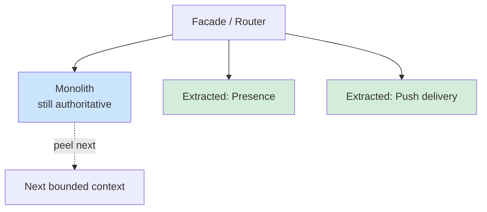

**Migration risk register (earmark the hard part):** the cutover and the *data ownership* split are the hard parts, not the new service code. Dual-writes, backfills, and the moment you flip the source of truth are where outages happen. I'd gate each cutover behind a flag, run shadow traffic, and keep the monolith authoritative until the new service has proven itself on real load.

**Sample talking point:**
> "I wouldn't frame this as monolith vs microservices — I'd frame it as: what's our coordination cost and where are our boundaries stable? With 8 engineers on one team, a modular monolith is the right call; we keep velocity and avoid distributed-systems tax. I'd enforce module boundaries in code so that *when* we hit ~3-4 teams, the seams are already drawn and extraction via strangler fig is mechanical. The trigger to extract a service is organizational pain — teams blocking each other's deploys — or a genuinely different scaling/compliance profile, not architectural fashion. And I'd extract by *org pain × boundary cleanliness*, forming the owning team before the service exists, because the hard part is the data-ownership cutover, not the code."

---

## 2. Build vs Buy vs Adopt(OSS)

### The concept

Three options for any capability: **build** it yourself, **buy** a vendor/SaaS, or **adopt** open source (and self-host or use managed OSS). The decision is an *investment allocation* problem: where do you spend your scarce, expensive engineering hours?

### The decision framework

The governing question is **Core vs Context** (Geoffrey Moore): *Does this capability differentiate us in the market?*

- **Core** = what your customers pay you for, your moat. → **Build.** Owning it is the point.
- **Context** = necessary but undifferentiated (auth, billing, email delivery, observability). → **Buy or Adopt.** Spending senior engineers here is opportunity-cost negative.

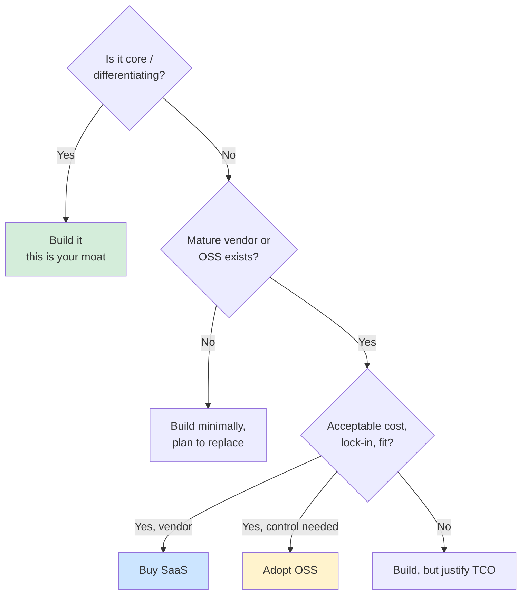

### The criteria to weigh

| Criterion | Build | Buy (SaaS) | Adopt (OSS) |
|---|---|---|---|
| **Time-to-market** | Slowest | Fastest | Fast (but ops setup) |
| **TCO** (total cost of ownership) | High & ongoing (it's never "done") | Predictable subscription, scales with usage | Free license, but ops + expertise cost |
| **Differentiation** | Full control of the moat | None (competitors can buy it too) | Some (can customize) |
| **Lock-in** | None (you own it) | High (data, APIs, pricing power) | Low–medium |
| **Control / customization** | Total | Limited to vendor roadmap | High (you have the source) |
| **Maintenance burden** | All on you | Vendor's problem | On you (patching, CVEs, upgrades) |
| **Reversibility** | N/A (you own it) | Make it reversible via an anti-corruption layer | Medium (fork risk, migration cost) |

**TCO is the trap.** Build estimates almost always ignore the *long tail*: the capability is never "done." You own maintenance, on-call, security patches, scaling, and feature parity *forever*. A $200K/yr vendor often beats a "free" build that consumes 2 FTEs ($600K+ fully loaded) indefinitely.

### Worked examples

- **Auth:** Almost always *buy/adopt* (Auth0, Cognito, Keycloak). Context, not core, and getting it wrong is a security liability. Exception: if identity *is* your product (an identity company), it's core → build.
- **Observability:** Buy (Datadog) for speed; adopt OSS (Prometheus/Grafana/Loki) when egress/cardinality costs explode at scale — many companies switch from buy→adopt precisely as a cost decision.
- **A real-time messaging core:** This is **core** → build the chat/presence/delivery engine; but *buy/adopt* the surrounding context (push delivery via FCM/APNs, transcoding, CDN, auth). The art is drawing the build/buy line *around* your differentiator.

### The decision, the way I'd make it

**My default recommendation:** **buy or adopt anything that isn't the moat**, and wrap it behind an **anti-corruption layer** so the choice stays reversible. Build only the differentiating core. When build estimates come in, I multiply the headline cost to account for the long tail (on-call, CVEs, feature parity forever) — a useful rule of thumb is that the *ongoing* cost of a non-trivial build is a recurring 1–2 FTE you'll never get back, so the bar for "build" is high.

**The line that signals seniority:** *"'We can build it' is never the question — of course we can. The question is what high-leverage work won't happen because these engineers are building undifferentiated plumbing."*

> **Staff/Director-level insight:** Frame every build/buy decision as **opportunity cost**, not sticker price. Also: prefer **reversible** choices — buy with a clean abstraction layer / anti-corruption layer so you can swap the vendor later. The worst answer in an interview is "we'd build it because we can"; the best is "it's context, so we buy — and I'd wrap it behind our own interface so switching cost stays low and we're not hostage to vendor pricing. The one place I'd build is the differentiating core, where owning it *is* the strategy." (Experience hook: the push-notification story above — buy, wrap, swapped a provider in two weeks instead of a re-platform.)

---

## 3. Multi-Tenant Architecture (Deep Dive)

> This is the highest-priority topic in this module for a B2B SaaS. Expect a full design round on it, and expect the interviewer to probe isolation, noisy-neighbor, cost attribution, and blast radius *hard*. Spend your time here.

### The concept

A **tenant** is a customer (an org/account) whose data and users must be logically — and sometimes physically — separated from every other tenant. Multi-tenancy is how a SaaS serves thousands of customers from shared infrastructure economically. The central tension: **isolation vs cost-efficiency**. Every multi-tenancy decision is ultimately *"how much isolation does this customer's risk/compliance/spend justify, and what does it cost me to provide it?"*

### The three models: Silo, Pool, Bridge

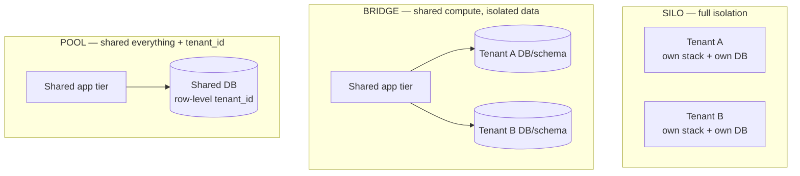

| Dimension | **Silo** (separate infra) | **Bridge** (shared infra, isolated data) | **Pool** (shared everything + `tenant_id`) |
|---|---|---|---|
| Data isolation | Strongest (physical) | Strong (separate DB/schema per tenant) | Logical only (row-level `tenant_id`) |
| Cost per tenant | Highest | Medium | Lowest (best economics) |
| Noisy-neighbor risk | None | Low (shared compute) | High |
| Blast radius of a bug | One tenant | One tenant's data; shared compute | **All tenants** |
| Onboarding speed | Slow (provision stack) | Medium | Instant (insert a row) |
| Operational overhead | High (N stacks to patch) | Medium | Low (one stack) |
| Per-tenant customization | Easy | Moderate | Hard |
| Compliance fit (HIPAA, FedRAMP, data residency) | Excellent | Good | Hard to satisfy |
| Cost attribution | Trivial (it's their stack) | Easy (per-DB metering) | Hard (must meter per `tenant_id`) |
| Best for | Enterprise/regulated tier | Mid-market | SMB / free / self-serve |

Most mature SaaS runs a **hybrid / tiered** model: pool for the long tail of small customers (great economics), silo (or per-tenant DB) for enterprise customers who demand isolation, residency, or pay for it. This is the **"dedicated tier"** — offered when a customer's compliance, scale, or noisy-neighbor concerns justify the cost, and they'll pay the premium.

### The decision, the way I'd make it

**My default recommendation for a B2B SaaS:** **start pool, design for tiering.** Pool model with strict row-level `tenant_id` isolation **enforced at the database (Postgres RLS), not just in app code** — because the catastrophic failure here is a cross-tenant data leak, which is a one-way-door reputational and legal event. Then define a **tiered model with an automated, IaC-driven promotion path**: pool → dedicated DB (bridge) → dedicated cell (silo), where the tier maps directly to a pricing tier and a compliance posture. Attribute cost and load per `tenant_id` from day one.

I would *not* default to silo-everyone (kills your economics and your onboarding speed) nor pool-everyone (can't sell to enterprise, can't satisfy residency, one noisy tenant or one bad deploy takes down the fleet). The tiered hybrid is the structural both/and answer.

### Isolation dimensions (all four matter — interviewers probe each)

1. **Data isolation** — Pool: enforce `tenant_id` on *every* query. The leading cause of cross-tenant data leaks is a forgotten `WHERE tenant_id = ?`. Defenses, in order of strength:
   - **Postgres Row-Level Security (RLS)** — the database enforces tenant scoping via a policy on `current_setting('app.tenant_id')`; even a buggy query *cannot* return another tenant's rows. This is the strongest practical defense and what I'd mandate.
   - A **tenant-scoped repository/ORM layer** that physically *cannot* issue an unscoped query (the unsafe method doesn't exist).
   - **Contract/lint tests** that fail CI if a query touches a tenant table without a tenant predicate.
   - Defense in depth: use all three. RLS is the backstop; the repository layer is the ergonomic default; the tests catch regressions.
2. **Performance isolation (noisy neighbor)** — one tenant's heavy load degrades everyone in a pool. (Detailed below.)
3. **Security isolation** — tenant context flows through the whole request (JWT claim → service → DB session variable → RLS), defense in depth so a bug at one layer doesn't leak across tenants. The tenant id should be derived from the *authenticated* identity, never from a client-supplied parameter.
4. **Blast radius** — a bad deploy or poison-pill input shouldn't take down all tenants. **Cell-based architecture** (sharding tenants into independent "cells"/stacks) caps blast radius: a failure hits one cell's tenants, not the whole fleet. (Pairs with [Reliability](11-reliability.md) — bulkheads.)

### Cell-based architecture (cap the blast radius)

A **cell** is a complete, independent copy of the stack (or a defined slice of it) serving a *subset* of tenants. Tenants are mapped to cells; a cell is sized to a blast-radius budget (e.g. "no single failure affects more than 5% of tenants").

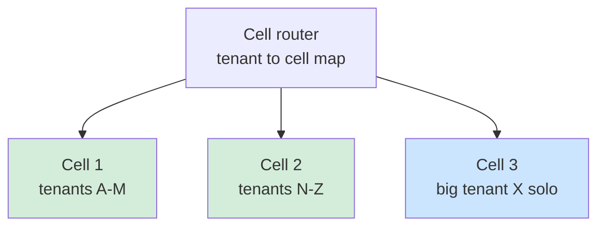

Benefits: a bad deploy is rolled to **one cell first** (canary by cell); a poison-pill or DB-exhaustion event is contained to one cell's tenants; you can place a single huge tenant in its own cell. Cost: more operational surface (N cells to deploy/observe) — which is exactly why you automate cell provisioning as code and roll deploys cell-by-cell.

> **Earmark the hard part:** cell *routing* and *tenant migration between cells* are the hard parts. You need a fast, cached tenant→cell lookup that is the single source of truth, and a rebalancing procedure to move a hot tenant without downtime. Get this wrong and you've built a fleet you can't operate.

### The noisy-neighbor problem

In a pool, Tenant A running a 10M-row export can starve CPU, DB connections, or queue capacity for Tenants B–Z. This is the most common production incident in pooled multi-tenancy.

**Mitigations (defense in depth):**

| Layer | Mechanism | Stops |
|---|---|---|
| Gateway | Per-tenant rate limits & quotas (token bucket keyed by `tenant_id`) | Request floods, API abuse |
| Workers | Per-tenant queues / weighted fair queuing; separate bulk vs interactive queues | One tenant monopolizing workers |
| Database | Connection-pool partitioning, statement timeouts, reserved connection floor | Pool exhaustion, runaway queries |
| Capacity | Promote heavy tenant to bridge/silo/own-cell | Structural over-consumption |

See [Reliability](11-reliability.md) for rate-limiting and bulkhead mechanics.

> **Staff/Director-level insight:** Tenant isolation is fundamentally a **business-tier decision dressed as an architecture decision**. The right answer is rarely "everyone gets the same model." It's: pool for self-serve economics, with a clear, *automated* promotion path (pool → dedicated DB → dedicated cell) tied to pricing tiers and compliance requirements. The architecture must make "noisy neighbor" *observable per tenant* (cost and performance attributed per `tenant_id`) so you can detect, charge for, or isolate the offender. **If you can't answer "what does tenant X cost me and how much load do they generate?", you can't run the business** — and you can't price, can't find the tenants destroying your margin, and can't decide who to promote.

### Sharding by tenant

Partition tenants across shards (DBs/cells) by a routing key. A **tenant→shard mapping table** (a "lookup service") lets you place big tenants on dedicated shards and pack small ones together, and to *rebalance* by migrating a tenant. Avoid hashing `tenant_id` directly to a fixed shard count — you lose the ability to move a hot tenant. Keep the mapping in a fast, cached lookup. (See [Architecture Patterns](15-architecture-patterns.md) for partitioning strategies.)

**Why a mapping table beats hash-mod-N:** the moment a tenant grows hot, you want to *move* it to its own shard/cell. Hash-mod-N forces a fleet-wide reshard to move one tenant. An explicit, cached mapping lets you move exactly one tenant. This is a reversibility argument — the mapping table keeps placement a two-way door.

### Tenant onboarding & cost attribution

- **Onboarding:** Pool = insert a row (instant, self-serve). Silo = provision a stack (Terraform/Pulumi pipeline, minutes-to-hours). Automate silo provisioning as Infrastructure-as-Code so a "dedicated tier" isn't a manual ticket — if promoting a tenant requires a human running steps, it won't scale and it'll be error-prone.
- **Cost attribution:** Tag every resource and meter every request with `tenant_id`. Compute **cost per tenant** and **revenue per tenant** → **margin per tenant**. This feeds FinOps (next section) and is essential for pricing and for finding tenants that cost more than they pay.

```
Margin per tenant = revenue per tenant
                  − (compute + storage + egress + support + telemetry) attributed per tenant
```

A standing report of *negative-margin tenants* is one of the highest-leverage artifacts a B2B SaaS leader can own — it drives pricing, tiering, and the occasional "we should fire this customer" conversation.

### Tier decision matrix (cheat-sheet)

| Customer profile | Model | Why |
|---|---|---|
| Free / self-serve SMB | **Pool** + RLS | Economics, instant onboarding; isolation enforced at DB |
| Growing mid-market | **Bridge** (dedicated DB/schema) | Stronger data isolation, easier cost attribution, still shared compute |
| Enterprise / regulated / residency | **Silo / own cell** (IaC-provisioned) | Compliance, residency, noisy-neighbor immunity; they pay the premium |
| One huge tenant degrading the pool | **Promote to own cell** | Contain blast radius and noisy-neighbor; structural fix not firefighting |

**Sample talking point (multi-tenancy):**
> "I'd default to a pool model with strict row-level `tenant_id` isolation enforced at the database via RLS — not just app code — because the worst failure here is a cross-tenant data leak, and that's a one-way door. I'd attribute cost and load per tenant from day one so noisy neighbors and negative-margin tenants are visible. Then I'd define tiers with an automated, IaC-driven promotion path: pool for self-serve, a dedicated-DB bridge tier for mid-market, and a fully siloed/cell-isolated tier for enterprise customers with residency or compliance needs. Blast radius is capped by cells, with deploys rolled cell-by-cell. The hard parts I'd spend my time on are leak-prevention and the cell routing/migration machinery. This way isolation maps cleanly to pricing and to risk — it's a business decision wearing an architecture costume. I'd revisit the tier boundaries as our enterprise mix grows."

---

## 4. Cost Optimization / FinOps as a Leadership Concern

### The concept

**FinOps** is the practice of bringing financial accountability to cloud spend — making engineering teams *see and own* the cost of their architectural decisions. The core framing for a senior engineer: **every architecture decision is a cost decision.** Choosing synchronous-everything, choosing a chatty microservice topology, choosing to keep logs at full cardinality — all have a price, and at scale that price is enormous.

### Why it matters at scale

Cloud bills grow super-linearly with carelessness. The biggest, least-visible line items are usually:
- **Data egress / cross-AZ / cross-region transfer** — moving data *out* and *between zones* is expensive and invisible in code reviews. A chatty cross-AZ service mesh can quietly cost more than the compute.
- **Idle / over-provisioned compute** — instances sized for peak, running at 15% utilization.
- **Observability cardinality** — logs and high-cardinality metrics often rival compute cost.
- **Storage tiering** — hot storage for cold data.

### Unit economics — the leadership lens

Don't talk about "the AWS bill." Talk about **unit cost**: cost per request, cost per tenant, cost per active user, cost per message delivered, cost per transaction. This converts an opaque number into a margin conversation the business understands and connects directly to pricing.

```
Gross margin per tenant = revenue per tenant − (compute + storage + egress + support) per tenant
```

If a free-tier tenant costs $4/mo to serve and pays $0, that's a deliberate CAC decision — *if you can see it*. If you can't, you're losing money blind. **The unit-economics lens is what lets you connect §3 (multi-tenancy) to the P&L** — it's the same `tenant_id` metering feeding both.

### Showback vs Chargeback

- **Showback** — show each team/tenant their cost (visibility, no transfer). Drives behavior via awareness.
- **Chargeback** — actually allocate the cost to the team's/tenant's budget (accountability with teeth).

Most orgs start with showback (resource tagging → per-team dashboards) and graduate to chargeback for the worst offenders.

### The optimization playbook (in priority order)

| Lever | Typical savings | Effort | Notes |
|---|---|---|---|
| Rightsizing / autoscaling | 20–40% | Low | Match capacity to demand; kill idle |
| Reserved / Savings Plans / committed-use | 30–60% on covered | Low | Commit for predictable baseline |
| Spot / preemptible for batch | up to 70–90% | Medium | Fault-tolerant workloads only |
| Kill egress / co-locate chatty services | varies, large | Medium | Architecture change |
| Storage tiering & retention policies | 30–50% on storage | Low | Lifecycle rules |
| Caching to cut DB/compute | varies | Medium | See caching modules |
| Observability cardinality control | 30–60% on telemetry | Medium | Sampling, drop high-card labels |

### The decision, the way I'd make it

**My default recommendation when handed a cost target:** **visibility before tactics.** I will not start by buying reserved instances. Step one is *make cost legible* — tag every resource, build per-team and per-tenant unit-cost dashboards, and rank the top 5 line items. Then attack with a **portfolio of levers ordered by ROI** (table above), and — the part juniors miss — **install a cultural mechanism so it doesn't regress**: cost as an SLO, cost reviewed in design docs, showback dashboards each team owns. A one-time cleanup regresses in two quarters; a discipline holds.

**Hard constraint I'd state out loud:** never breach an SLO for cost without an explicit, documented trade-off. Cost is optimized *under* the reliability ceiling, not against it.

> **Staff/Director-level insight:** When asked "cut cloud cost 30%," the junior answer is "buy reserved instances." The senior answer is: **make cost visible first**, then attack with a portfolio ordered by ROI, *and* establish the cultural mechanism so it doesn't regress. The mistake is treating cost as a one-time cleanup project rather than a continuous discipline. "Architecture decisions are cost decisions" is the line that signals seniority. (Experience hook: the cost-cut story above — found egress + cardinality were the real top line items, not compute; hit ~34% without touching an SLO; made it a standing review item.)

---

## 5. Technical Debt Management

### The concept

**Technical debt** = the implied cost of rework caused by choosing an easy/fast solution now over a better one. The metaphor matters: like financial debt, *some debt is smart leverage* (ship now, pay later to hit a market window); the danger is **unmanaged compounding interest** — debt that slows every future change.

### The Debt Quadrant (Martin Fowler)

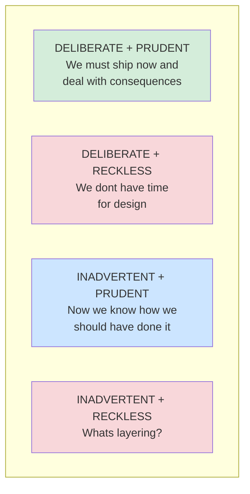

- **Deliberate + Prudent** is *healthy* debt — a conscious bet you've recorded and plan to repay. This is what good teams do.
- **Inadvertent + Reckless** is the dangerous accumulation from lack of skill/awareness.

### Types of debt

- **Code debt** (duplication, complexity, missing tests)
- **Architecture debt** (wrong boundaries, the distributed monolith, god services)
- **Data debt** (schema drift, no migrations strategy, denormalization gone wrong)
- **Infrastructure / platform debt** (unpatched, manual deploys, no IaC)
- **Knowledge/people debt** (bus factor of 1, no docs)
- **Test/dependency debt** (flaky suites, EOL dependencies, CVEs)

### How to quantify it

You can't manage what you can't measure. Translate debt into **business-legible cost**:
- **Change-failure rate & lead time** rising (DORA — see §9) → debt is taxing delivery.
- **% of eng time on toil/firefighting** vs feature work (track it).
- **"Interest" estimate:** "This module costs us ~2 extra dev-days per feature; we touch it ~twice a sprint → ~X/quarter."
- Hot-spot analysis: files with high churn × high complexity are your highest-interest debt.

### Getting buy-in to pay it down

The losing move is asking for "time to refactor." The winning move is **tying debt paydown to a business outcome**: "Paying down the auth-module debt unblocks the SSO feature sales is asking for and cuts our incident rate." Frame debt as **risk and velocity**, in the language of product/leadership.

### Boy Scout Rule vs Dedicated Initiatives — manage debt as a portfolio

- **Boy Scout Rule** ("leave it cleaner than you found it") — continuous, opportunistic, cheap. Handles low-interest debt. Insufficient alone for *architectural* debt.
- **Dedicated initiatives** — for high-interest, structural debt that opportunistic cleanup can't touch (re-drawing a service boundary). Needs a charter, a goal, and a definition of done.
- **Fixed allocation** — e.g. reserve ~20% of capacity for debt/reliability/platform work as a standing investment.

Treat debt like an **investment portfolio**: balance high-interest paydown, low-interest tolerance, and *strategic* debt (deliberately incurred to hit a window). Keep a **visible, prioritized debt register** so it's a managed backlog, not folklore.

### The decision, the way I'd make it

**My default recommendation:** run debt as a **portfolio with a standing budget** (~15–20% of capacity), a **visible register** where each item names its *interest* (cost per change × change frequency), and a bias toward the **deliberate-prudent** quadrant. Low-interest debt → Boy Scout Rule. High-interest *architectural* debt → a chartered initiative with a business hook. I **do not** crusade for zero debt (immature) and I **do not** sanction the unsanctioned big-bang rewrite (usually fatal — stops delivery and re-implements hard-won edge cases).

> **Staff/Director-level insight:** Senior engineers don't crusade for "zero debt" — that signals immaturity. They run debt as a *portfolio with a budget*. The two phrases that land in interviews: (1) "Not all debt is bad — deliberate, prudent debt is how we hit market windows; the job is to keep a register so it's *chosen*, not accidental." (2) "I get buy-in by translating debt into the language leadership funds: incident rate, lead time, and unblocking revenue features — never 'the code is ugly.'" The anti-pattern to call out: the unsanctioned big-bang rewrite, which usually fails because it stops feature delivery and re-implements the original's hard-won edge cases.

---

# Scaling Organizations

## 6. Conway's Law & the Inverse Conway Maneuver

### The concept

**Conway's Law:** *"Organizations design systems that mirror their own communication structure."* Your architecture will end up shaped like your org chart whether you intend it or not. Four teams will build a four-component system with the integration seams wherever the team boundaries are.

**The Inverse Conway Maneuver:** deliberately *design your org structure to produce the architecture you want.* If you want loosely-coupled services with clear ownership, you must first create loosely-coupled, clearly-owned teams.

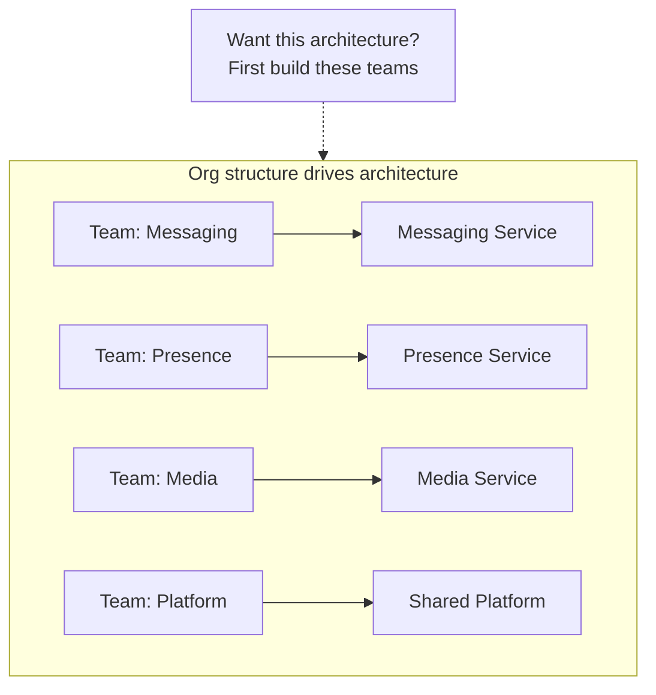

### Why it matters at scale

If you reorganize teams without thinking about architecture, you'll fight your own system — two teams sharing one service will create deploy contention; one team owning two unrelated services will neglect one. Conversely, if you want to *extract* a service (per §1), you usually need to *form the team* first; otherwise no one owns the new boundary and it rots.

### Real example

A company with a single "Backend Team" owning a monolith decides to go microservices. The architecture won't change durably until they split into product-aligned teams with their own services and deploy pipelines — because the *communication structure* (one team, one shared codebase, one release) re-creates the monolith no matter how the code is sliced.

### The decision, the way I'd make it

**My default recommendation:** treat any re-architecture as an **org change first**. Before extracting a service, I form the team that will own it and give it its own deploy pipeline; before mandating loose coupling, I create loosely-coupled teams. The reorg *is* the architecture lever — and it's the most over-looked one a Head of Engineering controls.

> **Staff/Director-level insight:** Reorgs *are* architecture decisions, and architecture decisions *are* org decisions — at Director level you wield both levers together. Before any re-architecture, ask: "Does our team structure support the target architecture, and who will own each new boundary?" The most powerful (and most over-looked) tool a Head of Engineering has for changing the system is changing the org. State this explicitly: "I'd apply the Inverse Conway Maneuver — shape the teams to produce the architecture, rather than hoping the architecture survives the org." (Experience hook: extraction story — we formed the owning team *before* the service existed, which is why it didn't rot.)

---

## 7. Team Topologies

### The concept

From *Team Topologies* (Skelton & Pais): a model for organizing teams to optimize for fast flow, built on **four team types** and **three interaction modes**, with **cognitive load** as the central constraint.

### The four team types

| Team type | Purpose | Example |
|---|---|---|
| **Stream-aligned** | Owns a flow of work for a product/feature/user segment end-to-end. The default, most teams. | "Messaging team", "Onboarding team" |
| **Platform** | Provides internal self-service products that reduce stream-aligned teams' cognitive load. | "Developer platform / IDP team" |
| **Enabling** | Helps other teams adopt new skills/tech; coaches, then leaves. | "SRE enablement", "ML enablement" |
| **Complicated-subsystem** | Owns a part needing deep specialist expertise. | "Video codec team", "Crypto/payments core" |

### The three interaction modes

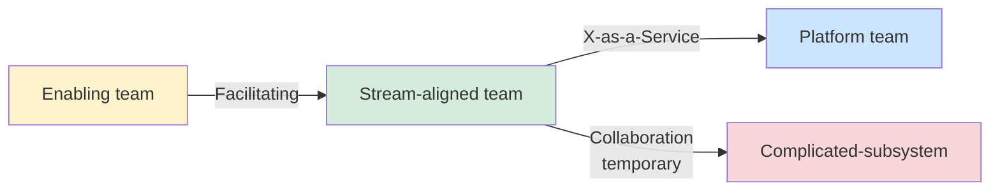

- **Collaboration** — two teams work closely for a *bounded* time to discover/create (high bandwidth, temporary, expensive).
- **X-as-a-Service** — one team consumes another's capability via a clean API/self-service (low bandwidth, the goal for platform↔stream).
- **Facilitating** — one team helps/coaches another (enabling teams).

### Cognitive load — the core idea

A team has finite cognitive capacity. Pile too many disparate domains and technologies on one team and they thrash. The **Team API** (well-documented interfaces, clear ownership, paved roads) and platform teams exist to *cap each stream-aligned team's cognitive load* so they can move fast on their domain. The platform absorbs the undifferentiated heavy lifting.

### The decision, the way I'd make it

**My default recommendation:** make **stream-aligned teams the overwhelming default** (most teams should own a product flow end-to-end), and add the other three types *only as a response to observed pain*: a platform team when ≥3–4 stream teams are duplicating infra toil; an enabling team when a capability gap (SRE, ML) is slowing many teams; a complicated-subsystem team only where genuine deep specialism exists. The diagnostic I'd use for a slow team is **"what's their cognitive load, and what can the platform absorb to convert Collaboration into X-as-a-Service?"** I'd resist standing up platform/enabling teams prematurely — that's over-engineering the org.

> **Staff/Director-level insight:** "Cognitive load" is the precise vocabulary that signals you understand org design, not just team names. When a team is slow, the senior diagnosis is often "they're carrying too much cognitive load — they own their product *and* the deploy pipeline *and* the observability stack *and* the Kafka cluster." The fix is a platform team that provides those as self-service, converting Collaboration overhead into a clean X-as-a-Service boundary. Tie this back to Conway: Team Topologies is the operational playbook for the Inverse Conway Maneuver.

---

## 8. Platform Engineering

### The concept

**Platform Engineering** builds an **Internal Developer Platform (IDP)** — a curated, self-service layer that lets product teams ship without re-learning the entire infra/ops stack each time. Its products are **golden paths** (a.k.a. **paved roads**): the well-supported, opinionated, easy way to do common things (spin up a service, get a database, deploy, observe).

### The platform-as-product mindset

The platform team treats internal engineers as *customers*. That means: discovery (what do teams actually struggle with?), a roadmap, SLAs, docs, onboarding, adoption metrics, and — critically — **the golden path must be the path of least resistance**. If the paved road is harder than rolling your own, no one uses it and you've built shelfware.

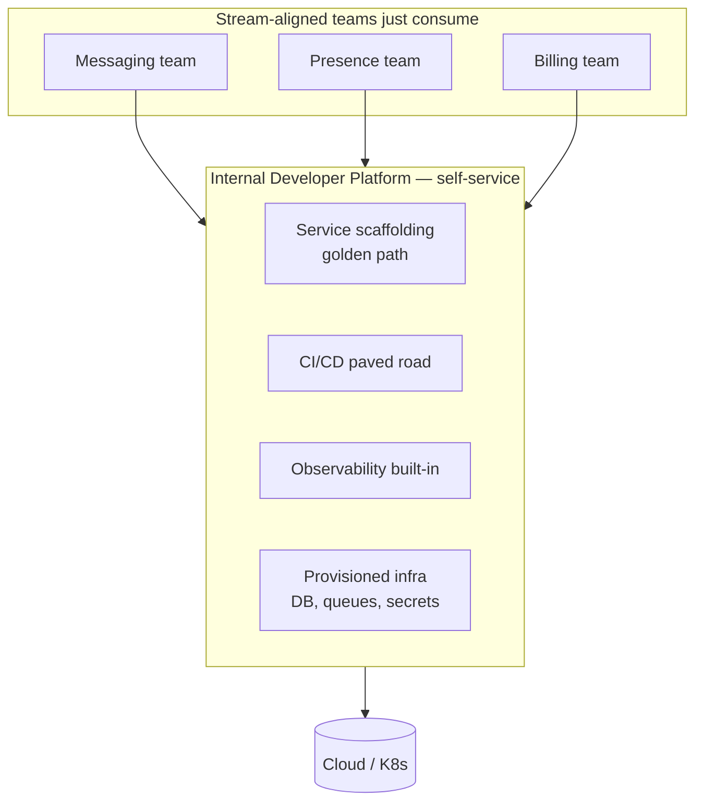

### Why it matters at scale

Without a platform, every team reinvents deploys, monitoring, and security — inconsistently, insecurely, and slowly (massive duplicated cognitive load). The platform converts that into one well-maintained, secure-by-default, self-service product. Self-service is key: **no tickets, no waiting on a central ops team** (which becomes a bottleneck and re-creates the org-chart-shaped delivery chokepoint).

### Golden paths vs guardrails

- **Golden path:** the recommended, supported way. *Optional but irresistible.*
- **Guardrails / paved road with walls:** for things you must enforce (security, compliance), make the secure way the *only* easy way, and make deviations require explicit sign-off.

### The decision, the way I'd make it

**My default recommendation:** build a platform team **only after the toil is real** (≥3–4 stream teams duplicating infra work), treat it strictly **as a product** whose success metric is **adoption + improving DORA**, not lines of platform code, and make the golden path **opt-out with written justification** rather than mandatory. The opt-out rate is my best instrument for where the platform is failing its customers. If I can't yet justify a platform team, I'd assign platform ownership as a part-time charter to a senior engineer rather than over-build org structure.

> **Staff/Director-level insight:** The failure mode of platform teams is building an **ivory-tower platform** — technically elegant, nobody adopts it, because it was built without treating internal devs as customers. The senior framing: "Platform is a product; its success metric is *adoption and the developer experience it produces (DORA metrics improving), not lines of platform code.* I'd let teams opt *out* of the golden path with explicit justification — that opt-out rate is my best signal for where the platform is failing its customers." Also name the prerequisite: don't build a platform team prematurely; you need enough stream-aligned teams suffering duplicated toil to justify it. (Experience hook: the direction-setting story — paved road with opt-out-with-justification; opt-out rate told me where to invest.)

---

## 9. Developer Productivity — DORA & SPACE

### DORA — the four (now five) keys

The **DORA** metrics (DevOps Research and Assessment) are the industry-standard, research-backed measures of software delivery performance:

| Metric | What it measures | Elite benchmark |
|---|---|---|
| **Deployment Frequency** | How often you ship to prod | On-demand / multiple per day |
| **Lead Time for Changes** | Commit → running in prod | < 1 day (often < 1 hour) |
| **Change Failure Rate** | % of deploys causing a failure | ≈0–5% (note: exact bands shift year to year — ~10–15% is mid-tier, >15% trends low) |
| **MTTR / Failed-deploy recovery** | Time to restore service after a failure | < 1 hour |
| **Reliability** (5th, added later) | Meeting operational SLOs | — |

The key DORA insight: **throughput (freq, lead time) and stability (CFR, MTTR) move *together*** at high-performing orgs. Speed and quality are *not* a trade-off in the long run — small batches and automation give you both. This is a great senior point.

### SPACE — productivity is multidimensional

DORA measures *delivery*; **SPACE** (Forsgren et al.) measures *developer productivity* holistically across five dimensions — and warns against any single metric:

- **S**atisfaction & well-being (are devs happy, not burning out?)
- **P**erformance (outcomes/quality, not output)
- **A**ctivity (counts — commits, PRs; the weakest, easily gamed)
- **C**ommunication & collaboration (PR review flow, knowledge sharing)
- **E**fficiency & flow (uninterrupted progress, low wait time)

The point of SPACE: **never manage by a single metric.** "Lines of code" or "story points per dev" are vanity/gameable. Pick at least one metric from a few dimensions, including a perceptual (survey) one.

### What actually moves the needle

| Lever | Why it works |
|---|---|
| **Reduce batch size** (small PRs, trunk-based, CI/CD) | Faster feedback, lower CFR, easier rollback |
| **Cut wait time / handoffs** | Most of lead time is *waiting* (code review, env, approvals), not coding |
| **Reduce cognitive load** (platform, paved roads) | Devs spend brain on the domain, not toil |
| **Protect flow / focus time** | Context-switching is the silent killer of throughput |
| **Fast, reliable CI** | Flaky/slow pipelines tax every change |

### The decision, the way I'd make it

**My default recommendation:** use **DORA at the team/system level** for delivery health, **paired with SPACE** so I'm never managing by a single gameable number — I weight Efficiency/Flow and Satisfaction (including a perceptual survey). I **never** weaponize DORA against individuals (Goodhart's Law destroys the metric instantly). And I'd put my first improvement dollar into **removing wait time** — review latency, env provisioning, approval gates — because lead time is mostly queue time, not coding time.

> **Staff/Director-level insight:** Two senior moves. First: "I use DORA for delivery health but pair it with SPACE so I don't manage by a gameable number — Activity metrics like commit counts are vanity; I weight Efficiency/Flow and Satisfaction." Second: the deepest insight is that **lead time is mostly wait time, not work time** — the highest-leverage productivity investment is usually removing handoffs and queues, not making engineers "code faster." And never weaponize DORA against individuals; it's a *team/system* health signal — using it for individual performance reviews destroys it instantly via Goodhart's Law.

---

# Trade-off Discussions

> This is the heart of the senior interview. Interviewers don't want a "right answer" — they want to see you *reason, name the spectrum, decide, and own the consequences.* Decide, don't enumerate.

## 10. The Trade-off Communication Framework

Use this reusable structure for *any* trade-off question. It's the single most valuable pattern in this module — and it's the same spine from §0.

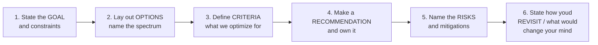

**The six steps, scripted:**

1. **Goal & constraints** — "Before choosing, what are we optimizing for, and what's fixed? Time-to-market? A 99.99% SLA? Budget? Team size?" *Anchoring on the goal is what separates senior from mid-level.* (Ask *once* to clarify the real constraint — don't use it to dodge deciding.)
2. **Options & the spectrum** — "This sits on a spectrum from X to Y. The options are A, B, C." Naming it as a spectrum (not binary) signals maturity.
3. **Criteria / decision matrix** — "I'd weigh these against cost, latency, operational burden, time-to-market, and reversibility." Often a small weighted table.
4. **Recommendation** — "Given the goal is X, I'd choose B." *Decide.* Don't sit on the fence — senior engineers are paid to make the call.
5. **Risks & mitigations** — "The risk of B is Z; I'd mitigate with…" Pre-empting your own choice's weakness builds enormous credibility.
6. **Revisit / falsifiability** — "I'd revisit this if traffic 10x's or if metric M crosses threshold T." Shows you treat decisions as *living*.

> **Staff/Director-level insight:** The phrase interviewers are listening for is **"it depends — and here's *on what*."** A junior says "it depends" and stops (weak). A senior says "it depends *on the goal*; if we're optimizing for time-to-market I'd do A, if for a 99.99% SLA I'd do B — given what you've told me, I'd choose A and here's the risk." Always articulate the *axis of the decision*, then commit. Indecision reads as junior; reckless certainty reads as junior; *reasoned commitment with named risk* reads as Staff.

---

## 11. The Canonical Trade-off Spectrums

For each: the **framing**, the **spectrum**, **how to decide**, and a **worked recommendation** you can say.

### Cost vs Performance

- **Spectrum:** cheapest-good-enough ←→ fastest-at-any-cost.
- **Decide by:** what does the *business* need? Sub-100ms p99 because it's a real-time chat product (then pay for it — it's core), or "fast enough" for a batch report (then optimize cost). Tie performance to a revenue/UX threshold; beyond that threshold, extra performance is waste.
- **Worked recommendation:** "I'd set an explicit latency SLO at the user-perceptible threshold — for a real-time chat path, say p99 message-delivery under ~200ms — and then optimize *cost* aggressively under that ceiling. Performance past the perceptible threshold is waste. Revisit if user research or a competitor moves the threshold."

### Speed (time-to-market) vs Reliability/Quality

- **Spectrum:** ship-now-iterate ←→ get-it-perfect.
- **Decide by:** stakes and reversibility. A new growth experiment → speed, accept some debt (deliberate-prudent). A payment/auth path → reliability, no shortcuts. Note the DORA insight: at high maturity these *converge* (small batches give speed *and* quality).
- **Worked recommendation:** "I match rigor to stakes and reversibility. Reversible, low-blast-radius feature → ship fast behind a flag, accept registered deliberate-prudent debt. Irreversible/high-blast-radius — payments, data migration — → slow down, no shortcuts. And at the system level I let the error budget decide so it's not a per-argument fight."

### Consistency vs Availability (CAP, business-framed)

- **Spectrum:** strong consistency (CP) ←→ high availability / eventual consistency (AP). (See CAP in the data modules; here's the *business* framing.)
- **Decide by:** cost of staleness vs cost of unavailability, *per use case*. Bank balance / inventory-at-checkout → consistency (CP). Social feed / like-count / presence → availability with eventual consistency (AP); a slightly stale like count is fine, an unavailable feed is not.
- **Worked recommendation:** "CAP only forces the choice *during a partition*, and I'd decide per-feature on business cost — not as a system-wide setting. Money or inventory → consistency, accept reduced availability. Activity feed or presence → availability, reconcile eventually. The same product holds both."

### Simplicity vs Scalability (YAGNI / premature optimization)

- **Spectrum:** simplest-thing-that-works ←→ built-for-massive-scale.
- **Decide by:** **build for 10x, not 1000x.** Premature optimization for scale you may never hit adds complexity (= cost, bugs, slower delivery) *now* for a *maybe* later. Keep boundaries clean so you *can* scale later, but don't pre-build it.
- **Worked recommendation:** "I'd build the simple version that handles 10x current load and keep the seams clean so the *next* 10x is a contained change — not architect for a billion users we don't have. I optimize for *changeability*, which buys the option to scale without paying for it today. Revisit when we're at ~50% of the 10x headroom."

### Innovation vs Standardization

- **Spectrum:** let-teams-choose ←→ one-blessed-stack.
- **Decide by:** standardize the **undifferentiated** (languages, CI, observability, deploy) to cut cognitive load and enable mobility; allow **innovation at the edges** where it's differentiating or experimental, via a sanctioned path (tech radar "Trial/Assess" rings, time-boxed spikes). Too much standardization = stagnation and frustrated seniors; too little = a zoo no one can operate.
- **Worked recommendation:** "I'd standardize the boring, undifferentiated layers — that's where consistency pays — and create a lightweight sanctioned path (tech radar + RFC) for teams to introduce new tech where it's differentiating. Innovation channeled, not banned or chaotic."

### Centralization vs Autonomy

- **Spectrum:** central platform/governance ←→ full team autonomy.
- **Decide by:** centralize for **consistency, security, and economies of scale** (one IDP, shared security baseline); decentralize for **speed and ownership**. The synthesis is **"centralized guardrails, decentralized execution"** — central paved roads + autonomy *within* them. Maps directly to Platform Engineering (§8).
- **Worked recommendation:** "'Freedom within a framework' — central guardrails for security, identity, and the paved road; team autonomy on product decisions within those. Pure autonomy gives you N incompatible snowflakes; pure centralization gives you a bottleneck. The platform is how you get both."

> **Staff/Director-level insight:** Every one of these is the *same meta-skill*: name the spectrum, anchor on the business goal, commit, and state your falsifiability condition. Notice the recurring synthesis pattern at senior level — you rarely pick an extreme; you find the *structural* answer that gets you the benefits of both ("guardrails + autonomy", "standardize the boring + innovate at edges", "build for 10x with clean seams"). Interviewers reward the candidate who *reframes a false binary into a structured both/and with explicit conditions* — but only after they've shown they can commit to a clear recommendation. Reframing must not become a way to avoid deciding.

---

## 12. Reversible vs Irreversible Decisions

> **This is the spine of the whole module.** Risk-weighting — calibrating rigor to reversibility — is the single most transferable senior heuristic. Use it as a lens on every other section.

### The concept (Amazon's two-way / one-way doors)

- **Two-way door (reversible):** you can undo it cheaply. → **Decide fast, delegate, bias to action.** Don't over-analyze; the cost of being wrong is low and you'll learn.
- **One-way door (irreversible):** hard/expensive to undo (public API contracts, data schema/format at scale, choosing a database for your core, a vendor with deep lock-in, a security/privacy posture, a cross-tenant data leak). → **Slow down, gather more input, get more eyes, be conservative.**

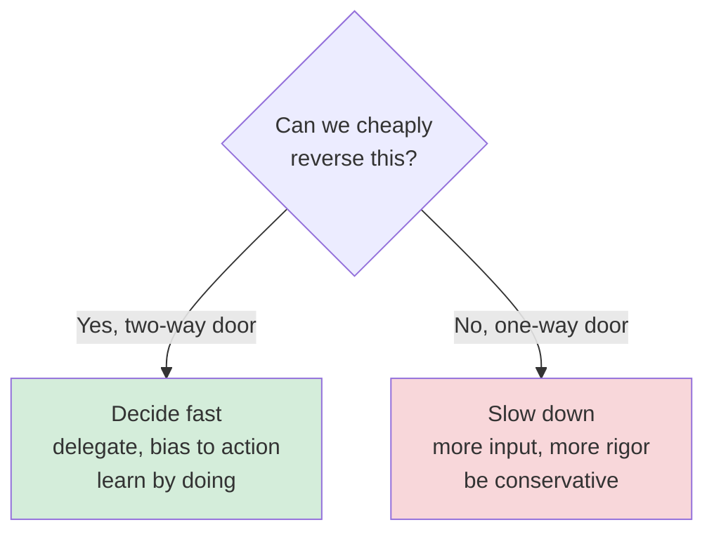

### Why it matters

The classic senior failure is applying the *wrong speed* to the door type: agonizing over reversible choices (slow, demoralizing) or rushing irreversible ones (catastrophic). Good judgment is *calibrating decision rigor to reversibility*. Many "irreversible" decisions can be *made reversible* by design — an anti-corruption layer around a vendor, feature flags, versioned APIs, expand/contract migrations — which is itself a senior move: **convert one-way doors into two-way doors when you can.**

### Examples mapped (so you can classify on the fly)

| Decision | Door | How I'd treat it |
|---|---|---|
| Choosing a queue tech for one service | Two-way | Let the team decide; move on |
| Public API contract shape | One-way | RFC, multiple reviewers, version it from day one |
| Core datastore for the product | One-way | Deep analysis; abstract data access to soften it |
| Pool vs silo *default* for multi-tenancy | One-way-ish | Decide carefully; mapping table keeps placement reversible |
| Vendor with deep lock-in | One-way | Anti-corruption layer converts it toward two-way |
| Feature behind a flag | Two-way | Ship, measure, flip off if wrong |

> **Staff/Director-level insight:** This is the single most useful decision heuristic to verbalize in any leadership interview. "First I ask: is this a one-way or two-way door? Most decisions are two-way — I push those down to the team and we move fast. For the genuine one-way doors I invest the analysis, and where possible I *engineer reversibility in* — wrap the vendor, version the API, use expand/contract — so a 'permanent' choice becomes recoverable." This shows you allocate your most precious resource — senior attention and organizational deliberation time — proportionally to actual risk. Cross-link: this is the same risk-weighting from [§0](#0-in-the-room--staff-level-delivery) and [Staff-Level Execution](20-staff-execution.md).

---

# Leading the Architecture Process

## 13. RFCs, ADRs & Design Review Culture

### RFCs and ADRs

- **RFC (Request for Comments) / Design Doc:** the *forward-looking* proposal — "here's what I want to build and why," circulated for feedback *before* building. Drives alignment and surfaces objections early (cheaply).
- **ADR (Architecture Decision Record):** the *durable record* — "we decided X, in context Y, with consequences Z." Lightweight, immutable, versioned in the repo. Answers the future question *"why on earth did we do it this way?"*

**Minimal ADR template:**

```
# ADR-0042: Use Postgres RLS for tenant isolation
Status: Accepted        Date: 2026-06-23
Context: Pool multi-tenancy; app-layer tenant_id filtering is leak-prone.
Decision: Enforce isolation via Postgres Row-Level Security policies.
Consequences:
  + DB-level guarantee, defense in depth
  - RLS adds query overhead; team must learn RLS
Alternatives considered: app-only filtering (rejected: leak risk),
  schema-per-tenant (rejected: operational cost at our tenant count).
Dissent: J. noted RLS overhead concern; accepted under disagree-and-commit.
```

### Design review culture

A healthy design review: **written-doc-first** (Amazon-style — read silently, then discuss; avoids the loudest-voice-wins dynamic), focused on *problem and constraints before solution*, psychologically safe so juniors challenge seniors, and *time-boxed with a clear decision owner*. The goal is **better decisions + shared context + raising the bar**, not gatekeeping.

### The decision, the way I'd make it

**My default recommendation:** **right-size the process to org size.** Small org (<~15 eng): lightweight ADRs in the repo and one weekly design sync; that's it. Larger org: add RFCs for one-way-door decisions, written-doc-first reviews, and a clear decision owner per doc — but I'd resist a heavyweight architecture review board, which becomes a bottleneck and a politics venue. The goal is *legible decisions with an owner*, not consensus on everything.

> **Staff/Director-level insight:** The output of a good architecture process is **written decisions with recorded context and a clear owner** — not consensus on everything. Name the failure modes: design-by-committee (no owner, endless meetings), and the opposite, decisions made in DMs that no one can later reconstruct. ADRs make decisions *legible and auditable*; RFCs make disagreement *cheap and early*. As a leader, you scale your judgment by establishing this process so good decisions happen *without you in the room* — and you record dissent in the ADR so disagree-and-commit is honest, not erased.

---

## 14. Tech Radar & Driving Technical Alignment

### Tech Radar

A **Tech Radar** (popularized by ThoughtWorks) is a living map of technologies categorized into rings: **Adopt** (proven, default), **Trial** (worth pursuing on a project), **Assess** (explore, prove it out), **Hold** (don't start new work with this). It's how an org channels innovation (§11) *visibly*: it says "yes, you can innovate — here's where, and here's how to graduate something from Assess to Adopt."

### Driving alignment across teams

As a Staff/Director, you don't *mandate*; you **align**. Tools:
- **Influence without authority** — bring data, prototypes, and a clear narrative; let teams co-own the decision.
- **A technical vision/strategy doc** — a written "where we're going and why" that teams can navigate by independently (so they make locally-consistent choices).
- **Architecture forums / guilds** — cross-team venues to surface and resolve cross-cutting decisions.
- **Working agreements** — explicit shared standards (API style, error contracts) that reduce friction at the seams.

### The decision, the way I'd make it

**My default recommendation:** drive alignment through **durable written artifacts that let teams self-align** — a one-page technical vision, a tech radar, and ADRs — rather than being the approval bottleneck. When two senior engineers disagree, I **facilitate to the decision criteria** ("what are we optimizing for?") rather than adjudicating who's right; if they still differ on a two-way door, pick one, document the dissent, and move (disagree-and-commit); on a one-way door, escalate with options *and a recommendation*.

> **Staff/Director-level insight:** Alignment at scale is achieved through **written, durable artifacts (vision docs, tech radar, ADRs) that let teams self-align**, not through you being the bottleneck approver. The senior skill is "managing senior stakeholders" — when two staff engineers disagree, you facilitate to the *decision criteria* rather than adjudicating who's right. If they still disagree on a two-way door, pick one, document the dissent in the ADR, and move — "disagree and commit." On a one-way door, escalate with options and a recommendation. Never escalate a problem without a recommendation attached — that's the difference between raising a flag and leading.

---

## 15. Decisions Under Uncertainty & "Good Judgment"

### What "good judgment" actually looks like

It's not "being right more often." It's a *process*: identifying the few decisions that matter, gathering *enough* (not infinite) information, calibrating rigor to reversibility (§12), making the call, and *adjusting* as reality arrives. Specifically:

- **Bias for action on reversible decisions; deliberation on irreversible ones.**
- **Decide with ~70% of the information** (Bezos): wait for 90% and you're too slow. Then course-correct fast.
- **Make assumptions explicit and falsifiable** — "I'm assuming traffic stays under 10K rps; if it crosses that, we revisit." This makes a decision *testable* rather than a gut bet.
- **Disagree and commit** — once decided, the org executes as one even where individuals dissented.
- **Pre-mortems** — "assume this failed in a year; why?" — surface risks before committing.

### The decision, the way I'd make it

**My default recommendation when I don't have enough data:** I don't wait for certainty — waiting *is* a decision, and usually the wrong one. I identify **what would make this a one-way door**, gather just enough to clear that bar, **state my key assumption as a falsifiable threshold**, decide, and **instrument the system so I'll know early if I was wrong**. Good judgment is reversibility-calibrated, assumption-explicit, and self-correcting — not infallible.

> **Staff/Director-level insight:** Interviewers probe judgment by asking how you decide *without enough data*. The strong answer: "I don't wait for certainty — that's a decision to be slow. I identify what would make this a one-way door, gather enough to clear that bar, state my key assumption as a falsifiable threshold, decide, and instrument the system so I'll *know early* if I was wrong. Good judgment is reversibility-calibrated, assumption-explicit, and self-correcting — not infallible." The tell of a junior here is either paralysis ("I'd need more data") or recklessness ("I'd just go with my gut"). The senior move is the explicit, instrumented, falsifiable bet.

---

## 16. Incident Leadership & Blameless Postmortems

### Leading an incident

In a major incident, the leader's job is *coordination and clear-headedness*, not heroics:
- Establish an **Incident Commander** (single decision owner), a comms lead, and ops responders — distinct roles.
- **Stabilize first, root-cause later** — restore service (rollback, failover, feature-flag off), then diagnose.
- Communicate proactively to stakeholders/customers on a cadence (under-communicating during an incident destroys trust faster than the outage).
- Keep a timeline as you go (feeds the postmortem).

### Blameless postmortems

The principle: **people don't cause failures; systems and conditions allow them.** Blame drives the truth underground — engineers hide context, and you lose the learning. A blameless postmortem assumes everyone acted reasonably with the information they had, and asks *"what about the system let this happen, and how do we make it impossible or detectable next time?"* Output: a timeline, contributing factors (plural — resist collapsing to a single root cause; complex failures almost always have multiple contributing factors), and *concrete, owned, dated* action items. (Pairs with [Reliability](11-reliability.md) — SLOs, error budgets, resilience.)

### The decision, the way I'd make it

**My default recommendation:** **stabilize before diagnose**, single Incident Commander, comms on a fixed cadence even when there's nothing new, and a **blameless** postmortem with plural contributing factors and dated, owned action items. I'd tie reliability investment to an **error budget** so the speed-vs-reliability fight is decided by policy in advance, not re-litigated each incident.

> **Staff/Director-level insight:** The two phrases that signal maturity: (1) "Blameless isn't 'no accountability' — it's accountability to *fixing the system* rather than punishing the person; the moment you blame a human, you stop learning." (2) "I treat the error budget as the forcing function — when we burn it, *reliability work automatically outranks features*; that takes the politics out of the speed-vs-reliability fight (§11) because the policy decided it in advance." A leader's behavior in the first hour of an incident — calm, role-clear, comms-forward, blameless after — sets the entire org's reliability culture.

---

## 17. Mentoring & Raising the Bar

### The leverage shift

Above Senior, your impact is no longer your own code — it's **the multiplier you put on everyone around you**. Mentoring, design review, ADRs, paved roads, and hiring are all *force multipliers*: they raise the floor and ceiling of the whole org's output.

- **Mentoring/sponsorship:** mentoring is advice; *sponsorship* is spending your political capital to put someone on a stretch project — the higher-leverage act for growing senior engineers.
- **Raising the bar:** consistent, high standards in design reviews and code reviews, codified into *paved roads and linters* so the bar holds *without* you. "Automate the standard" beats "police the standard."
- **Creating other leaders:** the Director-level measure is how many strong Staff engineers and EMs you've grown — scaling judgment, not tasks.

### The decision, the way I'd make it

**My default recommendation:** invest leverage in **encoding judgment into process** (ADRs, paved roads, written vision) and **growing people who decide well without me** — and I measure myself by the decisions that get made correctly *when I'm not in the room*. Concretely I bias toward sponsorship over mentoring for senior growth, and toward automating standards (linters, paved roads) over policing them.

> **Staff/Director-level insight:** Frame leadership impact as **leverage and replaceability**: "My job is to make myself unnecessary for day-to-day decisions by encoding judgment into process (ADRs, paved roads, written vision) and by growing people who decide well without me. I measure my success by the decisions that get made *correctly when I'm not in the room*." This is the cleanest articulation of the jump from individual contributor to multiplier, and it's exactly what Director/Head-of-Eng interviews are listening for.

---

# Putting It Together

## 18. Scripts for Leadership-Flavored Design Questions

> Lead with the recommendation. Support with the framework. Close with the risk + revisit trigger. Drop an experience hook where it fits.

### "How would you migrate a monolith to microservices?"

> "First I'd challenge the premise — *why?* If the driver is org coordination pain or a divergent scaling/compliance profile, microservices help; if it's fashion, I'd push back and propose a modular monolith. Assuming there's a real driver: I'd **not** big-bang rewrite — I'd use the strangler fig. Put a facade/router in front, identify the bounded context with the most cross-team contention *and* the cleanest data boundary, and extract that first to prove value. Critically — Inverse Conway — I'd form the *team* that owns the new service before extracting it, or it'll rot. I'd extract one context at a time, keep the monolith authoritative until each cutover, and define a clear success metric: can teams now deploy independently? The hard part I'd spend my time on is the data-ownership cutover — dual-writes, backfills, flipping the source of truth behind a flag — not the new service code. I'd watch hard for the distributed-monolith trap — if two 'services' still deploy in lockstep, I've added cost without benefit and I'd stop. I've run exactly this on a message-delivery service; we sequenced by org-pain × boundary-cleanliness and those teams went from coordinated weekly deploys to independent daily ones."

### "How do you decide build vs buy?"

> "Core vs context first: does this differentiate us? If it's our moat, build. If it's undifferentiated plumbing — auth, billing, observability — buy or adopt OSS, because spending senior engineers there is opportunity-cost negative. I weigh TCO honestly — build is never 'done,' you own maintenance and on-call forever, so a $200K vendor often beats a 'free' 2-FTE build. I bias toward reversible choices: buy behind an anti-corruption layer so we can swap vendors and aren't hostage to pricing. The decision is investment allocation, not 'can we build it' — of course we can; the question is what high-leverage work *won't* happen if we do. I made exactly this call on push-notification delivery — bought and wrapped it, and later swapped a provider in two weeks instead of a re-platform."

### "How would you reduce cloud cost by 30%?"

> "I'd resist jumping to tactics. Step one is *visibility*: tag every resource, build per-team and per-tenant unit-cost dashboards, and find the top 5 line items — at scale that's usually egress/cross-AZ, idle compute, and observability cardinality, not the obvious compute. Then I attack with a portfolio ordered by ROI: rightsizing and autoscaling, committed-use/savings plans for the predictable baseline, spot for batch, killing cross-AZ chatter, storage tiering, telemetry sampling. Crucially I'd never breach an SLO for cost without an explicit documented trade-off. And I'd make it stick culturally — cost as an SLO, showback dashboards each team owns, cost reviewed in design docs. 'Architecture decisions are cost decisions' — a one-time cleanup regresses; a discipline doesn't. Last time I did this we found egress and telemetry cardinality were the top two, not compute, and hit ~34% without touching an SLO."

### "How do you handle a senior engineer disagreeing with your design?"

> "First I genuinely want to know if they're right — they often have context I don't, and a leader who can't be moved by a good argument is a liability. I'd take it to the *decision criteria*: 'what are we optimizing for here?' Usually disagreement dissolves once we agree on the goal. If we still differ and it's a two-way door, I lean toward letting them run with their approach — it's reversible, they're invested, and ownership matters more than my being right; we instrument it so reality decides. If it's a one-way door and we're still split, I make the call as the accountable person, document their dissent honestly in the ADR, and ask for disagree-and-commit. What I *won't* do is win by authority on a reversible decision — that's how you lose senior engineers. I had this on an event-sourcing proposal; we re-anchored on the real goal, auditability, found a cheaper path, and on the one reversible disagreement I let him run it behind a flag — and he was partly right."

### "How do you set technical direction for a 50-person org?"

> "Direction at that size isn't me approving everything — that's a bottleneck. It's **durable, written artifacts that let teams self-align**: a technical vision doc (where we're going and why), a tech radar (sanctioned innovation paths), ADRs (legible decisions), and paved roads via a platform team (so teams move fast within guardrails). Structurally I'd apply Team Topologies and the Inverse Conway Maneuver — shape stream-aligned teams around product boundaries, a platform team to cap their cognitive load, enabling teams to spread skills — so the org *produces* the architecture I want. I'd run DORA+SPACE to see delivery and developer health, and reserve standing capacity for tech debt and reliability so velocity doesn't quietly erode. Centralized guardrails, decentralized execution. My success metric is good decisions happening correctly *without me in the room*. When I took over a ~40-person org I did exactly this — vision doc, small platform team, opt-out-with-justification paved road — and the opt-out rate told me precisely where to invest next."

---

## Interview Cheat-Sheet

**The delivery rules (from §0):**

- **Decide, don't enumerate.** Every answer ends in a recommendation. Banned: a bare "it depends."
- **Altitude:** talk teams, money, risk, customers, time-to-market — delegate the tech detail down.
- **Risk-weighting:** two-way door → fast; one-way door → slow. Calibrate rigor to reversibility.
- **YAGNI for systems *and* org:** don't over-build the architecture or the process.
- **Earmark the hard part** and spend your time there.
- **Drop an experience hook** the moment a question invites "have you done this?"

**One-liners to deploy:**

- "Microservices are an *organizational* scaling technique, not a system one. The question is coordination cost vs operational cost."
- "The worst outcome is a *distributed monolith* — full microservices tax, none of the independence."
- "Build vs buy is *core vs context* and *opportunity cost* — 'we can build it' is never the question."
- "Default to a **pool** multi-tenant model with DB-enforced (RLS) `tenant_id` isolation; tier up to dedicated/cell-isolated for enterprise/compliance. Make cost and load *observable per tenant*."
- "The worst multi-tenant failure is a cross-tenant data leak — enforce isolation at the database, not just in app code. That's a one-way door."
- "If you can't say what tenant X costs you and how much load they generate, you can't run the business."
- "Cap blast radius with **cells**; roll deploys cell-by-cell so one bad deploy can't take the fleet down."
- "**Architecture decisions are cost decisions.** Make cost visible (unit economics: cost per tenant/request) before optimizing."
- "Not all tech debt is bad — *deliberate, prudent* debt hits market windows. Run debt as a *portfolio with a register*, framed as risk/velocity to leadership."
- "**Conway's Law**: the system mirrors the org. **Inverse Conway**: shape the org to get the architecture. Reorgs *are* architecture decisions."
- "Cap **cognitive load** with platform teams and paved roads (Team Topologies). Platform is a *product*; its metric is adoption + DORA, not lines of code."
- "**DORA** for delivery, **SPACE** so I don't manage by a gameable single metric. Lead time is mostly *wait* time — kill handoffs."
- "Speed and quality *converge* at high maturity (small batches) — they're not a permanent trade-off."
- "Every trade-off: name the **spectrum**, anchor on the **goal**, **commit**, state the **risk** and what would **change my mind**."
- "**Two-way door → decide fast and delegate; one-way door → slow down.** And *engineer reversibility in* to turn one-way doors into two-way ones."
- "Decide at ~70% information, make assumptions *falsifiable*, then **disagree and commit**."
- "Never escalate without a recommendation attached — that's the difference between raising a flag and leading."
- "**Blameless** = accountability to fixing the *system*, not punishing the person. **Error budget** decides speed-vs-reliability in advance."
- "My leadership metric: good decisions made correctly *when I'm not in the room.*"

**Frameworks to name-drop (and use):** Core-vs-Context, TCO/opportunity-cost, Silo-Pool-Bridge, Cell-based architecture, Strangler Fig, Debt Quadrant, Conway/Inverse-Conway, Team Topologies (4 types/3 modes/cognitive load), Golden Paths, DORA, SPACE, two-way/one-way doors, disagree-and-commit, ADR/RFC, error budgets, showback/chargeback, unit economics.

**Cross-links:** [Staff-Level Execution](20-staff-execution.md) · [Architecture Patterns](15-architecture-patterns.md) · [Microservices](10-microservices.md) · [Cloud](14-cloud.md) · [Reliability](11-reliability.md)

---

## Common Interview Questions

> Answered in a **decisive leadership voice**: recommendation first, framework second, risk + revisit to close. Includes architecture, strategy, and behavioral framings.

**1. When would you *not* split a monolith into microservices?**
> When there's one team with low coordination cost, when domain boundaries are still moving (you'd bake the wrong seams into the network topology), when components are tightly transactional and chatty, or when you'd create a distributed monolith that deploys in lockstep. Microservices solve *organizational* scaling — without that pain, a modular monolith is faster and cheaper. I'd enforce module boundaries in code so extraction is mechanical *when* the org actually needs it. My trigger to revisit: two teams start blocking each other's deploys, or a component develops a genuinely divergent scaling/compliance profile.

**2. Walk me through designing a multi-tenant SaaS for 10,000 customers including a few large enterprises.**
> Hybrid/tiered, and I'll commit to the default up front: **pool with DB-enforced RLS for the long tail, tiering up to silo/cell for enterprise.** Pool (shared stack, shared DB with `tenant_id`) for SMB/self-serve — best economics, instant onboarding, isolation enforced via Postgres RLS so it's a *database* guarantee, not an app-code hope. A bridge tier (dedicated DB/schema) for mid-market. A siloed/cell-isolated tier for enterprises needing residency, compliance, or noisy-neighbor immunity — provisioned via IaC, with an *automated* promotion path from pool. Per-tenant rate limiting and fair scheduling at the gateway to control noisy neighbors. Cost and load attributed per `tenant_id` from day one so I can see margin and find offenders. Cells cap blast radius; deploys roll cell-by-cell. Tiers map to pricing. The two hard parts I'd spend my time on are cross-tenant leak prevention and the cell routing/migration machinery. I'd revisit the tier boundaries as our enterprise mix grows.

**3. A free-tier tenant is generating huge load and degrading paying customers. What do you do?**
> Short term: per-tenant rate limits and quotas at the gateway (token bucket keyed by `tenant_id`), and fair scheduling / a separate queue so bulk work can't starve interactive traffic. Diagnose via per-tenant cost/load observability — which I'd already have. Medium term: promote them out of the pool to a bridge/dedicated tier or their own cell, or enforce the free-tier quota that should have existed. This is a *productized* problem: noisy-neighbor protection and tiering are the answer, not firefighting. The lesson I'd carry back: if this surprised us, our per-tenant observability and our default quotas weren't good enough — that's the real fix.

**4. How do you decide build vs buy for, say, your auth system?**
> Core vs context: auth is context for almost everyone (unless identity *is* your product), and getting it wrong is a security liability — so buy/adopt (Auth0/Cognito/Keycloak). TCO: a build is never done, you own CVEs and on-call forever, so the 'free' build usually loses on fully-loaded cost. I'd wrap it behind our own interface (anti-corruption layer) to keep switching cost low. Build is reserved for the differentiating core — for a chat company, the messaging/presence engine, not auth. I'd only revisit toward build if vendor pricing or a hard customization need crossed a threshold that the abstraction layer couldn't absorb.

**5. How would you cut our cloud bill by 30% without hurting reliability?**
> Visibility first — tag everything, per-team/per-tenant unit-cost dashboards, find the top 5 line items (usually egress/cross-AZ, idle compute, telemetry cardinality). Then a ROI-ordered portfolio: rightsizing/autoscaling, committed-use for baseline, spot for batch, kill cross-AZ chatter, storage tiering, telemetry sampling. Never breach an SLO for cost without an explicit documented trade-off — cost is a constraint optimized *under* the reliability ceiling. Then institutionalize it: cost-as-SLO, showback, cost in design reviews — so it doesn't regress. I've hit ~34% this way; the surprise was that compute wasn't the top line item.

**6. Tell me about a time you took on significant tech debt deliberately. (behavioral)**
> Frame it as deliberate-prudent on the debt quadrant: a market window forced shipping a simpler-than-ideal design — name the specific shortcut (e.g. synchronous where async was 'right', or a denormalized schema). The senior signal is what you did *around* it: recorded it in the debt register/ADR with the explicit interest cost, set a falsifiable trigger to repay ('when we cross N tenants'), and later got buy-in to pay it down by tying it to a revenue feature it was blocking and a rising incident rate — not by saying 'the code is ugly.' The decision I'd own: the debt was *chosen and tracked*, not accidental.

**7. How do you handle a respected senior engineer who strongly disagrees with your architecture decision? (behavioral)**
> Genuinely engage — they may be right and have context I lack. Re-anchor on decision criteria: 'what are we optimizing for?' — most disagreement dissolves there. If still split and it's reversible (two-way door), I let them run with it; ownership and learning beat my being right, and we instrument it. If irreversible, I make the call as the accountable person, document their dissent in the ADR, and ask for disagree-and-commit. I never win a reversible call by authority — that's how you lose your best people. I've lived this on an event-sourcing proposal — re-anchored on auditability, found a cheaper path, and let him run the reversible piece behind a flag.

**8. What's the difference between a reversible and irreversible decision, and why does it matter to how you lead?**
> Two-way doors are cheap to undo — decide fast, delegate, bias to action, learn by doing; over-analyzing them wastes the org's scarcest resource, senior attention. One-way doors (public API contracts, core datastore, deep vendor lock-in, security posture, a cross-tenant data leak) are expensive to undo — slow down, more eyes, be conservative. The senior move is calibrating rigor to reversibility — *and* engineering reversibility in (anti-corruption layers, versioned APIs, expand/contract migrations) to convert one-way doors into two-way ones. It's how I allocate my rigor proportional to risk.

**9. How do you set and communicate technical direction across many teams without becoming a bottleneck?**
> Durable written artifacts that let teams self-align: a technical vision doc, a tech radar for sanctioned innovation, ADRs for legible decisions, and paved roads via a platform team for guardrails. Structurally, Team Topologies + Inverse Conway — shape the org to produce the target architecture and cap each team's cognitive load. Influence by data and prototypes, not mandate. Success = correct decisions made when I'm not in the room. I'd add process only as team count forces it — no architecture review board for a 15-person org.

**10. Speed vs reliability — how do you balance pressure to ship fast against quality? (architecture-strategy)**
> Match rigor to stakes and reversibility: reversible, low-blast-radius features optimize for speed and learning (accept deliberate-prudent debt); irreversible/high-blast-radius ones — payments, migrations — slow down. At a system level I use error budgets so the *policy* decides: when we burn the budget, reliability work automatically outranks features, which removes the politics. And I'd note that at high delivery maturity, small batches + CI/CD give speed *and* quality — DORA shows throughput and stability rise together, so the trade-off is partly a maturity problem to solve, not just a dial to set.

**11. Your VP asks for a feature in 2 weeks that you believe needs 6 to do safely. How do you respond? (behavioral/stakeholder)**
> I don't just say 'no' or silently cave. I make the trade-off explicit and give options with a recommendation: 'In 2 weeks I can deliver a thin slice behind a flag for the top customer — that's deliberate-prudent debt I'll register and repay; the full robust version is 6 weeks. Here's the risk of the fast path and how I'd contain blast radius. My recommendation is the thin slice if this is about unblocking that one customer, the full build if we're committing it as GA.' I put the decision, with its risks, back to the VP with a recommendation. Managing senior stakeholders is translating engineering trade-offs into business risk and giving them an informed choice — not heroics or capitulation.

**12. How do you measure whether your engineering org is healthy and improving?**
> DORA for delivery performance — deploy frequency, lead time, change-fail rate, MTTR — tracked at *team/system* level, never weaponized against individuals (Goodhart's Law). Paired with SPACE so I'm not managing a single gameable number — I weight Efficiency/Flow and Satisfaction, including a perceptual survey. I'd dig into where lead time is *wait* time (review latency, env provisioning, approvals) since that's usually the highest-leverage fix. Plus business-legible signals: incident rate/error-budget burn, % time on toil vs features, and attrition. Health is multidimensional and largely about *removing friction and cognitive load*, not pushing people to 'code faster.'

**13. You're asked to lead a re-architecture but the team structure doesn't match the target. What do you do first? (org/strategy)**
> I treat it as an org problem first — Conway's Law guarantees the architecture will snap back to the org's communication structure no matter how I slice the code. So before extracting services I'd form the owning teams and give them independent deploy pipelines (Inverse Conway). I'd sequence by org-pain × boundary-cleanliness, form the team, then strangler-fig the boundary. The recommendation I'd state plainly: 'the reorg *is* the architecture lever — we change the teams first, or the new architecture rots.' Revisit trigger: if a newly-formed team can't yet deploy independently, the org change isn't done and I'd hold the extraction.

**14. How do you decide what *not* to build — where's your YAGNI line? (judgment)**
> I build for 10x current load, not 1000x, and keep the seams clean so the next 10x is a contained change rather than a rewrite. I apply the same restraint to org and process — no platform team before there's duplicated toil to justify it, no heavyweight RFC board for a small org. The recommendation: optimize for *changeability*, which buys the option to scale or add structure later without paying for it today. Premature scaling and premature process are the same mistake as premature optimization. I'd revisit when we cross ~50% of the 10x headroom, or when team count crosses the threshold that makes the process pay for itself.

**15. A two-pizza team is shipping slowly. Diagnose it. (org/productivity)**
> First I'd look at where the time *goes*, not how hard people are working — lead time is usually mostly wait time. The common culprit at this level is excess cognitive load: the team owns their product *and* their deploy pipeline *and* observability *and* a Kafka cluster. The fix is a platform/paved-road that absorbs the undifferentiated load, converting Collaboration overhead into clean X-as-a-Service. I'd confirm with DORA (lead time, CFR) and a SPACE survey for the perceptual signal, then attack the biggest queue — review latency, env provisioning, or approvals. My recommendation is almost always *remove a handoff or cap cognitive load*, not 'push the team to code faster.'
