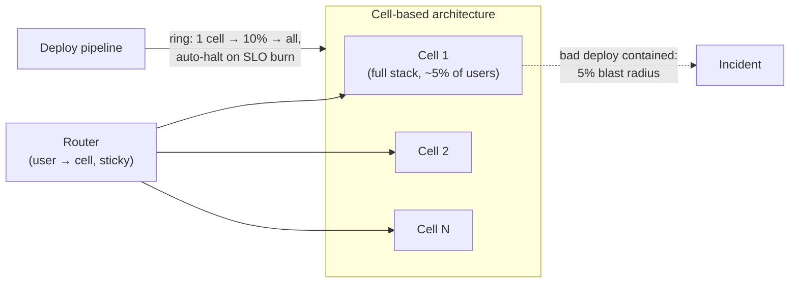

# Module 19b — Engineering Operations, Unit Economics & API Contracts

> Companion to [19 — Engineering Leadership & Trade-offs](19-leadership-tradeoffs.md) and [20 — Staff Execution](20-staff-execution.md). This module is the **L6 EM reality layer**: the round doesn't ask "what does it cost?" as a separate question — it watches whether cost, team boundaries, and operability *show up unprompted* in your design. Three muscles: pricing a design in dollars, drawing service boundaries that survive two teams and three years, and defending production with machinery instead of heroism.
> Cross-links: [11 — Reliability](11-reliability.md) · [12 — Observability](12-observability.md) · [28 — Designing for Failure](28-designing-for-failure.md) · [30 — Capacity Estimation](30-capacity-estimation.md) · flash-sale ops posture.

## What you'll master

- **$/QPS and storage-lifecycle math** you can do at the whiteboard, plus the three egress levers and the spot/reserved allocation ladder.
- **Team-to-team API contracts**: proto hygiene, deadline/retry-budget discipline, and the dependency-SLO multiplication that caps your own SLO.
- **Production readiness as a system**: on-call design numbers, blast-radius containment (cells + shuffle sharding), pre-decided degradation, and the toil ladder.

## 1. Practical unit economics

### 1.1 $/QPS — the five-line derivation (memorize the shape, not the prices)

```
Fleet: 40 servers × $1,500/mo (amortized or cloud-equiv) = $60K/mo
Avg load: 20K QPS  →  serving cost ≈ $3.0 per (QPS·month)
                   →  ≈ $0.0011 per 1M requests… plus the parts people forget:
+ storage, + egress, + cross-AZ traffic, + the second region, + 30% headroom
Real number is often 2–3× the naive one. Quote the loaded number.
```

The derived metric that matters to an EM is **cost per unit of product value** — $/1K recommendations, $/order, $/DAU-month — because that's the number that must stay flat while usage grows. If cost/DAU rises with scale, the architecture has a leak (usually: per-request work that should be precomputed — the [CS-29 economics](../Deep%20Dives/29-typeahead-autocomplete.md) argument, or unbounded per-user state).

### 1.2 Storage lifecycle — data has a temperature curve

| Tier | ~$/GB-month | Access | Move data here when |
|---|---|---|---|
| Hot (SSD/replicated DB) | 0.10–0.25 (with replicas + ops) | ms | actively queried |
| Object standard (S3/GCS) | ~0.023 | ms–100ms | read sometimes |
| Infrequent access | ~0.012 | same, retrieval fee | read rarely, kept for reuse |
| Archive (Glacier-class) | ~0.004 | hours, retrieval fee | compliance/insurance only |

The design move is **lifecycle policies as code** (age-based transitions + TTL deletion) declared at table/bucket creation — retrofitted archival never ships. Pair with the legal clock: retention floors (finance: keep ≥ N years) and ceilings (privacy: delete ≤ N days — [13b](13b-data-compliance-privacy.md)) bracket the curve.

### 1.3 Egress & network — the silent line items

Egress to internet ≈ **$0.05–0.09/GB**; cross-AZ ≈ $0.01–0.02/GB *each way*; cross-region in between. Three levers, in order of leverage: **(1) CDN/edge caching** (egress from CDN is cheaper and cache hits skip origin egress entirely), **(2) compression + payload discipline** (gzip/zstd on JSON is 5–10×; protobuf over JSON is 2–5×; don't ship fields clients drop), **(3) topology** (co-locate chatty services in one AZ with failover pairs, keep replication traffic on private links; a chatty microservice mesh split across AZs is a monthly invoice for an architecture diagram).

### 1.4 Compute allocation ladder

- **Reserved/committed (1–3 yr, ~40–60% off):** the diurnal *floor* — the capacity you know you'll use at 3 AM.
- **On-demand + autoscale:** the diurnal *peak* above the floor.
- **Spot/preemptible (~60–90% off):** stateless, checkpointable, deadline-tolerant work only — batch ETL, training, index builds ([CS-29](../Deep%20Dives/29-typeahead-autocomplete.md)'s nightly build is the perfect tenant). The discipline that makes spot safe is the same as crash-safety: idempotent, checkpointed, partition-atomic jobs. **Never** serving state, never the allocation gate.
- **The ISA lever (name it — a free ~20–40%):** **ARM (AWS Graviton, GCP Axion, Azure Cobalt)** is meaningfully cheaper per-QPS than x86 for most general serving/web/JVM/Go workloads, at similar or better perf-per-watt. The cost is a multi-arch build + validation and checking any native dependencies. An EM treats "have we moved the fleet to Graviton?" as one of the first cost questions, because it's a large, low-risk saving that doesn't touch the architecture. Quoting a flat "$1,500/mo per server" without asking the ISA is a tell you haven't priced the compute.

> **Staff & EM insight #1:** L5 treats cost as an afterthought slide; L6 *designs to a unit-economic target* ("this must serve at under $X/1K requests, which rules out per-request model inference — so we precompute") and knows which line item dominates their design (usually egress or the hot store, almost never CPU). The EM tell: you can name the number that must stay flat as the product grows, and the quarterly commitment you'd sign against it.

## 2. Service boundaries & interface hygiene

### 2.1 The gRPC contract between teams (the rules that prevent wars)

- **Schema evolution:** field numbers are forever (never reuse), additive-only changes, no breaking renames — the wire contract outlives both teams' roadmaps. Deprecation = new field + dual-read window + telemetry proving the old one is dead *before* removal.
- **Deadline propagation:** the caller's deadline rides the request; every hop subtracts its budget. Without it, a 50 ms-SLA caller queues behind your 10 s default timeout and melts during incidents.
- **Retry budgets, not retry counts:** retries capped at ~10% of upstream volume with jittered backoff — per-call "3 retries" multiplies across a 4-deep call chain into 81× amplification during a brownout (the retry-storm mechanics in [28](28-designing-for-failure.md)).
- **Idempotency in the contract:** any mutating RPC a client may retry carries a request ID — the [CS-23](../Deep%20Dives/23-exactly-once-purchase.md) law, written into the interface, not the incident review.

### 2.2 SLO contracts & the dependency math

Your availability is capped by your **hard** dependencies: three hard deps at 99.9% ⇒ your ceiling ≈ 99.9%³ ≈ **99.7%** — before your own bugs. The design consequences:

1. Count your hard dependencies *before* promising an SLO; the promise is arithmetic, not ambition.
2. **Convert hard deps to soft** wherever the product allows: cache-and-serve-stale, precomputed fallbacks, queue-and-apply-later — each conversion buys back nines (the fail-open/fail-closed table is this conversion, itemized).
3. The **error budget is the negotiation currency** between teams: dependency burning your budget ⇒ the conversation is SLO-vs-SLO with data, not vibes. Budget policy pre-agreed: burn > 2× projected ⇒ freeze risky launches, spend on reliability.
4. **Alert on burn rate, multi-window** — not on raw error rate. A **burn rate** of 1 means you'd exhaust the month's entire budget in exactly the month; a burn rate of 14.4 means you'd exhaust it in ~2 hours. The SRE-standard config pages on **multiple windows at once** to trade sensitivity vs false positives: **fast burn** (≈14.4× over 1 h + a 5 min short-window confirm) → page immediately; **medium** (≈6× over 6 h) → page; **slow** (≈1× over 3 days) → ticket. Two windows (long for signal, short to confirm recovery) stop a blip from paging and stop a slow leak from hiding. Say "multi-window multi-burn-rate," not "alert when errors > X."
5. **The math assumes independent failures — say so.** 99.9%³ ≈ 99.7% only holds if the three deps fail independently; a **shared** failure domain (same AZ, same downstream, same config push) correlates them and the real number is worse. Model the correlation (shared dependencies collapse toward a single point), and design the blast-radius (cells, [shuffle sharding](28-designing-for-failure.md)) to *restore* independence rather than assume it.

> **Staff & EM insight #2:** L5 draws service boxes by *function*; L6 draws them by **ownership and change-rate** (Conway deliberately — a boundary is good if the two sides can deploy independently and negotiate through the contract, bad if every feature needs a synchronized change on both sides). The EM overlay: the API contract + SLO sheet *is* the management interface between teams — when it's written down, dependencies are engineering; when it isn't, they're politics escalated through directors.

## 3. Production readiness & incident defense

### 3.1 On-call design (numbers, not vibes)

**Rotation ≥ 6 engineers** (below that, it's a lifestyle tax and attrition machine); follow-the-sun with 2 sites if you have them; **page budget < 2/shift** — anything above is a project backlog wearing a pager; every page maps to a runbook, and a page without an action item is deleted (alert-on-symptom-not-cause, [12](12-observability.md)). New-service gate: a **Production Readiness Review** — SLOs defined, dashboards + runbooks exist, load-tested to 2× projected peak, degradation paths tested, rollback rehearsed — *before* first prod traffic, because retrofitted operability costs 10×.

### 3.2 Blast-radius containment



- **Cells:** full vertical stacks each serving a user slice; a poison deploy, data bug, or noisy neighbor takes out one cell, not the fleet. Deploys ride the ring: one cell → watch SLOs → widen ([33](33-design-deployment-system.md) has the canary math).
- **Shuffle sharding** for shared fleets: give each customer a random k-of-n subset of servers; two customers share their *full* set with probability ≈ 1/C(n,k) — with n=100, k=5 that's 1-in-75M, so one abusive customer degrades their own shard, not the platform ([28](28-designing-for-failure.md) for mechanics).
- **Degradation pathways are pre-decided and tested:** the load-shed order written down in peacetime (features ranked by revenue-per-CPU; shed bottom-up), static fallbacks pre-positioned, and game-dayed — an untested degradation path is a rumor, not a capability.

### 3.3 The toil ladder

**Eliminate** (root-cause the recurring page) → **automate** (the runbook becomes a script becomes an auto-remediation) → **self-serve** (the other team stops filing tickets because there's a console) → **absorb consciously** (some toil is cheaper than its automation — but it's *measured*, and the SRE line of "toil < 50% of ops time" is the tripwire for staffing or re-architecture).

> **Staff & EM insight #3:** L5 answers incidents with monitoring and effort; L6 answers with *structure* — cells bound the blast radius before the bug exists, shuffle shards isolate the noisy neighbor before they sign up, the degradation order is decided before the traffic spike. The EM overlay is the economics of the pager: rotation math, page budgets, and toil measurement are *retention* engineering — the team that burns its on-call loses the engineers who could have fixed the causes.

## Interview Cheat-Sheet

**30-second version:** price the design ($/QPS loaded 2–3× naive; cost-per-product-unit must stay flat; lifecycle tiers as code; egress levers: CDN → compression → topology; reserved floor / on-demand peak / spot for checkpointable batch) · contracts between teams (additive-only protos, deadline propagation, retry *budgets*, idempotent mutations; SLO ceiling = product of hard deps ⇒ convert hard→soft; error budget as negotiation currency) · production defense (rotation ≥ 6, < 2 pages/shift, PRR gate; cells + ring deploys + shuffle sharding; pre-decided tested degradation; toil ladder with the 50% tripwire).

| Probe | Answer |
|---|---|
| "What does this cost?" | Derive $/QPS live, quote the loaded number, then the unit that must stay flat ($/order, $/DAU) and the dominating line item |
| "Why this service boundary?" | Independent deployability + contract-mediated change; boundaries follow ownership and change-rate, not nouns |
| "Your dependency is flaky" | SLO arithmetic first (three 99.9% hard deps ⇒ 99.7% ceiling), then convert hard→soft with stale-serve/fallback, then negotiate with error-budget data |
| "Bad deploy at scale?" | It hits one cell (5%), the ring halts on SLO burn, rollback is rehearsed — containment by structure, not by fast typing |
| "Team is drowning in ops" | Measure toil, page budget, rotation size; climb the ladder (eliminate→automate→self-serve); staffing follows the measurement |

**Say-verbatim:**
- *"The number I watch is cost per unit of product value — if $/DAU rises with scale, the architecture has a leak."*
- *"Our SLO ceiling is the product of our hard dependencies — so the design converts hard dependencies to soft ones wherever the product tolerates staleness."*
- *"Retry budgets, not retry counts — three retries at four hops is an 81× amplifier pointed at whatever's already sick."*
- *"I want the blast radius decided by architecture before the bug exists — cells for deploys, shuffle shards for neighbors, and a load-shed order written in peacetime."*
