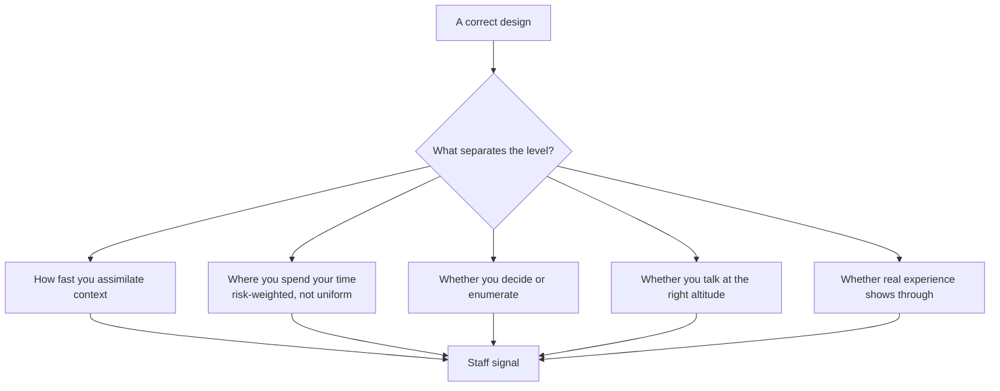
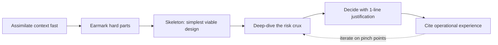
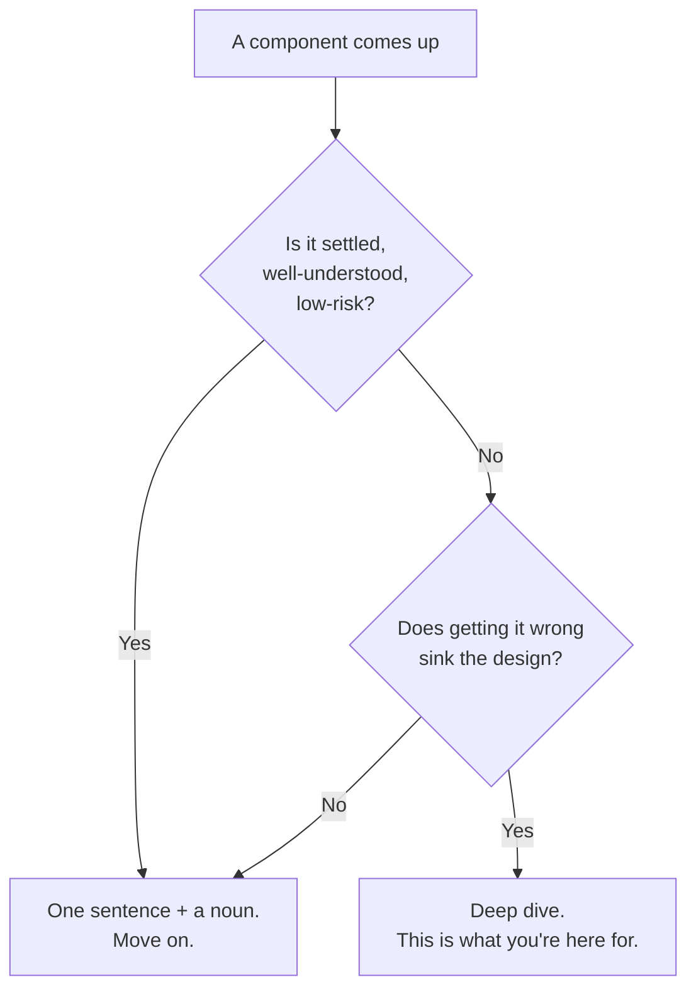
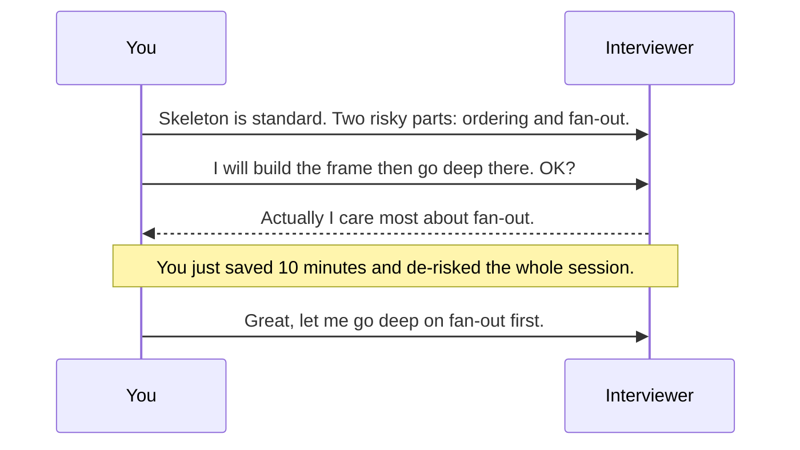

# 20 — Staff-Level Execution: How to *Perform* in the Room

> The other 23 modules make you **know** system design. This one makes you **interview like a Staff Engineer**.
> A staff-level system design interview is *qualitatively different* — interviewers are reading **how you operate**, not just whether you arrive at a correct architecture. You can produce a textbook-correct design and still fail the level by *delivering* it like a senior engineer.
>
> Synthesizes the meta-skill literature (notably Hello Interview's "Staff-Level System Design") and operationalizes it on top of the R.E.S.H.A.D.E.D. framework.

## Table of contents
- [The core shift: signal, not solution](#the-core-shift-signal-not-solution)
- [Senior vs Staff: the delivery delta](#senior-vs-staff-the-delivery-delta)
- [The six staff behaviors](#the-six-staff-behaviors)
- [The anti-patterns that cap you at senior](#the-anti-patterns-that-cap-you-at-senior)
- [Altitude control: what to skip, what to mine](#altitude-control-what-to-skip-what-to-mine)
- [Decisiveness: choose, don't enumerate](#decisiveness-choose-dont-enumerate)
- [Earmarking and the technical-risk crux](#earmarking-and-the-technical-risk-crux)
- [Leveraging your experience as a weapon](#leveraging-your-experience-as-a-weapon)
- [Overlay on R.E.S.H.A.D.E.D.](#overlay-on-reshaded)
- [Scripts and phrases that signal staff](#scripts-and-phrases-that-signal-staff)
- [Self-scoring rubric](#self-scoring-rubric)
- [Interview Cheat-Sheet](#interview-cheat-sheet)
- [Common Interview Questions](#common-interview-questions)

---

## The core shift: signal, not solution

At senior level the interviewer mostly asks: *can this person build a correct, scalable system?* At staff+ they ask a different question: **"Does this person operate at my level?"** The architecture is table stakes. What's actually being graded is a set of *operating signals*:

> **Staff-level insight:** You are not being interviewed as a *builder of this system*. You are being interviewed as a *future peer of the interviewer*. Every minute, ask yourself: "Is what I'm doing right now what a staff engineer they respect would be doing?" Explaining how a hash index works is not it. Identifying that the whole problem hinges on one consistency boundary — and resolving it crisply — is.

---

## Senior vs Staff: the delivery delta

Same problem, same whiteboard. The difference is entirely in *how the 45 minutes are spent*.

| Dimension | Senior delivery | Staff delivery |
|-----------|-----------------|----------------|
| **Requirements** | Gathers a thorough list | Gathers *and* drives — surfaces the constraint that changes the design ("are these updated frequently?") |
| **Time allocation** | Roughly uniform across components | Risk-weighted — 70% on the 2 hard parts, shortcuts the rest |
| **Altitude** | Explains how things work (correctly) | Assumes shared knowledge; explains *decisions*, not *mechanics* |
| **Decisions** | Lists options, weighs them, sometimes defers to interviewer | States a choice with a one-line justification, moves on, revisits if needed |
| **Complexity** | Reaches for the robust/distributed solution | Starts with the simplest thing that satisfies requirements; adds complexity only when forced |
| **Hard parts** | Discovered when reached | Earmarked verbally early, deep-dived deliberately |
| **Experience** | Reasons from first principles | Reasons from first principles *and* pattern-matches to systems they've actually run |
| **Communication** | Thorough, complete | High bandwidth — fewer words, deeper insight per word |

> **Staff-level insight:** Notice that *several rows describe the senior column as "more thorough."* At staff level, indiscriminate thoroughness is a **negative** signal — it reads as "doesn't know what matters." Selectivity is the skill.

---

## The six staff behaviors

### 1. Rapid context assimilation
A hallmark of a strong staff engineer is **how fast they absorb the problem** and find its shape. In the first 5 minutes you should already be distinguishing the *straightforward* aspects from the *genuinely hard* ones, out loud.

### 2. Risk-weighted attention
Spend your time on the **parts with the greatest technical risk** — the components where getting it wrong sinks the system, or where the "obvious" approach doesn't work. Everything else gets a sentence.

### 3. Start simple, earn complexity (YAGNI)
Begin with **"something as basic as possible that solves the functional requirements."** Every added layer — a queue, a cache, a second datastore, a shard — must be *justified by a requirement or a bottleneck you've identified*, not added reflexively. Explicitly say "I'm not adding X yet because nothing requires it — if [condition] I'd revisit."

### 4. Decide, don't enumerate
Make **decisive calls** with brief justifications. You don't need an airtight case — you need a defensible one and the confidence to own it. "Postgres here, because I need cross-table transactions and durability" beats a three-option comparison every time.

### 5. Verbally earmark the hard parts
Out loud: *"There are two interesting problems here — the fan-out under celebrity load, and exactly-once payment. Let me lay down the skeleton, then go deep on those."* This signals you see the crux and are managing the session like an owner.

### 6. Pull from real experience
Draw on systems you've actually built and operated. **"In our chat infra at scale, presence fan-out was the thing that fell over first, so I'd..."** Instinct grounded in operational scars is the single clearest staff signal and the hardest to fake.

---

## The anti-patterns that cap you at senior

| Anti-pattern | What it looks like | Why it caps you | The fix |
|--------------|--------------------|-----------------|---------|
| **Over-explaining basics** | Describing how a load balancer or a B-tree works | "Makes it appear as if you've *just learned* these concepts" | Name it and move on: "standard L7 LB here." |
| **Rabbit-holing on the easy parts** | Detailing every field on the user table | Burns the clock the interviewer wanted for the hard part | Shortcut: "user table is unremarkable — id, profile, auth refs." |
| **Listing options, not choosing** | "We could use Kafka, or RabbitMQ, or SQS..." then stopping | The interviewer has to ask "which would *you* choose?" — that question *is* the failure | State the pick + reason, name the runner-up only as the revisit path |
| **False humility** | "What do you think we should use here?" | Hands your decision to the interviewer; abdicates the leadership signal | Decide. Invite challenge *after*: "I'd go X — push back if you'd weight it differently." |
| **Over-engineering** | Distributed, sharded, multi-region for 10k infrequently-updated rows | Solving the complex flavor when the simple one fits = poor judgment | Right-size to the *actual* numbers you elicited |
| **Uniform thoroughness** | Equal depth everywhere | Signals you can't tell what matters | Risk-weight ruthlessly |
| **Not using experience** | Pure textbook reasoning | Misses the cheapest staff signal available to you | "When I ran X, the failure mode was Y, so..." |

> **Staff-level insight:** The "which one would *you* choose?" prompt is the tell. If an interviewer ever has to ask it, you've already leaked a senior signal. Pre-empt it: never leave a decision open that you could have closed.

---

## Altitude control: what to skip, what to mine

Think of every sub-topic as having an **altitude**. Staff engineers fly high over settled ground and dive only where there's risk.

**Skip / shortcut (name it, don't teach it):** auth basics, what a CDN is, how round-robin works, REST verbs, the user table schema, "we'll put a cache here."

**Mine / deep-dive (this is the interview):** the consistency boundary, the hot-key/celebrity fan-out, the exactly-once or double-booking guarantee, the matching/ranking engine, the part where the naive approach breaks at the stated scale.

> **Staff-level insight:** Calibrate altitude to *the interviewer*, not to a script. Talk to them "like a more experienced peer." If they nod and say "yep," you're at the right altitude — accelerate. If they look skeptical, *that's* your earmark to descend.

---

## Decisiveness: choose, don't enumerate

The decision pattern that reads as staff:

**`<Choice>` because `<the one requirement that forces it>`. `[optional: revisit hook]`.**

| Weak (senior/junior) | Strong (staff) |
|----------------------|----------------|
| "We could use SQL or NoSQL. SQL gives us X, NoSQL gives us Y, it depends..." | "Postgres — I need cross-entity transactions and strong consistency on the ledger. If write volume on events outgrows it, I'd peel those into Cassandra." |
| "There are a few caching strategies — write-through, write-back, cache-aside..." | "Cache-aside on Redis. Reads dominate 100:1 and slightly stale is fine here." |
| "What messaging system do you prefer?" | "Kafka — I need a replayable, partition-ordered log for the fan-out. SQS if we only needed at-least-once task dispatch." |

The structure is: **decide → justify in one clause → name the trigger that would change your mind.** That last part is the senior-to-staff multiplier: it shows you're not dogmatic, you're *managing reversibility* (the [two-way-door](19-leadership-tradeoffs.md) instinct).

> **Staff-level insight:** "It depends" is a senior answer. "It depends, **and here's how I'd decide given what you just told me about scale and consistency**" — followed by an actual decision — is the staff version. Never end on "it depends."

---

## Earmarking and the technical-risk crux

The single highest-leverage move in the first 5 minutes: **say out loud where the difficulty is.**

> "Stepping back — most of this is a standard read-heavy CRUD service, which I'll lay down quickly. The two parts with real technical risk are **(a)** keeping per-conversation message ordering under multi-device sync, and **(b)** presence fan-out for large groups. I'll build the skeleton, then spend most of our time there. Sound right?"

This does four things at once:
1. Proves you can **tell hard from easy** (judgment).
2. **Gets buy-in** on where to spend time (collaboration / ownership).
3. **Licenses you to shortcut** the boring parts without looking lazy.
4. Lets the interviewer **redirect** you to what *they* want to probe — a gift.

> **Staff-level insight:** Always ask "sound right?" after earmarking. It converts a monologue into a *collaboration* and gives the interviewer a cheap chance to steer you toward the signal they're hunting for. Senior candidates perform *at* the interviewer; staff candidates work *with* them.

---

## Leveraging your experience as a weapon

You run real infrastructure. **Use it explicitly** — it's the cheapest, strongest, least-fakeable staff signal, and most candidates leave it on the table.

Patterns that land:
- **Failure-mode recall:** "In production the first thing that fell over here was X, because Y — so I'd design for that up front."
- **Scar-tissue defaults:** "I default to idempotency keys on any money path because I've cleaned up the double-charge incident."
- **Calibrated numbers:** "A single Postgres box comfortably does low-tens-of-thousands of simple QPS in my experience, so at the scale we estimated we're fine without sharding yet."
- **Operational realism:** "This looks clean on the board, but the on-call cost of the multi-region active-active is real — I'd only pay it if the SLA demands it."

> **Staff-level insight:** Generic frameworks are senior; *specific operational memory* is staff. "We'd add a circuit breaker" is fine. "We added circuit breakers after a downstream timeout cascaded and took the whole tier down — so I put them on every cross-service call by default" is the level. (Use your a real-time chat platform real-time/chat experience — it's directly relevant to most chat/social/real-time prompts. See [Real-Time Systems](09-realtime-systems.md).)

---

## Overlay on R.E.S.H.A.D.E.D.

The R.E.S.H.A.D.E.D. framework is *what* you do. This module is *how* you do each step at staff altitude:

| Step | The senior version | The staff overlay |
|------|--------------------|-------------------|
| **R**equirements | Gather completely | Drive — surface the one constraint that changes the design; right-size scale before designing |
| **E**stimate | Do the math | Use the numbers to *justify or rule out* complexity ("10k rows → in-memory, no distributed store") |
| **S**ystem interface | List endpoints | Keep it to the few that reveal data flow; skip the obvious CRUD |
| **H**igh-level | Draw all the boxes | Draw the *simplest viable* skeleton fast; verbally earmark the hard boxes |
| **A**PI/data model | Full schema | Shard/partition key + the one consistency boundary; skip unremarkable fields |
| **D**eep-dive | Cover components | Spend the bulk here on the *risk crux* you earmarked; decide decisively |
| **E**volve/scale | Add scaling | Scale *the bottleneck you identified*, not everything; cite experience |
| **D**efend | Answer "what breaks?" | Pre-empt it — name your own failure modes and the trigger to revisit each |
| **E**dge cases | List them | Prioritize the ones that actually threaten the guarantee you promised |

> **Staff-level insight:** The framework keeps you *complete*; this overlay keeps you *senior-disqualified*. Run both. A staff candidate never *skips* a step — they *compress* the easy ones to a sentence so they can *expand* the hard ones.

---

## Scripts and phrases that signal staff

Keep these in muscle memory.

**Opening / driving requirements**
- "Before I design anything — what's the scale? Roughly how many X, and how often do they change?" *(elicits the number that right-sizes the design)*
- "Is this read-heavy or write-heavy, and how strong does consistency need to be on the critical path?"

**Earmarking**
- "Most of this is standard; the interesting risk is in [X] and [Y]. I'll frame quickly then go deep there — sound right?"

**Deciding**
- "I'll go with [X] because [one requirement]. If [trigger], I'd revisit toward [Y]."
- "I'm deliberately *not* adding [Z] yet — nothing requires it. I'd add it the moment [condition]."

**Altitude management**
- "I'll assume standard [LB / auth / CDN] here and not belabor it."
- "Tell me if you want me to go deeper anywhere — otherwise I'll keep moving."

**Experience**
- "From running [system] at scale, the thing that breaks first here is [X], so..."

**Defending pre-emptively**
- "The obvious risk in this design is [X] — here's how I'd contain the blast radius."

**Recovering when stuck**
- "Let me start with the naive version that's clearly correct, then attack the part that doesn't scale." *(start-simple is always a legitimate move)*

> **Staff-level insight:** The phrase **"I'm deliberately not adding X yet"** is gold. It demonstrates restraint *and* awareness simultaneously — you're proving you *know* the complex option exists and are *choosing* simplicity. That's judgment, the thing the level is named for.

---

## Self-scoring rubric

After every practice rep, score yourself 1–5 on each. Below 4 = a senior-level leak to fix.

| # | Signal | 1 (senior leak) | 5 (staff) |
|---|--------|-----------------|-----------|
| 1 | **Context speed** | Took >10 min to find the crux | Named hard vs easy within 5 min |
| 2 | **Risk weighting** | Even depth everywhere | 70% of time on the 2 risk areas |
| 3 | **Altitude** | Explained mechanics of basics | Named-and-moved-on; explained *decisions* |
| 4 | **Decisiveness** | Listed options, deferred | Chose + justified + named revisit trigger |
| 5 | **Simplicity** | Reached for distributed by reflex | Started simple, earned each complexity |
| 6 | **Earmarking** | Discovered hard parts when reached | Called them out early, got buy-in |
| 7 | **Experience** | Pure textbook | Cited specific operational memory |
| 8 | **Collaboration** | Monologued | Checked in, let interviewer steer |
| 9 | **Self-defense** | Waited to be challenged | Pre-empted own failure modes |

> **Staff-level insight:** Record yourself (audio is enough) on a few module-18 problems and score against this. The gap between "I know the architecture" and "I delivered it like a staff engineer" is almost always in rows 2, 3, and 4 — risk-weighting, altitude, and decisiveness. Drill those three.

---

## Interview Cheat-Sheet

- **You're being graded on operating signals, not the diagram.** Correct + senior-delivered still fails the level.
- **Indiscriminate thoroughness is a *negative* signal.** Selectivity > completeness.
- **First 5 minutes:** right-size the scale, then *say out loud* what's hard vs easy.
- **Spend 70% on the 2 highest-technical-risk parts.** One sentence each on the rest.
- **Altitude:** name-and-move-on for settled ground; deep-dive only the risk crux. Talk like a peer.
- **Never list options and stop.** Decide → one-clause justification → revisit trigger. Never end on "it depends."
- **Start simple; earn every layer.** Say "I'm deliberately not adding X yet."
- **Cite real operational experience** — failure modes you've actually seen. Strongest, cheapest staff signal.
- **Collaborate:** "sound right?" turns monologue into co-design and lets them steer you to the signal.
- **Pre-empt your own failure modes** before you're asked.
- The "**which one would *you* choose?**" prompt = a senior leak you should have pre-empted.

---

## Common Interview Questions

These are the *meta* questions — about how you operate. They surface in the design itself and in the debrief.

**Q1. "How do you decide how deep to go on a component?"**
> I risk-weight. If a component is settled and low-risk — auth, a standard LB, an unremarkable table — I name it and move on. If getting it wrong sinks the design, or the naive approach breaks at the stated scale, I go deep. Early on I say out loud which parts are which and get the interviewer's buy-in, so we spend the session where the signal is.

**Q2. "You gave two database options — which would you actually pick?"** *(the trap)*
> Postgres. I need cross-entity transactions and strong consistency on the critical path, and at the scale we estimated a single primary with read replicas handles the load. I'd only move the high-volume event stream off it — toward something like Cassandra — if write throughput there outgrew the primary. *(Notice: I never leave this question for the interviewer to ask. I decide, justify in one clause, and name the trigger that changes my mind.)*

**Q3. "This seems over-engineered — why the distributed setup?"**
> Fair challenge — let me right-size. We said ~10k locations updated a few times a day. That's small and infrequent, so I'll drop the distributed store and just sync periodically into memory and search there. I reached for the distributed version by reflex; the numbers don't justify it. *(Recovering well from this is itself a strong signal: you can kill your own complexity.)*

**Q4. "How would you handle a part of this you've never built before?"**
> Start from the simplest thing that's obviously correct and satisfies the functional requirement, then attack the specific point where it breaks under our constraints. I'll also pattern-match to the nearest thing I *have* run — the failure modes usually transfer even when the domain doesn't.

**Q5. "Walk me through how you'd run the first ten minutes."**
> Two or three sharp questions to right-size scale and pin the consistency requirement. Then I state which parts are standard and which carry real technical risk, and propose spending most of our time on the risky ones — checking that aligns with what you want to probe. Then a minimal skeleton, fast. Only after that do I start adding complexity, and only where a requirement or a bottleneck demands it.

**Q6. "What's the difference between how you'd interview now versus five years ago?"**
> Five years ago I'd demonstrate *coverage* — show I knew every piece. Now I demonstrate *judgment* — I move fast over settled ground, concentrate on the one or two decisions that actually determine whether the system works, decide them decisively, and ground the decisions in things I've seen break in production. Less breadth-as-proof, more risk-weighted depth.

**Q7. "A senior engineer on your team disagrees with the datastore choice you just made. How does that play out?"** *(staff = influence, not just decisions)*
> I'd state my reasoning and the trigger that would change it, then genuinely hear theirs — they may be holding a constraint I'm not. If their case clears that bar, I change my mind visibly; that's not weakness, it's how you keep a team's trust. If it doesn't, I make the call, document the trade-off as an [ADR](19-leadership-tradeoffs.md), and we revisit if the trigger fires. The goal is the right decision *and* an aligned team, not winning.

**Q8. "How do you avoid rabbit-holing?"**
> I keep asking "is this where the technical risk is?" If no, it gets a sentence. I also use the interviewer as a sensor — if I've spent two minutes somewhere and they're not leaning in, that's my cue it isn't the signal, and I climb back up to altitude and move on.

---

*Pair this with the R.E.S.H.A.D.E.D. framework and drill it against the [design playbooks](18a-design-chat-social.md). Knowing the modules gets you in the room; this module is how you win it.*
