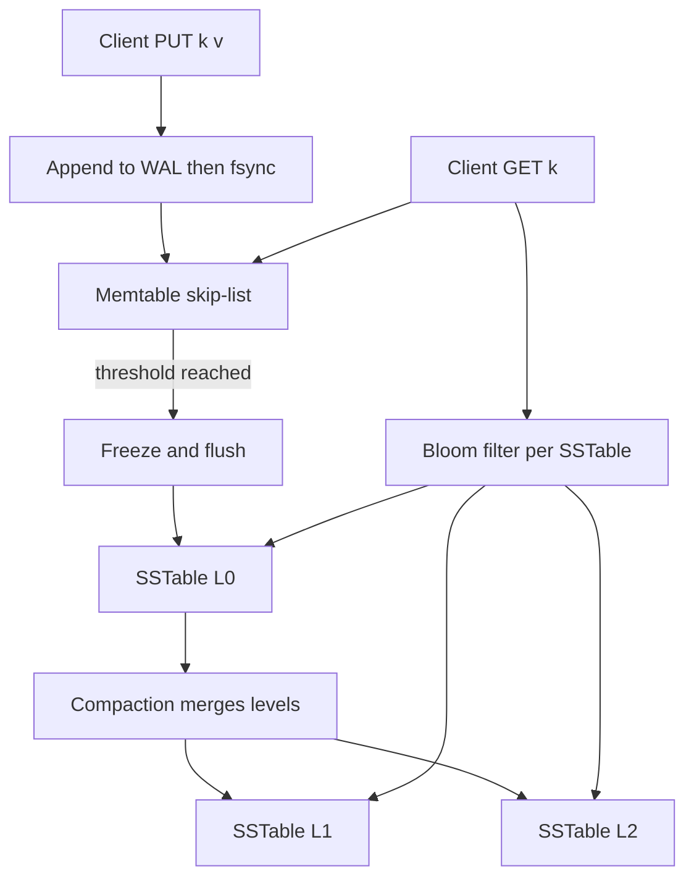
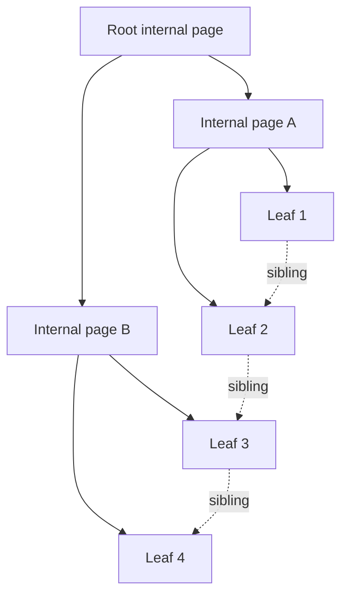
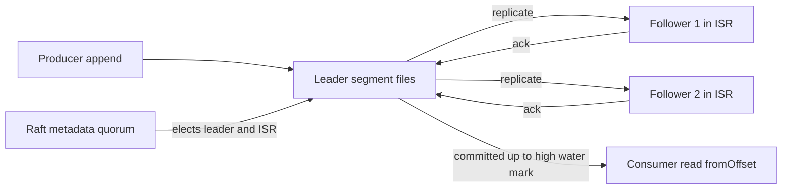
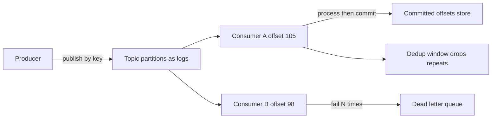
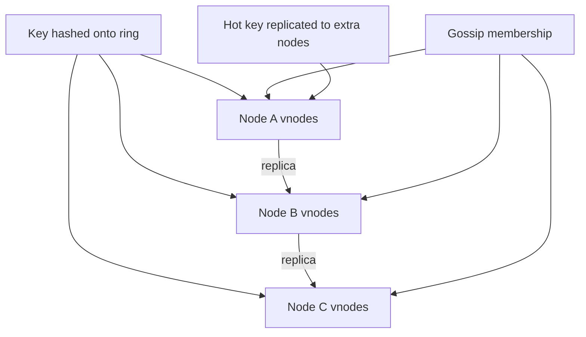
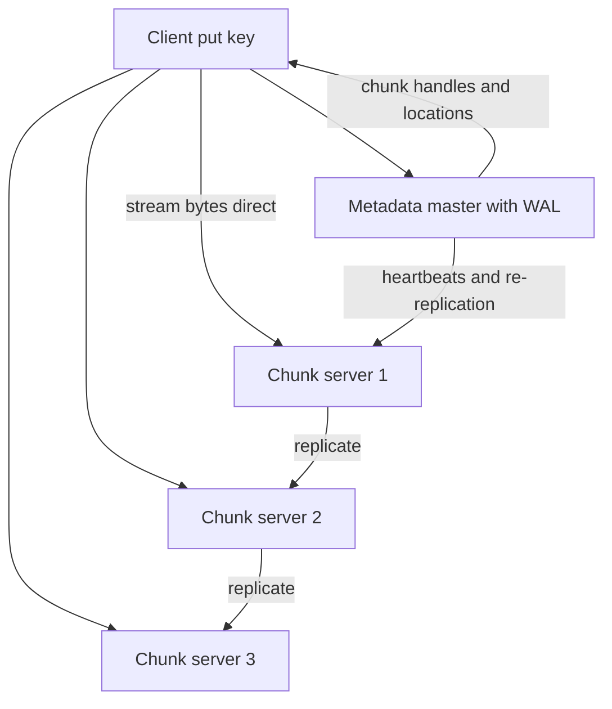
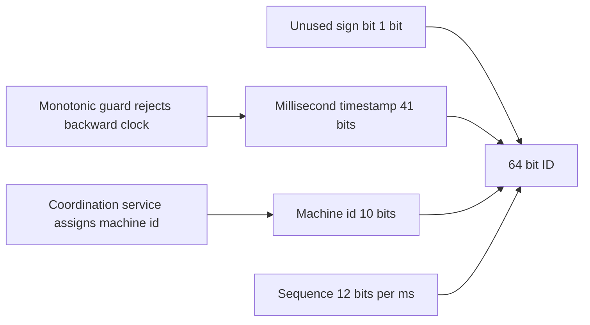
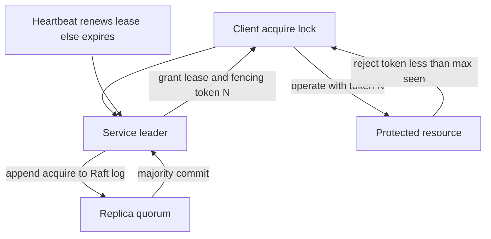
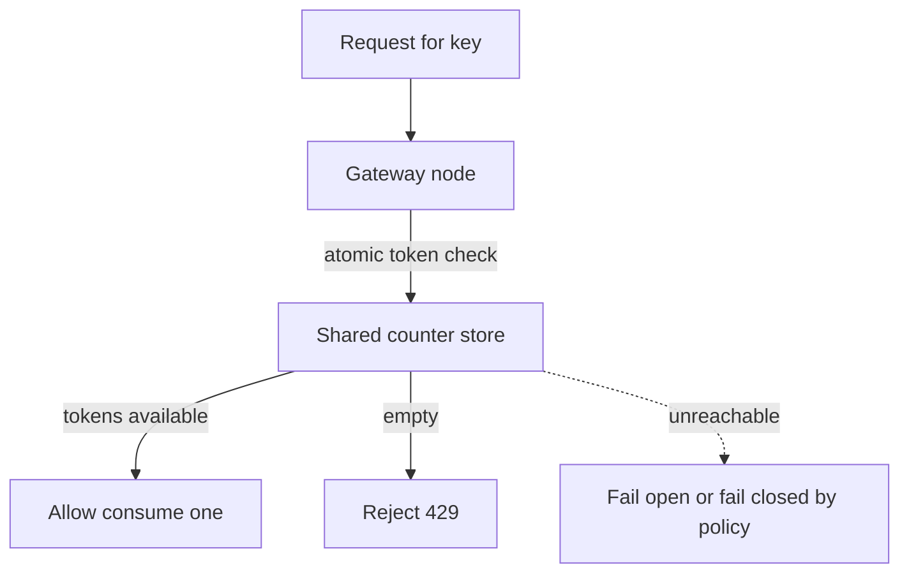
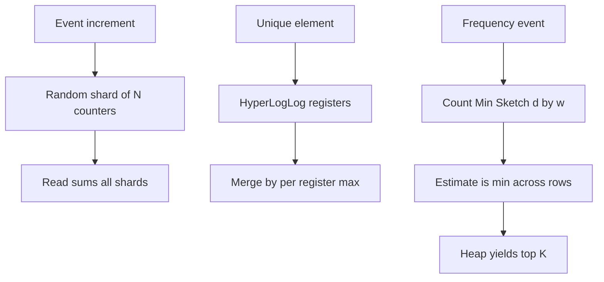

# 21 — Build From Scratch: The Primitives Every System Stands On

**What you'll master:** How to design each core distributed-systems primitive from first principles on a whiteboard — not by naming a product, but by describing the data structures, on-disk layout, algorithms, scaling story, and failure handling yourself. This is the single most important module for a Google Engineering Manager system-design interview, where the explicit #1 "don't" is *"use a standard database and query against it."* The recurring spine you'll see everywhere: a **write-ahead log (WAL)** for durability, an **LSM-tree** for write-optimized storage, and a **replicated log** as the universal backbone of databases, queues, and streams.

---

## Table of Contents

- [In the Room — Build It, Don't Name It](#in-the-room--build-it-dont-name-it)
- [1. Persistent Key-Value Store (WAL + LSM)](#1-persistent-key-value-store-wal--lsm)
- [2. Storage Index (B+Tree vs LSM)](#2-storage-index-btree-vs-lsm)
- [3. Write-Ahead / Replicated Log](#3-write-ahead--replicated-log)
- [4. Message Queue / Pub-Sub Broker](#4-message-queue--pub-sub-broker)
- [5. Distributed Cache](#5-distributed-cache)
- [6. Blob / Object Store](#6-blob--object-store)
- [7. Unique ID Generator](#7-unique-id-generator)
- [8. Distributed Lock / Coordination Service](#8-distributed-lock--coordination-service)
- [9. Rate Limiter](#9-rate-limiter)
- [10. Counter / Approximate Counting at Scale](#10-counter--approximate-counting-at-scale)
- [Interview Cheat-Sheet](#interview-cheat-sheet)
- [Common Interview Questions](#common-interview-questions)

---

## In the Room — Build It, Don't Name It

Google's own EM system-design prep material states the same warning three times: **"Avoid answers which involve 'use a standard database and do queries against it'; we're not looking for off-the-shelf products — rather, how do you BUILD FROM SCRATCH?"** Discussing *why* a managed product would or wouldn't fit is allowed and valued — but only if you can then build the primitive yourself.

### When to build vs. when to name-then-build

You will not build all ten primitives in a 45-minute interview. The skill is choosing **where to go deep**.

- **Name-then-build (the default move):** *"I'd reach for a managed log like a Kafka-class system because it gives me durable, partitioned, replicated append-only storage out of the box — but let me show you how I'd build that log primitive myself, since the design hinges on its guarantees."* This signals maturity (you don't reinvent wheels in production) **and** depth (you understand the wheel).
- **Build fully:** when the primitive *is* the problem (design a KV store, design a rate limiter, design a unique-ID service) or when the interviewer says "go deeper."
- **Name and move on:** for genuinely peripheral pieces (an SMTP gateway, a CDN edge), so you spend your minutes on the load-bearing parts.

### The decisive phrasing pattern

Every choice you make should sound like:

> **"\<choice\> because \<requirement\>; revisit if \<trigger\>."**

Examples:
- *"LSM-tree because the workload is write-heavy chat ingestion; revisit to a B+tree if reads become range-scan-dominated and writes flatten out."*
- *"At-least-once delivery with idempotent consumers because losing a message is worse than a duplicate; revisit to exactly-once if dedup cost dominates."*
- *"Leader-based replication with a Raft-managed config because we need linearizable metadata; revisit to leaderless if write availability beats consistency."*

This phrasing proves you reason from requirements, not from fashion, and that you know your decision's failure mode and reversal trigger.

### Altitude — which internals to deep-dive

Stay at **system altitude** (boxes, data flow, partitioning) until the interviewer probes, then **drop to mechanism altitude** (page layout, fsync semantics, compaction, quorum math) on exactly the one component they care about. Volunteering page-split mechanics for every box burns time; being unable to explain *one* when asked is fatal. Read the interviewer: when they ask "how does that survive a crash?" they want WAL replay mechanics, not another box diagram.

### Detect-and-defend-failure framing

For every primitive, answer two questions before being asked:
1. **How do we DETECT failure?** (heartbeats, missed fsync, checksum mismatch, quorum loss, lease expiry).
2. **How do we RECOVER?** (WAL replay, re-replication, leader election, fencing, hinted handoff).

Staff/EM candidates are separated from senior candidates almost entirely by whether failure handling is *baked in* or *bolted on*. Lead with it.

See also: [Staff-Level Execution](20-staff-execution.md) for how to drive the conversation, and [Google Papers](22-google-papers.md) for the source designs (GFS, Bigtable, Chubby, Spanner) behind several primitives here.

---

## 1. Persistent Key-Value Store (WAL + LSM)

### What it is + requirements/API

A durable map from keys to values that survives process crashes and power loss.

**API:** `PUT(k, v)`, `GET(k) -> v`, `DELETE(k)`, `SCAN(start, end) -> [(k,v)]`.

**Requirements:** durability (acknowledged writes survive crash), low write latency, point reads, ordered range scans, bounded memory.

### From-scratch design

Two parts: an **in-memory structure** for speed and a **WAL** for durability.

**Write path (PUT/DELETE):**
1. Append the operation to the **write-ahead log** on disk (`<seq, op, key, value>`), then `fsync`. The write is durable here.
2. Apply it to the **memtable** — an in-memory ordered structure (skip-list or balanced tree; skip-list is the common choice: O(log n) ordered ops, lock-free-friendly). A DELETE writes a **tombstone**, not a removal.
3. Acknowledge the client.

**Flush:** when the memtable exceeds a size threshold, it is frozen and written sequentially to disk as an immutable, sorted **SSTable** (Sorted String Table). A new memtable takes over. The WAL segment covering that memtable can now be discarded.

**SSTable layout:** sorted key/value blocks, a sparse **index** (key → block offset) at the tail, and a **bloom filter** per SSTable so a GET can skip SSTables that definitely don't contain the key.

**Read path (GET):** check memtable → check each SSTable newest-to-oldest (bloom filter first to skip, then sparse index to find the block, then scan the block). First hit (including a tombstone = "not found") wins.

**Compaction:** background process merges overlapping SSTables, drops superseded versions and tombstones, and keeps the number of SSTables (and thus read amplification) bounded. Leveled compaction organizes SSTables into size-tiered levels with non-overlapping key ranges per level.

**Crash recovery:** on restart, find the latest durable SSTables, then **replay the WAL** from the last flushed sequence number to rebuild the lost memtable. Acknowledged writes are never lost because they hit the fsync'd WAL before ack. Use a checksum per WAL record to detect a torn final write and truncate it.

**B-tree alternative:** instead of LSM, mutate B-tree pages in place (covered in §2). Better for read/range-heavy, point-update workloads; worse write amplification under heavy writes.

### Diagram

### How it scales

**Partitioning (sharding):** split the keyspace by hash or by range across nodes; each node runs its own WAL + LSM. Range partitioning enables global scans but risks hotspots; hash partitioning spreads load but loses ordered cross-shard scans. **Replication:** put 3 copies of each shard's data behind the [replicated log](#3-write-ahead--replicated-log) (§3) so each replica applies the same write stream. This is exactly the Bigtable/[Cassandra](06-databases.md) shape.

### How it handles failure

- **Detect:** WAL record checksum mismatch (torn write); SSTable block checksum mismatch (bit rot); missing replica heartbeat.
- **Recover:** truncate torn WAL tail; replay WAL into memtable; re-read corrupt block from a healthy replica and re-replicate; for a dead node, copy its shard from a surviving replica.

### Trade-offs

| Dimension | LSM-tree | B-tree |
|---|---|---|
| Write pattern | Sequential appends, fast | Random page writes, slower |
| Write amplification | Higher (compaction) | Lower |
| Read amplification | Higher (many SSTables) | Lower (one tree path) |
| Range scans | Good (sorted SSTables) | Excellent (linked leaves) |
| Space amplification | Higher (tombstones, versions) | Lower |
| Best for | Write-heavy, ingest | Read/update-heavy, OLTP |

> **Staff-level insight:** The WAL is the entire durability story — the memtable and SSTables are just a fast cache of state you could rebuild by replaying the log. Say this out loud: *"My in-memory structure is disposable; correctness lives in the fsync'd log."* That reframes durability, recovery, and replication as one mechanism (an ordered log of mutations) rather than three features, and it's the same insight that powers §3, §4, and most of [Databases](06-databases.md).

### Off-the-shelf vs. build

RocksDB/LevelDB give you a battle-tested LSM engine; managed Bigtable/DynamoDB give you the engine *plus* sharding, replication, and ops. You might still build when you need a custom value format, embedded zero-network-hop storage, exotic compaction policies, or simply because the interviewer is testing whether you understand what those products do internally.

---

## 2. Storage Index (B+Tree vs LSM)

### What it is + requirements/API

A structure mapping a key (or secondary attribute) to the location of a row, supporting point lookup and **ordered range scans** in sublinear time.

**API:** `lookup(key) -> rowptr`, `rangeScan(lo, hi) -> [rowptr]`, `insert(key, rowptr)`, `delete(key)`.

### From-scratch design

**B+Tree:** a balanced tree of fixed-size **pages** (e.g., 4–16 KB, matching disk/OS page size).

- **Internal pages** hold separator keys + child page pointers (high **fanout** — hundreds of children per page — keeps the tree shallow: a billion keys in ~4 levels).
- **Leaf pages** hold the actual keys + row pointers, **linked left-to-right** so a range scan is "descend once, then walk the leaf chain."
- **Insert:** find the leaf, insert in sorted order; if the page overflows, **split** it in half, push the median separator up to the parent (which may split recursively up to the root, growing height by one).
- **Delete:** remove the entry; if a page underflows, borrow from or merge with a sibling.
- Pages are updated **in place** and persisted via the same [WAL](#3-write-ahead--replicated-log) discipline (write the change to the WAL, then the page) so a crash mid-split is recoverable.

**LSM as an index** (the §1 alternative): keep keys sorted in SSTables; a range scan merges sorted runs across levels. Faster inserts (append-only), slower/heavier scans (merge across runs).

**Secondary indexes:** a second B+tree keyed on the secondary attribute whose "values" are the primary keys (or row pointers). A query on the secondary attribute hits this tree, gets primary keys, then looks them up in the primary index (a "covering" index avoids the second hop by storing needed columns inline).

**Range scan mechanics:** descend to the leaf containing `lo`, then follow the leaf sibling pointers emitting entries until you pass `hi`. O(log n + k) for k results.

### Diagram

### How it scales

Partition the index alongside the data (local secondary index per shard: scatter-gather on reads) **or** maintain a separate global index sharded by the indexed key (consistent reads, but cross-shard writes). Replicate each index partition via the replicated log. For huge indexes, the B+tree's shallow height means few page reads per lookup — cache the upper levels in RAM and only the leaves miss to disk.

### How it handles failure

- **Detect:** per-page checksum; WAL replay detects a half-applied split.
- **Recover:** WAL replay re-applies or rolls back the in-flight structural change (B+tree splits are logged as atomic operations); corrupt pages re-read from a replica.

### Trade-offs

| Dimension | B+Tree | LSM index |
|---|---|---|
| Point lookup | Excellent | Good (bloom-gated) |
| Range scan | Excellent (leaf chain) | Good (merge runs) |
| Insert throughput | Moderate (splits) | High (append) |
| Space overhead | Page fragmentation | Tombstones/versions |
| Update in place | Yes | No (rewrite on compact) |

> **Staff-level insight:** Fanout, not depth, is the lever. A B+tree wins because large pages → high fanout → a tree only 3–4 levels deep over billions of keys, so a lookup is a handful of page reads and the top levels live in cache. When asked "why is a B-tree fast on disk," answer with fanout and locality, not "it's balanced" — every senior says balanced; staff says *fanout amortizes disk seeks*.

### Off-the-shelf vs. build

Postgres/MySQL/InnoDB hand you a mature B+tree; RocksDB hands you the LSM. You still build the index logic yourself when designing a new storage engine, an in-memory index for a cache, or a specialized inverted index — and you must be able to whiteboard a page split because it's the canonical "do you understand storage internals" probe.

---

## 3. Write-Ahead / Replicated Log

This is the **backbone primitive** — databases, queues, and streams are all built on it. Master it.

### What it is + requirements/API

An ordered, append-only, durable sequence of records, each addressed by a monotonically increasing **offset**.

**API:** `append(record) -> offset`, `read(fromOffset) -> [records]`, `truncate(toOffset)`.

**Requirements:** appends are durable once acknowledged; reads are sequential and cheap; the log is replicated so a node loss doesn't lose data; total order within a partition.

### From-scratch design

**Single-node log:**
- Records are written sequentially to **segment files** (e.g., 1 GB each). A new segment opens when the current one fills. Sequential writes are near disk-bandwidth fast.
- Each record: `<offset, length, crc, payload>`. The CRC detects torn/corrupt writes.
- `fsync` policy is the durability knob: fsync-per-append (safest, slowest) vs. group-commit (batch many appends, one fsync — far higher throughput, bounded data-loss window). State your choice with the phrasing pattern.
- An in-memory **offset index** (sparse: offset → file position) makes `read(fromOffset)` a seek instead of a scan.
- **Retention:** delete whole segments older than a time/size threshold (cheap — unlink a file), or **compact** (keep only the latest record per key — log compaction, the basis of changelog topics).

**Replicating the log:** elect a **leader** for the partition; followers pull the log and append it in order. Maintain an **in-sync replica (ISR)** set — replicas caught up within a bound. An append is **committed** once a quorum/all-ISR have it; the **high-water mark** is the highest committed offset, and consumers only read up to it. This gives durability without losing availability when a lagging follower drops.

**Consensus for metadata:** the *data* log uses leader/ISR replication, but **who is the leader** and **what is the ISR** must itself be agreed consistently — use **Raft** (or a Chubby/ZooKeeper-like service, §8) for that control-plane state. Raft itself *is* a replicated log: a leader appends config entries, replicates to a majority, and commits once a majority acks; a follower that misses heartbeats starts an election with a higher term. Don't conflate the two logs — say "Raft for the small, consistency-critical metadata; ISR replication for the high-throughput data."

### Diagram

### How it scales

**Partitioning:** split a logical topic into N partitions, each an independent log with its own leader on a (possibly) different node — this is the horizontal scale unit. Total order holds *within* a partition only; choose the partition key so order-sensitive records share a partition (e.g., all events for one chat room). **Replication factor** sets durability vs. cost. Add partitions to add throughput.

### How it handles failure

- **Detect:** follower heartbeat timeout (drop from ISR); CRC mismatch on a record; leader unreachable.
- **Recover:** if leader dies, Raft/controller promotes an in-sync follower (it already has all committed data, so no loss up to the high-water mark); a returning follower truncates any uncommitted suffix past the high-water mark and re-syncs from the leader; corrupt segment record → truncate to last good offset and re-replicate.

### Trade-offs

| Choice | Option A | Option B |
|---|---|---|
| Durability knob | fsync per append (safe, slow) | group commit (fast, small loss window) |
| Commit rule | all ISR (durable, slower) | quorum (faster, tolerates one lag) |
| Leader vs leaderless | leader/ISR (ordered, simple) | leaderless quorum (higher write avail) |
| Retention | time/size delete (streams) | log compaction (changelog) |

> **Staff-level insight:** "The log is the source of truth; everything else is a materialized view." A database table, a search index, a cache, and a downstream service are all just **deterministic replays of the same ordered log** — which is why replication, recovery, change-data-capture, and exactly-once all reduce to "where is your offset?" Anchor §1, §4, and most of [Messaging](04-messaging-event-driven.md) and [Databases](06-databases.md) back to this single sentence and the interviewer will see the unifying mental model that separates staff from senior.

### Off-the-shelf vs. build

Kafka/Pulsar give you the partitioned, replicated, retained log plus tooling; Raft libraries give you consensus. You build the log yourself inside any storage engine (the WAL of §1/§2), in an embedded event-sourcing system, or when designing a new database — and you must be able to derive ISR + high-water-mark recovery, because it's the most reused idea in the whole interview.

---

## 4. Message Queue / Pub-Sub Broker

### What it is + requirements/API

Decoupled async delivery: producers publish, consumers subscribe, the broker buffers and tracks progress. Built **directly on the log primitive (§3)**.

**API:** `publish(topic, msg)`, `subscribe(topic, group) -> stream`, `commit(offset)`, `nack(msg)`.

### From-scratch design

- A **topic** is a set of partitions, each a replicated log (§3). Publishing = appending to the partition chosen by the message key.
- **Consumer groups:** each partition is assigned to exactly one consumer in a group (parallelism = partition count). Each group tracks its **committed offset per partition** — a tiny pointer, not a copy of messages. This is why the log model scales: many independent readers, each just a cursor.
- **At-least-once delivery:** consumer reads, processes, *then* commits offset. Crash before commit → reprocess (duplicate). Pair with **idempotent consumers** or a **dedup** store (keep a sliding window of seen message IDs; drop repeats) to make it effectively-once.
- **Visibility timeout (for queue-style, non-log brokers like SQS):** on receive, hide the message for T seconds; if not acked in T, it reappears for redelivery. In the log model the analog is "uncommitted offset will be re-read."
- **DLQ (dead-letter queue):** after N failed delivery attempts, move the message to a separate topic for inspection instead of blocking the partition (poison-message handling).
- **Ordering:** preserved within a partition only; the partition key is your ordering contract.

### Diagram

### How it scales

Add partitions to add consumer parallelism and write throughput; rebalance partition-to-consumer assignment when consumers join/leave. Offsets are stored in their own compacted log (changelog), so the offset store scales the same way. Brokers scale horizontally by hosting different partition leaders.

### How it handles failure

- **Detect:** consumer heartbeat loss (trigger group rebalance); processing exceptions (retry counter); broker/leader loss (§3 election).
- **Recover:** reassign the orphaned partition to another consumer, which resumes from the last committed offset (at-least-once → maybe one reprocess); poison messages routed to DLQ; broker failover via the underlying log's ISR mechanism.

### Trade-offs

| Dimension | Log-based (Kafka-style) | Queue-based (SQS-style) |
|---|---|---|
| Delivery | At-least-once, offset-tracked | At-least-once, visibility timeout |
| Ordering | Per-partition total order | Best-effort / FIFO option |
| Replay | Yes (rewind offset) | No (message consumed) |
| Fan-out | Cheap (many groups, one copy) | Per-consumer copy |
| Backpressure | Consumer lag metric | Queue depth |

> **Staff-level insight:** A queue and a stream are the *same* primitive at different retention and addressing policies — a queue is a log where you delete after ack and address by "next available," a stream is a log where you retain and address by offset. Exactly-once isn't a delivery guarantee you can buy; it's **at-least-once delivery + idempotent processing + atomic offset commit**. Say that and you've answered the trap question before it's asked.

### Off-the-shelf vs. build

Kafka, Pulsar, RabbitMQ, SQS cover essentially every production need — naming one and justifying it is the *right* production answer. You build a broker from scratch when embedding messaging in a constrained device, when teaching the model, or (most likely in the interview) to prove the queue is just a thin policy layer over the §3 log.

---

## 5. Distributed Cache

### What it is + requirements/API

A horizontally partitioned in-memory store fronting a slower backing store, mapping keys to cached values across many nodes. See [Caching](03-caching.md) for policy depth.

**API:** `get(k)`, `put(k, v, ttl)`, `delete(k)`.

### From-scratch design

**Placement — consistent hashing:** hash each node onto a ring (hash space 0..2^32). A key maps to the first node clockwise from `hash(key)`. Adding/removing a node only remaps keys in **one arc** (≈ 1/N of keys) instead of rehashing everything — the whole point.

**Virtual nodes:** each physical node owns many points on the ring (e.g., 100–200 vnodes) so load is even and a departing node's keys spread across *all* survivors rather than dumping onto its single neighbor.

**Replication:** store each key on the next R distinct physical nodes clockwise; reads can hit any replica, writes go to all R (or quorum). This is the Dynamo-style preference list.

**Eviction — LRU:** hash map (key → node in a doubly linked list) + the list ordered by recency. On access, move node to head; on capacity, evict the tail. O(1) get/put/evict. (LFU or segmented-LRU if scan-resistance matters.)

**Hot-key handling:** a single viral key overwhelms its owner. Mitigations: replicate the hot key to extra nodes and pick a replica at random on read; add a small per-client local cache for ultra-hot keys; or key-suffix sharding (`key#0..key#k`) to spread writes.

**Membership — gossip:** nodes periodically exchange (random peer) their view of who's alive/dead with version counters; failure suspicion spreads epidemically without a central coordinator. Eventually every node converges on the ring membership.

**Rebalancing on add/remove:** when a node joins, it claims its vnode arcs and pulls just those key ranges from the current owners; when one leaves (or is gossip-declared dead), its replicas are promoted and re-replicated to restore R copies.

### Diagram

### How it scales

Add nodes → ring rebalances ≈1/N of keys → linear capacity and throughput growth. Read scaling via replicas; write scaling via partitioning. No central coordinator (gossip), so the control plane scales too.

### How it handles failure

- **Detect:** gossip-propagated heartbeat/suspicion; a node missing from φ-accrual failure detector.
- **Recover:** route around the dead node to its replica (the next node clockwise already may hold a copy); **hinted handoff** — a temporary node accepts writes destined for a down node and replays them when it returns; re-replicate to restore R. Cache misses fall back to the backing store (graceful degradation).

### Trade-offs

| Dimension | Choice A | Choice B |
|---|---|---|
| Hashing | Consistent hashing (smooth) | Modulo (simple, full remap on resize) |
| Consistency | Quorum R+W>N (strong-ish) | R=W=1 (fast, eventual) |
| Membership | Gossip (decentralized) | Coordinator (simpler, SPOF) |
| Eviction | LRU (recency) | LFU (frequency, scan-resistant) |
| Hot key | Replicate + jitter | Local client cache |

> **Staff-level insight:** Consistent hashing's real win isn't even distribution — it's **minimal disruption on membership change**: only ≈K/N keys move when a node joins/leaves, which is what makes elastic scaling and failure recovery cheap. Pair it with virtual nodes (so a failed node's load spreads to *all* survivors, not one) and you've described the placement layer of Dynamo, Cassandra, and most distributed caches in one breath.

### Off-the-shelf vs. build

Memcached/Redis (and managed ElastiCache/Memorystore) give you the node; Redis Cluster / a client like Twemproxy gives you the ring. You build the distribution layer yourself when you need custom replication, application-aware placement, or to demonstrate (in interview) that consistent hashing + gossip + LRU are the three moving parts.

---

## 6. Blob / Object Store

### What it is + requirements/API

Durable storage for large immutable objects (images, video, chat attachments) addressed by key. The canonical "build it, don't say S3" question — design GFS-style.

**API:** `put(key, bytes) -> ok`, `get(key) -> bytes`, `delete(key)`.

### From-scratch design

Split control plane from data plane.

- **Metadata service (master):** maps `object key → [chunk handles]` and `chunk handle → [chunk-server locations]`. Keeps file→chunk mapping in memory (small) and persists mutations to its own [WAL](#3-write-ahead--replicated-log) + checkpoints. To avoid being a bottleneck/SPOF, it never touches bulk data and is replicated via consensus.
- **Chunk servers (data plane):** store fixed-size **chunks** (e.g., 64 MB, GFS-style) as plain files on local disks; serve reads/writes directly to clients.
- **Chunking:** large objects are split into chunks so they parallelize across servers and a single object isn't bounded by one disk.

**PUT path:** client asks master for chunk handles + a primary replica per chunk → client streams chunk bytes directly to the chunk servers (data flows client→servers, *not* through the master) → primary orders the writes across replicas → acks. Master only records metadata.

**GET path:** client asks master for chunk locations → reads chunk bytes directly from the nearest chunk server. Master is off the hot data path entirely.

**Durability — replication vs. erasure coding:**
- **Replication (3×):** keep 3 full copies on distinct racks/zones. Simple, fast recovery, 3× storage cost.
- **Erasure coding (e.g., Reed-Solomon 10+4):** split data into 10 fragments + 4 parity; survive any 4 losses at **1.4× storage** instead of 3×. Cheaper, but slower/CPU-heavy reconstruction. Use replication for hot data, EC for cold.

**Durability math (intuition):** with independent annual failure probability *p* per copy, 3 replicas fail together with probability ≈ *p³*; combined with fast re-replication (detect + restore the third copy in minutes), you reach the "eleven nines" range. EC reaches similar durability at far less storage by tolerating more simultaneous losses per stripe.

### Diagram

### How it scales

Data scales by adding chunk servers (capacity + bandwidth grow linearly); metadata scales because it's tiny and in-memory, and can be sharded by key range or federated across multiple masters for very large namespaces. Reads/writes never funnel through the master, so the data plane has no central bottleneck.

### How it handles failure

- **Detect:** chunk servers heartbeat to the master; per-chunk checksums catch bit rot on read; master detects under-replicated chunks.
- **Recover:** under-replicated chunk → master schedules a copy from a healthy replica to restore the replication factor; corrupt chunk on read → fetch from another replica and repair; master failover → promote a consensus-replicated shadow master that replays its WAL.

### Trade-offs

| Dimension | Replication 3x | Erasure coding 10+4 |
|---|---|---|
| Storage overhead | 3.0x | 1.4x |
| Recovery speed | Fast (copy one) | Slow (reconstruct stripe) |
| Read latency | Low | Higher on degraded read |
| CPU cost | Low | High (encode/decode) |
| Best for | Hot, small objects | Cold, large objects |

> **Staff-level insight:** The defining architectural move is **separating the metadata (control) plane from the data plane** so bulk bytes flow client↔chunk-server and never through the master — that's what lets the master hold the whole namespace in memory and stay off the bottleneck. Then pick durability *per data temperature*: 3× replication for hot, erasure coding for cold, because the same eleven-nines durability costs 3× vs 1.4× storage. Saying "it depends on the access pattern" with the storage math behind it is the staff signal.

### Off-the-shelf vs. build

S3/GCS/Colossus are the obvious production answer and you should say so. You build a blob store yourself for on-prem/air-gapped needs, specialized latency/locality, regulatory data residency, or — in the interview — to show you understand GFS's control/data split, chunking, and the replication-vs-EC durability trade. See [Storage](08-storage.md) and [Google Papers](22-google-papers.md) (GFS/Colossus).

---

## 7. Unique ID Generator

### What it is + requirements/API

Generate globally unique, often time-ordered, IDs at high throughput without a central bottleneck — message IDs, object IDs, transaction IDs.

**API:** `nextId() -> uint64` (unique across all nodes, ideally roughly sortable by time).

### From-scratch design

**Snowflake (the workhorse):** pack a 64-bit ID as `1 unused sign bit | timestamp (41 bits) | machine ID (10 bits) | sequence (12 bits)` = 64 bits. The high bit is left 0/unused so the value stays a positive signed 64-bit integer.
- **Timestamp** (ms since a custom epoch) → IDs are time-sortable. The 41-bit ms timestamp covers ≈69 years of range.
- **Machine ID** → uniqueness across nodes without coordination (assigned at startup, e.g., from a coordination service §8).
- **Sequence** → up to 4096 IDs per machine per millisecond; resets each ms.
- A machine generating >4096/ms in one tick simply waits for the next millisecond (or borrows from the next).

**Clock skew is the hazard:** if the wall clock moves *backward* (NTP correction), a machine could reissue a timestamp and collide. Defenses: **refuse to issue** (block) until the clock catches up to the last-issued time, or keep a monotonic last-timestamp and never go below it. Never blindly trust wall-clock.

**DB-ticket / segment (Flickr-style):** an auto-increment column hands out IDs. To avoid one row being a hot bottleneck, use **two servers** with odd/even increments, or — better — **segment allocation**: each app instance fetches a *range* (e.g., 1000 IDs) from a central counter in one transaction and serves them locally, refetching when the range runs low. This makes the central store a cold path. A **Key-Generation Service (KGS)** pre-generates and stores unused keys (useful for short, non-sequential IDs like URL shorteners).

**UUIDs:** UUIDv4 is 122 random bits — no coordination, effectively zero collision probability, but **not sortable** (bad for index locality) and 128 bits. UUIDv7 embeds a timestamp prefix to restore sortability.

### Diagram

### How it scales

Snowflake is **coordination-free at generation time** — each node mints IDs locally at millions/sec; only the one-time machine-ID assignment touches a shared service, so throughput scales linearly with nodes. Segment allocation scales by widening the segment size (fewer central round-trips). UUIDs need no coordination at all.

### How it handles failure

- **Detect:** clock-skew guard catches backward time; duplicate machine-ID detection at startup via the coordination service lease.
- **Recover:** on backward clock, block until caught up (small stall, no collision); on machine-ID lease loss, stop issuing until a new ID is leased; segment servers refetch a new range if their cache is lost (some IDs go unused — fine, IDs aren't required to be gapless).

### Trade-offs

| Approach | Sortable | Coordination | Size | Collision risk |
|---|---|---|---|---|
| Snowflake | Yes | Machine-ID only | 64-bit | None (if clock guarded) |
| DB segment | Yes (mostly) | Central counter | 64-bit | None |
| UUIDv4 | No | None | 128-bit | Negligible |
| UUIDv7 | Yes | None | 128-bit | Negligible |
| KGS | Optional | Central pool | Tunable | None (pre-checked) |

> **Staff-level insight:** "Sortable" is a feature with a cost, not a free property. Time-prefixed IDs (Snowflake, UUIDv7) give you index locality and natural chronological ordering for free — *but* couple correctness to clock monotonicity, so you must guard against backward clock movement. If you don't need ordering, UUIDv4 buys you zero coordination and you sidestep the entire clock problem. Stating that trade — *ordering vs. clock-dependency* — is the whole answer.

### Off-the-shelf vs. build

Twitter Snowflake, Sonyflake, and database sequences exist. You build it yourself (it's small and the interview *is* the build) and the bar is: get the bit-packing right, name the clock-skew failure mode unprompted, and justify sortable-vs-random against the workload.

---

## 8. Distributed Lock / Coordination Service

### What it is + requirements/API

A service granting mutually exclusive access (locks) and storing small amounts of strongly-consistent coordination state (leader election, config, membership). A Chubby/ZooKeeper-class primitive.

**API:** `acquire(lock, ttl) -> (token | fail)`, `release(lock)`, `read(path)`, `write(path, val)`, `watch(path)`.

### From-scratch design

- **Built on a replicated log + consensus (§3):** the service is a small replicated state machine. Every lock acquire/release and every config write is an entry appended to a **Raft/Paxos** log, committed by a majority quorum, then applied — so all replicas agree on lock ownership even across failures. This is the only safe foundation: a lock is a consistency problem.
- **Leases, not eternal locks:** a lock is granted with a **TTL (lease)**. The holder must heartbeat to renew; if it crashes or partitions away, the lease **expires** and the lock frees automatically — no deadlock from a dead holder. This is the key idea that makes distributed locking *available*.
- **Fencing tokens — the safety mechanism:** each successful acquire returns a **monotonically increasing token**. The holder includes this token on every protected operation against the resource, and the resource **rejects any token lower than the highest it has seen**. This defeats the classic failure: a paused/GC'd holder whose lease already expired wakes up and tries to write — its stale token is rejected, so a *new* holder isn't corrupted.

**"Is a distributed lock safe?" — say this:** A lease-based lock alone is **not** safe for correctness, because the holder can be paused (GC, VM pause) past lease expiry and act while believing it still holds the lock. It becomes safe **only** when the protected resource enforces **fencing tokens**. So: locks for *efficiency* (avoid duplicate work) can be lease-only; locks for *correctness* (mutual exclusion that must never be violated) require fencing.

**Why a lock service exists at all:** centralizing coordination into one consensus-backed service means every other service can be simple and stateless — they ask the lock service "am I the leader?" instead of each implementing Raft. That's exactly Chubby's role at Google: a reliable lock + small-file service that everything else uses for leader election and naming.

### Diagram

### How it scales

Coordination state is small, so a single Raft group (3–5 replicas) handles it; scale **reads** with follower reads / local caches plus invalidation watches (Chubby caches lock state at clients and invalidates on change). For many independent locks, **shard** locks across multiple Raft groups. Don't put it on the high-throughput data path — it's a control-plane service.

### How it handles failure

- **Detect:** lease heartbeat miss (holder presumed dead); leader heartbeat miss (triggers Raft re-election); network partition (minority side can't reach quorum, so it can't grant/hold authoritatively).
- **Recover:** expired lease auto-frees the lock; Raft elects a new leader from the majority partition with all committed state intact; the minority side is fenced off (its stale tokens are rejected), preventing split-brain corruption.

### Trade-offs

| Dimension | Lease-only lock | Lease + fencing |
|---|---|---|
| Safety under pause | Unsafe (stale holder acts) | Safe (stale token rejected) |
| Use case | Efficiency (dedup work) | Correctness (true mutex) |
| Resource changes | None needed | Must validate tokens |
| Availability | High (auto-expire) | High (auto-expire) |
| Consensus needed | Yes | Yes |

> **Staff-level insight:** A distributed lock cannot make a system safe by itself — **the resource must participate** by enforcing monotonic fencing tokens. The lock service provides mutual *exclusion*; only the resource rejecting stale tokens provides mutual *exclusion that holds across GC pauses and partitions*. Separating "lock for efficiency (lease-only OK)" from "lock for correctness (fencing required)" is the answer that distinguishes someone who has merely read about ZooKeeper from someone who has been burned by it.

### Off-the-shelf vs. build

ZooKeeper, etcd, and Chubby are the production answers — and the *right* call is almost always "use one, don't build consensus yourself." You build the abstraction (lease + fencing token discipline) on top, and in the interview you must explain the consensus underneath and the fencing-token safety argument, because "just use Redis SETNX" without fencing is the trap. Cross-link [Distributed Systems](02-distributed-systems.md) for consensus depth.

---

## 9. Rate Limiter

### What it is + requirements/API

Bound the request rate per client/key to protect a service. (Brief — see also the deep treatment alongside [Staff-Level Execution](20-staff-execution.md) and resilience modules.)

**API:** `allow(key) -> bool`.

### From-scratch design

**Token bucket (the default):** each key has a bucket with capacity C and a refill rate R tokens/sec. Each request consumes one token; if the bucket is empty, reject (or queue). The bucket **refills lazily**: on each request, compute `tokens = min(C, tokens + (now - lastRefill) * R)` — no background timer needed. This allows short bursts (up to C) while bounding the sustained rate (R). Alternatives: **sliding-window log** (precise, more memory), **fixed-window counter** (cheap, boundary bursts), **leaky bucket** (smooths output).

**Distributed (across many gateway nodes):** the counter must be shared, or each node independently allows R, multiplying the true limit by node count. Options:
- **Centralized atomic counter** in a fast store (Redis) using an atomic `INCR`/Lua script that does the token math server-side — single source of truth, adds a network hop.
- **Replicated/sharded counter:** shard the limit across nodes (each gets R/N) — no shared state, but uneven traffic underutilizes; or use a replicated counter with periodic reconciliation (approximate but fast).

**Fail-open vs. fail-closed:** if the limiter store is unreachable, do you **allow** (fail-open — favor availability, risk overload) or **deny** (fail-closed — favor protection, risk outage)? Choose by what the limiter protects: fail-open for a non-critical convenience limit, fail-closed for abuse/DDoS protection. State it explicitly with the phrasing pattern.

### Diagram

### How it scales

Shard counters by key (hash the client ID to a counter shard) so no single counter is hot; co-locate the limit check at the edge/gateway to reject early. For extreme scale, a local token bucket per node with a small per-node quota plus periodic global reconciliation trades precision for zero hot-path coordination.

### How it handles failure

- **Detect:** counter store timeout/unreachable; clock drift in refill math.
- **Recover:** apply the pre-declared fail-open/fail-closed policy; fall back to a conservative local bucket if the global store is down; use server-side time in the store to avoid per-node clock drift.

### Trade-offs

| Algorithm | Burst handling | Memory | Precision |
|---|---|---|---|
| Token bucket | Allows bursts to C | O(1) per key | Good |
| Leaky bucket | Smooths output | O(1) per key | Good |
| Fixed window | Boundary bursts | O(1) per key | Low |
| Sliding log | Exact | O(requests) | Exact |

> **Staff-level insight:** The defining decision isn't the algorithm — token bucket is almost always right — it's **fail-open vs. fail-closed when the limiter itself fails**, and the answer depends entirely on what you're protecting. Decide it deliberately and say so; an undecided rate limiter under store failure either melts the backend (silent fail-open) or self-inflicts an outage (silent fail-closed).

### Off-the-shelf vs. build

API gateways (Envoy, Kong, cloud API gateways) and Redis rate-limit libraries cover most needs. You build it yourself for custom multi-tier limits, edge enforcement, or to demonstrate the lazy-refill token math and the fail-open/closed decision in interview.

---

## 10. Counter / Approximate Counting at Scale

### What it is + requirements/API

Count things at massive volume — view counts, unique visitors, trending terms — where an exact counter would be a hotspot or an exact data structure too large.

**API:** `incr(key)`, `count(key)`, `uniqueCount(key)`, `topK()`.

### From-scratch design

**Sharded counters (exact, write-hot fix):** a single counter row under heavy writes is a contention bottleneck. Split it into N shard rows (`counter#0..counter#N-1`); each write increments a random shard; a read **sums all shards**. Trades read cost (sum N) for write parallelism (N× throughput). The standard fix for hot view counters/likes.

**HyperLogLog (approximate cardinality — "how many *unique*"):** counting distinct elements exactly needs memory ∝ the number of uniques. HLL estimates cardinality in ~12 KB for billions of uniques at ~0.8% error (m=16,384 registers, standard error 1.04/√m). Mechanism: hash each element; use the position of the **leftmost 1-bit** (number of leading zeros) as a proxy — seeing a hash with k leading zeros suggests ≈2^k distinct elements. Bucket hashes into 2^p registers (each holding the max leading-zero count seen) and harmonic-mean across registers to cut variance. **Mergeable**: union two HLLs by taking the per-register max — perfect for distributed counting (each node keeps a local HLL, merge for the global unique count).

**Count-Min Sketch (approximate frequency — "how many of *this* one"):** a 2D array of counters with d hash functions × w columns. `incr(x)`: hash x with each of the d functions, increment the cell in each row. `count(x)`: take the **minimum** across the d cells (collisions only ever inflate, so min is the tightest estimate). Fixed memory regardless of key count; never underestimates. Combine with a heap of candidate keys to get **top-K / trending** in sublinear space.

### Diagram

### How it scales

All three are **mergeable / shardable**, which is the whole point: sharded counters sum across shards; HLLs union by register-max; CMS sketches add cell-wise. So each node counts locally and a coordinator merges — linear scale with bounded, *fixed* memory for the approximate structures regardless of input volume.

### How it handles failure

- **Detect:** lost shard/node; sketch corruption via checksum.
- **Recover:** approximate structures degrade gracefully — losing one node's HLL/CMS slightly reduces accuracy, not correctness, and the merge of survivors still gives a usable estimate; exact sharded counters need each shard durably backed (WAL/replication) since their sum must be exact. Persist sketches periodically so they can be reloaded.

### Trade-offs

| Need | Structure | Memory | Error |
|---|---|---|---|
| Exact total, write-hot | Sharded counter | O(N shards) | Exact |
| Unique count | HyperLogLog | ~12 KB fixed | ~0.8% |
| Item frequency | Count-Min Sketch | Fixed d×w | Over-estimate only |
| Top-K / trending | CMS + heap | Fixed + K | Approximate |

> **Staff-level insight:** Trade exactness for memory *only when the question tolerates it* — "how many unique viewers" almost always tolerates HLL's sub-1% error, "how much money in this account" never does. The unifying property that makes HLL and CMS work at scale is **mergeability**: each shard/node maintains a local sketch and you union them, so distributed approximate counting needs no coordination on the hot path. Naming mergeability as the enabling property (not just "it's approximate") is the staff-level point.

### Off-the-shelf vs. build

Redis ships HyperLogLog (`PFADD`/`PFCOUNT`); many stream processors ship CMS. You implement them yourself when embedding in a custom analytics pipeline, when you need a specific error/memory budget, or — in interview — to show you know *why* ~12 KB can count a billion uniques (leading-zero estimation + harmonic mean) rather than treating it as magic. See [Distributed Computation](23-distributed-computation.md) for stream-processing context.

---

## Interview Cheat-Sheet

- **The spine:** WAL (durability) → LSM (write-optimized storage) → replicated log (the universal backbone). Anchor everything to *"the log is the source of truth; everything else is a materialized view."*
- **Phrasing pattern:** *"\<choice\> because \<requirement\>; revisit if \<trigger\>."* Use it on every decision.
- **Name-then-build:** *"I'd reach for managed X because \<reason\>, but here's how I'd build the primitive."* Signals maturity + depth.
- **Always volunteer failure:** how do we *detect* (heartbeat, checksum, lease expiry, quorum loss) and how do we *recover* (WAL replay, re-replication, election, fencing, hinted handoff).
- **KV store:** WAL + memtable + SSTables + bloom filters + compaction; recover by replaying WAL.
- **Index:** B+tree fanout amortizes seeks; LSM trades read-amp for write throughput.
- **Replicated log:** segments + offsets + fsync policy; leader/ISR + high-water mark; Raft only for metadata.
- **Queue:** thin policy layer over the log; exactly-once = at-least-once + idempotency + atomic offset commit.
- **Cache:** consistent hashing + vnodes (minimal disruption) + LRU + gossip + hinted handoff.
- **Blob store:** split control plane (metadata master, in-RAM, WAL) from data plane (chunk servers); replication for hot, erasure coding for cold.
- **IDs:** Snowflake bit-packing; guard backward clock; sortable-vs-random is the trade.
- **Lock service:** lease (availability) + fencing token (safety); locks-for-efficiency vs locks-for-correctness.
- **Rate limiter:** token bucket + lazy refill; decide fail-open vs fail-closed explicitly.
- **Counters:** sharded counters (exact, hot); HLL (unique); CMS (frequency/top-K); mergeability is the enabler.

---

## Common Interview Questions

1. **"How does your key-value store survive a power loss mid-write?"**
   Acknowledged writes hit the fsync'd WAL before the client is told OK, so on restart I replay the WAL from the last flushed sequence number to rebuild the lost memtable. A per-record CRC detects a torn final write and I truncate to the last good record. The memtable and SSTables are disposable — correctness lives in the log.

2. **"Why an LSM-tree over a B-tree for chat message ingestion?"**
   LSM because the workload is write-heavy append-style ingestion, and LSM turns random writes into sequential SSTable flushes — far higher write throughput. I accept higher read amplification, mitigated by bloom filters and leveled compaction. I'd revisit to a B+tree if the access pattern shifted to range-scan/point-update-dominated reads with flat write volume.

3. **"Build a replicated log. How do you commit a write without losing it on leader failure?"**
   Leader appends to its segment, replicates to followers in the in-sync replica set, and only advances the high-water mark — the committed offset consumers can read — once a quorum has the record durably. If the leader dies, I elect an in-sync follower that already holds everything up to the high-water mark, so there's no committed-data loss; a returning stale follower truncates its uncommitted suffix and re-syncs.

4. **"Is a distributed lock safe? Walk me through the failure."**
   Lease-only locks are not safe for correctness: a holder can GC-pause past lease expiry and act while a new holder also holds the lock. Safety requires fencing tokens — each acquire returns a monotonically increasing token, and the protected resource rejects any token below the max it has seen, so the stale holder's write is refused. Lease-only is fine for efficiency locks; correctness locks require fencing at the resource.

5. **"Design unique IDs for 100K messages/sec across 50 servers. Sortable."**
   Snowflake: 1 unused sign bit + 41-bit ms timestamp + 10-bit machine ID + 12-bit sequence = 64 bits (high bit 0 keeps the signed int positive; 41 ms bits ≈ 69 years). Machine IDs come from a coordination-service lease at startup; generation is then coordination-free and time-sortable. The one hazard is a backward clock from NTP — I guard with a monotonic last-timestamp and block issuance until the clock catches up rather than risk a collision. If sortability weren't required I'd use UUIDv4 and sidestep the clock problem entirely.

6. **"A node dies in your distributed cache. What happens to its keys?"**
   With consistent hashing + virtual nodes, the dead node's vnode arcs are owned next-clockwise by *many* survivors, so load spreads rather than dumping on one neighbor. Reads route to the next replica (we keep R copies on distinct nodes); gossip propagates the failure suspicion; hinted handoff buffers writes for the down node, and we re-replicate to restore R. Misses fall back to the backing store — graceful degradation, not an outage.

7. **"Build S3. Don't say S3."**
   Split control and data planes. A metadata master maps key → chunk handles → chunk-server locations, holds the namespace in RAM, and persists mutations to its own WAL — but never touches bulk bytes. Clients stream chunk data directly to/from chunk servers. Durability via 3× replication across racks for hot data; Reed-Solomon erasure coding (e.g., 10+4) for cold data at ~1.4× storage instead of 3×. Chunk servers heartbeat; under-replicated chunks get re-copied; checksums catch bit rot.

8. **"How do you count unique daily visitors for a billion-user app cheaply?"**
   HyperLogLog: ~12 KB per counter estimates billions of uniques at ~0.8% error (m=16,384 registers), using leading-zero counts of element hashes plus a harmonic mean across registers. The key property is mergeability — each node keeps a local HLL and I union them by taking the per-register max for a global count, so there's no hot-path coordination. Uniqueness tolerates sub-1% error; I'd only switch to exact counting if the number had to be billable.

9. **"Your rate-limiter's backing store goes down. Now what?"**
   That's a pre-declared policy decision, not an improvisation. For abuse/DDoS protection I fail closed — deny — because letting a flood through risks a full outage. For a convenience throttle I fail open to preserve availability. As a middle ground each gateway keeps a conservative local token bucket so we degrade to approximate local limiting instead of all-or-nothing when the global counter is unreachable.

10. **"Why not just use a standard database and query against it?"**
   For a real product I often would, and I'd justify the managed choice — but the design hinges on understanding the primitive underneath. A database *is* a WAL plus an LSM-or-B-tree index plus a replicated log; if I treat it as a black box I can't reason about its durability window, partition behavior, or failure modes. So I name the managed option and its trade-offs, then show I can build the primitive — because that's what lets me predict how it breaks at scale.
