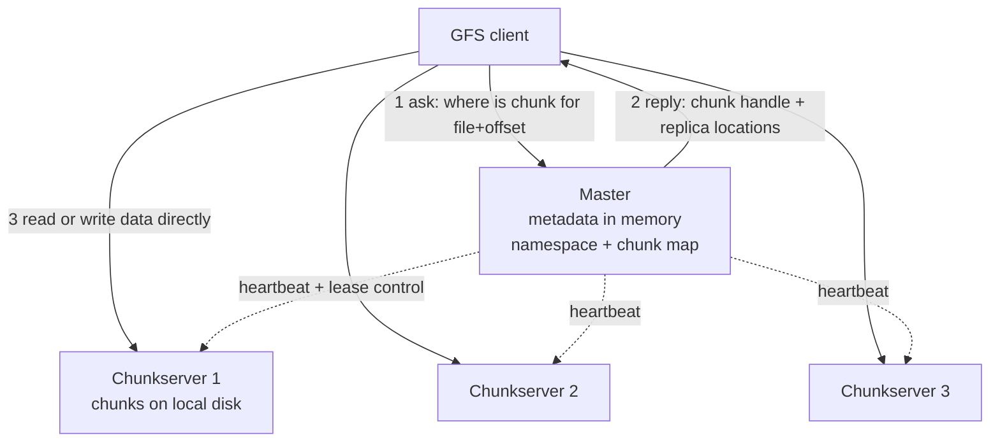
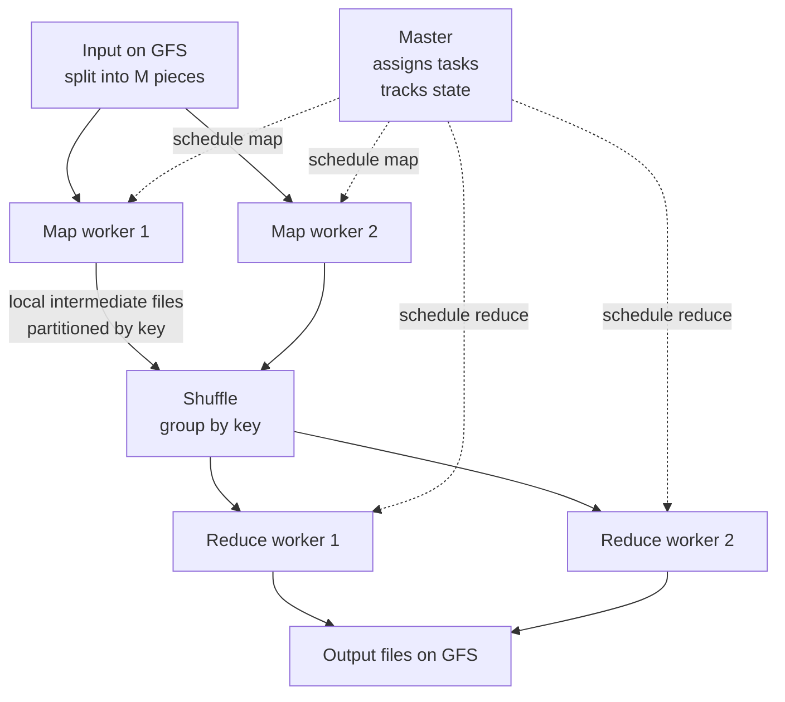
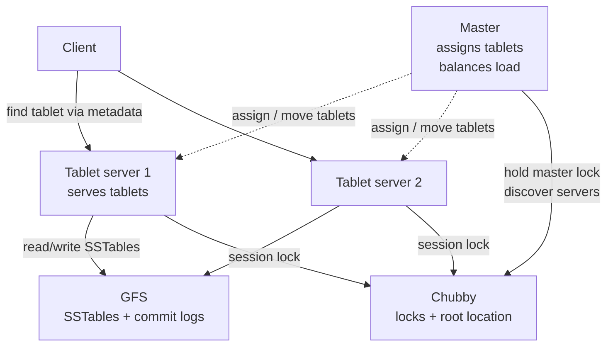
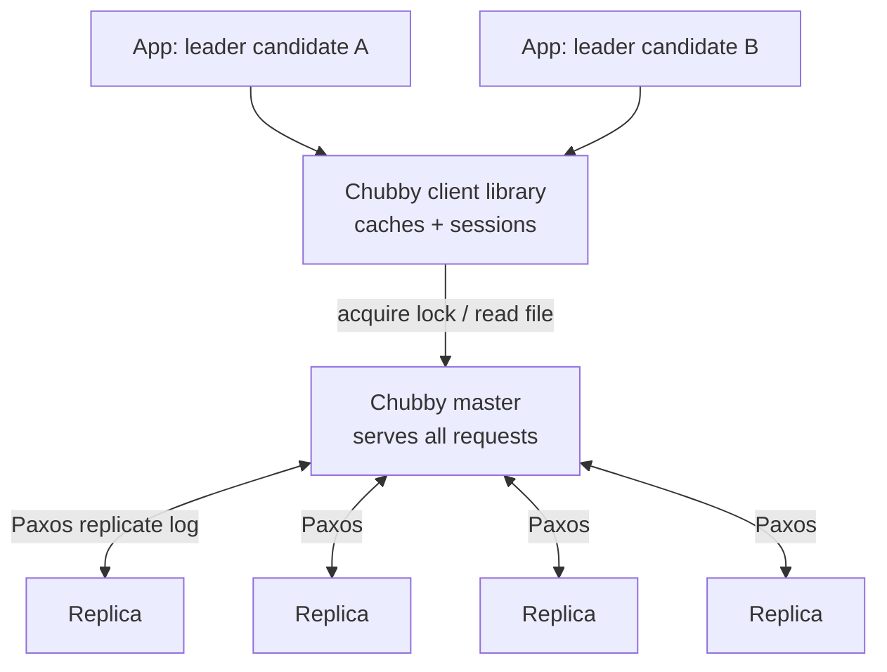
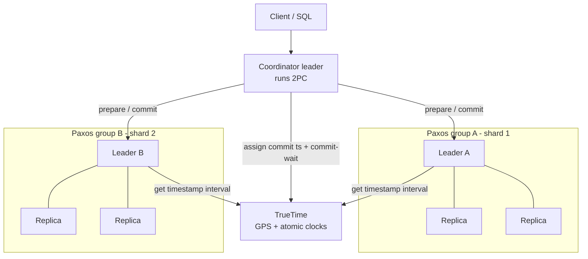
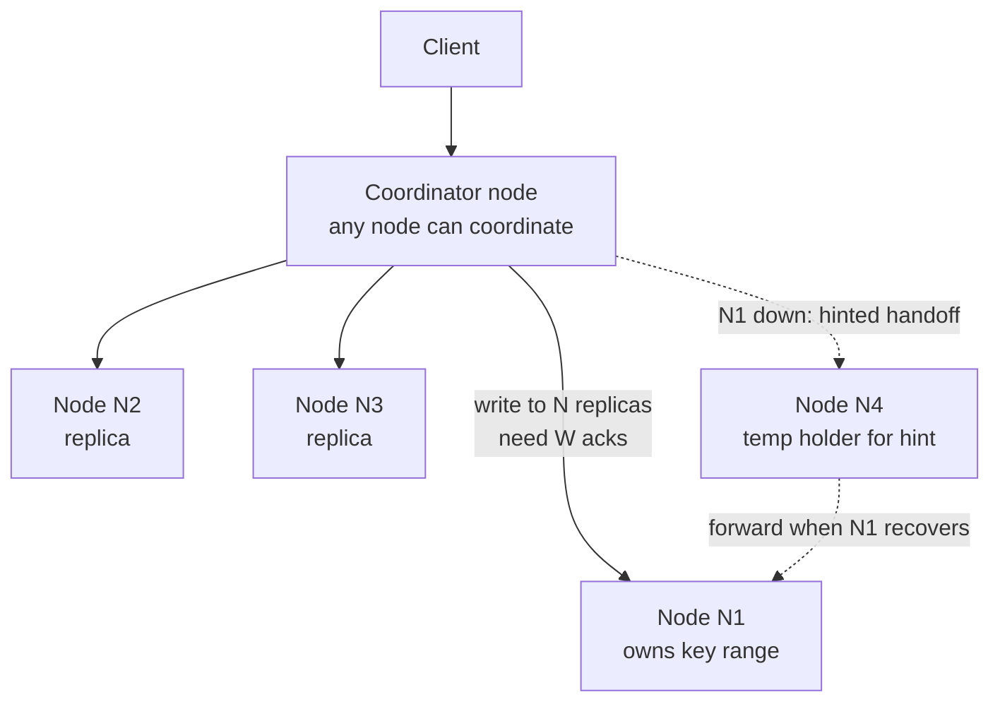
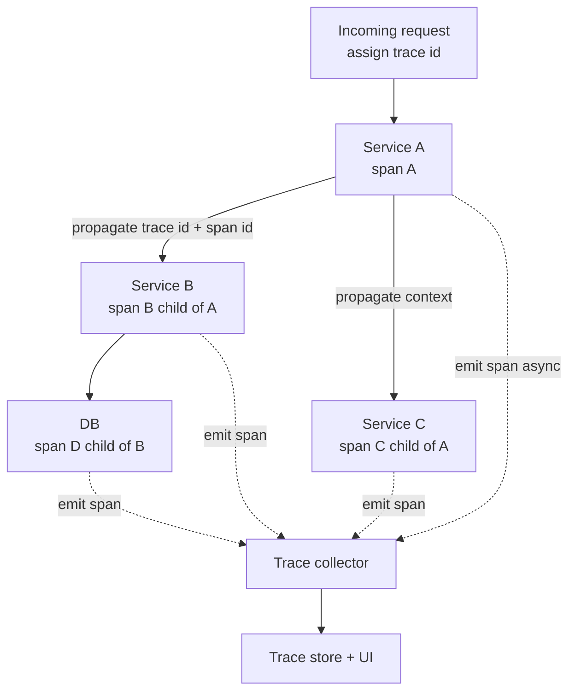
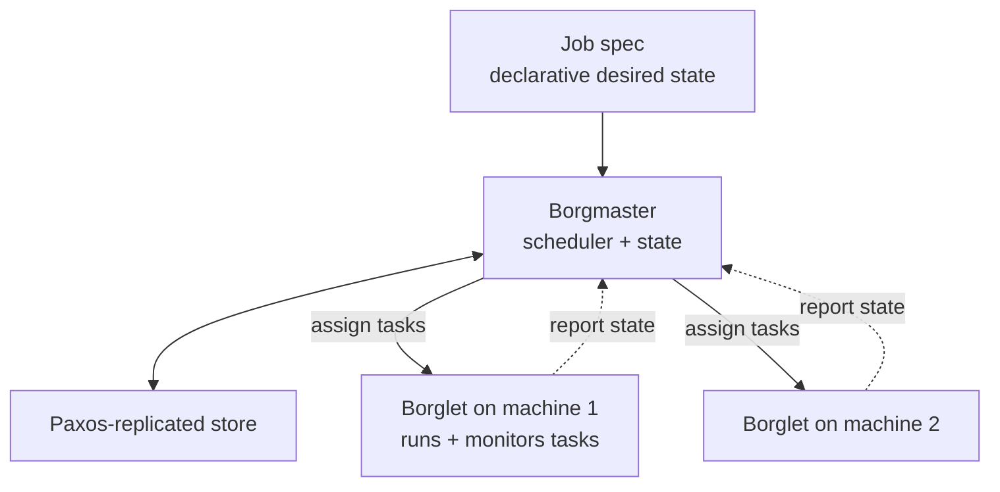

# Module 22 — The Google Papers: A System-Design Digest

> The lineage. GFS, MapReduce, Bigtable, Chubby, Spanner, Dapper, Borg — plus Dynamo as the intellectual counterpoint. Google's own EM-prep docs cite these papers as study material, because reasoning *like* these papers (append-only logs, LSM, master+workers, leases+fencing, TrueTime, quorums) is exactly the signal a strong system-design round rewards.
>
> **This module is a study-ready digest, not a literature review.** For each paper you get the problem it solved, the one key idea it invented, a clean architecture diagram, the decisive trade-offs, how it survives failure and scale, its modern descendants, and — most importantly — *how to invoke the idea live in a design without name-dropping*.

## What you'll master

By the end of this module you'll be able to walk into a Google EM system-design round and reach for the right primitive *by mechanism*, not by citation. Specifically:

- **GFS** — master + chunkservers, large chunks, append-optimized writes, and the single-master pattern (and how to make it not be a bottleneck).
- **MapReduce** — the map/shuffle/reduce model, master scheduling, re-execution fault tolerance, straggler mitigation via backup tasks, and data-locality scheduling.
- **Bigtable** — the sparse sorted map data model, tablets, and the SSTable + memtable + compaction (LSM) machinery that the whole NoSQL world inherited.
- **Chubby** — why a *lock service* beats a lock library: Paxos-replicated coordination, sessions/leases, and its role in leader election, naming, and config.
- **Spanner** — TrueTime, commit-wait, and how external consistency (linearizability) is achieved at global scale with Paxos groups and 2PC.
- **Dynamo** — the AP counterpoint: consistent hashing, vector clocks, quorums (R+W>N), hinted handoff, sloppy quorum, eventual consistency.
- **Dapper** — spans, trace context, and sampling: the origin of modern distributed tracing.
- **Borg + Colossus + Percolator + Monarch** — what each added to the lineage.
- **The decisive phrasing pattern** — how to invoke a paper's idea so the interviewer hears "this person has built at scale," not "this person memorized a reading list."

Cross-links: [Build From Scratch](21-build-from-scratch.md) · [Distributed Computation](23-distributed-computation.md) · [Databases](06-databases.md) · [Storage](08-storage.md) · [Distributed Systems](02-distributed-systems.md) · [Data Processing](16-data-processing.md)

---

## Table of Contents

1. [In the Room — How to Use These Papers](#in-the-room--how-to-use-these-papers)
2. [GFS — Google File System 2003](#1-gfs--google-file-system-2003)
3. [MapReduce 2004](#2-mapreduce-2004)
4. [Bigtable 2006](#3-bigtable-2006)
5. [Chubby 2006](#4-chubby-2006)
6. [Spanner 2012](#5-spanner-2012)
7. [Dynamo — Amazon 2007 — the counterpoint](#6-dynamo--amazon-2007--the-counterpoint)
8. [Dapper 2010](#7-dapper-2010)
9. [Borg, Colossus, Percolator, Monarch](#8-borg-colossus-percolator-monarch)
10. [Interview Cheat-Sheet](#interview-cheat-sheet)
11. [Common Interview Questions](#common-interview-questions)

---

## In the Room — How to Use These Papers

The mistake candidates make is **name-dropping**: "I'd use Spanner here." That signals nothing — the interviewer can't tell if you understand the mechanism or just the marketing. The strong move is to **invoke the idea by its mechanism** and let the name be optional context.

Weak: *"I'd use TrueTime."*
Strong: *"I'll give every commit a timestamp from a clock with a bounded uncertainty interval, then have the coordinator wait out that uncertainty before releasing locks — that guarantees any later transaction sees a strictly greater timestamp, so I get external consistency globally. This is the TrueTime approach in Spanner."*

The name comes **last**, as a footnote that proves you know where the idea lives.

### Which paper solves which problem

| Design problem in the room | Paper / idea to reach for | The mechanism you cite |
| --- | --- | --- |
| Store huge files, append-heavy, commodity disks | **GFS / Colossus** | Master holds metadata, chunkservers hold data; large chunks; append path |
| Process petabytes in batch | **MapReduce** | Map → shuffle → reduce; re-execute failed tasks; backup tasks for stragglers |
| Massive structured KV / wide-column store | **Bigtable** | Sparse sorted map; LSM (memtable + SSTable + compaction); tablets |
| Leader election / config / distributed locks | **Chubby** | Paxos-replicated lock service; sessions + leases; fencing |
| Globally-consistent SQL / strong cross-region txns | **Spanner** | TrueTime + commit-wait; Paxos groups; 2PC across groups |
| Always-on, write-available, multi-region KV | **Dynamo** | Consistent hashing; quorums R+W>N; vector clocks; hinted handoff |
| Debug latency across hundreds of services | **Dapper** | Trace context propagation; spans; head-based sampling |
| Schedule millions of jobs on a fleet | **Borg** | Central scheduler; bin-packing; priority/preemption; declarative jobs |

### The decisive phrasing pattern

1. **State the constraint** that forces the choice ("reads dominate 100:1 and we can tolerate stale reads").
2. **Name the mechanism** ("so I'll serve from local replicas and only route the rare strong read to the leader").
3. **Name the trade-off you're accepting** ("I'm giving up read-your-writes on the replica path; I'll pin a session to the leader for users who just wrote").
4. **Drop the lineage last** ("this is the Spanner read-replica + leader-lease pattern").

That sequence — constraint → mechanism → trade-off → lineage — is the staff/EM tell. It shows you *decide*, you know *why*, and you know *what it costs*.

---

## 1. GFS — Google File System 2003

### Problem it solved + context

By the early 2000s Google needed to store crawl data, web indexes, and intermediate results — *petabytes* — on thousands of cheap, failure-prone commodity machines. Existing distributed file systems assumed reliable hardware and small files with random reads/writes. Google's workload was the opposite: **huge files, mostly large sequential reads, and writes that are overwhelmingly appends** (e.g., many crawlers appending to one results file). They built a file system around *those* observed access patterns instead of POSIX generality.

### Key idea / what it invented

**Decouple metadata from data, optimize for append, and make failure the normal case.** A single **master** holds all filesystem metadata in memory; the actual bytes live in fixed-size **64 MB chunks** spread across **chunkservers** and replicated (default 3×). Clients talk to the master *only* to find where chunks live, then stream data directly from chunkservers — so the master never sits on the data path. GFS also introduced a relaxed, application-aware **consistency model** built around an **atomic record-append** primitive.

### Architecture

### Crucial design decisions & trade-offs

| Decision | Why | Trade-off accepted |
| --- | --- | --- |
| **Single master** | Simple, globally consistent metadata; easy to reason about | Single point of contention/failure — mitigated below |
| **64 MB chunks** | Fewer metadata entries fit in RAM; fewer client-master round trips; long sequential I/O | Small files waste space; hotspot if many clients hit one chunk |
| **Metadata in master RAM** | Fast lookups, simple ops | Total file count bounded by master memory |
| **Append-optimized, record-append** | Matches real workload; no per-client locking of offsets | Append may insert padding/duplicates — apps must dedupe |
| **Relaxed consistency** | Lets concurrent appends be cheap | "Defined vs consistent-but-undefined" regions — pushed onto the application |
| **Replication, not erasure coding** | Simple, fast recovery, cheap reads | 3× storage cost (Colossus later fixed this) |

### Failure & scale handling

- **Master is not on the data path**, so it scales to thousands of chunkservers despite being singular. Its state is kept small (metadata only) and recoverable from an **operation log + periodic checkpoints**; a **shadow master** serves read-only metadata during failover.
- **Chunkservers are assumed to fail constantly.** The master tracks replica counts via heartbeats and **re-replicates** under-replicated chunks automatically. Data integrity is checked with per-block **checksums** (detecting silent disk corruption).
- **Leases**: the master grants a 60s lease to one replica (the *primary*) to serialize mutations for a chunk, decoupling ordering from the master.

### Modern descendants

- **Colossus** (Google's GFS successor — see §8) — sharded metadata, erasure coding.
- **HDFS** is a near-direct open-source clone (NameNode = master, DataNodes = chunkservers).
- Cloud: **GCS**, **Amazon S3**, **Azure Blob** are the object-storage evolution of the same idea (metadata service + replicated/erasure-coded data nodes).

> **Staff-level insight:** GFS is the template for *every* "store huge blobs" answer. When asked to design blob/video/log storage, reach for the GFS split: a **metadata service** that only maps keys to locations, and **dumb, replicated storage nodes** that clients stream from directly — keep the control plane off the data path. The single-master "objection" is your chance to show range: "I'd keep metadata centralized for consistency but never put it on the byte path, cap its state to metadata so it fits in memory, and shard it once file count outgrows one host — which is exactly the GFS → Colossus evolution."

---

## 2. MapReduce 2004

### Problem it solved + context

Google had GFS storing petabytes, but every team kept re-writing the same gnarly boilerplate to process it: partition the input, parallelize across machines, handle machine failures, deal with stragglers, and recombine results. **MapReduce abstracted all of that away** behind two user functions, so an engineer with no distributed-systems expertise could process a petabyte.

### Key idea / what it invented

A **programming model**: express your computation as a **map** function (record → list of key/value pairs) and a **reduce** function (key + all its values → output). The framework handles partitioning, scheduling, the **shuffle** (grouping all values by key), fault tolerance, and stragglers. The insight: most large-scale data processing fits this shape, and once it does, the *runtime* can be reused and hardened once for everyone.

### Architecture

### Crucial design decisions & trade-offs

| Decision | Why | Trade-off accepted |
| --- | --- | --- |
| **Two-function model** | Trivial to write; runtime owns the hard parts | Not every computation fits map/reduce (iterative ML is awkward) |
| **Materialize intermediate to disk** | Re-execution after failure is cheap; no need to redo upstream | Slower than in-memory pipelines (Spark later fixed this) |
| **Re-execute failed tasks** | Idempotent tasks + deterministic functions = just retry | Requires deterministic, side-effect-free map/reduce |
| **Backup (speculative) tasks** | A few stragglers dominate tail latency of the whole job | Wastes a little compute on duplicate work |
| **Locality scheduling** | Schedule map tasks on the machine that holds the GFS replica | Scheduler complexity; not always satisfiable |
| **Combiner** | Pre-aggregate map output locally before shuffle | Only valid for associative/commutative reduces |

### Failure & scale handling

- **Worker failure**: master pings workers; a dead worker's *completed map* tasks are **re-executed** (their output was on the failed worker's local disk), while completed reduce tasks are safe (output is on GFS). In-progress tasks anywhere are rescheduled.
- **Stragglers**: near job end, the master launches **backup copies** of the remaining in-progress tasks; whichever finishes first wins. This collapses the long tail — the single biggest practical win in the paper.
- **Master failure** is rare and handled by checkpointing / job restart (the one SPOF they accepted because it's a single process).
- **Locality**: input is read from local or rack-local disk, conserving scarce network bandwidth — the scheduler is *topology-aware*.

### Modern descendants

- **Apache Hadoop MapReduce** (direct open-source clone), then **Apache Spark** (in-memory, DAG of stages — same shuffle, less disk), **Apache Flink** (streaming).
- Cloud: **Google Dataflow / Cloud Dataproc**, **AWS EMR**, **AWS Glue**, **Databricks**.
- Conceptually superseded for interactive SQL by **Dremel/BigQuery**, but the shuffle is still everywhere.

> See [Distributed Computation](23-distributed-computation.md) and [Data Processing](16-data-processing.md) for the full execution-engine treatment.

> **Staff-level insight:** Don't reach for MapReduce as a *product* — reach for its three reusable ideas. (1) **Re-execution as fault tolerance**: make units of work idempotent and deterministic so recovery is just "run it again." (2) **Backup tasks for the tail**: when asked "how do you handle a slow node in a fan-out," say "speculative duplicate execution and take the first to finish." (3) **Move compute to data**: when network is the bottleneck, schedule work where the bytes already live. Citing these mechanisms in *any* batch/fan-out design reads as scar tissue from real systems.

---

## 3. Bigtable 2006

### Problem it solved + context

Google needed a storage system for **semi-structured data at petabyte scale** — web index, Google Earth, Google Analytics — with low-latency reads/writes, that scaled to thousands of machines, and that didn't need a full relational engine. Relational DBs didn't scale horizontally cheaply; raw GFS files had no indexing or structured access. Bigtable sits **on top of GFS** and adds structure, indexing, and online mutation.

### Key idea / what it invented

A **sparse, distributed, persistent, multidimensional sorted map**, indexed by `(row key, column key, timestamp) → value (uninterpreted bytes)`. Rows are sorted lexicographically and partitioned into **tablets**; columns are grouped into **column families**; every cell can keep multiple **timestamped versions**. Under the hood it popularized the **LSM-tree** machinery for the masses: writes hit an in-memory **memtable** (after a commit log append), which flushes to immutable **SSTables** on GFS, merged by **compaction**. This data model + LSM engine is the genetic ancestor of HBase, Cassandra, and the modern NoSQL world.

### Architecture

### Read/write path (the part interviewers probe)

- **Write**: append to the tablet's **commit log** on GFS (durability) → insert into the in-memory **memtable**. When the memtable is full, flush it to a new immutable **SSTable**.
- **Read**: merge a view across the **memtable + the relevant SSTables**; a **Bloom filter** per SSTable skips files that can't contain the row, and a block cache avoids re-reading hot blocks.
- **Compaction**: minor compaction flushes memtable → SSTable; merging/major compaction combines SSTables, drops deleted/overwritten cells, and bounds read amplification.

### Crucial design decisions & trade-offs

| Decision | Why | Trade-off accepted |
| --- | --- | --- |
| **Rows sorted by key** | Range scans are cheap; locality controlled via key design | Hot ranges if keys are sequential (e.g., timestamps) |
| **LSM (memtable + SSTable)** | Fast sequential writes; immutable files are simple to replicate/cache | Read amplification + compaction CPU/IO cost |
| **Built on GFS** | Inherits durability, replication, scale for free | Inherits GFS latency profile; layered complexity |
| **Column families** | Group related columns; per-family tuning + access control | Schema-light, but families are relatively static |
| **Single master (light)** | Master only does assignment/balancing, *not* data | Master availability handled via Chubby, not data-path SPOF |
| **Chubby for coordination** | One trusted source for tablet ownership + master election | Hard dependency on Chubby being up |

### Failure & scale handling

- **Tablet server failure**: the server holds a **Chubby session lock**; when its session expires, the master detects it, reassigns its tablets to live servers, which **replay the commit log** from GFS to rebuild the memtable. No data loss because the log and SSTables are on GFS.
- **Master failure**: a new master acquires the **master lock in Chubby**, scans tablet assignments, and resumes. The master is not on the read/write path, so brief unavailability doesn't stop serving.
- **Scale**: a table grows by **splitting tablets** as they get large; the three-level **METADATA** hierarchy (root tablet → metadata tablets → user tablets) locates any row in a few RPCs and caches aggressively.

### Modern descendants

- **Apache HBase** (direct clone on HDFS), **Apache Cassandra** (Bigtable data model + Dynamo's ring), **ScyllaDB**.
- **RocksDB / LevelDB** are the embedded LSM engines distilled from this lineage and now power countless databases.
- Cloud: **Google Cloud Bigtable**, **Amazon DynamoDB** (data model cousin), **Azure Cosmos DB**.

> See [Databases §1 LSM internals](06-databases.md) and [Storage](08-storage.md).

> **Staff-level insight:** Bigtable is your answer for "design a wide-column / time-series / massive-KV store." The interviewer is really testing whether you understand **LSM trade-offs and key design**. Say it out loud: "Writes are an append to a log plus a memtable insert, so write throughput is high; reads merge the memtable with sorted immutable files and use Bloom filters, so I pay read amplification, which compaction bounds. The whole game is the **row-key design** — I'll prefix with the tenant and reverse the timestamp to avoid a sequential hotspot." That single paragraph covers data model, write path, read path, and the #1 scaling pitfall.

---

## 4. Chubby 2006

### Problem it solved + context

Across Google, dozens of systems needed the same thing: **agree on one leader, advertise a location, or guard a shared resource** — reliably, even through machine failures. Each team could implement Paxos themselves, but that's error-prone and they kept getting it wrong. Chubby's pragmatic insight: **most developers don't want a consensus library, they want a familiar lock + tiny-file abstraction** with consensus hidden inside. It became Google's default for **leader election, naming, and config distribution**.

### Key idea / what it invented

A **distributed lock service** exposing a UNIX-like filesystem of small files/directories ("nodes"), each of which can be a lock and can hold a little data. A small cell of (typically 5) replicas runs **Paxos** to keep a consistent, replicated log; one replica is the elected **master** that serves all client requests. Clients hold **sessions** kept alive by **leases** (KeepAlives); if a session lapses, the client's locks are released. Locks are **coarse-grained** (held for hours/days — e.g., "I am the leader"), not fine-grained per-operation locks.

### Architecture

### Crucial design decisions & trade-offs

| Decision | Why | Trade-off accepted |
| --- | --- | --- |
| **Lock service, not a library** | Most teams misuse raw Paxos; a service centralizes correctness | A hard, shared dependency many systems lean on |
| **Coarse-grained locks** | Locks held for hours; low lock-traffic, simple | Not for high-frequency mutual exclusion |
| **Sessions + leases (KeepAlive)** | Detect dead clients; auto-release their locks | Clock/timeout tuning; jeopardy/grace handling |
| **Small files alongside locks** | One place for config + leader address | Not a general datastore — kilobytes only |
| **Aggressive client caching + invalidation** | Most ops are reads of config | Master must track and invalidate caches |
| **Sequencers / fencing tokens** | Prevent a paused lock-holder from acting after losing the lock | Resources must check the token |

### Failure & scale handling

- **Replica failure**: Paxos tolerates a minority of the 5 replicas failing. If the **master** dies, the remaining replicas **elect a new master** and clients transparently fail over (their session enters a *grace period* — "jeopardy" — and re-establishes).
- **The fencing problem**: a client can hold a lock, pause (GC/network), and lose the lock without knowing. Chubby issues a monotonically increasing **sequencer (fencing token)** with the lock; the protected resource rejects any request carrying a stale token. *This is the canonical answer to "how do you make distributed locks safe."*
- **Scale**: it's *not* built for throughput — it's built for **availability of small, critical coordination state**. Client-side caching keeps read load off the master.

### Modern descendants

- **Apache ZooKeeper** (the open-source Chubby; ZAB instead of Paxos), **etcd** (Raft-based, powers Kubernetes), **HashiCorp Consul**.
- Cloud: **Google Cloud's internal Chubby**, etcd under **GKE/EKS/AKS**, **AWS** uses internal equivalents for control planes.

> **Staff-level insight:** Any time your design says "elect a leader," "register a service," or "take a distributed lock," you owe the interviewer two mechanisms: (1) a **consensus-backed coordination service** holding the small, critical state (don't roll your own Paxos), and (2) **fencing tokens** so a stalled old leader can't corrupt state after a new one is elected. The decisive line: "I'll elect the leader via a lease in a consensus store, and every write to the shared resource carries a monotonic fencing token so a paused old leader is rejected — that closes the split-brain window." That's Chubby reasoning without saying "Chubby."

---

## 5. Spanner 2012

### Problem it solved + context

Google's ad system (and many others) had outgrown both Bigtable (no transactions/SQL, eventual consistency was painful) and sharded MySQL (manual resharding hell). They wanted **SQL, schemas, and ACID transactions** — but **globally distributed** across continents with **strong consistency**. The hard part: making transactions on opposite sides of the planet agree on *order* without a global clock. Spanner's breakthrough is solving exactly that.

### Key idea / what it invented

**TrueTime**: an API backed by **GPS receivers and atomic clocks** in every datacenter that returns time not as a point but as an **interval** `[earliest, latest]` with a bounded uncertainty **ε** (typically a few ms). Because Spanner *knows the bound on its clock error*, it can assign each transaction a commit timestamp and then **commit-wait** — deliberately wait out ε before releasing locks — so that any transaction that starts later is guaranteed a strictly greater timestamp. This delivers **external consistency (linearizability)** at global scale: if T1 commits before T2 starts (in real time), T1's timestamp < T2's timestamp, everywhere. Data is sharded into **Paxos groups** for replication, and cross-group transactions use **2-phase commit** layered over Paxos.

### Architecture

### Crucial design decisions & trade-offs

| Decision | Why | Trade-off accepted |
| --- | --- | --- |
| **TrueTime (real clocks)** | Lets you *order* events globally without a single sequencer | Needs special hardware; ε must stay small |
| **Commit-wait** | Guarantees external consistency | Adds ~ε latency to every commit (a few ms) |
| **Paxos per shard group** | Strongly-consistent replication, survives DC loss | Write latency = WAN round trip to a quorum |
| **2PC across groups** | Atomic multi-shard transactions | 2PC's blocking + coordinator cost (Paxos-backed to survive) |
| **Leader leases** | Leader serves reads without quorum | Lease management; clock dependence |
| **Snapshot reads at a timestamp** | Lock-free, consistent reads in the past | Must retain MVCC versions |

### Failure & scale handling

- **Replica/DC failure**: each shard is a Paxos group spanning regions; losing a minority of replicas (or a whole DC) is survivable — a new leader is elected and serving continues with no data loss.
- **Read scaling**: a leader holds a **lease**; within it, the leader serves **linearizable reads with no quorum round-trip**. Stale-tolerant reads can be served from any replica at a chosen timestamp (**snapshot reads**), offloading the leader — same pattern as Bigtable/Spanner read replicas.
- **The ε dependency is the risk**: if TrueTime uncertainty spikes (clock drift, GPS loss), commit-wait grows and latency rises — Spanner deliberately **slows down rather than risk inconsistency** (CP over AP). That choice *is* the philosophy.

### Modern descendants

- **CockroachDB** (TrueTime emulated with HLCs + bounded clock skew), **YugabyteDB**, **TiDB** — all "distributed SQL."
- Cloud: **Google Cloud Spanner** (the product), **AWS Aurora** (regional strong consistency, different mechanism), **Azure Cosmos DB** (tunable consistency).

> See [Databases — NewSQL / Distributed SQL](06-databases.md) and [Distributed Systems — consensus & consistency](02-distributed-systems.md).

> **Staff-level insight:** Reach for Spanner/TrueTime whenever the room demands **global strong consistency** — a globally-consistent counter, a financial ledger across regions, "no double-booking ever." The decisive move: "I'll timestamp commits from a clock with a *bounded* uncertainty interval and have the coordinator wait out that bound before releasing locks, so any later transaction is guaranteed a greater timestamp — that's external consistency. The cost is a few ms of commit-wait per write and a hardware-clock dependency, and when clock uncertainty rises the system gets slower, not wrong." Then immediately pivot to cost: "If the workload tolerates staleness, I'd *not* pay this and use async replication — strong global consistency is the most expensive thing you can ask for."

---

## 6. Dynamo — Amazon 2007 — the counterpoint

### Problem it solved + context

Amazon's shopping cart could **never** be unavailable for writes — a failed "add to cart" loses a sale — even during datacenter partitions or hardware failures. The relational/strongly-consistent approach trades availability for consistency under partition (CP). Dynamo deliberately chose the **opposite corner of CAP**: an **always-writable**, **highly available** key-value store that accepts **eventual consistency**. It's the intellectual *counterpoint* to Google's CP lineage — and understanding both corners is what makes you sound senior.

### Key idea / what it invented

A bundle of techniques for an **AP** distributed KV store:

- **Consistent hashing** on a ring to partition keys across nodes with minimal reshuffling when nodes join/leave (refined with **virtual nodes** for balance).
- **N/R/W quorums**: each key is replicated to N nodes; a read needs R replies, a write needs W; choose **R + W > N** for read-your-writes overlap, or relax for speed.
- **Vector clocks** to track causal version history and detect concurrent writes; conflicts are surfaced to the application to reconcile (e.g., merge two carts).
- **Sloppy quorum + hinted handoff**: if a target replica is down, write to the next healthy node with a "hint"; it forwards the data back when the owner recovers — so writes never block on a downed node.
- **Anti-entropy** via Merkle trees and **gossip** for membership.

### Architecture

### Crucial design decisions & trade-offs

| Decision | Why | Trade-off accepted |
| --- | --- | --- |
| **AP over CP** | Writes must always succeed | Reads can return stale/concurrent versions |
| **Consistent hashing + vnodes** | Smooth scaling, balanced load | Range scans are hard; key-only access |
| **Tunable R/W/N quorums** | Per-operation consistency/latency dial | Operator must understand R+W>N math |
| **Vector clocks** | Detect causal vs concurrent updates | Vectors can grow; app must reconcile conflicts |
| **Sloppy quorum + hinted handoff** | Survive node failure without blocking writes | Temporary inconsistency; possible stale reads |
| **Gossip membership** | Decentralized, no master | Eventual view convergence; harder to reason about |

### Failure & scale handling

- **Node down on write**: sloppy quorum routes to a healthy node with a **hint**; no write is rejected. When the owner returns, hinted data is **handed off** back.
- **Divergent replicas**: **read repair** (fix stale replicas on read) + **anti-entropy** (Merkle-tree comparison) reconcile over time.
- **Scale**: fully **decentralized — no master, no single bottleneck**; adding nodes only remaps a slice of the ring. This is the opposite philosophy from GFS/Bigtable's master.

### Modern descendants

- **Amazon DynamoDB** (managed evolution), **Apache Cassandra** (Dynamo ring + Bigtable data model — the famous hybrid), **Riak**, **Voldemort**, **ScyllaDB**.

> **Staff-level insight:** Dynamo is the tool you reach for — and the *contrast* you draw — whenever availability beats consistency: shopping carts, session stores, "like" counters, presence. The senior move is to **place your design on the CAP spectrum out loud**: "This is a write-availability-first workload, so I'll go AP — replicate to N, accept writes at a sloppy quorum so a node failure never blocks the user, and resolve concurrent versions on read with a domain merge. I'm explicitly giving up linearizability; if this were a ledger I'd flip to the Spanner/CP side instead." Showing you can sit in *either* corner — and naming the exact trade — is the differentiator. **Dynamo (AP) vs Spanner (CP) is the cleanest consistency contrast you can draw in an interview.**

---

## 7. Dapper 2010

### Problem it solved + context

A single Google search touches **hundreds of services** across thousands of machines. When latency spikes or a request fails, *which* service caused it? Logs per machine are useless without a way to stitch one request's path together. Dapper made **distributed tracing** practical at production scale — low overhead, always-on, ubiquitous — and is the direct ancestor of every modern tracing system.

### Key idea / what it invented

Propagate a small **trace context** (a trace ID + parent span ID) along every RPC, so each unit of work emits a **span** (an operation with start/end timestamps, parent pointer, and annotations). Reassembling spans by trace ID yields the full **causal tree** of a request across services. Two enabling ideas: **context propagation through the RPC framework** (so app code needs almost no changes), and **sampling** (trace only a small fraction of requests — e.g., 1 in 1000 — to keep overhead negligible while still capturing statistical truth).

### Architecture

### Crucial design decisions & trade-offs

| Decision | Why | Trade-off accepted |
| --- | --- | --- |
| **Context in the RPC layer** | Near-zero app changes; ubiquitous coverage | Needs a common RPC/instrumentation substrate |
| **Head-based sampling** | Keeps overhead and storage tiny | May miss rare/anomalous traces |
| **Async, out-of-band span export** | Tracing must not slow the request | Some spans lost on crash |
| **Trace = tree of spans** | Matches real call graphs; easy to visualize | Async/fan-out/queues complicate the tree |

### Failure & scale handling

- **Overhead control**: aggressive **sampling** keeps the always-on cost negligible; span collection is **asynchronous and out-of-band**, so tracing failures never impact the served request.
- **Scale**: only a fraction of requests are traced, so storage and collection scale with sample rate, not traffic.

### Modern descendants

- **OpenTelemetry** (the converged standard) and its predecessors **OpenTracing/OpenCensus**; **Zipkin** (from Twitter), **Jaeger** (CNCF).
- Cloud/vendor: **Google Cloud Trace**, **AWS X-Ray**, **Datadog APM**, **Honeycomb**, **Grafana Tempo**.

> See [Observability](12-observability.md) for the metrics/logs/traces treatment.

> **Staff-level insight:** When your design has more than a handful of services, *proactively* add tracing before you're asked — it signals operational maturity. Say: "I'll propagate a trace context through the RPC layer so every hop emits a span tied to one trace ID; I sample at the edge to keep overhead negligible, and export spans asynchronously so tracing never sits on the request path. That gives me per-request latency breakdowns across services — which is how I'd actually debug the p99 in production." Bonus EM signal: tie it to *on-call* — "this is what lets an engineer answer 'which service caused the spike' in minutes instead of hours."

---

## 8. Borg, Colossus, Percolator, Monarch

The lineage didn't stop in 2012. Four more systems show up in design discussions; know what each *added*.

### Borg 2015 — cluster management

The paper that finally documented Google's long-running **cluster manager** (the direct ancestor of Kubernetes). **What it added:** a **centralized scheduler** that bin-packs tens of thousands of **jobs/tasks** onto a shared fleet of machines, mixing high-priority serving jobs with low-priority batch to drive utilization up. Jobs are **declarative** (desired state, not imperative steps); Borg reconciles reality toward that spec, restarting failed tasks. **Priority + preemption**: batch tasks get evicted when latency-sensitive work needs the resources. **Quota and naming** are built in.

**Descendants:** **Kubernetes** (open-source successor), **Omega** (Borg's research successor), **Nomad**, **Mesos**; cloud **GKE/EKS/AKS**.
**How to invoke it:** When asked to design a job/workload scheduler or "how do you run millions of containers," reach for the Borg pattern: a **declarative desired-state spec**, a **central scheduler that bin-packs and reconciles**, **priority/preemption** to mix latency-sensitive and batch work for utilization, and per-machine agents that report state and restart failed tasks.

### Colossus — the GFS successor

**What it added** over GFS: the single master became the GFS scaling ceiling (metadata in one host's RAM caps file count). Colossus **shards the metadata layer** (built on a Bigtable-like store) so it scales horizontally, and replaces 3× replication with **Reed-Solomon erasure coding** for cold data — cutting storage overhead from ~3× toward ~1.3–1.5× at the same durability.
**How to invoke it:** When someone challenges your GFS-style single-master ("doesn't that bottleneck?"), answer with the Colossus evolution: "shard the metadata service and erasure-code the data — you keep the metadata/data split but remove the single-host ceiling and the 3× cost."

### Percolator — incremental processing

**What it added:** MapReduce reprocessed the *entire* web index on every update — hugely wasteful for small changes. Percolator enabled **incremental processing** of Bigtable: **multi-row ACID transactions with snapshot isolation** (using a global timestamp oracle and a 2PC protocol stored in Bigtable cells), plus **observers/notifications** that trigger work when data changes. It cut Google's index-update latency dramatically.
**How to invoke it:** When a design says "we don't want to recompute everything on each change," reach for Percolator's idea: **transactional incremental updates triggered by change-notifications**, instead of periodic full batch recomputation. (This is the conceptual bridge to stream processing — see [Data Processing](16-data-processing.md).)

### Monarch — planet-scale monitoring

**What it added:** a globally-distributed, **in-memory time-series database** for metrics at Google's scale — regionalized (data stays near where it's produced for availability), schematized, and built to ingest and query *trillions* of points. It's the metrics backbone (the descendant of Borgmon, and a cousin of Prometheus's model).
**How to invoke it:** When designing a metrics/monitoring backend, reach for Monarch's ideas: a **purpose-built TSDB** (not a general DB), **regional autonomy** so monitoring survives the very outages it must report on, and an **in-memory recent window** for fast queries with downsampled long-term storage. Open-source cousins: **Prometheus**, **Thanos/Cortex/Mimir**, **VictoriaMetrics**, **InfluxDB**.

---

## Interview Cheat-Sheet

| Paper | One-line essence | Design problem it unlocks |
| --- | --- | --- |
| **GFS** | Master holds metadata, replicated chunkservers hold data; append-optimized; keep the master off the byte path | Huge blob/file/log storage |
| **MapReduce** | Map → shuffle → reduce; re-execute on failure; backup tasks kill the tail; move compute to data | Petabyte batch processing |
| **Bigtable** | Sparse sorted map over LSM (memtable + SSTable + compaction) on GFS, coordinated by Chubby | Wide-column / time-series / massive-KV store |
| **Chubby** | Paxos-replicated lock service with sessions, leases, and fencing tokens | Leader election, naming, config, distributed locks |
| **Spanner** | TrueTime's bounded-uncertainty clock + commit-wait gives global external consistency; Paxos groups + 2PC | Globally-consistent SQL / ledgers / no-double-book |
| **Dynamo** | Consistent hashing + tunable R/W/N quorums + vector clocks + hinted handoff = always-writable AP store | Always-on, write-available, multi-region KV |
| **Dapper** | Propagate trace context through RPC, emit spans, sample at the head | Distributed tracing / debugging cross-service latency |
| **Borg** | Central scheduler bin-packs declarative jobs with priority + preemption | Cluster/workload scheduling |
| **Colossus** | GFS with sharded metadata + erasure coding | Removing the single-master ceiling + 3× cost |
| **Percolator** | Snapshot-isolation transactions + change observers on Bigtable | Incremental processing instead of full recompute |
| **Monarch** | Regional, in-memory, planet-scale TSDB | Metrics/monitoring backend |

**The CP vs AP spine:** *Spanner (CP, strong, may slow down) ↔ Dynamo (AP, available, may go stale).* Knowing which corner your design needs — and naming the cost — is the single highest-signal move in the consistency discussion.

---

## Common Interview Questions

Answer these in the decisive **constraint → mechanism → trade-off → lineage** voice.

1. **"Design a system to store and serve billions of large files."**
   Split metadata from data: a metadata service maps keys to chunk locations; clients stream bytes directly from replicated storage nodes so the control plane never touches the data path. Cap metadata to fit memory, shard it when file count outgrows one host, and erasure-code cold data to escape 3× cost. (GFS → Colossus.)

2. **"How do you process a petabyte of logs nightly, and how do you handle a slow machine?"**
   Map → shuffle → reduce with idempotent, deterministic tasks so recovery is just re-execution; schedule map tasks where the data already lives to save network; and near the end, launch **backup copies** of straggling tasks and take the first to finish — that collapses the tail. (MapReduce.)

3. **"Design a wide-column store. Walk me through a write and a read."**
   Write = append to a commit log for durability, then insert into an in-memory memtable; flush to immutable sorted SSTables when full. Read = merge memtable + SSTables, using a Bloom filter per SSTable to skip files. Compaction bounds read amplification. The scaling lever is **row-key design** to avoid sequential hotspots. (Bigtable / LSM.)

4. **"How do you elect a leader safely and avoid split-brain?"**
   Hold the leadership as a **lease in a consensus-backed store**; on expiry a new leader is elected. Crucially, every write to the shared resource carries a **monotonic fencing token**, so a paused old leader that wakes up is rejected. Don't roll your own Paxos — use the coordination service. (Chubby.)

5. **"Design a globally-consistent counter / ledger with no double-spend across regions."**
   Timestamp commits from a clock with a **bounded uncertainty interval** and have the coordinator **wait out that bound** before releasing locks, so any later transaction gets a strictly greater timestamp — external consistency globally. Replicate each shard via Paxos, use 2PC across shards. Cost: a few ms commit-wait per write, and the system slows rather than goes wrong when clock uncertainty spikes. (Spanner / TrueTime.)

6. **"Design a shopping cart / session store that must never reject a write."**
   Go **AP**: consistent-hash keys onto a ring, replicate to N, accept writes at a **sloppy quorum** with hinted handoff so a node failure never blocks the user. Resolve concurrent versions on read with a domain-specific merge (vector clocks detect concurrency). Explicitly trade away linearizability — acceptable for carts, not for ledgers. (Dynamo.)

7. **"When would you pick Spanner-style CP over Dynamo-style AP, and vice versa?"**
   CP when correctness beats availability under partition — money, inventory, uniqueness constraints; accept higher write latency and the chance the system stalls during clock/quorum trouble. AP when the user must always be served and stale/merged reads are tolerable — carts, presence, counters. State which corner you're in *out loud* and name the cost. (Spanner vs Dynamo.)

8. **"A request touches 30 services and p99 latency spiked. How do you find the culprit?"**
   Propagate a **trace context** through the RPC layer so every hop emits a **span** tied to one trace ID; sample at the edge to keep overhead negligible and export spans asynchronously off the request path. The reassembled span tree gives a per-service latency breakdown for the slow requests. (Dapper.)

9. **"How would you schedule millions of containerized tasks across a shared fleet?"**
   A **central scheduler** consuming **declarative job specs**, bin-packing tasks onto machines, mixing latency-sensitive serving with preemptible batch to drive utilization, with **priority + preemption** and per-machine agents that report state and restart failures. (Borg → Kubernetes.)

10. **"Your pipeline recomputes everything on each input change — fix it."**
    Move from periodic full recomputation to **transactional incremental updates**: snapshot-isolation transactions that touch only changed rows, triggered by **change observers/notifications**. This is the batch → incremental/stream bridge. (Percolator; see [Data Processing](16-data-processing.md).)

---

> **The meta-lesson for the EM round:** these papers are a shared vocabulary. The interviewer isn't checking whether you can cite them — they're checking whether you *reason like them*: split metadata from data, append instead of mutate, replicate behind a quorum, fence your leaders, bound your clocks, and always say what each choice costs. Invoke the **mechanism**, place your design on the **CP/AP spectrum**, name the **trade-off**, and let the lineage land last.
