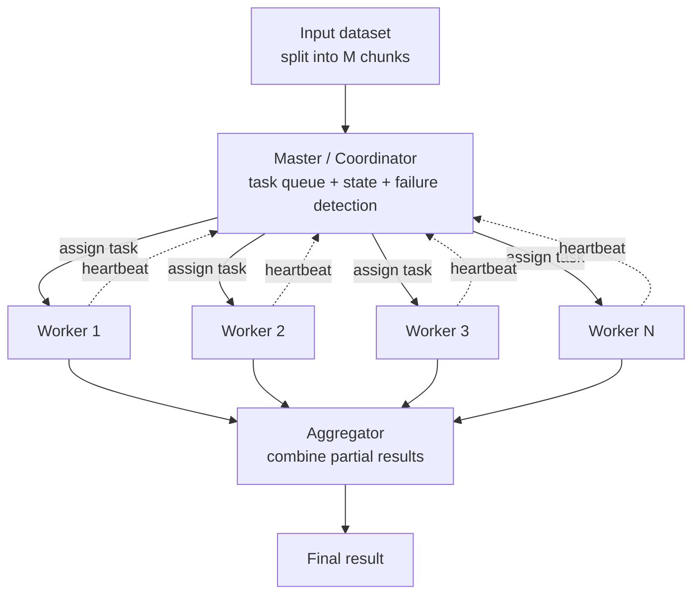
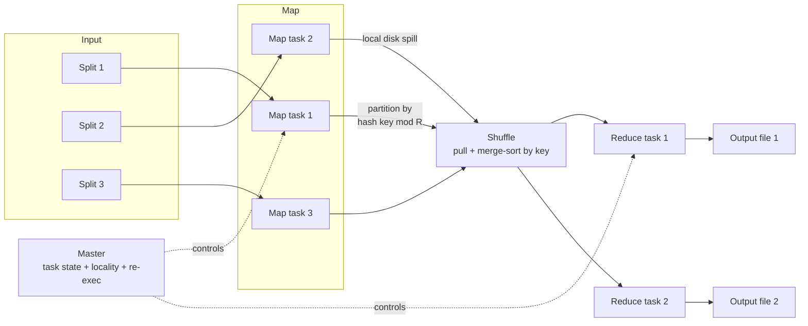
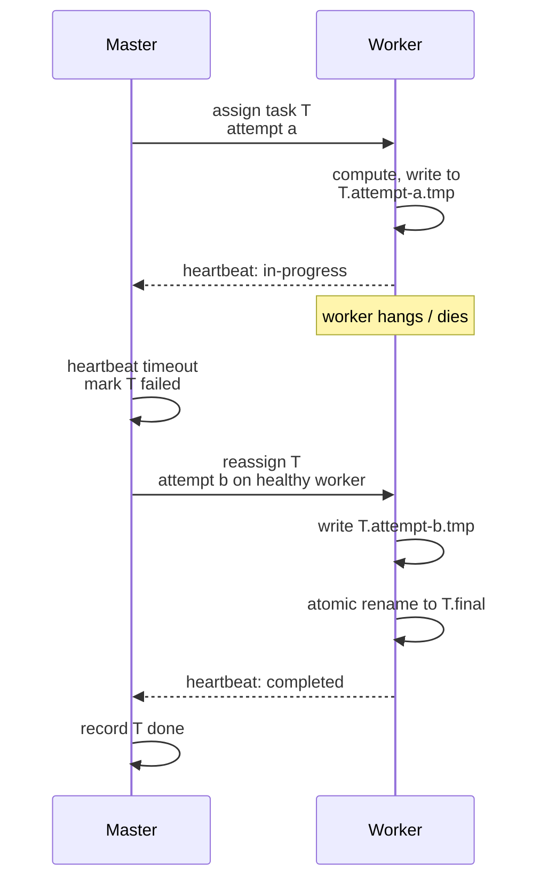
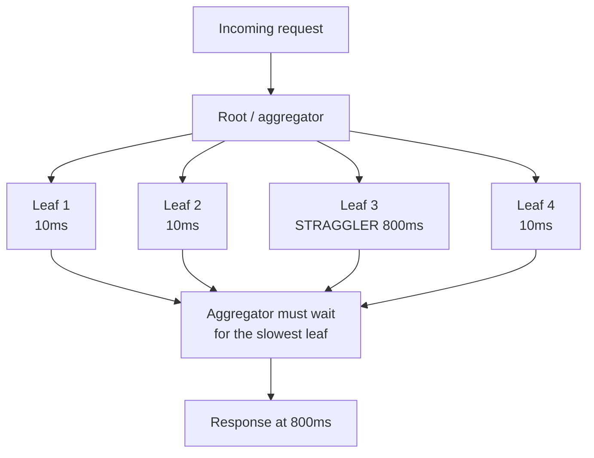
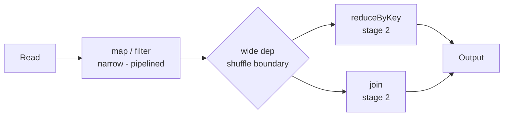
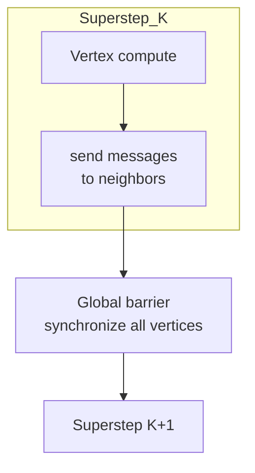
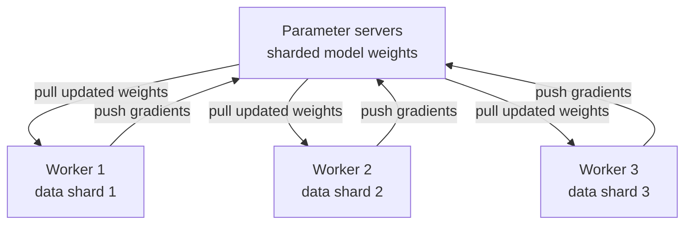
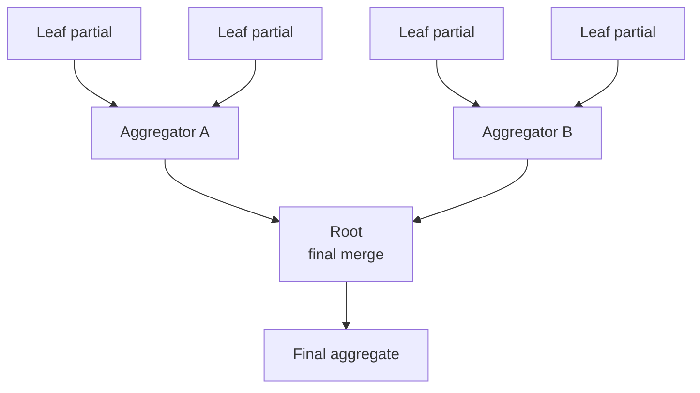
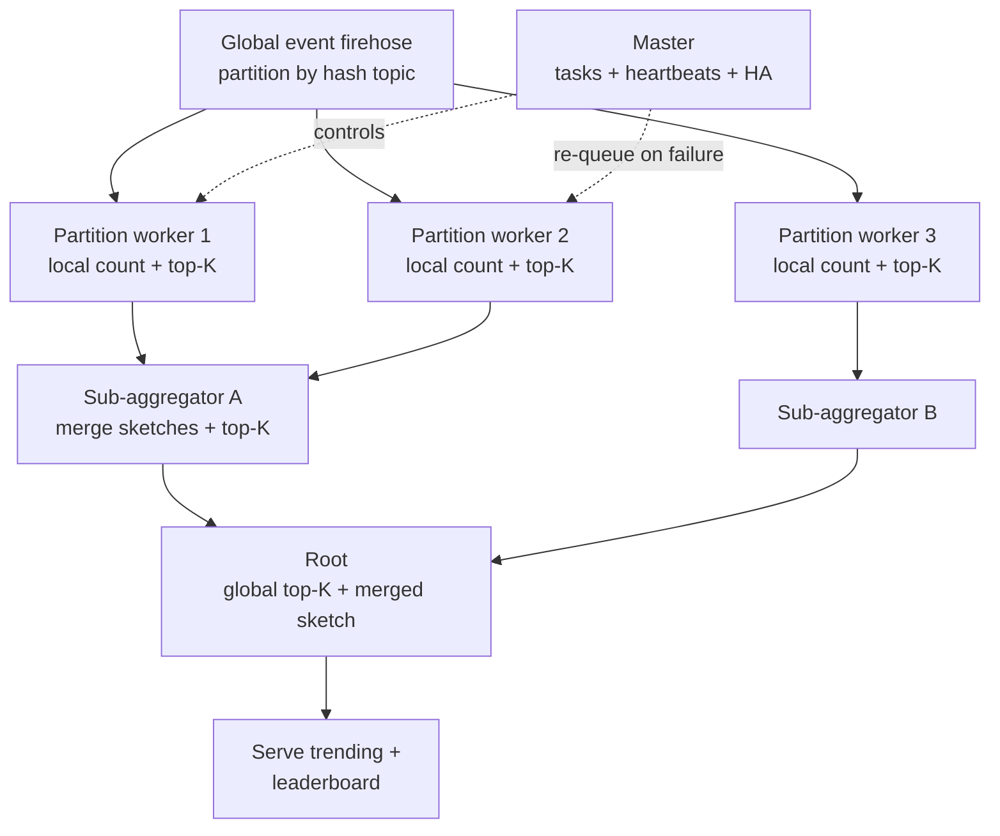

# 23 — Distributed Computation: Distributing Work Across Many Machines, From Scratch

> *"Typically there will be questions around distributing a computation over multiple machines — be prepared to think about this."* — Google EM prep guidance.

This is the MapReduce heritage talking. Google's interviewers want to see whether you can **build the coordination machinery yourself** — not name-drop Spark. This module teaches you to design a distributed computation from first principles: partition the work, distribute it, survive worker death, beat the stragglers, and aggregate the answer.

## What you'll master

- The **core decomposition**: data partitioning, task partitioning, the master/workers pattern, work distribution, result aggregation.
- **MapReduce from scratch** — map, the **shuffle** (the genuinely hard part), reduce, the master's role, combiners, **idempotent re-execution on worker crash**, **speculative/backup tasks for stragglers**, and data locality.
- **Worker coordination & fault tolerance** — heartbeats, failure detection, task reassignment, idempotency, exactly-once via atomic rename, checkpointing, master failure.
- **Stragglers & tail latency** — why the slowest worker dominates fan-out, the p99 amplification math, hedged requests.
- **Beyond MapReduce** — DAG engines, stream vs batch, BSP/Pregel for graphs, scatter-gather, parameter servers.
- **Distributed aggregation** — tree aggregation, partial aggregates, sketches (HLL) to avoid the shuffle, top-K across shards.
- A **live worked design**: building an inverted index / trending topics / a global leaderboard end-to-end.

The four things Google actually grades here: **master+workers**, **the shuffle**, **idempotent re-execution on failure**, **straggler mitigation**. Everything below keeps circling back to those four.

---

## Table of Contents

1. [In the Room — Distributing Work From First Principles](#in-the-room--distributing-work-from-first-principles)
2. [The Core Problem — Partition, Distribute, Aggregate](#the-core-problem--partition-distribute-aggregate)
3. [MapReduce From Scratch](#mapreduce-from-scratch)
4. [Coordination & Fault Tolerance of Workers](#coordination--fault-tolerance-of-workers)
5. [Stragglers & Tail Latency in Fan-Out](#stragglers--tail-latency-in-fan-out)
6. [Beyond MapReduce — DAGs, Streams, Graphs, Parameter Servers](#beyond-mapreduce--dags-streams-graphs-parameter-servers)
7. [Distributed Aggregation Patterns](#distributed-aggregation-patterns)
8. [Designing a Distributed Computation Live](#designing-a-distributed-computation-live)
9. [Interview Cheat-Sheet](#interview-cheat-sheet)
10. [Common Interview Questions](#common-interview-questions)

Cross-links: [Google Papers](22-google-papers.md) · [Build From Scratch](21-build-from-scratch.md) · [Data Processing](16-data-processing.md) · [Distributed Systems](02-distributed-systems.md) · [Messaging](04-messaging-event-driven.md)

---

## In the Room — Distributing Work From First Principles

When the interviewer says *"now imagine this computation is too big for one machine — how do you spread it across a thousand?"*, they are not asking you to recite a tool. They are asking you to **invent the coordination layer**. The strongest candidates build it; weaker ones say "I'd use Spark" and stop.

**The decisive phrasing pattern.** Open by naming the tool, then immediately pivot to the machinery:

> *"In production I'd reach for Spark or a managed Dataflow pipeline — but let me show you the machinery underneath, because that's where the design decisions actually live. I need to partition the input, run a coordinator that hands out tasks and tracks them, make every task idempotent so I can re-run it on failure, aggregate the partial results, and mitigate stragglers. Let me build each piece."*

That single sentence tells the interviewer you know the tool exists **and** you can rebuild it. That's the EM signal.

**Altitude.** As an EM candidate you must move fluidly between two heights:

- **High:** "There's a coordinator and a fleet of workers. Input is partitioned, work is fanned out, results are aggregated." (One breath. Sets the frame.)
- **Low:** "When a worker stops heartbeating for 30 seconds the master marks its in-flight tasks as failed and re-queues them on healthy workers. This is safe because tasks write to a per-attempt temp file and atomically rename on success, so a re-run never corrupts committed output." (The detail that proves you've built distributed systems.)

You earn the right to drop to low altitude by first establishing high altitude. Don't start in the weeds.

**Detect-and-defend-failure for workers — your default reflex.** Any time you place a worker on the whiteboard, immediately ask aloud: *"What happens when this one dies mid-task?"* Then answer it: heartbeat times out → master re-queues the task → idempotent design means re-execution is safe → atomic commit means no duplicate output. Internalize this loop. In a 1000-machine job, **something is always failing** — failure is the steady state, not the exception.

**The four-beat answer to "distribute this computation."** Whatever the specific problem, structure your answer as:

1. **Partition** the work (how do I split it, and what's the partition key?).
2. **Coordinate** (master assigns tasks, tracks state, detects failure).
3. **Execute idempotently** (re-runnable tasks, atomic commit, exactly-once *results*).
4. **Aggregate + defend tail** (combine partials, kill stragglers with backup tasks).

Memorize those four words: **Partition, Coordinate, Execute, Aggregate.** They are the skeleton of every answer in this module.

> **Staff-level insight:** The phrase that flips the interviewer's grade from "senior" to "staff/EM" is *"failure is the common case here, not the exception."* At 1,000 machines with a 3-year MTBF each, you lose a machine roughly every day — and a multi-hour job will almost certainly span at least one failure. If your design only works when nothing breaks, you haven't designed a distributed computation; you've designed a demo. Lead with the failure model, not as a follow-up.

---

## The Core Problem — Partition, Distribute, Aggregate

**Definition.** A distributed computation takes a job too large for one machine, splits it into independent (or loosely coupled) units of work, runs those units in parallel across a fleet, and combines the partial results into a final answer. The art is in *how you split*, *who hands out the work*, and *how you recombine*.

**How it works.** Two orthogonal kinds of partitioning:

- **Data partitioning** — split the *input* across machines.
  - **Range partitioning:** keys `[a–f]` to shard 1, `[g–m]` to shard 2, etc. Great for range scans and ordered output; risks hot ranges (skew).
  - **Hash partitioning:** `shard = hash(key) % N`. Even spread, no ordering. The workhorse. (Use **consistent hashing** when `N` changes so you don't reshuffle everything — see [Distributed Systems](02-distributed-systems.md).)
- **Task partitioning** — split the *computation* into stages/tasks (map tasks, reduce tasks, DAG vertices). Often `#tasks >> #machines` so the scheduler can load-balance and recover failed tasks cheaply.

**The master/workers topology.** A single logical **coordinator** (master/driver/job-tracker) owns the *control plane*: it knows the task list, assigns tasks to workers, tracks their state (idle → in-progress → complete), detects failures, and triggers re-execution. **Workers** own the *data plane*: they pull a task, do the heavy compute, and report back. Keep the master off the data path — it should move metadata, not gigabytes.



**Work distribution models — push vs pull:**

| Model | How | Pros | Cons |
|---|---|---|---|
| **Push** (master assigns) | Master picks worker per task | Master controls locality, load | Master must track worker capacity; can overload |
| **Pull** (worker requests) | Idle worker asks for next task | Natural load-balancing, self-throttling | Master needs a shared task queue; less locality control |
| **Work-stealing** | Idle workers steal from busy queues | Excellent tail behavior | More coordination complexity |

Most batch frameworks use **pull** (workers ask the master/queue for work) precisely because it self-balances stragglers: fast workers naturally grab more tasks.

**Result aggregation** is itself a distributed problem. If 1,000 workers each produce a partial sum, you don't ship all 1,000 to one node — you build a **tree** (covered in [Distributed Aggregation](#distributed-aggregation-patterns)).

**Pitfalls.**
- **Skew.** One partition is 100× the others → one worker runs forever while 999 idle. Mitigate with salting, finer partitioning, or skew-aware splits.
- **Single fat aggregator.** Funneling all partials to one node recreates the bottleneck you just escaped. Aggregate hierarchically.
- **Master as data path.** If results flow *through* the master, it becomes the bottleneck. Master moves control, not payload.
- **Too few tasks.** `#tasks == #machines` makes recovery expensive (a failure re-runs 1/N of the job) and load-balancing impossible. Over-partition.

> **Staff-level insight:** Always pick `#tasks` to be much larger than `#machines` — Google's MapReduce paper runs ~200,000 map tasks and ~5,000 reduce tasks on ~2,000 machines. Fine-grained tasks give you three free wins: (1) failures re-run a *small* unit, (2) the scheduler can balance load dynamically, and (3) you can pipeline locality-aware scheduling. "How many tasks?" is a real design lever, not an implementation detail — say so out loud.

---

## MapReduce From Scratch

**Definition.** MapReduce is a programming model + execution framework where you express a computation as two pure functions — `map(k1, v1) -> list(k2, v2)` and `reduce(k2, list(v2)) -> list(v3)` — and the framework handles partitioning, parallelization, the shuffle, fault tolerance, and stragglers. You write two functions; the framework distributes them over thousands of machines.

**How it works — the three phases plus the master.**

1. **Map phase.** Input is split into `M` chunks (~16–64 MB each, GFS-block sized). Each map task reads a chunk, runs `map()` on every record, and emits intermediate `(key, value)` pairs. These are buffered in memory, periodically spilled to the **local disk** of the map worker, partitioned into `R` regions by `partition(key) = hash(key) % R`.
2. **The shuffle — the hard part.** Every reduce task `r` must collect *all* intermediate pairs with `partition(key) == r`, scattered across *every* map worker's local disk. This is an all-to-all data movement: `M × R` transfers. Reduce workers **pull** their partition from each map worker over the network, then **sort** the merged stream by key so all values for a key are adjacent. The shuffle is where the network bytes, the disk I/O, and most of the wall-clock time go.
3. **Reduce phase.** For each distinct key, the reduce task calls `reduce(key, [values...])` and writes output to a final file (one per reduce task) — typically in [GFS](22-google-papers.md).

**The master's role.** The master is the brain of the control plane:
- Holds the state of every map and reduce task: `idle | in-progress | completed`.
- Assigns idle tasks to idle workers, preferring **data locality** (schedule a map task on the machine that holds its input block, or a machine on the same rack — this is the "move compute to data" principle that saves enormous network bandwidth).
- Stores, for each completed map task, the **locations and sizes** of its `R` intermediate files, and pushes these to in-progress reduce workers so they know where to pull from.
- Pings workers (heartbeats) and re-executes tasks on failed machines.



**The combiner — shrink the shuffle.** When the reduce is commutative and associative (sum, count, max), run a **combiner** on the map side: pre-aggregate the map output *before* it crosses the network. In word count, a map task that sees `the` 10,000 times emits `(the, 10000)` instead of 10,000 copies of `(the, 1)`. The combiner is often literally the reduce function applied locally. This can cut shuffle volume by orders of magnitude — it is the single most important MapReduce optimization to mention.

**Worked example — inverted index across a billion docs.**

- **Map:** `map(docId, docText)` → for each unique word `w` in the doc, emit `(w, docId)`. (Optionally `(w, (docId, position))` for phrase queries.)
- **Combiner:** within a map task, collapse to `(w, [docId1, docId2, ...])` to reduce shuffle.
- **Shuffle:** all postings for word `w` land on the same reduce task (`hash(w) % R`).
- **Reduce:** `reduce(w, [docIds...])` → sort + dedupe → write the **postings list** for `w`: `w -> [sorted docIds]`. That's the inverted index.

For **word count** the only changes: map emits `(word, 1)`, combiner sums per task, reduce sums the list. Same skeleton.

**How it handles a worker crash — re-execute idempotent tasks.** This is the part Google grades hardest.

- **Map worker fails:** *all* its map tasks (completed *and* in-progress) are re-executed, because completed map output lives on the *failed machine's local disk* and is now unreachable. The master resets them to `idle` and reschedules. Reduce tasks that hadn't yet read from the failed mapper are notified of the new location.
- **Reduce worker fails:** only its *in-progress* reduce tasks re-run — *completed* reduce output is already safely in GFS (global storage), so it survives.
- **Why re-execution is safe:** map and reduce are **pure/idempotent** functions of their input, and output is committed via **atomic rename** (write to a temp file, rename on completion). A re-run produces the same bytes; the rename is atomic so you never see partial or duplicated committed output. This is how MapReduce gives **exactly-once semantics on the *output*** despite running tasks *at-least-once*.

**Stragglers + backup/speculative execution.** A "straggler" is a task that runs abnormally slowly (bad disk, CPU contention, a buggy machine). Because the job isn't done until the *last* task finishes, one straggler can extend the whole job. The fix: when the job is near completion, the master **speculatively launches backup copies** of the still-running tasks on other machines. Whichever copy finishes first wins; the master cancels the rest (safe, because tasks are idempotent and commit atomically). Google reported backup tasks cutting a sort job's completion time by ~44%. **Always mention backup tasks** — it's a top-4 grading point.

**Data locality — move compute to data.** Network bandwidth is the scarce resource. The master schedules map tasks on (or near) the machine that already holds the input block on local disk, so most reads are local and never touch the network. This is a recurring distributed-systems theme: **ship the code to the data, not the data to the code.**

| MapReduce design choice | Why |
|---|---|
| Map output on **local** disk | Cheap, no replication needed; lost output just gets recomputed |
| Reduce output on **global** GFS | Durable final result; survives worker death |
| `M >> machines`, `R` tunable | Load balancing + cheap recovery |
| Combiner | Slashes shuffle bytes for assoc/commut reduces |
| Atomic rename commit | Exactly-once output from at-least-once execution |
| Backup tasks | Bounds tail latency from stragglers |
| Locality scheduling | Conserves network bandwidth |

**Pitfalls.**
- **Shuffle is the bottleneck**, not map or reduce — it's all-to-all network + disk. Combiners and locality are your levers.
- **Reduce skew:** one hot key (e.g., the word `the`) sends a giant postings list to one reduce task. Combiners help; secondary partitioning or a custom partitioner helps more.
- **Forgetting the local-disk-loss subtlety:** completed map output is *not* durable. Candidates who say "completed tasks never re-run" are wrong for the map side.
- **Two disk round-trips per job:** MR writes to disk between map and reduce, and between chained jobs. Iterative algorithms (PageRank, ML) pay this repeatedly — the motivation for Spark.

> **Staff-level insight:** The single most underrated sentence you can say is: *"MapReduce gives exactly-once **output** semantics by running tasks **at-least-once** and committing via atomic rename."* It shows you understand the precise contract — the framework doesn't prevent a task from running twice; it makes running twice *harmless*. That decoupling (cheap at-least-once execution + idempotent atomic commit = exactly-once result) is the deepest idea in the whole paper, and it generalizes to every distributed system you'll ever design.

---

## Coordination & Fault Tolerance of Workers

**Definition.** The mechanisms by which the master knows which workers are alive, detects failures quickly, reassigns lost work, and guarantees the final result is correct despite tasks running more than once.

**How it works.**

- **Heartbeats.** Each worker periodically pings the master (e.g., every few seconds). The heartbeat doubles as the channel for task assignment (master replies with "here's your next task") and progress reporting. If no heartbeat for a timeout window (e.g., 30–60 s), the worker is **presumed dead**.
- **Failure detection.** Pure timeouts can't distinguish a *dead* worker from a *slow/partitioned* one (the fundamental limit — see [Distributed Systems](02-distributed-systems.md)). So you design for the case where you re-run a task on a worker that was merely slow and is *still running it*. That's why idempotency + atomic commit are non-negotiable.
- **Task reassignment.** On suspected failure, the master moves that worker's in-flight tasks back to `idle` and reschedules them on healthy workers. (For map tasks, also re-run completed ones if their output was local — see previous section.)
- **Idempotency of tasks.** A task must be a deterministic function of its input that can run any number of times with the same committed effect. Achieve this with: pure compute, no in-place mutation, deterministic partitioning, and side-effects funneled through an idempotent commit.
- **Exactly-once results via atomic commit/rename.** Each task attempt writes to a **unique temp path** (`output-r-00007.attempt-3.tmp`). On success, it does an **atomic rename** to the canonical name. The filesystem's atomic rename is the linearization point: only one attempt's bytes ever become "the output." Two concurrent attempts (slow-but-alive + backup) race on the rename; the loser's temp file is garbage-collected. Result: exactly-once output.



- **Checkpointing long jobs.** For multi-hour jobs (or iterative DAGs), periodically persist intermediate state to durable storage so a failure doesn't restart from zero. Spark does this via **lineage** (recompute lost partitions from their parent RDDs) plus optional checkpointing to break long lineage chains. Stream processors (Flink) use **distributed snapshots** (Chandy–Lamport) to checkpoint operator state consistently.
- **Handling master failure.** The master is the single brain — its death is the scariest case. Options:
  - **Checkpoint master state** periodically; on failure, restart from the last checkpoint (original MapReduce just aborted and restarted the whole job, since master failure was rare with a single master).
  - **Standby master + consensus.** Run the master's metadata in a replicated state machine (Raft/Paxos, or on top of ZooKeeper/Chubby) so a hot standby can take over without losing task state. This is the modern approach (e.g., YARN ResourceManager HA, Spark driver HA via cluster manager). See [Distributed Systems](02-distributed-systems.md) for consensus.

| Failure | Detection | Recovery | Why correct |
|---|---|---|---|
| Worker crash (in-progress) | Heartbeat timeout | Re-queue task | Idempotent + atomic commit |
| Map worker crash (completed) | Heartbeat timeout | Re-run map (local output lost) | Reduce re-reads new location |
| Slow/partitioned worker | Timeout (false positive possible) | Re-run; both may complete | Atomic rename picks one winner |
| Reduce worker crash (completed) | n/a | Nothing — output in GFS | Output already durable |
| Master crash | Standby / external monitor | Restart from checkpoint or HA failover | Persisted task state |

**Pitfalls.**
- **Non-idempotent side effects.** A task that does `counter += 1` in an external DB, or sends an email, breaks under re-execution. Route side effects through idempotent writes (upsert by key) or a dedup/transactional outbox — see [Messaging](04-messaging-event-driven.md).
- **Timeout too aggressive** → healthy-but-slow workers get killed, wasting work and worsening tail. Too lax → slow failure detection stalls the job. Tune it.
- **Master is a SPOF** if you don't plan its recovery. Even saying "single master, restart-on-fail, acceptable because failure is rare and recovery is minutes" is a defensible answer — *as long as you name the tradeoff*.
- **Forgetting the two-writers race.** If you don't commit atomically, a backup task and the original can both write the "final" file and corrupt it.

> **Staff-level insight:** You cannot reliably tell "dead" from "slow" in an asynchronous network — that's a theorem (FLP), not an engineering gap. So the correct mental model is: **never try to prevent double execution; make it harmless.** Design every task so running it N times has the same committed effect as running it once, and let an atomic commit point linearize the winners. Candidates who try to build perfect failure detection are solving the wrong problem; candidates who embrace at-least-once + idempotency are designing like Google.

---

## Stragglers & Tail Latency in Fan-Out

**Definition.** In any fan-out computation, the job/request is only complete when the *slowest* component finishes. A "straggler" is that slow component. Because you wait for the max, tail latency — not median — governs your completion time.

**How it works — the p99 amplification math.** Suppose a request fans out to `N` independent workers, each with a 1% chance (p99) of being slow (say, taking 1 s instead of 10 ms). The probability that **at least one** of the `N` is slow is:

```
P(slow request) = 1 - (1 - 0.01)^N
```

| Fan-out N | P(at least one slow) |
|---|---|
| 1 | 1% |
| 10 | ~9.6% |
| 50 | ~39.5% |
| 100 | ~63.4% |
| 200 | ~86.6% |

So at a fan-out of 100, a per-worker p99 of 1% becomes a **~63% chance the overall request is slow.** Your service-level tail is dominated by fan-out width, not by any single worker's typical speed. This is *the* reason Google obsesses over tail latency.



**Mitigations — the toolkit:**

- **Backup / speculative tasks (batch).** Launch a duplicate of a slow task; take the first to finish. (MapReduce's straggler fix.)
- **Hedged requests (online/interactive).** Send the request to a second replica after a brief delay (e.g., after the 95th-percentile expected latency), use whichever responds first, cancel the other. Cheap (only the slow tail gets duplicated) and dramatically cuts p99. From Dean & Barroso, *The Tail at Scale*.
- **Tied requests.** Send to two replicas simultaneously, each telling the other "I've started this" so the loser drops it early — even tighter than hedging.
- **Reduce fan-out width / partition count** where the answer permits (tradeoff: less parallelism).
- **Micro-partitioning + work-stealing.** Many small tasks let fast workers absorb load that would otherwise pile behind a straggler.
- **Quorum / "good enough" responses.** If you can answer from `K of N` leaves (approximate or partial results acceptable), return as soon as the quorum responds and let stragglers drop — covered in aggregation below.

| Technique | Domain | Cost | Effect |
|---|---|---|---|
| Backup tasks | Batch | Extra compute near job end | Cuts batch tail (~44% in MR sort) |
| Hedged requests | Online | ~5% extra load (tail only) | Slashes p99/p999 |
| Tied requests | Online | Slightly more than hedge | Even tighter tail |
| Quorum / partial | Online + batch | Lose some accuracy/completeness | Bounds latency hard |

**Pitfalls.**
- **Hedging everything** = 2× load. Only hedge the *tail* (start the second request after a deadline), or you melt your fleet.
- **Backup tasks without idempotency** corrupt output (two writers). Same atomic-commit requirement as failure recovery.
- **Ignoring correlated stragglers.** If all your leaves hit the same overloaded shared resource (a hot lock, a saturated NIC, GC pauses fleet-wide), hedging just moves the load around. Fix the root cause.
- **Measuring the mean.** Mean latency hides the tail. Always reason in p99/p999 for fan-out systems.

> **Staff-level insight:** Stragglers are not a bug to be eliminated — at scale they are statistically *guaranteed* (GC pauses, queueing, shared-resource contention, the occasional bad disk). The senior move is to design the system to *tolerate* slowness rather than prevent it: make work re-runnable, hedge the tail, and accept approximate/partial answers when latency matters more than completeness. "The tail at scale is a property of the system, not a defect in any one machine" is a sentence that lands in an EM interview.

---

## Beyond MapReduce — DAGs, Streams, Graphs, Parameter Servers

You should know *why* the field moved past MapReduce and what replaced it — from first principles. For tool selection, cross-link [Data Processing](16-data-processing.md).

### DAG engines (Spark)

**Definition.** Express the computation as a **directed acyclic graph** of transformations over distributed, immutable datasets (RDDs/DataFrames). The engine pipelines stages, keeps intermediate data **in memory**, and recovers lost partitions via **lineage** (recompute from parents) instead of replication.

**Why it beats MapReduce:** MR writes to disk between *every* map→reduce boundary and between chained jobs. A DAG engine fuses narrow transformations into a single stage (no shuffle, no disk) and only materializes/shuffles at wide dependencies. Iterative jobs (PageRank, ML training, graph algorithms) that would be N chained MR jobs — paying 2N disk round-trips — run in-memory. This is the **disk-round-trip elimination** that makes Spark 10–100× faster on iterative workloads.



The shuffle still exists at wide dependencies — the hard part doesn't disappear, it just happens less often and stays in memory longer.

### Stream vs batch (unbounded data)

**Definition.** Batch processes a *bounded* dataset to completion. Stream processes an *unbounded* dataset continuously, emitting incremental results. For never-ending input (clickstreams, logs, sensors) you can't "wait for all the data" — you process per-event or per-window.

Key machinery: **windowing** (tumbling/sliding/session), **event-time vs processing-time** with **watermarks** for late data, and **checkpointed state** for exactly-once. Same core problems as batch — partition, coordinate, fault-tolerance, aggregate — but with the data never ending. See [Data Processing](16-data-processing.md) and [Messaging](04-messaging-event-driven.md).

### BSP / Pregel for graphs (PageRank)

**Definition.** Bulk Synchronous Parallel: computation proceeds in **supersteps**. In each superstep every vertex (a) receives messages from the previous superstep, (b) updates its state, (c) sends messages to neighbors; then a global **barrier** synchronizes before the next superstep. Pregel is Google's "think like a vertex" graph engine.

PageRank in Pregel: each superstep, every vertex distributes its current rank across its out-edges; the next superstep each vertex sums incoming contributions and recomputes its rank. Repeat until convergence. This avoids MapReduce's repeated full-graph disk shuffles for iterative graph algorithms.



### Scatter-gather

**Definition.** A request is *scattered* to many shards/leaves in parallel; each returns a partial; a root *gathers* and combines them. It's the online (low-latency) cousin of fan-out — exactly the topology in the stragglers section. Search ("query 1000 index shards, merge top results"), distributed query engines, and microservice aggregators all use it. Defend its tail with hedging.

### Parameter server (distributed ML)

**Definition.** For training a model too big or data too large for one machine: **worker nodes** each hold a data shard and compute gradients; **parameter-server nodes** hold the (sharded) model parameters. Workers pull current parameters, compute gradients on their batch, push gradients back; the server aggregates and updates. It's a specialized scatter-gather where the "aggregate" is gradient summation and the loop runs for many iterations.



| Engine | Best for | Key idea | Weakness |
|---|---|---|---|
| MapReduce | One-pass batch, huge data | Disk-durable, simple, bulletproof recovery | Slow on iterative (disk round-trips) |
| Spark / DAG | Multi-stage + iterative batch | In-memory DAG, lineage recovery | Memory pressure; still shuffles |
| Stream (Flink/Beam) | Unbounded, low-latency | Windows + watermarks + checkpoints | Operational complexity, state mgmt |
| Pregel / BSP | Iterative graph algorithms | Think-like-a-vertex, supersteps | Synchronization barrier overhead |
| Parameter server | Large-scale ML training | Sharded weights + gradient aggregation | Stragglers stall sync updates |

**Pitfalls.**
- Reaching for streaming when a nightly batch would do (or vice versa) — match the engine to bounded vs unbounded and latency needs.
- Spark OOM from caching too much / huge shuffles — memory is finite; it's not magic.
- BSP barrier means the slowest vertex per superstep stalls everyone — stragglers bite graph engines too.

> **Staff-level insight:** Don't present these as five unrelated tools — present them as the **same four-beat skeleton (partition, coordinate, execute, aggregate) with different knobs**. Spark = MapReduce with the disk round-trips removed and a DAG scheduler. Pregel = the same fault-tolerant fan-out but iterated with a barrier. Parameter server = scatter-gather where the gather is "sum the gradients." Streaming = the same, but the input never ends. Showing you see the shared skeleton beneath the tools is exactly the abstraction-level thinking Google grades in EMs.

---

## Distributed Aggregation Patterns

**Definition.** Techniques to combine partial results from many workers *without* recreating a single-machine bottleneck or doing a full expensive shuffle.

**How it works.**

- **Tree / hierarchical aggregation.** Instead of 1,000 workers reporting to one aggregator (`O(N)` fan-in into one node), build a tree: leaves → intermediate aggregators → root. Aggregation cost spreads across the tree; depth is `O(log N)`. This is how you sum, count, or merge across a huge fleet without a fat funnel.
- **Combiners / partial aggregates.** Pre-aggregate locally before sending (the MapReduce combiner). Only works for **commutative + associative** operations (sum, count, min, max, and — with care — average via (sum, count) pairs). Slashes the data crossing the network.
- **Approximate aggregation with sketches.** For cardinality ("how many *distinct* users?"), an exact count requires a full shuffle/dedup. A **HyperLogLog (HLL)** sketch estimates distinct count in ~12 KB with ~0.8% error (m=16,384 registers, standard error 1.04/√m), and sketches are **mergeable** — combine per-shard HLLs by taking element-wise max of registers, no shuffle of raw data. Similar mergeable sketches: **Count-Min** (frequency), **t-digest / KLL** (quantiles), **Bloom filters** (membership). This is the single best trick to *avoid the shuffle entirely* when an approximate answer is acceptable.
- **Top-K across shards.** To get the global top-K, each shard returns its **local top-K**; the root merges the `N×K` candidates and takes the global top-K. Correct because a globally top-K item must be top-K on at least one shard *for sum-decomposable scores* — be careful: for some scoring functions you need each shard to return more than K, or a second round. State the assumption.



| Pattern | Use when | Wins | Watch out |
|---|---|---|---|
| Tree aggregation | Large fan-in | No fat funnel, O(log N) depth | Tree node failure mid-aggregate |
| Combiner / partial agg | Assoc + commut reduce | Massive shuffle reduction | Must be assoc+commut |
| HLL / sketches | Distinct count, quantiles, heavy hitters | Avoids full shuffle; tiny + mergeable | Bounded error; not exact |
| Local top-K merge | Global ranking | Cheap fan-in | Score must be shard-decomposable |

**Pitfalls.**
- Using a combiner for a **non-associative** op (e.g., median, exact distinct) → wrong answer. Average needs `(sum, count)` not a naive mean-of-means.
- **Exact distinct count** at scale forces a shuffle; if the interviewer says "approximate is fine," reach for HLL immediately and name the sub-1% error budget (~0.8% at ~12 KB).
- **Top-K with non-decomposable scores** (e.g., TF-IDF where IDF is global) needs a global stat first or a multi-round protocol — don't claim local top-K always works.
- Tree aggregation needs its own failure handling — an aggregator node dying loses a subtree's partials unless they're recomputable.

> **Staff-level insight:** The highest-leverage realization in distributed aggregation is: **if the question tolerates an approximate answer, you can often skip the shuffle entirely.** "How many distinct users hit the site today?" with exact semantics = a massive shuffle/sort. With HLL = each shard keeps a few-KB sketch, you merge sketches in a tree, done — at a fraction of the cost. Asking the interviewer *"does this need to be exact, or is a 2% error acceptable?"* is a staff-level clarifying question because the answer changes the entire architecture from shuffle-heavy to shuffle-free.

---

## Designing a Distributed Computation Live

Let's run the **four-beat skeleton** end-to-end on a real prompt. The interviewer says: *"Build a system that computes trending topics across a global social feed — and also serves a real-time global leaderboard. How do you distribute it?"* (The same skeleton builds an inverted index over the web — noted inline.)

### Step 0 — Clarify (10 seconds, then move)

- Exact vs approximate? *"For trending and leaderboards, approximate top-K is fine — that unlocks sketches and lets me skip the full shuffle."*
- Batch refresh or streaming? *"I'll do a streaming pipeline for freshness with a batch backstop for correctness — lambda-ish."*
- Window? *"Trending = top topics in a sliding 1-hour window, refreshed every minute."*

### Step 1 — Partition

- **Input:** the firehose of post/engagement events, partitioned by **hash(topic)** so all events for a given topic/hashtag land on the same partition (and the same worker). This makes per-topic counting local. (Inverted index: partition the doc corpus into 64 MB splits; map tasks process splits with **data locality**.)
- **Tasks:** many fine-grained tasks (`#tasks >> #workers`) for load balancing and cheap recovery.

### Step 2 — Coordinate

- A **master/coordinator** holds the task list and worker state, assigns partitions to workers, prefers **data locality**, tracks heartbeats, and re-queues tasks from dead workers. Run master metadata on a consensus store (Raft/ZooKeeper) for HA so the master isn't a SPOF.

### Step 3 — Execute (idempotently)

- Each worker, per topic in its partition, maintains a **windowed count sketch** (Count-Min for frequency / a decaying counter for the sliding window) and a **local top-K** heap. For the leaderboard, each shard keeps the **local top-K** scores.
- Tasks are **idempotent**: window state is keyed by `(topic, window)`; reprocessing the same events yields the same counts (use event IDs to dedupe at-least-once delivery — see [Messaging](04-messaging-event-driven.md)). Output is committed via **atomic write** of the window's result.
- **Failure handling:** worker dies → heartbeat timeout → master re-queues its partition's tasks → idempotent replay from the durable event log (Kafka offsets / checkpoint) rebuilds the same window state → atomic commit prevents double-counted output.

### Step 4 — Aggregate + defend the tail

- **Tree aggregation:** per-partition local top-K and sketches roll up through intermediate aggregators to a root. The root **merges Count-Min sketches** (additive) and **merges local top-K lists** into a global top-K. No full shuffle of raw events — only compact partials cross the network.
- **Approximate by design:** HLL for "distinct users discussing a topic," Count-Min for frequency — mergeable, tiny, shuffle-free.
- **Stragglers:** the root waits on the slowest aggregator. Defend with **hedged requests** to a second replica of a slow sub-aggregator, and accept a **quorum** of partials ("good enough" trending list) if one subtree is late — better a 1-second-stale list than a stalled one.



### What you just demonstrated (say it out loud)

*"That's the full skeleton: I partitioned by topic so counting is local, ran a coordinator that detects worker death by heartbeat and re-queues idempotent tasks against a durable log, aggregated through a tree using mergeable sketches to avoid a full shuffle, and defended the tail with hedging plus a quorum fallback. Exactly-once on the output comes from idempotent replay plus atomic commit. In production this is a Flink or Spark Structured Streaming job — but that's the machinery it's running underneath."*

That closing sentence — name the tool, own the machinery — is the EM landing.

> **Staff-level insight:** Notice the design never funnels raw events to one place and never does a global shuffle — it keeps work local (partition by topic), aggregates hierarchically, and trades exactness for sketches. Those three moves (locality, tree aggregation, approximation) are what let a "global" computation scale horizontally. When you can articulate *why each choice avoids a bottleneck*, you're designing at the altitude Google expects from an Engineering Manager — not just assembling components, but explaining the load and failure properties of each edge on the diagram.

---

## Interview Cheat-Sheet

**The skeleton — say these four words for any "distribute this" question:**
1. **Partition** (hash vs range; input data + tasks; `#tasks >> #machines`).
2. **Coordinate** (master assigns + tracks; heartbeats detect failure; HA master).
3. **Execute idempotently** (re-runnable tasks + atomic rename = exactly-once *output* from at-least-once *execution*).
4. **Aggregate + defend tail** (tree aggregation, combiners, sketches; backup/hedged requests).

**The four things Google grades:**
- **Master + workers** topology (control plane vs data plane — keep master off the data path).
- **The shuffle** — the all-to-all `M×R` data movement; the hard, expensive part; cut it with combiners, locality, and sketches.
- **Idempotent re-execution on failure** — failure is the common case; make double-execution harmless, don't prevent it.
- **Straggler mitigation** — backup tasks (batch), hedged/tied requests (online); the tail dominates fan-out.

**One-liners to deploy:**
- *"I'd reach for Spark, but here's the machinery underneath."*
- *"Failure is the common case at this scale, not the exception."*
- *"At-least-once execution + atomic commit = exactly-once output."*
- *"Move compute to data, not data to compute."*
- *"Does this need to be exact, or is 2% error fine?"* → HLL/sketches, skip the shuffle.
- *"The job finishes when the slowest task finishes — so I hedge the tail."*

**The p99 fan-out math:** `P(slow) = 1 - (1-p)^N`. At N=100, p=1% → ~63% of requests slow. Tail dominates.

**Numbers worth quoting:** MR backup tasks cut a sort job ~44%; combiners can cut shuffle bytes by orders of magnitude; HLL gives distinct count in ~12 KB at ~0.8% error; pick `#tasks >> #machines`.

---

## Common Interview Questions

**1. "Distribute this computation across 1,000 machines — walk me through it."**
Partition the input (hash by key for even spread, or range for ordered output) into many fine-grained tasks; run a coordinator that assigns tasks to workers and tracks their state; make every task idempotent and commit via atomic rename so re-execution is safe; aggregate partials through a tree, not a single funnel; mitigate stragglers with backup tasks. Lead with the failure model — at this scale something is always dying.

**2. "Explain the shuffle in MapReduce. Why is it the hard part?"**
After map, each reduce task needs *all* intermediate pairs for its key partition, scattered across every map worker's local disk — an all-to-all `M×R` network transfer plus a merge-sort by key. It dominates network bytes, disk I/O, and wall-clock. I shrink it with combiners (pre-aggregate associative/commutative reduces on the map side) and locality scheduling, and where an approximate answer is acceptable I use mergeable sketches to skip it entirely.

**3. "A worker dies mid-job. What happens?"**
Heartbeat times out → master marks its in-flight tasks failed and re-queues them on healthy workers. For map workers I also re-run *completed* map tasks because their output sat on the dead machine's local disk; reduce output is already durable in global storage so it survives. Re-execution is safe because tasks are idempotent and commit via atomic rename — running twice has the same committed effect as running once.

**4. "How do you get exactly-once results if tasks can run more than once?"**
I don't prevent double execution — I make it harmless. Tasks run at-least-once; each attempt writes to a unique temp path and atomically renames to the canonical output on success. The atomic rename is the linearization point: exactly one attempt's bytes become the output, losers are garbage-collected. At-least-once execution plus idempotent atomic commit equals exactly-once output. External side effects get routed through idempotent upserts or a dedup key.

**5. "One task runs 50× slower than the rest. What do you do?"**
That's a straggler, and the job finishes only when the last task does. In batch I launch a speculative backup copy on another machine and take whichever finishes first — safe because of idempotency and atomic commit. In an online fan-out I hedge: send to a second replica after a short delay and use the first response. I never hedge everything (that doubles load) — only the tail.

**6. "You fan out to 200 leaves, each with a 1% slow rate. What's your tail?"**
`P(at least one slow) = 1 - 0.99^200 ≈ 87%`. The fan-out width, not any single leaf, governs my tail latency. I'd reduce it with hedged/tied requests, accept a quorum of leaves ("good enough" partial results) when latency matters more than completeness, and attack correlated stragglers (shared hot resource, GC) at the root.

**7. "How would you build an inverted index over a billion web documents?"**
MapReduce: map emits `(word, docId)` per document; a combiner collapses per-task postings to cut shuffle; the shuffle routes all postings for a word to one reduce task by `hash(word) % R`; reduce sorts and dedupes to write each word's postings list. Data-locality scheduling keeps map reads on the machine holding the block. Stragglers get backup tasks; failures re-run idempotent tasks. In production, Spark — but that's the machinery.

**8. "Count distinct users across 1,000 shards without melting the cluster."**
Exact distinct count forces a full shuffle/dedup. If approximate is acceptable — and for analytics it usually is — each shard keeps a HyperLogLog sketch (~12 KB, ~0.8% error). I merge sketches in a tree by taking element-wise max of registers — no raw data crosses the network. I'd ask the interviewer up front whether sub-1% error is acceptable, because that single answer flips the architecture from shuffle-heavy to shuffle-free.

**9. "Why did Spark replace MapReduce for iterative workloads?"**
MapReduce writes to disk between every map→reduce boundary and between chained jobs, so an iterative algorithm like PageRank or ML training pays N rounds of disk round-trips. Spark models the job as an in-memory DAG, pipelines narrow transformations into a single stage, and only materializes/shuffles at wide dependencies — recovering lost partitions via lineage instead of replication. Same four-beat skeleton; the disk round-trips are removed.

**10. "What happens if the master dies?"**
The master is the single brain, so I plan for it explicitly. The simplest defensible answer: single master, checkpoint its task state, restart-on-failure — acceptable when master failure is rare and recovery is minutes. The robust answer: run master metadata on a replicated state machine (Raft/ZooKeeper) with a hot standby that takes over without losing task state. The key is naming the tradeoff rather than leaving the master as an unaddressed SPOF.

---

*Related: [Google Papers](22-google-papers.md) · [Build From Scratch](21-build-from-scratch.md) · [Data Processing](16-data-processing.md) · [Distributed Systems](02-distributed-systems.md) · [Messaging](04-messaging-event-driven.md)*
