# 24 — OS Internals & Concurrency for System Design

> The missing CS-fundamentals layer. Pure system-design prep teaches you *what* to build (sharding, caches, queues); a Google EM interview also probes *why the machine behaves that way* — processes vs threads, locks, scheduling, IO models. This module wires OS internals directly to scaling decisions.

## What you'll master

By the end of this module you will be able to:

- Explain **why thread-per-connection collapses at scale** and what event loops do instead (C10K → C10M).
- Reason about **lock contention as a throughput ceiling** and connect it to the Universal Scalability Law from [Fundamentals](01-fundamentals.md).
- Pick the right **synchronization primitive** (mutex vs spinlock vs semaphore vs RW-lock) and justify it.
- Diagnose **deadlock, livelock, starvation, and priority inversion** — and prevent them.
- Talk credibly about **lock-free programming, CAS, false sharing, NUMA, and memory locality**.
- Size a **thread pool with Little's Law** and choose between thread-pool, actor, CSP, and async/await server models.

---

## Table of Contents

1. [In the Room — Why OS Internals Show Up in System Design](#in-the-room--why-os-internals-show-up-in-system-design)
2. [Processes vs Threads](#1-processes-vs-threads)
3. [Concurrency vs Parallelism](#2-concurrency-vs-parallelism)
4. [Synchronization Primitives](#3-synchronization-primitives)
5. [Deadlock, Livelock, Starvation](#4-deadlock-livelock-starvation)
6. [Lock-Free, Wait-Free & Atomics](#5-lock-free-wait-free--atomics)
7. [CPU Scheduling](#6-cpu-scheduling)
8. [Memory & Caches](#7-memory--caches)
9. [IO Models & the C10K Problem](#8-io-models--the-c10k-problem)
10. [Concurrency Models in Practice](#9-concurrency-models-in-practice)
11. [Interview Cheat-Sheet](#interview-cheat-sheet)
12. [Common Interview Questions](#common-interview-questions)

---

## In the Room — Why OS Internals Show Up in System Design

Most system-design answers live at the box-and-arrow layer: "put a load balancer here, a cache there, shard the DB." A Google EM interview pushes one level down. The interviewer wants to see that you understand the **machine your boxes run on**, because nearly every scaling wall is, at root, an OS-level constraint:

- You propose a server that holds a million WebSocket connections. The interviewer asks: *"How? A thread per connection?"* If you don't know that 1M threads means ~1M × 1–8 MB of stack plus a scheduler drowning in context switches, you can't defend the design. The real answer — an **event loop over epoll** — is an OS-IO-model decision (§8).
- You add more application servers and throughput *doesn't* go up linearly. That's not magic; it's **lock contention** and **coherence traffic** — the very forces the Universal Scalability Law in [Fundamentals](01-fundamentals.md) models as the `α` (contention) and `β` (crosstalk) terms. OS concurrency is the mechanism *behind* the curve.
- You size a thread pool. "Why 200 and not 2000?" The principled answer is **Little's Law** plus a model of whether the work is CPU-bound or IO-bound (§9).
- Your tail latency (p99) spikes under load. Often it's a **scheduling** effect — a slow lock holder blocking a high-priority request (priority inversion, §4), or context-switch thrash, or NUMA-remote memory.

### How to bring it up decisively

Don't lecture. Drop the OS layer exactly when it *changes a decision*:

- "I'd use an event-loop server here rather than thread-per-request, because at 100K concurrent connections the context-switch and memory cost of threads dominates — this is the classic C10K problem."
- "More replicas won't help past a point: there's a shared lock on the sequence generator. Per the USL, that contention term caps throughput and can even bend it downward. I'd remove the shared mutable state."
- "I'll size the pool with Little's Law: at 2 ms/request and 10K RPS target, I need ~20 concurrent slots for CPU work, but for IO-bound work I'd go async instead of inflating threads."

That phrasing signals **staff/EM depth**: you connect a CS fundamental to a concrete architectural choice and a number.

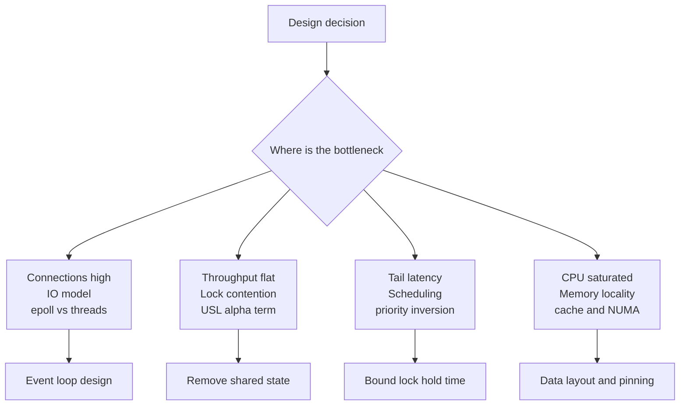

Cross-links you'll lean on: [Fundamentals](01-fundamentals.md) (latency numbers, USL), [Real-Time Systems](09-realtime-systems.md) (WebSockets, C10K), [Reliability](11-reliability.md) (timeouts, bulkheads, failure under contention), [Distributed Systems](02-distributed-systems.md) (the same coordination problems, one network away).

---

## 1. Processes vs Threads

### Definition

A **process** is an OS-managed instance of a running program with its **own virtual address space**, file descriptors, and resources. A **thread** is a unit of execution **inside** a process; all threads of a process **share** the same address space (heap, globals, code) but each has its **own stack and registers**.

### How it works

- **Process creation** on Unix is `fork()` (clone the parent — copy-on-write pages) followed by `exec()` (replace the image with a new program). Isolation is enforced by hardware via per-process page tables.
- **Thread creation** allocates a new stack and a kernel scheduling entity (for native/kernel threads) but reuses the parent's page table — so it's cheaper and communication is just shared memory.
- A **context switch** saves/restores CPU state. Switching *threads in the same process* is cheap-ish (registers + stack pointer). Switching *processes* additionally swaps the page-table root, which **flushes much of the TLB** (§7) — far more expensive.

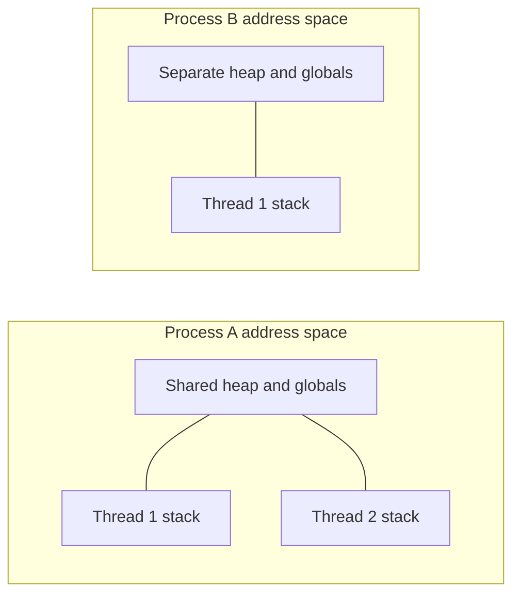

### Green threads, fibers, coroutines

Below kernel threads sits **user-space concurrency**: many logical tasks multiplexed onto few kernel threads by a runtime, not the OS.

- **Green threads / M:N threading** — runtime schedules M user tasks onto N kernel threads (Go goroutines, old JVM green threads, Java Virtual Threads/Loom).
- **Fibers** — cooperatively scheduled; yield explicitly.
- **Coroutines / async-await** — functions that suspend and resume (Python `asyncio`, Kotlin, Rust `async`, C++20 coroutines).

These give you cheap concurrency (a goroutine starts at ~2–8 KB stack vs ~1 MB default for a pthread) **without** a kernel context switch per yield.

### Comparison table

| Aspect | Process | Kernel thread | Green thread / coroutine |
|---|---|---|---|
| Address space | Isolated | Shared | Shared |
| Creation cost | High (fork/exec) | Medium | Very low (KBs) |
| Context-switch cost | Highest (TLB flush) | Medium | Lowest (user-space) |
| Communication | IPC / pipes / sockets | Shared memory | Shared memory |
| Crash blast radius | Isolated (one dies) | Whole process | Whole process |
| Scheduled by | OS | OS | Language runtime |
| Parallelism on multicore | Yes | Yes | Only via underlying kernel threads |

### Real-world relevance

- **Thread-per-connection cost:** A naive server spawns one thread per client. At 10K clients that's ~10 GB of stacks alone and a run queue the scheduler thrashes through — the seed of the C10K problem (§8).
- **Process isolation by design:** Chrome uses **one process per tab/site** so a renderer crash or exploit can't corrupt others. nginx uses **worker processes** (one per core) each running an event loop — combining isolation with low per-connection cost.
- **Postgres** is process-per-connection (robust, isolated) which is *why* you put **PgBouncer** in front: connections are expensive, so you pool them.

### Pitfalls

- Assuming threads are "free" — stack memory and scheduler pressure are real.
- Sharing mutable state across threads without synchronization (data races → §3).
- `fork()` in a multithreaded program: only the calling thread survives in the child; locks held by other threads stay locked forever (classic `fork()`-after-threads deadlock).

> **Staff-level insight:** The choice isn't "process or thread" — it's *what's your unit of isolation vs your unit of concurrency.* Use **processes for fault/security isolation** (blast radius, exploits), **threads for shared-memory parallelism on one box**, and **green threads/coroutines for high-concurrency IO-bound work**. Modern designs mix all three: nginx = processes (isolation) × event loop (concurrency); Go services = OS threads (parallelism) × goroutines (concurrency).

---

## 2. Concurrency vs Parallelism

### Definition

- **Concurrency** = *dealing with* many things at once — structuring a program so multiple tasks are in progress, interleaved, possibly on a single core.
- **Parallelism** = *doing* many things at once — literally executing on multiple cores simultaneously.

Rob Pike's line: *"Concurrency is about structure; parallelism is about execution."* You can have concurrency on one core (an event loop) and you need multiple cores for parallelism.

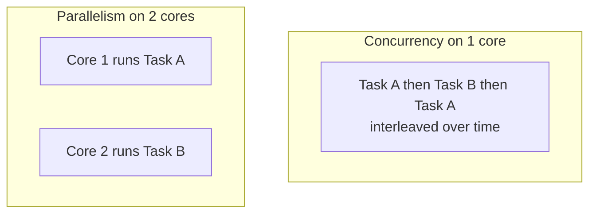

### The Amdahl / USL link

Adding cores has limits:

- **Amdahl's Law:** if a fraction `s` of work is serial, max speedup with `n` cores is `1 / (s + (1 - s)/n)`. Even 5% serial caps you at 20× no matter how many cores.
- **Universal Scalability Law (USL):** the more realistic model from [Fundamentals](01-fundamentals.md). Throughput `C(n) = n / (1 + α(n-1) + βn(n-1))` where `α` = **contention** (waiting on shared resources/locks) and `β` = **crosstalk/coherence** (cores synchronizing, cache-line bouncing). The `βn²` term means throughput can **peak and then *decline*** as you add cores.

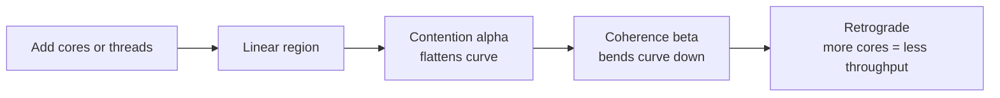

### Why more threads ≠ more throughput

Past the point where threads exceed useful parallel work:

1. **Lock contention** — threads queue on shared locks (the `α` term).
2. **Context-switch overhead** — scheduler spends CPU shuffling threads, not doing work.
3. **Cache thrash / false sharing** — cores invalidate each other's cache lines (the `β` term, §5/§7).

### Comparison table

| | Concurrency | Parallelism |
|---|---|---|
| Goal | Manage many in-flight tasks | Run many at the same instant |
| Needs multiple cores | No | Yes |
| Classic example | Event loop, async IO | SIMD, parallel map-reduce |
| Bottleneck it fights | IO wait / blocking | CPU-bound compute |
| Limiting law | Little's Law (queue depth) | Amdahl / USL |

### Real-world relevance

A web server is **mostly concurrency**: requests spend time waiting on DB/network, so you want many in-flight, not many cores. A video transcoder is **parallelism**: CPU-bound, scales with cores until Amdahl bites. Recognizing which one your workload is determines whether you reach for **async/event-loop** (IO-bound) or **thread/process pool sized to cores** (CPU-bound).

### Pitfalls

- "We'll just add more threads/replicas" without identifying the serial fraction — you hit the USL ceiling and pay for retrograde throughput.
- Benchmarking on one core then assuming linear scaling.

> **Staff-level insight:** When an interviewer says "scale it out," the sharp move is to name the *serial bottleneck* before adding capacity. "Adding app servers won't help because every write hits one Redis `INCR` for the ID — that shared resource is the USL contention term. I'd shard the ID space or use client-side ranges." That's the difference between a Senior answer (add boxes) and a Staff answer (find the `α`).

---

## 3. Synchronization Primitives

### Definition

Mechanisms that coordinate access to shared state so concurrent threads don't corrupt it (data races) or violate invariants. A region needing exclusive access is a **critical section**.

### The primitives

| Primitive | What it guarantees | Blocks or spins | Use when |
|---|---|---|---|
| **Mutex** | Mutual exclusion; one owner | Blocks (sleeps) | General critical sections, possibly long |
| **Spinlock** | Mutual exclusion via busy-wait | Spins (no sleep) | Very short critical sections, in-kernel, low contention |
| **Binary semaphore** | 0/1 signal | Blocks | Signaling between threads (not ownership) |
| **Counting semaphore** | N permits | Blocks | Bounded resource pool (e.g., N DB connections) |
| **Monitor + condition var** | Lock + wait/notify on a predicate | Blocks | "Wait until queue non-empty" style coordination |
| **Read-write lock** | Many readers OR one writer | Blocks | Read-heavy shared data |
| **Barrier** | All N threads reach a point before any proceed | Blocks | Phased parallel computation |

### Busy-wait vs blocking

- **Spinlock (busy-wait):** thread loops checking the lock. **No context-switch cost**, but **burns a CPU core** while waiting. Good only if the critical section is shorter than a context switch (~1–5 µs) and you're on a multicore (spinning on a uniprocessor is pointless — the holder can't run).
- **Mutex (blocking):** thread is **descheduled** and parked; the OS wakes it when the lock frees. Pays a context-switch (~1–10 µs each way) but **frees the core**. Good for longer or contended critical sections. (Many real mutexes — futexes, adaptive mutexes — spin briefly *then* sleep, getting the best of both.)

### How a mutex works (mechanics)

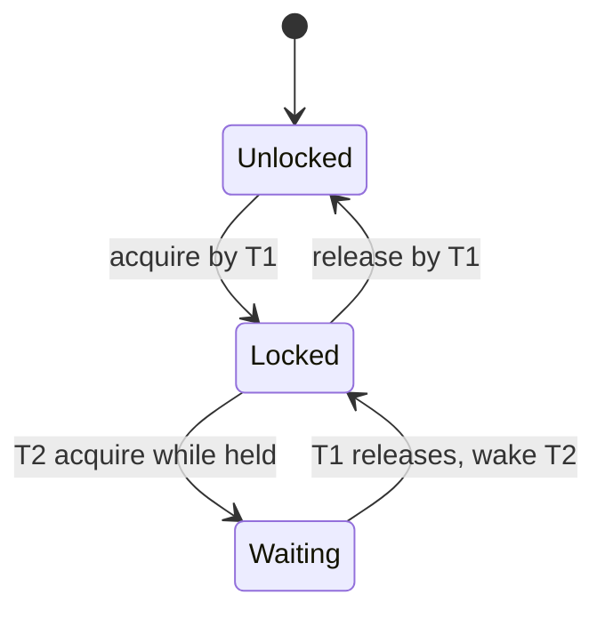

### Worked example — Producer-Consumer with a bounded buffer

Classic problem: producers add items, consumers remove them, buffer capacity = N. We must (a) block producers when full, (b) block consumers when empty, (c) protect the buffer itself. Two **counting semaphores** + one **mutex** solve it.

```
semaphore empty = N      // free slots
semaphore full  = 0      // filled slots
mutex     m              // protects the buffer

producer:                      consumer:
  loop:                          loop:
    item = produce()               wait(full)      // block if empty
    wait(empty)  // block if full  lock(m)
    lock(m)                        item = remove()
    insert(item)                   unlock(m)
    unlock(m)                      signal(empty)   // a slot freed
    signal(full) // an item ready  consume(item)
```

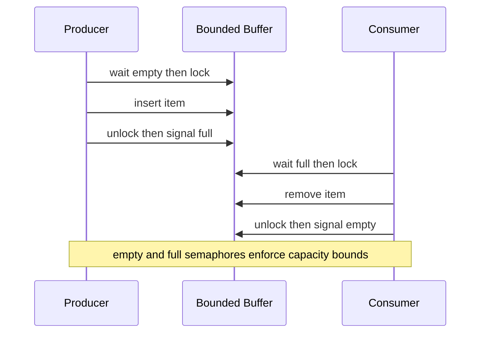

Key insight: **acquire the resource-counting semaphore *before* the mutex**, never the reverse — otherwise a producer could hold the mutex while blocked on a full buffer, deadlocking consumers who need the mutex to drain it.

### Real-world relevance

- A **counting semaphore = a connection pool / rate limiter** (N permits = N concurrent DB connections or N in-flight calls). This is the [Reliability](11-reliability.md) **bulkhead** pattern.
- **RW-locks** back read-heavy caches and config stores.
- **Condition variables** underpin every blocking queue / thread-pool work queue.

### Pitfalls

- **Lost wakeup:** signaling a condition before the waiter is waiting → always check the predicate in a `while` loop, not `if` (guards against spurious wakeups too).
- **Holding a lock across IO** (network/disk) — serializes everything behind a slow operation; a top cause of tail-latency blowups.
- **Reader starvation/writer starvation** with naive RW-locks under skewed load.

> **Staff-level insight:** The primitive matters less than **how long you hold it and what's the contention rate.** A mutex held for 50 ns under 8 threads is fine; the same mutex held across a 20 ms DB call is a throughput catastrophe — it converts your whole service into a single-threaded one for that resource (USL `α → 1`). In design reviews, the question to ask is always *"what's the critical-section duration × contention?"* — that product, not the lock type, predicts the scaling wall.

---

## 4. Deadlock, Livelock, Starvation

### Definition

- **Deadlock:** two+ threads each wait forever for a resource the other holds. Nobody progresses, nobody uses CPU.
- **Livelock:** threads *keep changing state* in response to each other but make no progress (busy but stuck) — like two people sidestepping in a hallway forever.
- **Starvation:** a thread is perpetually denied a resource it needs (others keep jumping ahead), even though the system as a whole progresses.

### The four Coffman conditions (all required for deadlock)

1. **Mutual exclusion** — a resource is held exclusively.
2. **Hold and wait** — a thread holds one resource while waiting for another.
3. **No preemption** — resources can't be forcibly taken.
4. **Circular wait** — a cycle of threads each waiting on the next.

Break **any one** and deadlock is impossible.

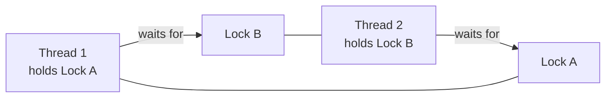

### Prevention / Avoidance / Detection

| Strategy | Idea | Cost / trade-off |
|---|---|---|
| **Prevention** | Negate a Coffman condition (e.g., global **lock ordering** kills circular wait; acquire-all-or-none kills hold-and-wait) | Discipline; can reduce concurrency |
| **Avoidance** | Grant only if system stays in a "safe state" (**Banker's algorithm**) | Needs max-claim knowledge; rare in practice |
| **Detection + recovery** | Let deadlocks happen, detect cycles in the wait-for graph, kill/rollback a victim | Used by DBs (deadlock detector aborts a transaction) |
| **Timeout / try-lock** | Give up acquiring after T, back off, retry | Simple; risks livelock if everyone retries in lockstep |

**Lock ordering** is the workhorse in real code: define a global order over all locks and always acquire them in that order. If everyone goes A-before-B, no cycle can form.

### Dining philosophers

Five philosophers, five forks, each needs both neighbor forks to eat. If all grab the left fork at once → everyone holds one, waits for the other → deadlock. Fixes: impose a **fork ordering** (one philosopher grabs right-first → breaks symmetry/circular wait), or use a **waiter/semaphore** allowing at most 4 to reach for forks at once.

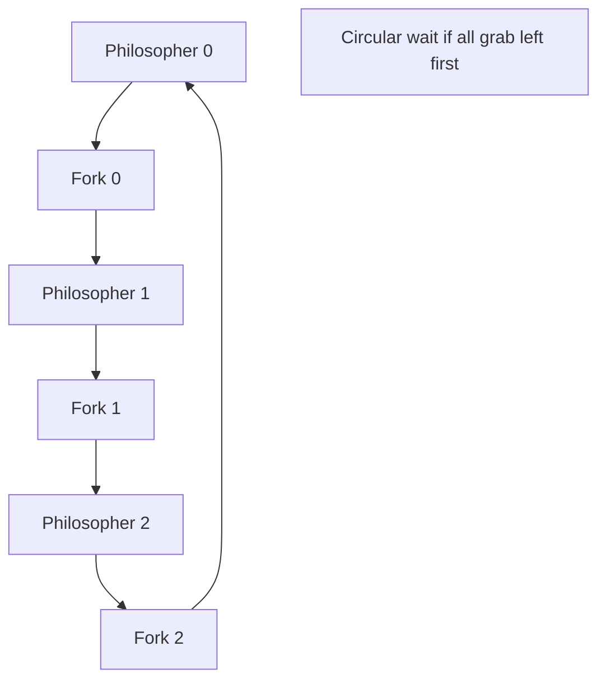

### Livelock vs starvation

- **Livelock:** the retry-with-backoff bug — two threads detect contention, both back off the same amount, retry simultaneously, collide again. Fix: **randomized exponential backoff** (also why network protocols use jitter — see [Reliability](11-reliability.md)).
- **Starvation:** a low-priority thread never runs because high-priority work keeps arriving; or a writer never gets a read-write lock under constant readers. Fix: **aging** (boost priority over time), fair queuing.

### Priority inversion — Mars Pathfinder (1997)

A low-priority task held a mutex; a high-priority task blocked on it; a steady stream of *medium*-priority tasks preempted the low one — so it never released the lock, the high-priority task missed its deadline, a watchdog rebooted the spacecraft repeatedly. **Fix: priority inheritance** — the lock holder temporarily inherits the priority of the highest waiter, so it finishes and releases. JPL fixed it by enabling priority inheritance in VxWorks via a live patch.

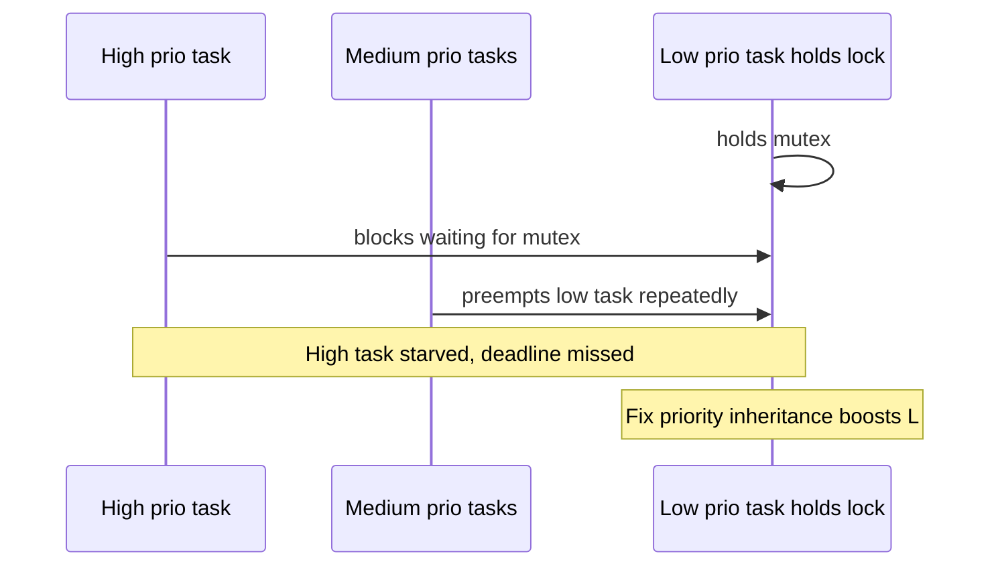

### Comparison table

| | Deadlock | Livelock | Starvation |
|---|---|---|---|
| Progress | None, threads blocked | None, threads active | System yes, victim no |
| CPU use | Idle (blocked) | Busy (spinning/retrying) | Victim idle |
| Typical cause | Circular lock wait | Symmetric retry/backoff | Unfair scheduling/priority |
| Fix | Lock ordering, detection | Randomized backoff | Aging, fair queues |

### Real-world relevance

- Database **deadlock detectors** aborting one transaction (you'll see `deadlock victim` errors) — design transactions to touch rows in a consistent order.
- Distributed deadlocks across services holding distributed locks — [Distributed Systems](02-distributed-systems.md) — usually solved with lease timeouts, not detection.

### Pitfalls

- Nested locks acquired in inconsistent order across modules (the #1 real-world deadlock).
- Naive retry loops causing livelock under load.
- Ignoring priority inversion in latency-critical / real-time paths.

> **Staff-level insight:** In distributed systems you rarely "detect" deadlock — you **design it out with timeouts and lock leases.** Any acquired lock should have a **TTL**; any cross-service call should have a **timeout + bounded retry with jitter**. The mindset shift for an EM: a single-machine deadlock is a bug; a distributed deadlock is an *architecture* smell that you should prevent by ordering, leasing, and making operations idempotent so a timeout-driven retry is safe.

---

## 5. Lock-Free, Wait-Free & Atomics

### Definition

- **Lock-free:** at least one thread makes progress in a bounded number of steps regardless of others — no mutexes, no thread can block the whole system by stalling.
- **Wait-free:** *every* thread makes progress in bounded steps (stronger, rarer).
- Built on **atomic** hardware instructions, chiefly **Compare-And-Swap (CAS)**.

### CAS — the core primitive

`CAS(addr, expected, new)`: atomically, *if* `*addr == expected`, set `*addr = new` and return true; else return false. The optimistic loop:

```
do:
    old = load(addr)
    new = f(old)
while not CAS(addr, old, new)   // retry if someone changed it
```

This is **optimistic concurrency**: assume no conflict, do the work, atomically commit, retry on conflict — no lock held.

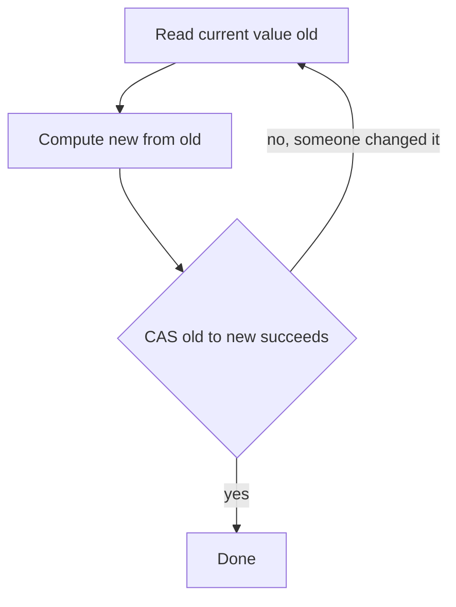

### The ABA problem

CAS checks the *value*, not whether it changed and changed back. Thread reads A, another thread changes A→B→A, the first thread's CAS(expects A) succeeds — but the world moved (e.g., a freed-then-reused node). Fixes: **tagged pointers / version counters** (CAS on value+counter), **hazard pointers**, or epoch-based reclamation.

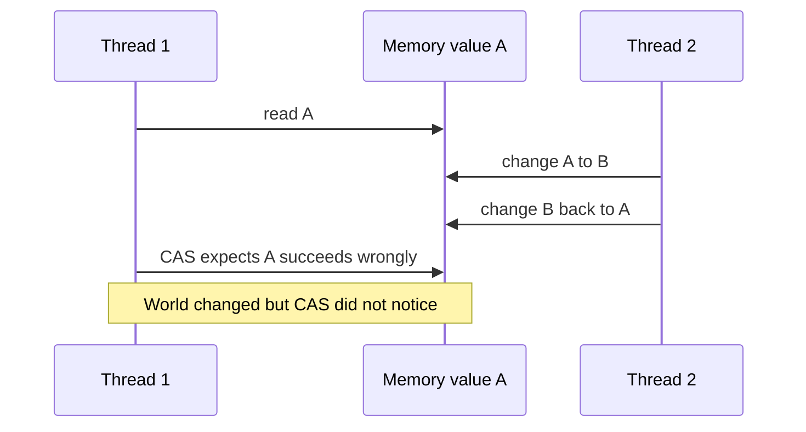

### Memory barriers & ordering

CPUs and compilers **reorder** memory operations for speed. Lock-free code needs **memory barriers/fences** (and the right `acquire`/`release`/`seq_cst` semantics) to ensure other cores see writes in the intended order. Locks include these fences implicitly; lock-free code must place them by hand — a major reason lock-free is hard to get right.

### False sharing & cache-line bouncing

Cores cache memory in **64-byte cache lines**. If two threads update *different* variables that sit on the *same* line, every write **invalidates the other core's copy** (MESI coherence traffic) — performance tanks though there's no logical sharing. This is **false sharing** — the concrete mechanism behind the USL `β` term (§2). Fix: **pad/align** hot per-thread data to separate cache lines.

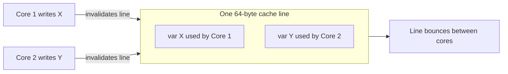

### Comparison table

| | Lock-based | Lock-free | Wait-free |
|---|---|---|---|
| Progress guarantee | None (can deadlock) | System-wide | Per-thread |
| Blocking | Yes | No | No |
| Complexity | Low | High | Very high |
| Tail latency | Spikes on contention | Smoother | Bounded |
| Typical use | General | Queues, counters, ring buffers | Hard real-time |

### Real-world relevance

- **Lock-free queues/ring buffers** (LMAX Disruptor, Java `ConcurrentLinkedQueue`, kernel RCU) for high-throughput, low-latency pipelines.
- **Atomic counters** for metrics under heavy concurrency.
- **Optimistic concurrency control** in databases (version columns, `WHERE version = ?`) and in distributed systems via CAS-like conditional writes (DynamoDB conditional `PutItem`, etcd compare-and-swap) — [Distributed Systems](02-distributed-systems.md).

### Pitfalls

- Rolling your own lock-free structure — extremely error-prone (memory ordering, ABA). Prefer battle-tested libraries.
- Assuming lock-free = faster. Under low contention a plain mutex is often faster and simpler.
- Ignoring false sharing in "embarrassingly parallel" code that mysteriously won't scale.

> **Staff-level insight:** Lock-free isn't a goal, it's a tail-latency tool. The reason a trading system or a Redis-style server reaches for it is **predictability**: a lock holder that gets descheduled stalls everyone (a latency cliff); lock-free guarantees *someone* always progresses. For an EM, the message is: reach for lock-free only on a proven hot path, measure false sharing first, and prefer **optimistic concurrency at the data layer** (version checks) over hand-rolled atomics in app code.

---

## 6. CPU Scheduling

### Definition

The OS scheduler decides **which ready thread runs on which core, for how long.** Threads cycle through states; the scheduler picks from the **ready/run queue**.

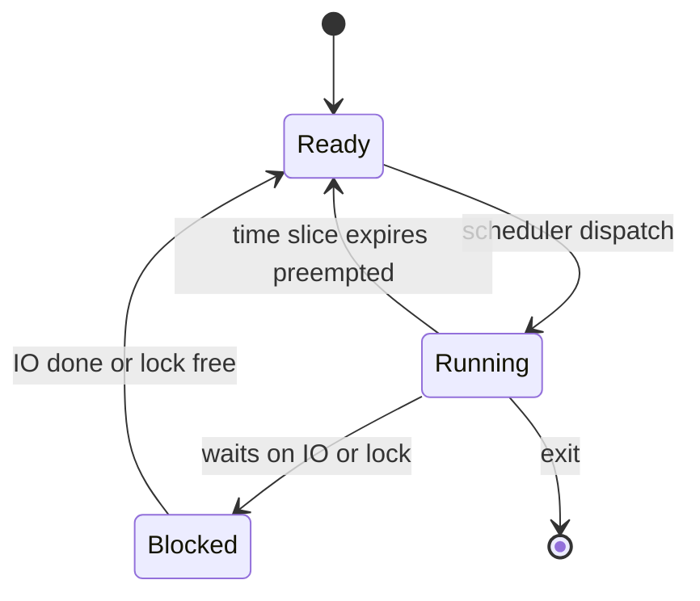

### Preemptive vs cooperative

- **Preemptive:** OS interrupts a running thread when its **time slice (quantum)** expires or a higher-priority thread becomes ready. Modern OSes (Linux, Windows, macOS) are preemptive — one runaway thread can't hog a core.
- **Cooperative:** a task runs until it **yields voluntarily**. Used by some coroutine runtimes and old systems (classic Mac OS, Windows 3.x). Simpler, no preemption overhead, but one stuck task freezes everything — **the reason a single blocking call in an event loop stalls the whole server** (§8).

### Scheduler algorithms

| Scheduler | How it picks | Strength | Weakness |
|---|---|---|---|
| **FCFS / FIFO** | Arrival order | Simple, fair-ish | Convoy effect (one long job blocks all) |
| **Round-robin** | Fixed quantum, cycle through ready | Fair, responsive | Quantum tuning; context-switch overhead |
| **Priority** | Highest priority first | Honors importance | Starvation of low priority |
| **MLFQ** (multi-level feedback queue) | Multiple priority queues; demote CPU hogs, boost IO-bound | Approximates "favor short/interactive jobs" without knowing job length | Tunable, gameable |
| **CFS** (Linux Completely Fair Scheduler) | Run the thread with least **virtual runtime**; weighted by `nice` | Fair proportional share, good interactivity | Not hard-real-time; replaced by EEVDF in recent kernels |

**MLFQ** is the practical heart of most general-purpose schedulers: interactive/IO-bound tasks (which yield quickly) float to high-priority queues; CPU-bound tasks sink to lower ones and get longer-but-rarer slices.

### Context switching mechanics

On a switch the kernel: saves the outgoing thread's registers/PC/stack pointer to its control block, updates scheduling accounting, picks the next thread, restores its state, and (if switching processes) **swaps the page-table root → TLB flush**. Direct cost ~1–5 µs; **indirect cost** (cold caches/TLB afterward) often larger. The takeaway: **context switches aren't free, and too many threads cause "thrash"** where the CPU spends more time switching than working.

### Real-world relevance

- **Tail latency** is a scheduling phenomenon: a request can be ready but waiting behind others in the run queue, or its lock holder got descheduled. Google's "Tail at Scale" work is largely about taming scheduling/queueing variance.
- **CPU pinning / affinity** keeps a thread on one core to preserve its warm cache and avoid cross-core migration — used in low-latency systems and tied to NUMA (§7).
- **`nice`/cgroups/CPU quotas** (Kubernetes CPU limits) directly manipulate the scheduler to isolate noisy neighbors.

### Pitfalls

- Running far more busy threads than cores → context-switch thrash, throughput drops (USL again).
- Kubernetes **CPU limits causing throttling**: a process gets paused mid-slice when it hits its quota, spiking p99 latency — a frequent, surprising production issue.
- Assuming the scheduler is "fair" enough to ignore priority — it isn't for latency-critical paths.

> **Staff-level insight:** For an EM, scheduling shows up as **the gap between "the CPU is only 60% busy" and "p99 latency is terrible."** The metric that exposes it is **run-queue depth / scheduler wait time**, not CPU utilization. When someone says "we have headroom, CPU's at 60%," the staff response is: *check whether requests are queuing for a core or a lock* — utilization hides queueing, and queueing is what users feel.

---

## 7. Memory & Caches

### Definition & hierarchy

CPUs are starved for data; the memory hierarchy hides latency. Approximate numbers (extend the table in [Fundamentals](01-fundamentals.md)):

| Level | Latency (approx) | Notes |
|---|---|---|
| Register | <1 ns | |
| L1 cache | ~1 ns | per-core, ~32 KB |
| L2 cache | ~4 ns | per-core, ~256 KB–1 MB |
| L3 cache | ~10–40 ns | shared across cores |
| Main memory (DRAM) | ~100 ns | NUMA-remote: +50%+ |
| NVMe SSD | ~16–100 µs | |
| Network within DC | ~0.5 ms round trip | |
| Disk seek (HDD) | ~10 ms | |

A main-memory access is **~100× slower** than L1. Your job in hot paths is to **keep working data in cache.**

### Virtual memory, paging, TLB

- Each process sees a contiguous **virtual address space**; the MMU translates virtual→physical via **page tables** (typically 4 KB pages).
- Translations are cached in the **TLB (Translation Lookaside Buffer)**. A TLB miss costs a page-table walk; a process-context switch **flushes the TLB** (part of why it's costly, §1/§6).
- A **page fault** (page not resident) traps to the OS, which fetches the page — cheap if from RAM (minor), expensive if from disk/swap (major). Heavy swapping = **thrashing**, where the system spends all its time paging.

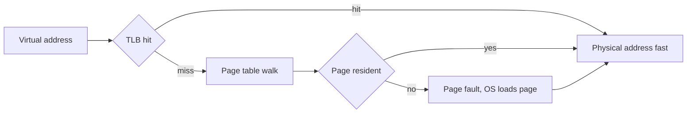

### Cache lines, false sharing, locality

- Memory moves in **64-byte cache lines**. Sequential access is fast (prefetcher + spatial locality); random pointer-chasing is slow (cache miss per hop).
- **False sharing** (§5): unrelated variables on the same line bouncing between cores.
- **Temporal locality** (reuse soon) and **spatial locality** (use nearby) are why arrays beat linked lists and why columnar storage beats row storage for scans.

### NUMA

On multi-socket servers, each CPU has **local memory**; accessing **another socket's memory is slower** (Non-Uniform Memory Access). Threads should run near their data. **NUMA-aware allocation + thread pinning** can be a large win; ignoring it silently halves bandwidth on big boxes.

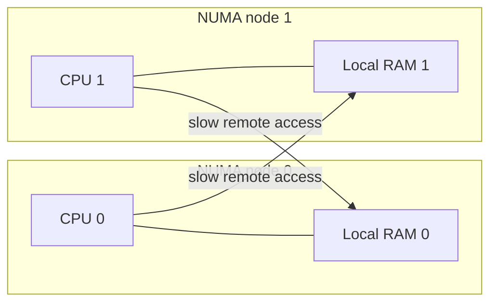

### Real-world relevance

- **Why in-memory beats disk by orders of magnitude** — informs cache-tier sizing (Redis/Memcached) and the whole caching module.
- **Data-structure choice for performance:** a cache-friendly flat array (`std::vector`, columnar Parquet/Arrow) crushes a pointer-heavy structure on scans — the basis of OLAP column stores.
- **NUMA + pinning** for databases and low-latency services on large nodes.

### Pitfalls

- Designing hot loops that pointer-chase (linked lists, deep object graphs) → cache-miss storms.
- Ignoring NUMA on big instances; cross-socket traffic silently caps throughput.
- Memory-mapped IO assumptions (`mmap`) hiding expensive page faults as "just a read."

> **Staff-level insight:** "Memory locality" is the physical reason behind half the latency-number intuition you cite in design. When you say "serve it from RAM, not disk" or "denormalize so one read fetches everything," you're really invoking **locality and the memory hierarchy.** The EM-level framing: *the fastest IO is the one you don't do; the second fastest is the one already in cache.* Architect data layout so the common path stays cache- and RAM-resident, and treat cross-NUMA/cross-network hops as the expensive events they are.

---

## 8. IO Models & the C10K Problem

### Definition

How a program waits for IO (sockets, disk) defines how many concurrent connections one machine can serve. Two orthogonal axes:

- **Blocking vs non-blocking:** does the call return immediately if no data is ready?
- **Synchronous vs asynchronous:** do *you* do the IO (and get told when ready), or does the OS do it and notify you when *done*?

### The models

| Model | Behavior | Concurrency strategy |
|---|---|---|
| **Blocking IO** | `read()` parks the thread until data | One thread per connection |
| **Non-blocking IO** | `read()` returns `EWOULDBLOCK` if not ready; you poll | Busy-loop (wasteful) — needs readiness model |
| **IO multiplexing (readiness)** | One thread asks the OS "which of these N sockets are ready?" via `select`/`poll`/`epoll`/`kqueue` | Event loop over many sockets |
| **Asynchronous IO (completion)** | You submit IO; OS performs it and signals completion (Windows IOCP, Linux `io_uring`) | Submit/complete queues, fewest syscalls |

### Readiness APIs evolution

- **`select`/`poll`** — pass the whole FD set each call; the kernel scans all N → **O(N) per call**. Dies past a few thousand connections.
- **`epoll` (Linux) / `kqueue` (BSD/macOS)** — register interest once; the kernel returns only the **ready** FDs → **O(ready)**, scales to hundreds of thousands. This is what cracked C10K.
- **`io_uring`** — modern Linux **completion-based** async: shared submission/completion ring buffers, **batches IO with near-zero syscalls per op**; pushes toward C10M and high-IOPS storage.

### Reactor vs Proactor

- **Reactor (readiness):** event loop waits for "socket is readable," then *your* handler does the (non-blocking) read. nginx, Node.js, Redis, Netty.
- **Proactor (completion):** you start the read; the OS completes it and hands you the buffer when done. Windows IOCP, Boost.Asio, `io_uring`-style.

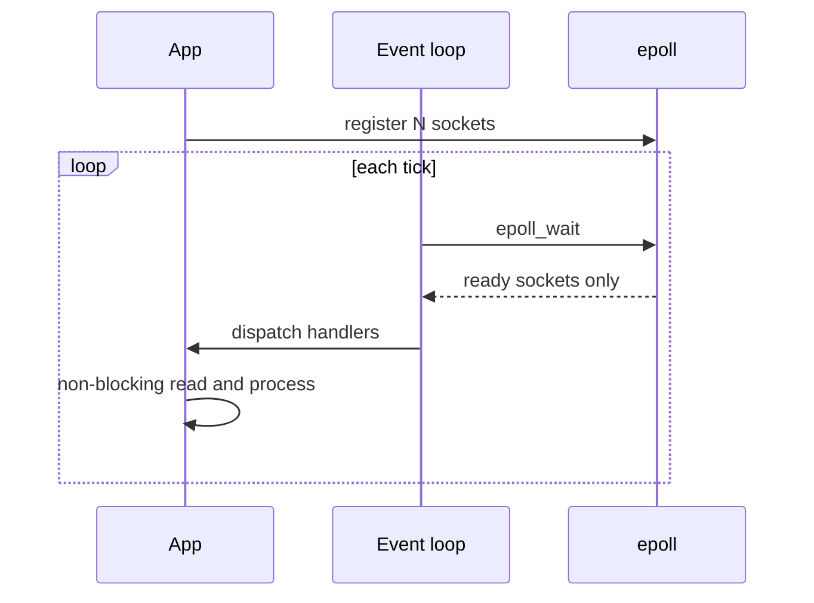

### The C10K → C10M problem

**C10K** (Dan Kegel, ~1999): can one server handle **10,000 concurrent connections**? Thread-per-connection can't — 10K threads = gigabytes of stack + scheduler thrash + per-connection memory. The answer: **event loop + epoll/kqueue**, where one (or per-core) thread multiplexes thousands of mostly-idle connections, each costing a few KB of buffers instead of a full thread.

**C10M** (Robert Graham, ~2013): **10 million connections** — needs kernel-bypass (user-space TCP, DPDK), `io_uring`, multi-queue NICs, careful NUMA/cache layout. Same principle, taken to the metal.

This is the direct OS foundation under [Real-Time Systems](09-realtime-systems.md): a **WebSocket fan-out / chat / presence** server holds vast numbers of *mostly-idle* connections. Thread-per-connection is hopeless; an **event-loop server (Node, Go, Netty, nginx, Redis)** is the only viable shape.

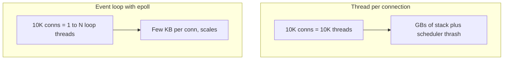

### Why event loops scale

For **IO-bound** workloads (most network servers), connections spend ~99% of time idle waiting. An event loop turns "10K waiting threads" into "10K cheap FDs + one busy thread." The CPU does work only when a socket is actually ready — no per-connection thread, no per-idle-connection context switch. **Redis is single-threaded** on the command path for exactly this reason: no lock contention, predictable latency, all concurrency from the event loop.

### Comparison table

| | Thread-per-connection | Event loop (reactor) |
|---|---|---|
| Concurrency limit | ~thousands | hundreds of thousands+ |
| Memory per conn | ~1 MB (stack) | ~few KB (buffers) |
| Model complexity | Simple, linear code | Callbacks/async, harder to read |
| CPU-bound handler | Fine | **Blocks the whole loop** |
| Best for | Low connection count, blocking calls | Massive idle/IO-bound connections |

### Pitfalls

- **Blocking the event loop:** any synchronous/CPU-heavy call (a sync DB driver, JSON of a huge payload, `bcrypt`) stalls *all* connections. Offload to a worker pool.
- Using `select`/`poll` at scale (O(N)); must use `epoll`/`kqueue`.
- Forgetting that event loops give concurrency, **not parallelism** — to use all cores you run **one loop per core** (nginx workers, Node `cluster`, Go's runtime over GOMAXPROCS).

> **Staff-level insight:** When the prompt is "design chat / a notification fan-out / a live dashboard for millions of users," the single sharpest opening move is: *"These are long-lived, mostly-idle connections, so this is a C10K/C10M problem — thread-per-connection won't fit in memory or the scheduler. I'll use an event-loop server over epoll, one loop per core, and shard connections across nodes via consistent hashing."* That one sentence demonstrates you connect the OS IO model to the architecture — and it directly drives the [Real-Time Systems](09-realtime-systems.md) design.

---

## 9. Concurrency Models in Practice

### Definition

The high-level patterns languages/frameworks use to structure concurrency — each maps to a server architecture.

### The models

**1. Thread pool.** A fixed set of worker threads pull tasks from a shared queue. Bounds resource use and amortizes thread-creation cost. The model behind Java servlet containers, most web frameworks, and DB connection pools.

**2. Actor model.** Independent **actors** own private state and communicate only by **asynchronous messages** (no shared memory → no locks). Each actor processes one message at a time. Erlang/Elixir (OTP), Akka, Orleans. Great for isolation, fault-tolerance ("let it crash" + supervisors), and distribution — an actor on another machine looks the same.

**3. CSP / channels (Go).** Goroutines communicate over typed **channels** — *"don't communicate by sharing memory; share memory by communicating."* Synchronization is the channel itself. Go's runtime multiplexes goroutines (M:N) over OS threads with a **work-stealing** scheduler.

**4. Event loop + async/await.** Single-threaded cooperative concurrency with `async`/`await` syntax over a reactor (Node.js, Python asyncio, Rust tokio). Linear-looking code, event-loop scaling. Run one loop per core for parallelism.

**5. Work stealing.** Each worker has its own deque; idle workers **steal** tasks from busy workers' tails. Balances load with low contention. Used by Go's scheduler, Java's ForkJoinPool, Rust's tokio/rayon, .NET TPL.

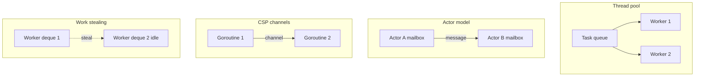

### Sizing a thread pool with Little's Law

**Little's Law:** `L = λ × W` where `L` = concurrent requests in system, `λ` = arrival rate, `W` = mean time in system. The number of concurrently busy workers you need ≈ `λ × W`.

- **CPU-bound work:** pool size ≈ **number of cores** (more just thrashes the scheduler). Rule of thumb: `cores + 1`.
- **IO-bound work:** threads spend most time waiting, so you need more. A useful formula: `threads ≈ cores × (1 + wait_time / compute_time)`. Example: 8 cores, each request 10 ms waiting on DB + 1 ms CPU → `8 × (1 + 10/1) = 88` threads. *Or* skip threads entirely and go **async/event-loop** for IO-bound work — that's the modern answer past a few hundred concurrent.

**Worked Little's Law sizing:** target 10,000 RPS, each request occupies a worker for `W = 20 ms`. Concurrent in-flight `L = 10000 × 0.02 = 200`. So you need ~200 concurrent slots (threads if blocking, or async tasks). If a single box has 16 cores and the work is IO-bound, 200 blocking threads is plausible; if CPU-bound, you're core-limited and must scale out.

### Mapping models to server architectures

| Model | Concurrency cost | Best fit | Real systems |
|---|---|---|---|
| Thread pool | OS thread each (~MB) | Moderate concurrency, blocking libs | Tomcat, Java EE, classic web servers |
| Actor | Lightweight, message-based | Stateful, fault-tolerant, distributed | Erlang/WhatsApp, Akka, Orleans |
| CSP / goroutines | Very light (KBs) | High concurrency + parallelism | Go services, Kubernetes |
| Event loop + async | Lightest (no thread/task switch) | Massive IO-bound connections (C10K) | Node.js, nginx, Redis, tokio |
| Work stealing | Light, auto-balanced | CPU-bound parallel compute | ForkJoinPool, rayon, TPL |

### Real-world relevance

- **WhatsApp** served ~2M connections per server with Erlang actors on the BEAM VM — actor isolation + lightweight processes.
- **Go** dominates cloud infra (Kubernetes, Docker) partly because goroutines+channels make C10K-scale concurrency *easy to write correctly*.
- **Node/nginx/Redis** show event-loop scaling for connection-heavy workloads.

### Pitfalls

- **Unbounded thread pools / queues** → memory blowup and latency collapse under overload; always bound and shed load (ties to [Reliability](11-reliability.md) backpressure/bulkheads).
- Sizing a thread pool by guesswork instead of Little's Law + CPU-vs-IO analysis.
- Mixing blocking calls into an async/actor runtime → starves the event loop / blocks the scheduler.

> **Staff-level insight:** The model question is really *"where does my work wait?"* IO-bound → async/event-loop or actors (cheap concurrency wins). CPU-bound → thread/process pool sized to cores + work stealing (parallelism wins). For an EM, the move is to **state the workload class, then size with Little's Law and a real number**, then connect bounded pools to backpressure: "200 concurrent slots from Little's Law, bounded queue of 1K, shed beyond that with a 503 — so overload degrades gracefully instead of melting down." That single chain — workload → model → sizing → backpressure — is exactly the systems-thinking Google looks for.

---

## Interview Cheat-Sheet

| Concept | One-liner to say in the room |
|---|---|
| Process vs thread | Process = isolation unit; thread = concurrency unit; coroutine = cheap concurrency for IO |
| Thread-per-conn cost | ~1 MB stack/thread + scheduler thrash → dies at C10K |
| Concurrency vs parallelism | Structure vs execution; concurrency for IO-bound, parallelism for CPU-bound |
| Amdahl / USL | Serial fraction caps speedup; USL contention+coherence can make throughput *decline* |
| Mutex vs spinlock | Spin for ultra-short critical sections on multicore; block for everything else |
| Counting semaphore | = connection pool / rate limiter / bulkhead (N permits) |
| Coffman conditions | Mutual exclusion, hold-and-wait, no-preemption, circular-wait — break one |
| Deadlock fix in practice | Lock ordering + timeouts/leases; DBs detect-and-abort a victim |
| Priority inversion | Low holder blocks high waiter; fix = priority inheritance (Mars Pathfinder) |
| CAS / lock-free | Optimistic loop; watch ABA (version tags) and memory ordering |
| False sharing | Unrelated vars on one 64B line bounce between cores → pad/align; it's the USL β |
| Context switch | µs-scale + cold cache/TLB; process switch flushes TLB |
| CFS / MLFQ | Fair-share / favor interactive jobs; tail latency is a queueing effect |
| Memory hierarchy | L1 ~1 ns, RAM ~100 ns, disk ~10 ms — keep hot data cache/RAM-resident |
| NUMA | Remote-socket memory is slower; pin threads to data |
| epoll vs select | select is O(N); epoll/kqueue O(ready) — cracked C10K |
| Reactor vs proactor | Reactor = readiness (epoll); proactor = completion (IOCP, io_uring) |
| Why event loops scale | Idle connections cost KBs not threads; one loop per core for parallelism |
| Don't block the loop | A sync/CPU-heavy call stalls every connection → offload to workers |
| Little's Law sizing | L = λ × W; CPU-bound ≈ cores, IO-bound ≈ cores×(1+wait/compute) or go async |
| Concurrency models | Actor (isolation/distribution), CSP (Go), async (C10K), pool+work-stealing (CPU) |

---

## Common Interview Questions

1. **You're designing a chat service for 50M concurrent users. How does each server handle so many connections?**
   Long-lived, mostly-idle connections → a C10K/C10M problem. Thread-per-connection is impossible (memory + scheduler). Use an event-loop server over epoll/kqueue, one loop per core, shard connections across nodes by consistent hashing, and a pub/sub backbone for fan-out. Ties directly to [Real-Time Systems](09-realtime-systems.md).

2. **We added more application servers but throughput plateaued. Why?**
   A serial bottleneck — likely lock contention on a shared resource (sequence generator, single Redis key, a hot mutex). Per the USL, the contention term caps and can reverse throughput. Find and remove the shared mutable state (shard IDs, partition the lock) rather than adding boxes.

3. **Mutex vs spinlock — when each?**
   Spinlock for critical sections shorter than a context switch (~µs) on a multicore with low contention — no scheduling cost. Mutex (blocking) for longer/contended sections — frees the core. Never spin on a uniprocessor. Real mutexes often adapt: spin briefly, then sleep.

4. **Walk me through producer-consumer with a bounded buffer.**
   Two counting semaphores (`empty=N`, `full=0`) for capacity + one mutex for the buffer. Producer: `wait(empty)`, lock, insert, unlock, `signal(full)`. Consumer mirrors it. Crucial: acquire the counting semaphore *before* the mutex to avoid deadlock. The counting semaphore generalizes to a connection pool / bulkhead.

5. **What are the four conditions for deadlock and how do you prevent it in a distributed system?**
   Mutual exclusion, hold-and-wait, no-preemption, circular-wait. On one machine: global lock ordering kills circular wait. Distributed: don't detect — *design it out* with lock leases/TTLs, call timeouts + jittered retry, and idempotent operations so a retry after timeout is safe. See [Distributed Systems](02-distributed-systems.md).

6. **Explain priority inversion and how you'd guard a latency-critical path against it.**
   A low-priority thread holds a lock a high-priority thread needs; medium tasks preempt the low one so it never releases (Mars Pathfinder). Fix with priority inheritance (holder inherits the waiter's priority) or by minimizing lock-hold time on hot paths. For tail latency, never hold a lock across slow IO.

7. **What's false sharing and how does it connect to scalability?**
   Two threads writing different variables on the same 64-byte cache line cause coherence traffic (the line bounces between cores) though nothing is logically shared. It's the concrete mechanism behind the USL `β` (crosstalk) term — the reason "embarrassingly parallel" code sometimes won't scale. Fix by padding/aligning per-thread hot data.

8. **CPU is at 60% but p99 latency is terrible. What's happening?**
   Utilization hides queueing. Requests are likely waiting in the run queue or on a lock — or you're hitting Kubernetes CPU-limit throttling (paused mid-slice). Look at run-queue depth/scheduler wait and lock contention, not average CPU. Could also be GC pauses or a blocked event loop.

9. **How do you size a thread pool?**
   Little's Law: `L = λ × W`. CPU-bound → ~`cores` (more just thrashes). IO-bound → `cores × (1 + wait/compute)`, or better, go async/event-loop past a few hundred concurrent. Always bound the pool and queue, and shed load beyond capacity so overload degrades gracefully ([Reliability](11-reliability.md)).

10. **Why is Redis fast despite being single-threaded on the command path?**
    Event loop over epoll: all concurrency from multiplexed IO, no lock contention, no per-command context switches, predictable latency, data in RAM (~100 ns vs ~10 ms disk). CPU rarely the bottleneck for an in-memory store — the network/IO model is. It scales out via sharding, and newer versions use IO threads only for network read/write, keeping command execution serial.

---

*Next:* revisit [Fundamentals](01-fundamentals.md) for the latency/USL numbers these mechanisms produce, [Real-Time Systems](09-realtime-systems.md) for the C10K design in full, and [Reliability](11-reliability.md) for backpressure/bulkheads that bound the concurrency you've now learned to reason about.
