# 25 — How the Internet Really Works: Packet to PoP

> The definitive "deep understanding of how the internet works" reference for the **Google Engineering Manager** interview. Google's EM rubric explicitly names *routers, domain name servers, load balancers, firewalls* — this module traces the **full path of a request** across the internet, from a keystroke to bytes on the screen, one hop and one layer at a time.

This goes **deeper** than [Fundamentals](01-fundamentals.md), which covers networking at system-design altitude. Here we go down to the wire: encapsulation, BGP, the DNS resolution tree, the TCP/TLS handshakes packet-by-packet, QUIC, the CDN edge, and the datacenter fabric.

---

## What you'll master

- The exact, end-to-end journey of **one HTTP request** — and how to narrate it confidently in an interview.
- The **OSI / TCP-IP layering** and which physical device lives at each layer (switch, router, load balancer, firewall).
- How the internet's **routes are actually chosen**: IP/CIDR, ARP, autonomous systems, BGP, peering vs transit, anycast.
- The full **DNS resolution tree**, record types, caching/TTL, GeoDNS, DNSSEC, and why DNS is a notorious single point of failure.
- **TCP** deeply: handshake, sliding window, flow vs congestion control, CUBIC/BBR, TIME_WAIT, head-of-line blocking.
- **UDP, QUIC, HTTP/3** — and why Google built QUIC.
- **TLS** 1.2 vs 1.3, PKI/chain-of-trust, SNI, mTLS, forward secrecy, where to terminate.
- The **HTTP evolution** 1.0 → 1.1 → 2 → 3, with headers, methods, status codes, caching, cookies.
- The **edge**: CDN/PoPs, reverse proxies, WAF/firewalls, NAT, DDoS scrubbing.
- **Datacenter & cross-DC** networking: spine-leaf/Clos, oversubscription, east-west vs north-south, the speed-of-light tax, multi-region.

---

## Table of Contents

1. [In the Room — How the Internet Works, End to End](#in-the-room--how-the-internet-works-end-to-end)
2. [The OSI / TCP-IP Layering](#1-the-osi--tcp-ip-layering)
3. [Routing & the Internet's Structure](#2-routing--the-internets-structure)
4. [DNS, Deep](#3-dns-deep)
5. [TCP, Deep](#4-tcp-deep)
6. [UDP & QUIC](#5-udp--quic)
7. [TLS, Deep](#6-tls-deep)
8. [HTTP Evolution](#7-http-evolution)
9. [The Edge — CDN, Proxies, Firewalls, NAT, DDoS](#8-the-edge--cdn-proxies-firewalls-nat-ddos)
10. [Datacenter & Cross-DC Networking](#9-datacenter--cross-dc-networking)
11. [Putting It Together — Mumbai → us-east](#10-putting-it-together--mumbai--us-east)
12. [Interview Cheat-Sheet](#interview-cheat-sheet)
13. [Common Interview Questions](#common-interview-questions)

---

## In the Room — How the Internet Works, End to End

A user in Mumbai types `https://www.example.com` and hits Enter. Here is the entire story — the backbone of this whole module. Every numbered topic below zooms into one stage.

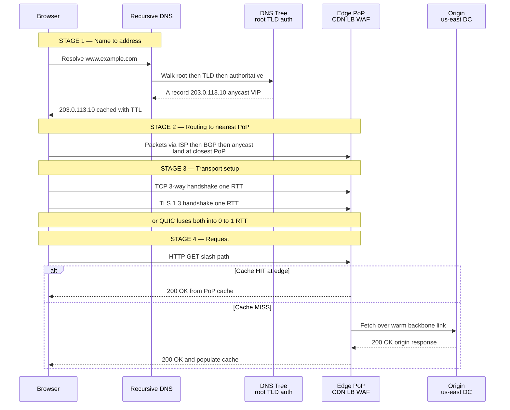

**The seven things that happen, in order:**

1. **DNS** turns `www.example.com` into an IP address (often an *anycast* VIP shared by many PoPs).
2. **Routing** carries the user's packets — through their ISP, across autonomous systems via **BGP** — to the **nearest PoP** announcing that anycast IP.
3. **TCP** establishes a reliable byte stream (3-way handshake, ~1 RTT).
4. **TLS** negotiates encryption and verifies identity (~1 RTT in 1.3). QUIC/HTTP-3 collapses TCP+TLS into one.
5. **HTTP** carries the actual request (`GET /`).
6. The **edge** (CDN + reverse proxy + WAF + load balancer) serves from cache, or forwards to **origin**.
7. The **origin datacenter** (spine-leaf fabric, services, databases) produces the response, which flows back the same path.

Keep this diagram in your head. Everything else is detail.

---

## 1. The OSI / TCP-IP Layering

**Definition.** Networking is built as a stack of layers; each layer provides a service to the one above and consumes the one below. The **OSI model** has 7 layers (conceptual); the **TCP-IP model** has 4 (what the internet actually runs).

**How it works — encapsulation.** As data travels *down* the stack on send, each layer wraps it with its own header (and L2 also adds a trailer). On receive, each layer peels its header off. This nesting is **encapsulation**.

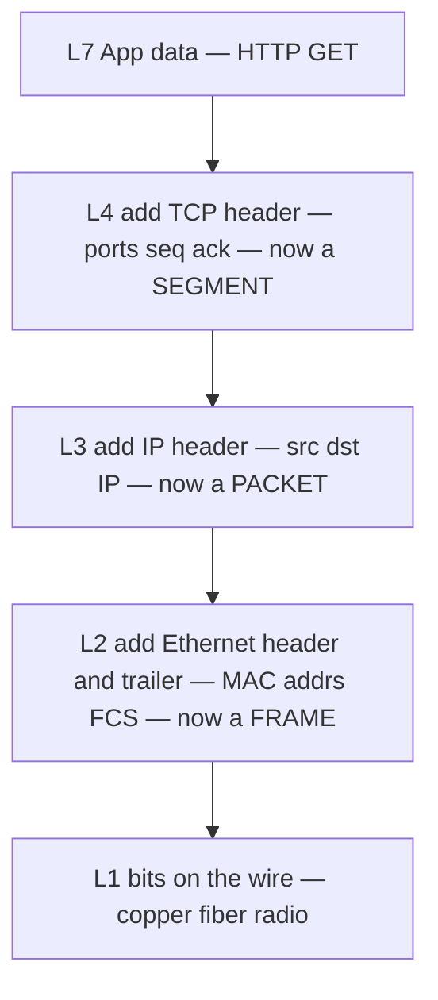

| OSI Layer | TCP-IP | PDU name | Address used | Example protocols | Device that operates here |
|-----------|--------|----------|--------------|-------------------|---------------------------|
| L7 Application | Application | Data | — | HTTP, DNS, TLS, gRPC | L7 load balancer, WAF, reverse proxy, API gateway |
| L6 Presentation | Application | Data | — | TLS, encoding | (folded into apps) |
| L5 Session | Application | Data | — | session mgmt | (folded into apps) |
| L4 Transport | Transport | Segment / Datagram | Port | TCP, UDP, QUIC | L4 load balancer, stateful firewall, NAT |
| L3 Network | Internet | Packet | IP address | IP, ICMP, BGP, OSPF | **Router**, L3 switch, packet-filter firewall |
| L2 Data Link | Link | Frame | MAC address | Ethernet, ARP, VLAN | **Switch**, bridge, NIC |
| L1 Physical | Link | Bits | — | copper, fiber, Wi-Fi | hub, cable, transceiver |

**Real-world relevance.** When an interviewer asks "where would you put the firewall?" or "is this LB L4 or L7?", you're being asked to reason about layers. An L4 LB load-balances on IP:port (fast, protocol-agnostic, can't read URLs); an L7 LB reads HTTP and can route by path/host/cookie (richer, slightly more expensive). A switch forwards by MAC within a LAN; a router forwards by IP between networks.

**Pitfalls.**
- Saying TLS is "L4" — it rides *on top of* TCP (L4) and is better thought of as L6/L7.
- Confusing a switch (L2, same subnet) with a router (L3, between subnets).
- Forgetting that **MTU** (typically 1500 bytes on Ethernet) limits the L3 payload — 1500 is the MTU, *not* the frame size; the Ethernet frame is 1518 bytes (1522 with a VLAN tag). Exceeding the MTU forces fragmentation or triggers Path MTU Discovery. Common pitfall: VPN/tunnel overhead shrinks effective MTU and breaks large packets silently.

> **Staff-level insight:** Layering is the interview's hidden grading rubric. When you say "the L7 LB terminates TLS, inspects the `Host` header, routes to the right service; the L4 LB in front just does connection-level DSR for raw throughput" — you've demonstrated you know *which layer each decision lives at*. That precision is what separates an EM who can lead a networking team from one who hand-waves "the load balancer handles it."

---

## 2. Routing & the Internet's Structure

**Definition.** Routing is how a packet finds its way from source IP to destination IP across thousands of independently-operated networks. The internet is a **network of networks** — there is no central map.

### IP addressing, subnets, CIDR

- **IPv4**: 32-bit (e.g. `203.0.113.10`), ~4.3B addresses (exhausted — hence NAT and IPv6).
- **IPv6**: 128-bit (e.g. `2001:db8::1`), effectively unlimited.
- **CIDR** notation `10.0.0.0/16` means the first 16 bits are the network prefix; the rest (65,536 addresses) is the host space. `/24` = 256 addresses, `/32` = a single host.
- A **subnet** groups hosts that can talk L2-directly; crossing subnets needs a router.

### ARP — bridging L3 and L2

To send to an IP on the local subnet, a host needs the destination **MAC**. **ARP** ("who has 10.0.0.5?") broadcasts on the LAN; the owner replies with its MAC. Results are cached. For off-subnet destinations, the frame is addressed to the **default gateway's** MAC.

### Routers, routing tables, autonomous systems, BGP

A **router** has a **routing table** mapping destination prefixes to next-hops, and forwards each packet to the best-matching (longest-prefix) next-hop. The internet is partitioned into **Autonomous Systems (AS)** — each a network under one administrative control with an **ASN** (e.g. Google is AS15169). **BGP (Border Gateway Protocol)** is how ASes advertise *which IP prefixes they can reach* to their neighbors. BGP chooses paths by policy (business relationships) more than by raw distance.

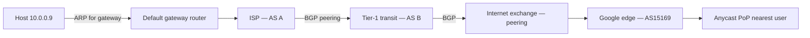

### Peering vs transit

| | **Transit** | **Peering** |
|---|---|---|
| What you buy | Reachability to the *entire* internet | Direct exchange of *each other's* traffic |
| Who pays | Customer pays provider | Usually settlement-free |
| Analogy | Paying for a full highway on-ramp | A shortcut road between two neighbors |
| Where | From a Tier-1/Tier-2 ISP | At Internet Exchange Points (IXPs) or private interconnect |
| Why it matters | Guarantees global reach | Cuts latency and cost for high-volume flows |

### Anycast — one IP, many PoPs

**Anycast** advertises the *same* IP prefix from *many* locations. BGP naturally routes each user to the **topologically nearest** PoP announcing it. Used by DNS root servers, CDNs, and Google's edge. One IP, dozens of datacenters; failure of one PoP simply withdraws its BGP announcement and traffic reroutes.

### BGP hijacks

Because BGP trusts announcements, a malicious or misconfigured AS can announce a prefix it doesn't own — a **BGP hijack** — pulling traffic to itself (interception or blackhole). Mitigations: **RPKI** (cryptographically signs which AS may originate a prefix) and route filtering.

**Real-world relevance.** "How does Google serve users worldwide from one URL?" → anycast + BGP + GeoDNS at the edge. "Why did half the internet go down for an hour?" → almost always a BGP misconfiguration or a major provider's fiber cut.

**Pitfalls.**
- Thinking BGP picks the *shortest* path — it picks the *policy-preferred* path (often longer AS-path is chosen for business reasons).
- Assuming anycast is "stateful load balancing" — it's stateless and BGP-driven; a route change mid-flow can break long-lived TCP connections (one reason CDNs prefer anycast for short connections / DNS and unicast or careful steering for long ones).

> **Staff-level insight:** The internet's structure is *economic*, not just technical. Routes follow money (peering/transit agreements), which is why a packet from Mumbai to a Mumbai server can detour through Singapore or even Europe if the cheap peering path goes that way. In an interview, calling out "the path is chosen by BGP policy, not geography" signals you understand that **latency anomalies are often routing-economics artifacts, not bugs.**

---

## 3. DNS, Deep

**Definition.** DNS (Domain Name System) is the internet's distributed, hierarchical directory that maps human names (`www.example.com`) to IP addresses (and other records). See [Fundamentals](01-fundamentals.md) for the system-design view; here is the resolution tree in full.

**How it works — the resolution path.** A **stub resolver** (in the OS) asks a **recursive resolver** (your ISP's, or `8.8.8.8`). The recursive resolver, if uncached, walks the hierarchy: **root** → **TLD** (`.com`) → **authoritative** server for the domain.

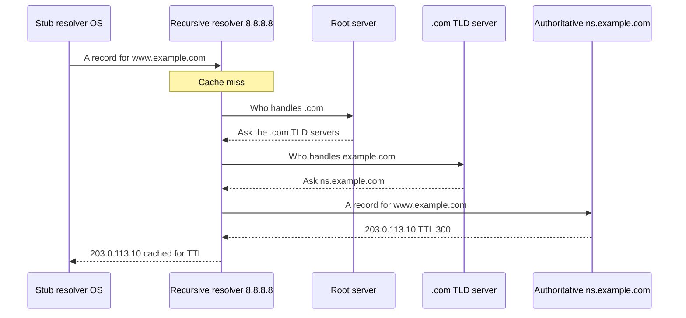

### Record types

| Record | Maps | Example / use |
|--------|------|---------------|
| **A** | name → IPv4 | `www → 203.0.113.10` |
| **AAAA** | name → IPv6 | `www → 2001:db8::1` |
| **CNAME** | name → another name (alias) | `www → example.com` (cannot coexist with other records at same name) |
| **MX** | domain → mail server + priority | email routing |
| **TXT** | arbitrary text | SPF, DKIM, domain verification |
| **NS** | zone → authoritative name servers | delegation |
| **SOA** | zone start-of-authority | serial, refresh, TTL defaults |
| **PTR** | IP → name | reverse DNS |
| **SRV** | service location | `_sip._tcp` etc. |

### Caching & TTL

Every record carries a **TTL** (e.g. 300s). Recursive resolvers, OS, and browsers cache until TTL expires. **Low TTL** = fast failover but more query load; **high TTL** = less load but slow propagation when you change records. Typical: 300s for records you might fail over, 24h+ for stable ones.

### GeoDNS & DNS-based load balancing

Authoritative servers can return **different answers by geography** (GeoDNS) or rotate/weight answers (round-robin, weighted) — a coarse but powerful load-balancing and traffic-steering tool. CDNs lean on this heavily; combined with anycast it directs users to the nearest edge.

### DNSSEC

**DNSSEC** signs DNS records so resolvers can verify authenticity and prevent **cache poisoning** (injecting forged answers). It adds RRSIG/DNSKEY/DS records and a chain of trust from the root. It does *not* encrypt (that's DoH/DoT).

### DNS as a single point of failure

DNS is foundational: if resolution fails, *everything* fails even when servers are healthy. The 2016 **Dyn** outage took down Twitter, GitHub, Netflix via a DDoS on a managed DNS provider. **Mitigations:** multiple DNS providers, anycast DNS, sensible TTLs, and monitoring resolution end-to-end (not just origin health).

| Property | Detail |
|---|---|
| Default transport | UDP/53 (falls back to TCP for large/zone responses) |
| Encrypted variants | DoT (TCP/853), DoH (HTTPS/443) |
| Authenticity | DNSSEC |
| Typical lookup cost | 1 RTT if cached at resolver; up to 4 RTTs cold (root→TLD→auth) |

**Pitfalls.**
- Setting a high TTL and then needing an emergency failover — clients keep the stale IP for hours.
- CNAME at the zone apex (`example.com` itself) — disallowed; use ALIAS/ANAME or A records.
- Treating DNS round-robin as real load balancing — clients/resolvers cache and don't health-check; a dead IP keeps getting handed out.

> **Staff-level insight:** Most engineers monitor their *servers*; staff engineers monitor their *resolution path*. The classic 3am page where "the site is down but every box is green" is DNS, a TTL, or a registrar/anycast issue. In an EM interview, naming **DNS as a SPOF and proposing multi-provider DNS** shows you design for the failure modes that take down whole companies, not just the ones in your own racks.

---

## 4. TCP, Deep

**Definition.** TCP provides a **reliable, ordered, byte-stream** connection over the unreliable IP packet service: it handles connection setup, retransmission, ordering, flow control, and congestion control.

### The 3-way handshake

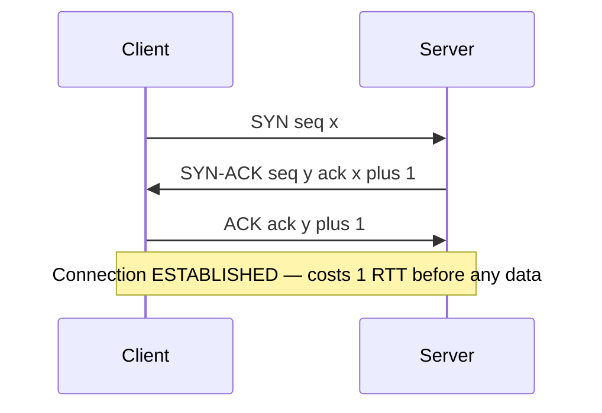

### Sequence/ack, sliding window, flow control

- Every byte has a **sequence number**; the receiver **ACKs** the next byte it expects (cumulative).
- The receiver advertises a **window** (how much it can buffer) → **flow control** prevents overwhelming a *slow receiver*.
- The sender keeps a **congestion window (cwnd)** → **congestion control** prevents overwhelming the *network*. Effective send rate = min(receive window, cwnd).

### Congestion control algorithms

| Algorithm | Signal it reacts to | Behavior | Where used |
|---|---|---|---|
| **Slow start** | start of connection | cwnd doubles each RTT until threshold | every TCP connection's opening |
| **AIMD (Reno)** | packet loss | additive increase, multiplicative decrease (halve on loss) | classic TCP |
| **CUBIC** | packet loss | cubic growth, recovers fast on high-bandwidth links | **Linux default** |
| **BBR** | bandwidth + RTT (not loss) | models the bottleneck, avoids bufferbloat | Google; great on lossy/long links |

**Slow start** matters because new connections start *slow* — this is why connection reuse (keep-alive, HTTP/2) and pre-warmed connections matter so much for tail latency.

### Retransmission, Nagle, TIME_WAIT

- **Retransmission**: on timeout (RTO) or 3 duplicate ACKs (fast retransmit), the sender resends.
- **Nagle's algorithm** batches small writes to reduce tiny packets — but adds latency for interactive traffic; disable with `TCP_NODELAY` for low-latency RPC.
- **TIME_WAIT**: after closing, the initiator holds the socket for 2×MSL to absorb stragglers. RFC 793 sets MSL at 2 minutes, so 2×MSL is nominally up to 4 minutes; Linux instead hard-codes `TCP_TIMEWAIT_LEN = 60s` (the commonly cited "~60s"). Under high connection churn this exhausts ephemeral ports — a real production scaling wall (mitigate with connection reuse, larger port range, `SO_REUSEADDR`).

### Head-of-line (HoL) blocking

TCP delivers bytes **in order**. If one segment is lost, *all later segments wait* even if they arrived — that's TCP-level HoL blocking. HTTP/2 multiplexes streams over one TCP connection, so one lost packet stalls *all* streams. This is the core motivation for QUIC.

### Connection lifecycle

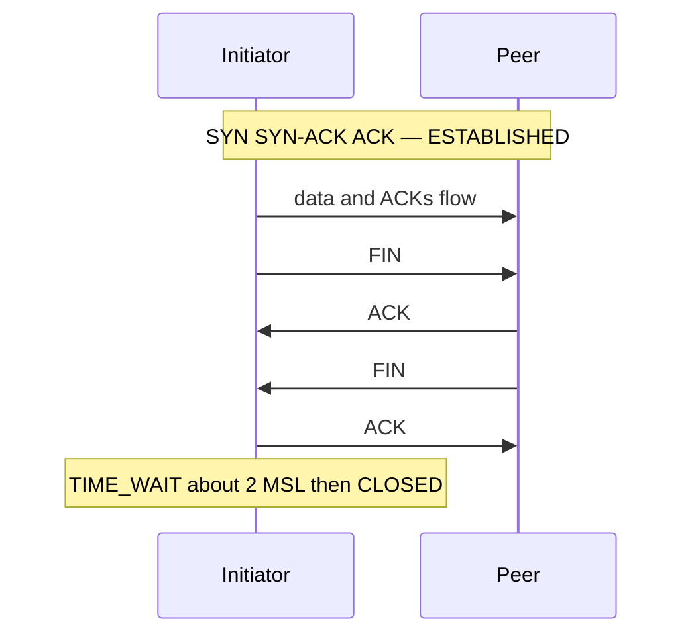

**Real-world relevance.** Tail latency, throughput on long-haul links, and "why is the first request slow but the rest fast" (slow start + handshake) all come from these mechanics. The famous **bandwidth-delay product** (BDP = bandwidth × RTT) sets how much data must be in-flight to saturate a link — too-small windows starve high-latency links.

**Pitfalls.**
- Forgetting that handshake + slow start makes the *first* request on a cold connection disproportionately expensive (~2-3 RTTs before useful data).
- Leaving Nagle on for an interactive/RPC workload → mysterious 40ms delays.
- Ignoring TIME_WAIT exhaustion in services that open many short-lived outbound connections.

> **Staff-level insight:** TCP's reliability is *ordering*, and ordering is *latency* under loss. The reason Google built QUIC and pushes BBR is that on real networks (mobile, intercontinental), loss-based congestion control + in-order delivery punish exactly the long-tail users you can least afford to lose. An EM who can connect "TCP HoL blocking" → "why we adopted HTTP/3" → "p99 mobile latency dropped" is reasoning at the level Google wants.

---

## 5. UDP & QUIC

**Definition.** **UDP** is a thin, connectionless, unreliable datagram service over IP — no handshake, no ordering, no retransmission. **QUIC** is a modern transport *built on top of UDP* that re-adds reliability, ordering-per-stream, and encryption — but smarter than TCP.

### When UDP

DNS, real-time media (VoIP, video — see [Real-Time Systems](09-realtime-systems.md)), gaming, and QUIC. You use UDP when **losing/late data is worse than retransmitting it**, or when you want to build your own transport logic in userspace.

### QUIC — why it exists

| Problem in TCP+TLS | QUIC's answer |
|---|---|
| 1 RTT TCP + 1 RTT TLS = 2-3 RTT setup | **0-RTT** (resumed) or **1-RTT** combined handshake |
| TCP HoL blocking across multiplexed streams | **Independent streams** — loss on one doesn't stall others |
| Connection breaks when IP changes (Wi-Fi → cellular) | **Connection IDs** — survives network/IP migration |
| TLS bolted on top | **Encryption built in** (always encrypted, incl. most headers) |
| Stack lives in kernel, slow to evolve | **Userspace** — ships with the app/browser |

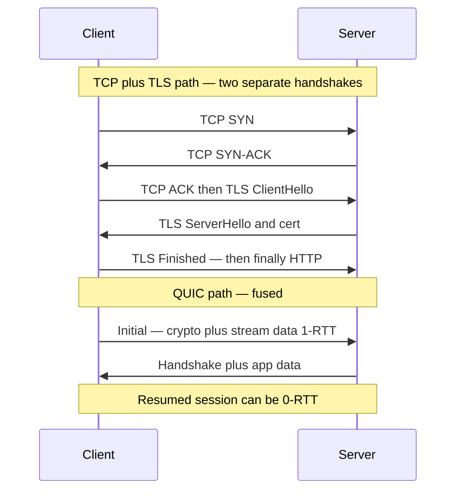

**HTTP/3 = HTTP over QUIC.** Same semantics as HTTP/2 (multiplexing, header compression via QPACK) but on QUIC, so it eliminates TCP HoL blocking and sets up faster.

**Real-world relevance.** Google serves a huge fraction of its traffic over QUIC/HTTP-3; it disproportionately helps mobile and long-distance users (lossy, high-RTT). The IP-migration feature keeps your video call alive as you walk from Wi-Fi to LTE.

**Pitfalls.**
- 0-RTT data is **replayable** — never put non-idempotent requests in the 0-RTT flight.
- Some middleboxes/firewalls throttle or block UDP/443 → need graceful fallback to TCP/HTTP-2.
- QUIC's userspace stack uses more CPU per byte than kernel TCP at very high throughput.

> **Staff-level insight:** QUIC is the cleanest example of "the layer boundary that made sense in 1980 is the bottleneck in 2020." By moving transport into userspace and fusing it with TLS, Google could iterate transport like application code instead of waiting years for kernel/OS upgrades across the internet. Framing QUIC as **organizational velocity, not just packets** is the kind of systems-and-people thinking an EM interview rewards.

---

## 6. TLS, Deep

**Definition.** TLS provides **confidentiality, integrity, and authentication** for a connection. It encrypts the data, verifies you're talking to the real server (via certificates), and detects tampering. See [Security](13-security.md) for the broader security picture.

### The handshake (1.2 vs 1.3)

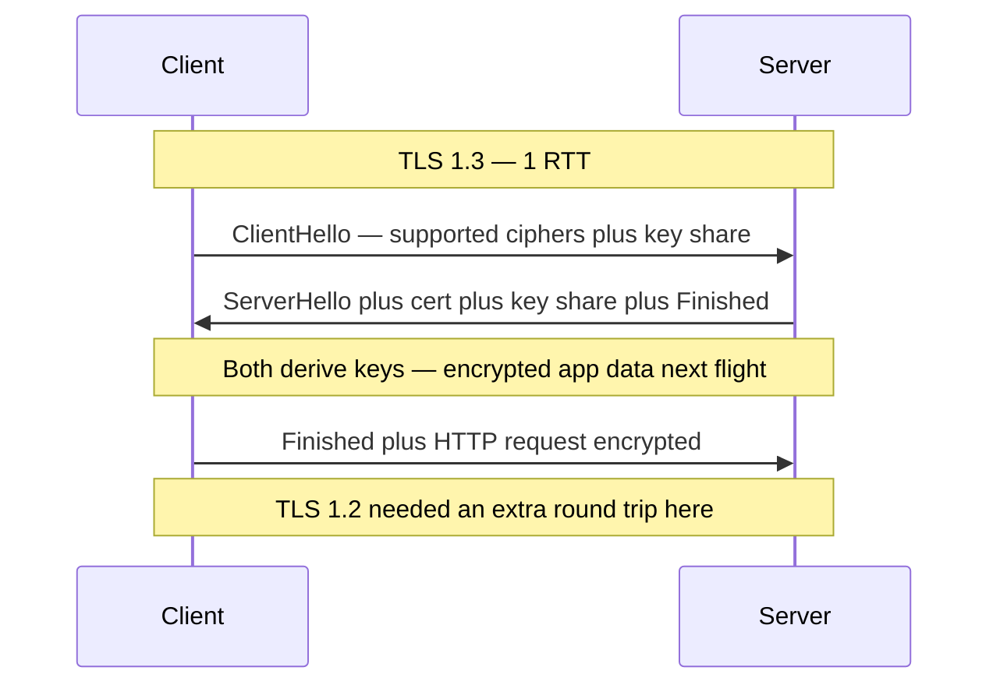

- **TLS 1.2**: 2 TLS RTTs (so ~3 RTT total cold over TCP: 1 TCP + 2 TLS); many cipher suites (some weak).
- **TLS 1.3**: **1 TLS RTT** (~2 RTT total cold over TCP), and **0-RTT** resumption (replay-unsafe for non-idempotent requests); removed legacy/insecure ciphers; **forward secrecy by default**.

### Certificates, chain of trust, CA, PKI

The server presents a **certificate** (its public key + identity) signed by a **Certificate Authority (CA)**. The client validates a **chain**: leaf → intermediate(s) → a **root CA** it already trusts (root store in OS/browser). This is **PKI** (Public Key Infrastructure). If any link fails to validate, the browser shows a security error.

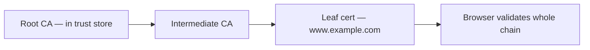

### Session resumption, SNI, mTLS, PFS

- **Session resumption** (session tickets / PSK) skips the full handshake on reconnect → cheaper, faster.
- **SNI (Server Name Indication)**: client sends the hostname *in the ClientHello* so one IP can host many TLS sites (the server picks the right cert). **ESNI/ECH** encrypts even that.
- **mTLS (mutual TLS)**: *both* sides present certs — standard for service-to-service auth inside a mesh / zero-trust network.
- **Perfect Forward Secrecy (PFS)**: ephemeral key exchange (ECDHE) means stealing the server's long-term private key *later* can't decrypt *past* sessions.

### Where to terminate TLS

| Termination point | Pros | Cons |
|---|---|---|
| **At the edge / CDN** | offload crypto, terminate close to user (fast handshake) | traffic edge→origin must be re-secured |
| **At the load balancer** | central cert management, inspect L7 | LB sees plaintext |
| **End-to-end to the app** | true E2E encryption, needed for compliance | app bears crypto cost, harder cert mgmt |
| **mTLS between services** | strong internal identity (zero-trust) | cert lifecycle/rotation overhead |

**Real-world relevance.** "Where do we terminate TLS?" is a core architecture question. CDNs terminate at the edge for handshake speed, then re-encrypt to origin. Internal microservices increasingly run **mTLS everywhere** (service mesh) for zero-trust.

**Pitfalls.**
- Shipping the leaf cert but **forgetting the intermediate** → fails on some clients (browsers may patch, but mobile/IoT won't).
- Expired certs (the perennial outage) — automate renewal (ACME/Let's Encrypt).
- Assuming TLS hides the destination — **SNI leaks the hostname** in plaintext unless ECH is used.

> **Staff-level insight:** TLS 1.3 + QUIC turned the encryption handshake from a *tax* into nearly *free* (1-RTT, even 0-RTT). The strategic shift this enabled is **"encrypt everything, including internal traffic"** — once handshakes are cheap, there's no performance excuse for plaintext, which is the foundation of zero-trust/BeyondCorp. Connecting "cheaper handshakes" → "encrypt all east-west traffic" → "zero-trust architecture" is exactly the cross-cutting reasoning Google looks for.

---

## 7. HTTP Evolution

**Definition.** HTTP is the application-layer (L7) request/response protocol of the web. Its evolution is largely a story of **reducing latency and head-of-line blocking**.

| Version | Transport | Key features | Main limitation solved / remaining |
|---|---|---|---|
| **HTTP/1.0** | TCP, new conn per request | simple request/response | new TCP handshake every request — slow |
| **HTTP/1.1** | TCP, **keep-alive** | persistent connections, chunked encoding, pipelining (rarely usable), Host header | one request at a time per connection → HoL; browsers open 6 parallel conns |
| **HTTP/2** | one TCP conn | **multiplexing** many streams, **HPACK** header compression, server push, prioritization | fixes HTTP HoL — but **TCP-level HoL remains** |
| **HTTP/3** | **QUIC over UDP** | multiplexing without TCP HoL, faster setup, conn migration, QPACK | removes TCP HoL entirely |

### Methods, status codes, headers

- **Methods**: `GET` (safe, idempotent, cacheable), `POST` (non-idempotent), `PUT`/`DELETE` (idempotent), `PATCH`, `HEAD`, `OPTIONS`.
- **Status classes**: `2xx` success, `3xx` redirect (`301` permanent, `302/307` temporary, `304` not-modified), `4xx` client error (`400`, `401`, `403`, `404`, `429` rate-limited), `5xx` server error (`500`, `502` bad gateway, `503` unavailable, `504` gateway timeout).
- **Caching headers**: `Cache-Control` (`max-age`, `no-store`, `private`/`public`), `ETag` + `If-None-Match` (revalidation → `304`), `Last-Modified`, `Vary`.
- **Cookies**: `Set-Cookie` with `HttpOnly`, `Secure`, `SameSite` (CSRF defense), `Domain`/`Path`, expiry.

**Real-world relevance.** Choosing HTTP/2 vs /3, getting caching headers right (a single bad `Cache-Control` can either melt your origin or serve stale data globally), and `SameSite`/`Secure` cookies are everyday architecture and security decisions.

**Pitfalls.**
- HTTP/1.1 **pipelining** is effectively dead (broken by proxies) — don't rely on it.
- HTTP/2 **server push** was largely removed/deprecated by browsers — prefer `103 Early Hints` / preload.
- Misusing `302` where `301` is meant (or vice versa) breaks SEO and client caching.
- Forgetting `Vary` → cache serves wrong variant (e.g. gzip vs identity, or wrong language).

> **Staff-level insight:** Every HTTP version is the same semantic protocol fighting the **same enemy: round trips and head-of-line blocking** at a lower and lower layer. 1.1 reused the connection, 2 multiplexed above TCP, 3 dropped TCP for QUIC. If you can narrate the evolution as "each version pushed the HoL fix one layer deeper until they had to replace the transport itself," you show you understand *why* the stack looks the way it does — not just *what* it is.

---

## 8. The Edge — CDN, Proxies, Firewalls, NAT, DDoS

This is where the user's request first touches the provider's infrastructure. See [Load Balancing](05-load-balancing.md) for LB depth; here's how the edge components fit together.

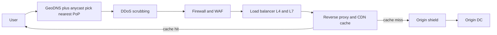

### CDN — anycast + PoPs + cache hierarchy

A **CDN** is a global mesh of **Points of Presence (PoPs)** near users. Users reach the nearest PoP via **anycast + GeoDNS**. PoPs cache static (and increasingly dynamic) content. A **cache hierarchy** — edge PoP → regional cache → **origin shield** (a single designated cache in front of origin) — collapses many edge misses into one origin fetch, protecting the origin (**origin shielding** dramatically cuts origin load and prevents thundering herds on cache expiry).

### Reverse proxy

A **reverse proxy** sits in front of servers, terminating client connections, doing TLS, caching, compression, routing, and auth — the building block of both CDNs and LBs. (Contrast: a *forward* proxy sits in front of clients.)

### Firewalls — stateful vs stateless, packet filtering

| Type | Operates at | Decision basis |
|---|---|---|
| **Stateless packet filter** | L3/L4 | per-packet rules on IP/port/protocol; no memory of flows (fast, simple) |
| **Stateful firewall** | L4 | tracks connection state; allows return traffic of established flows |
| **WAF (web app firewall)** | L7 | inspects HTTP — blocks SQLi, XSS, bad bots, enforces rules |

### NAT

**NAT (Network Address Translation)** maps many private IPs (`10.x`, `192.168.x`) to one public IP, conserving IPv4 and hiding internal topology. It rewrites source IP:port on the way out and reverses it on the way back (keeping a translation table). Side effect: complicates inbound connections (hence STUN/TURN for P2P — see [Real-Time Systems](09-realtime-systems.md)).

### DDoS scrubbing

Large providers absorb volumetric attacks at the edge via **anycast** (spreading attack traffic across many PoPs), **scrubbing centers** (filter malicious traffic, pass clean traffic), rate limiting, and SYN cookies for SYN floods.

**Real-world relevance.** Almost every modern system puts a CDN + WAF + anycast edge in front of origin. It cuts latency, absorbs attacks, offloads TLS, and shields origin — for a marginal cost.

**Pitfalls.**
- Caching responses that include personalized/auth data (leaking user A's page to user B) — set `Cache-Control: private`.
- WAF false positives blocking legitimate traffic; over-broad rules.
- Cache stampede on TTL expiry without origin shielding or request coalescing.
- Trusting the source IP behind a proxy — use `X-Forwarded-For` carefully (it's spoofable unless terminated at a trusted edge).

> **Staff-level insight:** The edge is where you convert **latency, security, and cost** problems into **someone else's anycast network**. The deepest move is **origin shielding + request coalescing**: it transforms "N million users" at the edge into "a handful of requests" at origin, which is what lets a modest origin survive global traffic. In an interview, proposing a CDN isn't enough — explaining the **cache hierarchy and shield** shows you understand how the edge actually protects the core.

---

## 9. Datacenter & Cross-DC Networking

**Definition.** Inside the datacenter, the network is engineered for massive **east-west** (server-to-server) traffic, not just **north-south** (in/out to users). Modern DCs use **Clos / spine-leaf** fabrics for high bisection bandwidth.

### Spine-leaf (Clos) fabric

- **ToR (Top-of-Rack)** switch connects all servers in a rack (L2).
- **Leaf** switches connect ToRs; **spine** switches connect all leaves. Every leaf connects to every spine → any server is **2 hops** from any other, with many equal-cost paths (ECMP).

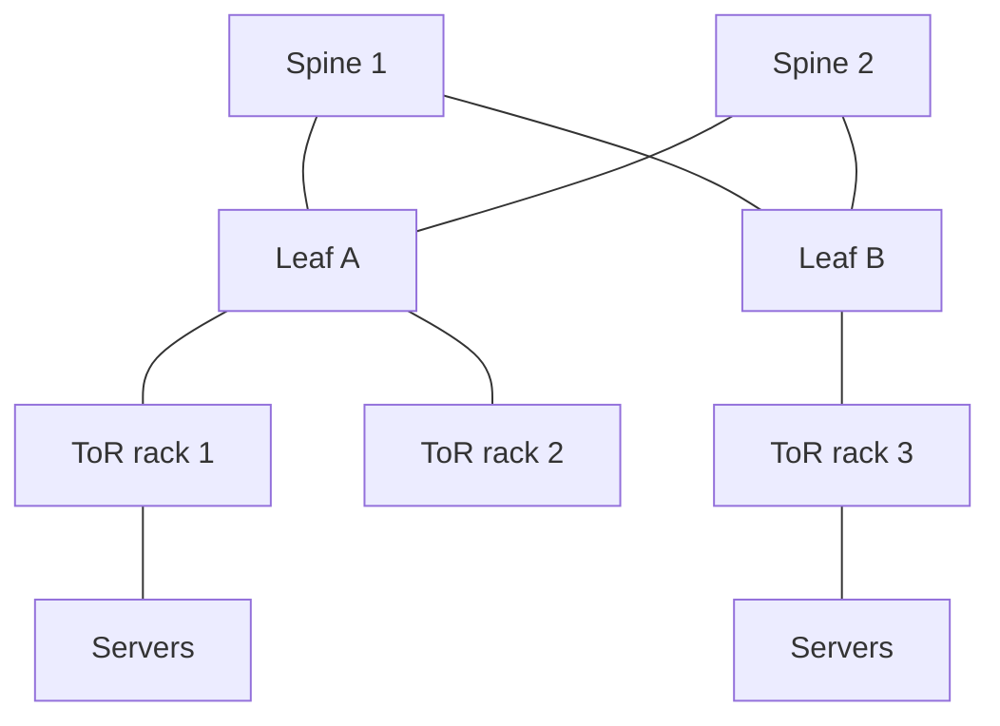

### Oversubscription, east-west vs north-south

- **Oversubscription**: more downlink (to servers) capacity than uplink (to spine). A 3:1 oversubscribed ToR assumes not all servers burst at once. Lower oversubscription = more expensive, more bisection bandwidth.
- **North-south**: traffic entering/leaving the DC (user requests). **East-west**: traffic *between* services inside (microservices, replication, MapReduce shuffle) — in modern architectures east-west dwarfs north-south, which is why fabrics optimize for it.

### Cross-DC latency — the speed-of-light tax

| Path | Approx RTT | Why |
|---|---|---|
| Same rack / DC | < 0.5 ms | local fabric |
| Same metro region | 1–2 ms | short fiber |
| Cross-region (US coast to coast) | ~60–80 ms | fiber distance |
| Intercontinental (US ↔ Europe) | ~80–100 ms | ocean fiber |
| Intercontinental (US ↔ India) | ~200+ ms | distance + routing |

Light in fiber travels ~200,000 km/s; you **cannot beat physics**. Mumbai → us-east is ~12,000 km one way → ~120ms+ RTT just for light, before any processing. This is the **speed-of-light tax** and it dictates multi-region design.

### Why cross-DC / geographic is a key NFR for Google

Google operates **multi-region** for latency (serve users from a nearby region), availability (survive a region outage), and **data locality / sovereignty** (keep data near users or within legal boundaries). The tension is **consistency vs latency**: synchronous cross-region replication pays the speed-of-light tax on every write (hence Spanner's TrueTime, async replication, or regional partitioning).

**Real-world relevance.** Any "design a global system" question is really a cross-DC question: where does data live, what's synchronous vs async, what's the consistency model, how do you fail over a region. The latency budget below makes it concrete.

**Pitfalls.**
- Synchronous writes across continents → every write costs 100ms+ RTT; users notice.
- Ignoring oversubscription → "the network is fine" until a shuffle-heavy job saturates uplinks.
- Assuming a single region is "good enough" → one region/AZ outage takes you fully down.

> **Staff-level insight:** The two unbreakable constraints in distributed systems are **the speed of light and the CAP trade-off** — and cross-DC design is where they collide. A staff engineer designs *around* latency (regional read replicas, async replication, conflict resolution, edge compute) rather than fighting it. For a Google EM, framing multi-region as **"latency, availability, and data sovereignty forcing the consistency model"** — not just "we add a second datacenter" — is the differentiator.

---

## 10. Putting It Together — Mumbai → us-east

A user in **Mumbai** loads a page whose origin lives in **us-east**, fronted by a global CDN. Here is every hop with its latency budget. (Numbers are representative.)

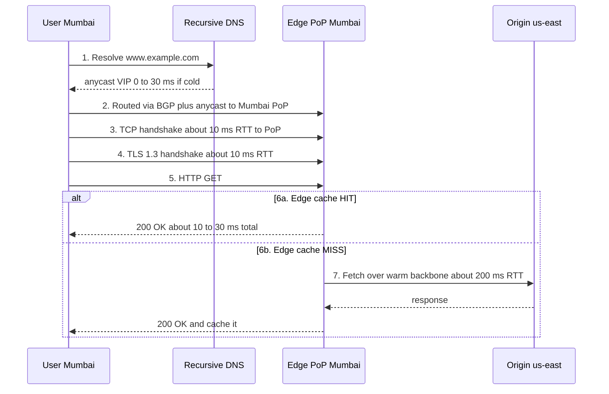

| Step | What happens | Latency budget |
|---|---|---|
| 1 | DNS resolution (cached at resolver) | 0–30 ms (often cached → ~0) |
| 2 | BGP + anycast route to nearest **Mumbai** PoP | (path setup, included below) |
| 3 | TCP handshake to local PoP (~5–10 ms RTT) | ~10 ms |
| 4 | TLS 1.3 handshake (1 RTT) — or QUIC fuses 3+4 | ~10 ms (0 with QUIC resume) |
| 5–6a | HTTP GET, **cache HIT** at edge | **total ~20–40 ms** |
| 7 | **Cache MISS** → fetch from us-east origin over warm backbone | + ~200 ms RTT |
| 8 | Origin DC: spine-leaf fabric, service mesh, DB read | + ~1–10 ms internal |

**The lesson:** The CDN's entire value is converting a **200 ms** intercontinental round trip into a **20–40 ms** local one for cacheable content — and even on a miss, the warm, optimized backbone (persistent connections, BBR, private fiber) beats the open internet. QUIC/HTTP-3 further shaves the handshake. This single diagram ties together DNS, BGP/anycast, TCP, TLS, HTTP, the CDN edge, and cross-DC latency — the whole module in one request.

---

## Interview Cheat-Sheet

| Concept | One-liner to say in the room |
|---|---|
| **Layers** | "Switch = L2/MAC, router = L3/IP, L4 LB = IP:port, L7 LB/WAF = HTTP." |
| **CIDR** | "/24 = 256 IPs; longest-prefix match wins in the routing table." |
| **BGP** | "ASes advertise prefixes; routes follow *policy/economics*, not geography. Hijacks → use RPKI." |
| **Anycast** | "One IP announced from many PoPs; BGP routes you to the nearest." |
| **DNS path** | "Stub → recursive → root → TLD → authoritative; cached by TTL; DNS is a SPOF → multi-provider." |
| **TCP setup** | "1 RTT handshake + slow start; first request is the expensive one — reuse connections." |
| **HoL blocking** | "TCP delivers in order → one lost packet stalls all HTTP/2 streams → QUIC fixes it." |
| **Congestion** | "CUBIC (loss-based, Linux default) vs BBR (bandwidth/RTT-based, great on lossy/long links)." |
| **QUIC/HTTP-3** | "TCP+TLS fused over UDP; 0–1 RTT, no TCP HoL, survives IP migration." |
| **TLS 1.3** | "1 RTT (0-RTT resume), forward secrecy by default; chain of trust leaf→intermediate→root CA." |
| **TLS terminate** | "At the edge for handshake speed; mTLS internally for zero-trust." |
| **CDN edge** | "anycast + GeoDNS + cache hierarchy + origin shield; converts 200ms → 20ms." |
| **Firewall** | "Stateless packet filter (L3/4) vs stateful (tracks flows) vs WAF (L7/HTTP)." |
| **NAT** | "Many private IPs → one public IP via translation table; complicates inbound (STUN/TURN)." |
| **DC fabric** | "Spine-leaf/Clos → any server 2 hops away, ECMP, optimized for east-west." |
| **Cross-DC** | "Speed-of-light tax: ~200ms RTT Mumbai↔us-east → forces async replication / regional reads." |

**Key numbers to memorize:** Ethernet MTU **1500 B**; TCP handshake **1 RTT**; TLS 1.3 **1 RTT** (0-RTT resume); same-DC RTT **<0.5 ms**; US coast-to-coast **~60–80 ms**; US↔India **~200 ms**; light in fiber **~200,000 km/s**; TIME_WAIT **~60 s (2×MSL)**.

---

## Common Interview Questions

1. **"Walk me through exactly what happens when I type a URL and press Enter."**
   Hit all seven stages: DNS resolution (stub→recursive→root→TLD→auth, cached by TTL) → BGP/anycast routing to nearest PoP → TCP handshake → TLS handshake → HTTP request → edge cache hit/miss → origin response. Mention layering and a latency number or two. This is *the* question.

2. **"What's the difference between an L4 and an L7 load balancer? When use which?"**
   L4 balances on IP:port (fast, protocol-agnostic, can do DSR, can't read URLs); L7 reads HTTP and routes by host/path/cookie, terminates TLS, does WAF. Use L4 for raw throughput / non-HTTP; L7 for smart routing, canaries, TLS offload. Cross-link [Load Balancing](05-load-balancing.md).

3. **"How does the internet decide the path my packet takes? What if I want one IP to serve users globally?"**
   BGP between autonomous systems, policy-driven (peering/transit economics), longest-prefix match per router. For global single-IP: **anycast** — announce the prefix from every PoP and BGP routes each user to the nearest.

4. **"DNS is up but every record is correct — why might users still not reach the site? And how do you make DNS resilient?"**
   TTL caching of a stale/failed-over IP, resolver/anycast issues, DNSSEC validation failure, or a DDoS on the DNS provider (Dyn 2016). Resilience: multi-provider DNS, anycast, sensible TTLs, monitor resolution end-to-end. DNS is a SPOF.

5. **"Why is the first request on a new connection slow, and how do you fix tail latency from it?"**
   TCP handshake (1 RTT) + TLS (1 RTT) + slow start (cwnd ramps over several RTTs). Fix: connection reuse/keep-alive, HTTP/2 multiplexing, TLS session resumption, QUIC 0-RTT, pre-warmed pools, terminate at a nearby edge.

6. **"Explain head-of-line blocking and how HTTP/2 vs HTTP/3 deal with it."**
   HTTP/1.1: one request per connection (app-level HoL). HTTP/2: multiplexes streams over one TCP conn — fixes app HoL but a single lost TCP packet stalls *all* streams (transport HoL). HTTP/3 over QUIC: independent streams, so loss on one doesn't block others.

7. **"Walk through the TLS handshake. What changed in 1.3, and where would you terminate TLS?"**
   ClientHello (ciphers + key share) → ServerHello + cert + key share → both derive keys. 1.3 = 1 RTT (0-RTT resume), forward secrecy by default, dropped weak ciphers. Terminate at the edge/CDN for handshake speed (re-encrypt to origin), or mTLS internally for zero-trust. Cross-link [Security](13-security.md).

8. **"Design a globally low-latency read for users in Mumbai when data lives in us-east. What's the limiting factor?"**
   Speed of light: ~200 ms RTT. Use CDN edge caching + origin shield for static; regional read replicas / edge compute for dynamic; async replication so writes don't pay cross-region RTT; accept eventual consistency where possible, or Spanner-style for strong. The physics sets the agenda.

9. **"When would you choose UDP/QUIC over TCP, and what are the risks?"**
   Real-time media, gaming, DNS, and HTTP/3 (mobile/long-haul). Benefits: no HoL, faster setup, IP migration. Risks: 0-RTT replay (idempotency), middlebox/UDP blocking → need TCP fallback, higher CPU. Cross-link [Real-Time Systems](09-realtime-systems.md).

10. **"How would you defend a global service against a volumetric DDoS while keeping legit users fast?"**
    Anycast edge to spread attack across PoPs, scrubbing centers to filter, rate limiting and SYN cookies, WAF for L7 attacks, origin shielding so the core never sees raw traffic, and over-provisioned edge capacity. Keep the origin hidden behind the CDN.

---

*Next: revisit [Load Balancing](05-load-balancing.md) and [Security](13-security.md) to connect the edge and PKI to full architectures, and [Real-Time Systems](09-realtime-systems.md) for UDP/QUIC in media.*
