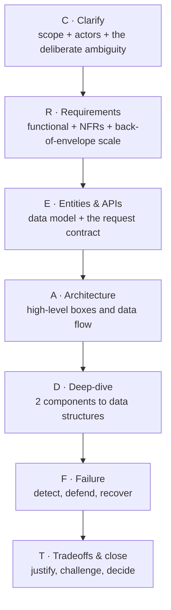
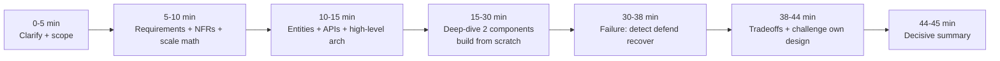
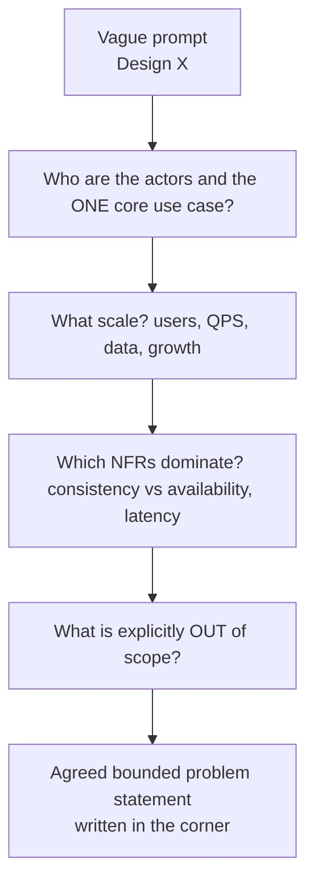
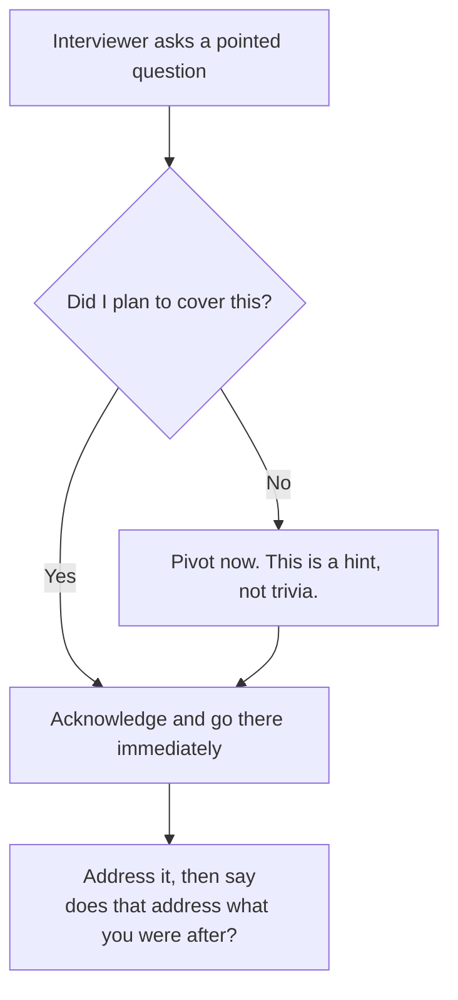

# 26 · The Google System-Design Delivery Playbook

> Your pre-interview ritual page. Read this in the 30 minutes before a Google System-Design round.

This module is the **Google-specific delivery playbook**. It does not teach you *new* system design — modules [18a](18a-design-chat-social.md)–[18d](18d-design-infra-primitives.md) do that. It teaches you to **deliver what Google grades**. Google's published prep guidance emphasizes these attributes (this is candidate prep / recruiter coaching, not a verbatim graded interviewer scoring rubric — Google does not publish that) so you spend your 45 minutes generating exactly the signals their interviewers score, in the order they expect them.

It complements [Staff-Level Execution](20-staff-execution.md) (general staff delivery) by being narrow and ruthless: Google's five graded attributes, their exact NFR list, their "detect & defend failure" expectation, and their "build from scratch" bias.

## What you'll master

- The **five attributes Google actually grades** — and the one sentence each one wants to hear.
- A **minute-by-minute 45-minute structure** you can run on autopilot under pressure.
- The **full Google NFR clarification checklist** — including the ones candidates forget: cross-datacenter, privacy, legal, geographic.
- The **"detect & defend & recover from failure" overlay** you apply to *every* design (this is a whole graded attribute most candidates underweight).
- The **"build from scratch vs name a product"** decision guide — Google penalizes "just use a standard DB and query it."
- The **"coherent design > correct tradeoff"** framing — Google grades that you understand *implications*, not that you pick the "right" answer.
- Scripts for **challenging your own design**, **justifying every decision**, and **not ignoring interviewer hints**.
- A **reusable framework** that answers *any* SD question, plus a one-page cheat-sheet and 4 worked example walkthroughs.

## Table of Contents

- [1. What Google Actually Grades](#1-what-google-actually-grades)
- [2. The Reusable Framework (one framework for any question)](#2-the-reusable-framework-one-framework-for-any-question)
- [3. The 45-Minute Minute-by-Minute Structure](#3-the-45-minute-minute-by-minute-structure)
- [4. Attribute 1 — Clarify the Deliberately-Underspecified Problem](#4-attribute-1--clarify-the-deliberately-underspecified-problem)
- [5. The Full NFR Clarification Checklist](#5-the-full-nfr-clarification-checklist)
- [6. Attribute 2 — Break Down High-Level AND Deep-Dive](#6-attribute-2--break-down-high-level-and-deep-dive)
- [7. Attribute 3 — Tradeoffs: Coherent Design > Correct Tradeoff](#7-attribute-3--tradeoffs-coherent-design--correct-tradeoff)
- [8. Attribute 4 — Detect, Defend & Recover From Failure](#8-attribute-4--detect-defend--recover-from-failure)
- [9. Attribute 5 — Build From Scratch vs Name a Product](#9-attribute-5--build-from-scratch-vs-name-a-product)
- [10. Delivery Behaviors — Challenge, Justify, Don't Ignore Hints](#10-delivery-behaviors--challenge-justify-dont-ignore-hints)
- [11. Distributing a Computation Over Many Machines](#11-distributing-a-computation-over-many-machines)
- [Interview Cheat-Sheet](#interview-cheat-sheet)
- [Common Interview Questions](#common-interview-questions)

---

## 1. What Google Actually Grades

Google's published prep guidance frames the SD interview as: *"Combine knowledge, theory, experience and judgement to solve a real-world problem **with significant ambiguity**."* The ambiguity is **deliberate**. They under-specify on purpose to see whether you probe boundaries or charge ahead building the wrong thing.

Google's published prep guidance emphasizes **five attributes** (prep / recruiter coaching, not a verbatim graded scoring rubric). Internalize them — each maps to a phase of your 45 minutes.

| # | Attribute | What it grades | The one sentence they want to hear |
|---|-----------|----------------|-------------------------------------|
| 1 | **Clarify** | Do you probe a deliberately-underspecified problem and bound it? | "Before I design, let me pin down scope, scale, and the NFRs that change the architecture." |
| 2 | **Break down + deep-dive** | Can you give a high-level decomposition AND deep-dive how a component *works internally*? | "Here's the whole system; now let me deep-dive two components down to data structures and algorithms." |
| 3 | **Tradeoffs** | Do you understand the *implications* of choices (not pick the 'right' one)? | "Either works; I'll pick X because it's coherent with my consistency requirement — and here's what it costs me." |
| 4 | **Recover from failure** | How do you **detect** and **defend against** failures at scale? | "Now let me walk the failure modes: how I detect them, defend against them, and recover." |
| 5 | **Build from scratch** | Can you build a primitive from first principles, not just name a product? | "Rather than 'use a database,' here's how I'd build this index/cache/log from scratch and why." |

> **Google-signal:** The interviewer is *guiding*, not testing trivia. Treat the round as a **collaborative design session** with a senior peer. Think out loud, propose, get reaction, refine. Silence and a perfect monologue both score *worse* than a noisy collaboration.

Logistics to internalize so they don't surprise you:
- **~45 minutes**, virtual whiteboard (**Google Drawings**) — practice drawing boxes-and-arrows fast and ugly. Legibility > beauty.
- You may get **two SD rounds**. Don't blow your whole repertoire in round one; both are internet-scale.
- As an **EM candidate**, you still design hands-on. The bonus signal is *judgment*: you frame tradeoffs the way you'd want your team to, and you reason about cost, operability, and org-scaling implications — not just throughput.

---

## 2. The Reusable Framework (one framework for any question)

Google explicitly says: *"develop a framework you can use to answer most questions."* Here is yours. It is the spine for every walkthrough in this module. Memorize the seven letters: **C-R-E-A-D-F-T**.

| Step | Letter | Output you must produce | Maps to graded attribute |
|------|--------|--------------------------|--------------------------|
| 1 | **C**larify | Bounded problem statement, agreed in-scope / out-of-scope | 1 |
| 2 | **R**equirements | Functional list + NFR numbers (QPS, latency, data size) | 1 |
| 3 | **E**ntities & APIs | Core data model + 2-3 key endpoints | 2 |
| 4 | **A**rchitecture | One diagram, end-to-end data flow | 2 |
| 5 | **D**eep-dive | ≥2 components to algorithms/data structures | 2, 5 |
| 6 | **F**ailure | Detect / defend / recover walk | 4 |
| 7 | **T**radeoffs & close | Decisions justified, design challenged, decisive ending | 3 |

> **Google-signal:** Saying out loud *"I run the same framework every time: clarify, requirements, entities, architecture, deep-dive two components, failure, tradeoffs"* in the first 30 seconds is itself a positive signal. It tells the interviewer you have a repeatable method — exactly what an EM is supposed to give a team.

---

## 3. The 45-Minute Minute-by-Minute Structure

This is the budget. Keep a running clock. The two most common failures are (a) clarifying for 15 minutes and never deep-diving, and (b) skipping failure entirely. The budget protects against both.

| Time | Phase | What you do | Watch-out |
|------|-------|-------------|-----------|
| 0–5 | Clarify | Ask the 5 scoping questions. Write agreed scope in a corner. | Don't design yet. |
| 5–10 | Requirements + NFRs | Functional bullets + back-of-envelope (DAU, QPS, storage/day, peak factor). Volunteer the NFR list. | Always do the math out loud. |
| 10–15 | Entities + APIs + arch | Data model, 2–3 endpoints, one high-level diagram. | Keep it brute-force first; improve later. |
| 15–30 | Deep-dive (the big block) | Pick 2 components. Go to data structures. Build the primitive from scratch. | This is where most points live. Protect this block. |
| 30–38 | Failure | Apply the detect/defend/recover overlay to the hot paths. | Don't wait to be asked. Volunteer it. |
| 38–44 | Tradeoffs + challenge | Name 2–3 forks, state implications, challenge your own choices. | "Coherent," not "correct." |
| 44–45 | Close | One-paragraph decisive summary: what, why, what you'd do next. | End decisively, not trailing off. |

> **Google-signal:** Announce the budget: *"I've got ~45 minutes — I'll spend the first ten bounding the problem, then most of the time deep-diving two components and failure modes."* This signals time-management and that you *know failure is graded* before you've even started.

---

## 4. Attribute 1 — Clarify the Deliberately-Underspecified Problem

The prompt will be vague *on purpose* — e.g., "Design a ride-sharing backend." Your job is to **converge** it. Use a clarification funnel: from the open problem, narrow to a crisp, bounded statement you and the interviewer agree on.

The five questions to always ask first:

1. **Who & what** — "Who are the users, and what is the single most important thing they do?" (Pin the *one* core use case; defer the rest.)
2. **Scale** — "Roughly how many users / QPS / data volume, and what growth?" (Drives every later decision.)
3. **Read vs write shape** — "Is this read-heavy or write-heavy, and what's the fan-out?" (Feed = read-heavy fan-out; logging = write-heavy.)
4. **Consistency vs availability** — "If a network partition hits, do we prefer stale-but-up or correct-but-down?" (CAP positioning up front.)
5. **Scope cut** — "Should I include auth / payments / analytics, or assume they exist?" (Get permission to *not* build things.)

> **Google-signal:** *Write the agreed scope down* (in a Drawings corner) and refer back to it. Re-bounding mid-interview ("you mentioned cross-region — does that change my consistency assumption?") shows you treat requirements as a living contract. That is the *judgment* signal an EM is hired for.

---

## 5. The Full NFR Clarification Checklist

Google explicitly tells candidates to **volunteer** non-functional requirements: *performance, latency, legal, privacy, maintainability, capacity, security, geographic, and **cross-datacenter**.* Most candidates name throughput and stop. Naming the *unusual* ones (legal, privacy, geographic, cross-DC) is a strong differentiator. Walk this table; you don't need all of them, but you must *consider* all of them out loud.

| NFR | The question to ask | Why it changes the architecture |
|-----|---------------------|----------------------------------|
| **Performance / throughput** | "What peak QPS and what's the peak-to-average ratio?" | Sizing, sharding, queue depth, autoscaling triggers. |
| **Latency** | "What's the p99 latency budget for the core path?" | Caching tiers, edge/CDN, sync vs async, colocating data. |
| **Capacity** | "Data volume now and in 3 years? Retention?" | Storage tiering, sharding strategy, archival/cold storage. |
| **Availability** | "What's the SLO — three nines, four nines? Cost of downtime?" | Redundancy depth, failover automation, multi-region. |
| **Consistency** | "Strong, read-your-writes, or eventual — and where?" | Quorum vs async replication, conflict resolution. |
| **Cross-datacenter** | "Single region or multi-region active-active? RTO/RPO?" | Replication topology, conflict handling, geo-routing, split-brain defense. |
| **Geographic** | "Where are users? Data-residency constraints? Edge presence?" | Region placement, latency to users, sovereign data stores. |
| **Privacy** | "Is there PII? Do we need encryption, deletion (GDPR right-to-erasure), consent?" | Encryption at rest/in transit, tokenization, deletion pipelines, audit. |
| **Legal / compliance** | "GDPR / CCPA / HIPAA / PCI? Data retention or residency law?" | Where data may live, what must be logged, retention windows. |
| **Security** | "Authn/authz model? Threat model? Abuse / DoS surface?" | Token design, rate limiting, isolation, encryption, least privilege. |
| **Maintainability / operability** | "Who operates this? How do we deploy, observe, roll back?" | Service boundaries, observability, config, blast-radius limits. |
| **Cost** | "Any cost ceiling? Is compute or storage the constraint?" | Tier choices, sampling, retention, batch vs realtime. |

> **Google-signal:** Cross-datacenter and privacy/legal are the two clusters candidates skip. One sentence each — *"Since users are global, I'll assume multi-region; that forces me to choose between active-active with conflict resolution or active-passive with a higher RPO,"* and *"If there's PII, GDPR right-to-erasure means my storage needs a real deletion path, not just tombstones in a log"* — visibly raises your score.

Always do **back-of-envelope math** in this phase, out loud:
- DAU → requests/user/day → average QPS → **× peak factor (3–10×)** (derive it from the traffic shape, don't apply a fixed multiplier blindly) → peak QPS.
- Payload size × write QPS → bytes/sec → **storage/day → storage/year**.
- Replication factor × storage = real footprint; cache working-set = hot-fraction × dataset.

---

## 6. Attribute 2 — Break Down High-Level AND Deep-Dive

This attribute is **two things**: a clean high-level decomposition *and* a deep-dive into how a component **works internally**. Many candidates do only the first (boxes and arrows) and stall at "...and this service handles that." Google wants you to go *down* into one or two components — to data structures, algorithms, and the actual mechanism.

**High level (10–15 min):** one diagram. Clients → gateway/LB → services → data stores → async pipeline. Show the *data flow* for the core use case, not an org chart.

**Deep-dive (15–30 min):** pick **two** components and go deep. For each, cover:

| Deep-dive lens | What to say |
|----------------|-------------|
| **Data structure** | The actual structure: hash ring, LSM-tree, skip list, inverted index, bloom filter, ring buffer. |
| **Algorithm** | The mechanism: consistent hashing, quorum reads, leader election, merge of sorted runs, fan-out-on-write. |
| **Partitioning** | How it shards: by key range, by hash, by entity; how it rebalances. |
| **Replication** | Sync/async, quorum, leader/follower; how it stays consistent. |
| **Hot-path numbers** | Where the QPS lands, what's cached, what the p99 is, where the bottleneck is. |

> **Google-signal:** Pick deep-dive components where you can genuinely go to **data structures and trade reasoning**, not just naming a tech. "The message fan-out service uses a write-ahead log partitioned by conversation-id; each shard is an append-only segment file with an in-memory index — here's how reads hit it" scores far higher than "Kafka handles fan-out."

Pair this with [Build From Scratch](21-build-from-scratch.md) and [Distributed Computation](23-distributed-computation.md) for the actual primitives.

---

## 7. Attribute 3 — Tradeoffs: Coherent Design > Correct Tradeoff

This is the single most misunderstood Google signal. Their guidance is explicit: *"we want a **coherent** design rather than evaluating if a specific tradeoff is 'correct'."* They are grading that you understand the **implications** of a choice — not that you pick the option they had in mind. There is no answer key.

So your job at every fork is: **name the fork → state both implications → pick one *consistent with your stated NFRs* → name what it costs you.**

**The tradeoff script (use this exact shape every time):**

> "I have a choice here between **A** and **B**.
> **A** gives me [benefit] but costs me [implication].
> **B** gives me [other benefit] but costs me [other implication].
> Given my earlier requirement that [NFR], I'll go with **A** — accepting that [the cost]. If [NFR] flipped, I'd switch to B."

Concrete example phrasings:

- *"Fan-out-on-write makes reads cheap but writes expensive and bursty for celebrity accounts; fan-out-on-read is the opposite. Since I said this is read-heavy with a p99 budget on the timeline, I'll fan out on write — and handle the celebrity tail as a hybrid, reading their posts at query time. The cost is write amplification, which I'll bound by capping fan-out."*
- *"Strong consistency via quorum costs me latency and availability under partition; eventual consistency costs me read-your-writes correctness. My NFR was availability-first, so I'll take eventual consistency and add a read-your-writes session guarantee on the user's own writes — the cost is more client complexity."*

> **Google-signal:** Never say "X is better than Y." Say *"X is **coherent with** my requirement, and here's the cost."* Coherence with your *own stated NFRs* is the rubric. Picking the "wrong" option but reasoning the implication correctly *passes*. Picking the "right" option with no implication reasoning *fails*.

---

## 8. Attribute 4 — Detect, Defend & Recover From Failure

Google asks directly: *"How do you **detect** and **defend** against failures?"* — at scale. This is a **whole graded attribute**, and it is the one candidates most often skip because they run out of time. The 45-min budget reserves minutes 30–38 for it. **Volunteer it; don't wait to be asked.**

Apply this three-layer overlay to *every* hot path in your design.

```mermaid
flowchart LR
    subgraph DETECT
      H[Health checks &amp; heartbeats]
      T[Timeouts &amp; deadlines]
      AN[Anomaly &amp; SLO alerts]
    end
    subgraph DEFEND
      R[Redundancy &amp; replication]
      RT[Retries with backoff &amp; jitter]
      CB[Circuit breakers]
      GD[Graceful degradation]
      BP[Backpressure &amp; load shedding]
      ID[Idempotency]
    end
    subgraph RECOVER
      FO[Failover &amp; leader election]
      RP[Replay from log]
      RC[Reconciliation &amp; repair]
      DR[Cross-region DR]
    end
    DETECT --> DEFEND --> RECOVER
```

| Layer | Mechanism | The sentence to say | Where it applies |
|-------|-----------|----------------------|------------------|
| **Detect** | Health checks / heartbeats | "Each node heartbeats; the LB / coordinator evicts on missed beats." | Every stateful node, every pool. |
| **Detect** | Timeouts & deadlines | "Every RPC has a deadline; I propagate it so I don't wait on a dead dependency." | All cross-service calls. |
| **Detect** | Anomaly / SLO alerting | "I alert on error-rate and p99 breach, not just hard-down." | The whole service. |
| **Defend** | Redundancy / replication | "N+1 replicas per shard across failure domains; no single AZ is a SPOF." | All stateful storage. |
| **Defend** | Retries + backoff + jitter | "Retries use exponential backoff with jitter to avoid retry storms." | Transient failures. |
| **Defend** | Circuit breakers | "If a dependency error-rate spikes, I trip the breaker and fail fast." | Downstream dependencies. |
| **Defend** | Graceful degradation | "If the recommender is down, I serve a cached / default feed, not an error." | User-facing reads. |
| **Defend** | Backpressure / load shedding | "Under overload I shed low-priority traffic and signal upstream to slow down." | Ingest, queues, gateways. |
| **Defend** | Idempotency | "Writes carry an idempotency key so retries don't double-apply." | All mutating paths. |
| **Recover** | Failover / leader election | "On leader loss, the followers elect a new leader; clients re-resolve." | Replicated stateful systems. |
| **Recover** | Replay from log | "I rebuild state by replaying the durable log from the last checkpoint." | Stream/state recovery. |
| **Recover** | Reconciliation / repair | "A background job re-syncs replicas and repairs drift (anti-entropy)." | Eventually-consistent stores. |
| **Recover** | Cross-region DR | "If a region fails, I fail over to the standby region within my RTO/RPO." | Multi-region. |

> **Google-signal:** Pick your *single most critical component* and walk it through all three layers end-to-end — "here's how the message store detects a node loss, defends with quorum, and recovers via log replay and anti-entropy." One component walked fully beats twelve mechanisms name-dropped. See [Reliability](11-reliability.md) for depth.

---

## 9. Attribute 5 — Build From Scratch vs Name a Product

Google's guidance is blunt: *"avoid 'use a standard database and query it'; how do you build it from scratch?"* They are testing whether you understand the **machinery underneath** the products. This does NOT mean reinvent Postgres for every question. It means: **at the core primitive, build from first principles; at the periphery, name a product and move on.**

**Decision guide — build vs name:**

| Build it from scratch when... | Name a product when... |
|-------------------------------|-------------------------|
| It's the **core challenge** of the question (the cache in "design a distributed cache"). | It's **supporting infrastructure** not under test (auth, a CDN, object storage). |
| The interviewer asks "how does that work internally?" | A standard component genuinely solves it and isn't the point. |
| It's a **primitive**: ID generator, cache, index, log, rate limiter, queue. | Reuse is the *right engineering call* and you can say why. |
| Going deeper reveals interesting tradeoffs (data structure, partitioning). | Going deeper adds no signal. |

The from-scratch building blocks you should be fluent in (these are the recurring "core challenge" primitives):

| Primitive | Build-from-scratch story |
|-----------|---------------------------|
| **Distributed cache** | Consistent-hash ring, sharded LRU per node, replication, hot-key handling, write-through vs write-back. |
| **ID generator** | Timestamp + machine-id + sequence (Snowflake-style); clock-skew handling; monotonicity vs k-sortedness. |
| **Index / search** | Inverted index, posting lists, sharded by term or doc, merge of sorted runs, top-k. |
| **Log / message bus** | Partitioned append-only segments, offsets, in-memory index, retention, consumer groups. |
| **Rate limiter** | Token bucket / sliding window; where state lives; distributed counters; approximate vs exact. |
| **KV store** | LSM-tree (memtable + SSTables + compaction) or B-tree; WAL; bloom filters; quorum replication. |

> **Google-signal:** Make the build/name call *explicit* and *justified*: *"Auth isn't the interesting part here, so I'll assume an existing identity service. The interesting part is the cache, so let me build that from scratch — consistent hashing, per-node LRU, and replication."* Naming the boundary IS the judgment signal. Blindly building everything from scratch wastes your 45 minutes; blindly naming products fails the rubric. See [Build From Scratch](21-build-from-scratch.md) and [Google Papers](22-google-papers.md).

---

## 10. Delivery Behaviors — Challenge, Justify, Don't Ignore Hints

The rubric rewards *how* you reason, not just the artifact. Three behaviors carry disproportionate weight.

### 10.1 Challenge your own design

Google: *"constantly challenge your own design."* Don't wait for the interviewer to find the hole — find it first.

Scripts:
- *"Let me stress-test my own design: what breaks at 10× traffic? ... My fan-out service does, so I'd add a hybrid read path for hot keys."*
- *"The weakest part of this design is X — if I had more time, the first thing I'd harden is the single coordinator, because it's a SPOF."*
- *"I'm assuming the working set fits in cache; if it doesn't, my latency story falls apart, so let me check that assumption."*

### 10.2 Justify every decision

Google: *"justify every decision."* No silent choices. Every box and arrow gets a *because*.

- Not: "I'll use a message queue." But: "I'll use a queue **because** ingest is bursty and I need to decouple write spikes from downstream processing rate."
- Not: "Shard by user-id." But: "Shard by user-id **because** the access pattern is per-user and it co-locates a user's data, avoiding scatter-gather reads."

### 10.3 Don't ignore hints

Google: the interviewer's questions are **guiding** you. A hint like "what happens during a region outage?" is not curiosity — it's *"go to multi-region failure now."*

> **Google-signal:** Repeating a hint back and pivoting — *"Good prompt — you're pointing me at the region-outage case; let me design the failover path now"* — scores on both *collaboration* and *failure-handling*. Plowing past a hint to finish your own monologue is one of the most common silent failures.

---

## 11. Distributing a Computation Over Many Machines

Google's guidance notes questions are *"typically around distributing a computation over multiple machines."* Have a ready mental checklist for any "do this big computation at scale" prompt (counting, aggregating, indexing, training, joining):

| Question | What to decide |
|----------|----------------|
| **How do I partition the work?** | By key (hash/range), by data shard, by time window. |
| **How do I combine partial results?** | Map → combine → reduce; partial aggregates; mergeable sketches (HLL, count-min). |
| **Where does state live?** | Stateless workers + external store, or stateful shards with local state + checkpoints. |
| **How do I handle stragglers / skew?** | Speculative execution, work-stealing, salting hot keys. |
| **How do I handle a worker dying mid-job?** | Idempotent tasks, re-assign the partition, replay from checkpoint. |
| **Batch or streaming?** | Bounded reprocess-friendly batch, or low-latency streaming with windowing + watermarks. |
| **Exactly-once vs at-least-once?** | Idempotency keys + dedup, or accept at-least-once with idempotent sinks. |

> **Google-signal:** Frame it as map/combine/reduce + "how a failed partition is re-run from a checkpoint." That single sentence covers partitioning, combination, and failure recovery at once. See [Distributed Computation](23-distributed-computation.md).

---

## Interview Cheat-Sheet

> The whole playbook on one page. Read this 5 minutes before the round.

**The five graded attributes:** Clarify · Break-down + Deep-dive · Tradeoffs (coherent > correct) · Detect/Defend/Recover failure · Build from scratch.

**The framework — C-R-E-A-D-F-T:** Clarify → Requirements → Entities/APIs → Architecture → Deep-dive 2 → Failure → Tradeoffs/close.

**45-min budget:** 0–5 clarify · 5–10 requirements + NFR + math · 10–15 entities/APIs/arch · **15–30 deep-dive 2 (build from scratch)** · **30–38 failure** · 38–44 tradeoffs/challenge · 44–45 decisive close.

**First 60 seconds, say:** *"I'll bound the problem first, then most of my time goes to deep-diving two components and walking failure modes. I run a fixed framework: clarify, requirements, entities, architecture, deep-dive, failure, tradeoffs."*

**5 clarifying questions:** Who & core use case · Scale/QPS/growth · Read vs write shape · Consistency vs availability · What's out of scope.

**NFRs to volunteer (don't skip the last cluster):** performance · latency · capacity · availability · consistency · **cross-DC · geographic · privacy · legal · security** · maintainability · cost.

**Tradeoff script:** "A gives X costs Y; B gives Z costs W; given my NFR [N] I'll take A, accepting [cost]; if [N] flipped I'd switch."

**Failure overlay (apply to hot paths):** Detect = heartbeats · timeouts · anomaly/SLO. Defend = redundancy · retry+backoff+jitter · circuit-breaker · graceful degradation · backpressure · idempotency. Recover = failover/election · log replay · reconciliation/anti-entropy · cross-region DR.

**Build vs name:** Build the *core primitive* from scratch (cache/ID/index/log/limiter/KV); *name a product* for supporting infra — and **say which and why**.

**Behaviors:** Think out loud (brute-force → improve) · justify every box with "because" · challenge your own design before they do · treat pointed questions as hints and pivot · end decisively.

**Don't:** design before clarifying · skip the math · skip failure · say "X is better" (say "coherent with my NFR") · ignore a hint · trail off at the end.

---

## Common Interview Questions

Four of Google's example domains, each a short *model walkthrough* applying the playbook. The point is the **shape and signals**, not exhaustive design — see the design playbooks ([18a](18a-design-chat-social.md), [18d](18d-design-infra-primitives.md)) for full depth.

### Q1 — Design a Distributed Cache

- **Clarify:** "Read-through cache in front of a slow store? What's the hit-rate target, eviction policy, and is consistency with the backing store required?" Out of scope: the backing store itself.
- **NFRs:** single-digit-ms p99 on hit (reserve sub-ms for a local L1 tier); multi-region? If yes, per-region caches (don't replicate cache cross-DC — re-warm locally). Capacity = hot-fraction × dataset.
- **Build from scratch (core):** Consistent-hash ring over N nodes so adding a node moves ~1/N keys. Per-node sharded LRU (memtable + intrusive linked list + hashmap). Replication factor 2 for availability; write-through vs write-back tradeoff.
- **Deep-dive 2:** (a) Hot-key problem — a single celebrity key overloads one shard; fix with per-key replication / client-side caching of hottest keys. (b) Consistency — TTL + invalidation-on-write; the stampede problem on expiry, solved with request coalescing / probabilistic early refresh.
- **Failure:** Detect via heartbeats; node loss → ring re-hashes its slice, cold-miss to backing store (graceful degradation, not error). Defend backing store with a circuit breaker + request coalescing so a cache flush doesn't stampede the DB. Recover by re-warming from traffic.
- **Tradeoff & close:** "Write-through keeps cache and store coherent but adds write latency; write-back is fast but risks data loss on node death. My NFR was read-latency with a durable backing store, so write-through — accepting the write cost. **Final: consistent-hash ring, per-node LRU, RF=2, write-through, coalesced refresh.**"

### Q2 — Design a Distributed Unique ID Generator

- **Clarify:** "64-bit IDs? Must they be strictly monotonic, or just roughly time-sortable (k-sorted)? QPS? Tolerable to have gaps?" Roughly-sortable + no central coordinator is the usual sweet spot.
- **NFRs:** 100k+ IDs/sec, p99 < 1ms, no SPOF, IDs must not collide across regions/DCs.
- **Build from scratch (core):** Snowflake layout — 1 unused sign bit (always 0) + 41-bit ms timestamp + 10-bit machine-id + 12-bit sequence = 64 bits. No coordination on the hot path; machine-id assigned at startup.
- **Deep-dive 2:** (a) Clock skew / NTP going backwards — refuse to issue (block briefly) or borrow from sequence bits; never emit a smaller timestamp. (b) Machine-id allocation — a small coordination service (or ZooKeeper-style lease) hands out unique ids; what happens on lease expiry.
- **Failure:** Detect clock-rollback locally and stall rather than collide. Defend uniqueness with disjoint machine-id ranges per region (encode region in the machine bits) so cross-DC IDs can't collide. Recover a node by re-leasing its machine-id on restart.
- **Tradeoff & close:** "A central counter gives strict monotonicity but is a throughput SPOF; Snowflake gives only k-sortedness but scales linearly with no coordination. My NFR was no-SPOF at high QPS, so Snowflake — accepting that IDs are only roughly ordered. **Final: timestamp+machineid+sequence, region-encoded, clock-rollback-safe.**"

### Q3 — Design a Stock-Exchange / Real-Time Aggregator

- **Clarify:** "Are we matching orders (an exchange) or aggregating a price feed (a ticker)? Latency budget — microseconds for matching vs milliseconds for a consumer feed? Correctness: can we ever lose or reorder a trade?" Assume: order-matching core + fan-out of the price feed.
- **NFRs:** Matching = strict ordering + exactly-once, ultra-low latency, durability of every order. Feed fan-out = millions of read subscribers, eventual is fine, freshness in ms.
- **Build from scratch (core):** Matching engine = single-threaded, in-memory order book per symbol (price-level → FIFO queue), partitioned by symbol so each symbol is one logical sequencer. A durable append-only log (WAL) records every order *before* matching, giving total order + replay.
- **Deep-dive 2:** (a) Order book data structure — sorted price levels (skip list / array of buckets) with FIFO queues; match crosses the spread in O(1) at the top of book. (b) Fan-out — read-heavy: publish trades to a partitioned log, edge servers tail it and push to subscribers; this is the distributed-computation/fan-out piece.
- **Failure:** Detect engine failure via heartbeat. Defend with a hot standby replaying the same WAL (state-machine replication) so failover is deterministic; idempotent order ids prevent double-execution on client retry. Recover by replaying the WAL from the last snapshot — the order book is fully reconstructable.
- **Tradeoff & close:** "Single-threaded per-symbol matching caps throughput per symbol but guarantees deterministic ordering — essential for an exchange; sharding by symbol recovers horizontal scale. I take the per-symbol cap because correctness/ordering is non-negotiable here. **Final: per-symbol single-writer in-memory book, WAL for order + replay, hot-standby failover, log-fan-out for the feed.**"

### Q4 — Design a Social Feed (read-heavy fan-out)

- **Clarify:** "Chronological or ranked? How many follows per user (fan-out size)? Are there celebrity accounts with millions of followers? Read:write ratio?" Assume ranked-ish, read-heavy, with celebrities.
- **NFRs:** p99 feed load < 200ms; eventual consistency acceptable; global users → multi-region reads; privacy/legal: block lists and right-to-erasure.
- **Build from scratch (core):** Per-user timeline store — each user has a precomputed feed (sorted list of post-ids) in a sharded store; fan-out-on-write pushes a new post into followers' timelines.
- **Deep-dive 2:** (a) Hybrid fan-out — fan-out-on-write for normal users (cheap reads) but **pull** for celebrities at read time and merge, capping write amplification. (b) Ranking/merge — read top-k from the pushed timeline, merge with pulled celebrity posts, score and return; this is a bounded merge of sorted runs.
- **Failure:** Detect fan-out worker lag via queue depth + SLO. Defend reads with graceful degradation (serve a slightly-stale cached feed if ranking is down); idempotent fan-out so a retried post isn't double-inserted. Recover the timeline store via replicas + anti-entropy; rebuild a corrupt timeline by replaying recent posts from followees.
- **Tradeoff & close:** "Pure fan-out-on-write makes reads trivial but explodes on celebrities; pure fan-out-on-read makes writes trivial but reads expensive. Since I'm read-heavy with a tight p99, I take a hybrid — write-fan-out for the masses, read-pull for the tail — accepting the added complexity. **Final: hybrid fan-out, per-user timeline shards, bounded top-k merge, degrade-to-cached on ranking failure.**"

---

**Cross-links:** [Staff-Level Execution](20-staff-execution.md) · [Build From Scratch](21-build-from-scratch.md) · [Google Papers](22-google-papers.md) · [Distributed Computation](23-distributed-computation.md) · [Reliability](11-reliability.md) · Design playbooks [18a](18a-design-chat-social.md) / [18d](18d-design-infra-primitives.md)
