# 27 — Low-Level Design (LLD) & Object-Oriented Design (OOD)

The definitive LLD/OOD reference for the **Google Engineering Manager** interview. Distributed-systems (HLD) design is covered elsewhere in this course; this module supplies the **object-oriented / low-level** layer that Google's EM prep guide explicitly calls out: *"feature sets, interfaces, class hierarchies, designing under constraints, simplicity, robustness, tradeoffs."*

## What You'll Master

By the end of this module you will be able to:

- **Recognize** in the first 60 seconds whether a prompt is an LLD/OOD problem or a distributed-systems problem — and drive each differently.
- Apply **SOLID, DRY/YAGNI/KISS, Law of Demeter, and coupling/cohesion** as design *forces*, not trivia.
- Run a **repeatable LLD interview framework**: requirements → actors/use-cases → entities & methods → interfaces → relationships → state machines → algorithms → concurrency → extensibility review.
- Reach for the **right design pattern** for a given problem — and justify why, including when *not* to use one (e.g., Singleton as an anti-pattern).
- Design **clean interfaces and class hierarchies** that are open for extension: idempotency, pagination, versioning, error models, contracts.
- Handle **concurrency in object design**: immutability, locking strategy, thread-safe singletons, producer-consumer.
- Deliver **complete worked designs** for a Parking Lot, Rate Limiter, Elevator, Movie-Ticket Booking, and a Notification Dispatcher.

As an EM candidate you are judged not just on the design but on **how you lead the discussion**: structured thinking, surfacing trade-offs out loud, and knowing when to stop gold-plating.

---

## Table of Contents

1. [In the Room — When It's LLD, Not HLD](#in-the-room--when-its-lld-not-hld)
2. [OOD Foundations](#ood-foundations)
3. [The LLD Interview Process — A Repeatable Framework](#the-lld-interview-process--a-repeatable-framework)
4. [Essential Design Patterns](#essential-design-patterns)
   - [Creational](#creational-patterns)
   - [Structural](#structural-patterns)
   - [Behavioral](#behavioral-patterns)
   - [Which Pattern Solves Which Problem](#which-pattern-solves-which-problem)
5. [API & Interface Design](#api--interface-design)
6. [Concurrency in LLD](#concurrency-in-lld)
7. [Worked LLD Problems](#worked-lld-problems)
   - [Parking Lot](#worked-problem-1--parking-lot)
   - [Rate Limiter](#worked-problem-2--rate-limiter-object-design)
   - [Elevator System](#worked-problem-3--elevator-system-state-machine)
   - [Movie-Ticket Booking](#worked-problem-4--movie-ticket-booking-bookmyshow)
   - [Notification Dispatcher](#worked-problem-5--notification-dispatcher)
8. [Interview Cheat-Sheet](#interview-cheat-sheet)
9. [Common Interview Questions](#common-interview-questions)

**Related modules:** [Microservices](10-microservices.md) · [Architecture Patterns](15-architecture-patterns.md) · [APIs in Fundamentals](01-fundamentals.md) · [Build From Scratch](21-build-from-scratch.md) · Concurrency (module 24) · Distributed Rate Limiting (module 18d)

---

## In the Room — When It's LLD, Not HLD

The single most common failure mode is **answering the wrong question**. A candidate hears "design a parking lot" and starts drawing load balancers and sharded databases. The interviewer wanted classes, interfaces, and a state machine. Or the reverse: someone hears "design a URL shortener" and spends 30 minutes on the `URL` class while the interviewer wanted capacity estimates and partitioning.

### How to recognize an LLD/OOD prompt

| Signal | Likely LLD / OOD | Likely HLD / Distributed |
| --- | --- | --- |
| Verb in the prompt | "design the **classes** / **objects** / **API**" | "design the **system** / **at scale**" |
| Scope cue | A single machine, a library, an SDK | Millions of users, multiple services |
| Named real-world object | Parking lot, elevator, deck of cards, chess, vending machine, file system | Twitter feed, search, ride-sharing, payments |
| What earns points | Clean interfaces, SOLID, extensibility, patterns | Partitioning, replication, CAP, caching, queues |
| Follow-ups | "How would you add a new vehicle type?" | "What happens when a data center fails?" |

Many prompts are **hybrids** (e.g., movie-ticket booking has both an OOD core *and* a consistency problem). The right move is to **ask which layer they want** and state the assumption explicitly.

> **The first move that wins the room:** *"I can take this at the class/interface level — entities, relationships, and how it stays extensible — or at the distributed-systems level — partitioning, replication, scale. Given the framing, I'll start with the object model and surface the distributed concerns where they touch it. Stop me if you'd rather I pivot."* This shows you can read the room and that you know both layers exist.

### The decisive delivery pattern

Whatever the prompt, drive an LLD interview in this order — out loud:

1. **Clarify requirements** — functional and non-functional; what's in scope. Lock it before coding.
2. **Identify actors & use cases** — who uses it, what they do.
3. **Identify entities (nouns → classes) and behaviors (verbs → methods).**
4. **Define interfaces / abstractions** before concrete classes — program to the contract.
5. **Establish relationships** — association, aggregation, composition, inheritance.
6. **Model lifecycle with state machines** where objects have meaningful states.
7. **Specify core algorithms** — the one or two methods that carry real logic (e.g., slot allocation, fare calc).
8. **Walk a concrete use case** end-to-end through your objects to prove it works.
9. **Address concurrency** — shared mutable state, locking, atomicity.
10. **Extensibility review** — "Now suppose requirement X changes" → show SOLID paying off.

> **Staff-level insight:** Juniors jump straight to classes. Seniors spend the first five minutes on requirements and the last five on extensibility. As an EM, *narrate the framework* ("First I'll nail requirements, then actors, then the object model…") — you're demonstrating the structured approach you'd want your team to use, not just solving a puzzle.

---

## OOD Foundations

These are the *forces* that shape every class you draw. Reference them by name when you justify a decision.

### The four pillars, applied

| Pillar | One-line | In the interview |
| --- | --- | --- |
| **Encapsulation** | Hide internal state; expose behavior through methods. | Never expose a public mutable collection; return copies or read-only views. |
| **Abstraction** | Model the essential, ignore the incidental. | Depend on `PaymentMethod`, not `CreditCard`. |
| **Inheritance** | "Is-a" reuse of type and behavior. | Use sparingly; deep hierarchies are a smell. |
| **Polymorphism** | One interface, many implementations chosen at runtime. | The engine of every Strategy/State/Factory design. |

### Composition over inheritance

Favor **"has-a" over "is-a."** Inheritance binds you to the parent's implementation forever and explodes combinatorially (a `FlyingSwimmingDuck` vs. composing `FlyBehavior` + `SwimBehavior`).

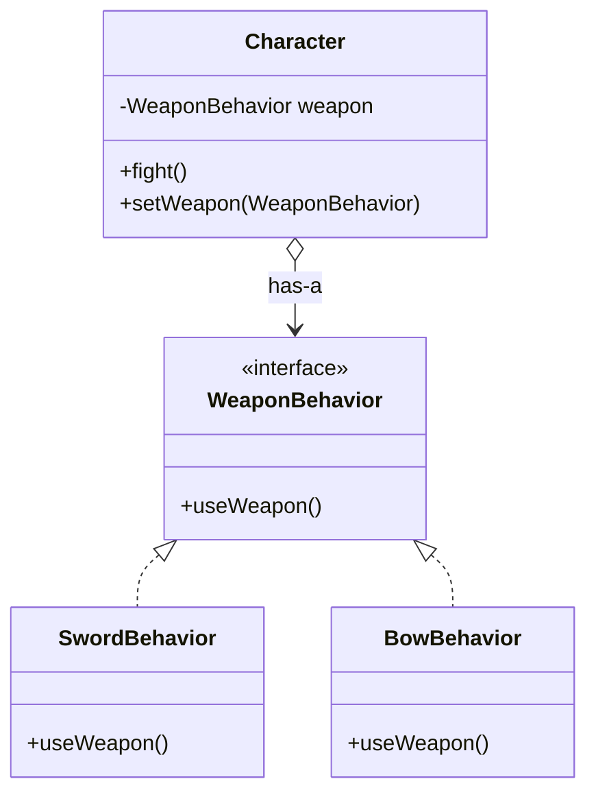

A `Character` *composes* a `WeaponBehavior` it can swap at runtime, instead of subclassing `SwordCharacter`, `BowCharacter`, etc.

> **Staff-level insight:** When you say "composition over inheritance," follow it with the concrete consequence: *swappable at runtime, avoids the fragile base class, and sidesteps the subclass explosion.* That sentence signals you've felt the pain in production, not read it on a slide.

### SOLID — each with the smell it prevents

| Principle | One-line | Smell it prevents |
| --- | --- | --- |
| **S** — Single Responsibility | A class has one reason to change. | The "God class" / `Manager` that does parsing, validation, persistence, and emailing. |
| **O** — Open/Closed | Open for extension, closed for modification. | Editing a giant `switch(type)` every time a new type appears. |
| **L** — Liskov Substitution | Subtypes must be usable wherever the base type is, without surprises. | `Square extends Rectangle` breaking `setWidth`; a `ReadOnlyList` that throws on `add`. |
| **I** — Interface Segregation | Many small interfaces beat one fat one. | A `Worker` interface forcing a `Robot` to implement `eat()`. |
| **D** — Dependency Inversion | Depend on abstractions, not concretions. High-level code shouldn't know low-level details. | `OrderService` doing `new MySqlRepository()` instead of taking a `Repository` interface. |

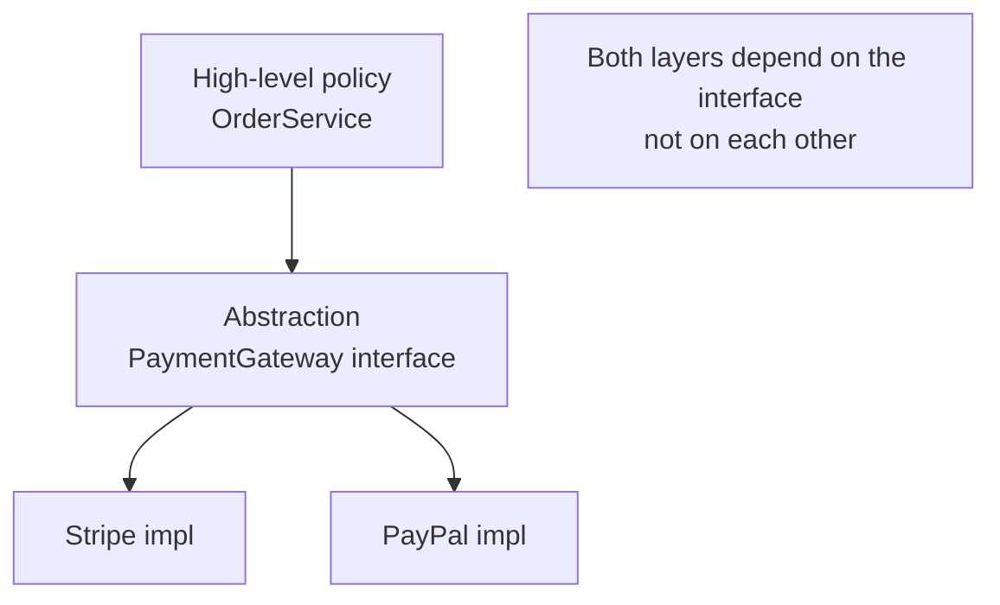

### DRY, YAGNI, KISS, and the Law of Demeter

- **DRY** (Don't Repeat Yourself) — one authoritative place for each piece of knowledge. *But* premature DRYing of coincidentally-similar code creates worse coupling than duplication — prefer the "rule of three."
- **YAGNI** (You Aren't Gonna Need It) — don't build for imagined futures. In an interview, resist designing for requirements no one asked for; *mention* the extension point instead of building it.
- **KISS** (Keep It Simple) — the simplest design that satisfies the requirements wins. Reaching for a pattern that isn't needed is a red flag, not a green one.
- **Law of Demeter** ("don't talk to strangers") — a method should call methods on itself, its parameters, objects it creates, and its direct fields — not `a.getB().getC().doThing()`. Train-wreck chains leak structure and couple you to it.

### Coupling vs. cohesion

- **Coupling** = how much classes depend on each other. *Aim low.* Loose coupling = changes stay local.
- **Cohesion** = how focused a class is on a single purpose. *Aim high.* High cohesion = each class earns its name.

> **Staff-level insight:** "Low coupling, high cohesion" is the *outcome* SOLID exists to produce. When an interviewer asks "is this a good design?", answer in those terms: *"It's loosely coupled — `Service` depends on the `Repository` interface, so I can swap storage without touching business logic — and each class is cohesive: `PricingEngine` only prices."* You've turned a vibe into a measurable claim.

---

## The LLD Interview Process — A Repeatable Framework

Use this framework on every LLD prompt. It is your visible structure.

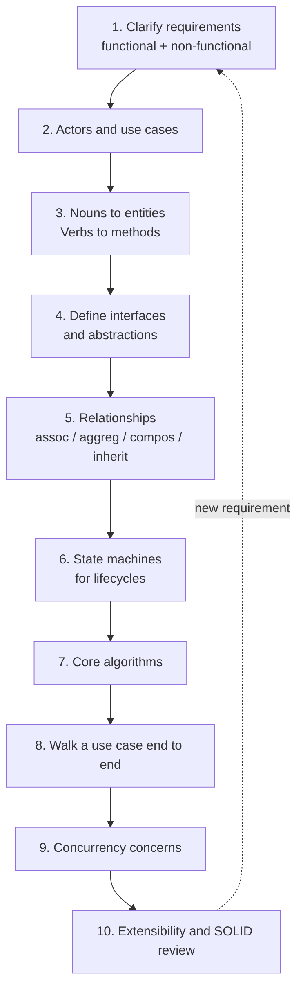

### Step detail

1. **Requirements.** Separate functional ("a user can park a car") from non-functional ("thread-safe, supports 10k slots"). Write down explicit non-goals.
2. **Actors & use cases.** List actors (Customer, Admin, System). Each gets a few verbs.
3. **Nouns → classes, verbs → methods.** Scan the requirements text. `ParkingLot`, `Vehicle`, `Spot`, `Ticket` are nouns; `park`, `unpark`, `calculateFee` are verbs. This is a *starting* set, not the answer.
4. **Interfaces first.** What contracts exist? `PaymentStrategy`, `Repository`, `PricingPolicy`. Program to these so concrete classes are swappable (Dependency Inversion).
5. **Relationships.** Be precise about the four kinds:

   | Relationship | Meaning | Lifetime | UML | Example |
   | --- | --- | --- | --- | --- |
   | Association | "uses-a" / knows-about | independent | `-->` | `Driver --> Car` |
   | Aggregation | "has-a", shared, weak | independent | `o-->` | `Team o--> Player` |
   | Composition | "owns-a", strong, exclusive | dies together | `*-->` | `House *--> Room` |
   | Inheritance | "is-a" | n/a | `<|--` | `Car <|-- ElectricCar` |

6. **State machines.** If an object has a lifecycle (Order: Created→Paid→Shipped→Delivered), draw it. State transitions reveal validation rules and the State pattern.
7. **Core algorithms.** Identify the 1–2 methods with real logic and describe them (slot-finding strategy, fare calculation, scheduling).
8. **Use-case walkthrough.** Pick the main flow and trace the calls across objects. This catches missing methods and bad ownership.
9. **Concurrency.** Where is shared mutable state? (Seat inventory, slot count.) Decide your locking/atomicity strategy.
10. **Extensibility review.** The interviewer *will* mutate a requirement. Pre-empt it: "If we add a new vehicle type, I add a class — no existing code changes (Open/Closed)."

> **Staff-level insight:** The framework itself is the deliverable an EM is being tested on. Even if you don't finish the design, demonstrating a calm, repeatable method — and pruning scope under time pressure (YAGNI) — reads as senior. Saying *"I'll stub the payment integration as an interface and not implement it — out of scope for what we're testing"* is a maturity signal, not a cop-out.

---

## Essential Design Patterns

Patterns are a shared vocabulary, not a checklist. Reach for one only when the problem *has the shape* the pattern solves. Naming a pattern you don't need is worse than naming none.

### Creational Patterns

#### Factory Method & Abstract Factory

**Definition.** Factory Method defers instantiation to a method so callers don't `new` concrete classes. Abstract Factory groups related factories to produce families of objects.
**When to use.** Object creation depends on a type/config and you want to keep `switch(type)` in one place (Open/Closed).

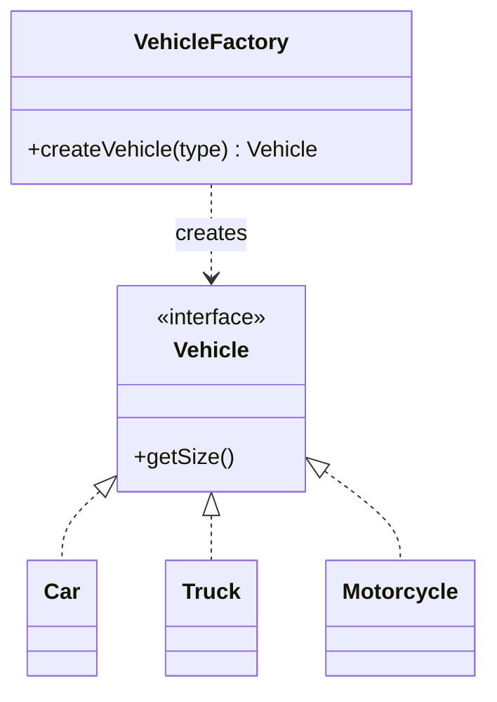

**Trade-off.** Centralizes creation and enables polymorphism, but adds a layer; overkill if you only ever build one type.
**Pitfalls.** A factory that grows a giant `switch` is just the smell relocated — pair with a registry map for true Open/Closed.

> **Staff-level insight:** A factory's real value is that the *rest of the code never sees concrete types*. If you find `instanceof` checks downstream, your factory leaked.

#### Builder

**Definition.** Construct a complex object step-by-step; separate construction from representation.
**When to use.** Many optional parameters; you want immutable objects without telescoping constructors.

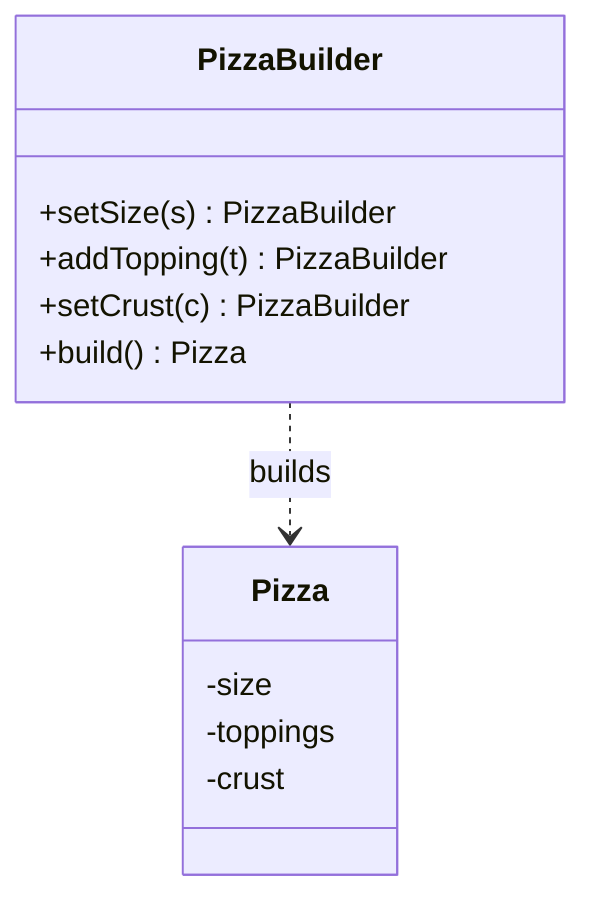

**Trade-off.** Readable fluent construction and immutability; more boilerplate than a constructor.
**Pitfalls.** Forgetting to validate in `build()` lets half-built objects escape.

#### Singleton (and why it's often an anti-pattern)

**Definition.** Guarantee one instance with a global access point.
**When (rarely) to use.** Genuinely-single resources: a config registry, a connection pool, a logger.

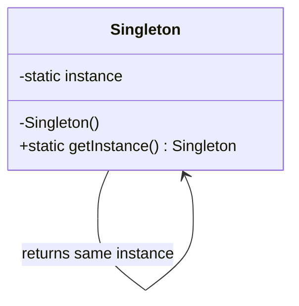

**Why it's often an anti-pattern.** It's **global mutable state**: hidden dependencies (callers don't declare it), hard to unit-test (can't substitute a mock), and tricky to make thread-safe. It violates Single Responsibility (the class manages both its job *and* its lifecycle) and Dependency Inversion (callers reach for the concrete singleton).
**Better.** Create one instance at the composition root and **inject** it. Same single-ness, none of the global-state pain.

> **Staff-level insight:** Volunteer the critique before the interviewer does: *"I'd make `Config` a singleton — but I'd inject it rather than call `getInstance()` everywhere, so it stays testable and the dependency is explicit."* That one sentence separates strong engineers from pattern-memorizers. (Thread-safe construction → see [Concurrency in LLD](#concurrency-in-lld).)

### Structural Patterns

#### Adapter

**Definition.** Convert one interface into another the client expects.
**When to use.** Integrating a third-party/legacy class whose interface you can't change.

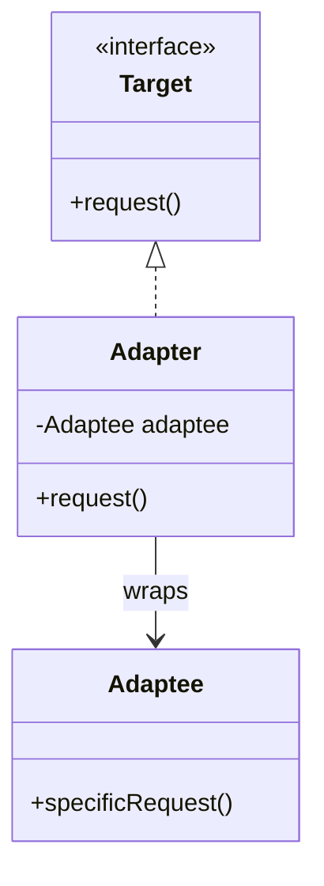

**Trade-off.** Decouples client from a foreign API; another indirection layer.
**Pitfalls.** Don't let an adapter quietly add logic — it should translate, not decide.

#### Decorator

**Definition.** Attach responsibilities to an object dynamically by wrapping it; both implement the same interface.
**When to use.** You need combinable, optional behaviors (compression + encryption on a stream; toppings on a coffee) without a subclass per combination.

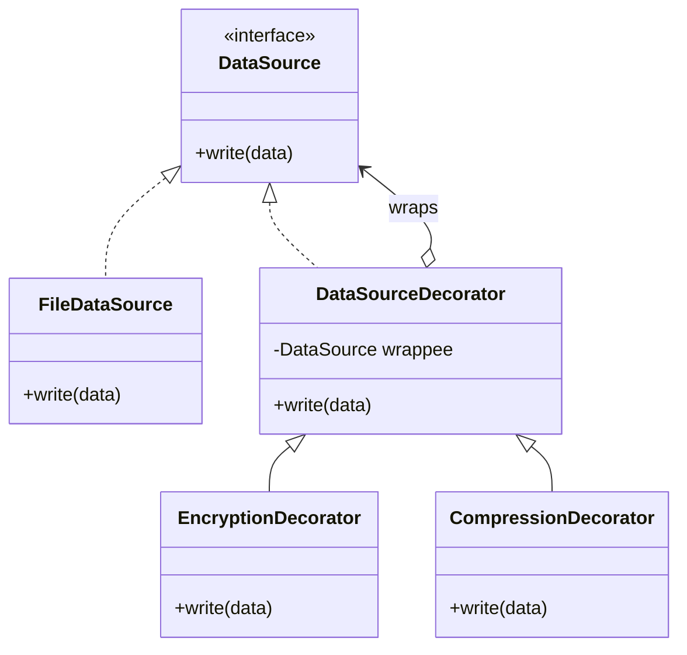

**Trade-off.** Beats subclass explosion; but many small wrappers can be hard to debug (deep stack).
**Pitfalls.** Order matters (encrypt-then-compress ≠ compress-then-encrypt) — make it explicit.

#### Facade

**Definition.** A single simplified interface over a complex subsystem.
**When to use.** Hide a messy set of collaborators behind one entry point (`OrderFacade.placeOrder()` orchestrating inventory, payment, shipping).

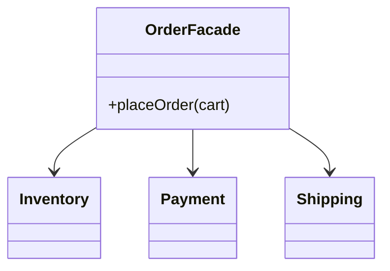

**Trade-off.** Reduces coupling for clients; can become a God object if it accretes logic.

#### Proxy

**Definition.** A stand-in that controls access to another object (lazy-loading, access control, caching, remote).
**When to use.** Add cross-cutting control without changing the real subject — virtual proxy (defer expensive init), protection proxy (authz), caching proxy.

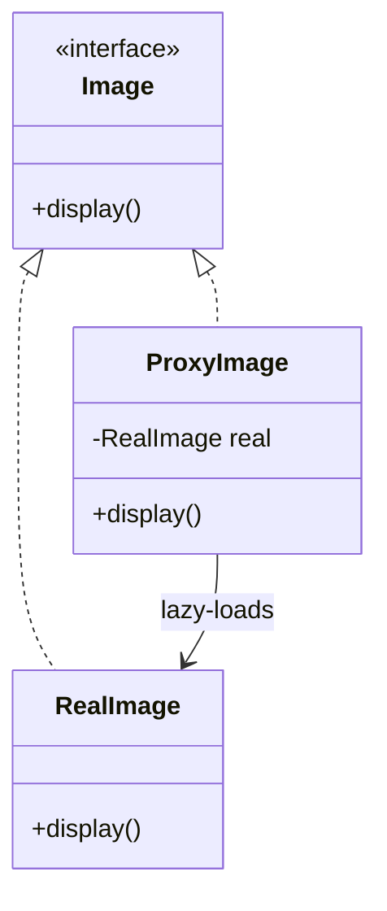

**Trade-off.** Transparent to clients; adds latency/indirection. Note Decorator *adds behavior*, Proxy *controls access* — same shape, different intent.

#### Composite

**Definition.** Treat individual objects and compositions of objects uniformly via a common interface (tree structures).
**When to use.** Part-whole hierarchies: file systems (file vs. folder), UI widgets, org charts.

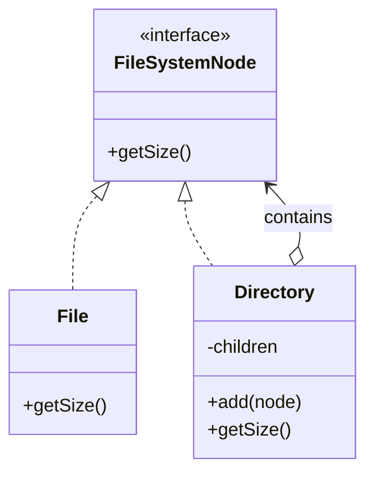

> Note: the legend reserves composition `*-->` for owned children that die with their parent; Composite is conventionally drawn with **aggregation** `o-->` here because nodes can be re-parented (moved between directories) rather than being exclusively owned.

**Trade-off.** Clients ignore leaf-vs-composite; but the shared interface can get watered down (a `File.add()` that's meaningless).

### Behavioral Patterns

#### Strategy

**Definition.** Encapsulate interchangeable algorithms behind a common interface; pick one at runtime.
**When to use.** Multiple ways to do one thing — payment methods, pricing policies, parking-fee calculators, sort orders.

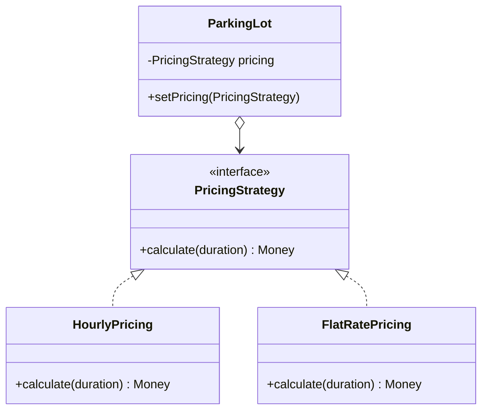

**Trade-off.** Open/Closed for new algorithms; more classes. *This is the most-used LLD pattern* — reach for it whenever you see a `switch` over behavior.

> **Staff-level insight:** Strategy is how you make code Open/Closed in practice. When you spot a `switch(type)` selecting *behavior* (not just creation), that's a Strategy waiting to be born.

#### Observer

**Definition.** A subject notifies a list of observers automatically when its state changes.
**When to use.** One-to-many event propagation — notification dispatch, UI binding, pub/sub within a process.

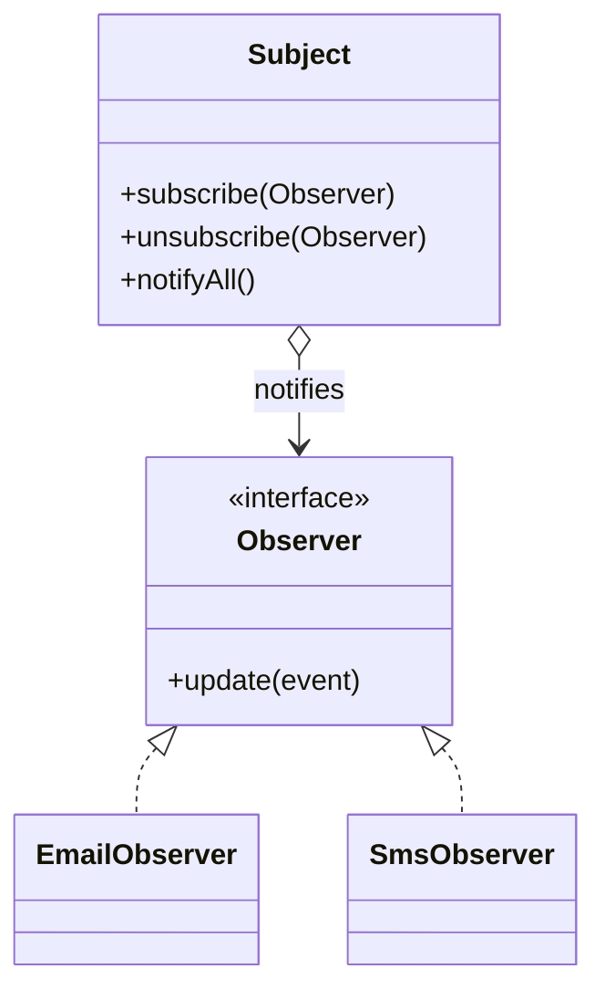

**Trade-off.** Decouples producers from consumers; notification order is undefined and runaway chains are hard to trace. (At scale this becomes a message queue — see [Microservices](10-microservices.md).)

#### State

**Definition.** An object alters its behavior when its internal state changes; each state is a class.
**When to use.** Lifecycle objects whose allowed operations depend on current state — elevator, order, traffic light, TCP connection.

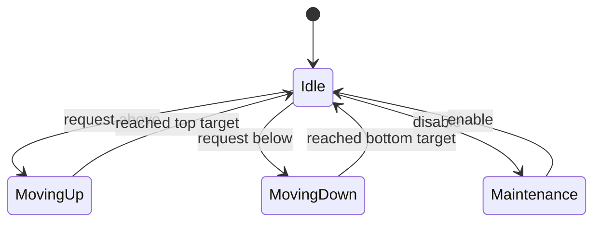

**Trade-off.** Replaces sprawling `if(state==X)` checks with polymorphism; adds a class per state. State and Strategy share structure — State transitions *itself*, Strategy is chosen by the client.

#### Command

**Definition.** Encapsulate a request as an object — enabling queueing, logging, undo/redo.
**When to use.** Undo stacks, job queues, transactional operations, macro recording.

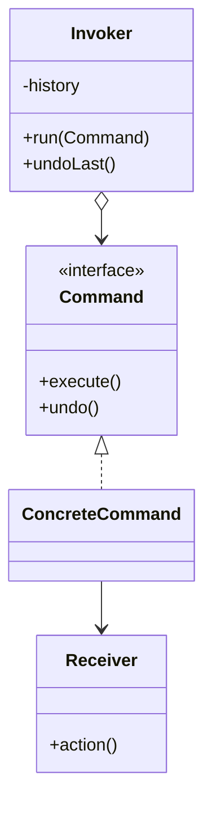

**Trade-off.** First-class operations unlock undo/queue/log; one class per action.

#### Template Method

**Definition.** Define the skeleton of an algorithm in a base method, deferring specific steps to subclasses.
**When to use.** A fixed sequence with pluggable steps (parse → validate → transform → save, where only transform varies).

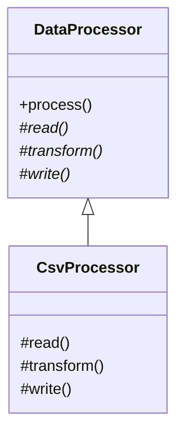

**Trade-off.** Reuses the invariant skeleton; relies on inheritance (vs. Strategy's composition) so it's less flexible at runtime.

#### Iterator

**Definition.** Provide sequential access to a collection's elements without exposing its internal representation.
**When to use.** You expose traversal but want to hide whether it's an array, tree, or linked list.

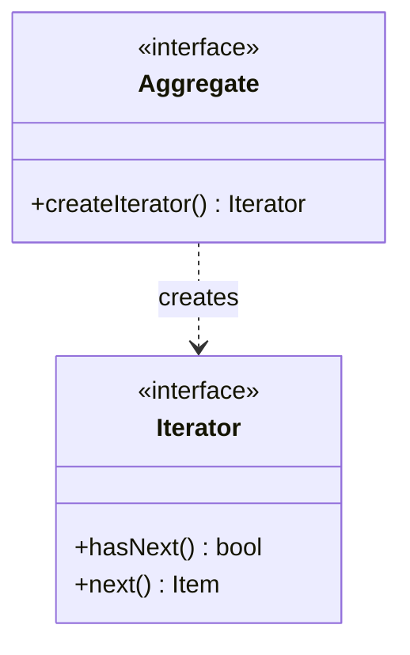

**Trade-off.** Uniform traversal, hides structure; most languages give this for free (`for-each`).

#### Chain of Responsibility

**Definition.** Pass a request along a chain of handlers; each either handles it or forwards it.
**When to use.** Middleware pipelines, request validation, escalation, event filtering.

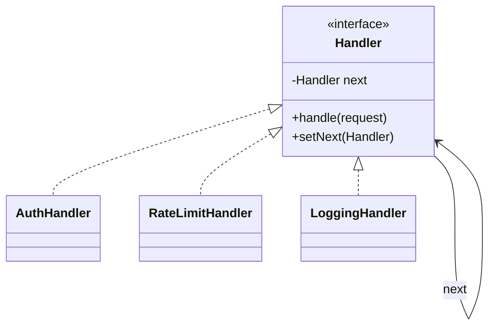

**Trade-off.** Decouples sender from handler and makes the pipeline reconfigurable; a request can fall off the end unhandled if no one claims it.

### Which Pattern Solves Which Problem

| Problem you're facing | Pattern | Category |
| --- | --- | --- |
| `switch(type)` choosing which object to create | **Factory** | Creational |
| Many optional constructor params; want immutability | **Builder** | Creational |
| Exactly one shared instance needed | **Singleton** (prefer DI) | Creational |
| Two incompatible interfaces must work together | **Adapter** | Structural |
| Add optional, combinable behaviors without subclass explosion | **Decorator** | Structural |
| Simplify a complex subsystem for clients | **Facade** | Structural |
| Control access / lazy-load / cache a real object | **Proxy** | Structural |
| Part-whole tree treated uniformly | **Composite** | Structural |
| `switch` selecting interchangeable *behavior* | **Strategy** | Behavioral |
| Notify many objects of state changes | **Observer** | Behavioral |
| Behavior depends on a lifecycle state | **State** | Behavioral |
| Need undo / queue / log of operations | **Command** | Behavioral |
| Fixed algorithm skeleton, varying steps | **Template Method** | Behavioral |
| Traverse a collection without exposing internals | **Iterator** | Behavioral |
| Pipeline of handlers, each may process or pass on | **Chain of Responsibility** | Behavioral |

> **Staff-level insight:** Strategy, State, and Command share the same UML shape (an interface + implementations). Interviewers probe whether you understand *intent*: Strategy = client picks an algorithm; State = the object transitions itself; Command = the request is reified for undo/queueing. Get the intent right and you've shown depth.

---

## API & Interface Design

A class hierarchy is only as good as the contract it exposes. The same principles apply whether the "interface" is a Java interface, a REST API, or an SDK method.

### Designing clean interfaces

- **Small and focused** (Interface Segregation): a `Reader` and a `Writer` beat a `ReadWriter` clients only half-use.
- **Depend on the abstraction** (Dependency Inversion): method signatures take `List`, not `ArrayList`; `PaymentMethod`, not `CreditCard`.
- **Make illegal states unrepresentable**: prefer types/enums over stringly-typed flags; constructors that validate so an object is never half-valid.
- **Command-Query Separation**: a method either changes state (command, returns void) or returns data (query, no side effects) — not both.

### Idempotency

An operation is **idempotent** if calling it N times has the same effect as once. Critical for retried writes.

- `PUT /accounts/123 {balance: 100}` is naturally idempotent; `POST /transfer` is not.
- Make non-idempotent operations safe with an **idempotency key**: the caller sends a unique key; the server records `(key → result)` and returns the stored result on retry instead of re-executing.

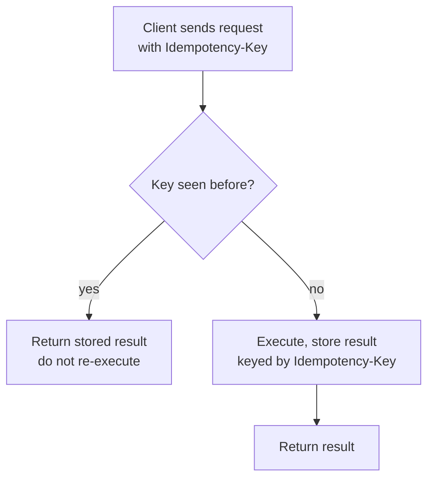

### Pagination

Never return an unbounded list. Two approaches:

| Type | How | Pros | Cons |
| --- | --- | --- | --- |
| **Offset/limit** | `?offset=40&limit=20` | Simple, jump to any page | Slow on deep pages; items shift if data changes mid-scan |
| **Cursor/keyset** | `?after=<opaque_cursor>` | Stable under inserts; fast | No random access to page N |

Prefer **cursor-based** for large or changing datasets. Return the next cursor in the response, not a raw offset.

### Versioning

- Version from day one — `/v1/`, or a header. Treat a published contract as immutable.
- Add fields in a backward-compatible way; **never** repurpose or remove a field within a version.
- Deprecate, don't break: announce, dual-run, then sunset.

### Error models

Return **structured, machine-readable** errors, not free text.

```
{ "error": { "code": "RATE_LIMITED", "message": "Too many requests", "retryable": true, "retryAfterMs": 1200 } }
```

- A stable `code` clients can branch on; a human `message` for logs.
- A `retryable` flag so callers know whether to back off and retry.
- Use the right HTTP status families (4xx caller's fault, 5xx server's) — see [APIs in Fundamentals](01-fundamentals.md).

### The contract & designing for extension

Make hierarchies **open for extension, closed for modification**:

- New behavior arrives as a **new implementation of an existing interface**, not an edit to a `switch`.
- Use **interfaces + a registry/factory** so adding a type is "drop in a class and register it."
- Keep base classes free of subclass-specific knowledge (no `if (this instanceof Truck)`).

> **Staff-level insight:** The cleanest test of an interface is the *substitution test*: can I write a fake/mock that satisfies it for tests, and can I add a real implementation without touching callers? If yes, you've inverted your dependencies correctly. State this explicitly — it's exactly the robustness Google's prompt asks for.

---

## Concurrency in LLD

(Pairs with the deep treatment in **module 24 — Concurrency**.) In object design, concurrency means: *where is shared mutable state, and how do I keep invariants under simultaneous access?*

### Thread-safety in object design — the toolbox, cheapest first

1. **Immutability** — an object that never changes after construction is trivially thread-safe and needs no locks. Make fields `final`/`readonly`; return copies. *Prefer this whenever you can.*
2. **Confinement** — keep mutable state owned by a single thread (e.g., per-request objects); share nothing.
3. **Atomic primitives** — `AtomicInteger`, compare-and-swap (CAS) for simple counters (e.g., available-slot count) without explicit locks.
4. **Locking** — when you must mutate shared state across threads, guard the *invariant*, not each field. Lock at the smallest scope that still protects the invariant.

### When to lock

Lock only around the **critical section** where a multi-step invariant could be observed mid-update (check-then-act, read-modify-write). The classic LLD case: **seat/slot booking** — "is seat free? then book it" must be atomic, or two users double-book.

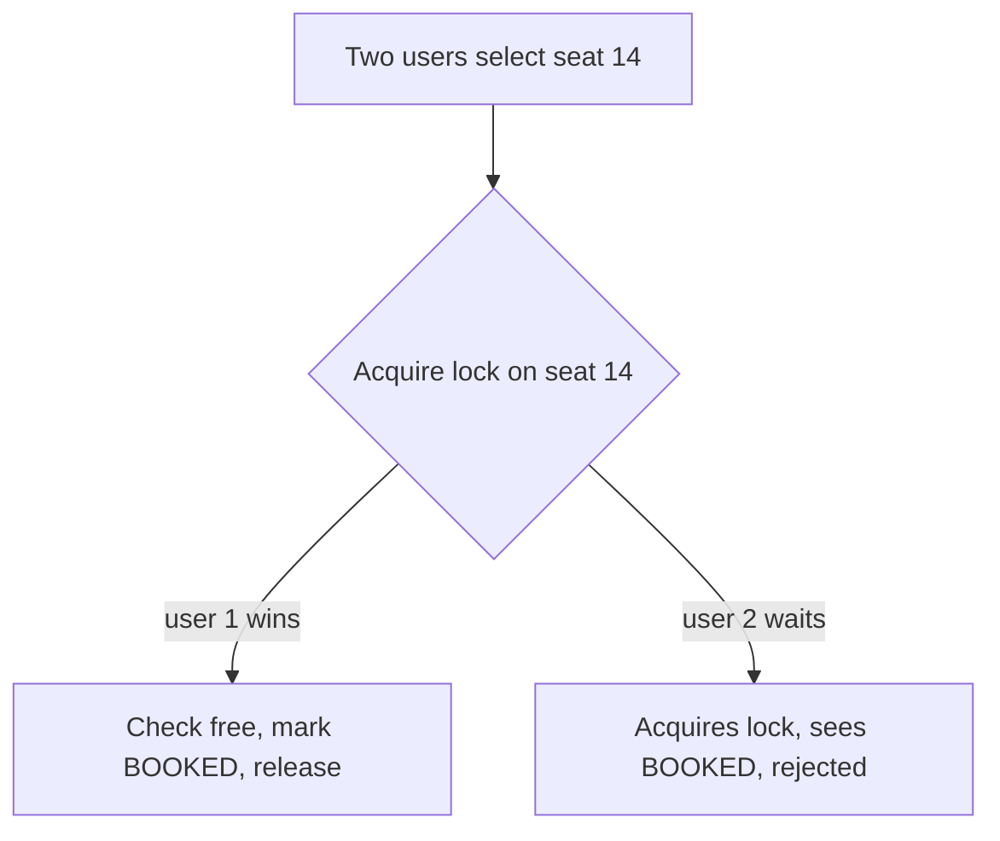

Prefer **fine-grained locks** (per-seat, per-row) over one global lock so independent bookings proceed in parallel. Beware deadlock: always acquire multiple locks in a consistent global order. At scale, push atomicity into the database (`SELECT ... FOR UPDATE`, conditional update) rather than app-level locks — see the [Movie-Ticket Booking](#worked-problem-4--movie-ticket-booking-bookmyshow) design.

### Thread-safe Singleton

The naive lazy singleton has a race: two threads both see `instance == null`. Safe options:

- **Eager init**: create at class load — simplest, thread-safe by the runtime, fine if construction is cheap.
- **Holder idiom**: rely on the language's class-initialization guarantee (lazy + safe, no locks).
- **Double-checked locking** with a `volatile` field: lazy and lock-free on the hot path. *Notoriously easy to get wrong* — the `volatile` is mandatory.

### Producer-Consumer

A canonical concurrent object design: producers enqueue work, consumers dequeue, decoupled by a **bounded blocking queue** that applies backpressure.

```mermaid
flowchart LR
    P1[Producer] --> Q[Bounded blocking queue]
    P2[Producer] --> Q
    Q --> C1[Consumer]
    Q --> C2[Consumer]
```

The queue handles the synchronization; producers and consumers stay simple and decoupled. This is the in-process cousin of a message broker.

> **Staff-level insight:** State your concurrency strategy as a *hierarchy of preference*: "First I'd try to make these objects immutable; if state must be shared, I'd use an atomic/CAS counter; only if there's a genuine multi-step invariant would I introduce a lock — fine-grained, in a fixed order to avoid deadlock." That ordering shows you treat locks as a last resort, which is exactly right.

---

## Worked LLD Problems

Each design follows the framework: requirements → class model → key methods → use-case walkthrough → extensibility.

### Worked Problem 1 — Parking Lot

**Requirements.** Multi-level lot; spot types (handicapped, compact, large, motorcycle, EV with charger); issue a ticket on entry, charge on exit by duration & spot type; show available counts; multiple entry/exit gates.
**Non-functional.** Thread-safe spot allocation; extensible to new vehicle/spot types and pricing schemes.
**Actors.** Driver, Admin, the System.

```mermaid
classDiagram
    class ParkingLot {
        -levels
        -PricingStrategy pricing
        +parkVehicle(Vehicle) Ticket
        +unparkVehicle(Ticket) Money
    }
    class ParkingLevel {
        -spots
        +findSpot(Vehicle) ParkingSpot
    }
    class ParkingSpot {
        -SpotType type
        -boolean occupied
        +assign(Vehicle)
        +vacate()
    }
    class Vehicle {
        <<abstract>>
        -licensePlate
        +getSpotType() SpotType
    }
    class Car
    class Motorcycle
    class Truck
    class Ticket {
        -spotId
        -entryTime
    }
    class PricingStrategy {
        <<interface>>
        +calculate(Ticket, exitTime) Money
    }
    Vehicle <|-- Car
    Vehicle <|-- Motorcycle
    Vehicle <|-- Truck
    ParkingLot o--> ParkingLevel
    ParkingLevel o--> ParkingSpot
    ParkingSpot --> Vehicle
    ParkingLot o--> PricingStrategy
    ParkingLot ..> Ticket : issues
```

**Key methods.**
- `ParkingLevel.findSpot(vehicle)` — return the nearest free spot matching the vehicle's required `SpotType` (allocation algorithm; could be Strategy-ized: nearest, cheapest, level-balanced).
- `ParkingLot.parkVehicle(vehicle)` — find spot, **atomically** mark occupied, issue `Ticket`.
- `ParkingLot.unparkVehicle(ticket)` — vacate spot, `pricing.calculate(ticket, now)`.

**Use-case walkthrough.** Car arrives at gate → `parkVehicle(car)` → loop levels calling `findSpot` → lock the chosen spot, `assign(car)`, mark occupied → return `Ticket(spotId, now)`. On exit → `unparkVehicle(ticket)` → fee = `pricing.calculate(...)` → `spot.vacate()` → available count incremented.

**Concurrency.** Two cars must not get the same spot: synchronize on the spot (or use a CAS on its `occupied` flag). Note the CAS isn't a free drop-in — `findSpot` then claim is a check-then-act: two threads can have `findSpot` hand back the *same* free spot, then both CAS, and the loser must **re-run `findSpot`** to pick another. The atomic unit is select-and-claim, not just the flag flip, so a failed CAS loops back to allocation. Track availability with atomic counters per `SpotType` so gates read counts lock-free.

**Extensibility.** New vehicle type → new `Vehicle` subclass + `getSpotType()` (Open/Closed). New pricing (weekend, member, surge) → new `PricingStrategy`. Reservations → add a `Reservation` entity without touching allocation. **Patterns used:** Strategy (pricing & allocation), Factory (vehicle creation).

### Worked Problem 2 — Rate Limiter (object design)

**Requirements.** Allow up to *N* requests per client per time window; `boolean allow(clientId)`; pluggable algorithm (fixed window, sliding window, token bucket); thread-safe.
*(Distributed/multi-node version — sharing counts across machines via Redis — is module **18d**. Here it's a single-process object.)*

```mermaid
classDiagram
    class RateLimiter {
        <<interface>>
        +allow(clientId) boolean
    }
    class TokenBucketLimiter {
        -capacity
        -refillRatePerSec
        -buckets
        +allow(clientId) boolean
    }
    class SlidingWindowLimiter {
        +allow(clientId) boolean
    }
    class FixedWindowLimiter {
        +allow(clientId) boolean
    }
    class Bucket {
        -tokens
        -lastRefillTime
    }
    RateLimiter <|.. TokenBucketLimiter
    RateLimiter <|.. SlidingWindowLimiter
    RateLimiter <|.. FixedWindowLimiter
    TokenBucketLimiter o--> Bucket
```

**Key method — Token Bucket `allow(clientId)`:** look up the client's `Bucket`; **refill** = `min(capacity, tokens + elapsedSeconds * refillRate)`; if `tokens >= 1` decrement and return `true`, else `false`. Lazy refill on access avoids a background timer.

**Use-case walkthrough.** Client makes 5 requests with capacity 3, refill 1/s: first 3 succeed (tokens 3→0), 4th & 5th rejected; one second later one token refilled, next request succeeds.

**Concurrency.** The per-bucket read-modify-write (check tokens → decrement) must be atomic — lock per-bucket or use a CAS loop. Per-client buckets in a `ConcurrentHashMap` so different clients never contend.

**Extensibility.** New algorithm → new `RateLimiter` implementation (Strategy). Swap to distributed → same interface, a `RedisRateLimiter` impl (Dependency Inversion lets callers stay unchanged) — bridges directly to module 18d.

> **Staff-level insight:** Because every algorithm hides behind one `allow(clientId)` interface, the *single-process* design and the *distributed* design are the same shape — only the storage of counts moves. Calling that out connects your LLD answer to the HLD layer and shows architectural range.

### Worked Problem 3 — Elevator System (state machine)

**Requirements.** *M* elevators, *N* floors; external up/down hall calls; internal floor requests; an algorithm that assigns calls and schedules stops (SCAN/elevator algorithm); doors, emergency stop, maintenance mode.
**The heart of this problem is the state machine** — interviewers want to see it.

```mermaid
stateDiagram-v2
    [*] --> Idle
    Idle --> MovingUp : request above
    Idle --> MovingDown : request below
    MovingUp --> DoorsOpen : reached a target floor
    MovingDown --> DoorsOpen : reached a target floor
    DoorsOpen --> Idle : no more requests
    DoorsOpen --> MovingUp : more requests above
    DoorsOpen --> MovingDown : more requests below
    Idle --> Maintenance : technician disables
    Maintenance --> Idle : re-enabled
```

```mermaid
classDiagram
    class ElevatorSystem {
        -elevators
        -SchedulingStrategy scheduler
        +requestElevator(floor, direction)
    }
    class Elevator {
        -currentFloor
        -ElevatorState state
        -upRequests
        -downRequests
        +addRequest(floor)
        +step()
    }
    class ElevatorState {
        <<interface>>
        +next(Elevator)
    }
    class SchedulingStrategy {
        <<interface>>
        +assign(elevators, request) Elevator
    }
    ElevatorSystem o--> Elevator
    ElevatorSystem o--> SchedulingStrategy
    Elevator o--> ElevatorState
```

**Key methods.**
- `ElevatorSystem.requestElevator(floor, dir)` — `scheduler.assign(...)` picks the best elevator (nearest moving in the same direction); enqueue the floor.
- `Elevator.step()` — drive one tick: the current `ElevatorState` decides the transition (move toward next target in the active direction, open doors on arrival, go Idle when empty) — classic **State pattern** replacing a giant `if/else`.

**Use-case walkthrough.** Hall call "up" at floor 3 → scheduler picks elevator A (Idle, floor 1) → A enters `MovingUp`, targets 3 → arrives → `DoorsOpen` → passenger presses 7 → `MovingUp` to 7 → no further requests → `Idle`.

**Concurrency.** Each elevator's request set is shared between the request thread and its control loop — guard it. Independent elevators don't share state, so per-elevator locking suffices.

**Extensibility.** New scheduling policy (energy-saving, peak-hour express) → new `SchedulingStrategy`. New behaviors (fire mode, VIP override) → new `ElevatorState`. **Patterns:** State (lifecycle), Strategy (scheduling).

### Worked Problem 4 — Movie-Ticket Booking (BookMyShow)

**Requirements.** Browse cities → cinemas → movies → shows; a show has a hall with seats; user selects seats and pays; **two users must never book the same seat** (the crux). Hold seats briefly during checkout, release on timeout.
**This is a hybrid:** clean OOD core + a real **concurrency/consistency** problem.

```mermaid
classDiagram
    class Show {
        -movie
        -hall
        -startTime
        -seatStatus
        +getAvailableSeats()
    }
    class Seat {
        -row
        -number
        -SeatType type
    }
    class SeatStatus {
        <<enum>>
        AVAILABLE
        HELD
        BOOKED
    }
    class Booking {
        -user
        -show
        -seats
        -BookingStatus status
    }
    class BookingService {
        +holdSeats(show, seats, user) Booking
        +confirm(Booking, Payment)
    }
    class PaymentStrategy {
        <<interface>>
        +pay(amount) PaymentResult
    }
    BookingService ..> Booking : creates
    Booking o--> Seat
    Show o--> Seat
    BookingService o--> PaymentStrategy
```

**Key methods.**
- `BookingService.holdSeats(show, seats, user)` — **atomically** check all requested seats are `AVAILABLE`, flip them to `HELD` with an expiry; create a pending `Booking`. This is the critical section.
- `BookingService.confirm(booking, payment)` — `payment.pay(amount)`; on success flip `HELD → BOOKED`; on failure/timeout flip back to `AVAILABLE`.

**Use-case walkthrough.** Two users target seat C7 simultaneously → both call `holdSeats` → the seat-level guard serializes them → user 1 wins (C7 → HELD), user 2 gets "seat unavailable." User 1 pays within the hold window → `BOOKED`. If user 1 abandons, a timeout job flips C7 back to `AVAILABLE`.

**Concurrency (the whole point).**
- App level: lock per *seat* (or per *show*), not globally, so different shows book in parallel; acquire multiple seat locks in a fixed order (e.g., by seat id) to avoid deadlock.
- At scale: enforce in the database — a conditional update `UPDATE seat SET status='HELD' WHERE id=? AND status='AVAILABLE'` succeeds for exactly one writer (optimistic concurrency), or `SELECT ... FOR UPDATE`. This ties to **strong consistency** for inventory — see [Architecture Patterns](15-architecture-patterns.md). The HELD state + expiry is a **reservation/saga** so abandoned carts don't strand seats.

**Extensibility.** New seat pricing tiers → `PricingStrategy`. New payment methods → `PaymentStrategy` impls. New hold policy → swap the expiry strategy. **Patterns:** Strategy (payment, pricing), State (booking lifecycle).

> **Staff-level insight:** The interviewer is really asking "how do you prevent a double-booking?" Lead with the answer — *make the check-and-hold atomic, prefer a DB conditional update over app locks at scale, and use a timed HELD state so failed checkouts self-heal.* Nailing that single invariant matters more than the rest of the class diagram.

### Worked Problem 5 — Notification Dispatcher

**Requirements.** Send notifications over multiple channels (email, SMS, push); a user has channel preferences; new channels added without touching existing code; multiple subscribers may react to one event.
**Showcases Strategy (channel) + Observer (event fan-out).**

```mermaid
classDiagram
    class NotificationService {
        -channels
        +notify(user, message)
        +register(NotificationChannel)
    }
    class NotificationChannel {
        <<interface>>
        +send(user, message)
    }
    class EmailChannel {
        +send(user, message)
    }
    class SmsChannel {
        +send(user, message)
    }
    class PushChannel {
        +send(user, message)
    }
    class EventPublisher {
        +subscribe(Observer)
        +publish(Event)
    }
    NotificationChannel <|.. EmailChannel
    NotificationChannel <|.. SmsChannel
    NotificationChannel <|.. PushChannel
    NotificationService o--> NotificationChannel
    EventPublisher o--> NotificationService : observer
```

**Key methods.**
- `NotificationService.notify(user, message)` — for each of the user's preferred channels, call `channel.send(...)` (**Strategy** per channel).
- `EventPublisher.publish(event)` — fan out to all subscribed observers (**Observer**); the notification service is one such observer.

**Use-case walkthrough.** "Order shipped" event → `EventPublisher.publish` → notifies the `NotificationService` observer → it looks up the user's prefs (email + push) → dispatches via `EmailChannel` and `PushChannel`. Failures per channel are isolated (one channel failing doesn't block others).

**Concurrency / robustness.** Dispatch async via a **producer-consumer** queue so a slow SMS provider doesn't block the request thread; add retry with backoff per channel; dedupe with an idempotency key so a retried event doesn't double-send.

**Extensibility.** New channel (WhatsApp, Slack) → new `NotificationChannel` impl, register it — zero edits elsewhere (Open/Closed). Templating → a `MessageTemplate` strategy. **Patterns:** Strategy (channel), Observer (event fan-out), optionally Decorator (add retry/logging around a channel).

---

## Interview Cheat-Sheet

**Opening move:** Confirm it's LLD, not HLD — *"I'll start at the class/interface level and surface distributed concerns where they touch it."*

**The 10-step framework:** Requirements → Actors/Use-cases → Nouns(classes)/Verbs(methods) → Interfaces first → Relationships → State machines → Algorithms → Use-case walkthrough → Concurrency → Extensibility/SOLID review.

**SOLID in one breath:** Single responsibility · Open/closed · Liskov substitutable · Interface segregated · Dependency inverted. (Loose coupling + high cohesion is the goal they serve.)

**Relationship UML:** association `-->` · aggregation `o-->` (shared) · composition `*-->` (owned, dies together) · inheritance `<|--`.

**Pattern reflexes:**
- `switch` to *create* objects → **Factory**
- `switch` to pick *behavior* → **Strategy**
- behavior depends on *lifecycle state* → **State**
- *one-to-many* event notify → **Observer**
- combinable optional behaviors → **Decorator**
- one entry point over a messy subsystem → **Facade**
- undo / queue / log of actions → **Command**
- tree / part-whole → **Composite**

**Concurrency ladder (cheapest first):** Immutability → confinement → atomic/CAS → fine-grained locks (fixed acquisition order). Booking/inventory = the canonical atomic check-then-act.

**Mantras:** YAGNI (don't build unasked-for features) · KISS (simplest design that works) · DRY (after the rule of three) · Law of Demeter (no train-wreck chains) · prefer composition over inheritance · program to interfaces.

**EM-specific:** narrate your structure, surface trade-offs aloud, prune scope under time pressure, critique your own choices (e.g., "Singleton, but injected").

---

## Common Interview Questions

1. **"Design a parking lot."** Drive the [framework](#worked-problem-1--parking-lot): clarify levels/spot types/pricing → `ParkingLot`/`Level`/`Spot`/`Vehicle`/`Ticket` → Strategy for pricing & allocation → atomic spot assignment → extend with new vehicle types via Open/Closed. *Watch for:* jumping to classes before requirements; ignoring concurrency on allocation.

2. **"How would you prevent two users from booking the same seat?"** Make check-and-hold **atomic**; per-seat (not global) locking for parallelism; at scale a DB conditional update / `SELECT FOR UPDATE` (optimistic concurrency); a timed `HELD` state so abandoned carts self-heal. See [Movie-Ticket Booking](#worked-problem-4--movie-ticket-booking-bookmyshow).

3. **"When is Singleton a bad idea, and what would you do instead?"** It's global mutable state — hidden dependencies, untestable, concurrency hazards, violates SRP/DIP. Instead, create one instance at the composition root and **inject** it. Same singleness, testable and explicit.

4. **"Strategy vs. State vs. Command — same UML, what's the difference?"** Intent: Strategy = *client* picks an interchangeable algorithm; State = the object *transitions itself* and changes behavior with its lifecycle; Command = a request *reified as an object* for undo/queue/log.

5. **"Walk me through applying SOLID to this design."** Name each principle against a concrete class: SRP (split the God class), OCP (new types as new classes, no edits), LSP (subtypes don't break callers), ISP (small interfaces), DIP (depend on the repository interface). Tie it back to loose coupling + high cohesion.

6. **"How do you make this class hierarchy extensible / open for extension?"** Interface + registry/factory so a new type is "drop in a class and register"; no `instanceof`/`switch(type)` downstream; base classes free of subclass knowledge. Apply the substitution test (can I add an impl without touching callers?).

7. **"Design a rate limiter as a set of classes."** One `RateLimiter` interface, `allow(clientId)`; Token Bucket / Sliding Window / Fixed Window as Strategy impls; per-client buckets in a concurrent map; atomic token check-and-decrement. Note the same interface scales to a distributed [Redis impl](18d-design-infra-primitives.md) — module 18d.

8. **"Design a notification system supporting multiple channels."** Strategy per channel (`NotificationChannel.send`), Observer for event fan-out, producer-consumer queue for async dispatch with per-channel retry, idempotency key to avoid double-sends; new channels via Open/Closed. See [Notification Dispatcher](#worked-problem-5--notification-dispatcher).

> **Staff-level insight:** For every answer, end with the *extension question* before the interviewer asks it: "...and if we later need X, here's the one place I'd add it." Anticipating change is the clearest signal of design maturity — and exactly the judgment Google expects from an Engineering Manager.
