# Module 28 — Designing for Failure

> The definitive failure-theory and resilience-design reference for Staff Engineer / Senior EM / Google EM system-design interviews.

## What you'll master

Most candidates can *list* resilience patterns. Staff candidates can reason about **why systems fail the way they fail at scale** — and design so that failure is contained, detected, and survivable. This module turns the famous outages (AWS Kinesis 2020, AWS US-EAST-1 2021, Facebook/WhatsApp BGP 2021) from journalism into a reusable **design-for-failure toolkit**. Where [Module 11 — Reliability](11-reliability.md) gives you the resilience *patterns* (timeouts, breakers, bulkheads), this module gives you the failure *theory* and the interview move that uses it. By the end you will be able to:

- Classify any failure with a **precise taxonomy** (fault vs error vs failure; crash vs omission vs timing vs Byzantine; gray vs fail-stop; correlated vs independent).
- Explain and diagnose **metastable failures** — the single highest-signal Staff concept Grokking omits: why a system stays broken *after the trigger is gone*, and how to break the sustaining loop.
- Do the **retry-amplification math** live and design retry budgets, backoff, and jitter that prevent congestion collapse.
- Apply **static stability** — keep the data plane serving when the control plane is dead.
- Contain **blast radius** with cells, shuffle sharding, and bulkheads — and explain the combinatorial math.
- Build a **graceful-degradation ladder** with load shedding, brownouts, and kill switches.
- Choose a **failure detector** (heartbeat / phi-accrual / SWIM gossip) and reason about the detection-time vs false-positive trade-off, split-brain, and fencing.
- Run **chaos engineering and game days** like an SRE, and write a **blameless postmortem** — and use all of it *live* in the room.

Cross-references: [Reliability](11-reliability.md) · [Distributed Systems](02-distributed-systems.md) · [Observability](12-observability.md) · [Load Balancing](05-load-balancing.md) · [Google SD Playbook](26-google-sd-playbook.md)

---

## Table of Contents

1. [In the Room — Designing for Failure](#in-the-room--designing-for-failure)
2. [The Failure Taxonomy That Matters](#1-the-failure-taxonomy-that-matters)
3. [Metastable Failures (Deep)](#2-metastable-failures-deep)
4. [Retry Storms & Congestion Collapse](#3-retry-storms--congestion-collapse)
5. [Control Plane vs Data Plane — Static Stability](#4-control-plane-vs-data-plane--static-stability)
6. [Blast Radius & Cell-Based Architecture](#5-blast-radius--cell-based-architecture)
7. [Graceful Degradation & Load Shedding](#6-graceful-degradation--load-shedding)
8. [Failure Detection at Scale](#7-failure-detection-at-scale)
9. [Chaos Engineering & Game Days](#8-chaos-engineering--game-days)
10. [Blameless Postmortems & the Interview Move](#9-blameless-postmortems--the-interview-move)
11. [Interview Cheat-Sheet](#interview-cheat-sheet)
12. [Common Interview Questions](#common-interview-questions)

---

## In the Room — Designing for Failure

Google's system-design rubric explicitly grades **"how do you detect and defend against failures at scale."** This is where Staff candidates separate from senior ones: a senior candidate designs the happy path and *answers* failure questions when asked; a Staff candidate **volunteers the failure modes unprompted, hunts their own SPOFs, and contains the blast radius before the interviewer pokes at it.**

The move is to treat every component you draw as a thing that *will* fail, and to narrate three things for each: **detect → defend → recover.**

- **Detect:** "How do I *know* this is failing, and how fast?" (heartbeats, SLO burn-rate alerts, the difference between a hard crash and a gray slow-degradation that no health check catches).
- **Defend:** "What stops this failure from spreading?" (timeouts, bulkheads, cells, load shedding, static stability, retry budgets).
- **Recover:** "How do I get back to steady state, and does the system *self*-heal or does it get stuck?" (failover, drain-and-restart, breaking a metastable loop, rollback).

### The two-minute self-audit you run on your own design

When you've drawn the architecture, *proactively* say: **"Let me do a blast-radius and SPOF hunt on this."** Then, out loud:

| Question you ask yourself | What you're hunting | The Staff answer pattern |
|---|---|---|
| **What's the single point of failure?** | A shared component every request touches | "The X is a SPOF — I'll replicate it and put it behind health-checked failover, and make callers degrade if it's gone." |
| **What's the shared-fate / global component?** | One config push or control plane that can take down *everything at once* | "This global config/control plane is the scariest thing here — Facebook 2021 was a single config that withdrew all of BGP. I'll cell-partition it and stage rollouts." |
| **If a dependency gets *slow* (not dead), what happens?** | Resource-exhaustion contagion; gray failure | "Slow is worse than dead — it ties up threads. Timeouts + bulkheads + breakers contain it." |
| **Under overload, does load *amplify*?** | Retry storms, metastable lock-in | "Naive retries turn a blip into an outage — I'll budget retries and shed load so we don't get stuck in a bad state." |
| **If the control plane dies, does serving stop?** | Control/data-plane coupling | "Existing capacity must keep serving even if the API to *change* it is down — static stability." |
| **How big is the blast radius of any one failure?** | Isolation boundaries | "I'll cell-partition so one bad tenant or AZ can't take down everyone." |

> **Staff-level insight:** The single most powerful sentence you can say in a system-design interview is **"Let me name how this fails before I make it bigger."** It signals that you design for the 3 a.m. page, not the demo. Interviewers consistently rate "volunteered the failure mode and contained it" far above "answered correctly when asked." Make failure analysis *offense*, not defense.

---

## 1. The Failure Taxonomy That Matters

**Definition.** A precise vocabulary for failure. The reason this matters at Staff level: the *type* of failure dictates the *defense*. A crash failure needs failover; a gray failure needs better detection; a Byzantine failure needs quorum/voting; correlated failures need de-correlation. If you can't classify it, you'll mis-defend it.

### 1.1 Fault vs Error vs Failure — the chain

These three words are not synonyms, and confusing them is a junior tell.

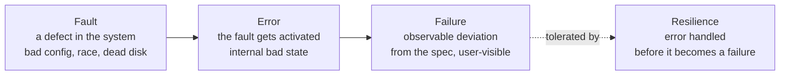

- **Fault** = the *cause* (latent defect): a bug, a misconfiguration, a hardware defect. It can sit dormant for months.
- **Error** = the fault *activated* into incorrect internal state (e.g., a corrupted in-memory value, a saturated thread pool).
- **Failure** = the error becomes *externally observable* — the system deviates from its specification. Users see it.

The whole discipline of resilience is **stopping the fault → error → failure chain before the last arrow.** Fault tolerance = an error occurs but no failure results.

### 1.2 The crash-to-Byzantine spectrum

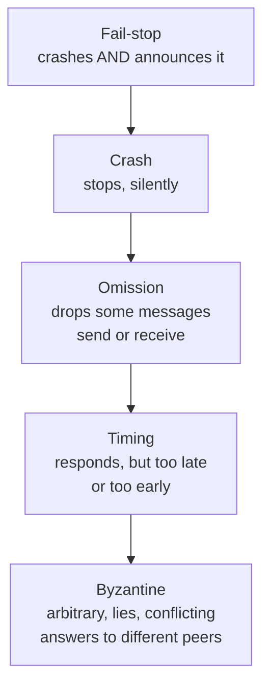

| Failure class | What the node does | Easiest to handle? | Defense |
|---|---|---|---|
| **Fail-stop** | Halts *and* the halt is detectable | Easiest | Failover; detector reliable |
| **Crash** | Halts silently | Easy-ish | Timeouts + heartbeats to *infer* the crash |
| **Omission** | Selectively drops messages | Harder | Acks, retransmits, sequence numbers |
| **Timing** | Right answer, wrong time | Hard | Deadlines, timeouts, "slow == failed" |
| **Byzantine** | Arbitrary / malicious / inconsistent | Hardest | Quorum, BFT, voting, checksums, signatures |

Most real distributed systems assume **crash / omission / timing** failures (the "crash-recovery" or "fail-noisy" model) and explicitly *do not* tolerate Byzantine faults — those need 3f+1 replicas to tolerate f liars, which is too expensive outside blockchains and avionics.

### 1.3 Gray failures — the ones that actually page you

**Definition.** A **gray failure** is a partial, *ambiguous* degradation where the system is neither clearly up nor clearly down — and crucially, **the system's own health checks say it's healthy while users see errors.** This is the *differential observability* problem: the failure detector and the affected user have different views.

Examples: a node that passes its `/healthz` ping (which only checks "process alive") but whose disk is 99% full so real writes time out; a network card silently corrupting 1% of packets; a GC pause storm making p99 latency 30× normal while p50 looks fine.

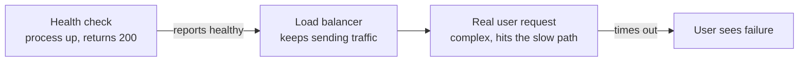

> **Staff-level insight:** Gray failures are deadlier than crashes because **a crash is self-announcing and triggers failover; a gray failure hides behind a green health check and keeps taking traffic.** The Staff fix is *deep* / *user-facing* health checks (probe the real dependency path, not just "am I alive"), and detection driven by **SLO burn-rate on real request outcomes**, not by liveness pings. Most catastrophic outages start as gray failures that monitoring declared healthy. See [Observability](12-observability.md).

### 1.4 Correlated vs independent failures

Availability math (3 replicas = 99.9999%) assumes failures are **independent**. They almost never are.

| | Independent failures | Correlated failures |
|---|---|---|
| **Cause** | Unrelated (one disk dies) | Shared dependency / common cause |
| **Examples** | Random hardware death | Same bad deploy to all 3 replicas; same AZ power loss; same expired TLS cert; same poison config; same kernel bug triggered by the same input |
| **Effect on redundancy math** | Redundancy works as advertised | Redundancy is an *illusion* — all replicas die together |
| **Defense** | More replicas | **De-correlate**: stagger deploys, spread across AZs/regions, diversify versions, cell-partition, stagger cert expiry |

> **Staff-level insight:** "We have three replicas so we're safe" is a junior statement. The Staff question is **"what do those three replicas *share*?"** — same rack, same AZ, same config push, same software version, same dependency. The 2021 AWS US-EAST-1 outage and Kinesis 2020 were correlated failures: a single trigger hit every node at once because they all shared the same fate. **Redundancy only helps against the failures you de-correlated.**

---

## 2. Metastable Failures (Deep)

This is the concept Grokking's "spectacular failures" chapters narrate but never name — and the single highest-signal thing you can bring to a Staff interview.

**Definition.** A **metastable failure** is a state where the system stays in a degraded, low-throughput condition **even after the original trigger that caused it has disappeared.** A short trigger flips the system into a bad state, and a **sustaining feedback loop** holds it there. Removing the trigger does *not* fix it — the system is "stuck."

### 2.1 The two ingredients: trigger and sustaining effect

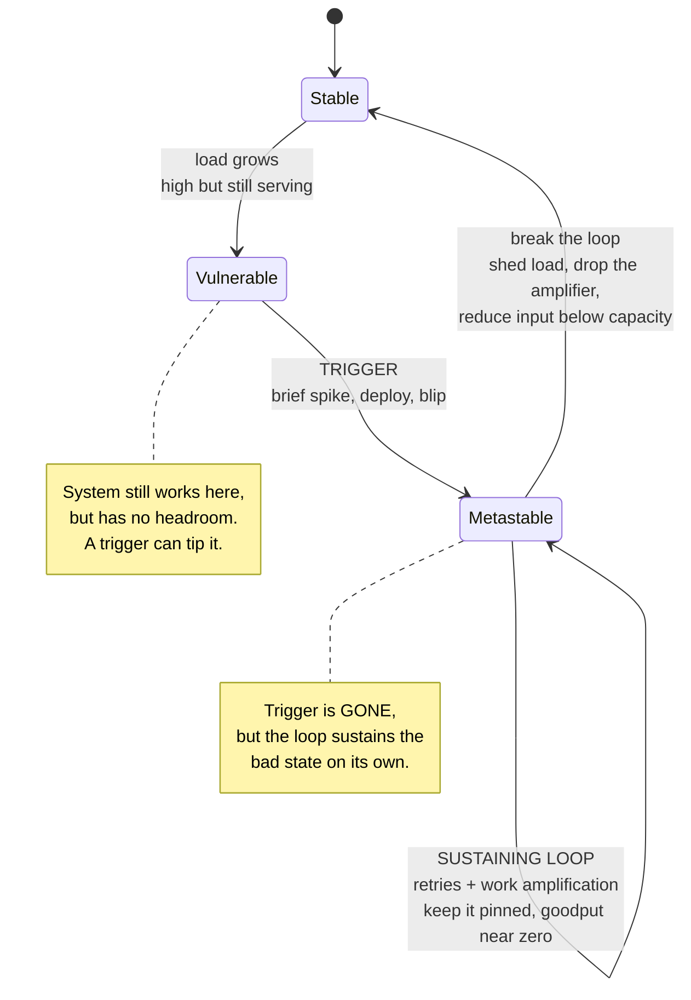

- **Trigger:** the brief event that pushes the system over the edge — a traffic spike, a deploy, a dependency blip, a cache flush, a node loss. **It is temporary.**
- **Sustaining effect (the feedback loop):** the mechanism that keeps the system pinned in the bad state *after the trigger is gone.* Almost always some form of **work amplification** — the system, under stress, generates *more* work per request, which deepens the stress, which generates more work.

The defining test: **if you remove the trigger and the system recovers on its own, it was *not* metastable. If it stays broken, it *is*.**

### 2.2 Work amplification and goodput collapse

The engine of every metastable failure is **work amplification**: under degradation, each unit of useful work costs *more* than it did when healthy.

- **Retries** are the classic amplifier: a request times out, the client retries 3×, so one logical request becomes 4 units of load — exactly when the system has *less* capacity.
- **Cache-miss amplification:** a cache flush → every request now hits the (slow) database → database slows → requests time out before the cache can refill → cache stays empty → it stays slow. (Cold-cache death spiral.)
- **Queue growth:** requests pile in a queue; by the time the server processes one, the client has already timed out and retried — so the server does work whose result *no one is waiting for anymore.* **Goodput** (useful throughput) collapses toward zero while the server is still 100% busy.

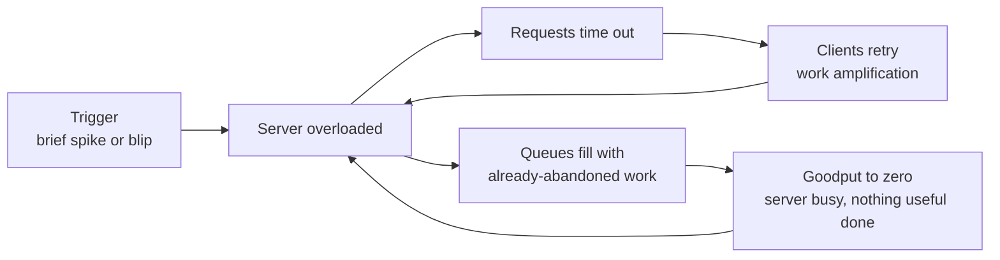

**Goodput vs throughput:** the server may report it's processing tons of requests (high throughput / 100% CPU) while **goodput — requests answered before the caller gave up — is near zero.** This is why a metastable system looks busy and healthy on resource graphs but serves nobody.

### 2.3 Worked example — AWS Kinesis, Nov 2020

A capacity addition to the Kinesis front-end fleet caused each server to exceed the OS thread limit while building its membership map of the fleet (the front-end servers each maintain a thread to every other server). Threads failed to be created → servers couldn't build a correct fleet map → they produced errors and *retried* the expensive map-construction → which consumed more threads → which produced more errors. **The trigger (adding capacity) was long gone, but the system could not recover by itself** — it was pinned by the cost of the recovery operation itself. The fix required *removing load* (rolling back the capacity, restarting the fleet slowly) — you could not just "wait it out." Many dependent services (Cognito, CloudWatch, even parts of the AWS status dashboard) cascaded.

### 2.4 Worked example — the 2021-style cold-cache / retry lock-in

A generalized version seen in many outages (and the shape behind several AWS events): a control-plane blip causes a brief error spike → clients retry aggressively → the retries themselves now constitute *more* load than the original traffic → the recovering service is immediately re-saturated by retries the moment it comes back → it can never climb out. The trigger lasted seconds; the metastable state lasted hours. The only exits were **shedding load** (so the service gets headroom to refill caches / rebuild state) or **stopping the amplifier** (rate-limiting or disabling retries).

### 2.5 How to break a metastable loop

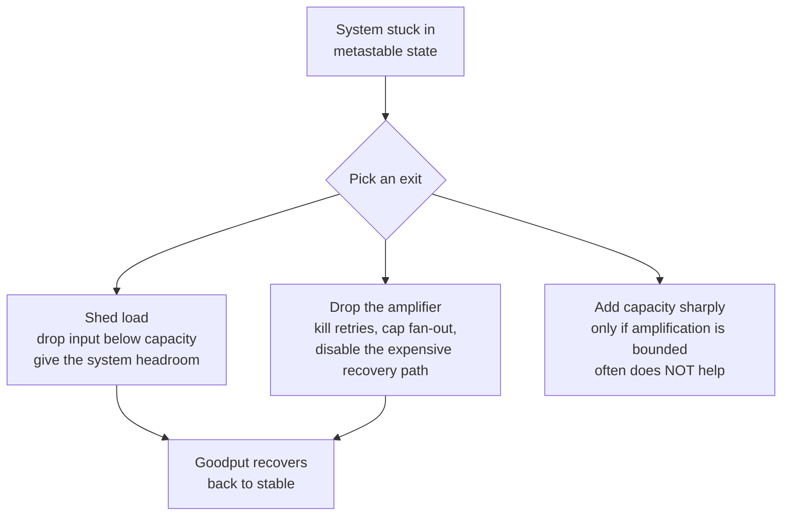

| Lever | Mechanism | When it works | When it fails |
|---|---|---|---|
| **Shed load** | Reject input until throughput < capacity, then ramp back | Almost always — the canonical fix | If the amplifier is internal (not from clients) |
| **Drop the amplifier** | Disable/rate-limit retries, cap queue depth, kill the costly recovery op | When a feedback loop (retries, fan-out) sustains it | If the loop is structural |
| **Add capacity** | More servers | Only if work-per-request is *not* amplifying | **Often useless** — more servers all enter the bad state too (Kinesis: more capacity *caused* it) |
| **Restart cold** | Drain, then slow ramp with caches warming | Cold-cache spirals | Naively restarting all at once re-triggers it |

> **Staff-level insight:** Metastability is *the* reason "just add more capacity" and "just wait for the spike to pass" both fail in real outages — and naming it is rare even among strong candidates. The Staff framing: **"This design has a metastable risk: under overload, retries amplify work, so a brief trigger can pin us in a low-goodput state the trigger no longer explains. I'll add load shedding and retry budgets so the loop can't sustain itself, and a 'drain and slow-ramp' runbook because you can't add capacity out of it."** The two design defenses are **(1) prevent the amplifier** (bounded retries, bounded queues, admission control) and **(2) provide an explicit exit** (load shedding to create headroom). Avoid the amplifier in the first place and the system *can't* get stuck.

---

## 3. Retry Storms & Congestion Collapse

**Definition.** A **retry storm** (thundering herd) is when a failure triggers synchronized retries across many clients, multiplying load on a system that is *already* failing — converting a transient blip into a sustained outage. It is the most common *cause* of the metastable state in §2. **Congestion collapse** is the network analog: total useful throughput falls toward zero as offered load rises, because capacity is spent on retransmissions of packets that already timed out.

### 3.1 The amplification math — do this live

Retries stack *multiplicatively* across layers. If every layer retries `r` times on failure:

- A **retry budget of 3** (1 original + 3 retries) = **4×** the load from that one layer under failure.
- Stack it across **3 layers** (client SDK → gateway → backend service), each doing 4× → **4 × 4 × 4 = 64×** load on the deepest service, precisely when it has the *least* capacity.
- Even a modest "3 retries at each of 3 tiers" is the difference between a 30-second blip and a multi-hour outage.

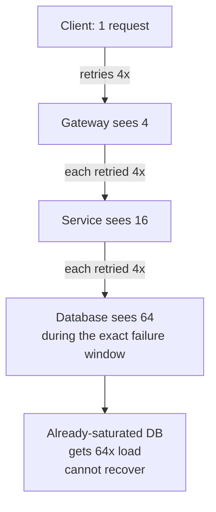

**The core insight: retries should live at exactly ONE layer.** Pick the layer closest to the user that can meaningfully retry, and make every other layer *fail fast and propagate* rather than retry.

### 3.2 Backoff and jitter — the three jitter strategies

Exponential backoff alone is insufficient: if all clients fail at the same instant and back off by the *same* schedule, they retry in *synchronized waves* — the herd just arrives later, together. **Jitter** (randomization) de-correlates them.

| Strategy | Formula (sleep before attempt) | Behavior | Use when |
|---|---|---|---|
| **No jitter** | `base * 2^attempt` | Synchronized waves; thundering herd just shifts in time | Never |
| **Full jitter** | `random(0, base * 2^attempt)` | Maximum spread; lowest contention | **Default** — best at reducing competing load |
| **Equal jitter** | `half + random(0, half)` where `half = base*2^attempt/2` | Spread but guarantees some minimum wait | When you want a floor on backoff |
| **Decorrelated jitter** | `min(cap, random(base, prev_sleep * 3))` | Self-adapting, good spread, fast recovery | High-contention retry against shared resource |

> AWS's own analysis found **full jitter** minimizes competing client load and total work, and **decorrelated jitter** completes fastest under heavy contention. Default to full jitter; reach for decorrelated when many clients hammer one shared resource.

### 3.3 Retry budgets and token buckets — cap the *aggregate*

Per-request retry limits don't bound *aggregate* retry load. The Staff-grade control is a **retry budget**: a client-side **token bucket** where retries (not original requests) consume tokens. When the bucket empties — i.e., the system is failing broadly — **stop retrying entirely** and fail fast.

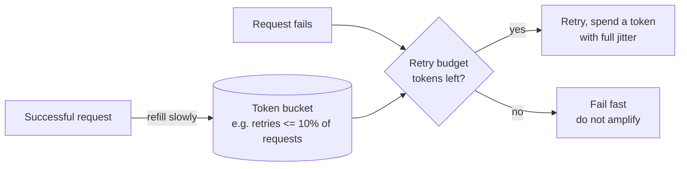

A common policy: **retries may not exceed ~10% of successful request volume.** During a broad outage, success rate craters, the bucket drains, and retries auto-disable — exactly when retrying would do the most harm. This is what turns "retries help with transient blips" into "retries can't cause a storm."

> **Staff-level insight:** Naive retries are a **self-inflicted DDoS.** The full defense stack, stated in one breath: **retries at one layer only + exponential backoff + full jitter + a retry budget (token bucket) + gated by a circuit breaker + only for idempotent operations.** Pair it with **circuit breakers** (stop calling a dead dependency entirely so it can recover — see [Reliability §3.3](11-reliability.md)). The interviewer is listening for whether you know that *the thing meant to improve reliability is the most common cause of outages.*

---

## 4. Control Plane vs Data Plane — Static Stability

**Definition.** The **data plane** does the actual per-request work (serve traffic, route packets, read/write data). The **control plane** *manages* the data plane (provision capacity, change config, place replicas, update routing, scale up/down). **Static stability** is the design principle that **the data plane must keep working at its current capacity even when the control plane is completely down.** Existing capacity survives a control-plane outage.

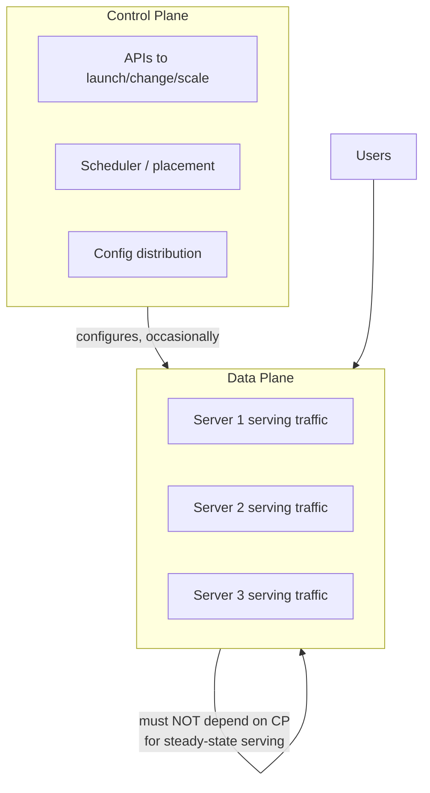

### 4.1 The principle: depend on nothing to keep doing what you're already doing

A statically stable system, when its control plane fails, **keeps doing whatever it was last told to do.** It can't *change* (no new instances, no config updates, no scaling), but existing instances keep serving. The opposite — a **dynamically stable** system — needs the control plane *in the request path* and dies with it.

| | Control plane | Data plane |
|---|---|---|
| **Job** | Manage, change, place, scale | Serve the actual traffic |
| **Volume** | Low (mutations are rare) | High (every request) |
| **Acceptable to be down?** | Briefly, yes — *if* data plane is statically stable | No — this is the user-facing outage |
| **Failure mode if coupled** | Control-plane outage → data-plane outage (catastrophic) | — |
| **Design goal** | Keep it *out* of the steady-state request path | Survive without it |

### 4.2 The AWS lesson — "EC2 instances kept running, but the APIs failed"

The canonical real-world illustration: in major AWS control-plane outages, **already-running EC2 instances kept serving traffic** — your live application stayed up — but the **APIs to launch new instances, change security groups, or attach volumes failed.** That's static stability working: existing data-plane capacity survived a control-plane outage. The failures bit hardest for anyone whose *recovery* depended on the control plane (e.g., autoscaling to add capacity, or failover that needed an API call to re-route) — they couldn't react because the very tool to react was down.

This drives two Staff design rules:

1. **Pre-provision for the failure case.** A statically stable failover design keeps the standby *already running at full size* so failover is just a traffic shift (data-plane action), not a "scale up the standby" (control-plane action) that fails exactly when you need it. Over-provision rather than depend on scaling-during-an-incident.
2. **Constant-work / declarative patterns.** Push the *full desired state* on a fixed cadence rather than sending deltas on events. A "push the entire config every 10s regardless" design does the same amount of work whether 0 or 10,000 things changed — so a flood of changes (or a control-plane hiccup) can't create a load spike or a backlog. The data plane converges to the last-known-good state and never needs the control plane in-line. (AWS's Route 53 health-check propagation and S3 use constant-work designs for exactly this reason.)

> **Staff-level insight:** The highest-leverage failure question you can ask of any architecture is **"if the control plane is down, does serving stop?"** If yes, you've coupled your steady-state availability to your *least*-tested, most-complex subsystem. The Staff move: **keep the control plane out of the request path, pre-provision failover capacity so recovery is a data-plane traffic shift (not a control-plane scale-up), and prefer constant-work designs that converge to desired state.** Static stability is *the* concept that distinguishes "we have a failover plan" from "our failover plan doesn't itself depend on the thing that just failed." See also [Distributed Systems](02-distributed-systems.md).

---

## 5. Blast Radius & Cell-Based Architecture

**Definition.** **Blast radius** is how much of your system (and how many users) a single failure can take down. **Cell-based architecture** partitions the system into independent **cells** (a.k.a. shards, pods, bulkheads) — each a complete, self-contained copy of the stack serving a subset of users — so that a failure in one cell **cannot** affect the others. The governing principle is **"don't share fate."**

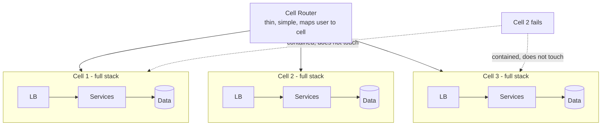

A failure (bad deploy, poison data, overload, hot tenant) hits **one cell = 1/N of users**, not everyone. You also gain: independent deployments (canary one cell), bounded capacity per cell (known scaling unit), and a smaller, comprehensible failure domain.

### 5.1 Shuffle sharding — the combinatorial math that limits shared fate

Plain sharding assigns each tenant to one cell: if a tenant sends a poison request that kills its cell, **everyone in that cell dies with it.** **Shuffle sharding** assigns each tenant a *random combination* of nodes (a "virtual shard") drawn from a larger pool — so two tenants rarely share the *same full set* of nodes.

The power is combinatorial. With **N nodes**, assigning each tenant **k nodes** gives **C(N, k)** possible combinations:

- 8 nodes, pick 4 → **C(8,4) = 70** virtual shards.
- A victim with *partial* overlap (sharing some, but not all, of the poison tenant's nodes) *does* feel it — those shared nodes degrade — but survives **via retry** onto a remaining unaffected node, so partial overlap is common but survivable. Only **full overlap** is fatal: the victim's *entire* subset must be ⊆ the bad tenant's subset, with no good node left to retry on. For size-k subsets that probability is ≈ 1/C(N,k) — rare. This is precisely why shuffle sharding must be paired with fail-fast/retry: partial overlap is only survivable if a client can fail fast off a bad node and retry onto a good one.
- AWS Route 53 / Shield use shuffle sharding so that a single abusive customer can poison only a vanishingly small fraction of *other* customers' shards.

| Approach | Tenant placement | Blast radius of one poison tenant |
|---|---|---|
| **No isolation** | All tenants share all nodes | **100%** of tenants |
| **Plain sharding** | Each tenant → 1 cell | **1/N** of tenants (everyone in that cell) |
| **Shuffle sharding** | Each tenant → random k-of-N combo | Partial overlap degrades but is **survived via retry**; only **full overlap** (≈ 1/C(N,k)) is fatal — vanishingly few tenants |

### 5.2 Bulkheads and isolation tiers

**Bulkheads** (named after ship compartments) are the per-resource version: dedicate separate thread pools / connection pools / queues per dependency or per tenant, so one slow dependency can't drain the shared pool and starve everything. Cells are bulkheads at the *stack* level; bulkheads are cells at the *resource* level. Layer your isolation:

- **Thread/connection pool** per dependency (resource bulkhead).
- **Cell / shard** per tenant group (stack bulkhead).
- **AZ** isolation (a cell shouldn't span an AZ such that AZ loss kills it; or run cells per-AZ).
- **Region** isolation (regional outage = one region's blast radius, the strongest boundary).

### 5.3 The danger of global config / control planes — Facebook BGP 2021

The thing cells *can't* fully protect you from is a **truly global component** — one config push, one DNS/BGP change, one control plane that touches everything at once. This is the scariest pattern in any design, and the Facebook/WhatsApp October 2021 outage is the textbook case.

**What happened (the mechanics):**

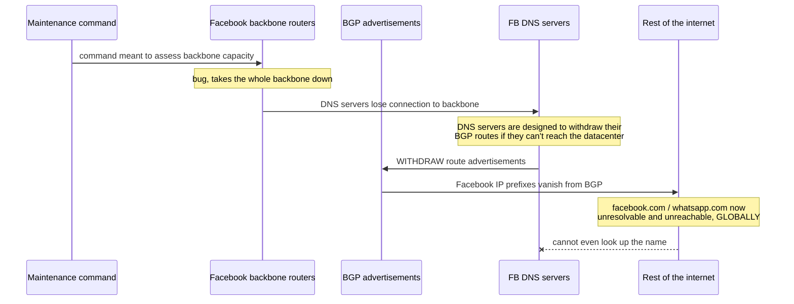

- **BGP (Border Gateway Protocol)** is how networks announce "these IP ranges are reachable through me" to the rest of the internet. Facebook's DNS servers had a safety mechanism: if they lost connection to the datacenter (a sign they were unhealthy), they would **withdraw their BGP route advertisements.** The backbone outage made *all* DNS servers think they were unhealthy *simultaneously*, so they all withdrew their routes — Facebook's IP prefixes disappeared from the global routing table. The name `facebook.com` could no longer be resolved by anyone, anywhere.
- **The recovery trap:** engineers couldn't fix it remotely because the **tools and out-of-band access to manage the routers were themselves on the network that just vanished** — and even physical badge access to datacenters reportedly degraded. This is the same static-stability failure: the recovery path depended on the thing that broke.

**The two lessons (and the design fix):**

1. A **global, correlated config/control action** defeats *all* your cell isolation. The BGP withdrawal was a single logical action that hit every prefix at once — no cell partitioning helps against a change to the global routing layer.
2. The fix is an **independent, out-of-band management plane** — control/recovery access that does *not* ride the same network, BGP, or DNS as the production data plane. Plus: **stage and canary global changes** (don't apply config to 100% at once — apply to one cell, bake, expand), **add change-validation/guardrails** that refuse a config that would withdraw all routes, and **break "everything withdraws on unhealthy" feedback loops** that can fire globally and simultaneously.

> **Staff-level insight:** Cells contain *most* failures, but the failures that make headlines are **global shared-fate components**: a config push, a DNS/BGP change, a schema migration, a feature flag, a single auth/identity service. In an interview, *hunt for the global component and name it as the top risk*: **"My biggest single risk is the global config/control plane — Facebook 2021 was one config change that withdrew all of BGP and even locked out their own recovery tools. I'll stage rollouts cell-by-cell, add a validation guardrail, and keep an out-of-band management path that doesn't depend on production DNS/BGP."** Naming the global SPOF and the out-of-band-management fix is a top-percentile signal. See [Load Balancing](05-load-balancing.md) for routing-layer isolation.

---

## 6. Graceful Degradation & Load Shedding

**Definition.** **Graceful degradation** is designing the system to **lose functionality gradually** under stress instead of failing completely — *degrade, don't fail*. **Load shedding** is the active mechanism: when overloaded, **deliberately reject or drop a portion of work** (preferably the lowest-value work) so the system can keep serving the rest, rather than collapsing into the metastable state of §2.

The core idea: **a partial service is worth far more than no service.** Better to serve 80% of users fully and brown out the rest than to give everyone a spinner.

### 6.1 The degradation ladder — black out is the last resort

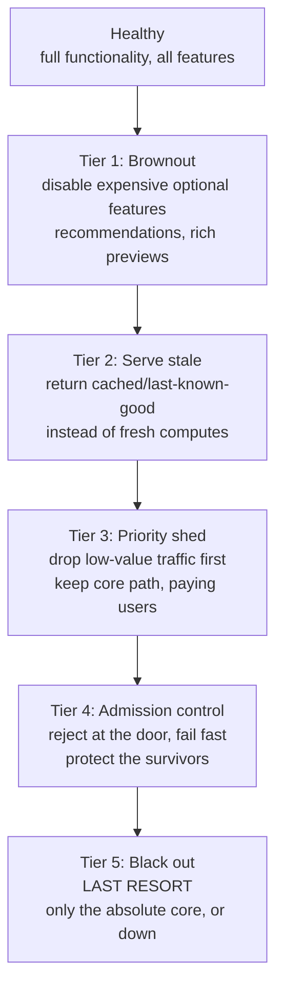

| Technique | What it sacrifices | Keeps working | Example |
|---|---|---|---|
| **Feature kill switch / flag** | Optional features | Core path | Turn off "people you may know," typing indicators, read receipts under load |
| **Serve stale** | Freshness | Availability | Return cached feed / last-known prices instead of recomputing |
| **Priority shedding** | Low-value requests | High-value requests | Drop analytics/background sync; keep message-send and login |
| **Admission control** | Some new requests | In-flight + accepted requests | Reject at the front door with 429/503 before spending resources |
| **Backpressure** | Upstream speed | System stability | Signal producers to slow down; bound every queue |

### 6.2 Load shedding and admission control — reject *early*

The key to shedding is **reject before you spend resources**, and **reject the right work**. A request you're going to drop should be dropped at the *cheapest* possible point (the edge / admission layer), not after it's traversed five services and loaded data — otherwise shedding itself amplifies work (the metastable trap).

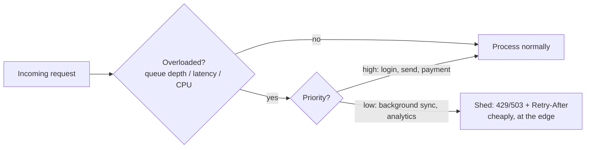

**Priority-based shedding** requires a notion of request value: tag traffic (critical / standard / background), and shed in reverse priority order. Google's systems do **criticality-based** shedding — `CRITICAL_PLUS` traffic is served last to be dropped. Pair with **deadline propagation**: if a request has already blown its deadline, drop it immediately — don't spend capacity on work no one is waiting for (this directly attacks goodput collapse).

> **Staff-level insight:** Load shedding is the **explicit exit from the metastable state** — it's how you create the headroom that lets the system climb back out (§2.5). The Staff framing ties it together: **"Under overload I shed the lowest-value work *at the edge* and bound every queue, so the system browns out gracefully instead of locking into a zero-goodput state. Degrade, don't fail — a stale feed beats a spinner, and a fast 503 beats a hung request."** The anti-pattern is a system with no shed valve: it has only two states, *fine* and *totally down*, and overload tips it straight into the metastable hole. See [Reliability §3.5](11-reliability.md).

---

## 7. Failure Detection at Scale

**Definition.** A **failure detector** decides whether a remote node is alive or dead. In an asynchronous network you can *never* distinguish "crashed" from "slow / partitioned" with certainty (the FLP impossibility result — see [Distributed Systems](02-distributed-systems.md)) — so every detector is a **bet** trading **detection time** against **false-positive rate.**

### 7.1 The three families

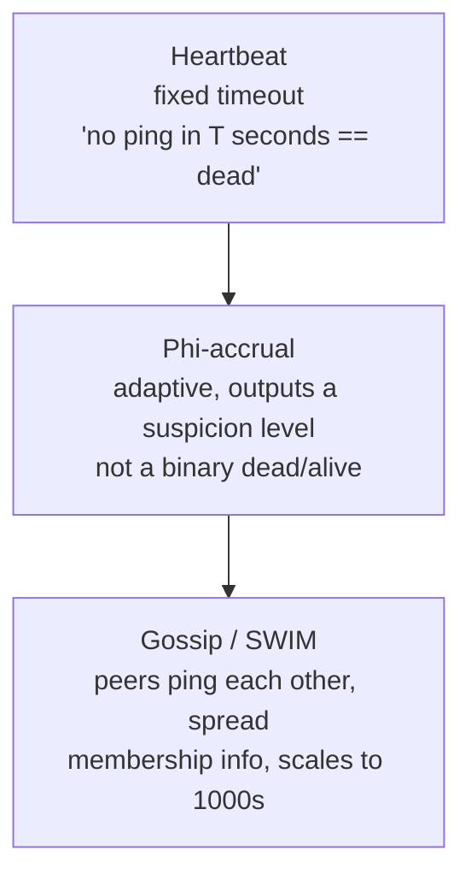

| Detector | How it works | Detection speed vs false positives | Scales to | Used by |
|---|---|---|---|---|
| **Heartbeat + fixed timeout** | "If no ping in T seconds, declare dead" | Tight T = fast but false-positive-prone; loose T = slow but safe — a **fixed, awkward** trade | Small/medium | Most simple systems, leader leases |
| **Phi-accrual (φ)** | Models inter-arrival times statistically; outputs a *continuous suspicion value* φ; you pick the threshold | **Adaptive** — adjusts to network jitter; you tune one knob (φ) for the speed/accuracy point you want | Medium/large | Cassandra, Akka |
| **Gossip / SWIM** | Nodes randomly ping peers, ask others to ping suspects (indirect probes), gossip membership | Scalable + resilient to transient blips (indirect probes filter false positives) | **Thousands** of nodes | Consul, Serf, Memberlist |

- **Heartbeat** is simple but forces a bad binary choice on the timeout.
- **Phi-accrual** turns "dead/alive" into a *gradient of suspicion* and adapts to changing network conditions, so you don't have to hardcode a brittle timeout.
- **SWIM-style gossip** scales failure detection across huge fleets *and* dampens false positives via **indirect probing** (before declaring a node dead, ask k other nodes to ping it — survives a single bad link).

### 7.2 The detection-time vs false-positive trade-off

This is the heart of it: a node that's merely *slow or partitioned* looks identical to a *dead* one.

- **Declare dead too eagerly** (short timeout) → **false positives** → you fail over / re-replicate / fence a node that was actually fine → wasted work, and worse, **split-brain** (two nodes both think they're the leader).
- **Declare dead too late** (long timeout) → **slow detection** → slow MTTR → users stare at a dead node longer.

> There is no free lunch: in an async system you trade one for the other. The right point depends on the cost of a false positive (high if failover is expensive/risky) vs. the cost of slow detection (high if downtime is expensive).

### 7.3 Split-brain and fencing tokens

When a detector false-positives and triggers failover, you can get **split-brain**: the old "dead" node was actually alive (just partitioned), and now **two nodes both believe they're the primary** — and both accept writes → data corruption.

The fix is **fencing**: a monotonically increasing **fencing token** issued with leadership. Every write carries the token; the shared resource (storage, lock service) **rejects any write with a token older than the highest it's seen.** So even if the old primary comes back thinking it's still in charge, its stale token is rejected — it's "fenced off."

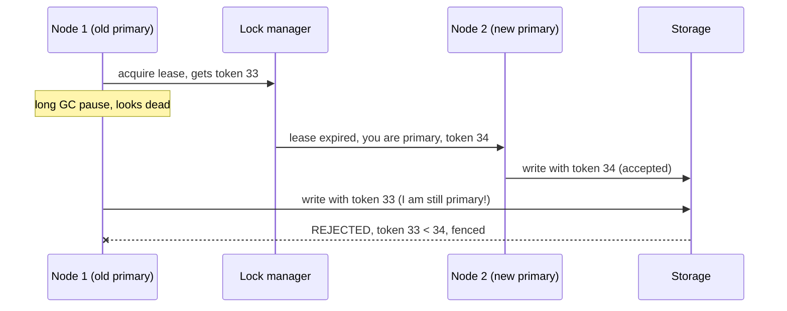

### 7.4 Why fast MTTR usually beats high MTBF

A direct corollary for failure detection: since you *cannot* prevent all failures (and chasing higher MTBF has steep diminishing returns), invest in **detecting and recovering fast.** `Availability = MTBF / (MTBF + MTTR)`. Cutting MTTR is the lever you fully control — fast detection (good detectors + SLO burn-rate alerts), fast mitigation (automated failover, rollback, cells you can drain), and rehearsed recovery (game days). A system that fails often but heals in seconds beats one that fails rarely but takes hours. (Developed in depth in [Reliability §2](11-reliability.md).)

> **Staff-level insight:** Two sentences earn the level here. First: **"In an async network you can't tell 'slow' from 'dead,' so detection is a tunable bet between detection-time and false positives — I'll use phi-accrual or SWIM gossip rather than a brittle fixed timeout, and tune for the cost of a false positive."** Second: **"Any failover must be fenced with monotonic tokens — otherwise a false positive gives me split-brain and corrupted data."** Detection without fencing is how a *detection* bug becomes a *data-loss* bug.

---

## 8. Chaos Engineering & Game Days

**Definition.** **Chaos engineering** is the practice of **deliberately injecting failures into a system to validate that it survives them — before the failures happen for real.** It's the empirical complement to all the theory above: untested resilience is merely *assumed* resilience. **Game days** are scheduled, often-manual chaos exercises that also test the *human* response (runbooks, alerts, on-call).

### 8.1 The method — hypothesis-driven, steady-state, blast-radius-controlled

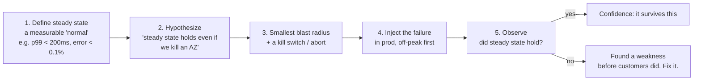

The discipline is what separates chaos engineering from "randomly breaking things": you **define a measurable steady state, form a falsifiable hypothesis, contain the blast radius, keep an abort switch, and run it in production** (staging hides the real failure modes). Start small (one instance, off-peak), graduate to AZ/region, then to continuous automated chaos.

### 8.2 What to inject — the failure menu

| Injection | Tests | Real failure it rehearses |
|---|---|---|
| **Instance kill** | Redundancy, auto-replacement | Hardware death (Chaos Monkey's original target) |
| **AZ / region loss** | Multi-AZ failover, cell isolation | AWS AZ power event |
| **Dependency failure** | Circuit breakers, fallbacks, bulkheads | A downstream service goes down |
| **Latency injection** | Timeouts, gray-failure detection, metastability | Slow dependency (the deadliest, per §1.3) |
| **Resource exhaustion** | Bulkheads, load shedding | CPU/memory/disk/thread saturation |
| **Network partition** | Split-brain, fencing, quorum behavior | Partition / netsplit |
| **Clock skew, packet loss** | Timing assumptions, omission handling | Real network/clock faults |

**Latency injection is the highest-value** because *slow* is deadlier than *dead* (§1.3) and is exactly the trigger for metastable failures (§2) and retry storms (§3) — it's where the subtle, cascading outages live.

> **Staff-level insight:** Chaos engineering is the *proof step* for everything else in this module. The Staff framing: **"I'd validate every failure defense I just claimed with game days — define steady state, hypothesize it survives an AZ loss or a slow dependency, inject it in prod with a small blast radius and a kill switch, and fix what breaks. Untested failover is hope, not failover."** Game days also surface the *human* SPOFs — the one engineer who knows the runbook, the alert that never fires, the dashboard that lies during a gray failure. Lowering MTTR is mostly about *rehearsal*, not tooling.

---

## 9. Blameless Postmortems & the Interview Move

**Definition.** A **postmortem** is the structured written analysis after an incident: what happened, why, and what changes prevent recurrence. **Blameless** means it focuses on **systemic and process causes, not individual fault** — because the goal is to fix the *system that allowed* the failure, not to punish a person.

### 9.1 The structure

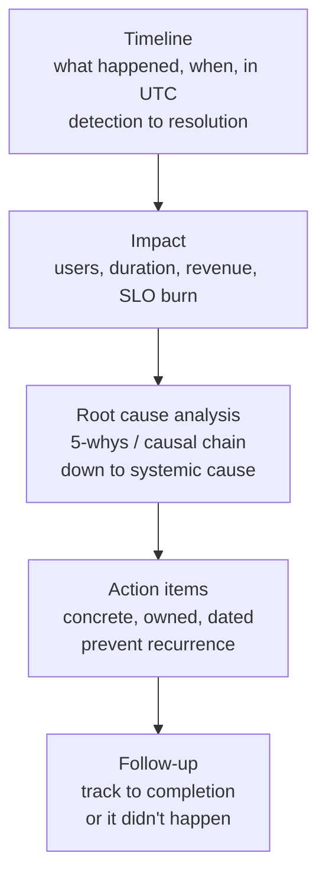

- **Timeline:** every event from trigger → detection → diagnosis → mitigation → resolution, with timestamps. Reveals where MTTR was spent.
- **Root cause via 5-whys / causal chain:** keep asking "why" past the proximate cause. *"The site went down" → why? "DB overloaded" → why? "retries amplified a blip" → why? "no retry budget" → why? "no review caught it" → why? "we have no checklist for retry policy."* The *real* cause is usually systemic (missing guardrail), not "someone typed the wrong thing."
- **Action items:** specific, owned, dated, and tracked to done. Vague action items ("be more careful") are worthless.

### 9.2 Blameless — and why "blame the config team" is the WRONG lesson

This is a point worth stating explicitly because it's the single most common *wrong* conclusion people draw from the famous outages:

The shallow read of Facebook 2021 is "the maintenance command was wrong — blame the engineer / the config team." **That is exactly the lesson NOT to take.** If a single command *could* take down the global backbone and simultaneously lock out the recovery tools, the failure is the **system that permitted it**: no validation guardrail on the command, no staged rollout, a feedback loop that withdrew all routes at once, and a recovery path that depended on the thing that broke. **A human will always eventually make the mistake; a well-designed system makes the mistake survivable.**

| Blameful framing (wrong) | Blameless framing (right) |
|---|---|
| "The engineer ran a bad command" | "Why could one command take down everything with no guardrail or staging?" |
| "The config team pushed bad config" | "Why does our config deploy have no validation, canary, or fast rollback?" |
| "On-call was too slow" | "Why did detection take 20 min? Why was the runbook stale?" |
| Punish → people hide mistakes → less learning | Fix the system → people report freely → MTTR drops |

> **Staff-level insight:** Blameless culture isn't softness — it's **engineering pragmatism.** Blame makes engineers hide near-misses, which destroys your richest source of learning and *raises* MTTR over time. The Staff/EM signal is reframing "who broke it" into "what *system change* makes this class of failure impossible or survivable." When an interviewer asks about an outage, the candidate who says "I'd add a validation guardrail and stage the rollout so no single change can do this" outscores the one who says "I'd make sure the team is more careful" — every time.

### 9.3 The interview move — how to use failure reasoning live

This is the payoff of the whole module. When you design *anything*, run the **detect → defend → recover** pass on each component, *proactively*:

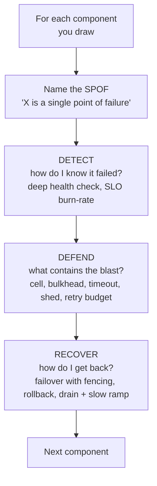

The script, said out loud, component by component:

1. **"Let me name how this fails before I make it bigger."** (Volunteer it — don't wait to be asked.)
2. **Name the SPOF and the global/shared-fate component.** ("The X is a SPOF; the config plane is shared-fate — that's my top risk.")
3. **For each, give detect / defend / recover.** ("Detect with a deep health check on the real path; defend with a bulkhead and a retry budget so a slow X can't cascade or storm; recover with fenced failover to the warm standby.")
4. **Name the metastable / amplification risk if there is one.** ("Under overload, retries amplify — I'll budget them and shed load so we don't get pinned in a zero-goodput state.")
5. **State the trade-off and a revisit trigger.** ("Single-region multi-AZ with cells for now; multi-region when the SLA demands surviving a regional event.")

> **Staff-level insight:** The interview-winning behavior, distilled: **you are graded on whether you design for the 3 a.m. page, not the demo.** Volunteer the failure modes, hunt your own SPOFs, name the global shared-fate component as the top risk, and give every component a detect/defend/recover story — *especially the metastable, retry-storm, and static-stability angles that most candidates never mention.* That proactivity is the single clearest Staff-vs-senior signal in the rubric. See [Google SD Playbook](26-google-sd-playbook.md) for how this slots into the full interview flow.

---

## Interview Cheat-Sheet

| Concept | One-liner |
|---|---|
| **The move** | Volunteer failure modes; hunt your own SPOFs; give every component **detect → defend → recover**. |
| **Fault / error / failure** | Cause → activated bad state → user-visible deviation. Resilience stops the chain before the last arrow. |
| **Failure spectrum** | Fail-stop → crash → omission → timing → Byzantine. Most systems assume crash/omission/timing, *not* Byzantine. |
| **Gray failure** | Partial/ambiguous; health check says UP while users see errors. **Differential observability.** Deadlier than a crash. |
| **Correlated failure** | "3 replicas" is a lie if they share fate (same deploy/AZ/config). Ask: *what do they share?* De-correlate. |
| **Metastable failure** | System stays broken *after the trigger is gone*, held by a **sustaining feedback loop** (work amplification). |
| **Trigger vs sustaining** | Trigger is brief; sustaining loop pins it. If removing the trigger doesn't fix it → metastable. |
| **Goodput collapse** | Server 100% busy, useful throughput ≈ 0 — processing work no one's waiting for anymore. |
| **Break the loop** | **Shed load** (create headroom) or **drop the amplifier** (kill retries). Adding capacity often *doesn't* work. |
| **Retry math** | Budget of 3 = 4× load; 3 layers × 4× = **64×** on the deepest service. Retry at **one** layer only. |
| **Jitter** | Exponential backoff + **full jitter** (default) or **decorrelated jitter** (high contention). No jitter = waves. |
| **Retry budget** | Token bucket; retries ≤ ~10% of requests; drains during outage → auto-disables. Naive retry = self-DDoS. |
| **Static stability** | Data plane keeps serving when control plane is **down**. "EC2 ran; APIs failed." |
| **Constant work** | Push full desired state on a cadence; same work for 0 or 10k changes; no event-driven spikes/backlogs. |
| **Pre-provision failover** | Standby already full-size; failover = traffic shift (data plane), not scale-up (control plane that may be dead). |
| **Cells** | Independent full-stack copies; failure = 1/N users. Don't share fate. |
| **Shuffle sharding** | Random k-of-N combo per tenant; **C(N,k)** virtual shards. Partial overlap degrades but is survivable via retry; only **full overlap** (≈1/C(N,k)) is fatal — so pair with fail-fast/retry. |
| **Bulkheads** | Per-dependency pools; one slow dep can't drain the shared pool. |
| **Global config = top risk** | Facebook 2021: one config withdrew all BGP, killed DNS + locked out recovery tools. Stage + guardrail + out-of-band mgmt. |
| **Degradation ladder** | Brownout → serve stale → priority shed → admission control → black out (last resort). Degrade, don't fail. |
| **Load shedding** | Reject early, at the edge; shed lowest-value first; the **explicit exit** from metastability. |
| **Failure detectors** | Heartbeat (brittle) → phi-accrual (adaptive) → SWIM gossip (scales to 1000s, indirect probes dampen false +). |
| **Detection trade-off** | Can't tell slow from dead. Eager = split-brain; late = slow MTTR. Tune for false-positive cost. |
| **Fencing** | Monotonic token; storage rejects stale token → no split-brain after a false-positive failover. |
| **MTTR > MTBF** | Can't prevent all failure; detect + recover fast. `A = MTBF/(MTBF+MTTR)`. |
| **Chaos / game days** | Steady state → hypothesis → small blast radius + kill switch → inject in prod. Inject **latency** first. |
| **Blameless** | Fix the *system that allowed it*, not the person. "Blame the config team" is the WRONG lesson. |

---

## Common Interview Questions

**Q1. What is a metastable failure, and why can't you just add capacity to fix it?**
A metastable failure is a degraded, low-goodput state the system stays stuck in *even after the triggering event is gone*, held there by a **sustaining feedback loop** — almost always **work amplification** (retries, cache-miss storms, queues full of abandoned work). The defining test: remove the trigger; if it doesn't self-recover, it's metastable. Adding capacity usually fails because the *amplification is the problem, not the capacity* — new servers enter the same bad state, and in the AWS Kinesis 2020 outage, adding capacity is literally what *triggered* it (thread exhaustion building the fleet map). The two real exits are **shed load** (create headroom so the system can rebuild state / refill caches and climb out) and **drop the amplifier** (kill or budget the retries). The design defenses: bounded retries, bounded queues, admission control, and an explicit load-shed valve so the loop *can't* sustain itself.

**Q2. Do the retry-storm math for me. Why are naive retries dangerous?**
Retries stack multiplicatively. One layer retrying 3× = 4× load. Three layers (client → gateway → service → DB), each 4×, = **4×4×4 = 64×** load on the deepest service — and it arrives precisely during the failure window, when capacity is lowest. That's how a 30-second blip becomes a multi-hour outage: a self-inflicted DDoS. The fix stack, in one breath: **retries at exactly one layer (closest to the user), exponential backoff with full jitter, a retry budget (token bucket capping retries at ~10% of requests so they auto-disable during a broad outage), gated by a circuit breaker, and only for idempotent operations.** Naive retries are the single most common cause of turning a transient failure into an outage — they're meant to improve reliability and are the thing that most often destroys it.

**Q3. Explain static stability. Walk me through the AWS lesson.**
Static stability means the **data plane keeps serving at current capacity even when the control plane is completely down.** In major AWS control-plane outages, already-running EC2 instances kept serving traffic — your live app stayed up — but the APIs to *launch* instances, change security groups, or scale failed. That's static stability working. The trap is when your *recovery* depends on the control plane: autoscaling-during-an-incident or failover-needing-an-API-call fail exactly when you need them. Two design rules: **(1) pre-provision failover capacity** so failover is a data-plane traffic shift, not a "scale up the standby" control-plane action that may be dead; **(2) prefer constant-work / declarative designs** that push full desired state on a cadence and converge, keeping the control plane out of the steady-state request path. The killer interview question: *"if the control plane is down, does serving stop?"*

**Q4. What's the difference between a crash and a gray failure, and which is more dangerous?**
A crash is self-announcing: the process dies, health checks fail, failover triggers. A **gray failure** is partial and ambiguous — the system is degraded but its *own health check says it's healthy* while users see errors (differential observability). A disk 99% full, a NIC dropping 1% of packets, a GC storm spiking p99 — the `/healthz` ping passes while real requests time out, and the load balancer happily keeps sending traffic. Gray is **more dangerous** precisely because it hides behind a green check and doesn't trigger failover. The fix: **deep, user-facing health checks** that probe the real dependency path, and alerting driven by **SLO burn-rate on actual request outcomes**, not liveness pings. Most catastrophic outages start as gray failures monitoring declared healthy.

**Q5. How do cells and shuffle sharding limit blast radius? Give me the math.**
A cell is a complete, self-contained copy of the stack serving a subset of users; a failure (bad deploy, poison data, hot tenant, overload) hits **one cell = 1/N of users**, and cells don't share fate. Shuffle sharding goes further for multi-tenant systems: instead of pinning a tenant to one cell (where a poison tenant kills everyone in it), assign each tenant a **random k-of-N combination** of nodes. With N nodes choosing k, there are **C(N,k)** virtual shards — C(8,4)=70. A victim with *partial* overlap does feel the poison tenant — the shared nodes degrade — but survives **via retry** onto a remaining good node, so partial overlap is common but survivable. Only **full overlap** is fatal: the victim's entire subset must be ⊆ the bad tenant's subset (≈ 1/C(N,k) for size-k subsets), leaving no good node to retry on — combinatorially rare. This is exactly why shuffle sharding must be paired with fail-fast/retry. AWS Route 53/Shield use this so one abusive customer fully poisons a vanishingly small fraction of others. The blast radius drops from 100% → 1/N → near-zero.

**Q6. Explain the Facebook 2021 outage and what you'd design differently.**
A maintenance command meant to assess backbone capacity had a bug that took the whole backbone down. Facebook's DNS servers had a safety feature: if they couldn't reach the datacenter, they'd **withdraw their BGP route advertisements** (signaling "don't route to me, I'm unhealthy"). The backbone loss made *all* DNS servers do this simultaneously, so Facebook's IP prefixes vanished from the global routing table — `facebook.com` became unresolvable to the entire internet. Worse, the recovery tools and out-of-band access rode the same network that just disappeared, so engineers couldn't fix it remotely. **The wrong lesson is "blame the config team."** The right lessons: a single global config action defeats all cell isolation, so (1) **stage and canary global changes** cell-by-cell with **validation guardrails** that refuse a config that would withdraw all routes, (2) **break the "everything withdraws on unhealthy simultaneously" feedback loop**, and (3) keep an **independent out-of-band management plane** that doesn't depend on production DNS/BGP. The global shared-fate component is always the top risk in a design.

**Q7. A dependency starts responding slowly — not failing, just slow. What happens, and how do you contain it?**
Slow is worse than dead. Without protection, callers' threads block waiting, the thread/connection pool saturates, and the caller stops serving *all* traffic — not just calls to the slow dependency — and the failure cascades upward by resource-exhaustion contagion. It also triggers retry storms (the slow call times out and gets retried) and can pin the system into a metastable state. Containment: **timeouts** (release threads fast — set above p99), **bulkheads** (isolate the slow dep's pool so other deps are unaffected), **circuit breakers** (after a threshold, fail fast and stop calling the sick dependency, which also lets *it* recover), **fallbacks** (degrade gracefully), and **load shedding** so you brown out instead of black out. And **detect** it: a slow dependency is a gray failure, so health checks must probe the real call path, not just liveness.

**Q8. How would you detect node failure in a large fleet, and what goes wrong if you get it wrong?**
In an async network you can never distinguish "dead" from "slow/partitioned" with certainty — detection is a tunable bet between **detection time** and **false-positive rate.** For a large fleet I'd avoid brittle fixed-timeout heartbeats and use **phi-accrual** (adaptive suspicion level, one tunable knob) or **SWIM gossip** (scales to thousands, and indirect probing — asking k peers to ping a suspect before declaring it dead — dampens false positives from a single bad link). Get it wrong eager → **false positives** → you fail over a healthy node → **split-brain** (two primaries, both accepting writes, data corruption). Get it wrong late → slow MTTR. Critically, **any failover must be fenced with monotonic tokens**: the shared storage rejects writes carrying a token older than the highest it's seen, so a falsely-declared-dead node that comes back is fenced off. Detection without fencing turns a detection bug into a data-loss bug.

**Q9. The interviewer says "make this design resilient" with 10 minutes left. What do you do?**
Run the self-audit out loud: **"Let me do a blast-radius and SPOF hunt."** First name the **SPOFs and the global shared-fate component** (config/control plane, single auth service) as the top risk. Then for each critical component give **detect → defend → recover**: detect with deep health checks and SLO burn-rate; defend with timeouts, bulkheads, cells, retry budgets, and load shedding; recover with fenced failover and rollback. Explicitly name the **metastable/retry-amplification risk** ("under overload retries amplify — I'll budget them and shed load so we don't get pinned at zero goodput") and the **static-stability** question ("if the control plane dies, does serving stop? It shouldn't"). Close with a trade-off and revisit trigger ("single-region multi-AZ with cells now; multi-region when the SLA demands surviving a regional event"). Don't enumerate every pattern uniformly — lead with the SPOF hunt and spend your minutes on the one real risk.

**Q10. What makes a postmortem "good," and why insist on blameless?**
A good postmortem has a precise **timeline** (trigger → detection → mitigation → resolution, which exposes where MTTR went), a quantified **impact**, **root-cause analysis via 5-whys/causal chain** that pushes past the proximate cause to the *systemic* one (missing guardrail, not "someone typed wrong"), and **specific, owned, dated action items** tracked to completion. Blameless isn't softness — it's pragmatism: blame makes engineers hide near-misses, destroying your richest learning source and *raising* MTTR. "Blame the config team" is the wrong lesson from Facebook 2021; the right one is "why could one command do this with no guardrail or staging?" A human will eventually make the mistake — a well-designed system makes it survivable. The Staff move is always reframing "who broke it" into "what system change makes this class of failure impossible or survivable."

**Q11. How would you validate that the failure defenses you just designed actually work?**
Chaos engineering and game days — because untested resilience is merely *assumed* resilience. Define a measurable **steady state** (p99 < 200ms, error < 0.1%), form a falsifiable **hypothesis** ("steady state survives an AZ loss"), inject the failure with the **smallest blast radius and a kill switch**, run it **in production** (staging hides real failure modes), starting off-peak and graduating to continuous. Inject the full menu — instance kills, AZ/region loss, dependency failure, **latency (highest value, since slow is deadliest and triggers metastability/retry storms)**, resource exhaustion, network partitions. Game days also surface the *human* SPOFs: the stale runbook, the alert that never fires, the one engineer who knows the system. The principle: untested failover is hope, not failover — and rehearsing recovery is how you actually lower MTTR.

---

*Related modules:* [Reliability](11-reliability.md) · [Distributed Systems](02-distributed-systems.md) · [Observability](12-observability.md) · [Load Balancing](05-load-balancing.md) · [Google SD Playbook](26-google-sd-playbook.md)
