# Module 29 — Geospatial Systems

> The definitive Staff-level reference for the "find nearby" / location / mapping family of problems. Three of Grokking's classic designs — **Google Maps, Yelp, Uber** — all collapse onto the same three pillars: a **geospatial index**, **routing on a road graph**, and **matching/dispatch**. Most course material reuses "QuadTree" for all three with zero trade-off, never names **geohash / S2 / H3**, and hand-waves dispatch and surge. This module is the dedicated deep-dive that makes those designs — and any proximity prompt — strong.

## What you'll master

By the end of this module you will stand at a whiteboard and, the moment you hear "find nearby X" or "match rider to driver" or "ETA," reach for the **right index by name and defend it in one sentence**. You'll explain why a B-tree on `(lat, lng)` cannot answer a radius query, why **space-filling curves** turn 2D proximity into a 1D range scan, and exactly when **geohash** (the Redis-friendly default) gives way to **S2** (Google/Uber scale, hierarchical cells) or a **QuadTree** (wildly non-uniform density). You'll design the **Uber write-path** — hundreds of thousands of location pings per second — without melting your database. You'll go from **Dijkstra → A\* → Contraction Hierarchies** and explain why CH gives continental routing in sub-milliseconds. And you'll design **dispatch** properly: batched global matching over greedy-nearest, the **atomic driver-claim** that prevents double-assignment, the **trip state machine**, and **surge** as a supply/demand heatmap per cell.

This is the module that separates "I'll use a QuadTree" from "geohash precision 6 in a Redis sorted set, neighbor-cell fan-out for the boundary problem, S2 region-cover if I need hierarchical cells." For how to *carry* a design under pressure, see [Staff-Level Execution](20-staff-execution.md). For the marketplace mechanics (saga, ledger, the strong/eventual boundary) that ride *on top of* this geospatial layer, see [18c Marketplace design](18c-design-marketplace-money.md).

---

## Table of Contents

1. [In the Room — Geospatial Design](#1-in-the-room--geospatial-design)
2. [The core problem](#2-the-core-problem)
3. [Geohash](#3-geohash)
4. [Google S2](#4-google-s2)
5. [QuadTree](#5-quadtree)
6. [R-tree / R*-tree](#6-r-tree--r-tree)
7. [Comparison & decision](#7-comparison--decision)
8. [Proximity search at scale](#8-proximity-search-at-scale)
9. [Real-time location ingestion — the Uber write-path](#9-real-time-location-ingestion--the-uber-write-path)
10. [Routing on a road graph](#10-routing-on-a-road-graph)
11. [Matching / dispatch — the Uber core](#11-matching--dispatch--the-uber-core)
12. [Worked mini-design — find nearby drivers + dispatch](#12-worked-mini-design--find-nearby-drivers--dispatch)
13. [Interview Cheat-Sheet](#13-interview-cheat-sheet)
14. [Common Interview Questions](#14-common-interview-questions)

---

## 1. In the Room — Geospatial Design

### 1.1 Recognizing a geospatial prompt

The trigger phrases: *"find nearby"*, *"within X km"*, *"closest driver / restaurant / friend"*, *"check-in / search this area"*, *"ETA / route"*, *"who's in this region"*. Yelp, Google Maps, Uber, Lyft, DoorDash, Tinder, Find My Friends, Pokémon Go, geo-fencing, ad targeting by location — all geospatial. The instant you hear them, your job is to **name the index, then the routing model, then the matching model** — in that order — and to *decide* on each rather than enumerate.

The single most common failure is treating this as a normal database problem. A radius query is **not** a `WHERE` clause a B-tree can serve, and "I'll use a QuadTree" with no trade-off is the tell of someone who read one article. Staff candidates choose by name and defend the choice.

### 1.2 The decisive index choice

This is the load-bearing decision of the whole family. Lead with it:

> **Geohash by default** for proximity search — because it turns 2D nearness into a 1D prefix/range key that drops straight into Redis (`GEOADD`/`GEOSEARCH`) or any KV/sorted-set store, no special infrastructure, operationally trivial. **Revisit to S2/H3** when you need *hierarchical cells* (roll-up/aggregation across zoom levels), better locality (Hilbert curve), or you're at Google/Uber scale and want region-cover semantics. **Revisit to QuadTree** when density is *wildly non-uniform* — Manhattan vs. Montana in the same index — and you need the structure to subdivide adaptively instead of using one fixed cell size everywhere. **R-tree/PostGIS** only when the objects are *polygons/extents* (delivery zones, parcels, "is this point inside this neighborhood"), not points.

Said in interview voice: *"Geohash because it's a 1-D key any KV store indexes and Redis ships it natively; S2 if I need hierarchical cells or Google-scale region-cover; QuadTree if density is so non-uniform that a single cell size wastes space in the desert and overflows downtown."*

### 1.3 The recurring hard parts (earmark these out loud)

Every geospatial design has the same three places where the difficulty concentrates. Name them as the crux and spend your minutes there:

| Hard part | Why it's hard | The decisive move |
|---|---|---|
| **High write-QPS location ingestion** | Millions of moving entities pinging every few seconds = hundreds of K writes/sec. You cannot put that on Postgres. | **In-memory geo-index** updated from a partitioned stream; the DB is *not* on the hot write path. Location is eventually consistent and lossy by design. (§9) |
| **Hot cells** | Times Square, an airport, a stadium — one cell holds 100× the entities and gets 100× the read fan-out. | **Replicate hot cells**, finer sub-cell sharding, cache the popular-cell result set with a short TTL. (§8.4) |
| **Dispatch / matching** | Greedy nearest creates concurrency races and worse marketplace outcomes; double-assignment corrupts trips. | **Batched global min-cost matching** + an **atomic driver-claim** (CAS/conditional write). (§11) |

> **Staff-level insight:** The geospatial index is *only the retrieval layer*. The interview is won in the seams around it — the **write-path** (how do you ingest the firehose without a database meltdown), the **hot-cell** skew, and the **dispatch concurrency**. Candidates who only talk about geohash-vs-QuadTree and stop are answering the easy 20%. Name the index decisively in 30 seconds, then earmark the write-path and dispatch as where you'll spend your time.

### 1.4 Altitude — name-and-move-on vs. deep-dive

**Name-and-move-on:** the exact base-32 alphabet of geohash, the bit-interleaving mechanics, the precise number of meters per precision level (know the table exists; don't recite it). The closed-form Haversine formula. "We use Redis / Kafka." One sentence each.

**Deep-dive (where staff rounds are won):** the index *trade-off* and the boundary/neighbor problem (§3.4); the write-path firehose (§9); CH vs. naive Dijkstra (§10.3); batched dispatch + atomic claim + surge (§11). Earmark these.

---

## 2. The core problem

### 2.1 Definition — three query shapes

Geospatial workloads reduce to three query shapes over points (and sometimes regions) on a sphere:

| Query | Question | Example |
|---|---|---|
| **Point / containment** | Is point P inside region R? | Is this GPS coord inside the airport surge zone? |
| **Range (window)** | Which points fall in this bounding box / radius? | All restaurants within 2 km. |
| **kNN (nearest)** | The k closest points to P. | The 5 nearest available drivers. |

All three need an index that preserves **2D spatial locality**: things that are *near in the world* must be *near in the index* so a query touches few index pages.

### 2.2 Why a B-tree on (lat, lng) fails

The naive instinct is a composite B-tree index on `(lat, lng)`. It does not work for proximity, and explaining *why* is a core Staff signal.

A B-tree orders rows by `lat` first, then `lng`. So it can answer "all rows with `lat BETWEEN a AND b`" efficiently — that's a contiguous range. But a radius query needs `lat BETWEEN a AND b AND lng BETWEEN c AND d` simultaneously. The index narrows on `lat`, then must **scan every row in that latitude band** and filter `lng` row-by-row. A 2 km radius in New York shares its latitude band with all of California and the Atlantic. The composite index gives you a thin horizontal stripe across the planet, not a box.

The root cause: a B-tree imposes a **1-D total order**, and there is no way to order 2-D points on a line such that *both* dimensions stay local. Sort by `lat` and `lng`-neighbors scatter; sort by `lng` and `lat`-neighbors scatter. Two points adjacent on the map can be arbitrarily far apart in the key.

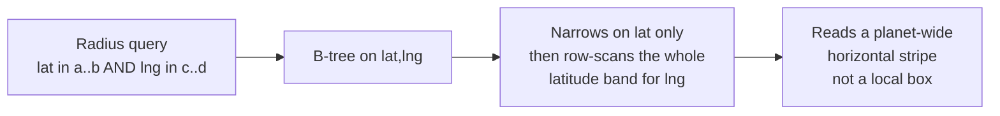

### 2.3 The space-filling-curve idea

The fix is a **space-filling curve**: a single continuous line that visits every cell of a 2-D grid, chosen so that **points close on the curve are usually close in 2-D**. You recursively subdivide the world into a grid, walk the grid with the curve, and assign each cell the position-along-the-curve as its 1-D key. Now a 2-D proximity query becomes a small number of **1-D range scans** — exactly what a B-tree, a KV store, or a Redis sorted set is great at.

Two curves dominate:
- **Z-order (Morton) curve** — interleave the bits of x and y. Simple, cheap, the basis of **geohash**. Has occasional big jumps where the "Z" snaps back.
- **Hilbert curve** — a fractal that *never* makes a long jump; consecutive cells are always edge-adjacent. Better locality, more math. The basis of **S2**.

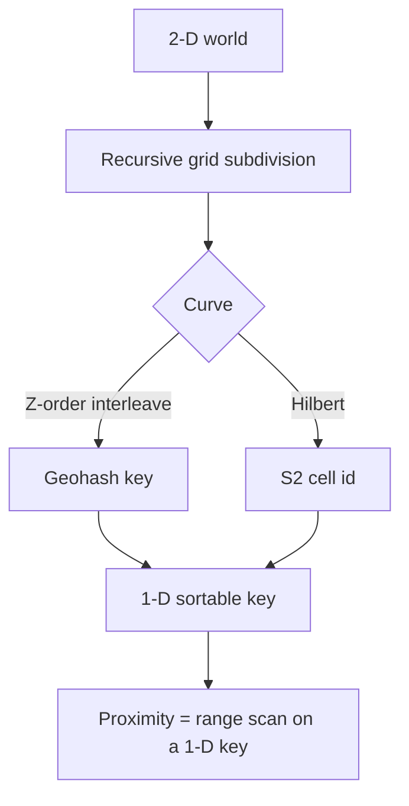

> **Staff-level insight:** The one sentence that proves you understand the whole field: *"A B-tree can't serve a radius query because no 1-D ordering of 2-D points keeps both axes local — so we don't index the coordinates, we index a space-filling-curve key that bakes 2-D proximity into a 1-D sort order, and then a nearby-search is just a handful of range scans."* Everything else — geohash, S2, the boundary problem — is a refinement of that idea.

---

## 3. Geohash

### 3.1 Definition

A **geohash** encodes a `(lat, lng)` pair into a short string (e.g. `dr5ru7`) using the Z-order curve. Each character adds 5 bits of precision (base-32). The defining property: **a shared prefix means a shared region**. `dr5ru` and `dr5rv` are adjacent neighborhoods; `dr5` is the larger box that contains both. Strip characters off the end → zoom out.

### 3.2 How it works — interleaving

The world is `[-90, 90]` latitude × `[-180, 180]` longitude. Geohash does a **binary search** on each axis: at each step, "is the value in the upper or lower half?" yields one bit. It **interleaves** longitude and latitude bits (lng, lat, lng, lat, …) — this interleaving *is* the Z-order curve — then groups the bits 5-at-a-time and base-32 encodes them. More characters = more binary-search steps = a smaller cell.

| Geohash length | Cell width (approx, equator) | Cell height | Good for |
|---|---|---|---|
| 4 | ~39 km | ~20 km | Coarse region / city |
| 5 | ~5 km | ~5 km | Neighborhood / "nearby city" |
| 6 | ~1.2 km | ~0.6 km | **Find-nearby default** (driver/restaurant proximity) |
| 7 | ~150 m | ~150 m | Block-level, dense urban dispatch |
| 8 | ~38 m | ~19 m | Building-level |
| 9 | ~5 m | ~5 m | Sub-building / precise pin |

Pick the precision so the cell ≈ your typical search radius. Precision 6 (~1 km cells) is the workhorse for "drivers/restaurants near me."

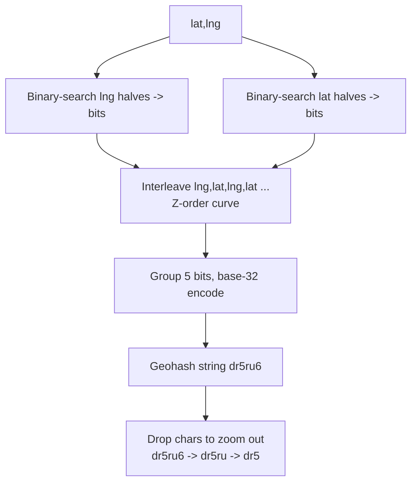

### 3.3 Range query on a 1-D key

Because a prefix defines a box, a "find nearby" becomes: compute the geohash of the query point at your chosen precision, then **scan all keys sharing that prefix**. In any KV/sorted-set store this is trivial:
- **Redis sorted set:** store each entity scored by its 52-bit geohash integer; a prefix range is a `ZRANGEBYLEX` / `ZRANGEBYSCORE` over the bit range. (This is literally how Redis GEO is implemented under the hood.)
- **Postgres/DynamoDB/Cassandra:** `WHERE geohash LIKE 'dr5ru%'` or a range partition key.

No special spatial index, no extension — a plain B-tree or sorted set on the string. That operational simplicity is geohash's killer feature.

### 3.4 The edge problem (and the neighbor-cell fix)

The trap that catches everyone: **two points can be physically adjacent but share no prefix** because they straddle a cell boundary. A driver 50 m away across the cell border has a completely different geohash. A naive single-prefix query *misses them*. Worse, the query point near an edge means the true nearest neighbor often lives in the *adjacent* cell.

The fix is the **neighbor-cell query** (also called the 3×3 / 9-cell technique): compute the query cell **plus its 8 surrounding neighbor cells**, and scan all 9 prefixes. This guarantees you never miss a point within one cell-width of the query, regardless of where it falls in the cell. Geohash libraries expose a `neighbors(hash)` function for exactly this.

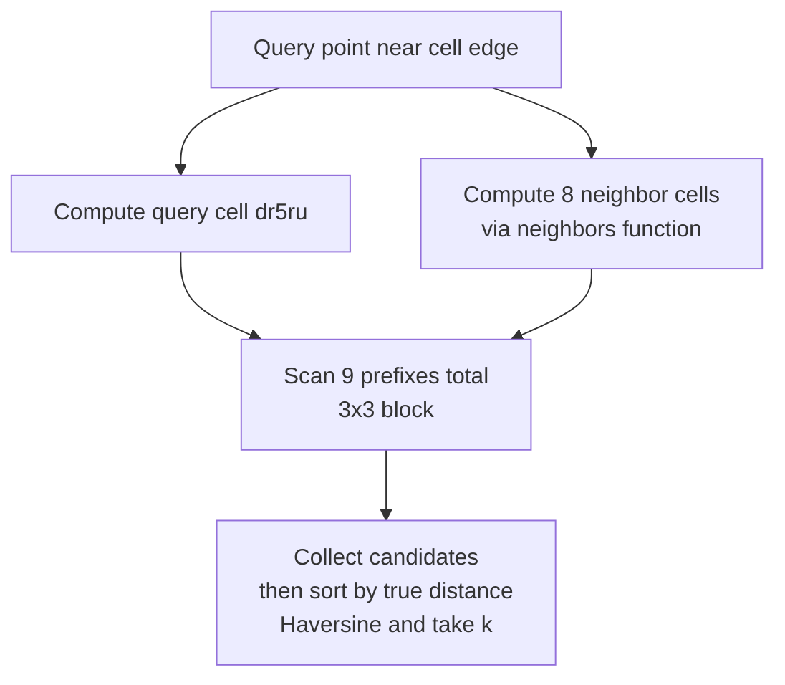

After gathering candidates from all 9 cells, compute the **true distance** (Haversine) for each and sort — the geohash gives you a *candidate set*, not a ranked answer. If 9 cells return too few results (sparse rural area), widen by dropping a precision character (bigger cells); if too many (dense city), the cell was already fine or go finer and accept more neighbor scans.

### 3.5 Redis GEO commands — the practical default

Redis ships geohash as first-class commands, which is why "geohash + Redis" is the boring-correct default for most proximity rounds:

| Command | Does |
|---|---|
| `GEOADD key lng lat member` | Add an entity; stored as a 52-bit geohash score in a sorted set |
| `GEOSEARCH key FROMLONLAT lng lat BYRADIUS 2 km ASC` | kNN/radius search, sorted by distance |
| `GEOSEARCH ... BYBOX w h` | Bounding-box search |
| `GEODIST key m1 m2` | Distance between two members |
| `GEOPOS` / `GEOHASH` | Read back coords / the geohash string |

Redis handles the neighbor-cell fan-out internally. For Uber-scale you outgrow a single Redis (you shard by city), but for Yelp/find-nearby it's frequently *enough*.

### 3.6 Pitfalls

- **Forgetting the neighbor-cell fan-out** → silently missing the nearest result that's just across a border. The #1 geohash bug.
- **Fixed precision under non-uniform density** → precision-6 cells are perfect in suburbia and overflow with 10k entities in midtown. (This is exactly when QuadTree wins; §5.)
- **Using the geohash *string prefix* as if it were the answer** — it's a candidate filter. Always re-rank by real distance.
- **Z-order seams** — the curve occasionally puts two far-apart cells next to each other in 1-D space; the neighbor-cell approach (not pure 1-D range) sidesteps this.

> **Staff-level insight:** When you say "geohash," immediately follow with "and I'll query the cell *plus its 8 neighbors* and re-rank by Haversine, because the boundary problem otherwise silently drops the nearest result." Naming the edge problem *before the interviewer asks* is one of the cleanest depth signals in the whole geospatial space — it's the detail that proves you've actually built this, not just read the encoding.

---

## 4. Google S2

### 4.1 Definition

**S2** (Google's geometry library, used by Google Maps, Uber's dispatch, MongoDB, and others) projects the sphere onto the **6 faces of a cube**, then recursively subdivides each face into a quadtree of cells, numbering cells along a **Hilbert curve**. Each cell gets a 64-bit `S2CellId`. Cells form a strict **hierarchy of 31 levels**: level 0 is a cube face (~85M km²), level 30 is ~1 cm². A cell at level *n* has exactly 4 children at level *n+1*, and the parent id is a bit-truncation of the child — so roll-up/aggregation across zoom levels is a bit operation. (**H3**, Uber's open-source hexagonal grid, is the same *idea* with hexagons instead of squares — neighbor cells are equidistant, which is nicer for radius coverage; mention it as the modern alternative.)

### 4.2 How it works — region cover & the Hilbert advantage

The key S2 operation is **region cover**: given an arbitrary shape (a circle for "within 2 km," a polygon for a delivery zone), S2 returns the **minimal set of cells** (mixing levels — big cells in the interior, small cells hugging the boundary) that tile it. You then index entities by their cell id and query by the cover's cells. This *adaptive multi-level cover* is what geohash's fixed-precision prefix can't do.

**Why Hilbert beats Z-order on locality:** the Hilbert curve never makes a long jump — consecutive cell ids are always physically edge-adjacent. The Z-order curve (geohash) periodically "snaps back" across the whole quadrant, so two cells adjacent in 1-D key space can be far apart on the map (and vice-versa). Hilbert's better locality means a region cover yields **fewer, tighter ranges**, fewer false-positive candidates, and better cache behavior.

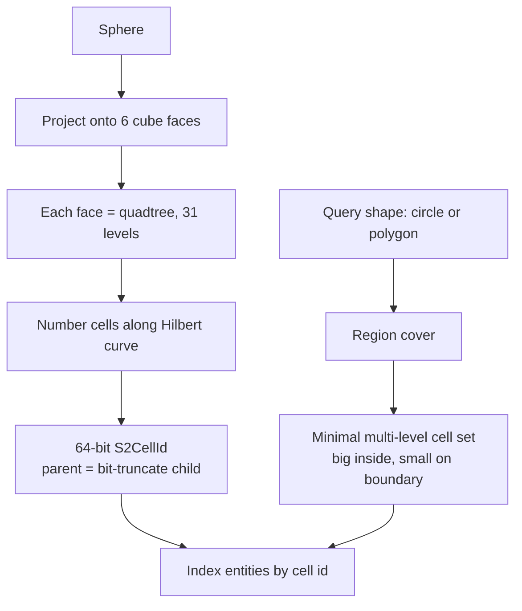

### 4.3 Geohash vs. S2

| Dimension | Geohash | S2 |
|---|---|---|
| Curve | Z-order (Morton) | Hilbert (better locality) |
| Cell shape | Lat/lng rectangles (distort toward poles) | Cube-face quads (near-uniform area on sphere) |
| Hierarchy | Yes, by prefix length (string) | Yes, 31 levels, parent = bit-truncate (numeric) |
| Region cover | No native concept; you fan out fixed-precision cells | First-class, adaptive multi-level cover |
| Pole/wraparound distortion | Significant (cells shrink toward poles) | Minimal (cube projection) |
| Infra | Plain string/int in any KV; Redis native | Needs the S2 library; ids are 64-bit ints |
| Operational cost | Trivial | Higher — a real dependency and concept |
| Who uses it | Most "find nearby" apps, Elasticsearch geo, Redis | Google Maps, Uber (with H3), MongoDB, Foursquare |

### 4.4 Pitfalls

- **Reaching for S2 by default.** It's heavier; for a Yelp-scale find-nearby, geohash+Redis is simpler and *enough*. Only justify S2 when you can name the requirement it uniquely serves (hierarchical aggregation, region cover, pole accuracy).
- **Confusing S2 and H3.** S2 = squares (Google). H3 = hexagons (Uber). H3's equidistant neighbors make radius coverage cleaner — name it as the modern pick if asked.
- **Forgetting region cover can over-cover.** A circle's cover includes corner cells outside the radius → still re-rank by true distance.

> **Staff-level insight:** The decisive line is *"S2 because I need **hierarchical cells** — I want to aggregate supply/demand from level-15 dispatch cells up to level-10 surge cells with a bit-truncation, and I want a region cover for arbitrary geo-fences, neither of which geohash gives me cleanly. If I just needed 'nearest 10 restaurants,' I'd stay on geohash + Redis."* That sentence — choosing S2 *for the hierarchy*, not for fashion — is exactly the trade-off Grokking skips when it uses one structure for everything.

---

## 5. QuadTree

### 5.1 Definition

A **QuadTree** recursively subdivides 2-D space into 4 quadrants (NW, NE, SW, SE). A node holds points up to a **capacity** (e.g. 100); on overflow it **splits** into 4 children and redistributes. The defining property versus geohash/S2: subdivision is **adaptive to density** — dense regions split deep (many small leaves), sparse regions stay shallow (few big leaves). The tree *shapes itself* to the data instead of imposing one fixed cell size everywhere.

### 5.2 How it works

- **Point-region (PR) quadtree:** each leaf is a spatial cell holding up to *N* points; exceed *N* → split into 4, push points down.
- **Range query:** descend from the root, pruning any quadrant that doesn't intersect the query box; collect points from the surviving leaves.
- **kNN:** best-first descent ordered by quadrant distance to the query point, with a running k-nearest heap.
- **Dynamic split/merge:** insert → split a full leaf; delete → if 4 sibling leaves drop below a threshold, **merge** them back into the parent. This keeps the tree balanced to *current* density (Manhattan splits deep at rush hour, sparse at 4 a.m.).

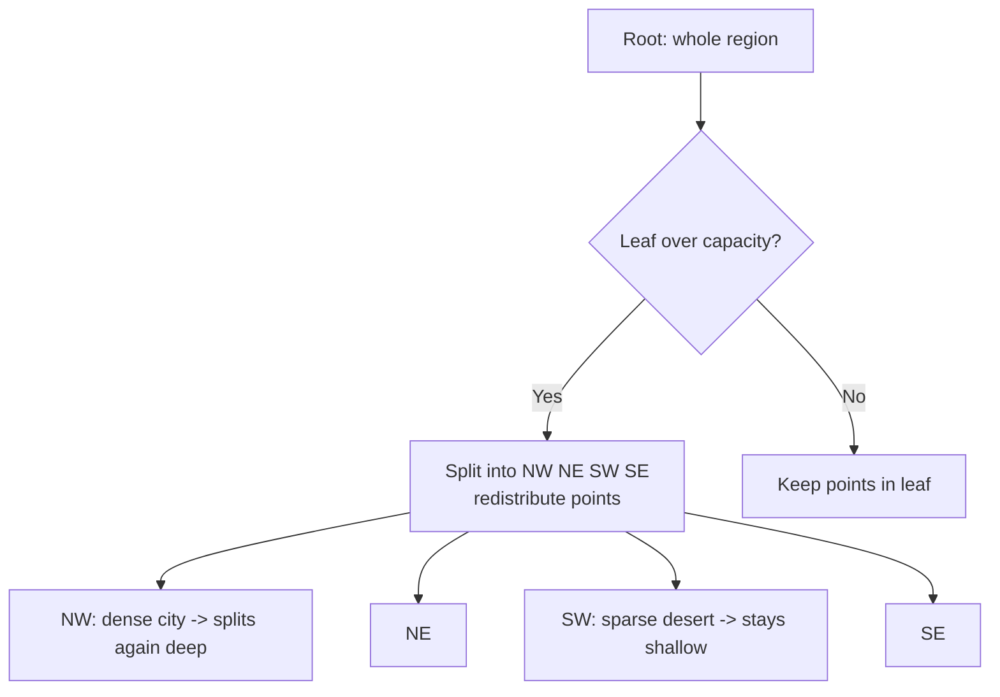

### 5.3 When QuadTree beats geohash/S2

The single answer: **highly non-uniform density**. Geohash precision is fixed — choose precision 6 and a midtown cell holds 50k entities (slow, hot) while a rural cell holds 2. A QuadTree gives midtown 12 levels of depth and rural 3, so *every leaf holds roughly the same count* and query work is bounded regardless of where you look. It's also naturally **in-memory** and great for a single hot service (one city's live driver index), which is precisely the Uber dispatch-index pattern.

Costs that push you back toward geohash/S2: a QuadTree is a **stateful in-memory structure** — harder to shard across machines, harder to persist/replicate, and rebalancing on every move has overhead. Geohash's "it's just a string in any KV store" is the opposite trade. So:

- **Geohash/S2** — distributed, KV-backed, operationally simple, uniform-ish density.
- **QuadTree** — single-node in-memory hot index, wildly skewed density, fast adaptive queries.

### 5.4 Pitfalls

- **Sharding a QuadTree across machines is awkward** — you typically shard *by city/region first* (one QuadTree per shard), not split a single tree.
- **High churn cost:** entities that move constantly (drivers) cause frequent leaf splits/merges. Often you rebuild periodically rather than mutate per-ping.
- **Pathological clustering:** everyone at one stadium → one leaf splits to max depth at a single point; cap depth and fall back to a bucket list at the deepest leaf.

> **Staff-level insight:** Quote the trade-off in one breath: *"QuadTree when density is wildly non-uniform — it self-balances so a leaf in Manhattan and a leaf in Montana both hold ~100 entities, giving bounded query work everywhere. The price is it's a stateful in-memory tree that's awkward to shard and persist, so I shard by city and rebuild from the stream. If density were uniform-ish, I'd take geohash's KV simplicity instead."* Naming *why* you'd reject your own QuadTree choice is the Staff move Grokking never makes — it uses QuadTree for Maps, Yelp, *and* Uber with no discussion of its sharding cost.

---

## 6. R-tree / R*-tree

### 6.1 Definition

An **R-tree** indexes objects by their **minimum bounding rectangle (MBR)**. Interior nodes hold MBRs that enclose their children's MBRs; leaves hold the actual object extents. It's a balanced, B-tree-like structure but for *2-D extents*, not points. The **R\*-tree** is a tuned variant with smarter node-split heuristics (minimize overlap and coverage) for fewer false hits. This is the index behind **PostGIS** (via GiST) and most relational spatial extensions.

### 6.2 How it works & when to use it

A query descends the tree, following any node whose MBR intersects the query window — pruning the rest. Because MBRs can **overlap**, a query may follow multiple paths (the cost the R\*-tree minimizes).

The key distinction from the curve methods: **R-trees natively index regions/polygons, not just points** — delivery zones, building footprints, parcels, flight paths, "which neighborhood polygon contains this point" (point-in-polygon). Curve methods (geohash/S2) are point-first; representing arbitrary polygons in them means region-covering into many cells.

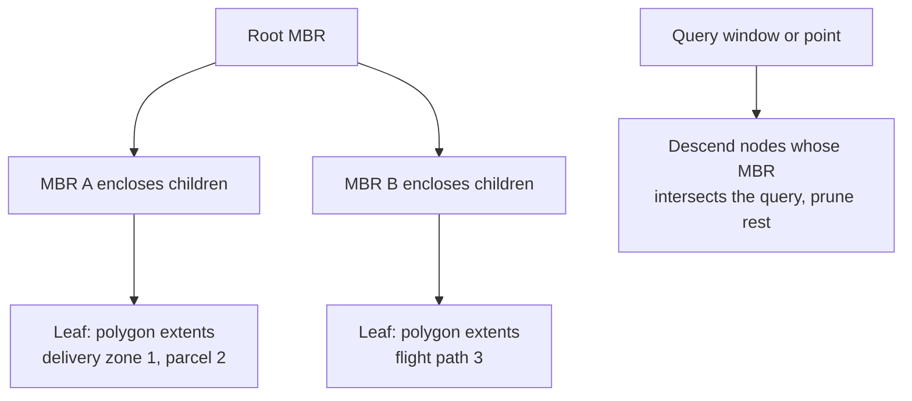

| Use | Reach for |
|---|---|
| Points, "nearest k", radius, KV-backed, distributed | **Geohash / S2** |
| Polygons/extents, point-in-polygon, "does this zone contain X", relational/PostGIS already in stack | **R-tree (GiST)** |
| Skewed-density in-memory hot point index | **QuadTree** |

> **Staff-level insight:** The clean separation: *"Curve methods index points; R-trees index extents. If the question is 'nearest drivers,' geohash. If it's 'which delivery polygon / surge zone / school district contains this point,' that's a point-in-polygon over regions — R-tree in PostGIS, because bounding-box pruning over arbitrary polygons is exactly what GiST does and geohash doesn't."* Knowing PostGIS exists and *when* it's the right tool (polygons, not points) is a depth signal most candidates lack.

### 6.3 Point-in-polygon & geofencing — the exact test behind the index

Every index above, R-tree MBRs and S2/H3 cell covers alike, only produces **candidates**. The final "is this point *inside* the delivery zone?" is an exact geometric test, and at geofencing scale you run it hundreds of thousands of times per second. That makes it part of the design, not trivia.

**Ray casting (even-odd rule).** Cast a ray from the point to +∞ along x and count how many polygon edges it crosses: **odd = inside, even = outside**. It's O(V) per polygon, needs no preprocessing, and holes work automatically (crossing into a hole flips the parity back).

```
inside = false
for each edge (a, b) of the polygon:
    if (a.y > p.y) != (b.y > p.y):                          # edge straddles the ray's y (half-open rule)
        x_cross = a.x + (p.y - a.y) * (b.x - a.x) / (b.y - a.y)
        if p.x < x_cross: inside = !inside
```

| Edge case | What goes wrong | The fix |
|---|---|---|
| Ray passes exactly through a vertex | Counted twice → parity flips wrongly | **Half-open rule** `(a.y > p.y) != (b.y > p.y)`: each vertex belongs to exactly one edge |
| Horizontal edges | Division by zero / ambiguous crossing | Half-open rule skips them naturally |
| Point exactly on the boundary | Inside or outside depending on floating-point noise | **Pick a policy explicitly** (boundary = inside for "deliverable"), and test with an epsilon |
| Self-intersecting polygon (bad data) | Even-odd and winding number disagree | Use the **winding number** (non-zero rule) or validate/repair polygons on ingest |
| Polygon crosses the antimeridian (±180°) | Planar math sees a polygon spanning the whole globe | Split at the antimeridian, or use spherical geometry (S2) |
| Continental-size zones | Planar lat/lng edges aren't the true great-circle edges | **S2 spherical predicates**; planar is fine for city-scale fences |

**The filter-refine pipeline** (the same shape as retrieve-then-rank):

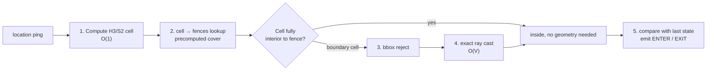

The trick that makes it cheap: when you precompute each fence's **cell cover**, label every cell **interior** or **boundary**. Points in interior cells are inside with *no geometry at all*, so only the thin ring of boundary cells ever pays for ray casting. A 1,000-vertex city zone becomes mostly hash lookups.

**Geofencing as a system** ("notify when a driver enters the airport zone", "is this address deliverable?"):
- **Fences are small, read-mostly data**, often thousands to low millions of polygons. Hold the `cell → [fence_id, interior|boundary]` map **in memory** on every ingest worker and rebuild it when fences change (versioned, the same as any config push).
- **The output is a state transition, not a boolean**: keep the last known `(entity, fence) → inside/outside` and emit `ENTER`/`EXIT` events only on change. That's what downstream consumers (notifications, airport queueing, surge zones) actually want.
- **GPS jitter causes flapping.** A driver parked on the boundary would emit ENTER/EXIT every ping. Fix it with **hysteresis**: require N consecutive pings, or a dwell time, before flipping state, and/or shrink and expand the fence by the reported accuracy radius.
- **BOTEC:** 750k pings/s (§9) × ~1–2 candidate fences × only ~10% landing in boundary cells × ~1 µs per 100-vertex ray cast ≈ **well under one core**. The cost is all in the ping fan-in, not the geometry, so it lives as a stage on the existing location stream, not a new service.
- **Partitioning:** shard the stream by city/region (as in §9.4) so each worker holds only its region's fences.

> **Staff-level insight:** say the two-step out loud: *"The index gives me candidates; the exact test is a ray cast with the half-open rule. I precompute an H3 cover per fence with interior and boundary cells, so most pings resolve with a hash lookup and only boundary cells pay O(V). Output is ENTER/EXIT transitions with hysteresis, because GPS jitter would otherwise flap a parked driver in and out of the airport zone."* The flapping point is the one that shows you've run this in production. Planar vs spherical is a one-sentence aside: planar for city fences, S2 predicates for continental ones.

---

## 7. Comparison & decision

### 7.1 The master comparison

| Dimension | Geohash | S2 (/ H3) | QuadTree | R-tree / R\*-tree |
|---|---|---|---|---|
| Underlying idea | Z-order curve | Hilbert curve | Recursive 4-way split | Bounding-box hierarchy |
| Simplicity / ops | **Highest** (string in any KV) | Medium (library + 64-bit ids) | Medium (in-memory tree) | Medium (DB extension) |
| KV / Redis-friendly | **Yes, native** | Ids are sortable ints; doable | Awkward (stateful tree) | No (lives in the DB) |
| Density adaptivity | Poor (fixed precision) | Good (multi-level cover) | **Best** (self-balances) | Good |
| Boundary handling | Manual neighbor-cell fan-out | Region cover handles it | Natural (descend tree) | Natural (MBR intersect) |
| Hierarchical cells / roll-up | Prefix (coarse) | **First-class** (bit-truncate) | Tree levels | Tree levels |
| Polygon / region support | No (point-first) | Region cover, partial | No (point-first) | **Yes, native** |
| Distributed sharding | **Easy** (shard by prefix) | Easy (shard by cell range) | Hard (shard by city) | DB-managed |
| Who uses it | Redis, Elasticsearch, most apps | Google Maps, Uber (H3), MongoDB | In-memory dispatch indexes | PostGIS, Oracle Spatial |

### 7.2 The decisive default

> **Default: geohash + Redis** for find-nearby. Because it's a 1-D key any store indexes, Redis ships it natively, and a precision-6 + 9-cell neighbor scan answers "nearest k" with trivial ops. **Switch to S2/H3** when you need hierarchical cells (aggregate dispatch cells up to surge cells), region cover for geo-fences, or Google/Uber scale. **Switch to QuadTree** when density is so non-uniform that fixed cells either overflow downtown or waste space in the desert — accept its in-memory/sharding cost. **Switch to R-tree/PostGIS** when the objects are polygons and the question is containment, not nearest. Most interviews want **geohash** — name S2/QuadTree to show you know the *triggers*, then decide.

---

## 8. Proximity search at scale

### 8.1 Scatter-gather / fan-out across cells

A find-nearby at scale (index sharded across many nodes by cell range) is a **scatter-gather**: the coordinator computes the target cells (the query cell + 8 neighbors, or the S2 region cover), routes a sub-query to each owning shard in parallel, then **merges** the candidate sets, computes true distance, ranks, and returns top-k.

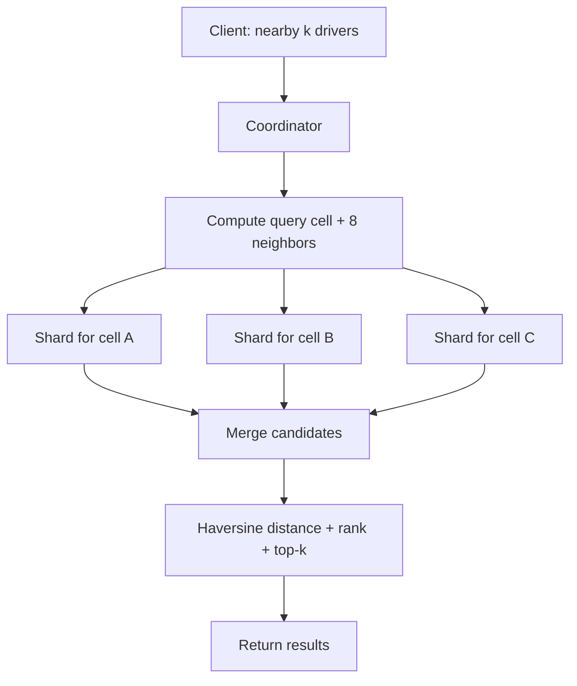

### 8.2 Ranking — it's not just distance

Distance gets you the *candidate set*; the **ranking** is a product problem. A Yelp "nearby" result blends:

| Signal | Why |
|---|---|
| **Distance** | Closer is usually better, but not the only thing |
| **Rating / review count** | A 4.8-star place 800 m away beats a 3.0-star next door |
| **Popularity / open-now / busyness** | Live signals; closed restaurant ranks below |
| **Personalization** | Cuisine history, past visits, friends' check-ins |
| **Sponsored / business rules** | Promoted listings (kept honest and labeled) |

This is the same **retrieve → rank** two-stage pattern as search and ads: the geo-index *retrieves* a cheap wide candidate set; a ranker *scores* it expensively on few results. (See [07 Search](07-search.md) for the retrieve/rank structure.)

### 8.3 Tail latency across cells

Scatter-gather inherits the **slowest shard's latency** — p99 of the whole query is the p99 of the worst cell touched. Mitigations: **hedged requests** (fire a duplicate to a replica after a short delay), **partial results with a deadline** (return what's back in 50 ms rather than wait for the straggler — proximity is approximate anyway), and keeping the fan-out narrow (don't touch 50 cells when 9 suffice).

### 8.4 Hot cells — the Times Square problem

One cell — a stadium, an airport, Times Square — can hold 100× the entities and absorb 100× the read fan-out, melting its shard. This is the geospatial equivalent of a hot key. Fixes, layered:

- **Replicate the hot cell** across multiple read replicas; reads load-balance across them.
- **Sub-shard** the hot cell into finer cells (go from precision 6 to 7/8 *just there*) so its load spreads.
- **Cache the popular-cell result** with a short TTL — "nearby in Times Square" is asked thousands of times a second and changes slowly enough that a 1–2 s cached candidate set is fine. (See [03 Caching](03-caching.md).)
- **Detect hotness dynamically** (per-cell QPS counter) and promote a cell to replicated/cached status automatically.

### 8.5 Caching

Cache at two layers: the **candidate set per cell** (the expensive geo retrieval, short TTL) and the **ranked result per (cell, user-segment)** (longer TTL for non-personalized, none for personalized). Static venues (Yelp) cache aggressively; moving entities (Uber drivers) cache barely at all — the result is stale in seconds.

> **Staff-level insight:** Two things separate a Staff proximity answer: (1) saying *"this is scatter-gather, so my p99 is the worst cell's p99 — I'll hedge and return partial results on a deadline because nearest-results are approximate anyway,"* and (2) naming the **hot-cell** problem unprompted — *"Times Square is a hot key; I replicate that cell and cache its candidate set with a short TTL."* Treating proximity as retrieve→rank (not just distance-sort) and naming the tail/hot-cell seams is the depth Grokking's Yelp/Maps treatment skips entirely.

---

## 9. Real-time location ingestion — the Uber write-path

### 9.1 The firehose

This is the hard part Grokking hand-waves. Millions of drivers, each pinging GPS **every few seconds**, is the dominant load of the whole system. Capacity math (corrected — *not* DAU-as-RPS):

- Say **3M active drivers** online, each pinging every **4 s** → 3,000,000 / 4 = **750,000 location writes/sec**.
- At ~100 bytes/ping that's ~75 MB/s of ingest, sustained.
- You **cannot** put 750k writes/sec on Postgres. The write-path *is* the design.

### 9.2 The architecture — in-memory index, DB off the hot path

The decisive insight: **location is eventually consistent, lossy, and disposable** — it lives in an **in-memory geo-index**, fed by a partitioned stream, and is **not** synchronously written to the durable DB on every ping. The DB persists *trips* (strongly consistent); it does not persist every breadcrumb.

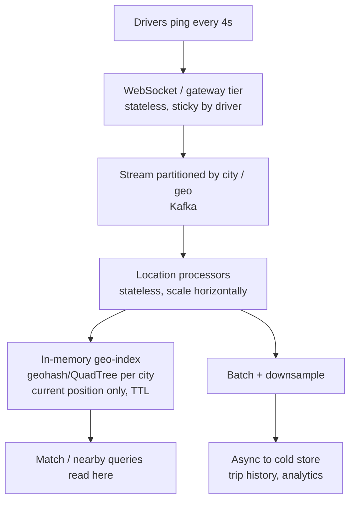

- **Gateway:** drivers hold a **WebSocket** (see [09 Real-Time](09-realtime-systems.md)); pings stream up. Stateless, horizontally scaled, sticky per connection.
- **Partition the ingestion by city/geo**, not by random key — so a city's writes land on the same partitions/processors that own that city's index, preserving locality.
- **In-memory index** holds only the **current** position per entity (overwrite-in-place), with a **TTL/heartbeat** so a driver who drops offline ages out and stops being matched.
- **Batching & downsample:** the breadcrumb trail for trip history/analytics is **batched** and written async to a cold store, downsampled (you don't need every 4-s point forever).
- **Rebuildable:** the in-memory index is *derived state* — on crash, replay the recent stream to rebuild. It's never the source of truth.

### 9.3 Cell-crossing churn

A moving driver constantly crosses cell boundaries → the index must **move the entity from old cell to new cell** on each crossing. In a geohash/Redis model that's a `ZREM` old + `GEOADD` new (Redis handles this in `GEOADD` as an overwrite of the member's score). In a QuadTree it's a delete+insert that may trigger split/merge churn — hence "rebuild periodically" over "mutate per ping." Most pings *don't* cross a cell, so the common path is a cheap in-place score update.

### 9.4 Sharding & backpressure

- **Shard the ingestion by city** — NYC and Mumbai are independent; hot cities get finer sub-sharding.
- **Backpressure / graceful degradation:** under load, *raise the ping interval* (4 s → 8 s) — halves the write rate at the cost of slightly staler positions. A clean, named degradation lever.
- **Drop, don't queue, stale pings:** if a processor is behind, the *latest* ping wins; an old queued ping is worthless. Location is last-write-wins.

> **Staff-level insight:** The line that wins this section: *"I do **not** write 750k pings/sec to a database. Location is eventually consistent and lossy — it lives in an in-memory geo-index fed by a city-partitioned stream, with a TTL so stale drivers age out. The only strongly-consistent thing in this whole system is the trip↔driver assignment, which is tiny by comparison. Separating the location firehose from the transactional core is the single most important decision."* That firehose-vs-transaction separation is the exact judgment [18c](18c-design-marketplace-money.md) flags as the Uber differentiator.

---

## 10. Routing on a road graph

### 10.1 The graph model

A road network is a **directed weighted graph**: **nodes = intersections**, **edges = road segments**, **edge weight = travel cost** (distance, or time given current speed). One-way streets are directed edges; turn restrictions are modeled at nodes (or with edge-expansion). Continental graphs are huge — the US road network is ~50M+ nodes, ~100M+ edges.

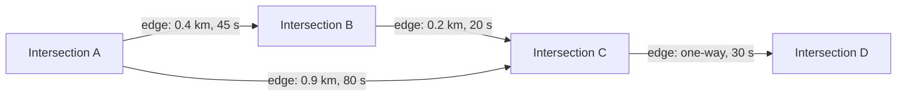

### 10.2 Dijkstra → A\*

- **Dijkstra** finds the shortest path by expanding outward from the source in all directions until it reaches the target. Correct, but it explores a **huge circle** of nodes — on a continental graph, far too slow for an interactive query.
- **A\*** adds a **heuristic** (straight-line / Haversine distance to the target) to bias the search *toward* the goal, exploring an ellipse instead of a circle. Much faster, still correct if the heuristic never overestimates (admissible). But on continental routes it still touches millions of nodes — not the sub-millisecond you need.

### 10.3 Contraction Hierarchies — the scale answer

The Staff differentiator. **Contraction Hierarchies (CH)** is a **preprocessing** technique: offline, you rank nodes by importance and "contract" them one at a time (least important first), adding **shortcut edges** that preserve shortest-path distances when a node is removed. The result is an augmented graph where a query runs a **bidirectional Dijkstra that only ever moves "upward"** in the hierarchy — touching low thousands of nodes instead of millions. Continental shortest-path queries drop to **sub-millisecond**. This is how Google Maps / OSRM answer instantly.

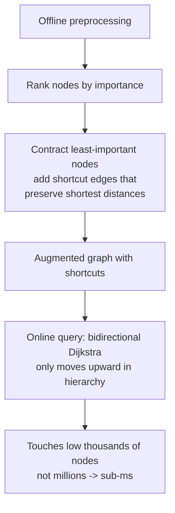

**Why naive Dijkstra doesn't scale:** every query re-explores the graph from scratch. CH amortizes that work into a one-time preprocess so each query is cheap — the same "precompute heavy offline, serve cheap online" pattern as ANN search and ad ranking.

### 10.4 Customizable Route Planning (CRP)

CH's weakness: it bakes edge weights into the shortcuts, so a **traffic update** (an edge got slower) means **recomputing shortcuts** — expensive. **Customizable Route Planning (CRP)** separates the **topology preprocessing** (rarely changes — roads) from a cheap **customization phase** over the **metric** (weights — traffic). When traffic changes, you re-run only the fast customization, not the full preprocess. This is what makes **live-traffic routing** practical at scale.

### 10.5 Live traffic & path invalidation

- **Edge-weight updates:** real-time traffic = a stream of per-segment speed updates → edge weights change continuously. Feed them into the CRP metric (cheap re-customization) rather than re-preprocessing CH.
- **Precomputed-path invalidation:** an in-progress route may become suboptimal when an edge ahead slows down → **reroute**: periodically re-run the (cheap) query from the current position. Cache routes with short TTLs keyed on the metric version; bump the version on a traffic update to invalidate.

### 10.6 ETA

ETA is *not* just the route's summed edge weights. Layered:

1. **Historical baseline** — typical speed for this segment, this day-of-week, this time-of-day.
2. **Live traffic** — current observed speeds adjust the baseline.
3. **ML / GNN** — Google DeepMind's ETA uses a **Graph Neural Network** over road segments to capture interactions (a jam upstream propagates). Features: segment history, weather, events, current speeds.

ETA is **eventually consistent and probabilistic** — a prediction, not a fact; surface a range, degrade to the historical baseline if the live/ML layer is down.

| Method | Scales to continental? | Handles live traffic? | Notes |
|---|---|---|---|
| Dijkstra | No (explores too much) | Yes (re-run) | Baseline; correct but slow |
| A\* | Better (heuristic-guided) | Yes (re-run) | Still millions of nodes on long routes |
| **Contraction Hierarchies** | **Yes, sub-ms** | Poorly (shortcuts bake in weights) | Best for static weights |
| **CRP** | Yes | **Yes (cheap re-customize)** | Topology vs. metric split — the live-traffic answer |

> **Staff-level insight:** The sentence that lands: *"Naive Dijkstra re-explores the whole graph per query and can't do continental routing interactively. I precompute — Contraction Hierarchies for sub-millisecond static queries, and CRP to split the road topology from the traffic metric so a live-traffic update is a cheap re-customization, not a full re-preprocess. ETA is then historical baseline × live traffic, refined by a GNN, and it's a probabilistic prediction I degrade gracefully."* Naming **CH and CRP by name** — and *why* CRP exists (live-traffic invalidation) — is the routing depth Grokking's Maps design never reaches.

---

## 11. Matching / dispatch — the Uber core

### 11.1 Greedy-nearest vs. batched global matching

The naive answer is **greedy nearest**: a request comes in, assign the closest available driver, done. It's simple but **wrong at the margin** — it creates concurrency races (two requests grabbing the same driver) and produces a **worse marketplace outcome** (a driver assigned greedily to request A might have been the only good option for request B, who now waits much longer).

The Staff answer is **batched global matching**: collect requests over a short **window** (2–5 s) per region, then solve a **bipartite assignment** — minimize total rider wait (or a richer cost: ETA + driver idle-time + fairness) across the whole batch at once. At city scale the problem is **sparse and unbalanced** — many more drivers than requests, and each request only considers a handful of *nearby* drivers — so the default is **min-cost bipartite matching / min-cost flow** over that sparse candidate graph. The **Hungarian algorithm** is the textbook special case for the **balanced (square) assignment problem**, solving it optimally in **O(n³)**; it is *not* what you'd run at city-scale batches, where most driver/request pairs don't even exist as edges. You trade a few seconds of dispatch latency for materially better efficiency *and* you dissolve the double-assignment race (a single writer per region per batch decides all assignments atomically).

| | Greedy nearest | Batched global matching |
|---|---|---|
| Latency | Instant | Few-second window |
| Marketplace efficiency | Locally optimal, globally worse | Globally optimal over the batch |
| Concurrency races | Yes (two requests grab one driver) | No (single writer decides the batch) |
| Algorithm | Pick min-distance | Min-cost flow / min-cost bipartite matching (Hungarian only for the balanced-square O(n³) case) |
| When | Ultra-low density (nothing to batch) | Default |

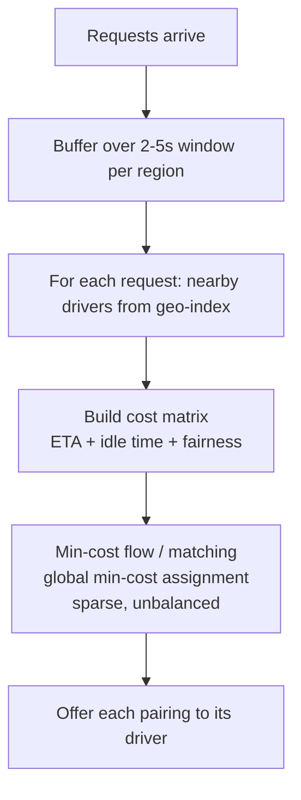

### 11.2 The atomic driver-claim

Even with batching, the assignment must be **committed atomically** so a driver is never given to two trips. The driver-claim is a **conditional write / CAS**: transition the driver row from `available` → `offered` (or the trip from `unassigned` → `assigned`) *only if* it's still in the prior state. The first writer wins; the loser sees the failed condition and gets the next candidate. This is the strongly-consistent kernel of an otherwise eventually-consistent system.

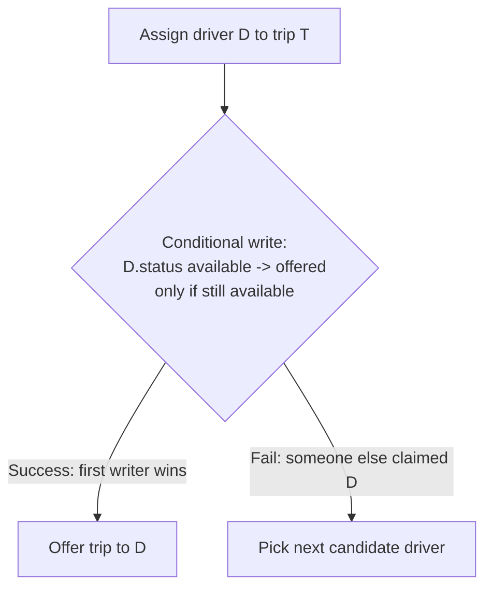

### 11.3 Offer timeout & re-dispatch

A driver gets **N seconds** to accept. On **decline** or **timeout**, release the claim (back to `available`) and offer the next candidate. Implement with a **state machine + timer/delay queue** so a non-responding driver never wedges a rider. The claim's whole purpose is to prevent the offered driver from being matched elsewhere *during* that window; the timeout guarantees the claim is never held forever. **Match-then-confirm**: re-check the driver is still genuinely available at accept time, catching the "ghost driver" (went offline but TTL hasn't expired in the index).

### 11.4 Surge pricing — the demand heatmap

**Surge** = supply/demand imbalance **per geo-cell**. Compute, per cell over a sliding window, the ratio of **open requests : available drivers** → map to a **multiplier** → cache per cell with a short TTL. This is a **demand heatmap** (H3 cells aggregated up to a coarser surge-cell level — exactly the hierarchical-cell roll-up; Uber uses H3 hexagons here precisely because S2's square cells have non-uniform neighbor distances, per §4.4). It's **eventually consistent and approximate** by design — but the multiplier shown at request time must be **locked to that ride** (quote-then-honor: the *estimate* is eventual, the *committed quote* is pinned to the trip record so the rider isn't surprised). Surge serves two jobs: ration scarce supply by price and **incentivize drivers** to move toward high-demand cells (shown as the heatmap in the driver app).

### 11.5 The trip state machine

Every assignment lives inside a **strongly consistent trip state machine** (source of truth = Trip DB). Each transition is **guarded and idempotent** — a retried `accept` or a duplicate `complete` must not double-apply.

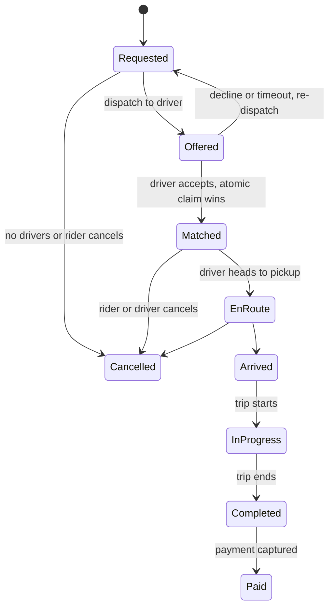

`Completed → Paid` triggers fare finalization via a **payment saga** (see [18c](18c-design-marketplace-money.md)). A cancellation after `Matched` must *atomically* release the driver back to `available` **and** post any cancellation fee through the saga — two effects that must not partially apply.

> **Staff-level insight:** The dispatch answer that lands has three beats: (1) *"batched global min-cost matching, not greedy nearest — better marketplace efficiency and it dissolves the concurrency race for free"*; (2) *"the assignment is committed with an atomic conditional-write driver-claim so no driver is double-assigned, with an accept-timeout that releases the claim and re-dispatches"*; (3) *"surge is a per-cell demand heatmap — eventual for the estimate, but the quote is pinned to the trip."* Recognizing dispatch as an **optimization over a marketplace**, not a lookup, is the single differentiator Grokking's Uber treatment misses.

---

## 12. Worked mini-design — find nearby drivers + dispatch

**Prompt:** "Find available drivers near a rider and dispatch one." This ties index + ingestion + matching together.

### 12.1 Capacity math (corrected BOTEC — not DAU-as-RPS)

- **3M active drivers**, ping every **4 s** → 3M / 4 = **750k location writes/sec** (the firehose; §9).
- **Rider requests:** say **20M rides/day** → 20M / 86,400 ≈ **230 requests/sec** average, ~**1,000/sec** at peak (4–5× factor). *Three orders of magnitude smaller than the location writes* — which tells you immediately where the load is: **ingestion, not matching**.
- **Nearby query** touches 9 geohash cells (precision 6, ~1 km); each cell holds tens of drivers in a dense city → candidate set ~hundreds, re-ranked by Haversine.
- **Index memory:** 3M drivers × ~100 bytes ≈ **300 MB** — fits in memory comfortably; shard by city for locality and hot-city headroom.

### 12.2 The end-to-end flow

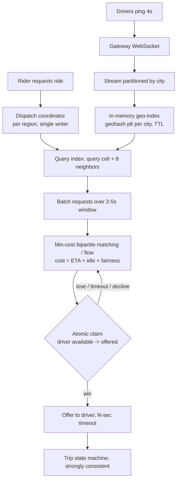

### 12.3 The decisions, stated decisively

1. **Index:** *"Geohash precision 6 in an in-memory per-city index (Redis GEO or a QuadTree if a city's density is wildly skewed), query the cell + 8 neighbors, re-rank by Haversine. Geohash because it's KV-native and operationally trivial; I'd only go S2/H3 for the hierarchical surge-cell roll-up."*
2. **Ingestion:** *"750k pings/sec go to an in-memory index via a city-partitioned stream — never to a database. Location is eventually consistent, lossy, TTL'd. Backpressure lever: widen the ping interval under load."*
3. **Matching:** *"Batched global min-cost assignment per region over a 2–5 s window, not greedy nearest — better marketplace efficiency, no race. Single writer per region."*
4. **Claim:** *"Atomic conditional-write driver-claim prevents double-assignment; accept-timeout releases and re-dispatches; match-then-confirm catches ghost drivers."*
5. **Surge:** *"Per-cell demand heatmap → multiplier, eventual estimate but the quote is pinned to the trip."*
6. **Trip:** *"A strongly consistent, idempotent state machine is the source of truth; `Completed→Paid` is a payment saga."*
7. **Strong/eventual boundary:** *"The ONLY strongly consistent thing is the trip↔driver assignment + trip state machine. Everything geospatial — location, nearby results, surge, ETA — is eventually consistent and approximate. Separating the firehose from the transaction is the whole game."*

---

## 13. Interview Cheat-Sheet

**Recognize:** "find nearby" / "within X km" / "closest" / "ETA" / "match" → geospatial. Name **index → routing → matching** in order.

**Index decision (lead with this):**
- **Geohash + Redis** — default. 1-D key, any KV, `GEOSEARCH` native, precision 6 (~1 km) + **9-cell neighbor scan**, re-rank by Haversine.
- **S2 / H3** — hierarchical cells (roll-up dispatch→surge), region cover, Google/Uber scale, Hilbert locality.
- **QuadTree** — wildly non-uniform density; self-balancing in-memory; awkward to shard (shard by city).
- **R-tree / PostGIS** — polygons/extents, point-in-polygon, not points.

**Point-in-polygon / geofencing:** index = candidates, **ray cast** (even-odd, half-open rule for vertices; winding number for self-intersecting) = the exact test. Precompute an H3/S2 cover per fence with **interior vs boundary** cells; interior → inside with no geometry. Emit **ENTER/EXIT transitions** with **hysteresis** (GPS jitter flaps). Planar for city fences, S2 spherical for continental/antimeridian.

**Why B-tree fails:** no 1-D ordering keeps both axes local → radius query scans a planet-wide latitude stripe. Space-filling curve fixes it.

**The boundary problem:** adjacent points across a cell border share no prefix → query **cell + 8 neighbors**. Say this unprompted.

**Write-path (Uber):** millions × ping/4s = **~750k writes/sec**. In-memory geo-index fed by a **city-partitioned stream**; DB off the hot path; TTL for stale drivers; rebuildable from the stream. Backpressure = widen ping interval.

**Hot cells:** Times Square = hot key → replicate the cell, sub-shard, cache candidate set short-TTL.

**Routing:** Dijkstra (too slow) → A\* (heuristic) → **Contraction Hierarchies** (preprocess + shortcuts → sub-ms continental) → **CRP** (split topology from traffic metric → cheap live-traffic re-customize). ETA = historical × live × GNN, probabilistic.

**Dispatch:** **batched global min-cost matching** (min-cost flow / min-cost bipartite matching over the sparse candidate graph; Hungarian is only the balanced-square O(n³) special case, not the city-scale default), not greedy nearest. **Atomic driver-claim** (CAS) prevents double-assignment. Accept-timeout → re-dispatch. **Surge** = per-cell demand heatmap, eventual estimate / pinned quote. **Trip state machine** = the only strongly consistent core.

**The signature line:** *"Separate the location firehose (eventually consistent, in-memory, lossy) from the transactional core (the trip↔driver assignment, strongly consistent). That separation is the whole design."*

---

## 14. Common Interview Questions

**1. Why can't a B-tree on (lat, lng) serve a "drivers within 2 km" query?**
A B-tree imposes a 1-D total order; it narrows on latitude then row-scans the entire latitude band filtering longitude — a planet-wide horizontal stripe, not a local box. No 1-D ordering of 2-D points keeps both axes local. The fix is a **space-filling-curve key** (geohash/S2) that bakes proximity into a sortable 1-D value, turning radius search into a few range scans.

**2. Geohash vs. S2 vs. QuadTree — which and why?**
**Geohash by default** — 1-D key, KV/Redis-native, operationally trivial, precision 6 + 9-cell neighbor scan. **S2/H3** when I need hierarchical cells (roll-up dispatch cells to surge cells), region cover, or Hilbert-curve locality at Google/Uber scale. **QuadTree** when density is wildly non-uniform — it self-balances so every leaf holds ~equal entities, at the cost of being a stateful in-memory tree I shard by city. I decide on geohash and name the triggers for the others.

**3. What's the geohash edge/boundary problem and how do you fix it?**
Two physically adjacent points can straddle a cell border and share no prefix, so a single-prefix query silently drops the nearest result. Fix: compute the query cell **plus its 8 neighbors** (the 3×3 / `neighbors()` technique) and scan all 9, then re-rank candidates by true Haversine distance. Naming this unprompted is the geohash depth signal.

**4. How do you ingest millions of driver location pings per second?**
You don't write them to a database. ~750k pings/sec (3M drivers / 4 s) stream over WebSocket into a **city-partitioned log**, feeding an **in-memory geo-index** holding only current position with a TTL. The DB persists *trips*, not breadcrumbs; trail history is batched/downsampled async. The index is derived state, rebuildable by replaying the stream. Backpressure lever: widen the ping interval under load.

**5. How do you handle a hot cell like Times Square?**
It's a hot key: one cell with 100× entities and 100× read fan-out. Layer fixes — **replicate** the cell across read replicas, **sub-shard** it into finer cells just there, and **cache** its candidate result set with a short TTL (the query is asked thousands of times/sec and changes slowly). Detect hotness with a per-cell QPS counter and promote automatically.

**6. Greedy nearest-driver or something better for dispatch?**
**Batched global min-cost matching**, not greedy. Buffer requests per region over a 2–5 s window, build a cost matrix (ETA + idle time + fairness), and solve the assignment optimally (min-cost flow / min-cost bipartite matching over the sparse graph; Hungarian is the O(n³) balanced-square special case, not what you run at city scale). It beats greedy on total rider wait *and* dissolves the double-assignment race (a single writer commits the batch). Greedy only in ultra-low-density regions with nothing to batch.

**7. How do you prevent the same driver being assigned to two trips?**
An **atomic conditional-write driver-claim**: transition `available → offered` *only if* still available — first writer wins, the loser takes the next candidate. Pair it with an accept-**timeout** that releases the claim and re-dispatches, and **match-then-confirm** to catch ghost drivers (offline but TTL not yet expired). This CAS is the strongly-consistent kernel of an otherwise eventually-consistent system.

**8. How does routing scale to continental distances in milliseconds?**
Naive Dijkstra re-explores the whole graph per query — too slow. **A\*** with a distance heuristic helps but still touches millions of nodes on long routes. **Contraction Hierarchies** preprocess the graph offline, adding shortcut edges so a query runs a bidirectional upward search touching low thousands of nodes → sub-millisecond. For live traffic, **CRP** splits the road topology (rarely changes) from the traffic metric (changes constantly), so a traffic update is a cheap re-customization, not a full re-preprocess.

**9. How is surge pricing computed?**
A per-geo-cell **demand heatmap**: over a sliding window, ratio of open requests to available drivers per cell → multiplier, cached short-TTL — and aggregated up a cell hierarchy (the S2/H3 hierarchical-cell use case). It's eventually consistent and approximate, but **quote-then-honor**: the displayed estimate is eventual, while the *committed quote* is pinned to the trip record so the rider isn't surprised. Surge both rations scarce supply and steers drivers toward demand.

**10. Where's the strong/eventual consistency boundary in a ride-hailing system?**
The **only** strongly consistent thing is the **trip↔driver assignment and the trip state machine** (atomic claim, idempotent transitions, source of truth in the Trip DB). Everything geospatial — driver location, nearby results, surge multiplier, ETA — is **eventually consistent and approximate** by design. Articulating that boundary, and *why* the firehose must stay off the transactional path, is the Staff-level judgment the whole design hinges on.

**11. Design geofencing: "notify when a driver enters the airport zone."**
It's a filter-refine stage on the existing location stream, not a new service. Precompute each fence's **H3/S2 cell cover**, labeling cells **interior** or **boundary**, and hold the `cell → fences` map in memory on every ingest worker (versioned, rebuilt when fences change). Per ping: compute the cell (O(1)) and look up candidate fences. Interior cell → inside, no geometry. Boundary cell → bbox reject, then an exact **ray cast** (even-odd with the half-open vertex rule). Compare with the last `(driver, fence)` state and emit **ENTER/EXIT** only on change, with **hysteresis** (N consecutive pings or a dwell time) so a driver parked on the edge doesn't flap. BOTEC: 750k pings/s with ~10% hitting boundary cells at ~1 µs per test is under a core, so the cost is the fan-in, not the geometry. Shard by city like the location index. Planar math for city fences; S2 spherical predicates for huge or antimeridian-crossing zones.

---

> **Cross-links:** [01 Fundamentals](01-fundamentals.md) (consistency, BOTEC) · [03 Caching](03-caching.md) (hot-cell caching) · [06 Databases](06-databases.md) (indexing, sharding, why a B-tree is wrong here) · [07 Search](07-search.md) (retrieve→rank) · [09 Real-Time](09-realtime-systems.md) (WebSocket gateway, the location write-path transport) · [18c Marketplace design](18c-design-marketplace-money.md) (the saga/ledger/state-machine layer riding on top of this geospatial core).
