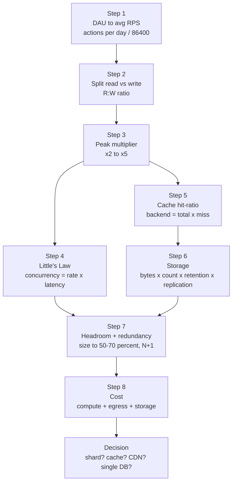
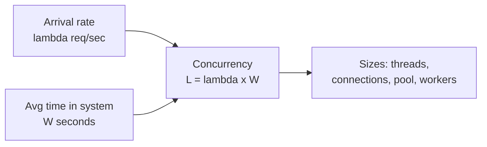

# Module 30 — Capacity Estimation Masterclass

**What you'll master:** The one skill that quietly grades every system-design interview — turning a hand-wavy scale number ("500M DAU") into a *defensible* set of derived quantities (RPS, concurrency, RAM, disk, dollars) that right-size the entire design and rule complexity in or out. By the end you will own the **8-step estimation spine**, never again confuse **DAU with RPS** (the single most common error in the popular courses — off by 10⁴–10⁵), and be able to drive a Twitter, YouTube, WhatsApp, URL-shortener, or Uber estimation end-to-end out loud, ending each on the number that *decides* an architectural fork. This module is the focused drill-reference companion to [01 Fundamentals](01-fundamentals.md), which introduces back-of-the-envelope calculation (BOTEC) in passing; here we make it a discipline.

> Siblings most relevant here: [01 Fundamentals](01-fundamentals.md) (where BOTEC is introduced) · [03 Caching](03-caching.md) (hit-ratio sizing) · [06 Databases](06-databases.md) (single-node ceilings) · [14 Cloud](14-cloud.md) (egress + instance economics) · [26 Google SD Playbook](26-google-sd-playbook.md) (how estimation is graded).

## Table of Contents

- [In the Room — Estimating Out Loud](#in-the-room--estimating-out-loud)
- [1. The Numbers to Memorize](#1-the-numbers-to-memorize)
  - [1.1 Latency Numbers Every Engineer Should Know](#11-latency-numbers-every-engineer-should-know)
  - [1.2 Powers of Two](#12-powers-of-two)
  - [1.3 Time: One Day ≈ 10⁵ Seconds](#13-time-one-day--10-seconds)
  - [1.4 Bytes Per Type](#14-bytes-per-type)
  - [1.5 QPS-Per-Component Rules of Thumb](#15-qps-per-component-rules-of-thumb)
- [2. The 8-Step Method](#2-the-8-step-method)
  - [Step 1 — DAU → Average RPS](#step-1--dau--average-rps)
  - [Step 2 — Split Reads vs Writes](#step-2--split-reads-vs-writes)
  - [Step 3 — Peak Multiplier](#step-3--peak-multiplier)
  - [Step 4 — Little's Law: Concurrency](#step-4--littles-law-concurrency)
  - [Step 5 — Cache Hit-Ratio](#step-5--cache-hit-ratio)
  - [Step 6 — Storage](#step-6--storage)
  - [Step 7 — Headroom + Redundancy](#step-7--headroom--redundancy)
  - [Step 8 — Cost](#step-8--cost)
- [3. The "DAU-as-RPS" Error — Named and Killed](#3-the-dau-as-rps-error--named-and-killed)
- [4. Worked Drills](#4-worked-drills)
  - [Drill A — Twitter / Newsfeed (read-heavy fan-out)](#drill-a--twitter--newsfeed-read-heavy-fan-out)
  - [Drill B — YouTube / Video (transcode + egress)](#drill-b--youtube--video-transcode--egress)
  - [Drill C — WhatsApp / Chat (connections, not RPS)](#drill-c--whatsapp--chat-connections-not-rps)
  - [Drill D — URL Shortener (write-once, read-heavy)](#drill-d--url-shortener-write-once-read-heavy)
  - [Drill E — Uber / Location (write-QPS = drivers ÷ interval)](#drill-e--uber--location-write-qps--drivers--interval)
- [5. Sanity Checks & Plausibility](#5-sanity-checks--plausibility)
- [Interview Cheat-Sheet](#interview-cheat-sheet)
- [Common Interview Questions](#common-interview-questions)

---

## In the Room — Estimating Out Loud

Capacity estimation is not a warm-up you rush past to "get to the design." **It is a graded Staff signal, and it grades you twice.** First on *arithmetic discipline* — can you turn a population number into a load number without being off by orders of magnitude? Second, and more importantly, on *judgment* — does the number you computed actually *change* a decision? A candidate who computes "12,000 write QPS" and then says nothing is doing arithmetic; a Staff candidate computes it and says **"12,000 write QPS fits comfortably on one Postgres primary, so I am explicitly *not* sharding — I'll revisit at ~50,000."** The number ruled out a whole subsystem. That is the move.

The reason estimation right-sizes the design is mechanical: every major architectural fork has a numeric threshold behind it.

- *Do I need a cache?* → only if read QPS × miss-cost exceeds what the DB can serve.
- *Do I need to shard?* → only if write QPS or dataset size exceeds one node.
- *Do I need a CDN?* → only if egress volume × $/GB or origin QPS is intolerable.
- *Do I need fan-out-on-write?* → only if the read:write ratio is extreme enough that precompute pays.

You cannot answer any of these without a number. So the candidate who skips the math is *guessing* at the architecture, and the interviewer knows it.

**How to narrate it.** Estimate out loud in this rhythm, and say each step's *purpose* before its arithmetic:

1. **State the assumption, then round it.** "Let's say 300M DAU and each user does ~20 reads and ~2 writes a day. I'm rounding to clean powers of ten so the arithmetic stays honest." Round early, round visibly. Precision you didn't measure is false confidence.
2. **Derive, don't recite.** Take DAU → daily actions → ÷ 86,400 → average RPS → × peak multiplier. Show the chain.
3. **Sanity-check immediately.** "That's ~80k read QPS at peak — does that fit on one box? No, but on a cache tier plus a few replicas, yes." Catch your own order-of-magnitude errors before the interviewer does.
4. **Land the decision.** End every estimate on **"...so this means ___"** — the number must do work. An estimate that doesn't kill or justify a design choice was wasted breath.

> **Staff-level insight:** The decisive move is using a single number to *justify or kill* a design choice in the same sentence you compute it. "Writes are 5,000/s, a single primary does tens of thousands, so no sharding — revisit at 50k." You're not showing off arithmetic; you're demonstrating that your architecture is *load-driven*, not pattern-matched. Interviewers are explicitly listening for "this number means I do / don't need X." Give it to them every time. See [26 Google SD Playbook](26-google-sd-playbook.md) for how this maps to the scoring rubric.

> **Common error:** *Estimating, then ignoring your own estimate.* The popular courses frequently compute a bandwidth or storage number and then design as if it didn't exist — the most famous case is computing Uber's location-update bandwidth and then never using that same number to size the geo-sharding (we fix this in [Drill E](#drill-e--uber--location-write-qps--drivers--interval)). If a number doesn't feed a decision, either it's the wrong number to compute, or you forgot to close the loop. Close the loop.

---

## 1. The Numbers to Memorize

You cannot derive load on a whiteboard if you have to pause and wonder whether RAM is microseconds or milliseconds. These are the constants. Memorize them cold; they are the multiplication table of system design.

### 1.1 Latency Numbers Every Engineer Should Know

The canonical "Latency Numbers" table (Jeff Dean / Peter Norvig lineage), normalized to round figures you can do mental math with. The *ratios* matter more than the absolute values.

| Operation | Latency | Mnemonic |
|---|---|---|
| L1 cache reference | ~1 ns | baseline |
| Branch mispredict | ~3 ns | a few ns |
| L2 cache reference | ~4 ns | ~4× L1 |
| Mutex lock/unlock | ~17 ns | tens of ns |
| Main memory (RAM) reference | ~100 ns | 100× L1 |
| Compress 1 KB (Snappy ~2 µs, Zstd ~5-10 µs better ratio) | ~2 µs | low µs |
| Read 1 MB sequentially from RAM | ~3–10 µs | µs |
| SSD random read (4K) | ~50-100 µs | tens of µs |
| Read 1 MB sequentially from SSD | ~250 µs | sub-ms |
| Round trip within same datacenter | ~0.5 ms | sub-ms |
| Disk (HDD) seek | ~5–10 ms | single-digit ms |
| Read 1 MB sequentially from HDD | ~5–20 ms | ms |
| Round trip CA → Netherlands (cross-region) | **~150 ms** | the WAN tax |

**The orders of magnitude to internalize:**

| Tier | Ballpark | Relative to RAM |
|---|---|---|
| CPU cache | ns | 1/100 |
| RAM | ~100 ns | 1× |
| SSD | ~10–100 µs | ~100–1000× |
| Same-DC network | ~0.5 ms | ~5,000× |
| Disk seek | ~10 ms | ~100,000× |
| Cross-region RTT | ~150 ms | ~1,500,000× |

> **Staff-level insight:** Two ratios decide most designs. (1) **RAM is ~5 orders of magnitude faster than a disk seek** — this is *why caches exist* and why a cache hit-ratio improvement is worth real RAM (see [03 Caching](03-caching.md)). (2) **A cross-region round trip is ~150 ms**, which alone blows most interactive SLOs — this is why you replicate data near users and why synchronous cross-region writes are a design smell. If you can recite only two numbers under pressure, recite these.

### 1.2 Powers of Two

Storage and address-space math is base-2. Memorize the exponents; everything else is a shift.

| Power | Exact | Approx | Unit |
|---|---|---|---|
| 2¹⁰ | 1,024 | ~1 thousand | **KB** |
| 2²⁰ | 1,048,576 | ~1 million | **MB** |
| 2³⁰ | ~1.07 × 10⁹ | ~1 billion | **GB** |
| 2⁴⁰ | ~1.1 × 10¹² | ~1 trillion | **TB** |
| 2⁵⁰ | ~1.13 × 10¹⁵ | ~1 quadrillion | **PB** |

The practical shortcut: **2¹⁰ ≈ 10³.** So 2³⁰ ≈ 10⁹, 2⁴⁰ ≈ 10¹². When you see "1 GB" treat it as 10⁹ bytes for estimation. The 7% error from rounding 1,024 to 1,000 is irrelevant at this altitude and keeps the arithmetic in decimal.

**ID / key-space sizing** also lives here: a 64-bit integer addresses ~1.8 × 10¹⁹ values; a base-62 string of length *n* gives 62ⁿ values (62⁷ ≈ 3.5 × 10¹², 62⁸ ≈ 2.2 × 10¹⁴) — directly relevant to the URL-shortener drill.

### 1.3 Time: One Day ≈ 10⁵ Seconds

This is the single most useful estimation fact, and the one whose absence causes the DAU-as-RPS disaster.

| Window | Seconds | Round |
|---|---|---|
| 1 minute | 60 | 60 |
| 1 hour | 3,600 | ~4 × 10³ |
| **1 day** | **86,400** | **~10⁵** |
| 1 month | ~2.6 × 10⁶ | ~2.5M |
| 1 year | ~3.15 × 10⁷ | ~3 × 10⁷ (≈ π × 10⁷) |

**The headline conversion:**

> **1 million events/day ÷ 86,400 ≈ 12 events/sec.**

Burn this in. **1M/day ≈ ~12 RPS.** So:
- 1 **billion** actions/day ≈ ~12,000 RPS average.
- 100M actions/day ≈ ~1,200 RPS average.
- 100 actions/sec ≈ ~8.6M/day.

Almost every estimation starts by converting a per-day count to a per-second rate by dividing by ~10⁵. Everything else (peak, read/write split) modifies that base.

### 1.4 Bytes Per Type

To size storage and bandwidth you need typical object sizes. Use these defaults and *state them as assumptions* (sizes vary, the interviewer just wants to see you're not guessing wildly).

| Item | Size | Notes |
|---|---|---|
| Boolean / small int | 1–4 bytes | |
| 64-bit int / timestamp | 8 bytes | epoch millis fits in 8 B |
| UUID | 16 bytes binary / 36 bytes as string | prefer binary at scale |
| Short string (username, URL) | ~50–100 bytes | |
| A tweet / chat message | ~200–300 bytes | text + small metadata |
| Typical relational **row** | ~0.5–1 KB | with indexes/overhead |
| Compressed thumbnail | ~10–20 KB | |
| Web image (typical) | ~200 KB – 2 MB | |
| 1 photo (high-res) | ~2–5 MB | |
| **1 minute of video (1080p, H.264)** | **~50 MB** | ~5–10 Mbps bitrate |
| 1 hour of 1080p video | ~3 GB | before the encoding ladder |
| 1 minute of audio (AAC) | ~1 MB | |

> **Common error:** Sizing video as if you store *one* copy. You store an **encoding ladder** — 240p/360p/480p/720p/1080p/4K plus codecs (H.264, VP9, AV1). That's a **multiplier of ~1.5–2.5×** on the source size *before* replication. The popular courses routinely store "the video" once and under-count storage by ~2×. We fix this in [Drill B](#drill-b--youtube--video-transcode--egress).

### 1.5 QPS-Per-Component Rules of Thumb

These ceilings let you instantly answer "does it fit on one box?" Treat them as *single-node, well-tuned, simple-workload* figures — order-of-magnitude anchors, not guarantees. The point is the exponent, not the digit.

| Component | Realistic single-node throughput | When it bends down |
|---|---|---|
| **Single Postgres / MySQL primary** | ~5k–20k write QPS; tens of thousands of simple read QPS; holds **single-digit TB** comfortably | complex queries, large rows, lock contention, fsync-bound writes |
| **Read replica (each)** | adds ~tens of thousands of read QPS | replication lag under write pressure |
| **Redis (single instance)** | ~100k+ simple ops/sec (often cited ~100k–250k) | O(N) commands, big values, single-threaded core |
| **Memcached (multithreaded)** | ~several hundred thousand ops/sec | nothing fancy; pure KV |
| **A single app/web server** | ~a few thousand to ~10k RPS (I/O-bound) | CPU-bound work, sync blocking calls |
| **Kafka (per broker)** | ~hundreds of MB/s, ~100k+ msgs/sec | small messages, no batching |
| **NGINX / L7 LB (per node)** | ~tens of thousands of RPS | TLS termination cost, large bodies |
| **A WebSocket server (per node)** | ~tens of thousands to ~1M idle connections (memory-bound, ~tens of KB each) | active fan-out, per-conn CPU |

> **Staff-level insight:** These ceilings are the *denominators* of your fleet-sizing division. "Peak read QPS 80,000 ÷ ~20,000 per replica ≈ 4 replicas, round up to 6 with headroom." The whole reason to memorize the numerator (your derived load) and the denominator (per-node capacity) is so you can do that division out loud and produce a *node count* — which is what actually costs money and what the interviewer is waiting to hear.

---

## 2. The 8-Step Method

This is the spine. Run it in order, every time. You don't always need all eight (a back-of-envelope might stop at step 3), but knowing the full chain means you never skip the step that *would* have changed the design. The flow:



### Step 1 — DAU → Average RPS

**Purpose:** convert a population into a base load.

```
avg_RPS = (DAU × actions_per_user_per_day) / 86,400
```

The `actions_per_user_per_day` term is the part everyone forgets — and forgetting it (treating it as 1, *and* dropping the ÷86,400) is exactly the DAU-as-RPS error in [§3](#3-the-dau-as-rps-error--named-and-killed). A user does not make one request per day; they make tens to hundreds. But that count is spread across all ~10⁵ seconds of the day.

**Example.** 300M DAU, 30 actions/user/day:
`(3 × 10⁸ × 30) / (8.64 × 10⁴) = 9 × 10⁹ / 8.64 × 10⁴ ≈ 104,000 RPS` average.

State it as: "~100k requests/sec average across all action types — now let me split and peak it."

### Step 2 — Split Reads vs Writes

**Purpose:** reads and writes hit *different* infrastructure, so they must be sized separately.

Writes go to the **primary** (and the primary is your sharding pressure). Reads can be absorbed by **replicas and caches**. Conflating them sizes nothing correctly.

```
read_RPS  = avg_RPS × R/(R+W)
write_RPS = avg_RPS × W/(R+W)
```

Typical ratios to assume (and state):

| System type | Read:Write | Implication |
|---|---|---|
| Social feed / Twitter | ~100:1 (read-heavy) | precompute/cache reads; writes are small |
| URL shortener | ~100:1 or more | write-once, read-forever; cache + read replicas |
| Chat / WhatsApp | ~1:1 (write = read, each msg delivered) | sizing is delivery, not RPS |
| Analytics ingest | write-heavy | the primary/queue is the constraint |
| Video upload/view | views ≫ uploads (~1000:1+) | CDN-dominated reads |

> **Staff-level insight:** The read:write ratio *is* the architecture decision in disguise. **A ~100:1 ratio is what justifies fan-out-on-write** (precompute the read because reads vastly outnumber writes), a denormalized read model, and a heavy cache tier. A ~1:1 ratio (chat) means you can't cache your way out — you must size the *write/delivery* path. Always extract the ratio explicitly; it tells the interviewer you know which path to optimize.

### Step 3 — Peak Multiplier

**Purpose:** real traffic isn't flat — you must provision for the peak, not the average.

```
peak_RPS = avg_RPS × peak_multiplier   (typically 2×–5×)
```

Sources of peaking: **diurnal** cycle (everyone awake in the same timezone band), **regional** concentration (a single-country app peaks hard at lunch/evening), and **events** (New Year's messages, a viral moment, a product launch, the Super Bowl). For a globally-spread service the diurnal effect smooths to ~2×; for a single-region consumer app assume ~3–5×; for event-driven spikes, call them out separately as a burst case.

> **Common error:** *"All DAU hit in one second."* This is the catastrophic version of the peaking mistake — treating the entire daily user base as simultaneous. **No: the day is ~10⁵ seconds long, and traffic is spread across it.** The correct model is "average load × a 2–5× peak factor," not "everyone at once." Assuming all-at-once over-provisions by ~10⁴–10⁵× and signals you don't understand how load distributes over time. Spread first (Step 1), *then* apply a modest peak multiplier.

> **Staff-level insight:** Size the steady fleet for peak, but handle *bursts* (events) with a different tool — autoscaling, load shedding, queue buffering — not by permanently provisioning for the worst second of the year. Naming "I provision for ~3× diurnal peak and absorb event spikes with a queue + autoscaling, with load shedding as the backstop" is the mature answer.

### Step 4 — Little's Law: Concurrency

**Purpose:** convert a *rate* into a *concurrency* — the number of in-flight requests, which sizes connection pools, thread pools, and worker counts.

```
L = λ × W
concurrency = arrival_rate × average_latency
```



| λ (req/s) | W (latency) | L = concurrent in-flight |
|---|---|---|
| 10,000 | 10 ms | 100 |
| 10,000 | 100 ms | 1,000 |
| 10,000 | 1 s | 10,000 |
| 50,000 | 20 ms | 1,000 |

**The lesson:** at fixed arrival rate, **latency is a multiplier on required concurrency.** A backend that slows from 10 ms to 100 ms needs *10× more* connections/threads to serve the same QPS — which is exactly how a latency blip cascades into pool exhaustion and a thundering retry storm. This is why a DB connection pool of, say, 200 is meaningful: at 10 ms query time it serves ~20,000 QPS; at 100 ms it serves only ~2,000.

> **Staff-level insight:** Little's Law is the bridge from "QPS" (what you estimated) to "how many threads/connections/pods" (what you provision). It's also the early-warning model for **metastable failure**: when W rises under load, L rises, pools saturate, requests queue, W rises further — a feedback loop. Mentioning Little's Law when sizing a connection pool is a strong Staff signal. See [01 Fundamentals](01-fundamentals.md) for the queueing/utilization relationship behind it.

### Step 5 — Cache Hit-Ratio

**Purpose:** the cache absorbs reads, so the database only sees the *misses*. Size the DB for what actually reaches it.

```
backend_QPS = total_read_QPS × (1 − hit_ratio)
```

| Total read QPS | Hit ratio | Backend (DB) QPS |
|---|---|---|
| 100,000 | 0% (no cache) | 100,000 |
| 100,000 | 80% | 20,000 |
| 100,000 | 95% | 5,000 |
| 100,000 | 99% | 1,000 |

Notice **backend load is proportional to the *miss* rate, not the hit rate** — 95%→99% is a 5× DB reduction, far bigger than 80%→84%. (Full treatment in [03 Caching](03-caching.md).)

**Working-set sizing** (how much RAM the cache needs):
```
cache_RAM = hot_items × item_size × overhead(~1.5×) × replicas
```
Size the cache for the *hot working set* (the Pareto-hot keys serving most traffic), not the whole dataset.

> **Common error:** Sizing the database for the *total* read QPS while also claiming a cache. Either the cache does nothing (then drop it) or it absorbs hits (then the DB only sees `total × (1 − hit)`). The popular courses often add a cache box to the diagram but then size the DB for full read load anyway — pick one. And always size the DB to survive a **cache-down (0% hit)** event at a safe-degraded level behind a concurrency limiter.

### Step 6 — Storage

**Purpose:** size disk for the *durable, replicated, retained, indexed* dataset — not the naive `bytes × count`.

```
storage = object_size × object_count × retention_factor
          × replication_factor(~3)
          × (1 + index/overhead)
```

| Factor | Typical | Why it's there |
|---|---|---|
| object_size | from [§1.4](#14-bytes-per-type) | the raw bytes |
| object_count | from ingest rate × time | how many |
| retention | days/years you keep it | logs ≠ forever; messages maybe forever |
| **replication** | **×3** | durability (3 copies) — the most-forgotten multiplier |
| index/overhead | +20–50% (×1.2–1.5) | secondary indexes, metadata, fragmentation |
| encoding ladder (media) | ×1.5–2.5 | multiple resolutions/codecs (video) |

Then **tier** it: hot (SSD/RAM, recent + frequently accessed), warm (cheaper SSD/HDD), cold (object storage / Glacier, rarely accessed). Most data goes cold fast — the last 7 days might be 90% of accesses but 1% of the bytes.

> **Common error:** Forgetting the **×3 replication factor** (and sometimes the index overhead too). "10 PB of messages" stored 3× durably with indexes is closer to **~36+ PB provisioned** — and that 3.6× gap is a budget-killer the popular courses routinely omit. Replication is not optional at scale; bake the ×3 in by reflex.

### Step 7 — Headroom + Redundancy

**Purpose:** you can't run hardware at 100% — queues explode and a single failure takes you over the cliff.

Two independent rules:

1. **Utilization headroom — size to 50–70% target utilization.** Latency rises hyperbolically as utilization → 1 (Little's Law / queueing: `W ∝ 1/(1−ρ)`). A tier at 90% has ~10× the queue wait of one at 50%. So `provisioned = needed / 0.6` roughly (≈ 1.6× the raw requirement).
2. **Failure-domain redundancy — N+1 / N+2 per failure domain.** If you need N nodes to serve peak, run N+1 (survive one failure) or N+2, *and* spread across availability zones so losing a whole AZ doesn't drop you below N. Provisioning across 3 AZs means any one AZ holds ≤ 1/3 and you can lose it.

```
provisioned_nodes = ceil( peak_load / per_node_capacity / target_utilization ) + failure_spares
```

> **Staff-level insight:** "I size to ~60% utilization so the tail stays flat, and run N+1 per AZ across 3 AZs so an AZ loss doesn't breach SLO" is a complete, mature capacity answer in one sentence. Candidates who size to exactly the computed load (100% utilization, no spares) are revealing they've never been paged at 3am. The headroom *is* the experience signal.

### Step 8 — Cost

**Purpose:** translate the design into dollars, because at Staff level the cheapest correct design wins, and **egress is the hidden killer**.

```
total_cost ≈ compute($/node × nodes)
           + storage($/GB-month × GB × tiers)
           + EGRESS($/GB × GB_served_to_users)   ← the one people forget
```

Then normalize: **$/request** and **$/DAU** — the metrics that tell you whether the business model survives the architecture.

| Cost driver | Order of magnitude | The trap |
|---|---|---|
| Compute | $/vCPU-hour | usually the obvious, expected line |
| Storage (hot SSD) | ~$0.08–0.10 /GB-month | tiering to cold (Glacier ~$0.004) saves 20× |
| Storage (object/S3) | ~$0.02 /GB-month | cheap; ingest/request fees add up |
| **Egress (data out to internet)** | **~$0.05–0.09 /GB** | **dominates for any media/video service** |
| Intra-region / cross-AZ | ~$0.01 /GB | cross-AZ chatter adds up at fan-out |

> **Common error:** Omitting **egress** entirely. For a video service, serving petabytes to users at ~$0.08/GB is often the *single largest line item* — frequently larger than compute and storage combined — and it's precisely why a CDN (which both caches at the edge *and* negotiates far cheaper egress) is not optional. The popular courses compute video *storage* but never the *egress to viewers*, missing the dominant cost. Always ask "how many GB leave to users, and what does that cost?" See [14 Cloud](14-cloud.md) for the full egress + instance economics.

> **Staff-level insight:** The decisive cost move is computing **$/DAU** and comparing it to revenue/DAU. "Egress alone is ~$X/DAU/month against ~$Y ARPU — so a CDN isn't an optimization, it's a survival requirement" turns a cost number into an architecture mandate. That's estimation doing its real job.

---

## 3. The "DAU-as-RPS" Error — Named and Killed

This is the single most common systemic error in popular system-design material, and the fastest way to fail the estimation portion of a Staff interview. **It must be unmissable, so here it is in full.**

The error: treating the **daily active user count as the requests-per-second**. "500M DAU" silently becomes "500M requests/sec." This is wrong by **four to five orders of magnitude (10⁴–10⁵×)**, because it makes two compounding mistakes at once:

1. It treats each user as making exactly **one** request (ignoring the ~10–100 actions/user/day multiplier).
2. It compresses the entire **day (~10⁵ seconds)** into **one second** (dropping the ÷86,400).

| | Wrong way (DAU-as-RPS) | Right way (8-step) |
|---|---|---|
| Start | 500M DAU | 500M DAU |
| Actions/user/day | (ignored, ~1) | × 30 = 15 × 10⁹ actions/day |
| Spread over the day | (ignored) | ÷ 86,400 (~10⁵ s) |
| **Average RPS** | **"500,000,000 RPS"** | **~174,000 RPS** |
| Peak (×3) | — | ~520,000 RPS |
| Off by | — | the wrong answer is ~**1000×** too high here, up to 10⁵× in the pure single-request case |

Even after adding back the 30× action multiplier and a 3× peak, the correct number (~520k RPS) is roughly **1000× smaller** than the naive "500M RPS." If you *don't* add the action multiplier (the more common naive form, 1 action/user), the correct average is `500M / 86,400 ≈ 5,800 RPS` — and the error is the full **~10⁵×**.

**Why it's catastrophic for the design:** "500M RPS" would demand tens of thousands of servers, an impossible cache tier, and a fantasy budget — so a candidate who starts there either invents absurd infrastructure or freezes. The correct ~500k RPS is a large but *tractable* number that maps to a few hundred app servers, a real cache tier, and a shardable DB. **The estimation error doesn't just produce a wrong number — it produces a wrong architecture.**

**The fix, as a reflex:** the moment you hear a DAU number, say out loud:

> "DAU is a *daily* count. I'll multiply by actions-per-user-per-day to get daily actions, divide by ~10⁵ seconds to get average RPS, then apply a 2–5× peak. DAU is never RPS."

> **Common error (the canonical one):** **DAU = RPS.** Fix: `RPS = DAU × actions_per_day / 86,400 × peak`. Say "1M/day ≈ 12 RPS" to anchor yourself, then scale. This one correction, applied reflexively, prevents the most damaging estimation mistake in the entire field.

---

## 4. Worked Drills

Each drill follows the same arc: **state assumptions → compute (8-step) → sanity-check → what the number DECIDES.** These use the popular-course systems precisely to show the corrected math.

### Drill A — Twitter / Newsfeed (read-heavy fan-out)

**Assumptions (stated):** 300M DAU. Each user reads their timeline ~30×/day and posts ~0.5 tweets/day (most users lurk). Read:write ≈ 100:1. Tweet ≈ 300 bytes. Avg followers per user ≈ 200 (heavily skewed — celebrities are the tail).

**Compute:**
- Writes: `300M × 0.5 / 86,400 ≈ 1,740 tweet-writes/sec` average. Peak ×3 ≈ **~5,000 writes/sec**.
- Reads: `300M × 30 / 86,400 ≈ 104,000 timeline-reads/sec` average. Peak ×3 ≈ **~310,000 reads/sec**.
- Read:write ≈ 310k : 5k ≈ **~60:1** at peak — confirms read-heavy.
- **Fan-out-on-write amplification:** each tweet (5k/s) writes into ~200 follower timelines → `5,000 × 200 = 1,000,000 timeline-inserts/sec`. *This* is the real write load, not the 5k tweet-writes.
- **Timeline cache sizing:** keep ~800 recent tweet-IDs per active user. `300M × 800 IDs × 8 bytes ≈ 1.9 TB` of timeline pointers — fits across a Redis cluster (with ×1.5 overhead and replicas, ~6–8 TB provisioned).

**Sanity-check:** 310k reads/sec — does that fit one box? No. But at a 95% timeline-cache hit ratio, DB sees `310k × 0.05 ≈ 15,500 reads/sec` of misses — that's a handful of replicas. The 1M/s fan-out inserts go to the cache tier, not a relational primary. Plausible.

**What the number DECIDES:**
- The ~60:1 read:write ratio → **fan-out-on-write** (precompute timelines) for normal users — reads vastly outnumber writes, so paying the write cost to make reads O(1) is correct.
- The **celebrity tail** breaks fan-out (one user × 100M followers = 100M inserts per tweet) → **hybrid: fan-out-on-write for the masses, fan-out-on-read (pull) for celebrities**, merged at read time. The fan-out number is exactly what forces the hybrid.
- 1.9 TB of timeline pointers → **distributed cache cluster**, not a single Redis box.

### Drill B — YouTube / Video (transcode + egress)

**Assumptions (stated):** 2B users, 1B views/day, 1M uploads/day. Avg watched video ≈ 5 min. Source upload ≈ 50 MB/min → ~250 MB per 5-min upload. Encoding ladder (multiple resolutions/codecs) ≈ ×2 on source. View:upload ≈ 1000:1.

**Compute:**
- Upload write rate: `1M / 86,400 ≈ 12 uploads/sec` average, ~36/sec peak. *Tiny* in RPS terms — uploads are not the load.
- **Transcode compute:** each upload spawns the encoding ladder. ~12/sec × (say) ~5 min of CPU-heavy work per minute of video across the ladder → a sustained **transcode farm** sized by `uploads/sec × ladder_cost`, not by RPS. This is a *batch/async* fleet, not a request-serving one.
- **Storage per upload:** `250 MB × 2 (ladder) × 3 (replication) ≈ 1.5 GB` provisioned per uploaded video. Daily: `1M × 1.5 GB = 1.5 PB/day` → **~550 PB/year** added.
- **Egress (the omitted killer):** `1B views/day × 250 MB avg = 250 PB served/day` to viewers. At even ~$0.02/GB CDN-negotiated egress: `250 PB × $0.02/GB ≈ 250 × 10⁶ GB × $0.02 ≈ $5M/day` — **~$1.8B/year in egress alone.** Without a CDN (raw ~$0.08/GB), it's ~4× that.

**Sanity-check:** uploads are ~12/sec (trivial), but storage grows ~0.5 PB/day net and egress is ~250 PB/day — the system is *not* request-bound, it's **bandwidth- and storage-bound**. That matches reality (YouTube is a CDN/storage problem, not a QPS problem). Plausible.

**What the number DECIDES:**
- Egress at ~$M/day → **CDN is mandatory, not optional** — both for latency and because edge caching + bulk egress pricing is the only way the cost survives.
- ×2 encoding-ladder × ×3 replication = **6× the source bytes** → storage tiering (hot recent uploads on SSD, the long tail on cheap cold object storage; un-watched videos get fewer ladder rungs).
- Transcode is `uploads/sec × ladder_cost` → a **separate async worker fleet** (queue-fed), decoupled from the view-serving path. The number tells you uploads and views are two different systems.

### Drill C — WhatsApp / Chat (connections, not RPS)

**Assumptions (stated):** 2B users, 1B concurrent online at peak. Each online user sends ~40 messages/day. Message ≈ 200 bytes. Group messages fan out to ~50 members average. Read:write ≈ 1:1 per recipient (every sent message is delivered/read).

**Compute:**
- Message send rate: `2B × 40 / 86,400 ≈ 925,000 sends/sec` average; peak ×3 ≈ **~2.8M sends/sec**.
- **Fan-out delivery:** if a fraction are group messages averaging 50 recipients, delivered messages ≫ sent. Even at modest group share, deliveries are several million/sec → the *delivery* path, not the send path, is the load.
- **Connections, not RPS — the key reframe:** 1B concurrent users each hold a **persistent WebSocket/MQTT connection**. At ~tens of KB of memory per idle connection (say ~10 KB): `1B × 10 KB = 10 TB` of connection-state RAM across the fleet. At ~1M connections/server (memory-bound), that's **~1,000 connection-gateway servers** just to *hold* the connections — before any message is sent.
- Connection RAM per server: `1M conns × 10 KB = 10 GB` per box just for connection buffers — sizes the gateway instance type.

**Sanity-check:** the headline isn't a QPS — it's "1B persistent connections." A request/response sizing would completely miss the architecture. ~1,000 gateway nodes holding connections + a pub/sub backplane to route messages between them is the real shape. Plausible (matches WhatsApp's famously small-but-dense server fleet).

**What the number DECIDES:**
- 1B persistent connections → **connection-gateway tier sized by connections × per-conn memory**, not by RPS. The app tier is *stateful* (a connection pins to a node) — breaking the "disposable stateless app tier" assumption everywhere else.
- Cross-node delivery (sender on node A, recipient on node B) → a **pub/sub backplane** (Redis/Kafka) to route, sized by the *delivery* fan-out rate (~millions/sec), not the send rate.
- Group fan-out of ~50× → deliveries dominate; **fan-out happens at delivery**, and large groups need the same celebrity-style mitigation as Drill A.

### Drill D — URL Shortener (write-once, read-heavy)

**Assumptions (stated):** 100M new URLs created/day; read:write ≈ 100:1 (each short URL is clicked many times). Stored row ≈ short_code + long_URL + metadata ≈ ~500 bytes. Retention ≈ 5 years.

**Compute:**
- Writes: `100M / 86,400 ≈ 1,160 creates/sec` average; peak ×3 ≈ **~3,500 writes/sec**.
- Reads (redirects): `100:1 → ~116,000 reads/sec` average; peak ×3 ≈ **~350,000 redirects/sec**.
- **Cache hit:** redirects are extremely Pareto-skewed (a few viral links dominate). At ~90% hit ratio: DB sees `350k × 0.10 ≈ 35,000 reads/sec`; at 99% (very cacheable, immutable mapping): `350k × 0.01 ≈ 3,500 reads/sec` — trivially a few read replicas.
- **Storage:** `100M/day × 365 × 5 years × 500 bytes ≈ 1.8 × 10¹¹ rows × 500 B ≈ 91 TB`, × replication ×3 ≈ **~270 TB**. Large but bounded.
- **ID space:** 100M/day × 5 yr ≈ ~1.8 × 10¹¹ codes. Base-62 length 7 = 62⁷ ≈ 3.5 × 10¹² — **7 characters is plenty** (20× headroom). Length 6 (62⁶ ≈ 5.7 × 10¹⁰) is too small. The estimate *picks the code length*.

**Sanity-check:** 350k redirects/sec at 99% cache hit → 3,500 DB reads/sec → fits on a primary + a couple replicas. The mapping is immutable (write-once), so caching is near-perfect and consistency is a non-issue. Plausible.

**What the number DECIDES:**
- Immutable, write-once mapping + 99% achievable hit ratio → **cache-heavy read path**, near-zero consistency complexity (no invalidation problem). Don't over-engineer.
- ~1.8 × 10¹¹ total codes → **base-62, length 7** for the short code (the number directly sizes the key space). No need for length 8.
- 3,500 writes/sec, ~270 TB → fits a single primary + replicas at first; **shard only when writes or dataset exceed one node** (here, dataset pressure arrives before write-QPS pressure — shard on the code).

### Drill E — Uber / Location (write-QPS = drivers ÷ interval)

**Assumptions (stated):** 5M active drivers at peak. Each driver's app sends a location update every **4 seconds**. Each rider matching/ETA query reads nearby drivers. Location payload ≈ ~50 bytes.

**Compute (the number the popular courses compute but never use):**
- **Location write-QPS** = `drivers × (1 / update_interval) = 5M × (1/4) = 1,250,000 location-writes/sec`. This is the dominant load and it is a *write* number.
- Bandwidth (what the courses *do* compute): `1.25M/sec × 50 bytes ≈ 62.5 MB/sec ingress` — true, but bandwidth isn't the constraint; **write QPS and geo-locality are.**
- Match/read queries: far fewer (riders ≪ drivers, requests are bursty) — say tens of thousands/sec at peak. Reads are cheap relative to the 1.25M/sec write firehose.

**Sanity-check:** 1.25M writes/sec to a single primary? No single Postgres does that (~5k–20k write ceiling) — off by ~100×. So this *cannot* be one DB; it must be sharded, and sharded **by geography** (geohash / S2 cell / quadtree), because queries are "drivers near this point." The write number and the access pattern *together* force geo-sharding. Plausible.

**What the number DECIDES (the loop the courses leave open):**
- 1.25M location-writes/sec ÷ ~10–20k per shard → **~60–125 shards minimum** for the location store → **geo-sharding by spatial cell** (geohash/S2/quadtree). The very same number the courses compute for *bandwidth* is the number that sizes the *sharding* — and that's the closed loop they miss.
- Writes ≫ reads, ephemeral, high-churn → an **in-memory geo-index** (Redis GEO / specialized spatial store) for current positions, with the durable trip record written separately. Don't put 1.25M/sec of transient pings in your transactional DB.
- Hotspot risk: dense city cells get disproportionate load → **adaptive cell sizing** (split hot cells), the geo analog of the celebrity hotspot in Drill A.

> **Staff-level insight (Drill E is the thesis of this module):** The location write-QPS of ~1.25M/sec is computed by the popular courses *as a bandwidth figure* and then abandoned. The Staff move is to carry that same number forward: "1.25M writes/sec ÷ ~15k per shard ≈ ~80 shards, geo-sharded, in-memory" — the number *decides the sharding strategy*. An estimate that doesn't feed a decision is incomplete. Always ask: "what does this number make me do?"

---

## 5. Sanity Checks & Plausibility

A number you can't sanity-check is a number you can't defend. Apply these *as you go*, not at the end.

| Check | The question | Catches |
|---|---|---|
| **Order-of-magnitude** | "Is this 10³, 10⁶, or 10⁹? Right exponent?" | the DAU-as-RPS class of errors (wrong by 10ⁿ) |
| **Does it fit on one box?** | "Per-node ceiling vs my load — single box or fleet?" | over- and under-provisioning; tells you shard/replicate or not |
| **Reality anchor** | "Does my answer match what I know the real system does?" (YouTube = bandwidth-bound, chat = connection-bound) | architecturally wrong framing |
| **Units** | "Is this per second, per day, bytes, or bits?" (÷8 for bits↔bytes) | the silent 8× and 10⁵× unit slips |
| **Both ends** | "Average *and* peak; raw *and* replicated; sent *and* delivered." | forgetting peak, replication, or fan-out |

**The "does it fit on one box?" test** is the most useful single move. Take your derived load, divide by the relevant per-node ceiling from [§1.5](#15-qps-per-component-rules-of-thumb):
- < 1 box → **don't distribute.** Say "this fits on one primary, so I'm explicitly not sharding." (A Staff signal — restraint.)
- A few boxes → **replicas / a small cluster**, no sharding yet.
- Many boxes → **shard / partition**, and now the shard-key choice becomes the crux.

**When to round.** Always round *inputs* to clean powers of ten before multiplying (300M not 287.4M; 30 actions not 27). Round *intermediate* results to one significant figure. The interviewer is grading the exponent and the method, never the third digit. Rounding visibly ("call it ~10⁵ seconds") signals you understand precision theater is a junior tell.

**Presenting a single defensible number.** Don't hide behind a range you won't commit to. The Staff move is: **state your assumptions, derive one number, and commit to it — then name the trigger that would change it.** "Given ~300M DAU and 30 actions/day, I'll work with **~500k peak RPS**. If usage skews more interactive, that doubles — but I'll design to 500k and revisit." One number, owned, with a revisit trigger. That's decisiveness, which is exactly what [01 Fundamentals](01-fundamentals.md) and [26 Google SD Playbook](26-google-sd-playbook.md) say the rubric rewards over hedged ranges.

> **Staff-level insight:** A range ("somewhere between 100k and 800k RPS") is what you say when you haven't decided. Pick the assumptions, commit to *one* number, and attach the trigger that moves it. You can always say "I'm assuming X; if it's 2× that, here's what changes" — that's better than refusing to land a number, because it shows you know *which* assumption is load-bearing.

---

## Interview Cheat-Sheet

**The reflexes (say these out loud):**
- **DAU is NEVER RPS.** `RPS = DAU × actions/day ÷ 86,400 × peak`.
- **1M/day ≈ 12 RPS.** 1B/day ≈ 12,000 RPS. (÷ ~10⁵ s/day.)
- **2¹⁰ ≈ 10³** → GB ≈ 10⁹, TB ≈ 10¹².
- **RAM ~100 ns, SSD ~10–100 µs, DC RTT ~0.5 ms, disk seek ~10 ms, cross-region ~150 ms.**
- End every estimate on **"...so this means I do / don't need ___."**

**The 8 steps:**

| # | Step | Formula |
|---|---|---|
| 1 | DAU → avg RPS | `DAU × actions/day / 86,400` |
| 2 | Split read/write | `× R/(R+W)` and `× W/(R+W)` — reads→replicas/cache, writes→primary |
| 3 | Peak multiplier | `× 2–5` (diurnal/regional/events); NOT "all at once" |
| 4 | Little's Law | `concurrency = arrival_rate × latency` → threads/pool/conns |
| 5 | Cache hit-ratio | `backend_QPS = total × (1 − hit)`; load ∝ miss rate |
| 6 | Storage | `bytes × count × retention × replication(×3) × (1 + overhead)` → tier hot/warm/cold |
| 7 | Headroom + redundancy | size to **50–70%** util; **N+1/N+2** per AZ |
| 8 | Cost | `compute + EGRESS($/GB) + storage tiers` → **$/request, $/DAU** |

**Per-node ceilings (the denominators):** Postgres primary ~5k–20k writes/s, single-digit TB · Redis ~100k+ ops/s · app server ~few-k–10k RPS · WebSocket node ~1M idle conns (~tens of KB each).

**The "does it fit on one box?" test:** load ÷ per-node ceiling → 1 box (don't distribute) / few (replicas) / many (shard — now pick the shard key).

**Worked-number anchors:** Twitter ~310k reads/s peak, 1M/s fan-out inserts → hybrid fan-out · YouTube ~250 PB/day egress → CDN mandatory · WhatsApp 1B connections, ~1k gateway nodes → connection-sized · Uber 1.25M location-writes/s → ~80 geo-shards.

---

## Common Interview Questions

**Q1. "We have 500M DAU. How many requests per second is that?"**
The trap is answering "500M." DAU is a *daily* count, not a rate. First, multiply by actions-per-user-per-day — say 30 — giving 15 billion actions/day. Then divide by ~10⁵ seconds in a day: `15 × 10⁹ / 8.64 × 10⁴ ≈ 174,000 RPS` average. Apply a ~3× peak multiplier for diurnal/regional concentration → **~520k RPS peak**. So the honest answer is roughly half a million RPS at peak, not 500 million — the naive reading is off by ~1000×. I'd then split that read/write and sanity-check against per-node ceilings to size the fleet. (The anchor I keep in my head: 1M/day ≈ 12 RPS.)

**Q2. "Walk me through sizing the database for a feed with 100k read QPS and a cache."**
Backend DB load is proportional to the cache *miss* rate, not the read QPS. At a 95% hit ratio the DB sees `100,000 × 0.05 = 5,000 QPS` of misses; at 99%, only 1,000. A single primary plus a couple of read replicas handles that easily. The cache itself I'd size for the *hot working set* — distinct hot items × item size × ~1.5 overhead × replicas — not the whole dataset. Crucially, I'd still size the DB to survive a **cache-down (0% hit)** event at a degraded level behind a concurrency limiter, because a cold cache at full 100k QPS would otherwise melt the primary. The number that decides everything is `total × (1 − hit)`.

**Q3. "Why isn't 'all our users hit the service at once' a valid peak model?"**
Because traffic is spread across the ~10⁵ seconds of a day, not compressed into one. The correct peak model is `average load × a 2–5× multiplier` for diurnal cycle, regional concentration, and events — not "everyone simultaneously," which over-provisions by ~10⁴–10⁵×. I size the *steady* fleet for the ~3× diurnal peak, and handle genuine event spikes (New Year's, a viral moment) with autoscaling, queue buffering, and load shedding rather than permanently paying for the worst second of the year.

**Q4. "How do you turn a QPS number into a number of servers or connections?"**
Little's Law: `concurrency = arrival_rate × average_latency`. At 10,000 QPS and 100 ms latency, I have 1,000 requests in flight — so I need ~1,000 worker slots / connections to serve it without queuing. The key insight is that latency is a *multiplier*: if the backend slows from 10 ms to 100 ms, I need 10× the concurrency for the same QPS, which is how a latency blip cascades into pool exhaustion. So I size connection pools and worker counts from `λ × W`, then divide the QPS by per-node capacity (with 50–70% utilization headroom and N+1 redundancy) to get a node count.

**Q5. "Estimate storage for 10 years of chat messages — 5B messages/day, 200 bytes each."**
Raw: `5 × 10⁹ × 200 B = 10¹² B = 1 TB/day`. Over 10 years: `1 TB × 365 × 10 ≈ 3.65 PB` raw. Now the multipliers the naive answer forgets: **×3 replication** for durability and **×1.3 for indexes/metadata overhead** → `3.65 PB × 3 × 1.3 ≈ 14 PB provisioned`. Then I'd tier it: the last 30 days (hot, on SSD) is a tiny fraction of bytes but most of the access; the rest goes to cheap cold object storage. The ×3 replication and the index overhead are exactly the factors most estimates drop, under-counting by ~4×.

**Q6. "For a video platform, what's the dominant cost, and why?"**
**Egress** — bytes served to viewers — not compute or storage. At, say, 1B views/day × ~250 MB average, that's ~250 PB/day leaving to users. Even at CDN-negotiated ~$0.02/GB that's ~$5M/day (~$1.8B/year); at raw cloud egress (~$0.08/GB) it's ~4× worse. That single number makes a **CDN mandatory** — both for latency and because edge caching plus bulk egress pricing is the only way the cost survives. I'd also remember storage carries an encoding-ladder multiplier (~×2 for resolutions/codecs) on top of ×3 replication, so ~6× the source bytes. The estimates that miss this compute video *storage* but never the *egress*, which is the actual dominant line item.

**Q7. "Does this design need sharding?"**
I answer it with a number, never a reflex. I take the derived write QPS (writes go to the primary) and the dataset size, and divide by the single-node ceiling — roughly 5k–20k write QPS and single-digit TB for one Postgres primary. If I'm under that, I say "this fits on one primary, so I'm explicitly *not* sharding — I'll add read replicas if reads saturate, and shard only when write QPS or dataset crosses one node, revisiting around 50k writes/s or a few TB." If I'm over it — like Uber's 1.25M location-writes/sec, which is ~100× a single node — then sharding is forced, and the access pattern (geo queries) dictates the shard key (spatial cells). The restraint of *not* sharding when the number doesn't demand it is as much a signal as sharding correctly when it does.

**Q8. "You computed a bandwidth number for location updates. So what?"**
This is the closed-loop test. The number — `5M drivers × (1 update / 4 s) = 1.25M writes/sec` — isn't just bandwidth (~62 MB/s); it's the **write QPS that sizes the sharding**. 1.25M writes/sec ÷ ~15k per shard ≈ ~80 shards, and because the queries are "drivers near a point," the sharding must be **geographic** (geohash/S2/quadtree) over an in-memory geo-index. The mistake I'm avoiding is the one the popular courses make: computing this number for bandwidth and then never using it to drive a decision. Every number I compute should answer "what does this make me do?" — here it decides shard count *and* shard key.

**Q9. "Give me one number for peak RPS and commit to it — don't give me a range."**
Right — ranges are what you say when you haven't decided. I'll state my assumptions: ~300M DAU, ~30 actions/user/day, ~3× peak. That gives `300M × 30 / 86,400 × 3 ≈ 312k peak RPS` — I'll design to **~300k RPS** and own it. The load-bearing assumption is actions-per-day; if real usage is twice as interactive, peak roughly doubles to ~600k, and what changes is the app-tier fleet size and cache cluster — but I design to 300k now and name 600k as the revisit trigger. One committed number, with the assumption that would move it called out explicitly.

**Q10. (Meta) "How do you know your estimate is even in the right ballpark?"**
Three sanity checks, applied as I go. **Order of magnitude:** is this 10³, 10⁶, or 10⁹ — right exponent? That alone catches the DAU-as-RPS class of error. **Does it fit on one box:** dividing my load by per-node ceilings tells me instantly whether I'm in single-box, small-cluster, or must-shard territory. **Reality anchor:** does my framing match what I know the real system is — YouTube should come out bandwidth/storage-bound, chat connection-bound, a feed read/cache-bound. If my arithmetic says chat is a QPS problem, I've mis-framed it. I round inputs to clean powers of ten so the exponent stays honest, and I check both ends — average *and* peak, raw *and* replicated, sent *and* delivered.
