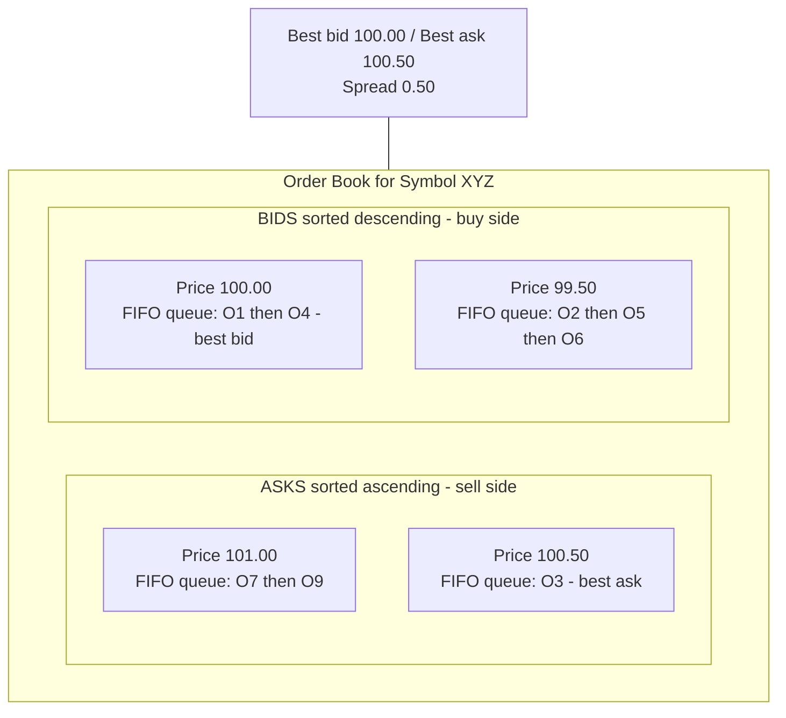
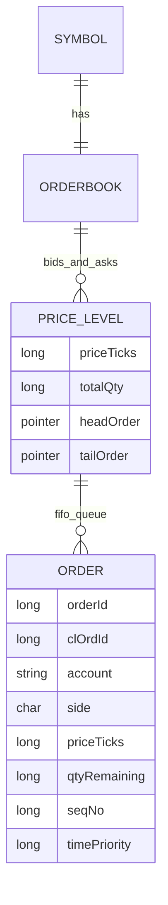
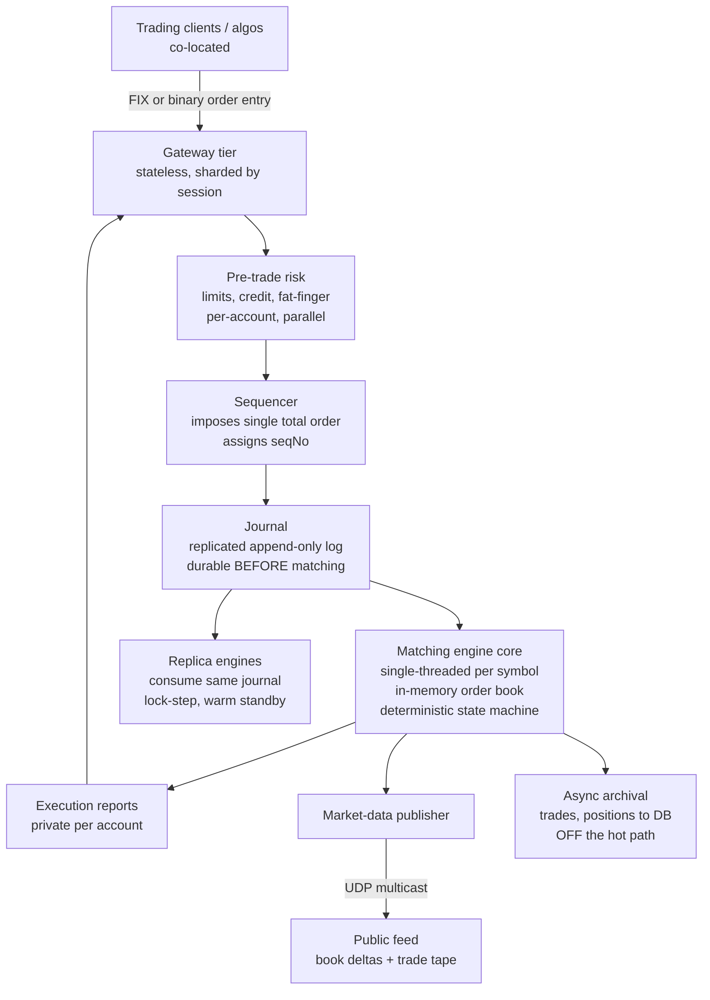
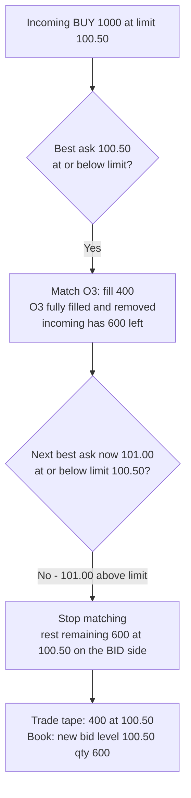
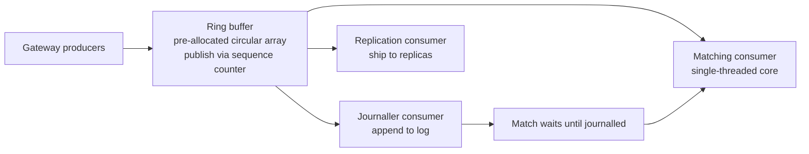
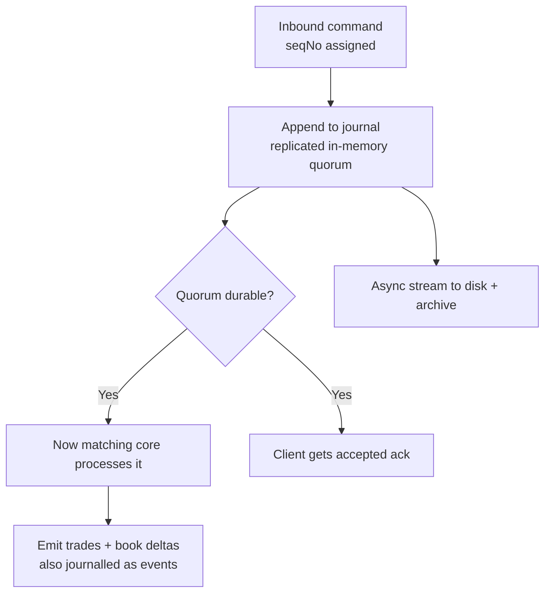
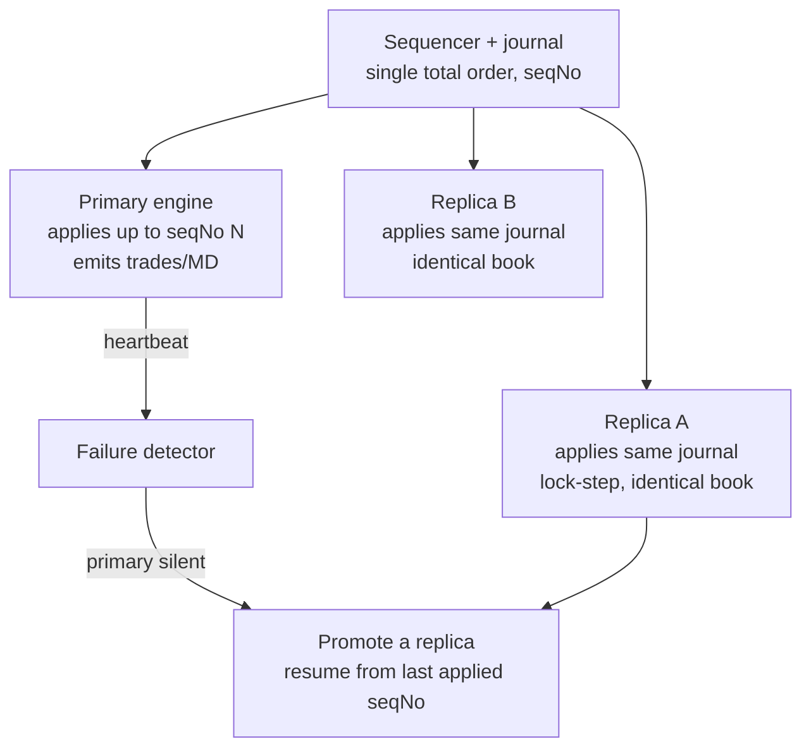
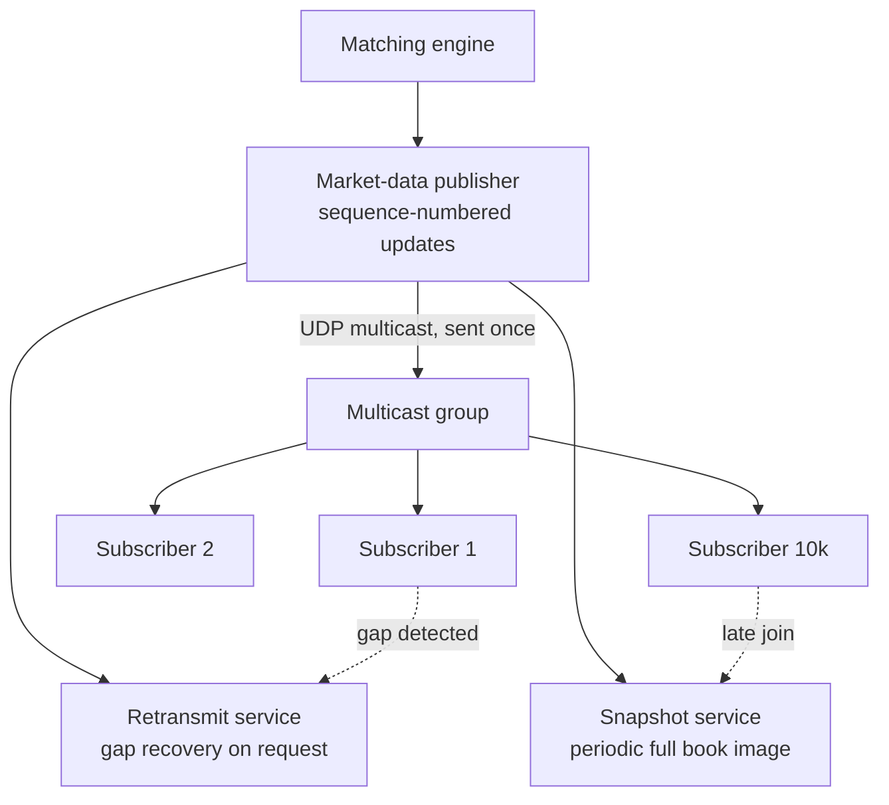
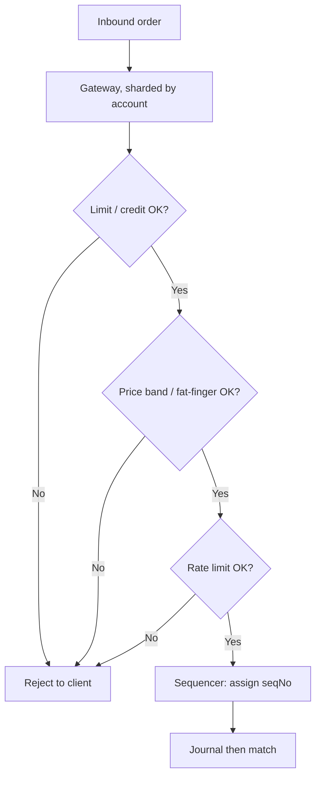

# Module 31 — Design a Low-Latency Matching Engine

> The definitive Staff-level reference for the hardest classic design that Grokking and most courses simply don't cover: an **exchange order-matching engine** — the core of a stock exchange, a crypto exchange, an FX venue, or any central limit order book (CLOB). This is the prompt that quietly separates "I've built CRUD-over-Kafka services" from "I understand deterministic state machines, single-writer concurrency, event-sourcing for recovery, and microsecond latency budgets." It is the *anti-pattern* to everything else in this course: no database in the hot path, no horizontal sharding of the core, no eventual consistency — and that inversion is exactly what's being tested.

## What you'll master

By the end of this module you will hear "design an exchange / order book / matching engine" and immediately earmark the three things that win the room: **determinism** (the matching core is a single-threaded deterministic state machine per symbol — same inputs, same outputs, every replica, every replay), **the limit order book** (price-time priority over sorted price levels with FIFO queues, and how an order *walks* it), and **latency** (a microsecond budget where GC pauses, locks, syscalls, and cache misses are the enemy). You'll defend why the core is **single-writer and not sharded by user**, why you **journal every command before processing** and recover by replaying that journal rather than loading from a DB, and how **hot-hot failover** resumes *deterministically* from the same log. You'll size it with a *correct* BOTEC — orders/sec from market structure, not DAU-as-RPS — and you'll know the real numbers: single-digit-microsecond matching, millions of orders/sec on one core, p99.9 (not p50) as the metric that matters.

This is the module that turns "I'd put it on Kafka and a database" — which is *wrong here* and the interviewer knows it — into "I journal commands to a replicated append-only log, the matching core is a lock-free single-threaded deterministic state machine fed by a ring buffer, the DB is off the hot path entirely, and recovery is journal replay." For the concurrency mechanics underneath, see [24 OS-Concurrency](24-os-concurrency.md); for the failover and replay discipline, [28 Designing for Failure](28-designing-for-failure.md) and [11 Reliability](11-reliability.md).

---

## Table of Contents

1. [In the Room — Delivering This at Staff Level](#1-in-the-room--delivering-this-at-staff-level)
2. [Problem framing](#2-problem-framing)
3. [Requirements — functional + non-functional](#3-requirements--functional--non-functional)
4. [Capacity estimation — the correct BOTEC](#4-capacity-estimation--the-correct-botec)
5. [API design — FIX, place / cancel / modify](#5-api-design--fix-place--cancel--modify)
6. [Data model — the limit order book](#6-data-model--the-limit-order-book)
7. [High-level architecture](#7-high-level-architecture)
8. [Deep dives](#8-deep-dives)
   - [8.1 The matching algorithm + order book](#81-the-matching-algorithm--order-book)
   - [8.2 Determinism + single-writer](#82-determinism--single-writer)
   - [8.3 Durability + exactly-once via event sourcing](#83-durability--exactly-once-via-event-sourcing)
   - [8.4 Ultra-low latency](#84-ultra-low-latency)
   - [8.5 Hot-hot / hot-warm failover with deterministic replay](#85-hot-hot--hot-warm-failover-with-deterministic-replay)
   - [8.6 Market data dissemination](#86-market-data-dissemination)
   - [8.7 Pre-trade risk + sequencing](#87-pre-trade-risk--sequencing)
9. [Scaling & bottlenecks](#9-scaling--bottlenecks)
10. [Trade-offs & failure modes](#10-trade-offs--failure-modes)
11. [What the interviewer is really testing + Staff insight](#11-what-the-interviewer-is-really-testing--staff-insight)
12. [Interview Cheat-Sheet](#12-interview-cheat-sheet)
13. [Common Interview Questions](#13-common-interview-questions)

---

## 1. In the Room — Delivering This at Staff Level

### 1.1 Earmark the crux in the first 60 seconds

The instant you hear "matching engine" or "order book" or "exchange," say the three hard parts out loud so the interviewer knows you know where the difficulty lives. Everything else is supporting cast.

> **The crux is three things, and I'll spend my time here:** (1) **Determinism** — the matching core must be a single deterministic state machine: same input sequence, identical output, on every replica and every replay, so I can recover and fail over by replaying a log. (2) **The order book itself** — price-time priority over sorted price levels with FIFO queues, and exactly how an order walks it and partially fills. (3) **Latency** — a microsecond budget, which means *no database in the hot path*, no locks, no GC pauses, single-writer per symbol. Get those three right and the design is right.

Naming determinism, the book, and latency as the crux — before designing anything — is itself a Staff signal. It says you recognize this is *not* a normal web service.

### 1.2 Decide, don't enumerate — the load-bearing decisions

| Decision | Decide this | Because | Revisit if |
|---|---|---|---|
| Core concurrency | **Single-threaded matching core per symbol (single-writer)** | Determinism + lock-free = no contention, no nondeterministic interleaving; one core does millions of orders/sec | A single symbol's order rate exceeds one core (rare); then partition *by symbol*, never within a symbol |
| Durability | **Journal every inbound command to a replicated append-only log *before* matching** | Recovery = deterministic replay; no DB in the hot path; exactly-once via sequence numbers | Never — this is the non-negotiable spine |
| Persistence of book state | **Book lives in RAM; the journal is the source of truth, not a DB** | A DB write per order blows the latency budget by 1000× | Only snapshot periodically to bound replay time |
| Transport in the core | **Ring buffer (LMAX Disruptor pattern), busy-spin** | Bounded, pre-allocated, cache-friendly, no lock, no GC | Lower-tier venues can tolerate a blocking queue |
| Failover | **State-machine replication: replicas consume the same journal; resume from sequence number** | Replica is already warm and in lock-step; failover is deterministic | — |
| Risk | **Pre-trade risk in the gateway, *before* sequencing** | Keep the matching core pure; risk is per-account state, parallelizable | — |

### 1.3 Name-and-move-on vs. deep-dive

**Name-and-move-on (one sentence each):** the exact FIX tag numbers (know FIX exists, `NewOrderSingle` = 35=D; don't recite the dictionary), the precise wire format of the market-data feed, the choice of Aeron vs. raw UDP multicast, the specific Disruptor API. The garbage collector tuning flags. Colocation contract details.

**Deep-dive (where this round is won):** the order book data structure and the walk/partial-fill mechanics (§8.1); *why* single-threaded is faster than multi-threaded here (§8.2); journal-before-match and replay recovery (§8.3); the microsecond budget and what eats it (§8.4); deterministic failover and why "load from DB" is wrong (§8.5). Earmark these and spend your minutes here.

> **Staff-level insight:** The single biggest tell in this interview is whether you *invert your normal instincts*. Everywhere else in this course the answer is "scale horizontally, use a database, embrace eventual consistency." Here the answer is "scale vertically on one deterministic core, keep all state in RAM, and make the *log* — not a DB — the source of truth." A candidate who reaches for Postgres-per-order or sharding-a-symbol's-book has missed the entire point. Say early: *"This is a single-writer, in-memory, deterministic state machine recovered by log replay — the opposite of a typical web backend, on purpose."*

---

## 2. Problem framing

A **matching engine** is the heart of an exchange. Participants submit **orders** to buy or sell an instrument (a stock, a currency pair, a crypto symbol). The engine maintains, per instrument, a **central limit order book (CLOB)** — all resting buy orders (**bids**) and sell orders (**asks**) — and **matches** incoming orders against resting ones according to a fixed, public, fair set of rules (**price-time priority**). When a buy and a sell agree on price, a **trade** (execution) is produced. The engine then disseminates **market data** (the public view of the book and the trade tape) and **execution reports** (private confirmations to the order owners).

What makes this a *hard* problem and not a CRUD app:

- **Fairness and determinism are regulatory, not nice-to-have.** Two orders arriving in a given sequence must always produce the same matches. The rules must be reproducible and auditable.
- **Latency is the product.** For an HFT-facing venue, being 5 microseconds slower than a competitor loses order flow. The budget is *microseconds*, not milliseconds.
- **You cannot lose or duplicate an order.** A dropped cancel can cost millions; a duplicated order is a phantom trade. Exactly-once is mandatory.
- **The book is the single most contended piece of state in the system** — every order touches it — so the usual "shard it" instinct fails, because matching *requires* a global view of one symbol's book.

Scope for the interview: design the core matching engine and the tiers immediately around it (gateways, sequencer, journal, market-data publisher). Out of scope unless asked: clearing/settlement, the custody ledger, regulatory reporting pipelines, the trading UI.

---

## 3. Requirements — functional + non-functional

### 3.1 Functional

- **Place order** — limit, market, IOC (immediate-or-cancel), FOK (fill-or-kill), stop / stop-limit, post-only.
- **Cancel order** — remove a resting order by id.
- **Modify / cancel-replace** — change price or quantity (semantically a cancel + new, with loss of time priority on price/qty-up changes).
- **Match** — apply price-time priority; produce trades; support partial fills.
- **Maintain the order book** per symbol — bids and asks by price level.
- **Emit execution reports** — fills, partial fills, acks, rejects, cancels (private, to order owners).
- **Publish market data** — order book updates and the trade tape (public).
- **Pre-trade risk** — reject orders that breach account limits / credit / fat-finger bands *before* they reach the book.

### 3.2 Non-functional

| Requirement | Target | Why it drives the design |
|---|---|---|
| **Latency** | p50 single-digit µs core matching; **p99.9 < ~50 µs** end-to-end in-engine | Forces in-RAM, lock-free, single-thread, kernel-bypass |
| **Determinism** | Bit-for-bit reproducible given the input sequence | Enables replay recovery + replica failover |
| **Throughput** | Millions of orders/sec aggregate; hundreds of thousands per busy symbol | One core must handle a symbol's full rate |
| **Durability** | Zero acknowledged-order loss | Journal-before-ack to a replicated log |
| **Exactly-once** | No dropped or duplicated orders | Sequence numbers + idempotent intake |
| **Availability** | Hot-hot / hot-warm; sub-second failover | State-machine replication, warm replicas |
| **Fairness** | Strict price-time priority; no participant advantaged in the core | Single total order imposed by the sequencer |
| **Auditability** | Full, ordered, immutable record of every command and event | The journal *is* the audit log |

The tension to state explicitly: **latency vs. durability**. You cannot both fsync-to-disk and answer in microseconds. The resolution is *replicate the journal in memory across machines* (network round-trip, microseconds) and treat the in-memory replica quorum as durable, with asynchronous archival to disk. That single trade-off is worth saying out loud.

---

## 4. Capacity estimation — the correct BOTEC

The trap here is the same one [30 Capacity Estimation](30-capacity-estimation.md) drills: **do not turn "users" into RPS**. An exchange's load comes from **market structure** — number of instruments, quote-update rate per instrument, and the order-to-trade ratio of algorithmic participants — not from a DAU figure. HFT systems are dominated by *order churn*: most orders are placed and cancelled within milliseconds without ever trading.

### 4.1 Inbound order rate

- Say a venue lists **~8,000 instruments**, of which **~500 are actively quoted** at any moment.
- Algorithmic market makers churn quotes aggressively: assume an active symbol sees **~2,000 order events/sec** (place + cancel + modify) at busy times.
- Peak inbound ≈ 500 × 2,000 = **1,000,000 order events/sec** aggregate, bursting to several million at market open / news events (apply a 3–5× burst factor → design for **~3–5M/sec peak**).
- A single hot symbol (e.g. the front-month index future at the open) can alone exceed **300,000–500,000 events/sec** — which is why one symbol's book must fit on one core that can sustain that rate.

### 4.2 Order-to-trade ratio

- Order-to-trade ratios of **10:1 to 100:1** are normal — most order events are cancels, not fills.
- So at 1M order events/sec, **trades** might run **~10,000–100,000/sec** aggregate — an order of magnitude or two below inbound. This tells you the *matching* work is cheaper than the *intake + book-mutation* work; the bottleneck is processing the churn, not producing trades.

### 4.3 Market-data fan-out (the real firehose)

This is where the volume explodes — and where most candidates under-size.

- Every accepted order event mutates the book → a market-data update. At ~1M book changes/sec…
- …fanned out to, say, **10,000 subscribers** (every co-located trading firm, every data vendor) →
- **1M × 10,000 = 10 billion message-deliveries/sec** if done naively as unicast. That is impossible point-to-point.
- **Therefore: multicast.** You publish each update *once* to a multicast group and the network fabric fans it out. The publisher does ~1M sends/sec; the *network* does the 10⁴ fan-out. This single number is *why* market data is UDP multicast, not TCP unicast — say it explicitly.

### 4.4 Memory & latency sizing

- **Book in RAM:** even a deep book is a few thousand price levels × a few orders each per symbol; 500 active symbols × tens of thousands of resting orders × ~100 bytes ≈ **low single-digit GB**. Trivially fits in memory. *This is the proof that no DB belongs in the hot path.*
- **Journal:** 1M events/sec × ~100 bytes = **~100 MB/sec** to the append-only log; ~8.6 TB/day archived. Replicated in-memory for durability, streamed to disk async.
- **Latency budget:** if the target is p99.9 < ~50 µs in-engine, and a single L3-cache miss is ~100 ns and a kernel syscall is ~1–5 µs, you have room for *tens of cache-friendly operations and zero syscalls* per order. That budget alone dictates kernel-bypass, busy-spin, and pre-allocation.

> **The BOTEC punchline to say out loud:** *"Load here is order churn, not users — ~1M order events/sec aggregate, dominated by cancels at a 10:1+ order-to-trade ratio. The book is only single-digit GB so it lives entirely in RAM. The genuinely scary number is market-data fan-out — 1M updates × 10k subscribers is 10 billion deliveries/sec, which is impossible as unicast and is exactly why the public feed is UDP multicast: publish once, let the fabric fan out."*

---

## 5. API design — FIX, place / cancel / modify

### 5.1 The order-entry protocol — FIX (and binary variants)

Order entry uses **FIX (Financial Information eXchange)** — the industry-standard session protocol — or a venue-specific **binary** order-entry protocol (FIX is verbose tag=value text; latency-sensitive venues offer a binary encoding like SBE / FIX-SBE or a proprietary one for fewer bytes and faster parse). Name FIX, then note the binary variant exists for the latency tier.

Core messages (name them; don't recite the full dictionary):

| Action | FIX message | Key fields |
|---|---|---|
| Place | `NewOrderSingle` (35=D) | ClOrdID, Symbol, Side, OrdType, Price, OrderQty, TimeInForce |
| Cancel | `OrderCancelRequest` (35=F) | OrigClOrdID, ClOrdID, Symbol, Side |
| Modify | `OrderCancelReplaceRequest` (35=G) | OrigClOrdID, ClOrdID, Price, OrderQty |
| Engine → client ack/fill | `ExecutionReport` (35=8) | ExecType, OrdStatus, LastPx, LastQty, LeavesQty, CumQty |
| Engine → client reject | `OrderCancelReject` (35=9) / reject in 35=8 | reason |

**`ClOrdID`** (client order id) is the idempotency key — the same `ClOrdID` from a client must never create two orders. This is the hook for exactly-once intake (§8.3).

### 5.2 A clean internal command shape

Strip FIX down to a normalized internal command at the gateway. Every command carries the fields the deterministic core needs and *nothing time-dependent the core must not read* (no wall-clock — see §8.2):

```
PlaceOrder   { seqNo, account, clOrdId, symbol, side, type, price, qty, tif, gatewayTs }
CancelOrder  { seqNo, account, clOrdId, origClOrdId, symbol }
ModifyOrder  { seqNo, account, clOrdId, origClOrdId, symbol, newPrice, newQty }
```

- `seqNo` is assigned by the **sequencer** (§8.2), giving the total order.
- `gatewayTs` is captured *before* the core and passed in — the core never calls `now()`, because that would be nondeterministic.
- Order types in `type`: `LIMIT`, `MARKET`, `IOC`, `FOK`, `STOP`, `STOP_LIMIT`, `POST_ONLY`.
- `tif` (time-in-force): `GTC`, `DAY`, `IOC`, `FOK`.

### 5.3 Outputs

- **ExecutionReport stream** (private, per account) — ack, partial fill, full fill, cancelled, rejected. Routed back through the gateway to the owning session.
- **Market-data stream** (public, multicast) — incremental book deltas + the trade tape, each carrying a **sequence number** for gap detection (§8.6).

---

## 6. Data model — the limit order book

### 6.1 The structure

A **limit order book (LOB)** per symbol has two sides — **bids** (buy orders) and **asks** (sell orders). Each side is a collection of **price levels**, and each price level is a **FIFO queue** of resting orders at that price (oldest first = best time priority). This nested structure — *sorted price levels, each holding a time-ordered queue* — is the entire model, and it directly encodes **price-time priority**.



- **Best bid** = highest buy price; **best ask** = lowest sell price; the gap between them is the **spread**. An incoming order interacts with the book from the **inside out** (best price first).
- A new order **crosses** the book if a buy is priced at or above the best ask (or a sell at or below the best bid) — it matches immediately. Otherwise it **rests** at its price level, joining the back of that level's FIFO queue.

### 6.2 Why these data structures

The access patterns dictate the structures:

| Operation | Frequency | Structure that serves it |
|---|---|---|
| Find best bid / best ask | Every incoming order | Sorted map keyed by price (O(1) to peek the best) |
| Walk to next price level | On a sweeping order | Ordered iteration over price levels |
| Add order at end of a level | Every resting order | FIFO queue / intrusive doubly-linked list per level |
| Match at the front of a level | Every cross | Pop from the head of the level's queue |
| Cancel an arbitrary order by id | Very frequent (high churn) | Hash map: orderId → node pointer, O(1) unlink |

The high-performance implementation: **price levels in a sorted structure** (a tree map, or — because real instruments have a finite tick grid — often a **flat pre-allocated array indexed by price-tick** for O(1) level access), each level a **doubly-linked list** of orders (intrusive nodes), plus a global **hash map from orderId to its node** so a cancel is an O(1) pointer unlink instead of a scan. This is the canonical LOB layout.



### 6.3 What is NOT in this model

No SQL database. No ORM. No per-order row write. The authoritative record of *what happened* is the **journal** (the ordered command + event log, §8.3); the book is a **derived, in-memory projection** of that journal. Persisting trades and EoD positions to a DB happens **asynchronously, off the hot path**, downstream of the engine. Saying this — that the relational store is downstream and derived, never in front of the match — is a core depth signal.

---

## 7. High-level architecture



The dataflow, narrated: clients connect to **stateless gateways** over FIX/binary. Each order passes **pre-trade risk** (per-account, parallelizable), then hits the **sequencer**, which assigns a monotonic `seqNo` and thereby imposes the *single total order* that makes everything downstream deterministic. The command is appended to the **replicated journal** and acknowledged durable *before* matching. The **matching engine core** consumes the journal in sequence order, mutates the in-memory book, and emits **execution reports** (private) and **market-data updates** (public, multicast). **Replica engines** consume the identical journal in lock-step and stand ready to take over. A DB sits **downstream**, fed asynchronously, never in the request path.

---

## 8. Deep dives

### 8.1 The matching algorithm + order book

#### Price-time priority

The matching rule is **price-time priority** (a.k.a. FIFO matching):

1. **Price priority** — better-priced orders match first. For a resting buy book, the highest bid is most aggressive; for the ask book, the lowest ask. An incoming order matches the *best* opposite price first.
2. **Time priority** — among orders at the *same* price, the one that arrived first matches first (front of that level's FIFO queue). Resting earlier earns you the front of the line.

This is the dominant model (most equity and futures venues). Alternatives to *name and move on*: **pro-rata** (allocate a fill across a level proportional to order size — common in some futures/options) and **price-time with size-priority tweaks**. Default to price-time unless asked.

#### How an aggressive order walks the book

Take an incoming **limit buy, 1000 @ 100.50**, against an ask book with `100.50: [O3=400]`, `101.00: [O7=300, O9=900]`:



The order **sweeps** price levels from best outward, filling the FIFO queue at each level head-first, until either it's fully filled or the next level's price is worse than its limit — at which point any **remainder rests** on the book at the order's limit price (joining the back of that level's queue). That sweep-then-rest is the whole algorithm.

#### Partial fills

If the incoming order has more quantity than the resting order at the head of a level, it **partially fills** that resting order's remainder is matched and the resting order is removed; the incoming order continues to the next order in the queue. Conversely, if the resting order is larger, *it* is partially filled (its `qtyRemaining` decremented, it stays at the front of the queue retaining time priority) and the incoming order is fully consumed. Every match emits a trade for the matched quantity to both sides.

#### Order types — how each behaves

| Type | Behavior |
|---|---|
| **Limit** | Match up to its limit price; rest the remainder on the book. The default. |
| **Market** | Match against the best available prices with no price limit; sweep until filled or book exhausted. Often constrained by a protection band to avoid catastrophic fills. |
| **IOC** (immediate-or-cancel) | Match whatever it can *right now*; **cancel** any unfilled remainder (never rests). |
| **FOK** (fill-or-kill) | **All-or-nothing**: if the full quantity can't be filled immediately, cancel the *entire* order (no partial). Requires a pre-check of available liquidity before mutating the book. |
| **Stop / stop-limit** | Dormant until the market trades through a **trigger price**; then it activates as a market (stop) or limit (stop-limit) order. Held in a separate trigger structure, *not* in the book, until armed. |
| **Post-only** | Rejects (or reprices) if it would cross — guarantees the order *adds* liquidity (rests) rather than *takes* it. |

#### Cancel / cancel-replace

- **Cancel:** look up the order by id in the hash map → O(1) unlink from its level's linked list → decrement the level's aggregate qty → if the level is now empty, remove it. Emit a cancel ack. Cancels are the *most frequent* operation (high order-to-trade ratio), so O(1) cancel is essential.
- **Cancel-replace (modify):** a price change, or a quantity *increase*, **loses time priority** (it's a cancel + new order at the back of the queue). A quantity *decrease* may keep priority (venue-dependent). State this nuance — it's a common follow-up.

> **Staff-level insight:** The depth move is to *walk a concrete order through the book out loud* — "best ask first, fill the FIFO head, sweep to the next level until the price exceeds the limit, rest the remainder" — and then nail the three structures that make it fast: **sorted price levels (often a flat tick-indexed array), a FIFO linked list per level, and a hash map orderId→node for O(1) cancel.** Candidates who can't name the cancel structure reveal they've only thought about the match, not the churn — and churn is 90% of the traffic.

---

### 8.2 Determinism + single-writer

#### Why single-threaded is *faster*, not slower

The counterintuitive Staff point: for the matching core, **one thread beats many**. The book is the single most contended object in the system — every order reads and mutates it. If you parallelize, you need locks (or complex lock-free CAS loops) around the book, and under high contention that lock traffic *and* the cache-line ping-pong between cores costs far more than the matching work itself. A single thread owning the book has **no locks, no contention, no cache-coherency thrash**, and it processes orders in a tight loop entirely from L1/L2 cache. The LMAX exchange famously showed a single thread doing **6 million orders/sec** this way. So:

> *"The matching core is single-threaded per symbol — single-writer — not as a limitation but because it's the fastest correct design. One thread owns the book, no locks, no contention, runs hot in cache. We scale *across* symbols (each symbol's book is independent), never *within* a symbol."*

This is also the cleanest sharding model: partition the symbol universe across cores/processes; each symbol's book is a self-contained single-writer domain. (See [24 OS-Concurrency](24-os-concurrency.md) for why lock contention dominates and why mechanical sympathy wins.)

#### Determinism — the contract

The core must be a **deterministic state machine**: given the same ordered sequence of input commands, it produces *bit-for-bit identical* output (same trades, same book state, same sequence of events) on any machine, any time. This is what makes replay-recovery and replica failover possible. Determinism requires eliminating every source of nondeterminism:

- **No wall-clock reads in the core.** `now()` is nondeterministic. Timestamps are captured at the gateway and passed *in* as data (`gatewayTs`).
- **No random numbers, no hash-map iteration order, no thread scheduling** affecting outcomes.
- **No external I/O mid-match.** No DB call, no network call that could fail or reorder.
- **A single total input order** — which is the sequencer's job.

#### The sequencer

The **sequencer** imposes a single, monotonic total order on all inbound commands *before* they reach the matching core. It assigns a strictly increasing `seqNo`. Every replica consumes commands in `seqNo` order, so every replica sees the identical input stream → identical output. The sequencer is the linchpin that converts many concurrent gateways into one deterministic tape. It is typically itself a single-writer, ultra-fast component (or co-located with the journal).

#### Ring buffer / LMAX Disruptor + mechanical sympathy

The core consumes commands via a **ring buffer** (the LMAX **Disruptor** pattern), not a lock-based queue:

- A **pre-allocated, fixed-size circular array** — no per-message allocation, no GC pressure (objects are reused in place).
- Producers and the consumer coordinate with **memory barriers and a published sequence number**, not locks — a single CAS on a counter, no contention on the data itself.
- **Cache-friendly**: sequential access over a contiguous array is prefetcher-friendly; padding avoids false sharing of the cursor.
- **Busy-spin** consumers (§8.4) eliminate wakeup latency.



**Mechanical sympathy** — designing the software to fit how the CPU actually works — is the underlying philosophy: pre-allocate to avoid GC, keep data contiguous for the cache, avoid locks and syscalls, pin threads. (In a managed runtime like the JVM, this means **object pooling and zero-allocation steady state** so the GC never runs during trading hours.)

> **Staff-level insight:** The line that lands: *"Single-writer isn't a compromise — it's the fastest correct design, because the book is the hottest object in the system and a single owning thread has zero lock contention and zero cache-coherency traffic. Determinism then comes for free as long as the core reads no wall-clock, does no I/O, and consumes a single sequenced input stream. That determinism is what buys me replay-recovery and lock-step replicas — so single-writer + determinism is one decision that pays off three times."*

---

### 8.3 Durability + exactly-once via event sourcing

#### Journal-before-match

The durability spine: **every inbound command is appended to a replicated, append-only journal *before* the matching engine processes it** — and before the client is told the order is accepted. The journal is the **source of truth**. The matching engine is a **deterministic state machine over the journal**: feed it the journal from the start and it reconstructs the exact book and every trade.

This is **event sourcing** applied at microsecond scale: you don't store the *current state* and mutate it transactionally; you store the *ordered sequence of commands*, and state is a fold over that sequence.



#### Recovery = replay

There is **no "restore from database."** Recovery is: **replay the journal from the last snapshot to the head**, re-running the deterministic state machine, and you arrive at the exact book state — same trades, same priorities, byte-for-byte. To bound replay time, take **periodic snapshots** of the in-memory book (a consistent point-in-time image at a known `seqNo`); recovery loads the latest snapshot and replays only the tail since that `seqNo`. This is the standard snapshot + log-replay pattern.

#### Exactly-once

Exactly-once = **no order processed zero times (durability) and no order processed twice (idempotence)**:

- **Sequence numbers** give a total order and let any consumer detect a gap (missing `seqNo`) or a duplicate (already-seen `seqNo`) — a replica or recovering node knows exactly where it is.
- **Idempotent intake** via `ClOrdID`: the gateway/sequencer dedupes — a retried `NewOrderSingle` with a `ClOrdID` already in flight is recognized and not double-submitted. The client can safely retry on timeout because the idempotency key makes the retry a no-op if the original landed.
- Because the matching core is deterministic and driven by the sequenced journal, **replaying** the same journal twice produces the same result once — replay is inherently idempotent.

#### Why no DB in the hot path

A synchronous DB write per order is **~1 ms+** — three orders of magnitude over a microsecond budget — and introduces a non-deterministic, failure-prone external dependency mid-match. The append-only **in-memory replicated log** gives durability at network-round-trip latency (microseconds), is sequential (fast to append), and is itself the audit record. The DB lives *downstream*, fed asynchronously, for queries, reporting, and end-of-day — never in front of the match.

> **Staff-level insight:** Say this crisply: *"I journal every command to a replicated append-only log before I match it and before I ack the client — the log is the source of truth, the engine is a deterministic fold over it, and recovery is snapshot-plus-replay, not 'load from a database.' Exactly-once falls out of sequence numbers (detect gaps/dups) plus a ClOrdID idempotency key (safe client retries). There is no DB in the hot path because a DB write is a thousand times too slow and adds a nondeterministic dependency mid-match.'"* This event-sourcing-for-recovery argument is the single most distinguishing answer in the whole interview.

---

### 8.4 Ultra-low latency

#### The budget

State the target in microseconds and then show you know what eats them. A reference budget for in-engine processing might be: **wire-in to wire-out, p50 ~5–10 µs, p99.9 < ~50 µs.** Against that budget:

| Cost | Rough latency | Implication |
|---|---|---|
| L1 cache hit | ~1 ns | Keep the hot book in cache |
| L3 / last-level cache miss → RAM | ~100 ns | Minimize pointer chasing; contiguous layout |
| Kernel syscall / context switch | ~1–5 µs | **Avoid the kernel** in the data path |
| Lock under contention | µs+, unbounded | **No locks** in the core |
| GC pause (managed runtime) | ms — catastrophic | **Zero-allocation** steady state |
| Network round-trip (in-rack) | ~1–10 µs | Replication quorum costs this; budget for it |

A single GC pause or a single blocking syscall blows the entire p99.9 budget. The whole discipline is *eliminating these from the steady state*.

#### The techniques

- **Kernel bypass** — use **DPDK** or a **Solarflare / OpenOnload** NIC to read/write packets in user space, skipping the kernel network stack and its syscall + copy overhead. This alone removes microseconds and, more importantly, *tail* jitter.
- **Busy-spin, not blocking** — the matching thread spins in a tight loop polling the ring buffer rather than `wait()`-ing on a condition variable. Blocking means an OS wakeup (microseconds of jitter); busy-spin trades a burned CPU core for deterministic sub-microsecond pickup. (See the busy-spin vs. blocking discussion in [24 OS-Concurrency](24-os-concurrency.md).)
- **NUMA pinning** — pin the matching thread to a specific core, and keep its memory on that core's NUMA node, so it never pays cross-socket memory latency. Pin and isolate the core (`isolcpus`) so the OS scheduler never preempts it.
- **Pre-allocation / zero-allocation** — allocate all buffers, order objects, and the ring buffer up front and **reuse** them; never allocate in the hot path. In a JVM this keeps the GC dormant during the trading session.
- **Cache-friendly data layout** — contiguous arrays over pointer-heavy trees where possible (the tick-indexed level array); avoid false sharing with padding.
- **Colocation** — customers rack their servers in the *same data center* as the engine, with equalized cable lengths, so propagation delay is microseconds and *fair*. Latency you can't remove from the engine, you remove from the wire.

#### Throughput vs. latency, and the tail

These trade off. Batching amortizes per-message overhead → higher throughput but adds queuing latency. A matching engine prioritizes **latency and especially the tail**: the metric is **p99 / p99.9**, not p50, because the cost of being slow is borne on the worst orders during the busiest, most valuable moments (the open, a news spike). A design with a great median and a bad tail loses. So you optimize for *predictable* low latency — eliminate jitter sources (GC, syscalls, scheduler preemption, lock contention) — even at some throughput cost.

> **Staff-level insight:** The framing that signals seniority: *"Latency here is a tail problem, not a median problem — p99.9 is the number, because the slow orders happen at the worst possible time. So I attack jitter: kernel bypass to skip the syscall path, busy-spin to skip OS wakeups, NUMA-pin and isolate the core so nothing preempts it, and zero-allocation so the GC never fires during the session. A single GC pause or one blocking syscall is the whole p99.9 budget gone."* Naming **p99.9 over p50** and **jitter elimination** as the goal is the distinguishing latency answer.

---

### 8.5 Hot-hot / hot-warm failover with deterministic replay

#### State-machine replication

Availability comes from **state-machine replication**: the primary and one or more replica engines **consume the same sequenced journal** and apply it with the identical deterministic state machine. Because the engine is deterministic, every replica's book is **bit-for-bit identical** to the primary's at the same `seqNo` — the replicas are continuously, exactly in sync, with no reconciliation needed.



- **Hot-hot / hot-warm:** replicas are *already running and warm* — they've applied the journal up to the same point. There is no cold start, no cache warm-up, no book reconstruction at failover time.
- **Failover:** the failure detector notices the primary went silent; a replica is **promoted** and **resumes from its last-applied `seqNo`**, continuing the deterministic sequence exactly where the primary left off. Output continuity is preserved because the next `seqNo` to process is unambiguous.

#### Gap detection & dedup at failover

The risk at failover is **emitting an output twice** or **dropping one**. Sequence numbers solve it: downstream consumers (market data, execution reports) track the last `seqNo` they've seen; on failover, the promoted primary may re-emit a few events around the cut-over, and consumers **dedup by `seqNo`** (ignore already-seen) and **detect gaps** (request retransmit of missing). The journal's total order makes "exactly where to resume" a precise, unambiguous answer.

#### Why you cannot "just load from a DB"

This is the question the interviewer will push on. A DB snapshot is the *wrong* recovery model for three reasons:

1. **It's not current.** A DB lags by however long since the last write; the book moved thousands of times since. You'd resume from a stale state and lose or mis-order trades.
2. **It's not deterministic-continuous.** The book includes *time priority* (queue position) and in-flight matching state. A coarse DB row doesn't capture the exact FIFO ordering and partial-fill state mid-sequence; replay from the journal does, exactly.
3. **It's too slow and would lose the tail.** Reconstructing a book from a DB at failover is a cold start of seconds — unacceptable for a venue that must resume in well under a second.

The correct model is: **warm replicas in lock-step via journal replay; failover resumes from a `seqNo`, not from a database image.** The DB is for downstream analytics, not for recovering the live book.

> **Staff-level insight:** When they ask "what if the engine crashes — restore from your database?", the winning answer is a firm *no*: *"I don't recover the live book from a database — it's stale, it loses exact time priority, and it's a multi-second cold start. I run warm replicas in lock-step via state-machine replication over the same journal, so a replica is already byte-for-byte identical; failover promotes it and resumes from the next sequence number, and downstream consumers dedup by seqNo. Recovery and failover are both 'replay the deterministic log,' which is exactly why I made the engine deterministic in the first place.'"* This closes the loop on why determinism was worth all the constraints.

---

### 8.6 Market data dissemination

#### The public feed

The engine publishes two public streams: **incremental book updates** (deltas: add/change/remove at a price level, or a top-of-book quote) and the **trade tape** (executions). This is the firehose from §4.3 — ~1M updates/sec to ~10k subscribers — so it cannot be unicast.

#### Multicast fan-out

The feed is **UDP multicast**: the publisher sends each update *once* to a multicast group; the network fabric replicates it to all subscribers. This makes the *publisher's* cost independent of subscriber count — publish once, the switches fan out. UDP (not TCP) because TCP's per-connection retransmit/ack state across 10k subscribers is untenable and TCP head-of-line blocking adds tail latency; the feed accepts UDP's "best effort" and layers its *own* recovery (below).



#### Sequence numbers + gap recovery (snapshot + incremental)

Each multicast packet carries a **sequence number**. A subscriber detects a **gap** (a missing seq) — because UDP can drop packets — and recovers via two mechanisms:

- **Retransmit / recovery channel** — request the specific missing packets from a retransmit service (often a separate multicast or unicast channel).
- **Snapshot + incremental** — the publisher periodically emits a **full book snapshot** at a known sequence number; a subscriber that joined late (or fell hopelessly behind) takes the latest snapshot and then **applies incrementals from that sequence onward**. This snapshot-plus-incremental pattern is how every real market-data feed lets a consumer (re)build the book from scratch.

#### Conflation under load

When a slow consumer or a burst means updates arrive faster than they can be sent/consumed, the feed **conflates**: instead of sending every intermediate state of a price level, it sends only the *latest* state (coalescing rapid updates to the same level into one). Conflation trades fidelity for keeping up — acceptable for a *non-latency-critical* consumer (a retail UI, a chart), **never** for the co-located HFT feed, which must get every tick.

#### The latency-fairness concern

Because *who gets the data first* is competitively decisive, fairness matters: equalized cable lengths in colocation, simultaneous multicast send, and care that the publisher doesn't systematically favor one subscriber. Some venues deliberately publish to all co-located subscribers on equal-length fiber to keep the feed fair.

> **Staff-level insight:** The market-data answer that lands: *"Public feed is UDP multicast — publish once, let the fabric fan out, because 1M updates times 10k subscribers is impossible as unicast. Every packet is sequence-numbered so subscribers detect gaps and recover via a retransmit channel, plus a periodic full snapshot so a late joiner rebuilds the book from snapshot-then-incrementals. Under load I conflate to the latest state for non-critical consumers but never for the co-located feed. And fairness is a first-class concern — equal-length fiber, simultaneous send.'"*

---

### 8.7 Pre-trade risk + sequencing

#### Risk before the book

**Pre-trade risk checks run in the gateway tier, *before* the order is sequenced and matched** — never inside the matching core (which must stay pure and deterministic). Checks include:

- **Position / exposure limits** — does this order breach the account's max position or notional?
- **Credit / margin** — does the account have buying power / collateral for it?
- **Fat-finger / price bands** — is the price absurd (e.g. 50% off the last trade)? Reject obvious mistakes.
- **Rate / message limits** — is this client flooding (a runaway algo)?
- **Self-trade prevention** — would this match the account against itself?

These are **per-account** state, so they **parallelize** trivially — shard risk by account across the gateway fleet. This keeps the expensive, stateful, account-specific logic *out* of the single-threaded matching hot path, which is one reason the core can stay so fast.



#### Sequencing, fairness, and anti-gaming

After risk, the **sequencer** assigns the total order. Fairness lives here: the sequence in which orders are accepted determines who gets filled first at a price, which is competitively and legally significant. Concerns:

- **Fair sequencing** — a deterministic, defensible rule for ordering simultaneous arrivals (e.g. by arrival time at a single ingress point), so no participant is systematically advantaged.
- **Anti-gaming / anti-manipulation** — detect spoofing (placing then rapidly cancelling to mislead) and quote-stuffing (flooding to slow others); these are policed via surveillance on the order stream (often downstream, on the journal).
- **Speed bumps** (some venues) — a deliberate small delay applied uniformly to neutralize pure latency arbitrage. Name it as a fairness mechanism if asked.

> **Staff-level insight:** *"Risk runs in the gateway, before sequencing — limits, credit, fat-finger bands, self-trade prevention — and it's per-account so it shards and parallelizes, which is precisely why I can keep the matching core a pure single-threaded deterministic loop. The sequencer is where fairness lives: a single ingress imposing one defensible total order, with spoofing/quote-stuffing surveillance running downstream on the journal.'"* Keeping risk *out* of the core — for both speed and determinism — is the judgment being tested.

---

## 9. Scaling & bottlenecks

You scale this system *unlike* every other system in the course — and naming that inversion is the point.

| Bottleneck | Wrong instinct | Right move |
|---|---|---|
| One symbol's order rate | Shard the symbol's book across machines | **You can't** — matching needs one global view. Make one core fast enough (it can do millions/sec). Partition *across* symbols, never within one. |
| Many symbols | One giant engine | **Partition by symbol** across many single-writer engine instances; route each order to its symbol's engine. Symbols are independent. |
| Market-data fan-out | Unicast to each subscriber | **UDP multicast** — publish once, fabric fans out (§8.6). |
| Journal write throughput | Single disk fsync per order | **In-memory replicated quorum**, sequential append, async disk archive. |
| Gateway / risk load | Push into the core | **Stateless gateways + per-account risk shard** horizontally, off the hot path. |
| Recovery time growing | Replay the whole journal | **Periodic snapshots** bound replay to the tail since the last snapshot. |

The clean mental model: the system is **horizontally scalable everywhere *except* the per-symbol matching core, which scales vertically on one fast deterministic thread, and the universe of symbols, which scales horizontally by partition.** Gateways, risk, journal replication, and market-data publishing all scale out; a single symbol's book does not, by necessity.

---

## 10. Trade-offs & failure modes

### 10.1 Key trade-offs

| Trade-off | The tension | Resolution |
|---|---|---|
| **Latency vs. durability** | fsync-to-disk is durable but ms-slow | Replicate the journal **in-memory across machines** (µs); disk archive is async |
| **Latency vs. throughput** | Batching raises throughput, adds queuing delay | Optimize for **tail latency (p99.9)**; minimal batching |
| **Single-writer simplicity vs. one-core ceiling** | One thread is simple+fast but caps a symbol's rate | The cap is millions/sec — above any real symbol; partition by symbol for aggregate scale |
| **Determinism vs. flexibility** | No wall-clock/IO/randomness in the core constrains design | Worth it — determinism *is* the recovery + failover mechanism |
| **In-memory book vs. crash safety** | RAM is volatile | The **journal** (replicated, durable) is the source of truth; the book is rebuildable |

### 10.2 Failure modes

- **Primary engine crash** → warm replica promoted, resumes from `seqNo` (§8.5). No book reconstruction from DB.
- **Sequencer failure** → the sequencer is itself replicated/failed-over (it's the single point that imposes order); a backup takes over the `seqNo` counter at the last journalled value. This is the most sensitive SPOF — treat it like the journal.
- **Journal replica loss** → fall back to remaining quorum members; re-replicate; if quorum is lost, the venue must halt rather than risk un-durable acks. **Halting is an acceptable, sometimes mandatory, failure mode** for an exchange — better to stop than to trade un-recoverably.
- **Market-data packet loss** → subscriber detects the seq gap, requests retransmit, or rebuilds from snapshot (§8.6). Lossy by transport, recoverable by protocol.
- **Bad/runaway order (fat-finger, runaway algo)** → caught at **pre-trade risk** in the gateway before it ever reaches the book.
- **Erroneous trade / circuit breaker** → venues implement **kill switches** and **trading halts** (circuit breakers on extreme moves) as a higher-level safety net. Name them as the operational backstop.

See [28 Designing for Failure](28-designing-for-failure.md) for the failover-and-replay discipline and [11 Reliability](11-reliability.md) for the halt-vs-degrade decision.

---

## 11. What the interviewer is really testing + Staff insight

This prompt is a filter. It checks whether you can **set aside your trained web-scale reflexes** and reason about a system where the right answers are the *opposite* of usual:

| The reflex they're testing against | What they want to hear |
|---|---|
| "Put it on a database" | "No DB in the hot path — journal to a replicated log; the book is in RAM" |
| "Scale horizontally / shard everything" | "Single-writer core per symbol; you can't shard one book; partition across symbols" |
| "Eventual consistency is fine" | "The core is a strict deterministic state machine; fairness and exactly-once are mandatory" |
| "Recover from a backup/DB" | "Recover by replaying the deterministic journal; fail over to warm lock-step replicas" |
| "Optimize the average" | "Optimize the tail — p99.9 — and eliminate jitter (GC, syscalls, locks, scheduling)" |

They're probing four specific competencies: **(1) determinism** — can you articulate why and how the core is reproducible; **(2) single-writer / concurrency judgment** — do you understand that one thread can beat many when contention dominates; **(3) event-sourcing for recovery** — journal-before-process, replay, exactly-once via sequence numbers; **(4) latency engineering** — microsecond budgets, kernel bypass, mechanical sympathy, tail focus.

> **The Staff insight that ties it together:** *"A matching engine is the purest deterministic-state-machine problem in systems design. Make the core single-writer and deterministic, and one decision pays off four times: it's the fastest design (no lock contention), it makes recovery trivial (replay the journal), it makes failover trivial (warm lock-step replicas resume from a seqNo), and it makes the system auditable (the journal is the record). Everything else — kernel bypass, multicast market data, gateway risk — exists to protect that deterministic core's microsecond budget. The interview is won by inverting your web-scale instincts on purpose and explaining *why* the inversion is correct here.'"*

---

## 12. Interview Cheat-Sheet

**Recognize:** "exchange / order book / matching engine / CLOB / trading system" → this module. Earmark the crux: **determinism + the order book + microsecond latency**.

**The order book:** per symbol, **bids** + **asks** as **sorted price levels**, each a **FIFO queue** (price-time priority). Implement with **sorted/tick-indexed levels + linked list per level + hash map orderId→node** (O(1) cancel — and cancels dominate traffic). An aggressive order **sweeps best price first, fills FIFO heads, rests the remainder**.

**Order types:** Limit (rest remainder), Market (sweep, no limit), IOC (cancel remainder), FOK (all-or-nothing), Stop (armed by trigger price, held outside the book), Post-only (must add, never take).

**Single-writer:** matching core is **single-threaded per symbol** — fastest because the book is the hottest object; no locks, no cache thrash. Scale **across** symbols, never within one.

**Determinism:** deterministic state machine — **no wall-clock, no random, no I/O, single sequenced input**. The **sequencer** imposes the total order (`seqNo`). Ring buffer / **LMAX Disruptor**, pre-allocated, busy-spin — **mechanical sympathy**.

**Durability / exactly-once:** **journal every command to a replicated append-only log BEFORE matching and before the ack.** Recovery = **snapshot + replay**, not "load from DB." Exactly-once = **sequence numbers (gap/dup detection) + ClOrdID idempotency key (safe retries)**.

**Latency:** budget in **µs**, optimize **p99.9 not p50** (it's a tail/jitter problem). **Kernel bypass (DPDK / Solarflare), busy-spin, NUMA-pin + isolate core, zero-allocation, colocation.** One GC pause or syscall = whole budget gone.

**Failover:** **state-machine replication** — replicas consume the same journal, byte-for-byte identical; promote a warm replica, **resume from seqNo**; dedup downstream by seqNo. **You cannot load the live book from a DB** (stale, loses time priority, cold-start slow).

**Market data:** **UDP multicast** (publish once, fabric fans out — unicast is 10B deliveries/sec). **Sequence numbers + retransmit + periodic snapshot** for gap recovery; **conflate** for non-critical consumers only; fairness via equal-length fiber.

**Risk:** **pre-trade in the gateway, before sequencing** — limits, credit, fat-finger, self-trade prevention; per-account so it shards. Keeps the core pure.

**BOTEC:** load = **order churn** (~1M events/sec, 10:1+ order-to-trade), **not DAU**. Book is **single-digit GB** (proves no DB in path). Scary number = **market-data fan-out** → multicast.

**The signature line:** *"Single-writer + deterministic core, journalled to a replicated log, recovered by replay, failed over to warm lock-step replicas — the opposite of a normal web backend, and that inversion is the whole point."*

---

## 13. Common Interview Questions

**1. Why is the matching core single-threaded — isn't that a bottleneck?**
It's the *fastest correct* design, not a bottleneck. The order book is the single most contended object — every order mutates it. Parallelize and you pay lock contention plus cache-coherency ping-pong between cores, which costs more than the matching itself. One thread owns the book lock-free, runs hot in L1/L2 cache, and does millions of orders/sec (LMAX showed ~6M/sec). I scale *across* symbols — each symbol's book is independent — never within one symbol, because matching needs one global view of that book.

**2. Why no database in the hot path — where does durability come from?**
A synchronous DB write is ~1 ms, a thousand times over my microsecond budget, and adds a nondeterministic external dependency mid-match. Durability comes from journalling every command to a **replicated, in-memory, append-only log before matching and before I ack the client** — the log is the source of truth at network-round-trip latency. The DB lives downstream, fed asynchronously, for reporting and end-of-day. The book is just an in-memory projection of the journal.

**3. How do you recover the order book after a crash?**
**Snapshot plus replay**, not restore-from-DB. Periodically I snapshot the in-memory book at a known `seqNo`; recovery loads the latest snapshot and **replays the journal tail** through the deterministic state machine, arriving at the exact book — same trades, same time priorities, byte-for-byte. Replay is inherently idempotent because the engine is deterministic over a sequenced input.

**4. How do you achieve exactly-once with no dropped or duplicated orders?**
Two pieces. **Sequence numbers** from the sequencer give a total order, so any consumer detects a gap (missing seq) or a duplicate (already-seen seq). **Idempotent intake** via the `ClOrdID` key lets a client safely retry on timeout — the dedup recognizes the retry as a no-op if the original landed. And because the core is deterministic over the sequenced journal, replaying it produces the same result once.

**5. What makes the engine deterministic, and why does it matter?**
Same input sequence → bit-for-bit identical output, on every replica and replay. I get it by forbidding nondeterminism in the core: **no wall-clock reads** (timestamps come in as data from the gateway), no randomness, no hash-iteration-order dependence, no external I/O mid-match, and a **single total input order** from the sequencer. It matters because determinism *is* my recovery mechanism (replay) and my failover mechanism (warm lock-step replicas) — one property pays off three ways.

**6. The engine crashes — why not just restore the book from your database?**
A firm no. A DB image is **stale** (the book moved thousands of times since the last write), it **loses exact time priority** and in-flight partial-fill state (a row can't capture FIFO queue position mid-sequence), and it's a **multi-second cold start** when I must resume in well under a second. Instead I run **warm replicas in lock-step** via state-machine replication over the same journal — already byte-for-byte identical — promote one, and resume from the next `seqNo`. Downstream dedups by seqNo.

**7. How do you hit microsecond latency? What's the budget made of?**
Budget is p99.9 < ~50 µs, so I attack **jitter, not just the median**. **Kernel bypass** (DPDK / Solarflare) removes the syscall + copy path; **busy-spin** removes OS-wakeup jitter; **NUMA-pin and isolate the core** so nothing preempts it; **zero-allocation** steady state so the GC never fires during the session; **cache-friendly contiguous layout** to avoid pointer-chasing misses. A single GC pause or blocking syscall is the entire p99.9 budget gone — that's why p99.9, not p50, is the metric.

**8. Walk me through what happens when a market buy order hits the book.**
It matches against the **best ask first** (lowest sell price), filling the **front of that level's FIFO queue** (oldest order = best time priority). If the head order is smaller, it's fully filled and removed and the buy continues to the next order; if larger, it's partially filled, stays at the queue front retaining priority, and the buy is consumed. The order **sweeps to the next price level** and repeats until filled (or, for a limit, until the next level's price exceeds its limit) — a market order has no limit, so it sweeps until filled or the book is exhausted. Each match emits a trade to the tape and an execution report to both owners.

**9. How does market data scale to thousands of subscribers?**
**UDP multicast** — publish each update once to a multicast group and let the network fabric fan it out, so the publisher's cost is independent of subscriber count. Unicast would be ~1M updates × 10k subscribers = 10 billion deliveries/sec, impossible. Each packet is **sequence-numbered**; subscribers detect gaps and recover via a **retransmit channel** plus a **periodic full snapshot** (late joiners rebuild from snapshot-then-incrementals). For non-critical consumers I **conflate** to the latest level state under load; never for the co-located feed.

**10. Where do risk checks go, and why not in the matching engine?**
**In the gateway, before sequencing** — position/credit limits, fat-finger price bands, rate limits, self-trade prevention. They're **per-account state, so they parallelize** — shard risk across the gateway fleet. Keeping them out of the core preserves both its **speed** (the single thread does only matching) and its **determinism** (no account-state lookups or rejects mid-match). The sequencer after risk is where fairness lives — one ingress imposing one defensible total order, with spoofing/quote-stuffing surveillance running downstream on the journal.

---

> **Cross-links:** [02 Distributed Systems](02-distributed-systems.md) (state-machine replication, total order, consensus on the sequencer) · [04 Messaging](04-messaging-event-driven.md) (append-only log, event sourcing, the journal as an ordered stream) · [11 Reliability](11-reliability.md) (halt-vs-degrade, the durability quorum) · [24 OS-Concurrency](24-os-concurrency.md) (single-writer, lock-free, busy-spin, NUMA, mechanical sympathy) · [28 Designing for Failure](28-designing-for-failure.md) (deterministic failover, replay recovery, SPOF on the sequencer) · [30 Capacity Estimation](30-capacity-estimation.md) (order-churn BOTEC, not DAU-as-RPS; the multicast fan-out number).
