# Module 32 — Large-Scale Migrations

> The definitive zero-downtime migration and schema-evolution reference for Staff Engineer / Principal / Senior EM system-design interviews.

## What you'll master

Most candidates can design a system from a blank page. Staff and Principal candidates can **evolve a live system that's already serving millions of users** — change its schema, reshard its data, swap its datastore, or carve a service out of a monolith **without ever taking it down and without ever losing the ability to roll back.** This is one of the highest-signal interview topics precisely because it can't be faked: you can only answer "how would you migrate X to Y with zero downtime?" if you've internalized the **expand-contract spine** and the **dual-write → backfill → verify → cutover** playbook. This module turns migration from an ad-hoc scary project into a reusable, reversible discipline. By the end you will be able to:

- Apply the **universal migration spine** — *expand → migrate → contract* (a.k.a. parallel-change) — to any change, and explain why **every step must be independently reversible**.
- Run the **canonical 5-phase zero-downtime data migration**: dual-write, backfill, shadow-read + verify, cutover, contract — and reason about the **consistency-window problem**.
- Do **online schema changes** on a billion-row table without locking it, using **gh-ost / pt-online-schema-change** (shadow table + triggers + cutover) and Postgres **concurrent index builds**.
- **Reshard live** from N to M shards using **consistent hashing / virtual shards** to minimize data movement, and handle split/merge with cross-shard consistency.
- Migrate **across datastore engines** (Postgres → Cassandra, etc.) using **CDC + backfill + tail-the-log**, and choose between dual-write and CDC.
- Decompose a **monolith into services** with the **Strangler Fig**, **branch-by-abstraction**, an **anti-corruption layer**, and the hardest part — **splitting the shared database**.
- **Verify and de-risk** every migration with **shadow traffic, dual-read diffing (GitHub Scientist), canary, feature-flag cutover, and a rollback plan at each stage.**
- Walk a **10 TB Postgres → sharded cluster** migration end-to-end, live, naming the diff/verify and rollback at every step.

Cross-references: [06 Databases](06-databases.md) · [02 Distributed Systems](02-distributed-systems.md) · [04 Messaging](04-messaging-event-driven.md) · [15 Architecture Patterns](15-architecture-patterns.md) · [28 Designing for Failure](28-designing-for-failure.md)

---

## Table of Contents

1. [In the Room — Migrations Are a Staff Signal](#in-the-room--migrations-are-a-staff-signal)
2. [The Universal Migration Spine — Expand-Contract](#1-the-universal-migration-spine--expand-contract)
3. [Zero-Downtime Data Migration — The Canonical Playbook](#2-zero-downtime-data-migration--the-canonical-playbook)
4. [Online Schema Changes](#3-online-schema-changes)
5. [Live Resharding / Repartitioning](#4-live-resharding--repartitioning)
6. [Datastore Migration — CDC & Backfill](#5-datastore-migration--cdc--backfill)
7. [Monolith → Services Migration](#6-monolith--services-migration)
8. [Verification & Safety](#7-verification--safety)
9. [Worked Example — 10 TB Postgres → Sharded Cluster](#8-worked-example--10-tb-postgres--sharded-cluster)
10. [Interview Cheat-Sheet](#interview-cheat-sheet)
11. [Common Interview Questions](#common-interview-questions)

---

## In the Room — Migrations Are a Staff Signal

Greenfield design grades whether you can *build* a system. Migration grades whether you can **change one that's already load-bearing** — and that's a strictly harder, more senior skill. A senior engineer designs the target architecture; a Staff engineer designs the **path from here to there with the lights on.** Interviewers love "how would you migrate X to Y with no downtime?" precisely because it separates people who've only drawn boxes from people who've actually moved 10 TB of live data and survived.

The single most important thing to internalize: **there is one spine underneath every migration, and it is always the same.**

### The universal spine — expand, migrate, contract

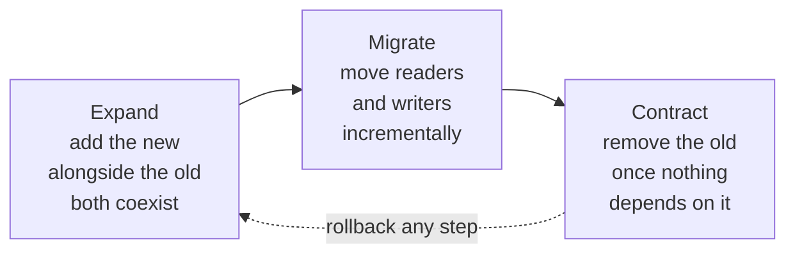

Whether you're adding a column, swapping a database, resharding, or extracting a service, you do the same three moves:

1. **Expand** — introduce the new thing (column, table, shard, store, service) *next to* the old one. Nothing breaks because nothing depends on the new thing yet. The system now understands **both** the old and new shape (backward + forward compatible).
2. **Migrate** — incrementally move **writes**, then **backfill** history, then **reads** from old to new. Every increment is small, observable, and **reversible**.
3. **Contract** — only after *nothing* reads or writes the old thing, remove it. This is the irreversible step, so it goes **last** and only after verification proves the new path is correct.

### The decisive framing — reversible at every step

> The one sentence that earns the Staff signal: **"I never do a big-bang cutover; I expand-contract so I can roll back at every step, and I never delete the old path until I've verified the new one in production."**

The whole art is structuring the migration so that at *no point* is the system in a state you can't safely back out of. A big-bang "stop the app, run a script, start it pointing at the new thing" is a junior answer — it has a single irreversible moment, a downtime window, and no verification. The Staff answer is a **sequence of independently reversible steps, each verified in production, with the destructive step last and behind a flag.**

### The two-minute self-audit you run on any migration

| Question you ask yourself | What you're hunting | The Staff answer pattern |
|---|---|---|
| **Can I roll back this step?** | An irreversible moment hiding mid-migration | "Each step is reversible; the only one-way door is the final cleanup, and it goes last." |
| **What's reading/writing the old thing right now?** | Hidden consumers that break on contract | "I won't drop the old column/table until tracing proves zero reads — I instrument first." |
| **How do I know the new data is correct?** | Cutting over on faith | "Shadow-read and diff old vs new in prod before flipping; I cut over on evidence, not hope." |
| **What's the consistency window?** | The gap between backfill snapshot and live writes | "Backfill is idempotent and I tail the change log so live writes during backfill aren't lost." |
| **Is the cutover a deploy or a flag flip?** | Slow, all-or-nothing rollback | "Cutover is a feature flag I can flip back in seconds — not a redeploy." |
| **What's my blast radius if the new path is wrong?** | All users at once | "I canary by percentage / by tenant, so a bug hits 1% before 100%." |

> **Staff-level insight:** The most powerful migration sentence you can say is **"Let me make this reversible before I make it fast."** Every famous migration disaster — the truncated table, the cutover that couldn't be undone, the dropped column that still had readers — is a *missing reversibility step*, not a missing clever optimization. Interviewers consistently rate "structured it as expand-contract with verification and rollback at each stage" far above "knew the fancy tool name." Make the spine your reflex.

---

## 1. The Universal Migration Spine — Expand-Contract

**Definition.** *Expand-contract* (also called **parallel change**) is the technique of evolving a system through a sequence of **backward-and-forward-compatible** intermediate states, where the new and old shapes **coexist**, so you can migrate consumers incrementally and roll back at any point. It is the foundational pattern from which every other migration in this module is a specialization.

### 1.1 How it works — the three phases applied to an API field rename

Say you must rename a JSON field `email` → `email_address` across a service consumed by mobile apps you can't force-update.

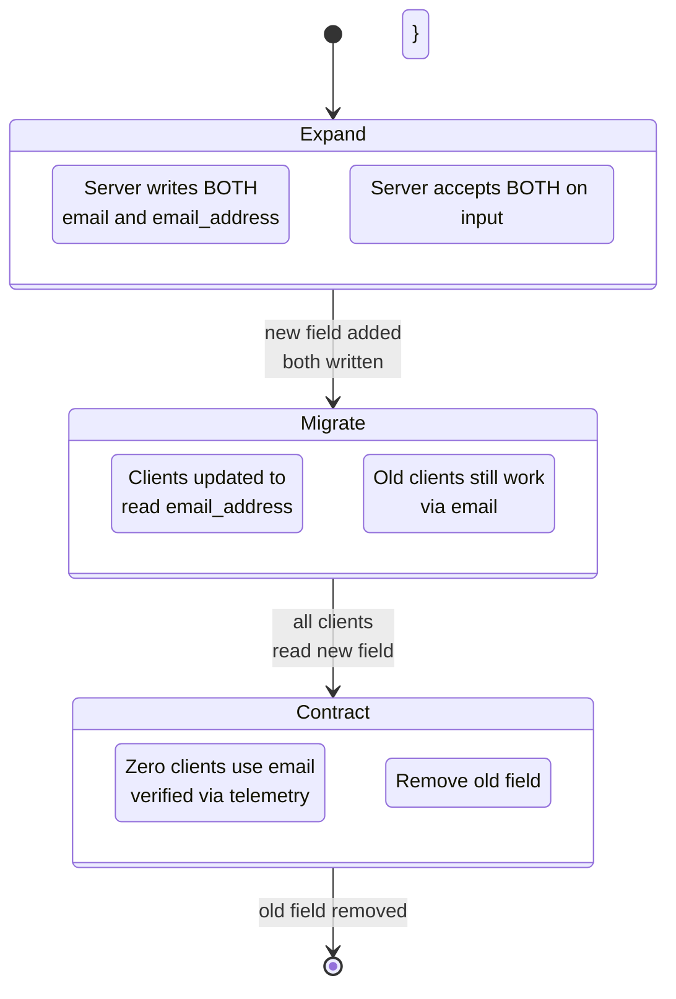

- **Expand:** the producer emits **both** `email` and `email_address`, and accepts both on input. Old clients keep reading `email`; new clients can start reading `email_address`. The system is now **dually compatible**.
- **Migrate:** roll out new client versions / consumers that use the new field. Crucially, instrument so you can *measure* who still touches the old field.
- **Contract:** once telemetry shows zero reads of `email`, remove it.

The same three phases govern a column rename, a queue-format change, a config-schema change, a database swap, and a service extraction. **It is the only pattern you need to remember.**

### 1.2 Backward vs forward compatibility — the contract that makes it safe

| Term | Definition | Who must tolerate what | Migration role |
|---|---|---|---|
| **Backward compatible** | New code can read **old** data/messages | New readers tolerate old writers | Lets you deploy readers before writers |
| **Forward compatible** | Old code can read **new** data/messages | Old readers ignore unknown new fields | Lets you deploy writers before readers / roll back readers |
| **Full (both)** | Either order works, rolling deploy safe | Everyone tolerates everyone | **Required** for zero-downtime rolling deploys |

During a rolling deploy you transiently run **old and new code simultaneously**, hitting the **same data**. So every intermediate state must be **fully compatible** — otherwise a request served by an old instance and a request served by a new instance disagree. This is why you *never* do "add NOT NULL column + change code" in one deploy: there's a window where old code inserts rows without the column.

### 1.3 The cardinal rule: never combine an expand and a contract in one step

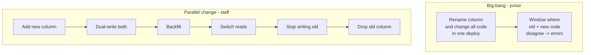

| Approach | Steps | Downtime | Reversible? | Verifiable? |
|---|---|---|---|---|
| **Big-bang** | 1 deploy does everything | Yes (or breakage) | No — single one-way door | No |
| **Expand-contract** | 5–6 small steps | None | Yes — at every step | Yes — verify before contract |

> **Staff-level insight:** The deepest principle here is that **an irreversible change and a risky change should never be the same change.** Expand-contract works because it *separates* the reversible, verifiable steps (add, dual-write, backfill, switch reads) from the single irreversible one (drop the old), and pushes the irreversible one to the end where it's a formality. If an interviewer proposes a one-shot cutover, your job is to find the irreversible moment and split it out.

---

## 2. Zero-Downtime Data Migration — The Canonical Playbook

**Definition.** The standard, battle-tested 5-phase procedure to move data from an **old store/representation** to a **new** one while the system stays fully online, used at Stripe, GitHub, Shopify, and everywhere else that's moved data at scale. It is expand-contract specialized for *data*, and it is the single most reusable thing in this module.

### 2.1 The five phases

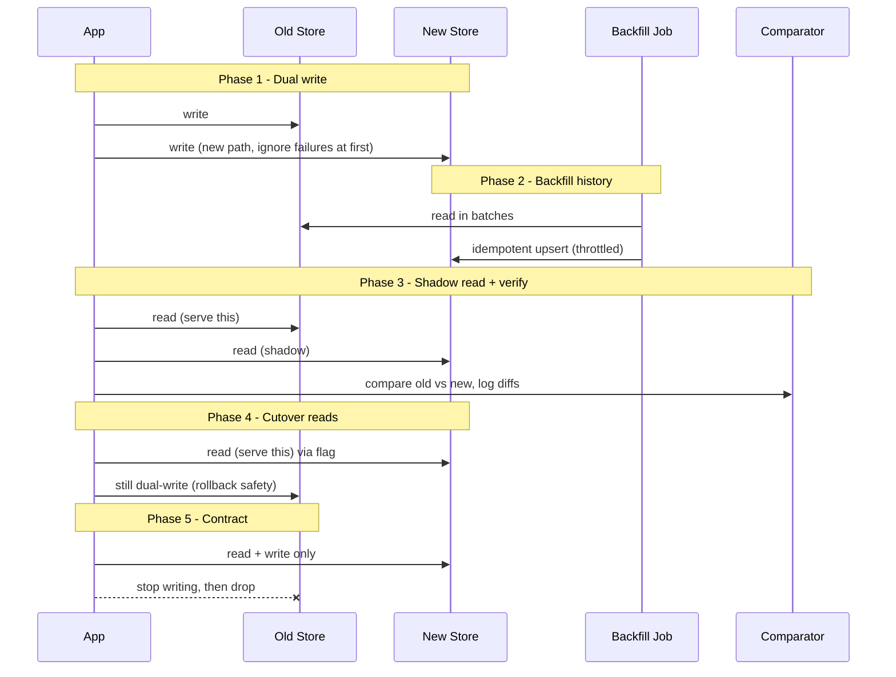

**Phase 1 — Dual-write.** The application writes **every mutation to both** the old and new store. At first, treat new-store write failures as **non-fatal / log-only** (the old store is still source of truth) so a bug in the new path can't break production. From this moment forward, **all new data lands in both stores.**

**Phase 2 — Backfill historical data.** A batch job reads existing rows from the old store and writes them to the new one. This handles everything written *before* dual-write turned on. Backfill must be:
- **Idempotent** — use `UPSERT` / `INSERT … ON CONFLICT`, keyed by primary key, so re-running a batch (after a crash) is safe and so it can't clobber a *newer* live dual-write (use "write only if older" / last-write-wins by version where needed).
- **Throttled** — rate-limit so backfill doesn't saturate the source DB or the new store and harm live traffic. Watch replication lag and back off.
- **Resumable & tracked** — checkpoint progress (last PK / batch cursor) so you can stop, resume, and report "73% complete, ETA 6h."

**Phase 3 — Shadow-read / dual-read + verify.** The app now reads from the **old store (served to the user)** and *also* reads the same key from the **new store in the background**, then **compares** them. Mismatches are logged, not surfaced. This is the proof step — you measure the *real* divergence rate on *real* traffic before you trust the new store. Drive the diff rate to ~zero, fixing backfill/dual-write bugs as they surface.

**Phase 4 — Flip reads to new (cutover).** Behind a **feature flag**, switch the served read from old → new, **ramping** (1% → 10% → 50% → 100%, or tenant-by-tenant). **Keep dual-writing to the old store** during this phase so you can flip reads *back* instantly if the new store misbehaves. The flag is your rollback switch.

**Phase 5 — Stop writing old + clean up.** Once reads have been 100% on the new store long enough to trust (days, not minutes), **stop writing the old store**, then later **decommission/drop** it. This is the only irreversible step, and it's a formality by now.

### 2.2 The consistency-window problem

The subtle bug: backfill takes a **snapshot** of the old store and copies it, but live writes keep happening *during* the backfill. If a row is updated after backfill copied it but the update goes only to the old store, the new store is stale.

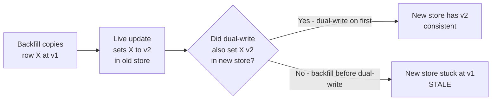

**The fix is ordering: turn on dual-write FIRST, then backfill.** Because dual-write is already live, any update during backfill lands in the new store too; the only thing backfill must avoid is *overwriting a newer live value with an older snapshot value* — hence idempotent, version-aware upserts (last-write-wins or "skip if newer exists"). The alternative pattern (for engine swaps) is **backfill from a snapshot, then tail the change-log from the snapshot's position** — covered in §5.

| Strategy | Order | How live writes during backfill are captured | Best for |
|---|---|---|---|
| **Dual-write then backfill** | Writes to both first, then copy history | Dual-write captures them in real time | Same-app, you control the write path |
| **Snapshot + tail-the-log (CDC)** | Snapshot, then replay log from snapshot LSN | Change-data-capture replays them | Engine swaps, can't easily dual-write |

> **Staff-level insight:** The phase that earns the Staff signal is **Phase 3 — verify.** Anyone can dual-write and backfill; the senior-vs-Staff gap is *insisting on production diffing before cutover.* Say it explicitly: "Before I flip a single read, I shadow-read both stores on live traffic and drive the diff rate to zero — I cut over on measured equality, not on the assumption that backfill worked." That's the line that says you've actually done this and seen backfill be subtly wrong.

---

## 3. Online Schema Changes

**Definition.** Changing a table's structure (add/drop/modify column, add index, change type) on a **large, live, high-traffic table** without locking it or taking write downtime. The naive `ALTER TABLE` is a trap at scale; the discipline is the same expand-contract spine, plus engine-specific tooling.

### 3.1 Why a naive ALTER is dangerous

On MySQL (older / certain operations) and during many Postgres DDLs, an `ALTER TABLE` takes an **exclusive lock** and/or **rewrites the whole table**, blocking reads/writes for the duration. On a 500M-row table that's **minutes to hours of downtime** — unacceptable. Even Postgres, which does many DDLs as metadata-only, will take an `ACCESS EXCLUSIVE` lock for operations like adding a column **with a volatile default** (older versions), changing a type, or `CREATE INDEX` (non-concurrent), and a lock request can **queue behind / block all traffic.**

### 3.2 Expand-contract for a column change (the safe recipe)

To change a column (e.g., widen `int` → `bigint`, or rename), never modify in place:

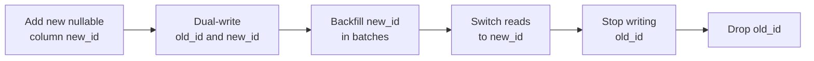

1. **Add** a new **nullable** column (metadata-only, instant — no default rewrite).
2. **Dual-write** both old and new columns from app code.
3. **Backfill** the new column in **small batches** (e.g., 1–10k rows/txn) with sleeps, to avoid long locks and replication lag.
4. **Switch reads** to the new column (behind a flag).
5. **Stop writing** the old column; later **drop** it.

Adding a NOT NULL constraint? Add nullable → backfill → add a `CHECK ... NOT VALID` then `VALIDATE CONSTRAINT` (Postgres, non-blocking) → finally promote.

### 3.3 The online-DDL tools — shadow table + triggers + cutover

For MySQL, tools automate this with a **shadow (ghost) table** mechanism:

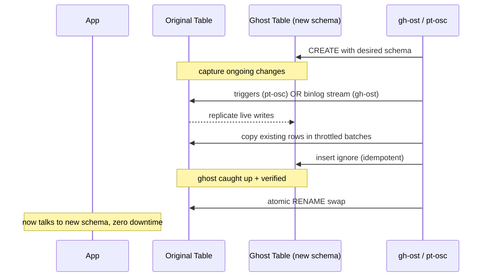

| Tool | Engine | How it captures live writes | Cutover | Notes |
|---|---|---|---|---|
| **pt-online-schema-change** | MySQL | **Triggers** on original table mirror writes to ghost | Atomic `RENAME` | Triggers add write overhead; foreign keys are painful |
| **gh-ost (GitHub)** | MySQL | **Binlog stream** (no triggers) | Atomic swap | Triggerless = lower prod impact, pausable, **throttle on replica lag** |
| **Postgres CREATE INDEX CONCURRENTLY** | Postgres | N/A — builds index without `ACCESS EXCLUSIVE` write lock | Index becomes valid | Slower, two table scans, can't run in a txn |
| **Postgres pg-osc / pgroll** | Postgres | Shadow table + triggers (pg-osc); expand-contract views (pgroll) | View/RENAME swap | pgroll keeps old + new schema versions live simultaneously |
| **Vitess online DDL** | MySQL/Vitess | Wraps gh-ost/vreplication | Managed | Declarative, scheduler-driven at fleet scale |

The mechanism is **identical to the 5-phase data migration**: ghost table = new store, triggers/binlog = dual-write, batch copy = backfill, atomic rename = cutover. gh-ost's key win is reading the **binlog** instead of triggers, so it imposes near-zero write-path overhead and can **throttle automatically when replica lag rises.**

### 3.4 Pitfalls

- **Adding a column with a default** on old MySQL/Postgres rewrites the whole table — use nullable-add + backfill instead (modern Postgres 11+ makes constant defaults metadata-only, but volatile defaults still rewrite).
- **Long-held locks queue behind short ones** — a DDL waiting for a lock can block every query behind it. Use `lock_timeout` and retry.
- **Foreign keys + triggers** (pt-osc) interact badly; gh-ost or careful FK handling required.
- **Replication lag** — the backfill batch copy can lag replicas; throttle on lag, not just on primary load.

> **Staff-level insight:** The Staff move is to say **"a schema change is just a data migration in miniature — same expand-contract spine."** Naming `gh-ost` shows you've operated MySQL at scale, but the deeper signal is recognizing that **the tool is automating the exact dual-write + backfill + atomic-cutover pattern you'd apply by hand** — and that *renaming or dropping a column is never one step*; it's add → dual-write → backfill → switch reads → drop, so you can roll back until the final drop.

---

## 4. Live Resharding / Repartitioning

**Definition.** Changing the number or layout of shards (N → M) on a live, partitioned datastore without downtime — to relieve a hot shard, add capacity, or fix a bad partition key. The hard parts are **minimizing data movement**, keeping the system online during the move, and preserving **cross-shard consistency** while keys are in flight.

### 4.1 Why the partitioning scheme decides the pain

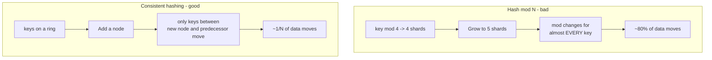

| Scheme | Data moved when adding 1 of N nodes | Hot-spot control | Migration cost |
|---|---|---|---|
| **Hash mod N** | ~(N-1)/N of all keys (almost everything) | Poor | Catastrophic — avoid |
| **Consistent hashing** | ~1/N of keys | OK (uneven without vnodes) | Low |
| **Consistent hashing + virtual nodes** | ~1/N, spread evenly | Good | Low + balanced |
| **Range partitioning** | Only the split/merged range | Good (but range hot-spots) | Low, surgical |
| **Lookup table / directory** | Exactly what you choose | Best (manual placement) | Low, but directory is a dependency |

**Virtual shards / vnodes** are the key trick: pre-create *many* logical partitions (e.g., 4096 vshards) and map them onto few physical nodes. Resharding then means **reassigning vshards to nodes** — moving a small, bounded slice — instead of rehashing every key. You never change the *number of vshards*; you change their *placement*. This is how Vitess, Cassandra, DynamoDB, and most modern sharded stores avoid mass rehashing.

### 4.2 The move itself — split a shard with zero downtime

A shard split (or rebalance of a vshard) is, again, the 5-phase playbook scoped to one partition:

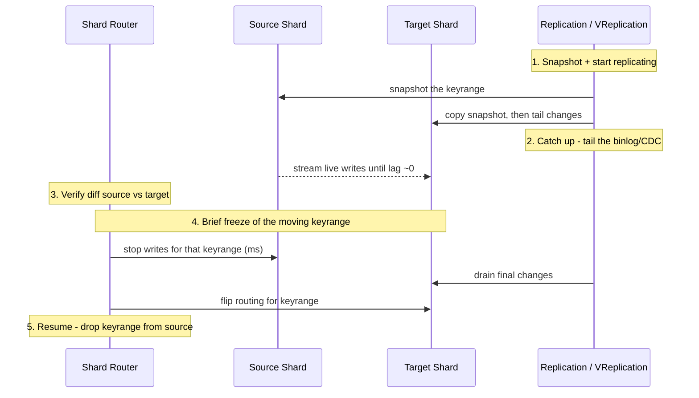

1. **Replicate** the moving keyrange from source to target (snapshot + tail changes — Vitess calls this **VReplication**).
2. **Catch up** until replication lag is near zero.
3. **Verify** (diff source vs target for the keyrange).
4. **Cutover:** briefly **freeze writes for only the moving keyrange** (milliseconds), drain the last changes, then **atomically flip the router** for that keyrange to the target. Other keyranges never pause.
5. **Contract:** drop the keyrange from the source.

The freeze is scoped to **one keyrange**, not the whole DB, so the system stays online; only writes to keys in-flight pause for milliseconds.

### 4.3 Cross-shard consistency during the move

The dangerous window is when a key's home is changing. Defenses:
- **Route through a single source of truth** (the shard router / lookup directory) so there's exactly one "where does key K live?" answer at any instant; flip it atomically.
- **Fence the old shard** — after cutover, the source must **reject writes** for the moved keyrange (return a redirect/error), preventing split-brain where both shards accept writes.
- **Idempotent replication** so replaying the tail is safe.
- For **transactions that span shards** during a move, either freeze briefly (Vitess approach) or use a **2-phase / saga** boundary — but the cleanest answer is "scope the freeze tiny and atomic-flip the router."

> **Staff-level insight:** The Staff answer to "how do you reshard without downtime?" is **"I'd never use hash-mod-N; I'd use virtual shards so resharding is reassigning a bounded set of vshards, not rehashing the world — then move each vshard with snapshot → tail → verify → atomic keyrange flip with the source fenced after cutover."** Naming **vnodes to bound data movement** and **fencing the source to prevent split-brain** are the two ideas that prove you've thought past the happy path. (See [02 Distributed Systems](02-distributed-systems.md) for consistent hashing and [28 Designing for Failure](28-designing-for-failure.md) for fencing tokens.)

---

## 5. Datastore Migration — CDC & Backfill

**Definition.** Moving from one storage *engine* to another (Postgres → Cassandra, MySQL → DynamoDB, self-hosted → managed, SQL → a search index) where you often **can't easily dual-write** (different consistency models, transactions, or you don't fully control all writers). The dominant pattern is **Change Data Capture (CDC): backfill a snapshot, then tail the database's change log to catch everything since.**

### 5.1 Dual-write vs CDC — the core trade-off

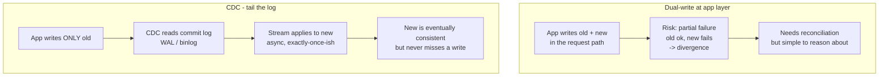

| Dimension | Dual-write (app layer) | CDC (tail the log) |
|---|---|---|
| **Where** | In the application write path | Off the DB commit log (WAL/binlog) |
| **App change** | Yes — every writer must dual-write | Minimal — writers untouched |
| **Consistency** | Risk of partial-write divergence (old ok, new fails) | No lost writes (log is the source of truth) but **async lag** |
| **Captures all writers?** | Only writers you modified | **Every** writer, even ones you forgot |
| **Ordering** | App-defined, racy across two stores | Log preserves commit order |
| **Best for** | Same-app, full control, want synchronous | Engine swaps, many/unknown writers, can't dual-write |
| **Tooling** | Your code + a flag | Debezium, Kafka Connect, AWS DMS, Maxwell |

**The deciding question:** *can you reliably intercept every write in the app?* If yes and you want synchronicity, dual-write. If writers are many/unknown or you can't risk app-path coupling, **CDC** — because the commit log sees *every* committed write by construction, you can never silently miss one.

### 5.2 The backfill + tail-the-log pattern

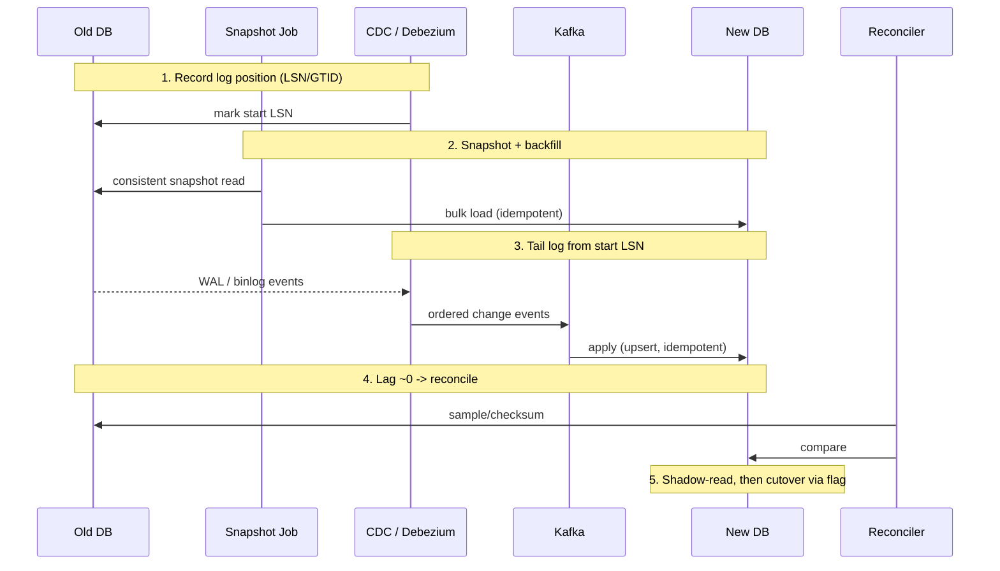

1. **Mark the log position** (Postgres LSN, MySQL GTID/binlog coordinates) *before* snapshotting.
2. **Snapshot + backfill** the existing data into the new store (idempotent bulk load).
3. **Tail the change log from the marked position** — every write that happened during/after the snapshot replays into the new store. This **closes the consistency window** (the snapshot + log union covers everything).
4. **Reconcile / diff** — checksum ranges or sample rows old vs new to prove equality (account for type mapping differences, e.g., Postgres `numeric` → Cassandra `decimal`).
5. **Shadow-read, cutover behind a flag, then contract** — same as §2.

### 5.3 Cutover with rollback

Because the engines differ, cutover and rollback need care:
- **Reverse CDC option:** during cutover, also stream **new → old** so the old store stays warm and you can flip *back*. This makes rollback trivial but doubles the CDC plumbing.
- **Or keep dual-writing the old** during the cutover window (if feasible) so it remains a valid fallback.
- **Cutover is a feature flag**, ramped by percentage/tenant, never a redeploy.
- Watch for **semantic mismatches**: transactions, foreign keys, and strong consistency on the old side may have **no equivalent** on the new side — surface these in the diff phase, not in production.

> **Staff-level insight:** The phrase that signals you've done a real engine migration is **"backfill from a snapshot, then tail the log from the snapshot's LSN — the snapshot plus the change stream provably cover every write, so there's no consistency gap."** And the decisive trade-off articulation: **"I prefer CDC over dual-write when I can't guarantee every writer is in my code path, because the commit log captures writes I'd otherwise miss — at the cost of async lag I close before cutover."** Tools like **Debezium / AWS DMS** are the names; the LSN-anchored snapshot+tail is the *idea*. (See [04 Messaging](04-messaging-event-driven.md) for CDC-to-Kafka and [06 Databases](06-databases.md) for WAL/binlog.)

---

## 6. Monolith → Services Migration

**Definition.** Incrementally decomposing a monolith into services **without** a risky big-bang rewrite, by routing functionality to new services one capability at a time until the monolith is "strangled" away. The hardest part is almost never the code — it's **splitting the shared database.**

### 6.1 The Strangler Fig pattern

Named after the fig vine that grows around a tree and eventually replaces it: you put a **facade/router** in front of the monolith and **redirect one route at a time** to new services, shrinking the monolith until it's gone.

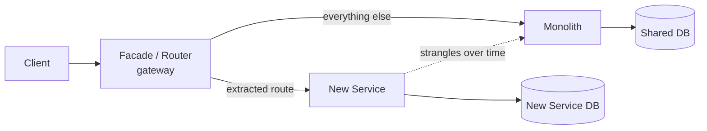

You migrate **one capability**: stand up the new service, point its route through the facade to the new service (behind a flag, canaried), verify, then move the next. The monolith and services coexist for **months or years** — that coexistence is the point, not a failure.

### 6.2 Branch-by-abstraction — extracting code that's deeply entangled

When the code you want to extract is called from many places, you can't just reroute at the edge. **Branch-by-abstraction** introduces a seam *inside* the codebase:

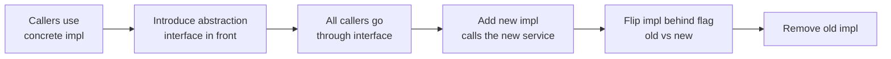

1. Introduce an **abstraction (interface)** over the functionality to extract.
2. Route **all callers through the abstraction** (no behavior change).
3. Build a **new implementation** that calls the extracted service.
4. **Switch** implementations behind a flag (old vs new), canary, verify.
5. **Remove** the old implementation.

This is expand-contract applied to code: the abstraction lets old and new implementations **coexist** so you migrate callers gradually and roll back by flipping the flag.

### 6.3 Splitting the shared database — the hardest part

Two services sharing one database are **not** two services — the DB is a hidden coupling and a shared failure domain. Splitting it:

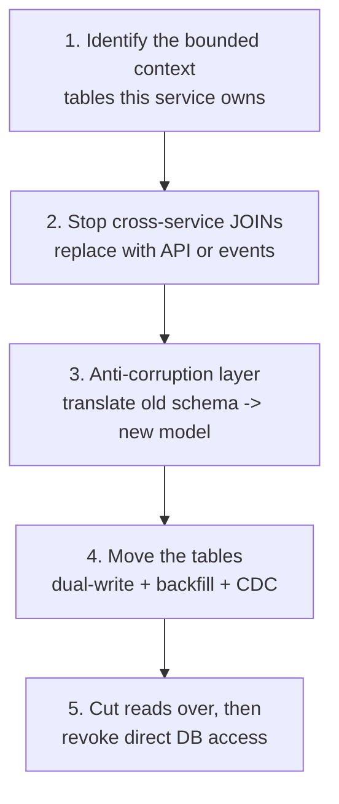

1. **Find the bounded context** — which tables truly belong to the new service.
2. **Eliminate cross-service JOINs and shared transactions** — replace a JOIN across the boundary with an **API call** or an **event** (the foreign data is now denormalized/cached or fetched). This is the genuinely hard work; a DB-level JOIN across the boundary makes the split impossible.
3. **Anti-corruption layer (ACL)** — a translation layer so the new service's clean domain model isn't polluted by the monolith's legacy schema; the ACL maps old → new and isolates the new service from the monolith's quirks.
4. **Move the tables** using the §2 playbook (dual-write or CDC, backfill, verify).
5. **Cut reads over, then revoke the monolith's direct access** to those tables so the boundary is enforced.

### 6.4 How to sequence it — which piece first

| Sequencing heuristic | Why |
|---|---|
| **Leaf / low-coupling capabilities first** | Fewest cross-boundary JOINs; easiest, builds the pattern & confidence |
| **High-pain or high-scale capabilities next** | Where independent scaling/deploy pays off most |
| **Shared-kernel / core data last** | The user/auth/billing tables are the most entangled — extract once you have practice |
| **Vertical slices (capability) not horizontal layers** | A capability with its own data deploys & scales independently; a "service" that still shares the DB is fake |

> **Staff-level insight:** The Staff-level truths here: **(1) the database split is the migration — the code is the easy part;** if you can't break the cross-boundary JOINs and shared transactions, you don't have microservices, you have a distributed monolith. **(2) Strangler Fig over rewrite** — never propose "freeze features and rewrite for a year"; you incrementally route capabilities through a facade so you ship value and de-risk continuously, with the monolith as a working fallback. **(3) The anti-corruption layer** protects the new clean model from the legacy schema. Say "leaf-first, vertical slices, database last" and you sound like someone who's actually done it. (See [10 Microservices](10-microservices.md) and [15 Architecture Patterns](15-architecture-patterns.md).)

---

## 7. Verification & Safety

**Definition.** The set of techniques that turn a migration from "deploy and pray" into "prove it's correct in production before committing." Verification is what makes the expand-contract spine *safe* — it's the evidence on which you cut over and the mechanism by which you roll back. This is the most under-practiced area and a strong differentiator.

### 7.1 The toolkit

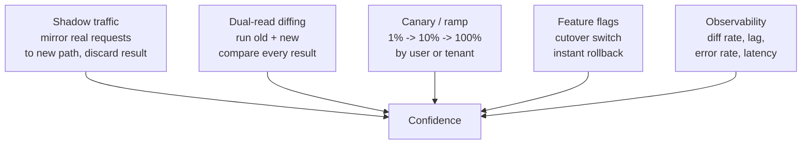

| Technique | What it does | When in the migration | Rollback role |
|---|---|---|---|
| **Shadow / dark traffic** | Mirror live requests to the new path; **discard** the response | Before serving any real read | New path tested under real load, zero user impact |
| **Dual-read diffing** | Run **both** old and new, serve old, **compare** results, log mismatches | Phase 3 (verify) | Proves equality before cutover |
| **Canary / progressive ramp** | Send a **small % or set of tenants** to the new path first | Phase 4 (cutover) | Bug hits 1% not 100%; flip back |
| **Feature flag** | The **cutover switch** itself | Phase 4 | **Instant rollback** without redeploy |
| **Observability** | Diff rate, replication lag, error rate, p99, backfill progress | All phases | Tells you *when* it's safe / when to abort |

### 7.2 Dual-read diffing — the GitHub Scientist pattern

GitHub's **Scientist** library is the canonical implementation: wrap the old code as the **control** and the new code as the **candidate**; run **both**, **return the control's result** to the user, and **compare + log** the difference asynchronously.

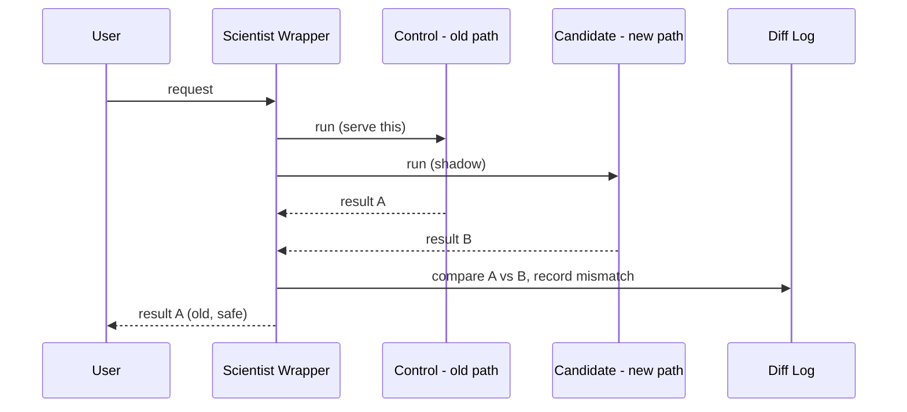

Key properties: the **candidate never affects the user** (you always return control), it runs on **real production traffic** (the only honest test), and the **mismatch rate is your go/no-go metric** for cutover. GitHub used exactly this to migrate their permissions code. This is Phase 3 of §2 made into a reusable library.

### 7.3 The rollback plan at every stage

The non-negotiable: **before each step, know exactly how to undo it.**

| Stage | Forward action | Rollback |
|---|---|---|
| Expand | Add new column/store/service | Drop the unused new thing (no readers yet) |
| Dual-write | Write both | Stop writing new (old still source of truth) |
| Backfill | Copy history | Idempotent → just stop; no corruption |
| Verify | Shadow-read + diff | No user impact to undo |
| Cutover | Flip read flag to new | **Flip flag back** (old still being written) |
| Contract | Stop writing old, drop it | **Irreversible — only do this last, after long soak** |

> **Staff-level insight:** The verification mindset is the clearest Staff signal in the whole topic: **"I cut over on evidence, not on faith."** Concretely — *shadow first* (test under real load with no user impact), *diff in production* (Scientist-style, drive mismatch to ~zero), *canary the cutover* (1% by tenant), *make the cutover a feature flag* (rollback in seconds, not a redeploy), and *keep the old path writable until the new one has soaked*. Every one of those is a reversibility guarantee. The junior plan ends at "deploy"; the Staff plan ends at "verified, then contracted." (See [28 Designing for Failure](28-designing-for-failure.md) for canary/blast-radius and [12 Observability](12-observability.md) for the metrics.)

---

## 8. Worked Example — 10 TB Postgres → Sharded Cluster

**The prompt:** *"We have a single 10 TB Postgres `users` table serving 50k QPS. It's hitting the single-node ceiling. Migrate it to a sharded cluster (say 16 shards, keyed by `user_id`) with zero downtime and full rollback at every step."*

This stitches every section together. Narrate it as **expand → migrate → contract**, naming the verify and rollback at each step.

### 8.1 The end-to-end plan

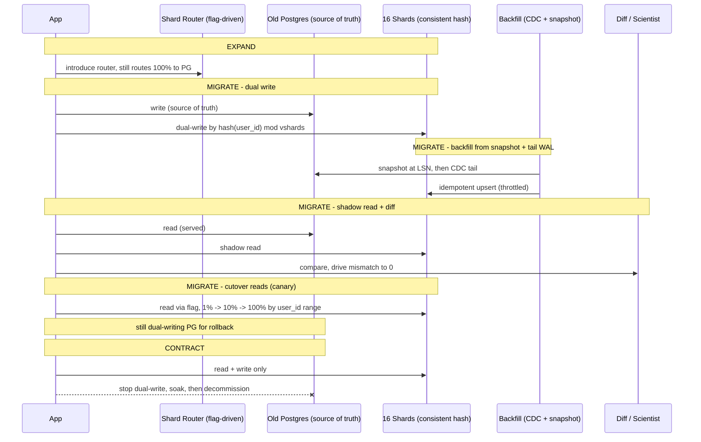

### 8.2 Step by step, with rollback at each

| # | Step | What happens | Verify | Rollback |
|---|---|---|---|---|
| 1 | **Choose key & layout** | Shard by `hash(user_id)`; use **4096 virtual shards** over 16 nodes so future resharding is cheap | Capacity math: 10 TB / 16 ≈ 625 GB/shard, 50k QPS / 16 ≈ 3.1k QPS/shard — within single-node ceiling | N/A (design) |
| 2 | **Expand — stand up router** | Insert a **shard router** in front; it routes **100% to old Postgres** initially | Router adds no behavior change | Remove router |
| 3 | **Dual-write** | App writes to **old PG (source of truth)** and to the **correct shard** by hash; shard-write failures **log-only** at first | Monitor shard-write error rate | Turn off shard-write; PG unaffected |
| 4 | **Backfill** | Mark PG **LSN**, snapshot, bulk-load shards via **idempotent upsert**, then **tail the WAL** (Debezium/logical replication) from that LSN to close the consistency window; **throttle** on replica lag | Backfill progress %, ETA, lag | Idempotent → just stop; re-run safe |
| 5 | **Shadow-read + diff** | Serve reads from **PG**; **shadow-read the shard** and **diff** (Scientist-style); fix dual-write/backfill bugs until **mismatch ≈ 0** | **Mismatch rate is the go/no-go gate** | Zero user impact |
| 6 | **Cutover reads (canary)** | Flip read flag to shards, **ramped by `user_id` range**: 1% → 10% → 50% → 100%; **keep dual-writing PG** | Error rate, p99, diff rate per cohort | **Flip flag back** — PG still current |
| 7 | **Soak** | Run 100% reads on shards for **days**, PG still written | Stability over time | Flip reads back to PG |
| 8 | **Contract** | **Stop dual-writing PG**, then later **decommission** it | Confirm zero PG reads via tracing first | **Irreversible — last, after soak** |

### 8.3 The hard parts you volunteer

- **Cross-shard queries:** a `WHERE country = X` query that used to be one table now fans out to 16 shards (**scatter-gather**) or needs a **secondary index / search store**. Name it: "queries not keyed by `user_id` need a scatter-gather or a separate index — I'd identify those before sharding."
- **Transactions across users:** anything that updated two users in one transaction now spans shards — replace with a **saga** or accept eventual consistency. Surface it in the diff phase.
- **Consistency window during backfill:** solved by **dual-write-first** (or snapshot-LSN + tail-WAL), with **idempotent, version-aware upserts** so backfill never clobbers a newer live write.
- **Hot shard:** if `user_id` hashing still leaves a hot shard (a whale user), that's where **vshards + per-vshard rebalancing** (§4) earns its keep — move that vshard without touching others.
- **Rollback after contract:** once PG is decommissioned you **can't** roll back — so the soak is long and the contract is the very last step.

> **Staff-level insight:** Driving this end-to-end *out loud as expand → migrate → contract, naming the verify gate (mismatch ≈ 0) and the rollback at every step, and keeping the old store writable until after the soak* is the single strongest demonstration of the Staff signal in this entire module. The interviewer isn't testing whether you know sharding — they're testing whether you can change a live 10 TB system **reversibly**. Close with: "the only irreversible action is the final PG decommission, and it happens after days of verified production traffic on the new cluster."

---

## Interview Cheat-Sheet

| Concept | One-liner |
|---|---|
| **The move** | Never big-bang. Structure every migration as **expand → migrate → contract**, reversible at every step, verified before cutover. |
| **Expand-contract / parallel change** | Add the new alongside the old; migrate consumers incrementally; remove the old **last**. The one pattern under everything. |
| **Reversible at every step** | The only one-way door is the final cleanup — push it to the end where it's a formality. |
| **Never combine expand + contract** | Add and drop are different deploys. Separate the irreversible step from the risky steps. |
| **Full compatibility** | Rolling deploy runs old + new code on the same data → every intermediate state must be backward **and** forward compatible. |
| **5-phase data migration** | Dual-write → backfill → shadow-read+verify → cutover (flag) → contract. The most reusable thing here. |
| **Dual-write first, then backfill** | Order matters — dual-write-first closes the consistency window; backfill must be **idempotent & version-aware**. |
| **Backfill discipline** | Idempotent (upsert), throttled (replica lag), resumable (checkpointed), tracked (% + ETA). |
| **Verify before cutover** | Shadow-read both stores on live traffic; drive **diff rate to ~0**. Cut over on evidence, not faith. |
| **Cutover = feature flag** | Not a redeploy. Ramp 1% → 100% by tenant; flip back in seconds. Keep old path writable for rollback. |
| **Naive ALTER locks** | Big ALTER takes exclusive lock / rewrites table → minutes of downtime. Use online-DDL. |
| **gh-ost / pt-osc** | Ghost table + binlog(gh-ost)/triggers(pt-osc) + atomic rename = automated dual-write+backfill+cutover. gh-ost is triggerless, throttles on lag. |
| **Column change recipe** | Add nullable → dual-write → backfill → switch reads → stop writing old → drop. Never modify in place. |
| **Resharding: vnodes** | Hash-mod-N moves ~everything; **consistent hashing + virtual shards** moves ~1/N. Reshard = reassign vshards, not rehash. |
| **Shard move** | Snapshot → tail changes → verify → **freeze only the moving keyrange (ms)** → atomic router flip → **fence the source**. |
| **Dual-write vs CDC** | Dual-write if you control every writer; **CDC** (tail WAL/binlog) if writers are many/unknown — the log captures every write. |
| **Backfill + tail-the-log** | Mark LSN → snapshot → tail from LSN. Snapshot + log union = no consistency gap. Debezium/DMS. |
| **Strangler Fig** | Facade routes one capability at a time to new services; monolith shrinks to nothing. Never a big-bang rewrite. |
| **Branch-by-abstraction** | Interface seam in code → new impl calls the service → flag-flip → remove old. Expand-contract for code. |
| **DB split is the migration** | Kill cross-boundary JOINs/transactions (→ API/events); ACL translates legacy schema. Leaf-first, vertical slices, shared data last. |
| **Scientist diffing** | Run control(old)+candidate(new), serve old, log mismatch. Real traffic, zero user impact, mismatch rate = go/no-go. |
| **Rollback table** | Know how to undo each step *before* doing it. Contract is the only irreversible step → goes last after a soak. |

---

## Common Interview Questions

**Q1. What's the universal pattern behind every zero-downtime migration?**
**Expand → migrate → contract** (parallel change). You add the new thing *alongside* the old so both coexist, migrate writers then readers incrementally, and remove the old only after nothing depends on it. The whole reason it works is **reversibility**: every step except the final cleanup can be backed out, so you're never in a state you can't escape. The irreversible deletion goes *last*, after you've verified the new path in production. A big-bang "stop, migrate, restart" is the junior answer — it has a downtime window, a single irreversible moment, and no verification. My reflex on any migration prompt is to name the spine and find the irreversible step so I can isolate it to the end.

**Q2. Walk me through migrating a large table's data to a new store with zero downtime.**
Five phases. **(1) Dual-write** every mutation to old and new (new-store failures log-only at first, old stays source of truth). **(2) Backfill** history with an idempotent, throttled, checkpointed job. **(3) Shadow-read + verify** — read from old (serve it) and new (background), diff them on live traffic, and drive the mismatch rate to ~zero, fixing bugs as they surface. **(4) Cutover** by flipping reads to the new store behind a feature flag, ramped 1%→100%, *while still dual-writing the old* so I can flip back instantly. **(5) Contract** — once reads have soaked on the new store for days, stop writing the old and decommission it. The load-bearing ideas: dual-write *first* to close the consistency window, verify in production before cutover, and the cutover is a flag, not a redeploy.

**Q3. What is the consistency-window problem in a backfill, and how do you avoid it?**
Backfill copies a *snapshot* of the old store, but live writes keep happening during the copy. If a row is updated after backfill copied it and that update only lands in the old store, the new store is silently stale. The fix is **ordering: turn on dual-write before starting the backfill.** Then any live update during backfill also lands in the new store; the only remaining risk is backfill *overwriting* a newer live value with an older snapshot value, which you prevent with **idempotent, version-aware upserts** (last-write-wins or skip-if-newer). The alternative for engine swaps is **snapshot at a log position, then tail the change log from that position** — the snapshot plus the replayed log provably cover every write.

**Q4. Why is a naive `ALTER TABLE` dangerous at scale, and how do online-DDL tools fix it?**
A naive ALTER can take an exclusive lock and/or rewrite the entire table, blocking reads and writes for minutes to hours on a large table — that's downtime. Tools like **gh-ost** and **pt-online-schema-change** automate the safe path: create a **ghost table** with the new schema, capture ongoing writes (gh-ost reads the **binlog** triggerlessly; pt-osc uses **triggers**), copy existing rows in throttled batches, and **atomically rename** the ghost into place. It's literally the dual-write + backfill + cutover playbook for schema. gh-ost's edge is being triggerless (near-zero write overhead) and **throttling on replica lag**. And at the app level, the safe column-change recipe is never modify-in-place: add nullable → dual-write → backfill → switch reads → drop — so it's reversible until the drop.

**Q5. How do you reshard a live database from N to M shards without downtime?**
First, the partitioning scheme decides the pain: **never hash-mod-N** (adding a node moves ~everything). Use **consistent hashing with virtual shards** so resharding is *reassigning a bounded set of vshards*, not rehashing the world — only ~1/N of data moves. To move a vshard/keyrange: snapshot it, **tail the change log** to the target until lag is near zero, **verify** with a diff, then **briefly freeze writes for only that keyrange** (milliseconds), drain the final changes, and **atomically flip the router** to the target — other keyranges never pause. Critically, **fence the source** after cutover so it rejects writes for the moved keyrange, preventing split-brain. Vitess's VReplication does exactly this.

**Q6. When would you use CDC instead of dual-writing for a datastore migration?**
Dual-write puts both writes in the app request path — simple to reason about, synchronous, but it only captures writers *you modified* and risks partial-write divergence (old succeeds, new fails). **CDC tails the database's commit log** (WAL/binlog), so it captures **every committed write by construction** — even writers you forgot about or don't control — and preserves commit order, at the cost of async lag. So I choose CDC for **engine swaps and when writers are many/unknown or I can't safely couple the app to two stores**; I choose dual-write when I control every writer and want synchronicity. The canonical CDC procedure: mark the log position, snapshot+backfill, tail the log from that position, reconcile/diff, then shadow-read and cutover behind a flag — with Debezium or AWS DMS as typical tooling.

**Q7. How do you decompose a monolith into services without a big-bang rewrite?**
**Strangler Fig**: put a facade/router in front of the monolith and redirect **one capability at a time** to new services (behind flags, canaried, verified), shrinking the monolith until it's gone — the monolith stays a working fallback throughout, so I ship value and de-risk continuously instead of freezing features for a year. For deeply entangled code, **branch-by-abstraction**: introduce an interface, route all callers through it, add a new implementation that calls the extracted service, flip behind a flag, remove the old. And the genuinely hard part is **splitting the shared database** — I have to break cross-boundary JOINs and shared transactions (replacing them with API calls or events) and put an **anti-corruption layer** between the new clean model and the legacy schema. Sequence: leaf/low-coupling capabilities first, shared core data (user/auth/billing) last.

**Q8. Why do you say "the database split is the real migration"?**
Because two services sharing a database aren't two services — the DB is a hidden coupling and a shared failure domain, and you have a distributed monolith. The code extraction is mechanical; the hard part is that cross-boundary **JOINs and transactions** assume one database. To truly split, you must replace those JOINs with **API calls or events** (denormalize or fetch the foreign data) and remove shared transactions (sagas / eventual consistency), then move the tables with the standard dual-write/CDC + backfill + verify playbook, and finally **revoke the monolith's direct table access** so the boundary is enforced. If you can't break the cross-boundary JOINs, the split isn't possible — that's why I scope and sequence around the data, leaf-first.

**Q9. How do you verify a migration is correct *before* you commit to it?**
I cut over on evidence, not faith. **Shadow/dark traffic** first — mirror real requests to the new path and discard the result, so it's tested under real load with zero user impact. Then **dual-read diffing** (GitHub Scientist pattern): run old as control and new as candidate, **serve the control**, and **compare + log** the mismatch on live traffic — the mismatch rate is my go/no-go gate, driven to ~zero. Cutover is a **canary** ramped by percentage or tenant so a bug hits 1% before 100%, and it's controlled by a **feature flag** for instant rollback. Throughout, observability tracks diff rate, replication lag, error rate, and backfill progress. The junior plan ends at "deploy"; mine ends at "verified in production, then contracted."

**Q10. What's your rollback plan at each stage, and which step is irreversible?**
Before each step I know how to undo it. Expand → drop the unused new thing (no readers yet). Dual-write → stop writing new (old is still truth). Backfill → idempotent, so just stop, no corruption. Verify → no user impact to undo. Cutover → **flip the feature flag back** (old is still being written). The **only irreversible step is contract** — stopping the old writes and dropping the old store — so it goes **last**, only after the new path has soaked in production for days and tracing confirms zero remaining reads of the old path. The discipline is structuring the whole migration so that at no point am I in a state I can't safely back out of, right up until the destructive final cleanup.

**Q11. Migrate a 10 TB Postgres `users` table to a 16-shard cluster, zero downtime — go.**
Expand → migrate → contract. **Design:** shard by `hash(user_id)` over **4096 virtual shards** on 16 nodes so future resharding is cheap; capacity checks out (~625 GB and ~3k QPS per shard). **Expand:** insert a shard router routing 100% to old PG. **Migrate:** (a) dual-write to PG (truth) and the correct shard, shard failures log-only; (b) backfill — mark the **WAL LSN**, snapshot, idempotent-upsert into shards, then **tail the WAL** from that LSN to close the consistency window, throttling on replica lag; (c) shadow-read the shards and **diff** until mismatch ≈ 0; (d) **cutover** reads behind a flag ramped by `user_id` range 1%→100% while still dual-writing PG; (e) soak for days. **Contract:** stop dual-writing PG, then decommission it. I'd volunteer the hard parts up front: non-`user_id` queries need scatter-gather or a secondary index, cross-user transactions become sagas, and the **only irreversible step — PG decommission — happens last after verified production soak.**

---

*Related modules:* [06 Databases](06-databases.md) · [02 Distributed Systems](02-distributed-systems.md) · [04 Messaging](04-messaging-event-driven.md) · [15 Architecture Patterns](15-architecture-patterns.md) · [28 Designing for Failure](28-designing-for-failure.md)
