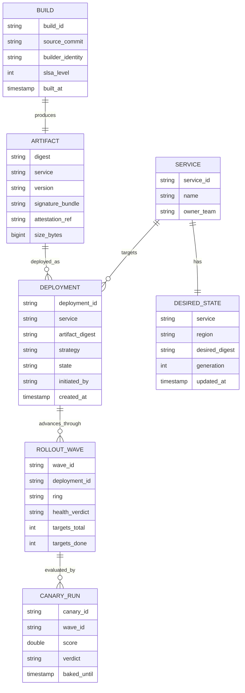
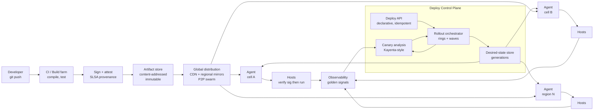
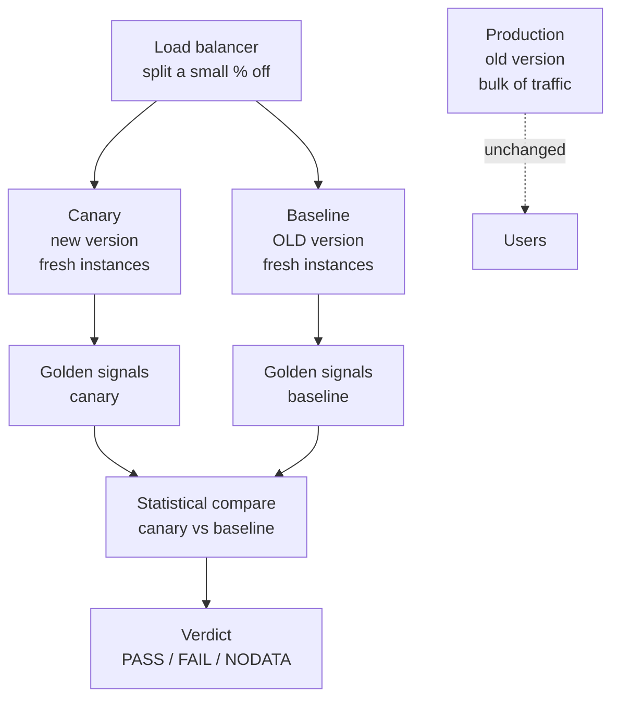
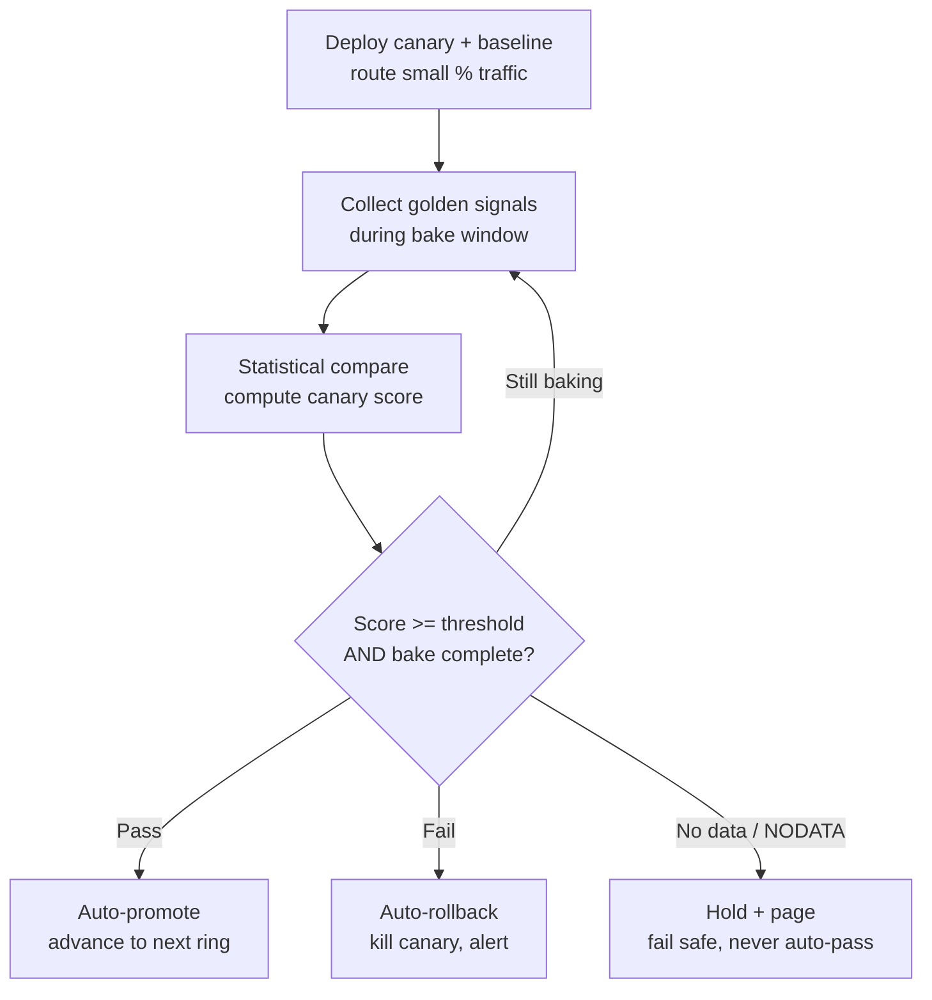
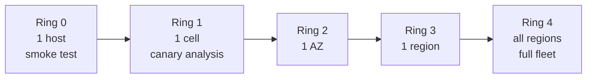
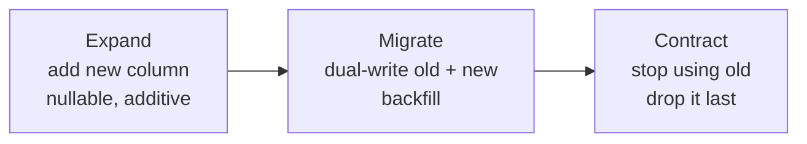
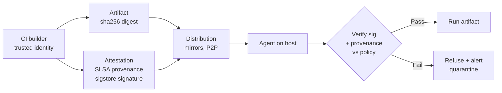
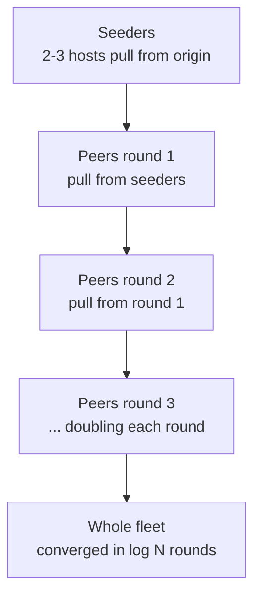
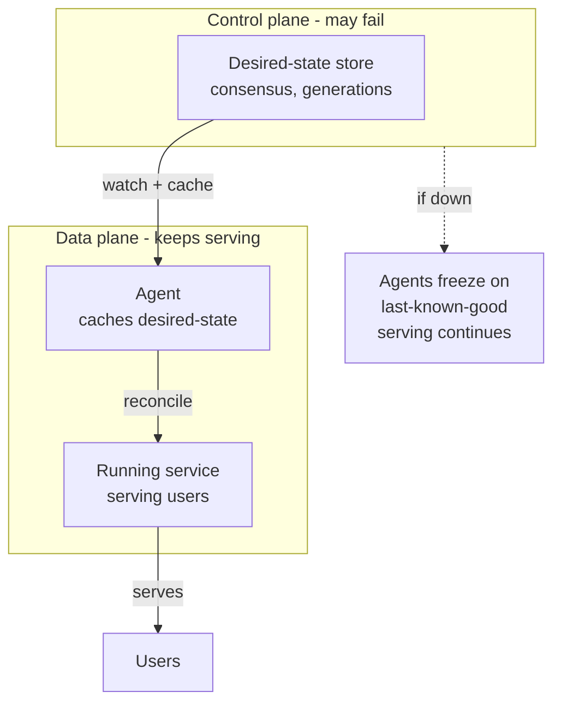

# Module 33 — Design a Code Deployment System

> The definitive deployment-system reference for Staff / Principal / Senior-EM system-design interviews — progressive rollout, automated canary analysis, and safe rollback as first-class design problems.

## What you'll master

Almost every candidate can describe "CI builds a thing and we ship it." Staff candidates design the **machine that safely moves code onto a global fleet without taking it down** — and treat *rollout safety, automated rollback, and supply-chain integrity* as the actual problem, not an afterthought. Grokking covers "code deployment" shallowly; this module makes it a dedicated playbook because it is a genuine Staff infrastructure question (Google's Rapid/Borg, Netflix's Spinnaker/Kayenta, AWS's deployment pipelines, Meta's Tupperware/Conveyor all exist because this is hard). By the end you will be able to:

- Run a deployment-system design end-to-end with the **10-part structure** and a **correct BOTEC** (artifacts/day, fleet size, distribution bandwidth — never DAU-as-RPS).
- Choose between **recreate / rolling / blue-green / canary** from first principles and defend the trade-off.
- Design **automated canary analysis** — the crux: deploy to a small slice, compare canary vs baseline on golden signals with statistical significance, gate promotion on the metrics, and **roll back automatically on SLO regression**.
- Build **progressive ring rollout** (1 host → cell → AZ → region → fleet) with per-wave health gates and **blast-radius control**.
- Handle the hard part — **rollback when there are database migrations** — with the expand/contract discipline and forward-fix-vs-rollback judgment.
- Guarantee **artifact integrity** with content-addressed, signed, attested artifacts (SLSA / sigstore) — the post-SolarWinds supply-chain concern.
- **Distribute a large binary to a huge fleet fast** with P2P swarm / CDN / regional mirrors, and do the convergence-time math.
- Design the **control plane / desired-state** so a deploy-system outage **cannot take down running services** (static stability).

Cross-references: [14 Cloud](14-cloud.md) · [11 Reliability](11-reliability.md) · [28 Designing for Failure](28-designing-for-failure.md) · [12 Observability](12-observability.md) · [32 Migrations](32-migrations.md)

---

## Table of Contents

1. [In the Room — Delivering This at Staff Level](#in-the-room--delivering-this-at-staff-level)
2. [Problem Framing](#1-problem-framing)
3. [Requirements — Functional + Non-Functional](#2-requirements--functional--non-functional)
4. [Capacity Estimation (Correct BOTEC)](#3-capacity-estimation-correct-botec)
5. [API Design](#4-api-design)
6. [Data Model](#5-data-model)
7. [High-Level Architecture](#6-high-level-architecture)
8. [Deep Dives](#7-deep-dives)
   - [7.1 Deployment Strategies](#71-deployment-strategies--recreate-rolling-blue-green-canary)
   - [7.2 Automated Canary Analysis (the crux)](#72-automated-canary-analysis-the-crux)
   - [7.3 Progressive Ring Rollout + Blast Radius](#73-progressive-ring-rollout--blast-radius)
   - [7.4 Rollback with Database Migrations (the hard part)](#74-rollback-with-database-migrations-the-hard-part)
   - [7.5 Artifact Integrity & Supply-Chain Security](#75-artifact-integrity--supply-chain-security)
   - [7.6 Binary Distribution at Scale](#76-binary-distribution-at-scale)
   - [7.7 The Control Plane / Desired-State](#77-the-control-plane--desired-state)
9. [Scaling & Bottlenecks](#8-scaling--bottlenecks)
10. [Trade-offs & Failure Modes](#9-trade-offs--failure-modes)
11. [What the Interviewer Is Really Testing](#10-what-the-interviewer-is-really-testing--staff-insight)
12. [Interview Cheat-Sheet](#interview-cheat-sheet)
13. [Common Interview Questions](#common-interview-questions)

---

## In the Room — Delivering This at Staff Level

A junior answers this question as a **pipeline**: "git push → CI builds → tests pass → kubectl apply → done." That answer scores poorly because it solves the wrong problem. The hard part of a deployment system is not *moving bits onto a server* — Docker and a copy command do that. The hard part is **moving bits onto thousands of servers, fast, without an outage, and getting back to safety automatically when the new code is bad.** Deployment is the single most common cause of production incidents — most outages are *self-inflicted by a change*. So the deployment system's entire reason to exist is **change safety**.

Earmark the crux early and out loud. The moment scale is established, say:

> "The interesting part here isn't the build pipeline — it's making a fleet-wide rollout safe. So I'm going to spend my time on three things: **progressive rollout so a bad change hits a tiny blast radius first; automated canary analysis so the system decides whether the new version is healthy from real metrics, not a human eyeballing a dashboard; and rollback that actually works — including the hard case where there's a database migration involved.** Everything else (build, artifact storage, distribution) I'll design correctly but quickly."

That framing is the Staff signal. It says you know where the risk lives. Three decisive framings to plant:

- **"A deploy is a controlled experiment, not a copy."** You're running new code against real traffic and measuring whether it regressed. Treat it statistically.
- **"The rollout must fail safe, automatically."** A human watching a graph at 3 a.m. is not a control loop. The system must detect SLO regression and revert without a pager.
- **"The deploy control plane must be statically stable."** If the deployment service is down, *running services keep running*. You never want "the thing that ships code" to be in the critical path of "the code that's already shipped." (See [28 Designing for Failure](28-designing-for-failure.md).)

> **Staff-level insight:** The interviewer is testing whether you understand that *the deployment system is itself a high-blast-radius global control plane* — the same class of component as DNS or config push that caused the famous outages. The candidate who designs it with cells, staged rollout of the deployer's *own* changes, and static stability is operating two levels above the candidate who draws a CI arrow into a server.

---

## 1. Problem Framing

**What we're building.** A system that takes built, versioned artifacts and **safely rolls them out to a large fleet of compute** (containers / VMs / bare metal), across regions, with automated health-gating and rollback, plus the integrity guarantees to trust what's being shipped.

**Scope it explicitly** (say this out loud to bound the problem):

- **In scope:** build submission → immutable artifact → global distribution → progressive rollout → canary analysis → automated rollback → desired-state reconciliation → audit.
- **Adjacent, name and defer:** the CI test farm itself (we consume its output), service discovery / load balancing (we integrate, [05](05-load-balancing.md)), the actual app runtime (Kubernetes / Borg — we may *be* the thing that drives it or sit above it), secrets management (we version-couple to it, but it's its own system).
- **Two deployment targets to distinguish:** (a) **orchestrated** (Kubernetes/Borg already does rolling updates — we add canary analysis + ring orchestration on top), and (b) **un-orchestrated** (we push binaries to a raw fleet and run agents ourselves). I'll design for the general case and note where an orchestrator subsumes a layer.

**The core tension to name:** **speed of delivery vs. safety of delivery.** Engineers want changes live in minutes; the org wants zero change-induced outages. The whole design is the machinery that buys *both* — fast *and* safe — by shrinking blast radius and automating the safety check so it doesn't cost human time.

**Who's the user?** Three personas, three needs: the **developer** (wants "ship my commit, tell me if it's healthy, don't make me babysit"), the **SRE / release engineer** (wants guardrails, blast-radius control, an audit trail, a big red rollback button), and the **security team** (wants to know exactly what's running everywhere and that it wasn't tampered with).

---

## 2. Requirements — Functional + Non-Functional

### Functional

| # | Requirement |
|---|---|
| F1 | **Submit a build** — register an immutable, versioned, content-addressed artifact (container image / binary) with metadata and provenance. |
| F2 | **Deploy** — roll a version out to a target (environment + region + service), choosing a strategy (rolling / blue-green / canary) and a rollout plan (rings/waves). |
| F3 | **Progressive rollout** — advance through waves (1 host → cell → AZ → region → fleet) with a **health gate** between waves that can halt or revert. |
| F4 | **Automated canary analysis** — deploy to a small % of traffic, compare canary vs baseline on golden signals, and **auto-promote or auto-rollback** on the verdict. |
| F5 | **Rollback** — return to the previous known-good version safely, accounting for schema/config coupling and draining in-flight requests. |
| F6 | **Status / observability** — query rollout progress, per-wave health, current desired vs actual state, and a full audit history (who/what/when). |
| F7 | **Desired-state reconciliation** — agents converge running state to declared desired state; drift is corrected. |
| F8 | **Artifact integrity** — verify signatures/attestations before anything runs. |

### Non-Functional

| Property | Target / stance |
|---|---|
| **Safety (the #1 NFR)** | A bad change must affect a **bounded blast radius** and be **auto-reverted** within minutes. Mean-time-to-rollback is the headline metric. |
| **Static stability** | Deploy control-plane outage **does not** affect already-running services. Data plane > control plane. ([28](28-designing-for-failure.md)) |
| **Availability of the control plane** | High, but degrades *safely*: if the deployer is down, deploys pause; serving is unaffected. |
| **Latency of rollout** | Fleet-wide rollout completes in a bounded, predictable window (minutes for canary, controlled hours for global, by design — fast enough to ship, slow enough to catch regressions). |
| **Integrity / auditability** | Every artifact signed + attested; every deploy action is in an immutable audit log (compliance, forensics). |
| **Idempotency & determinism** | Re-running a deploy converges to the same state; reconciliation is idempotent. |
| **Scale** | Tens of thousands of hosts; thousands of services; thousands of deploys/day. |
| **Multi-tenancy / isolation** | One team's runaway rollout can't starve another's; the deployer is itself cell-partitioned. |

> **Decisive framing:** Lead with safety as the dominant NFR. "Throughput of deploys matters, but the binding constraint is *change safety* — so I optimize the design around blast-radius control and automated rollback, and accept that a global rollout deliberately takes longer than a copy command would."

---

## 3. Capacity Estimation (Correct BOTEC)

The classic trap here is to reach for "DAU." **There is no DAU in a deployment system — the users are engineers and the load unit is artifacts and hosts, not request RPS.** Size it on the right quantities: artifacts/day, fleet size, and distribution bandwidth.

**Assumptions (state, then round):**

- ~2,000 services, each deployed ~5×/day on average → **~10,000 deploys/day**.
- ÷ ~10⁵ s/day ≈ **~0.1 deploys/sec average**, peak (business hours, pre-weekend freeze rush) ~5–10×: call it **~1 deploy/sec peak**. This is a *tiny* control-plane QPS — the control plane is not throughput-bound; it's correctness- and coordination-bound. Good thing to say out loud: "the control plane handles ~1 op/s, so it's not a scaling problem — it's a *consistency and safety* problem."
- **Fleet size:** ~20,000 hosts. A single global rollout touches up to 20,000 targets.

**Artifact storage:**

- Container image ~**500 MB** each (round number). ~10,000 builds/day, but content-addressed layers dedup heavily — assume ~**20% unique** → ~2,000 × 500 MB = **~1 TB/day** of new unique artifact bytes.
- Retain 90 days for rollback + forensics → ~**90 TB** hot, plus tiered older versions. Trivial for object storage; **cheap and not the bottleneck**. The decision: object store (S3/GCS-class), not a database, for artifact bytes.

**Distribution bandwidth — the number that actually decides architecture:**

- Roll a **500 MB** image to **20,000 hosts** = **10 TB** to move *per global rollout*.
- Naive **central pull**: if the artifact store egress is, say, **10 GB/s**, then 10 TB ÷ 10 GB/s = **~1,000 s ≈ 17 min** just for bytes — *and* you've slammed one origin with 20,000 concurrent pulls (the origin becomes the bottleneck and the SPOF). And with ~10,000 deploys/day, central egress is **~10 TB × (unique fraction) per rollout × many rollouts** — origin egress saturates.
- **This number forces a decision:** don't fan out from one origin. Use **P2P swarm + regional mirrors / CDN** so the fleet shares bytes peer-to-peer. With P2P, distribution time scales roughly with **log(N)** of the fleet (seeds → peers → peers), not linearly with origin bandwidth. Convergence math in [§7.6](#76-binary-distribution-at-scale).

**Control-plane storage:** deploy records, desired-state, audit. ~10,000 deploys/day × ~10 KB metadata × years = low TBs in a transactional store — small. The audit log is append-only and the part with compliance retention.

> **The closing move (per [30](30-capacity-estimation.md)):** "So the meaningful numbers are: control plane ~1 op/s (trivial — design for *consistency*, not throughput); ~1 TB/day unique artifacts (cheap object storage); and **10 TB per global rollout, which kills central distribution and mandates P2P/CDN.** That one bandwidth number is what shapes the architecture."

---

## 4. API Design

A small, declarative, idempotent control-plane API. Note the **desired-state / declarative** flavor — you *declare* what should run, the system reconciles. Mutations carry an idempotency key; reads expose rollout progress.

**Submit a build / register artifact**

```
POST /v1/artifacts
{
  "service": "chat-gateway",
  "version": "2026.06.24-a1b2c3",
  "digest": "sha256:9f8e...",          // content-addressed identity
  "provenance": { "builder": "ci-prod", "source_commit": "a1b2c3",
                  "slsa_level": 3 },
  "signature": "sigstore-bundle..."
}
-> 201 { "artifact_id": "art_...", "digest": "sha256:9f8e..." }
```

**Create a deployment** (declarative — the rollout *plan* is part of the request)

```
POST /v1/deployments
Idempotency-Key: dep-req-7781
{
  "service": "chat-gateway",
  "target": { "env": "prod", "regions": ["us-east", "eu-west"] },
  "version": "2026.06.24-a1b2c3",
  "strategy": "canary",                 // recreate | rolling | blue-green | canary
  "rollout": {
    "rings": ["one-host", "one-cell", "one-az", "region", "fleet"],
    "canary": { "traffic_pct": 5, "bake_minutes": 30,
                "metrics": ["error_rate","latency_p99","cpu_sat"],
                "auto_promote": true, "auto_rollback": true }
  }
}
-> 202 { "deployment_id": "dep_...", "state": "PENDING" }
```

**Advance / pause / abort a rollout** (manual override of the automated loop)

```
POST /v1/deployments/{id}/advance      // promote to next ring (if gated manual)
POST /v1/deployments/{id}/pause
POST /v1/deployments/{id}/abort        // halt; do not auto-continue
```

**Rollback**

```
POST /v1/deployments/{id}/rollback
{ "to_version": "2026.06.20-prev", "drain_seconds": 30,
  "migration_aware": true }            // see §7.4 — refuses unsafe rollback
-> 202 { "rollback_id": "rb_...", "state": "ROLLING_BACK" }
```

**Status**

```
GET /v1/deployments/{id}
-> { "state": "CANARY_BAKING",
     "current_ring": "one-cell",
     "canary": { "verdict": "PASS", "score": 0.98,
                 "signals": { "error_rate": "ok", "latency_p99": "ok" } },
     "desired_version": "...a1b2c3", "actual_rollout_pct": 12.5,
     "history": [ ... ] }

GET /v1/services/{service}/state       // desired vs actual across the fleet
```

> **Staff note:** make `POST /deployments` *declarative and idempotent*. The client declares the desired end-state + plan; re-submitting the same idempotency key returns the same deployment, never a duplicate rollout. This is what lets the control plane be a **reconciler** rather than an imperative script — and reconcilers are what survive partial failure (re-run converges).

---

## 5. Data Model

Separate the **immutable artifact lineage** (builds/artifacts — content-addressed, never mutated) from the **mutable rollout state** (deployments, desired-state — reconciled).



Key modeling decisions:

- **Artifact identity = content digest** (`sha256:...`), not a mutable tag. `latest` is forbidden in prod — you deploy a digest. This makes rollback unambiguous ("the previous digest") and makes tampering detectable.
- **`DESIRED_STATE` has a monotonic `generation`** — agents reconcile toward the highest generation they've seen. This is the GitOps-style source of truth and the basis for static stability (agents cache it; control-plane outage just freezes the generation).
- **`ROLLOUT_WAVE` records the per-ring health verdict** — the audit trail of *why* a rollout advanced or halted.
- **Audit log** (not shown): append-only, immutable, every API mutation. Compliance + postmortem forensics.

---

## 6. High-Level Architecture



**Read it as two planes.** The **control plane** (API, orchestrator, canary analysis, desired-state) *decides* what should run and whether it's healthy. The **data plane** (artifact store, distribution, agents, hosts) *moves and runs* the bytes. The arrows from `OBS → CAN` close the loop: the canary verdict is computed from real production metrics, and feeds back to the orchestrator to promote or revert.

**Agents pull, the control plane doesn't push to hosts directly.** Each agent watches `DESIRED_STATE`, pulls the artifact via distribution, **verifies the signature**, and reconciles its host. Pull-based + cached desired-state is what gives static stability ([§7.7](#77-the-control-plane--desired-state)).

---

## 7. Deep Dives

### 7.1 Deployment Strategies — Recreate, Rolling, Blue-Green, Canary

The base vocabulary. Know all four cold and, more importantly, *when each fits*.

| Strategy | How it works | Downtime | Extra capacity | Blast radius | Rollback speed | Best when |
|---|---|---|---|---|---|---|
| **Recreate** | Stop all old, start all new | **Yes** | None | 100% (all at once) | Redeploy old (slow) | Dev/test; stateful single-instance; can't run two versions at once |
| **Rolling** | Replace instances in batches | No | Small (one batch) | Grows per batch | Roll back batch-by-batch | Default for stateless services; simple; orchestrator-native |
| **Blue-green** | Stand up full new env (green), flip traffic, keep blue | No | **2×** (full duplicate) | All-or-nothing flip | **Instant** (flip back) | Need instant rollback; can afford 2× cost; DB-compatible |
| **Canary** | New version to small % first, observe, then expand | No | Small | **Smallest** (the %) | Fast (kill canary) | Default for high-risk/high-scale prod; the safety-maximizing choice |

**In-place vs immutable** is the orthogonal axis and the more important one to discuss:

- **In-place / mutable:** SSH in, update the binary on the running host. Fast, no extra capacity, but **configuration drift** (every host slightly different over time), rollback is "hope you can re-apply the old state," and a half-failed update leaves a host in a broken in-between state.
- **Immutable:** never modify a running host — replace it with a freshly-provisioned one from a known image (the cattle-not-pets model). Rollback = bring back the old image. **No drift, deterministic, trivially reproducible.** This is the modern default and what containers/AMIs enable.

> **Staff move:** "I'll default to **immutable, canary** for high-risk prod services and **immutable rolling** for low-risk ones, with **blue-green reserved for cases needing instant rollback that can absorb 2× cost.** And immutability is non-negotiable — mutable in-place updates cause drift, which is the silent cause of 'works on host A, fails on host B' incidents." Then immediately pivot: "But canary is only as good as the *analysis* that decides if the canary is healthy — that's the real work."

---

### 7.2 Automated Canary Analysis (the crux)

This is the highest-signal section. A "canary" that a human eyeballs on a dashboard is not a safety system — it's a hope. **Automated canary analysis (ACA)** makes the system *statistically decide* whether the new version regressed, and act on it without a human.

**The setup — three populations, not two.** The naive version compares "canary (new)" vs "production (old)." The correct version uses a **baseline that is a fresh deployment of the *old* version**, run side-by-side with the canary, *both receiving the same small slice of traffic*:



**Why a fresh baseline and not "compare to existing prod"?** Because existing prod instances have warm caches, aged JITs, and accumulated state — comparing a cold new canary to warm old prod is apples-to-oranges and produces false regressions. A **fresh baseline of the old version** controls for "newness" (cold start, empty cache), so the only difference between canary and baseline is **the code change itself.** This is the Kayenta (Netflix/Spinnaker) insight, and naming it is a strong signal.

**The golden signals to compare** (from [12 Observability](12-observability.md)):

- **Latency** (p50, p99 — p99 is where regressions hide).
- **Errors** (5xx rate, exception rate).
- **Saturation** (CPU, memory, GC pauses, thread-pool utilization, connection-pool exhaustion).
- (Plus business/domain metrics where they exist — e.g., message-send success rate for a chat service.)

**Make it statistical, not threshold.** Don't say "fail if error rate > 1%." Say: for each metric, run a **statistical test** (e.g., Mann-Whitney U / a two-sample test) on the canary vs baseline distributions to ask *"is the canary's distribution significantly worse than the baseline's?"* Aggregate per-metric pass/fail into a **canary score** (e.g., weighted % of metrics passing). This handles natural variance — a metric that's noisy but not *significantly* worse passes; a small but *statistically robust* regression fails. Saying "I'd use a significance test, not a fixed threshold, so I don't false-alarm on noise or miss a small real regression" is exactly the Staff-level nuance.

**Bake time.** Hold the canary for a **bake period** (e.g., 30–60 min, or N requests) so slow-burn problems surface: a memory leak, a connection-pool exhaustion that takes 20 minutes to fill, a cache that poisons gradually, a cron that fires hourly. **A canary that passes instantly hasn't been tested for the failures that take time.** State the bake time as a deliberate trade-off between rollout speed and detection coverage.

**The decision loop** — the part that makes it *automated*:



Three verdicts, not two. **PASS → auto-promote. FAIL → auto-rollback.** And crucially **NODATA → halt and page** — if the metrics pipeline is broken or the canary got no traffic, you must **not** interpret silence as success. "No signal is not a pass" is the trap that bites naive implementations.

**Tie it to SLOs.** The rollback trigger is an **SLO regression**: error-budget burn-rate on the canary exceeds the baseline's by a significant margin → revert. This connects the deploy system to the reliability program ([11](11-reliability.md)): a deploy that would burn the error budget is automatically refused.

> **Staff-level insight:** The decisive sentence is **"the system, not a human, decides whether the new version is healthy — from a statistical comparison of golden signals against a fresh baseline of the old version, and it rolls back automatically on a significant regression or on no-data."** That single sentence demonstrates you understand canarying as a *control loop with a statistical detector and a fail-safe default*, which is two levels above "deploy to 5% and watch the graph."

---

### 7.3 Progressive / Ring Rollout + Blast Radius

Canary protects you within one location. **Ring (progressive) rollout** protects you across the whole fleet by expanding the blast radius *gradually*, with a health gate between every expansion.

**The ring sequence — blast radius grows by orders of magnitude per ring:**



| Ring | Blast radius | Gate before advancing |
|---|---|---|
| 0 — one host | ~1/20,000 | Process starts, passes smoke / health check |
| 1 — one cell | ~1/100 | **Full canary analysis** (§7.2); bake |
| 2 — one AZ | ~1/10 region | Health gate + soak; watch dependency metrics |
| 3 — one region | one region | Health gate; verify cross-region invariants |
| 4 — all regions | 100% | Staggered, never all-at-once; keep one region untouched longest |

**Per-wave health gate.** Between every ring, the orchestrator pauses and evaluates: are the golden signals on the *already-deployed* portion still healthy? If yes, advance; if no, **halt and roll back the deployed rings.** This is what makes a bad change cost "1 cell of users for 30 minutes" instead of "everyone."

**Blast-radius control is the whole point.** Cross-link the cell-based architecture from [28 Designing for Failure](28-designing-for-failure.md): because the fleet is partitioned into **cells** (independent full-stack copies serving 1/N of users), rolling to "one cell" means a bad version can poison at most 1/N of users — and cells don't share fate. **Never roll the same version to all cells simultaneously.** Keep at least one cell (and ideally one region) on the last-known-good version the longest, so you always have a clean fallback population.

**Cross-service dependency ordering.** A real subtlety: if service B depends on a new API in service A, you must roll **A before B** (and A's new API must be backward-compatible so old B still works during the window). The orchestrator needs a **dependency-aware rollout order** — or at minimum, the discipline that *every* change is backward/forward compatible so ordering doesn't matter (the safer design). This is the same expand/contract discipline as schema migrations ([§7.4](#74-rollback-with-database-migrations-the-hard-part), [32](32-migrations.md)).

**The global desired-state / control plane and its consensus.** The rollout plan and the per-service desired-state live in a **strongly-consistent store** (Raft/Paxos-backed — etcd/Spanner-class). Why consensus? Because the desired-state is the single source of truth that thousands of agents read, and you cannot have a split-brain where two agents believe different versions are desired. The orchestrator advances the `generation` of desired-state atomically per ring; agents in that ring observe the new generation and converge. **The consensus store is the heart of the control plane — and therefore its scariest SPOF**, which is exactly why it must be statically stable ([§7.7](#77-the-control-plane--desired-state)).

> **Staff move:** "Rings turn a fleet-wide change into a sequence of *small, gated experiments*, each with a bigger blast radius than the last but each verified before the next. Combined with cells, the worst case for a bad deploy is one cell of users for one bake window — and I keep one region last so I always have a clean rollback population."

---

### 7.4 Rollback with Database Migrations (the hard part)

The single most under-appreciated part of this design, and where Staff candidates separate. **Rollback is NOT "redeploy the old binary."** That's true *only* when the new version made no backward-incompatible changes to anything stateful. The moment a deploy touches a **database schema, a config format, a message format, or a secret**, naive rollback corrupts data or crashes.

**Why redeploying the old binary breaks:**

- The new version ran a migration that **dropped a column** the old binary needs → old binary now crashes on `SELECT`.
- The new version **renamed a column** → old binary writes to the old name, which no longer exists.
- The new version wrote data in a **new format** → old binary can't read its own database.
- The new version requires a **new config key / new secret version** → rolling the binary back without rolling config back leaves a mismatch.

In every case, **the binary went backward but the data/schema stayed forward** — and the two are now incompatible.

**The discipline: expand / contract (a.k.a. parallel-change).** Never make a backward-incompatible schema change in lockstep with the code. Split every breaking change into compatible steps, deployed separately (this is the core of [32 Migrations](32-migrations.md)):



1. **Expand** — make the schema accept *both* old and new (add the new column nullable; never drop or rename in place). Old and new binaries both work.
2. **Migrate** — dual-write to old and new; backfill historical rows. Reads can fall back. Old binary still works → **rollback is safe here.**
3. **Contract** — only *after* the new version is fully baked and you're confident, remove the old column/format in a *separate*, later deploy.

The payoff: **at every step, the previous version still runs against the current schema, so rollback is always "just redeploy the old binary."** Expand/contract is what *makes* rollback simple. The `migration_aware: true` flag in the rollback API (§4) means the system **refuses a rollback that would land the old binary on an incompatible schema** — it knows the schema generation and won't let you corrupt data.

**Forward-fix vs rollback — the judgment call.** Once you've passed the point where the schema has contracted, you *can't* safely roll the binary back. Now the choice is:

- **Rollback** (preferred when possible): fast, returns to known-good, but only safe if schema is still compatible.
- **Forward-fix / roll-forward**: ship a *new* version that fixes the bug. Slower (you have to write and test a fix under pressure), but the only safe option once a backward-incompatible migration has contracted.

State the rule: **"Rollback is the default because it's fast and known-good — but expand/contract is what keeps rollback *available*. If a migration has already contracted, rollback is off the table and I forward-fix. So I design migrations to keep the rollback window open as long as possible."**

**Config & secret versioning coupled to the binary.** A binary + its config + its secret version form one **deployable unit**. If you roll the binary back, you must roll back to the config/secret version that binary expects — otherwise mismatch. So version config alongside artifacts (config is content-addressed too) and roll the *bundle*, not just the binary.

**Draining in-flight requests.** Rollback (and any instance replacement) must **drain** gracefully: stop accepting new requests, let in-flight ones finish (or time out at a bound), deregister from the load balancer *first*, then terminate. Killing an instance mid-request causes user-visible errors and, worse, half-committed writes. Connection draining + a `drain_seconds` budget is mandatory.

> **Staff-level insight:** The line that wins this section: **"Rollback isn't a redeploy — it's only safe if the system is backward-compatible, which is why I make every schema change expand/contract. The expand/contract discipline isn't about migration elegance; it's what keeps rollback *available as a safety valve*. Once a migration contracts, rollback is gone and I'm forced to forward-fix — so I treat the open rollback window as a resource I deliberately preserve."** This connects deployment to [32 Migrations](32-migrations.md) and shows you understand state, not just process.

---

### 7.5 Artifact Integrity & Supply-Chain Security

Post-**SolarWinds** (attackers compromised the *build system* and injected malicious code into signed, trusted updates that shipped to thousands of orgs), supply-chain integrity is a first-class deploy-system requirement — and naming SolarWinds shows you know *why* this matters, not just *that* it's good hygiene.

**Three properties to guarantee:**

1. **Immutable, content-addressed artifacts.** The artifact's identity *is* its content hash (`sha256:...`). You can't swap the bytes without changing the identity. This makes tampering **detectable** (the digest won't match) and rollback **unambiguous** (a digest is exact; a mutable tag like `latest` is a moving target and a security hole).

2. **Signing + provenance/attestation.** When CI produces an artifact, it **signs** it and emits **provenance** — a signed statement of *how* it was built: which source commit, which builder, which dependencies. Standards to name:
   - **SLSA** (Supply-chain Levels for Software Artifacts) — a graded framework; SLSA 3+ means the build is on a hardened, isolated builder and produces non-falsifiable provenance.
   - **sigstore / cosign** — keyless signing with short-lived certs tied to an OIDC identity (the CI's identity), so you don't manage long-lived signing keys. The signature + provenance travel as an **attestation bundle** with the artifact.

3. **Verification on the target — at the last possible moment.** The agent on the host, *before it runs anything*, verifies: the signature is valid, the signer is the trusted CI identity, the provenance meets policy (e.g., "must be SLSA 3, must come from the prod builder, source commit must be on `main`"). **If verification fails, the agent refuses to run the artifact.** Verification at the edge (not just at upload) is what defends against a compromised distribution layer or a tampered mirror.



> **Staff move:** "Content-addressing gives me immutability and unambiguous rollback; signing + SLSA provenance gives me a verifiable chain from source commit to running binary; and verifying at the *host*, right before execution, means even a compromised mirror or distribution swarm can't make a host run tampered code. SolarWinds is the reason this is mandatory, not optional — they compromised a trusted build pipeline, so 'we signed it' isn't enough; you need *provenance* about how it was built and *policy* at the point of execution." See [13 Security](13-security.md).

---

### 7.6 Binary Distribution at Scale

Recall the BOTEC: **10 TB to move per global rollout to 20,000 hosts.** Pulling all of that from one origin is slow (~17 min minimum) and makes the origin a SPOF and a bottleneck. The design problem is **fan-out: get a large binary to a huge fleet fast.**

**Option A — Central pull (the naive baseline).** Every host pulls from the artifact store / a CDN origin. Simple, but origin egress = `image_size × N / time` — scales **linearly with fleet size** and saturates one origin. Fine for small fleets; breaks at scale.

**Option B — CDN + regional mirrors.** Push the artifact to a CDN / regional mirror cache once; hosts pull from the *nearest* mirror. This cuts cross-region bandwidth (you move the image to each region once, not once per host) and parallelizes egress across mirrors. Big improvement, still ultimately limited by each mirror's egress to its local hosts.

**Option C — P2P / BitTorrent-style swarm (the scale answer).** The fleet distributes the binary *to itself*. A few seeders get the image; each host that receives a chunk becomes a source for its peers. Real systems: **Facebook's** and **Twitter's "Murder"** (BitTorrent-based), Uber's **Kraken**, Dragonfly. The image is chunked; hosts swap chunks peer-to-peer.

**The convergence math — why P2P wins.** In central pull, time scales **O(N)** with fleet size (one origin's bandwidth divided among N pullers). In a P2P swarm, the number of seeders **doubles each round** (1 → 2 → 4 → 8 …), so the whole fleet converges in **O(log N)** rounds × (time to transfer one image between peers).

- Central: 20,000 hosts ÷ origin bandwidth → bottlenecked on **one** pipe.
- P2P: log₂(20,000) ≈ **~15 rounds**. If one peer-to-peer image transfer takes ~30 s, full-fleet convergence ≈ 15 × 30 s ≈ **~7.5 min**, and it gets *faster* relative to central as the fleet grows, because the fleet's *aggregate* bandwidth (every host both downloads and uploads) grows with N. "P2P turns every host into a seeder, so distribution bandwidth scales *with* the fleet instead of against it — convergence is log(N), not N." That's the decisive line.



**Pre-warming / pre-fetch.** Distribution can (and should) happen *before* the rollout decision — pre-stage the artifact on hosts so that when the desired-state flips, the bytes are already local and the switch is near-instant. Separate **"get the bits there"** (slow, can be eager/background) from **"make them active"** (fast, the actual deploy). This also de-risks: the slow, failure-prone part (moving 10 TB) is done before the time-sensitive part (flipping traffic).

> **Staff move:** "I separate distribution from activation: pre-stage the immutable, content-addressed image across the fleet via a P2P swarm — log(N) convergence so it scales *with* fleet size — then the deploy itself is just flipping desired-state, which is fast. Central pull from one origin is the thing I'd explicitly avoid: it's a SPOF and scales linearly with the fleet." See [14 Cloud](14-cloud.md) for the egress economics.

---

### 7.7 The Control Plane / Desired-State

The architectural backbone, and the place to demonstrate the **static-stability** insight that the failure module ([28](28-designing-for-failure.md)) drills.

**Pull-based, GitOps-style reconciliation.** The control plane writes the **desired-state** (per service/region: "run digest X, generation N") to a consensus-backed store. **Agents pull** that desired-state, compare it to actual state on their host, and **reconcile** — fetch the new artifact, verify it, drain the old, start the new, update health. The control plane never imperatively pushes to thousands of hosts; it just declares intent, and agents converge. This is the Kubernetes / Borg / GitOps model.

Why pull + reconcile beats push:

- **Resilient to partial failure** — a missed message doesn't leave a host stuck; the agent just keeps reconciling toward desired-state on its next loop (idempotent, self-healing).
- **Scales** — the control plane's job is O(changes to desired-state), not O(hosts). Agents do the work locally (constant-work pattern — see [28](28-designing-for-failure.md)).
- **Drift correction is automatic** — if a host falls off desired-state (manual change, crash-restart with stale binary), the reconcile loop pulls it back.

**Static stability — the non-negotiable design constraint.** This is the sentence that earns the section:

> **A deploy control-plane outage must NOT take down running services.**

The deployment system is, structurally, a **high-blast-radius global control plane** — the same dangerous category as DNS, config-push, and BGP that caused the famous outages. So apply the control-plane/data-plane separation from [28](28-designing-for-failure.md):

- **Agents cache the last-known desired-state locally.** If the control plane / desired-state store is *down*, agents **keep running whatever they were running** — they simply stop receiving *new* desired-state. Serving is unaffected; only *new deploys* pause. The data plane (running code) does not depend on the control plane (the thing that changes it) being up.
- **Never put the deployer in the request path** of the services it deploys. A running service must not call the deployment control plane to serve a user request.
- **The deployer's own changes are staged.** The deployment system deploys *itself* using the same rings/canary discipline — you never push a new deployer to its whole fleet at once. (Who deploys the deployer? It eats its own dog food, carefully.)



> **Staff-level insight:** The most senior thing you can say about a deployment system is **"the deployer is itself a global control plane in the same risk class as DNS or config-push — so I make it statically stable: agents cache desired-state and keep serving if the control plane dies, the deployer never sits in the request path, and the deployer rolls out its *own* changes with the same rings and canary it gives everyone else."** That reframes the deployment system from "a tool" to "the most dangerous control plane in the company, which I've designed to fail safe."

---

## 8. Scaling & Bottlenecks

| Bottleneck | Symptom | Fix |
|---|---|---|
| **Artifact origin egress** | One origin saturates serving 20,000 pulls; rollout slow | **P2P swarm + regional mirrors / CDN** (§7.6); convergence O(log N) |
| **Desired-state consensus store** | Write contention as deploys/orchestrator advance generations | Keep control-plane QPS tiny (it's ~1 op/s — see BOTEC); partition desired-state per service/region; this is a *consistency* store, not a throughput store |
| **Canary metrics pipeline** | Analysis can't get clean signals; false NODATA | Dedicated, isolated metrics path for canary; **NODATA halts (fail-safe), never auto-passes** |
| **Orchestrator as SPOF** | One orchestrator drives all rollouts | Replicate (leader-elected); orchestrator is stateless over the desired-state store, so failover is a leader change |
| **Agent fleet coordination** | Thundering-herd pulls when desired-state flips fleet-wide | Pull with **jitter**; rings naturally stagger; pre-stage artifacts before activation |
| **Cross-region rollout coupling** | A global config/desired-state change hits all regions at once | Stage *across regions* too; keep one region last; cell-partition the control plane |
| **Audit log write volume** | Append-only log under all mutations | Append-only object/log store; it's compliance data, easily scaled horizontally |

The headline: **the control plane is not throughput-bound (it's ~1 op/s) — it's coordination- and safety-bound.** The data-plane bottleneck is **distribution bandwidth**, solved by P2P. Don't over-engineer the control plane for QPS; over-engineer it for *consistency and static stability*.

---

## 9. Trade-offs & Failure Modes

**Trade-offs to volunteer:**

- **Speed vs safety.** More rings + longer bake = safer but slower rollout. State the dial explicitly: "I'd bake longer for high-risk services and shorten rings for low-risk ones — it's a per-service policy, not a global constant."
- **Blue-green (instant rollback, 2× cost) vs canary (smaller blast radius, slower).** Pick per service economics.
- **Strong consistency of desired-state (correctness) vs availability.** The desired-state store is CP (consensus) — during a partition, *new deploys* pause but *serving* continues (static stability makes this acceptable: you sacrifice deploy availability, never serving availability).
- **Automated rollback (fast, fail-safe) vs flapping risk.** An over-eager auto-rollback can flap (deploy → rollback → redeploy). Mitigate with hysteresis and a "circuit breaker" on repeated rollbacks (halt and page a human after N auto-rollbacks).

**Failure modes (apply detect → defend → recover from [28](28-designing-for-failure.md)):**

| Failure | Defense |
|---|---|
| **Bad version reaches whole fleet** | Rings + cells bound blast radius; canary catches it in ring 1; one region kept last as clean fallback |
| **Canary passes but version is still bad** (canary didn't exercise the bug) | Bake time + soak; keep rings gated even after canary; SLO burn-rate monitoring continues post-rollout |
| **Rollback corrupts data** (incompatible schema) | Expand/contract keeps rollback safe; `migration_aware` refuses unsafe rollback; forward-fix when contracted (§7.4) |
| **Compromised artifact / supply chain** | Content-addressing + signing + SLSA provenance + verify-at-host (§7.5); refuse on policy fail |
| **Deploy control plane outage** | Static stability — agents cache desired-state, serving continues, only new deploys pause (§7.7) |
| **Distribution origin overload** | P2P swarm; origin only seeds (§7.6) |
| **Metrics pipeline broken during canary** | NODATA = halt + page; never interpret silence as pass |
| **Half-deployed host (crash mid-update)** | Immutable replacement + idempotent reconcile loop converges; never leave mutable in-between state |
| **Rollback flapping** | Hysteresis + circuit-break repeated auto-rollbacks → halt + human |

---

## 10. What the Interviewer Is Really Testing + Staff Insight

**What they're actually probing:**

- Do you know the **real problem is change safety**, not the build pipeline? (Most outages are deploy-induced.)
- Can you make rollout **fail safe automatically** — a statistical control loop, not a human watching graphs?
- Do you understand **rollback is a state problem**, not a process problem (the migration trap)?
- Do you treat the deployer as a **dangerous global control plane** and apply static stability + blast-radius control to it?
- Do you take **supply-chain integrity** seriously (post-SolarWinds)?
- Can you do a **correct BOTEC** on a system with no DAU (artifacts, fleet, bandwidth)?

**The three highest-signal moves, ranked:**

1. **Automated canary analysis** — "the *system* decides health from a statistical comparison against a fresh baseline, and rolls back on SLO regression or NODATA." (The crux.)
2. **Ring rollout + blast radius** — "a fleet change is a sequence of gated experiments; worst case is one cell for one bake window; one region kept last."
3. **Rollback with migrations** — "rollback isn't a redeploy; expand/contract keeps it *available*; once a migration contracts, I forward-fix."

> **Staff-level insight:** The candidate who designs a deployment system and *never names the migration-rollback trap, the canary's statistical baseline, or the deployer's own static stability* is designing a CI pipeline, not a deployment system. The Staff candidate frames the whole thing as **"this is the most dangerous control plane in the company — its entire job is to make change safe — so I optimize for blast-radius control, automated fail-safe rollback, and the integrity to trust what's running, and I hold the build/distribution plumbing to 'correct but fast.'"** That sentence is the difference between Senior and Staff.

---

## Interview Cheat-Sheet

| Concept | One-liner |
|---|---|
| **The crux** | Progressive rollout + automated canary + safe rollback. Everything else is plumbing. |
| **Real problem** | Change safety. Most outages are deploy-induced; the system exists to bound + auto-revert bad changes. |
| **BOTEC** | No DAU. Size on artifacts/day (~1 TB unique), fleet (~20k hosts), **10 TB/global rollout** → kills central distribution. |
| **Strategies** | Recreate (downtime) → rolling (default) → blue-green (instant rollback, 2×) → canary (smallest blast radius). |
| **Immutable > in-place** | Replace hosts from images; no config drift; deterministic rollback. Cattle, not pets. |
| **Canary = control loop** | Compare canary vs **fresh baseline of old version**, statistical test on golden signals, auto-promote/rollback. |
| **Fresh baseline** | Compare to a *new* deploy of the old version, not warm prod — controls for cold-start. (Kayenta.) |
| **Statistical, not threshold** | Significance test on distributions, aggregate to a canary score. Handles noise. |
| **Bake time** | Hold the canary so slow-burn bugs (leaks, pool exhaustion) surface. Instant pass ≠ tested. |
| **NODATA halts** | No signal is **not** a pass. Fail safe; page a human. |
| **Rings** | 1 host → cell → AZ → region → fleet; health gate between each; one region kept last. |
| **Blast radius** | Cells (1/N users); never deploy all cells at once; keep a clean fallback population. |
| **Rollback ≠ redeploy** | Only safe if backward-compatible. The migration trap: binary back, schema forward → corruption. |
| **Expand/contract** | Add nullable → dual-write/backfill → drop last. Keeps rollback *available* at every step. |
| **Forward-fix** | Once a migration contracts, rollback is gone → ship a fix forward. |
| **Drain** | Deregister → finish in-flight → terminate. Never kill mid-request. |
| **Supply chain** | Content-addressed + sign + SLSA/sigstore provenance + **verify at host before run**. Post-SolarWinds. |
| **Distribution** | P2P swarm (Murder/Kraken) — **O(log N)** convergence; pre-stage then activate. Not central pull. |
| **Desired-state** | Pull-based GitOps reconcile; consensus store; monotonic generation; idempotent + self-healing. |
| **Static stability** | Control-plane outage ≠ serving outage. Agents cache desired-state; deployer never in request path. |
| **The deployer is dangerous** | It's a global control plane like DNS/config — stage its *own* rollouts; cell-partition it. |

---

## Common Interview Questions

**Q1. Why is "rollback = redeploy the old binary" wrong, and how do you make rollback actually safe?**
It's wrong whenever the new version touched anything stateful — schema, config format, message format, secret version. If the new version dropped or renamed a column, the old binary now crashes or writes to a column that doesn't exist; the binary went backward but the schema stayed forward, and they're incompatible. The fix is the **expand/contract (parallel-change) discipline**: never make a breaking schema change in lockstep with code — *expand* (add the new column nullable, both versions work), *migrate* (dual-write + backfill), and *contract* (drop the old thing) only in a separate, much-later deploy after the new version is fully baked. At every step the previous version still runs against the current schema, so rollback stays "just redeploy the old binary." Expand/contract isn't about migration elegance — it's what keeps rollback *available as a safety valve*. The rollback API is schema-aware and refuses a rollback that would land the old binary on an incompatible schema. Once a migration has contracted, rollback is off the table and you **forward-fix** (ship a new fixed version) instead — so I treat the open rollback window as a resource I deliberately preserve. See [32 Migrations](32-migrations.md).

**Q2. Walk me through automated canary analysis. Why is a fresh baseline important?**
A canary a human watches isn't a safety system. ACA deploys the new version to a small traffic slice **alongside a fresh deployment of the *old* version (the baseline)**, both getting the same small slice, while bulk traffic stays on existing prod. You then run a **statistical test** (e.g., Mann-Whitney U) comparing canary vs baseline on golden signals — latency p99, error rate, saturation — asking "is the canary significantly worse?", aggregate to a canary score, and **auto-promote on pass / auto-rollback on fail.** The fresh baseline is essential because existing prod has warm caches and aged JITs; comparing a cold canary to warm prod produces false regressions. A fresh baseline of the *old* version controls for newness, so the only difference is the code change itself (this is Netflix Kayenta's insight). Two more non-negotiables: a **bake time** so slow-burn bugs (memory leaks, pool exhaustion) surface, and **NODATA → halt + page**, because no signal is not a pass. The whole thing is a control loop with a statistical detector and a fail-safe default.

**Q3. Compare the deployment strategies and tell me when you'd use each.**
**Recreate** (stop all, start all) has downtime — dev/test or single-instance stateful only. **Rolling** (replace in batches) is the no-downtime default for stateless services, small extra capacity, orchestrator-native. **Blue-green** stands up a full duplicate env and flips traffic — **instant rollback** by flipping back, but **2× cost** and requires DB compatibility. **Canary** sends the new version to a small % first, observes, then expands — **smallest blast radius**, the safety-maximizing choice for high-risk/high-scale prod. Orthogonally, I default to **immutable** over in-place everywhere: replace hosts from images rather than mutating them, to avoid config drift and get deterministic rollback. My default: immutable canary for high-risk prod, immutable rolling for low-risk, blue-green where instant rollback justifies 2× cost. But the strategy is only as good as the *analysis* deciding the canary is healthy — that's where the real work is.

**Q4. Do the capacity estimation. There's no DAU here.**
Right — the load unit is artifacts and hosts, not request RPS. Say ~2,000 services × ~5 deploys/day = **~10,000 deploys/day** = ~0.1/s average, ~1/s peak — so the **control plane is ~1 op/s, trivially small; it's a consistency-and-safety problem, not a throughput one.** Artifacts: ~500 MB images, ~20% unique after layer dedup → **~1 TB/day** unique, ~90 TB hot for a rollback/forensics window — cheap object storage, not the bottleneck. The number that decides architecture is **distribution: 500 MB × 20,000 hosts = 10 TB per global rollout.** Central pull from one origin is ~17 min minimum *and* makes the origin a SPOF/bottleneck with 20,000 concurrent pulls. So that 10 TB number mandates **P2P swarm + regional mirrors**, where convergence is O(log N) instead of O(N). That's the close: one bandwidth number kills central distribution.

**Q5. How do you push a 500 MB binary to 20,000 hosts fast?**
Not from one origin — that scales O(N) and saturates one pipe. Options improve in order: central pull (simple, doesn't scale), CDN + regional mirrors (move the image to each region once, parallelize egress), and the scale answer, **P2P/BitTorrent-style swarm** (Facebook/Twitter "Murder", Uber Kraken, Dragonfly). In a swarm, a few seeders get the image and every host that receives a chunk becomes a source — the number of seeders doubles each round, so the fleet converges in **O(log N) rounds**: log₂(20,000) ≈ 15 rounds × ~30 s/transfer ≈ ~7.5 min, and it gets *relatively faster* as the fleet grows because aggregate bandwidth scales with N. And I **separate distribution from activation**: pre-stage the immutable image across the fleet in the background, then the deploy itself is just flipping desired-state — fast, and the slow failure-prone part is done before the time-sensitive part.

**Q6. The deployment control plane goes down. What happens to running services?**
Nothing — that's the whole point of **static stability.** The deployment system is a high-blast-radius global control plane, the same risk class as DNS or config-push, so I design it so a control-plane outage **cannot** affect the data plane. Agents are **pull-based and cache the last-known desired-state locally**: if the desired-state store / orchestrator is down, agents keep running exactly what they were running and just stop receiving *new* desired-state — serving is unaffected, only *new deploys* pause. The deployer is never in the request path of the services it deploys. And the deployer rolls out its *own* changes with the same rings + canary it gives everyone, because "who deploys the deployer" is a real SPOF question. You never want the thing that ships code to be a dependency of the code that's already shipped. See [28 Designing for Failure](28-designing-for-failure.md).

**Q7. How do rings and cells limit blast radius, and what's the rollout order?**
A ring rollout expands blast radius gradually with a health gate between each expansion: **1 host (smoke test) → 1 cell (full canary analysis) → 1 AZ → 1 region → all regions.** Each ring is ~10–100× bigger than the last, and the orchestrator pauses between rings to check the golden signals on the already-deployed portion — advance if healthy, halt and roll back if not. Combined with **cells** (independent full-stack copies serving 1/N of users that don't share fate — see [28](28-designing-for-failure.md)), the worst case for a bad deploy is one cell of users for one bake window. Two rules: **never roll all cells/regions simultaneously**, and **keep one region on last-known-good the longest** so you always have a clean fallback population. For cross-service dependencies (B needs A's new API), roll A before B — or better, make every change backward/forward compatible so order doesn't matter, the same expand/contract discipline as schema.

**Q8. Why is supply-chain security part of a deployment system, and how do you implement it?**
Because of SolarWinds: attackers compromised the *build pipeline* and shipped malicious code inside signed, trusted updates — so "we signed it" isn't enough; you need to know *how* it was built. Three properties: **(1) content-addressed immutable artifacts** — the identity is the sha256 of the bytes, so tampering is detectable and rollback is unambiguous (`latest` is banned). **(2) Signing + provenance** — CI signs the artifact (sigstore/cosign keyless signing tied to the CI's OIDC identity) and emits **SLSA provenance**: a signed statement of source commit, builder, and dependencies, traveling as an attestation bundle. **(3) Verification at the host, right before execution** — the agent checks the signature, signer identity, and that provenance meets policy (SLSA 3, prod builder, commit on main), and **refuses to run** on failure. Verifying at the edge means even a compromised mirror or distribution swarm can't make a host run tampered code. See [13 Security](13-security.md).

**Q9. What triggers an automatic rollback, and how do you avoid flapping?**
The trigger is an **SLO regression detected by the canary analysis**: error-budget burn-rate on the canary significantly exceeding the baseline, or a statistically significant regression in latency p99 / error rate / saturation — *or* a NODATA verdict (which halts and pages rather than auto-passing). This ties the deploy system to the reliability program ([11](11-reliability.md)): a deploy that would burn the error budget is automatically refused. To avoid **flapping** (deploy → rollback → redeploy → rollback), I add **hysteresis** (don't re-trigger on marginal signals) and a **circuit breaker on repeated auto-rollbacks** — after N automatic rollbacks of the same change, the system stops trying and **pages a human** instead of thrashing. Automated rollback is fast and fail-safe, but it needs a governor so it doesn't oscillate.

**Q10. The interviewer says "make this deployment safe" with 10 minutes left. What do you say?**
Lead with the crux: **"Three things make a deploy safe — bound the blast radius, let the system decide health automatically, and keep rollback available."** Concretely: **(1) progressive ring rollout + cells** so a bad change hits one cell for one bake window, with one region kept last as a clean fallback; **(2) automated canary analysis** comparing canary against a fresh baseline of the old version with a statistical test on golden signals, auto-rolling-back on SLO regression and halting on NODATA; **(3) expand/contract migrations** so rollback stays available, plus drain-on-replace so no request is killed mid-flight; **(4) verify-at-host** signed/attested artifacts so I trust what's running; and **(5) static stability** so the deployer's own outage never touches serving. Then I'd name the residual risk — "the canary can pass and the bug still slip through, so I keep rings gated and SLO monitoring live post-rollout" — and the one trade-off: bake longer for high-risk services, shorter for low-risk. Don't enumerate every feature; lead with blast-radius + automated rollback, the two things that actually contain a bad change.

---

*Related modules:* [14 Cloud](14-cloud.md) · [11 Reliability](11-reliability.md) · [28 Designing for Failure](28-designing-for-failure.md) · [12 Observability](12-observability.md) · [32 Migrations](32-migrations.md)
