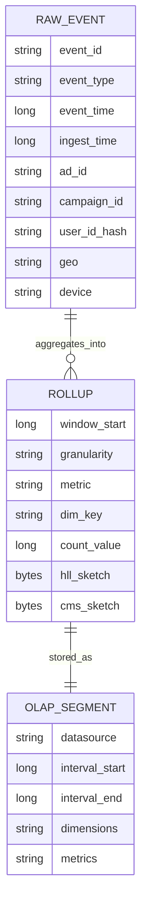
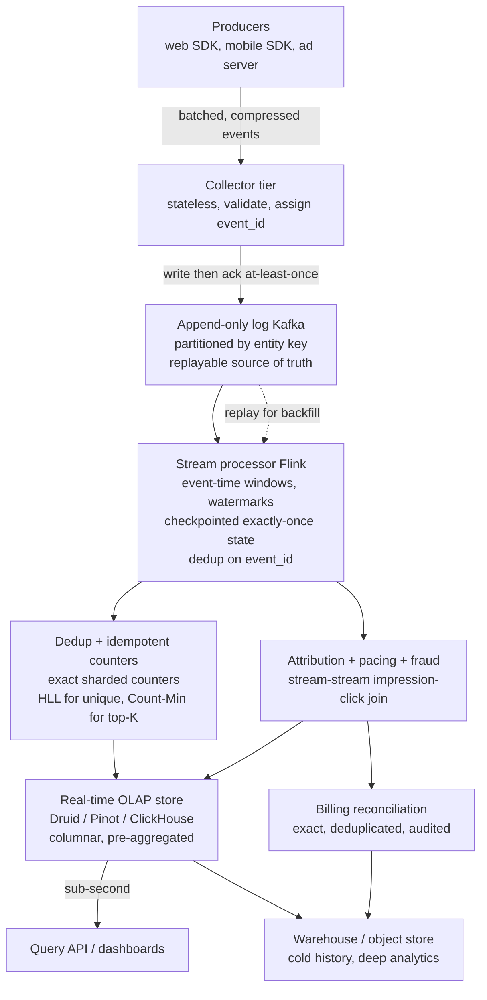
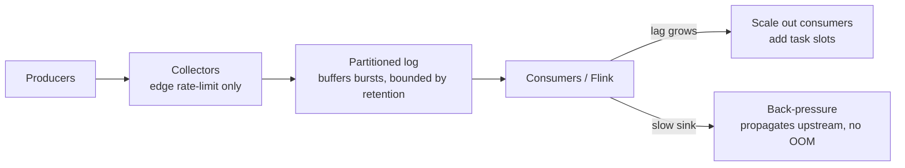
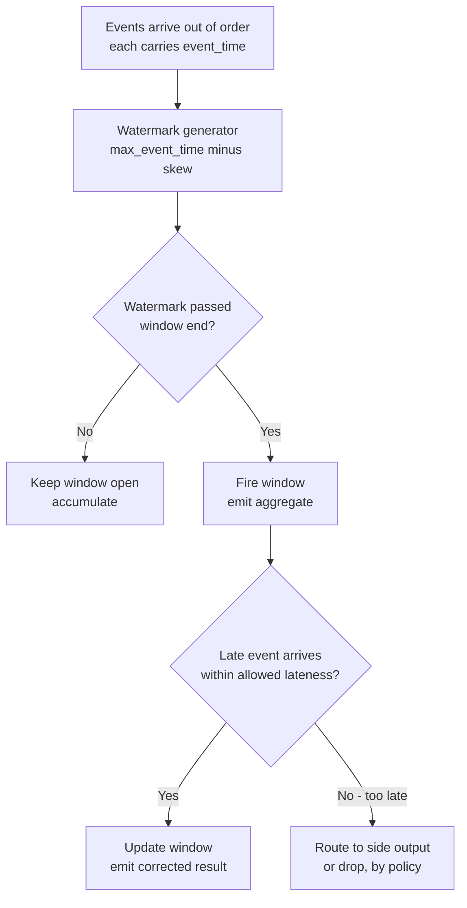
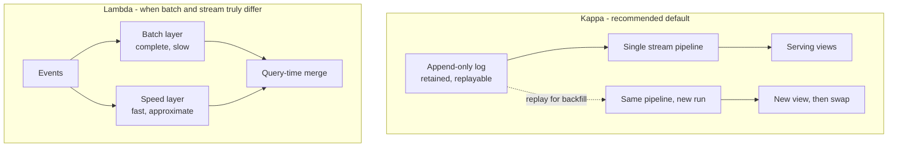
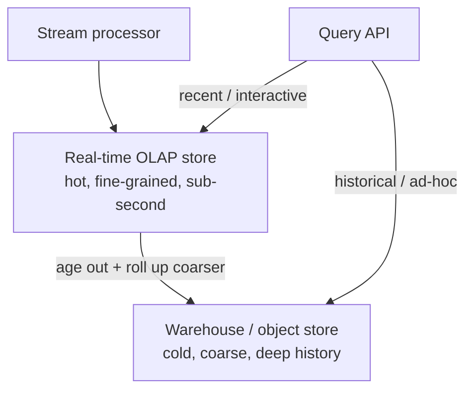
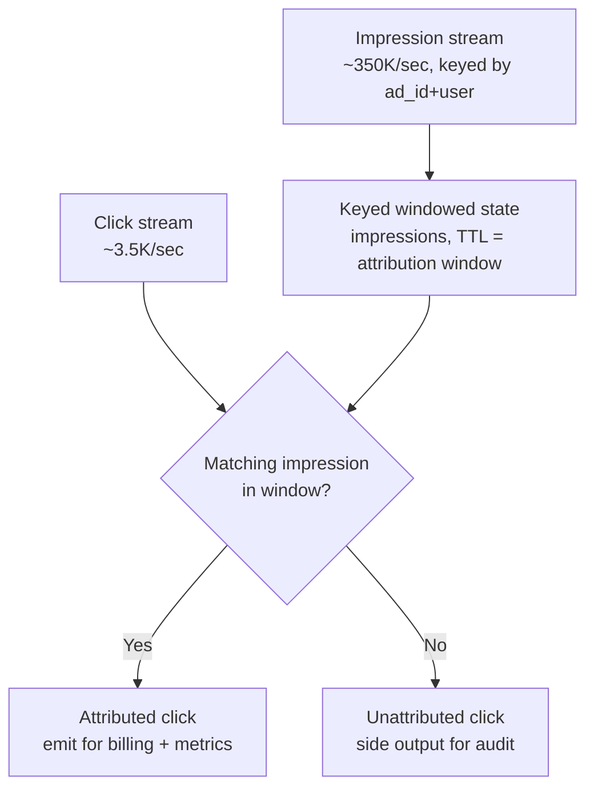

# Module 34 — Design Real-Time Analytics & Ad-Click / Event Aggregation

> The definitive Staff-level reference for the "design a real-time analytics pipeline" / "count ad impressions and clicks at scale" / "build a clickstream metrics system" prompt — the design that quietly tests whether you understand **stream processing**, **windowing and watermarks**, **effective-once counting**, and the **speed-versus-accuracy trade-off**. This is the prompt where most candidates either reach for a database and `SELECT COUNT(*)` (wrong at this scale) or claim "exactly-once delivery" (which does not exist). The winning answer earmarks the real crux: *aggregating a firehose of events into counters that are correct under retries, late data, and reprocessing — and choosing precisely where approximate is good enough.*

## What you'll master

By the end of this module you will hear "design real-time analytics / count ad clicks / build a clickstream pipeline" and immediately earmark the three things that win the room: **the aggregation problem** (how to fold billions of events/day into windowed counters — by minute, by ad, by user — with bounded state and bounded latency), **effective-once counting** (at-least-once delivery plus idempotent dedup on an event key, *not* "exactly-once delivery," which is a myth — the honest goal is exactly-once *effect on state*), and **the speed/accuracy trade-off** (when an exact sharded counter is required versus when an approximate sketch — HyperLogLog for unique-user cardinality, Count-Min Sketch for top-K heavy hitters — is the right call because exact is 100× more expensive for a 0.8% error you don't care about). You'll size it with a *correct* BOTEC — **events/sec derived from impressions and clicks, not DAU-as-RPS** — and you'll defend a **Kappa** architecture (stream-only, reprocess from the log) as the default, knowing exactly when **Lambda** (a separate batch layer) earns its keep.

This is the module that turns "I'd put events in a database and aggregate with a cron job" — which collapses at a million events/sec — into "I ingest to a partitioned log, aggregate in a stateful stream processor with watermark-driven windows and checkpointed exactly-once *state*, dedup on an idempotency key for effective-once counts, serve sub-second queries from a real-time OLAP store, and reprocess by replaying the log." For the streaming and batch foundations underneath, see [16 Data Processing](16-data-processing.md); for the log and event-driven backbone, [04 Messaging](04-messaging-event-driven.md); for the failure discipline, [28 Designing for Failure](28-designing-for-failure.md).

---

## Table of Contents

1. [In the Room — Delivering This at Staff Level](#1-in-the-room--delivering-this-at-staff-level)
2. [Problem framing](#2-problem-framing)
3. [Requirements — functional + non-functional](#3-requirements--functional--non-functional)
4. [Capacity estimation — the correct BOTEC](#4-capacity-estimation--the-correct-botec)
5. [API / ingest design](#5-api--ingest-design)
6. [Data model + the OLAP store choice](#6-data-model--the-olap-store-choice)
7. [High-level architecture](#7-high-level-architecture)
8. [Deep dives](#8-deep-dives)
   - [8.1 Ingestion firehose](#81-ingestion-firehose)
   - [8.2 Stream aggregation — windowing, watermarks, checkpoints](#82-stream-aggregation--windowing-watermarks-checkpoints)
   - [8.3 The counting problem at scale — exact vs approximate](#83-the-counting-problem-at-scale--exact-vs-approximate)
   - [8.4 Lambda vs Kappa](#84-lambda-vs-kappa)
   - [8.5 Serving layer — real-time OLAP vs warehouse](#85-serving-layer--real-time-olap-vs-warehouse)
   - [8.6 Ad-click specifics — attribution, pacing, fraud, billing](#86-ad-click-specifics--attribution-pacing-fraud-billing)
   - [8.7 Failure modes — late data, lag, reprocessing, watermark stall](#87-failure-modes--late-data-lag-reprocessing-watermark-stall)
9. [Scaling & bottlenecks](#9-scaling--bottlenecks)
10. [Trade-offs & failure modes](#10-trade-offs--failure-modes)
11. [What the interviewer is really testing + Staff insight](#11-what-the-interviewer-is-really-testing--staff-insight)
12. [Interview Cheat-Sheet](#12-interview-cheat-sheet)
13. [Common Interview Questions](#13-common-interview-questions)

---

## 1. In the Room — Delivering This at Staff Level

### 1.1 Earmark the crux in the first 60 seconds

The instant you hear "real-time analytics," "count ad clicks," or "clickstream aggregation," name the three hard parts so the interviewer knows you see where the difficulty lives. The ingestion and the dashboard are supporting cast.

> **The crux is three things, and I'll spend my time here:** (1) **Aggregation of a firehose** — folding billions of events/day into windowed counters (per minute, per ad, per user) with bounded state and seconds-fresh latency, which means stream processing, not batch SQL. (2) **Effective-once counting** — networks retry, so delivery is *at-least-once*; I make counts correct by deduplicating on an event idempotency key, giving exactly-once *effect on state* — I will never claim "exactly-once delivery," because that doesn't exist. (3) **The speed/accuracy trade-off** — exact distinct-user counts are expensive; where a ~0.8% error is acceptable I use approximate sketches (HyperLogLog for cardinality, Count-Min for top-K), and where money is involved (billing) I keep exact, deduplicated, reconciled counters. Get those three right and the design is right.

Naming aggregation, effective-once, and the speed/accuracy dial as the crux — before drawing a box — is itself a Staff signal.

### 1.2 Decide, don't enumerate — the load-bearing decisions

| Decision | Decide this | Because | Revisit if |
|---|---|---|---|
| Architecture | **Kappa — stream-only, reprocess by replaying the log** | One codebase, one source of truth (the log); backfill = replay, not a second pipeline | Batch and stream logic genuinely diverge, or a years-deep historical recompute makes a batch engine cheaper → add a Lambda batch layer |
| Ingest backbone | **Append-only partitioned log (Kafka), partitioned by entity key** | Durable buffer, replayable, per-partition order, absorbs back-pressure | — never; this is the spine |
| Delivery + correctness | **At-least-once delivery + idempotent dedup on event_id → effective-once** | Exactly-once delivery is a myth; dedup gives exactly-once *effect* | — |
| Stream processor | **Flink (stateful, event-time, checkpointed)** | Native watermarks, windowing, exactly-once *state* via checkpoints | A simpler per-key counter suffices → Kafka Streams; ultra-simple → a consumer + Redis |
| Unique-user counts | **HyperLogLog (approximate, ~0.8% std error, ~12KB/sketch)** | Exact distinct-count needs a per-user set — 100× the memory for accuracy nobody needs on a dashboard | The number drives money/audit → exact, deduplicated counter |
| Top-K / heavy hitters | **Count-Min Sketch** | Sub-linear memory for "top advertisers/URLs," overcounts only | Exact ranking required → exact counts over a bounded key space |
| Serving | **Real-time OLAP store (Druid / Pinot / ClickHouse) for hot; warehouse for cold** | Pre-aggregated, columnar, sub-second slice-and-dice; warehouse for deep history | — |

### 1.3 Name-and-move-on vs. deep-dive

**Name-and-move-on (one sentence each):** the exact dashboard UI, the specific Avro vs Protobuf choice (say "schema registry, either works"), the cloud vendor, the precise Kafka partition count formula, the OLAP vendor bake-off (Druid vs Pinot vs ClickHouse — name the class, pick one, move on). Auth on the collectors.

**Deep-dive (where this round is won):** the ingestion firehose and back-pressure (§8.1); windowing + watermarks + late data + checkpoints (§8.2); exact-vs-approximate counting and double-count prevention (§8.3); Kappa vs Lambda and reprocessing (§8.4); the OLAP serving layer and hot/cold split (§8.5); ad-click attribution join, pacing, fraud, and billing reconciliation (§8.6). Earmark these and spend your minutes here.

> **Staff-level insight:** The single biggest tell in this interview is precision about correctness. Junior answers say "I'll use Kafka exactly-once so counts are perfect." The Staff answer says: *"Delivery is at-least-once — I assume duplicates and out-of-order arrival as the normal case. I make counts correct two ways: idempotent dedup on an event_id for exactly-once **effect**, and watermark-driven event-time windows with bounded allowed-lateness so late events still land in the right bucket. And I explicitly choose approximate where a 0.8% error is free money — HyperLogLog and Count-Min — and exact only where it bills a customer."* That precision — naming the myth, the trade-off, and the dial — is the whole game.

---

## 2. Problem framing

A **real-time analytics / event-aggregation system** ingests a high-volume stream of **events** — page views, clicks, impressions, app interactions, IoT readings — and turns them into **aggregated metrics** that are queryable within **seconds**: counts, sums, rates, unique-user counts, top-K rankings, funnels, all sliceable by dimensions (ad, campaign, geo, device, time). The canonical sharp variant is **ad impression-and-click counting**: an ad server shows an **impression**, the user may **click**, and the system must count both, **attribute** clicks to impressions, **pace** spending against a budget, **detect fraud**, and ultimately **bill advertisers** — where wrong counts mean real money lost or over-charged.

What makes this a *hard* problem and not a CRUD-plus-cron app:

- **The volume forbids querying raw events.** At a million+ events/sec, `SELECT COUNT(*) WHERE ...` over raw rows is hopeless. You must **pre-aggregate in motion** and serve from compact rollups.
- **Delivery is at-least-once, so duplicates are normal.** Clients retry, brokers redeliver, processors restart. Naive counting double-counts. Correctness demands **idempotent dedup**, not a hope that delivery is perfect.
- **Time is the hard axis.** Events arrive **out of order and late** (a phone was offline, a network hiccup). "How many clicks in the 10:00–10:01 minute?" depends on *event* time, not *arrival* time — which forces **windowing, watermarks, and a late-data policy**.
- **Speed and accuracy trade off.** Exact unique-user counts cost a lot of memory; approximate sketches cost almost none for a tiny, bounded error. The Staff judgment is *knowing which metrics tolerate approximation and which (billing) do not.*

Scope for the interview: design the ingestion → aggregation → serving pipeline plus the ad-click specifics (attribution, pacing, fraud, billing reconciliation). Out of scope unless asked: the ad-targeting/auction system itself, the BI dashboard UI, the data-science feature store, GDPR deletion plumbing (mention it exists).

---

## 3. Requirements — functional + non-functional

### 3.1 Functional

- **Ingest events** — accept a firehose of typed events (impression, click, view, custom) from web, mobile, and server-side collectors.
- **Aggregate metrics in real time** — counts, sums, rates per dimension (ad, campaign, advertiser, geo, device) over time windows (per-minute, per-hour, per-day).
- **Unique counts** — distinct users / distinct devices per dimension and window (cardinality).
- **Top-K** — heavy hitters: top advertisers by spend, top URLs by clicks, top referrers.
- **Attribution (ad-specific)** — join a click to the impression that produced it within an attribution window.
- **Budget pacing (ad-specific)** — track spend against campaign budgets and throttle delivery as budget is consumed.
- **Fraud / dedup (ad-specific)** — detect and discount duplicate or fraudulent clicks (bots, click farms).
- **Serve queries** — sub-second dashboard/API queries that slice metrics by dimension and time; historical queries over months.
- **Billing reconciliation (ad-specific)** — produce an exact, deduplicated, auditable count for invoicing.

### 3.2 Non-functional

| Requirement | Target | Why it drives the design |
|---|---|---|
| **Throughput** | Millions of events/sec ingest; billions/day | Partitioned log + horizontally scaled stream processors |
| **Freshness (latency)** | Dashboards fresh within **seconds** (p99 < ~5–10 s end-to-end) | Stream processing, not batch; pre-aggregated rollups |
| **Query latency** | **Sub-second** slice-and-dice on hot data | Columnar, pre-aggregated real-time OLAP store |
| **Correctness of counts** | **Effective-once** (no double-count) on dashboards; **exact + reconciled** for billing | At-least-once + idempotent dedup; exact counters for money |
| **Accuracy of approximations** | Bounded, *known* error (HLL ~0.8% std error; Count-Min one-sided overcount) | Approximate where free; exact where it bills |
| **Durability** | Zero acknowledged-event loss | Replicated, replayable log as source of truth |
| **Availability** | Ingest never blocks producers; degrade gracefully | Buffer in the log; consumers can lag and catch up |
| **Reprocessability** | Recompute history after a logic bug | Kappa — replay the retained log |
| **Scalability of dimensions** | New metrics/dimensions without re-ingesting | Store raw/semi-raw in the log; derive rollups downstream |

The tension to state explicitly: **freshness vs. completeness**. A window can be *emitted early* (fresh but possibly missing late events) or *held* until the watermark passes (complete but later). The resolution is **watermarks + allowed lateness + optional late-update emission**: emit a provisional result at the watermark, and *correct* it if a late event arrives within the allowed-lateness grace period. Saying that trade-off out loud is a Staff signal.

---

## 4. Capacity estimation — the correct BOTEC

The trap [30 Capacity Estimation](30-capacity-estimation.md) drills: **do not turn DAU into RPS**. Load here is **events per second derived from impression and click volume and per-user event rates**, not a headcount. Let me build it from the ad-tech reality.

### 4.1 Ingest event rate

- Say the platform serves **~10 billion ad impressions/day**. (A mid-large ad network — pick a defensible number and show the work.)
- Spread over a day: 10e9 / 86,400 ≈ **~115,000 impressions/sec average**.
- Apply a **peak factor of ~3×** (diurnal + regional concentration) → **~350,000 impressions/sec peak**.
- **Clicks** run at a click-through rate (CTR) of ~0.5–1%, so clicks ≈ 1% of impressions → **~1,150/sec average, ~3,500/sec peak**. Clicks are an order of magnitude+ below impressions — the *impression* stream dominates the firehose.
- Add **secondary events** (viewability beacons, video quartile events, conversions, page views): realistically **2–5 events per impression**. Take 3× → **ingest ≈ 350,000 × 3 ≈ ~1,000,000 events/sec peak**.

> **Punchline:** ~10B impressions/day → ~115K/sec avg, ~350K/sec peak impressions; with secondary events the **firehose is ~1M events/sec peak**. Clicks are tiny by comparison (~3.5K/sec) — which matters for the **stream-stream join** in §8.6, because one side (clicks) is small and the other (impressions) is huge.

### 4.2 Bandwidth / storage

- Event payload ≈ **~500 bytes–1 KB** (ids, timestamps, ad/campaign/user keys, geo, device, user-agent). Take ~1 KB.
- Ingest bandwidth: 1M events/sec × 1 KB = **~1 GB/sec** into the log. Compressed (Avro/Protobuf + batch compression, ~4–6×) → **~150–250 MB/sec** on the wire.
- Raw retention in the log (say **7 days** for replay): 1 GB/sec × 86,400 × 7 ≈ **~600 TB** (pre-compression) → **~100–150 TB compressed**. Bounded and affordable; this is the replay buffer, not forever-storage.
- Long-term (warehouse / cold): roll up and tier to object storage; raw kept only as long as reprocessing needs it.

### 4.3 Aggregated state size (the part that actually constrains the processor)

This is where candidates under- or over-size. The aggregated state is *tiny* compared to the raw firehose — that's the whole point of aggregating.

- **Counters:** suppose **1M active ads × 100 dimension combos × per-minute buckets**. The *in-flight* window state is only the *currently open* windows, not all history — so it's millions of small counters, **single-digit GB of RAM** across the processor fleet. Old windows are emitted and evicted.
- **Unique-user (HyperLogLog):** each HLL sketch is **~12 KB** for ~0.8% standard error. For 1M (ad × window) cells that's 1M × 12 KB = **~12 GB** — versus an *exact* distinct set which, at hundreds of millions of users, would be **hundreds of GB to TB per dimension**. That ~100× gap *is* the argument for approximate. (And HLLs **merge**, so per-shard sketches combine without re-reading users.)
- **Top-K (Count-Min Sketch):** a few MB per sketch regardless of key cardinality — trivial.

> **The BOTEC to say out loud:** *"Load is ~1M events/sec peak from ~10B impressions/day plus secondary events — derived from ad volume, not DAU-as-RPS. Clicks are tiny (~3.5K/sec), which shapes the attribution join. The firehose is ~1 GB/sec raw; I retain ~7 days in the log (~100+ TB compressed) purely as a replay buffer. The genuinely interesting number is the **aggregated state**: counters are single-digit GB, unique-user HyperLogLogs are ~12 GB at 12 KB each — versus hundreds of GB to TB for exact distinct sets. That ~100× memory gap is exactly why unique counts are approximate and only billing is exact."*

---

## 5. API / ingest design

### 5.1 The collect endpoint

Producers (web SDK, mobile SDK, server-side ad server) emit events to **collector** services behind a load balancer. The collector's only job is **validate → assign idempotency key → write to the log → ack** — it is stateless and horizontally scaled.

```
POST /v1/collect
Content-Type: application/x-protobuf   (batched)

Event {
  event_id      // client- or collector-assigned UUID — the idempotency key
  event_type    // IMPRESSION | CLICK | VIEW | CONVERSION | ...
  event_time    // when it happened on the device (event-time, may be late)
  ingest_time   // when the collector received it (processing-time)
  ad_id, campaign_id, advertiser_id
  user_id / device_id   // hashed
  context       // geo, device, user_agent, referrer, placement
}
```

- **`event_id` is the idempotency key.** It must be stable across retries: the *client* (or the impression-serving layer) generates it, so a retried POST carries the *same* id and dedups to a no-op downstream (§8.3). If the client cannot, the collector derives a deterministic id from `(ad_id, user_id, event_time, type)`.
- **`event_time` vs `ingest_time`** are both carried. All windowing is on **event_time**; `ingest_time` bounds lateness and feeds the watermark heuristic. The processor never calls `now()` to bucket an event — that would make late data land in the wrong window.
- **Batching + compression:** SDKs batch many events per POST and compress; this is essential to hit ~1M events/sec without 1M HTTP/sec.
- **Schema:** events are **Avro or Protobuf** with a **schema registry** so producers and consumers evolve compatibly (add fields without breaking old consumers). Name the registry; the encoding choice is secondary.

### 5.2 Ack semantics — at-least-once on purpose

The collector acks the producer **only after the event is durably written to the log** (replicated to a quorum of partitions). This makes the producer safe to retry on timeout — and that retry is exactly *why* delivery is at-least-once and why dedup is mandatory downstream. **Do not promise exactly-once delivery to the producer; promise at-least-once + downstream idempotency.**

### 5.3 Query API (serving side)

```
GET /v1/metrics?metric=clicks&dims=campaign_id,geo&filter=advertiser_id:42
                &granularity=1m&from=...&to=...
GET /v1/metrics?metric=unique_users&dims=ad_id&granularity=1h&from=...&to=...   // HLL-backed, approximate
GET /v1/topk?metric=spend&dim=advertiser_id&k=20&window=1h                       // Count-Min-backed
```

Queries hit the **real-time OLAP store** for hot/recent data and the **warehouse** for deep history (§8.5). Responses flag approximate metrics as such (e.g. `"unique_users": 1_204_300, "approximate": true, "error_pct": 0.8`) — being honest about approximation in the API is itself a correctness stance.

---

## 6. Data model + the OLAP store choice

### 6.1 The three shapes of data

1. **Raw event log** (Kafka) — the immutable, ordered (per-partition), replayable source of truth. Append-only. Retained for the replay window (~7 days).
2. **Pre-aggregated rollups** (in the OLAP store) — counts/sums per (metric, dimension-combo, time-bucket), plus serialized **HLL** sketches for unique counts and **Count-Min** sketches for top-K. These are *small and queryable*.
3. **Cold history** (warehouse / object storage) — coarser rollups over months/years for trend and audit, queried rarely and tolerantly of seconds-to-minutes latency.



### 6.2 The OLAP store choice — and why not a transactional DB

The serving store must do **sub-second aggregation queries over high-cardinality dimensions on fresh data**. That is a **columnar, real-time OLAP** workload, not an OLTP one.

| Need | OLAP store gives you | Why a Postgres/MySQL doesn't |
|---|---|---|
| Sub-second slice-and-dice | **Columnar** storage, scans only needed columns | Row store reads whole rows; index explosion on many dims |
| Pre-aggregation | **Rollup at ingest** (Druid/Pinot pre-aggregate; ClickHouse aggregating engines) | Would need materialized views maintained by hand |
| Fresh + queryable | **Real-time ingestion** segments queryable within seconds | OLTP not built to ingest 1M/sec and aggregate live |
| High-cardinality dims | Bitmap/inverted indexes, dictionary encoding | Index bloat, slow `GROUP BY` |
| Approximate metrics | Native **HLL** (and theta/CMS) aggregations | Bolt-on at best |

**Decision:** a **real-time OLAP store — Apache Druid, Apache Pinot, or ClickHouse** — for the hot serving layer. Name the class, pick one (e.g. *"Druid for its native real-time ingestion, time-partitioned segments, and built-in approximate aggregations — Pinot or ClickHouse are equally defensible"*), and move on. The **warehouse** (BigQuery / Snowflake / Spark-on-object-store) handles cold history and ad-hoc deep analytics; it is **not** in the sub-second path.

> **Depth signal:** State that the rollups carry **serialized sketches, not just integers** — an HLL or Count-Min sketch stored per (dimension, window) cell so that unique-counts and top-K **merge across cells and re-aggregate across windows at query time** (sum a day from 24 hourly HLLs by *merging* them, not re-scanning users). That mergeability is *why* sketches live in the data model at all.

---

## 7. High-level architecture



The dataflow, narrated: **producers** batch and compress events to stateless **collectors**, which validate, ensure an `event_id`, write to the **append-only log**, and only then ack — so producers safely retry (at-least-once). The log is **partitioned by entity key** (e.g. `ad_id` or `user_id`) so all events for one entity land on one partition and are processed in **per-partition order**. The **stream processor** (Flink) consumes the log, **deduplicates on `event_id`**, and aggregates into **event-time windows** driven by **watermarks**, with state **checkpointed** for exactly-once *effect*. It maintains **exact sharded counters**, **HyperLogLog** sketches for unique users, and **Count-Min** sketches for top-K. A parallel **attribution/pacing/fraud** stage does the **stream-stream impression↔click join**, feeds **pacing** counters, and emits an **exact, reconciled** stream for **billing**. Results land in the **real-time OLAP store** for sub-second queries; cold rollups tier to the **warehouse**. **Backfill = replay the log** through the same processor (Kappa).

---

## 8. Deep dives

### 8.1 Ingestion firehose

#### Collectors → partitioned log

The ingest spine is an **append-only partitioned log** (Kafka). Collectors are thin and stateless; the log is the durable buffer that **decouples producers from consumers** and absorbs bursts. This is the [04 Messaging](04-messaging-event-driven.md) backbone applied to analytics.

- **Partitioning by entity key:** partition by `ad_id` (or `user_id`, depending on the dominant aggregation) so that **all events for one entity go to one partition** and are consumed **in order per partition**. This gives the processor per-key ordering for free — critical for stateful per-entity aggregation. *Be precise: ordering is **per partition, not global.** There is no total order across the whole topic, and you should never design as if there were.*
- **Partition count** sets max consumer parallelism; size it for peak throughput with headroom (e.g. enough partitions that each handles a comfortable slice of ~1M events/sec).

#### Back-pressure

When consumers fall behind, you must not drop acknowledged data and must not OOM. The log *is* the back-pressure mechanism: producers keep producing, the log buffers (bounded by retention/disk), and consumers **catch up by reading faster or scaling out**. Within the processor, Flink propagates back-pressure **upstream** (a slow sink slows the source) rather than buffering unboundedly. The collector can shed *only at the very edge* (rate-limit abusive producers) — never silently drop accepted, acked events.



#### Schema + registry

Events are **Avro or Protobuf** with a **schema registry** enforcing **backward/forward compatibility** — producers add fields without breaking running consumers, and consumers ignore unknown fields. This is what lets the pipeline evolve while running at a million events/sec. (Versioned schemas also make **replay** safe: a replayed old event still deserializes.)

#### At-least-once + dedup at the edge

Delivery is **at-least-once**: a producer that times out retries, and the broker may redeliver to a consumer that restarted before committing offsets. Duplicates are *normal*, not exceptional. The fix is **idempotency on `event_id`**, handled in §8.3. The collector does *not* try to dedup globally (it's stateless) — it just guarantees a stable `event_id` is present so a stateful stage downstream can dedup deterministically.

> **Staff-level insight:** *"The log is the shock absorber: collectors are thin, partition by entity key so I get per-partition ordering — which I'm careful to say is **not** global ordering — and back-pressure is handled by buffering in the log and scaling consumers, never by dropping acked events. Schema registry with Avro/Protobuf lets me evolve at a million events/sec and keeps replay safe. And I treat duplicates as the normal case, because delivery is at-least-once."*

---

### 8.2 Stream aggregation — windowing, watermarks, checkpoints

This is the heart of the design.

#### Windowing — tumbling, sliding, session

Aggregation happens over **windows** of **event time**:

| Window | Shape | Use here |
|---|---|---|
| **Tumbling** | Fixed, non-overlapping (e.g. each 1-minute bucket) | The default for per-minute/-hour counts; each event lands in exactly one window |
| **Sliding** | Fixed size, overlapping by a slide (e.g. 5-min count updated every 1 min) | Moving averages, "clicks in the last 5 minutes" rates |
| **Session** | Dynamic, closed by a gap of inactivity | Per-user sessions: clickstream "visit" boundaries, time-on-site |

Default to **tumbling** for counters; reach for **sliding** for rolling rates and **session** for per-user behavioral analytics.

#### Event time vs processing time — and watermarks

The non-negotiable point: **bucket by event time, not processing/arrival time.** An event that happened at 10:00:59 but arrives at 10:01:30 belongs in the **10:00 minute**, not 10:01. But if you window by event time, *when do you know a window is complete* and can be emitted? You can't wait forever for a straggler.

A **watermark** is the processor's assertion: *"I believe I have seen all events with event_time ≤ T."* It is a **heuristic** (usually `max_event_time_seen − allowed_skew`) that advances as events flow. When the watermark passes a window's end, the window is **triggered** (its result emitted). Watermarks let event-time windowing make progress without waiting indefinitely.



#### Late data + allowed lateness

Even after the watermark fires a window, **late events** may still arrive (the watermark is a heuristic, not a guarantee). The policy dial:

- **Allowed lateness** — keep window state for a grace period after firing; a late event within that period **re-fires** the window with a **corrected** aggregate (a downstream update/upsert). Trade-off: longer grace = more state retained, more correctness.
- **Too-late events** — beyond allowed lateness, route to a **side output** (dead-letter for audit/repair) or drop, by policy. For **billing**, never silently drop — capture for reconciliation.

This is the **freshness vs completeness** trade-off made concrete: emit a provisional count at the watermark (fresh), and correct it within the allowed-lateness window (more complete).

#### Stateful aggregation + checkpointing — exactly-once *effect on state*

Counters are **state** held in the processor (per key, per open window). To survive failures without losing or double-counting:

- Flink takes **periodic checkpoints** — consistent snapshots of all operator state plus the **source offsets** — using an aligned-barrier (Chandy-Lamport-style) algorithm. State is stored durably (e.g. RocksDB + object storage).
- On failure, the job **restores the last checkpoint and rewinds the source to the checkpointed offsets**, then reprocesses. Because state and offset are restored **together and atomically**, the *effect on state* is **exactly-once** — each event is reflected in the counters exactly once even though it may be physically *read* more than once.

> **Be precise — and say this out loud:** this is **exactly-once *effect on state*, NOT exactly-once *delivery*.** Events may be re-read on recovery (at-least-once delivery), and side effects to external systems are only exactly-once if the sink is **transactional or idempotent**. "Exactly-once delivery" over a network is a myth; the honest, achievable guarantee is *exactly-once effect* via checkpointed state + idempotent/transactional sinks.

#### Dedup of duplicate events — the idempotency key

Checkpointing handles duplicates *from reprocessing within the job*. It does **not** handle duplicates that were **already in the input** (the producer sent the same event twice with the same `event_id`). For those, the processor keeps a **dedup set keyed on `event_id`**, scoped to a window of time (you can't remember every id forever):

- Maintain a **keyed state of recently-seen `event_id`s** (e.g. a TTL'd set, or a Bloom/Cuckoo filter for memory efficiency with a tiny false-positive rate you account for).
- On each event: if `event_id` already seen → **drop** (it's a duplicate); else record it and count it. This makes the count **effective-once** regardless of how many times the producer or broker delivered it.

> **Staff-level insight:** *"I window on **event time** with **watermarks** so late, out-of-order events still land in the right bucket; **allowed lateness** lets me emit a fresh provisional count and correct it when stragglers arrive. State is **checkpointed** so on failure I restore state and source offsets together — that's exactly-once **effect on state**, which I'm careful to distinguish from exactly-once delivery, a thing that doesn't exist. And I dedup the *input* on an `event_id` idempotency key, because at-least-once delivery means the same event can arrive twice. Watermarks plus allowed-lateness plus idempotent dedup is what makes a streaming count actually correct."*

---

### 8.3 The counting problem at scale — exact vs approximate

The deceptively simple ask — "count the clicks" — splits into three sub-problems, each with a different right answer.

#### Exact counts — sharded counters

For metrics that **must be exact** (total clicks per ad, spend per campaign, anything that bills), keep **exact integer counters**, but **shard** them to avoid a single hot key:

- Partition by entity key so each processor instance owns a slice of keys and increments **local** counters with no cross-instance contention; the OLAP store sums the shards at query time. (Per-partition ownership in the log already gives this for free.)
- **Double-count prevention on retry** is handled by the **`event_id` dedup** (§8.2): increment only on first sight of an `event_id`. Without dedup, a single retried click becomes two — the classic over-billing bug.

#### Approximate unique counts — HyperLogLog

"How many **distinct users** saw this ad this hour?" An *exact* answer needs a **set of every user id** seen — hundreds of MB to GB **per (ad × window)** cell, multiplied across millions of cells = **TB**. Unaffordable, and pointless for a dashboard.

**HyperLogLog (HLL)** estimates **cardinality** in **fixed, tiny memory**:

- ~**12 KB** per sketch for a **standard error of ~0.8%** (error and size are tunable via the precision parameter).
- Sketches **merge**: the HLL for a day is the *merge* of 24 hourly HLLs — no re-reading users. This is why HLL is stored per cell and re-aggregated at query time.
- **Use it for** unique users/devices/IPs per dimension on dashboards, where ±~0.8% is invisible and irrelevant.

State the trade-off explicitly: **~12 KB and ~0.8% error vs. GB-to-TB and exact.** A ~100×+ memory saving for an error nobody on a dashboard will ever notice.

#### Approximate top-K / heavy hitters — Count-Min Sketch

"**Top 20 advertisers by spend**" or "top URLs by clicks" over a huge, unbounded key space. Keeping an exact counter per key is possible but heavy at high cardinality, and ranking needs scanning. **Count-Min Sketch (CMS)** estimates **per-key frequencies** in **sub-linear memory**:

- A few MB regardless of key cardinality; pairs with a small top-K heap to track heavy hitters.
- **One-sided error: it can *over*count, never undercount** (hash collisions add to a key's estimate). That bias is acceptable for "who are the heavy hitters" but must be understood — it's *not* a precise count.
- **Use it for** top-K rankings, heavy-hitter detection (e.g. abnormally active IPs for fraud), trending content.

#### Choosing the dial

| Metric | Right tool | Why |
|---|---|---|
| Total clicks / spend (billing) | **Exact sharded counter + dedup + reconciliation** | Money — must be exact and auditable |
| Distinct users per ad/hour (dashboard) | **HyperLogLog** | ~0.8% error is free; exact is ~100× memory |
| Top advertisers / URLs / IPs | **Count-Min Sketch + top-K heap** | Sub-linear memory; over-count bias is tolerable |
| Per-minute event counts | **Exact sharded counter** | Cheap and exact; no reason to approximate |

> **Staff-level insight:** *"I split counting three ways. Things that bill — clicks, spend — are **exact sharded counters**, made correct under retries by deduping on `event_id` so one retried click never becomes two. Unique-user counts are **HyperLogLog** — ~12 KB and ~0.8% error versus GB-to-TB for exact sets — and they **merge**, so I roll a day up from hourly sketches without re-reading users. Top-K is **Count-Min Sketch**, sub-linear memory with a one-sided over-count bias I'm explicit about. The Staff judgment isn't knowing the algorithms — it's knowing **which metric tolerates approximation and which one bills a customer.**"*

---

### 8.4 Lambda vs Kappa

#### The two architectures

- **Lambda** runs **two pipelines**: a **batch layer** that recomputes accurate views over all historical data (slow, complete, the "source of truth" for correctness) and a **speed layer** that streams recent data for low-latency-but-approximate views; queries **merge** the two. The pain is **two codebases computing the same metrics**, which drift and double the maintenance.
- **Kappa** runs **one pipeline**: **stream-only**, with the **log as the single source of truth**. To recompute history (a logic bug, a new metric, a backfill), you **replay the retained log** through the *same* streaming code into a new output, then swap. One codebase, one set of semantics.



#### Recommendation — Kappa by default

**Default to Kappa.** With a durable, replayable log and a modern stream processor that handles event-time, watermarks, and exactly-once *state*, you get accuracy *and* low latency from **one** codebase, and **backfill is just replay**. Lambda's batch layer mostly existed to compensate for early stream processors that *couldn't* do correct event-time aggregation — that gap has largely closed.

**Choose Lambda when:** (a) you need a **multi-year historical recompute** where a batch engine (Spark over object storage) is dramatically cheaper/faster than replaying a years-long stream; (b) batch and streaming logic **genuinely differ** (heavy ML training offline vs simple counts online); or (c) regulatory/audit requires an **independent** batch recomputation as a cross-check on the stream. Otherwise Lambda's duplicate-logic tax isn't worth it.

#### Reprocessing / backfill mechanics

- **Bug fix or new metric:** start a **new** instance of the pipeline reading the log **from an earlier offset**, write to a **new** output table/datasource, and **atomically swap** the serving layer to it once caught up (blue/green). The old output stays until the new is verified.
- **Bounded replay:** the log's retention bounds how far back stream-only replay can reach; for older-than-retention recompute, fall back to the warehouse (a Lambda-ish escape hatch) or keep coarse raw archives in object storage.

> **Staff-level insight:** *"Default **Kappa** — one streaming codebase, the log as source of truth, and **backfill is replay**: I spin up the fixed pipeline from an old offset into a new datasource and blue/green swap. I reach for **Lambda only** when a years-deep recompute makes a batch engine cheaper, when batch and stream logic genuinely diverge, or when an auditor wants an independent batch cross-check. The reason Lambda existed — stream processors couldn't do correct event-time aggregation — is mostly historical now, so I don't pay its two-codebase tax by default."*

---

### 8.5 Serving layer — real-time OLAP vs warehouse

#### Pre-aggregation + columnar + sub-second

The serving store answers **interactive, multi-dimensional aggregation queries on fresh data**. A **real-time OLAP store** (Druid / Pinot / ClickHouse) delivers this because:

- **Pre-aggregation at ingest** — rollups computed as data lands, so queries read compact summaries, not raw rows.
- **Columnar storage** — a query touching 3 of 30 columns scans only those 3; massive I/O reduction for aggregations.
- **Time-partitioned segments + indexes** — bitmap/inverted indexes on dimensions make high-cardinality `GROUP BY` fast; data is partitioned by time so recent-window queries scan little.
- **Native approximate aggregations** — built-in HLL (and theta/CMS) so `unique_users` is a first-class, mergeable column.
- Result: **sub-second** queries over recent, high-volume data — the dashboard SLA.

#### The hot-vs-cold split

You do **not** keep everything in the OLAP store; you **tier**:

| Tier | Store | Data | Query latency | Retention |
|---|---|---|---|---|
| **Hot** | Real-time OLAP (Druid/Pinot/ClickHouse) | Recent fine-grained rollups (minutes→weeks) | **Sub-second** | Days to weeks |
| **Cold** | Warehouse / object store (BigQuery, Snowflake, Spark) | Coarse historical rollups (months→years) | Seconds–minutes (OK) | Months to years |

- The OLAP store holds the **hot window** at fine granularity; older data is **rolled up coarser** (per-day instead of per-minute) and **tiered to the warehouse**, keeping the hot store small and fast.
- The query API **routes**: recent/interactive → OLAP; deep-history/ad-hoc → warehouse. A federated query can span both when needed.



> **Staff-level insight:** *"Serving is a **real-time OLAP store** — columnar, pre-aggregated, time-partitioned, with native HLL — because the workload is sub-second multi-dimensional aggregation on fresh data, which an OLTP database simply can't do at this volume. And I **tier hot vs cold**: fine-grained recent data in Druid for sub-second dashboards, coarse historical rollups in a warehouse where seconds of latency are fine. Keeping the hot store small is what keeps it fast."*

---

### 8.6 Ad-click specifics — attribution, pacing, fraud, billing

The ad variant adds four problems on top of the generic pipeline.

#### Attribution — the stream-stream join

A **click** must be **attributed to the impression** that produced it, within an **attribution window** (a click counts only if it follows a matching impression within, say, 24 hours — and you join on `(ad_id, user_id)` plus an impression token carried into the click).

This is a **windowed stream-stream join**: the **impression** stream (huge, ~350K/sec) and the **click** stream (tiny, ~3.5K/sec) are joined on the impression key within the attribution window.

- The processor **buffers impressions in keyed, windowed state** (TTL'd to the attribution window) and, on each click, looks up the matching impression to emit an **attributed click** event.
- Because impressions vastly outnumber clicks and the window can be long (hours to a day), the **impression-side state is the expensive part** — bound it with the attribution-window TTL and consider storing only the **impression key + token**, not the full payload, in join state.
- Late clicks are handled by the same **allowed-lateness** machinery (§8.2); a click whose impression has aged out of state is **unattributed** (route to a side output for audit).



#### Budget pacing — eventual consistency is fine

**Pacing** spreads a campaign's daily budget evenly and **throttles delivery** as budget is consumed, so a campaign doesn't blow its budget at 9 a.m. Crucially:

- Pacing counters can be **eventually consistent / approximate** — being a few hundred ms or a small percentage stale is acceptable, because pacing is a *control signal*, not a *bill*. A near-real-time "spend so far today" counter (even slightly behind) is good enough to throttle.
- This means pacing can read from the **fast streaming counters** (or a Redis-backed running total) without the strict exactness billing requires. Slight over-delivery is bounded and reconciled later. **Say explicitly that pacing tolerates eventual consistency** — that's the judgment being tested (matching the right consistency level to the use case).

#### Click fraud / dedup

Invalid traffic (bots, click farms, accidental double-clicks, replayed events) must be **discounted before billing**:

- **Dedup** identical clicks on `event_id` and on **`(ad_id, user_id, short-time-bucket)`** to kill rapid double-clicks.
- **Heuristics / detection** — abnormal CTR per IP/device, impossible click timing (click before impression render), Count-Min heavy-hitter detection on IPs, ML scoring downstream. Suspicious clicks are **flagged and excluded** from billable counts (kept in a separate stream for audit).

#### Billing reconciliation — exactly-once-*ish*, reconciled

Billing is the one place **approximate is unacceptable**. But since the streaming layer is at-least-once with provisional, late-correctable windows, billing uses a **reconciliation** pass:

- Bill from **exact, deduplicated, attributed, fraud-filtered** counts.
- Run a **periodic reconciliation** (e.g. end-of-day batch over the *same log*, Kappa-style replay, or a Lambda batch cross-check) that recomputes billable counts authoritatively, accounting for **late events** and **fraud reversals**, and **adjusts** the streamed provisional numbers.
- The honest framing: **not "exactly-once delivery,"** but **"at-least-once + idempotent dedup + an authoritative reconciliation = effectively-exact, auditable billing."** The reconciliation is the safety net that makes provisional streaming numbers trustworthy for money.

> **Staff-level insight:** *"The ad variant is four things layered on the pipeline. **Attribution** is a windowed **stream-stream join** — and the asymmetry matters: impressions are huge, clicks are tiny, so the **impression-side join state, TTL'd to the attribution window, is the cost** to manage. **Pacing** I deliberately make **eventually consistent** — it's a throttle, not a bill, so slight staleness is fine. **Fraud** is dedup plus heavy-hitter/heuristic filtering before anything bills. And **billing** is the one exact path: at-least-once plus dedup gives a provisional count, and a **reconciliation pass over the log** makes it authoritative and auditable — not 'exactly-once delivery,' which doesn't exist, but effectively-exact via dedup and reconciliation."*

---

### 8.7 Failure modes — late data, lag, reprocessing, watermark stall

| Failure | What goes wrong | The right handling |
|---|---|---|
| **Late / out-of-order data** | Events arrive after their window fired | **Watermarks + allowed lateness**: emit provisional, correct within grace; side-output the too-late for audit (never silently drop billable) |
| **Consumer lag** | Processor falls behind; freshness SLA breaks | Detect via **lag/watermark-delay metrics**; **scale out** consumers/task slots; the log buffers so nothing is lost — you catch up |
| **Reprocessing double-count** | Replaying the log re-emits counts | Write replay to a **new output + blue/green swap**, and rely on **`event_id` dedup + idempotent/transactional sinks** so re-emit is a no-op into the live store |
| **Watermark stall** | One slow/idle partition stops advancing the watermark → windows never fire → output freezes | **Idle-partition detection** (advance watermark past idle sources after a timeout); per-partition watermarks; alert on **watermark-lag**; bound max out-of-orderness so a single stuck stream can't wedge the job |
| **Processor crash** | In-flight window state lost | **Checkpoint restore** — state + source offsets together → exactly-once **effect**; reprocess the tail since the last checkpoint |
| **Hot key / skew** | One ad/campaign overwhelms one partition | **Salt the key** for the hot entity (sub-shard then merge), or two-stage aggregation (pre-aggregate per sub-key, combine) |
| **Sink (OLAP) outage** | Aggregates can't be served | Back-pressure into the processor / buffer in the log; serve stale-but-flagged from the OLAP store; never drop acked events |

The **watermark stall** is the subtle, Staff-distinguishing one: in a partitioned stream the watermark is the **minimum across partitions**, so **one idle or stuck partition holds the whole watermark back**, and every event-time window stops firing — the pipeline silently freezes output while *appearing* healthy. The fixes are **idle-source detection** (advance the watermark past a quiet partition after a timeout) and **alerting on watermark-lag**, not just on throughput.

> **Staff-level insight:** *"The failure I make sure to name is the **watermark stall**: the job watermark is the **min across partitions**, so one idle or stuck partition wedges every event-time window and output silently freezes — throughput looks fine, freshness dies. I detect it with **watermark-lag alerts and idle-partition handling**, not just consumer-lag. For the rest: lag → scale out (the log buffered everything); reprocessing → new output plus dedup plus blue/green so no double-count; late data → allowed-lateness with side-outputs for the too-late, never a silent drop on billable events."* See [28 Designing for Failure](28-designing-for-failure.md).

---

## 9. Scaling & bottlenecks

| Bottleneck | Wrong instinct | Right move |
|---|---|---|
| Ingest at 1M events/sec | One big queue / DB writes | **Partitioned log**, partition by entity key, scale partitions + collectors horizontally |
| Querying raw events | `SELECT COUNT(*)` over raw rows | **Pre-aggregate in the stream**; serve compact rollups from a columnar OLAP store |
| Distinct-user memory | Exact set per (ad × window) → TB | **HyperLogLog** — ~12 KB/sketch, mergeable, ~0.8% error |
| Top-K over huge key space | Exact counter per key + sort | **Count-Min Sketch + top-K heap**, sub-linear memory |
| Hot key (one viral ad) | Let it overwhelm one partition | **Salt/sub-shard the hot key**; two-stage (pre-aggregate then merge) |
| Stream state growth | Hold all windows forever | **Watermark-evict** closed windows; TTL join state to the attribution window |
| Attribution join state | Buffer full impression payloads | Store **key + token only**, TTL'd to the attribution window |
| Backfill / recompute | A second batch pipeline (Lambda) | **Kappa** — replay the log through the same code into a new output, blue/green swap |
| Hot store bloat | Keep everything fine-grained forever | **Tier hot→cold**: coarse rollups to the warehouse, keep the OLAP store small |
| Freshness SLA at peak | Over-provision permanently | **Autoscale consumers on consumer-lag/watermark-lag**; the log absorbs the burst |

The clean mental model: **everything scales horizontally off the partitioned log** — collectors, processors, OLAP nodes — and the two genuinely interesting scaling moves are **(1) replacing exact distinct-counts with mergeable sketches** to make state affordable, and **(2) tiering hot vs cold** to keep the sub-second store small. Hot keys and watermark stalls are the skew/liveness traps to call out.

---

## 10. Trade-offs & failure modes

### 10.1 Key trade-offs

| Trade-off | The tension | Resolution |
|---|---|---|
| **Freshness vs completeness** | Emit early (may miss late events) vs wait for the watermark | **Watermark + allowed-lateness**: provisional now, corrected within grace |
| **Speed/cost vs accuracy** | Exact counts cost GB–TB and CPU | **Approximate (HLL, Count-Min) where error is free**; exact only where it bills |
| **Exactly-once effect vs exactly-once delivery** | Networks redeliver; true exactly-once delivery is impossible | **At-least-once + checkpointed state + idempotent dedup = exactly-once *effect*** |
| **Kappa simplicity vs Lambda completeness** | One codebase vs an independent batch recompute | **Kappa default**; Lambda only for deep recompute / divergent logic / audit cross-check |
| **Hot store speed vs history depth** | Fine-grained is fast but big | **Tier hot (OLAP) vs cold (warehouse)** |
| **Pacing responsiveness vs exactness** | Exact spend is slow to compute live | **Pacing is eventually consistent** (it's a throttle); billing is exact + reconciled |

### 10.2 Failure modes (consolidated)

- **Late/out-of-order data** → watermarks + allowed lateness; side-output too-late; never silently drop billable (§8.7).
- **Consumer lag** → log buffers; autoscale consumers; alert on lag/watermark-delay.
- **Watermark stall (idle partition)** → idle-source detection, per-partition watermarks, watermark-lag alerts — the silent freeze (§8.7).
- **Reprocessing double-count** → new output + dedup + idempotent sink + blue/green swap.
- **Processor crash** → checkpoint restore (state + offsets together) = exactly-once effect.
- **Hot key skew** → salt/sub-shard + two-stage aggregation.
- **Duplicate delivery** → `event_id` dedup → effective-once.
- **OLAP/sink outage** → back-pressure + buffer in log; serve stale-flagged; no acked-event loss.

See [28 Designing for Failure](28-designing-for-failure.md) for the reprocessing-without-double-counting and watermark-stall discipline, and [11 Reliability](11-reliability.md) for degrade-vs-halt.

---

## 11. What the interviewer is really testing + Staff insight

This prompt is a filter for **streaming literacy and correctness honesty**. It checks whether you can resist two junior traps — "store events in a DB and aggregate later" and "Kafka exactly-once makes it perfect" — and instead reason precisely about time, duplicates, and approximation.

| The reflex they're testing against | What they want to hear |
|---|---|
| "Put events in a DB, `COUNT(*)` later" | "Pre-aggregate in the stream; serve compact rollups from a columnar OLAP store" |
| "Exactly-once delivery so counts are perfect" | "At-least-once + idempotent dedup = exactly-once **effect**; delivery exactly-once is a myth" |
| "Bucket by arrival time" | "Event-time windows + watermarks + allowed lateness for out-of-order/late data" |
| "Exact unique counts everywhere" | "HyperLogLog (~0.8% error, ~12 KB) for cardinality; Count-Min for top-K; exact only for billing" |
| "Build a batch + streaming Lambda" | "Kappa by default — replay the log to backfill; Lambda only when it truly earns it" |
| "Global ordering across the topic" | "Per-**partition** ordering only; partition by entity key" |

They're probing four competencies: **(1) stream processing** — windowing, watermarks, late data, checkpointed state; **(2) correctness honesty** — at-least-once reality, effective-once via dedup, exactly-once *effect* not delivery; **(3) the speed/accuracy trade-off** — knowing when approximate sketches are the *right* call and when exact is mandatory; **(4) architecture judgment** — Kappa-vs-Lambda, hot-vs-cold serving, the OLAP store choice, and the ad-specific stream-stream join.

> **The Staff insight that ties it together:** *"Real-time analytics is fundamentally a problem of **counting correctly under time and duplicates**. Three decisions carry it: window on **event time with watermarks** so late and out-of-order data lands right; make counts **effective-once** by deduping on an idempotency key (at-least-once delivery plus exactly-once *effect on state* — never claim exactly-once *delivery*); and **dial speed against accuracy on purpose** — approximate with HyperLogLog and Count-Min where a sub-1% error is free, exact and reconciled only where it bills a customer. Wrap that in **Kappa** so backfill is just replay, serve from a **columnar OLAP store** for sub-second queries, and tier hot-vs-cold. The interview is won by being *precise about correctness* where juniors hand-wave."*

---

## 12. Interview Cheat-Sheet

**Recognize:** "real-time analytics / clickstream / metrics pipeline / count ad impressions+clicks" → this module. Earmark the crux: **aggregation of a firehose + effective-once counting + speed/accuracy trade-off**.

**BOTEC:** load = **events/sec from impression+click volume**, NOT DAU-as-RPS. ~10B impressions/day → ~115K/sec avg, ~350K/sec peak; +secondary events → **~1M events/sec peak**; clicks tiny (~3.5K/sec). Firehose ~1 GB/sec; ~7-day log retention as replay buffer (~100+ TB compressed). **Aggregated state is small**: counters single-digit GB; **HLL ~12 KB each** (~0.8% error) vs **TB** for exact distinct sets.

**Ingest:** collectors → **partitioned append-only log (Kafka)**, **partition by entity key** for **per-partition order** (NOT global). **At-least-once** ack (after durable write) → producers retry. **Avro/Protobuf + schema registry**. Back-pressure = buffer in log + scale consumers; never drop acked events.

**Aggregation:** **event-time** windows (tumbling default / sliding for rates / session for behavior) + **watermarks** (heuristic "seen all ≤ T") + **allowed lateness** (provisional → corrected) + **checkpointing** (state + offsets together) = **exactly-once EFFECT on state, NOT exactly-once delivery**. **Dedup input on `event_id`** → effective-once.

**Counting:** **exact sharded counters** for billing (dedup prevents double-count on retry); **HyperLogLog** for unique users (~0.8% std error, ~12 KB, **mergeable**); **Count-Min Sketch** for top-K/heavy-hitters (**over-counts only**, sub-linear memory). Approximate where free, exact where it bills.

**Architecture:** **Kappa** (stream-only, **backfill = replay the log** into a new output + blue/green swap). **Lambda** only for deep historical recompute / divergent batch-vs-stream logic / audit cross-check.

**Serving:** **real-time OLAP (Druid/Pinot/ClickHouse)** — columnar, pre-aggregated, native HLL → **sub-second**. **Tier hot (OLAP, fine-grained, days) vs cold (warehouse, coarse, years)**. Not OLTP.

**Ad-specifics:** **attribution = windowed stream-stream join** (impressions huge, clicks tiny → impression-side join state TTL'd to attribution window is the cost). **Pacing = eventually consistent** (it's a throttle, not a bill). **Fraud** = dedup + heavy-hitter heuristics before billing. **Billing = exact + dedup + reconciliation pass** (effectively-exact, auditable — never "exactly-once delivery").

**Failure to name:** the **watermark stall** — watermark = min across partitions, so one idle/stuck partition wedges all windows and output silently freezes. Fix: idle-source detection + watermark-lag alerts.

**The signature line:** *"Window on event time with watermarks, make counts effective-once by deduping on an idempotency key — exactly-once *effect*, never exactly-once delivery — and dial approximate-vs-exact on purpose: HLL and Count-Min where error is free, exact + reconciled only where it bills."*

---

## 13. Common Interview Questions

**1. How do you count clicks without double-counting when delivery isn't reliable?**
Delivery is **at-least-once** — producers retry on timeout, brokers redeliver to restarted consumers — so duplicates are normal. I make counts **effective-once** by deduping on an **`event_id` idempotency key**: the client (or impression layer) stamps a stable id, and the stateful processor keeps a TTL'd set of recently-seen ids (or a Bloom/Cuckoo filter), incrementing the counter **only on first sight**. That's exactly-once **effect on state**. I'll be explicit: I do *not* claim exactly-once *delivery* — that doesn't exist over a network; I achieve exactly-once *effect* via checkpointed state plus idempotent dedup.

**2. Why not just store events in a database and run `COUNT(*)`?**
At ~1M events/sec, writing raw rows and aggregating on read collapses — the write volume and the scan cost are both untenable, and freshness suffers. Instead I **pre-aggregate in the stream** into windowed counters and serve **compact rollups** from a **columnar real-time OLAP store** (Druid/Pinot/ClickHouse) that's built for sub-second multi-dimensional aggregation. The raw events live in a replayable log for reprocessing, not as the query surface.

**3. Events arrive late and out of order — how do you bucket them correctly?**
I window on **event time, not arrival time**, so an event that happened at 10:00:59 but arrives at 10:01:30 still lands in the 10:00 minute. **Watermarks** tell me when a window is "probably complete" (a heuristic: max-event-time minus allowed skew) so windows can fire without waiting forever. **Allowed lateness** keeps the window's state for a grace period, so a straggler **re-fires** the window with a corrected count; events beyond the grace go to a **side output** for audit (never silently dropped if they're billable). That's the freshness-vs-completeness dial: provisional at the watermark, corrected within allowed lateness.

**4. When do you use approximate counting, and what's the error?**
Where a small, known error is free. **Unique users** per (ad × window) with an exact set is GB–TB of memory; **HyperLogLog** does it in **~12 KB at ~0.8% standard error**, and HLLs **merge** so a daily count is the merge of 24 hourly sketches — no re-reading users. **Top-K** (top advertisers/URLs) over a huge key space uses **Count-Min Sketch**: sub-linear memory, but it **over-counts** (one-sided error), which I'm explicit about. The judgment is matching the tool to the metric — approximate on dashboards, **exact and reconciled for anything that bills**.

**5. Lambda or Kappa — which and why?**
**Kappa by default.** One streaming codebase with the **log as source of truth**; **backfill is just replay** — I run the fixed pipeline from an earlier offset into a new output and blue/green swap. Modern stream processors do correct event-time aggregation with exactly-once *state*, which is the gap Lambda's batch layer used to fill. I add **Lambda only** when a years-deep recompute makes a batch engine dramatically cheaper, when batch and streaming logic genuinely differ, or when an auditor wants an independent batch cross-check. Otherwise I won't pay Lambda's two-codebase drift tax.

**6. How do you attribute a click to its impression at scale?**
A **windowed stream-stream join** on `(ad_id, user_id)` plus an impression token, within the **attribution window** (say 24h). I buffer **impressions in keyed, TTL'd state** and, on each click, look up the matching impression to emit an attributed click. The asymmetry drives the cost: impressions are ~100× the click volume, so the **impression-side join state is the expensive part** — I bound it with the attribution-window TTL and store only the **key + token**, not the full payload. A click whose impression aged out is **unattributed** and side-outputted for audit.

**7. How does budget pacing stay correct in real time?**
Pacing is a **throttle, not a bill**, so it can be **eventually consistent**. I read a near-real-time running "spend so far today" from the **streaming counters** (or a Redis-backed total) and throttle delivery as budget is consumed. Being a few hundred ms or a small percentage stale is fine — slight over-delivery is bounded and reconciled later. I deliberately do **not** put pacing on the strict-exactness path that billing needs; matching the consistency level to the use case is the point.

**8. How do you make billing exact when the stream is at-least-once and windows are provisional?**
Bill from **exact, deduplicated, attributed, fraud-filtered** counters, then run a **reconciliation pass** — an end-of-day recompute over the same log (Kappa replay) or a Lambda batch cross-check — that authoritatively accounts for **late events and fraud reversals** and **adjusts** the provisional streamed numbers. The honest framing is **at-least-once + idempotent dedup + authoritative reconciliation = effectively-exact, auditable billing**, not "exactly-once delivery." The reconciliation is the safety net that makes provisional streaming numbers trustworthy for money.

**9. What is the watermark stall and how do you avoid silently freezing?**
The job watermark is the **minimum across all partitions**. If one partition goes **idle or stuck**, the watermark stops advancing, every **event-time window stops firing**, and output **silently freezes** while throughput dashboards still look healthy. I avoid it with **idle-source detection** (advance the watermark past a quiet partition after a timeout), **per-partition watermarks**, and **alerting on watermark-lag** — not just consumer-lag — so a liveness problem surfaces even when throughput looks fine.

**10. A consumer falls behind during a traffic spike — do you lose data?**
No. The **log buffers** everything (bounded by retention), so producers keep producing and nothing acked is lost. I detect the fall-behind via **consumer-lag and watermark-lag** metrics and **autoscale consumers / add task slots** to drain the backlog and catch up. Within the processor, **back-pressure** propagates upstream so a slow sink slows the source rather than OOM-ing. The only "loss" risk is if lag exceeds the log's retention before catching up — which I size the retention and autoscaling to prevent.

---

> **Cross-links:** [04 Messaging](04-messaging-event-driven.md) (the append-only log, partitioning, at-least-once, event-driven backbone) · [16 Data Processing](16-data-processing.md) (batch vs stream, windowing, watermarks, Lambda/Kappa, exactly-once *effect*) · [21 Build From Scratch](21-build-from-scratch.md) (composing collectors, log, processor, OLAP into one design) · [28 Designing for Failure](28-designing-for-failure.md) (reprocessing without double-counting, watermark stall, consumer lag, checkpoint recovery) · [30 Capacity Estimation](30-capacity-estimation.md) (events/sec from impression volume, not DAU-as-RPS; aggregated-state sizing; the HLL-vs-exact memory gap).
