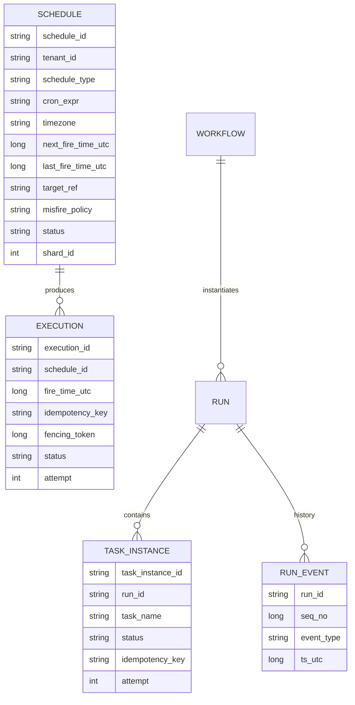
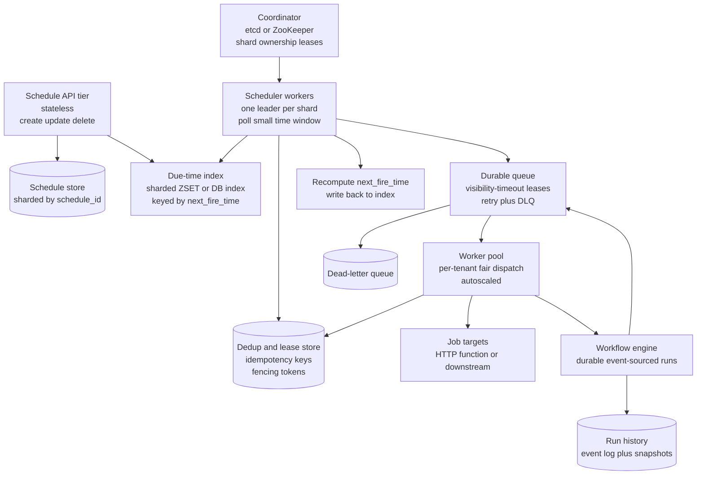
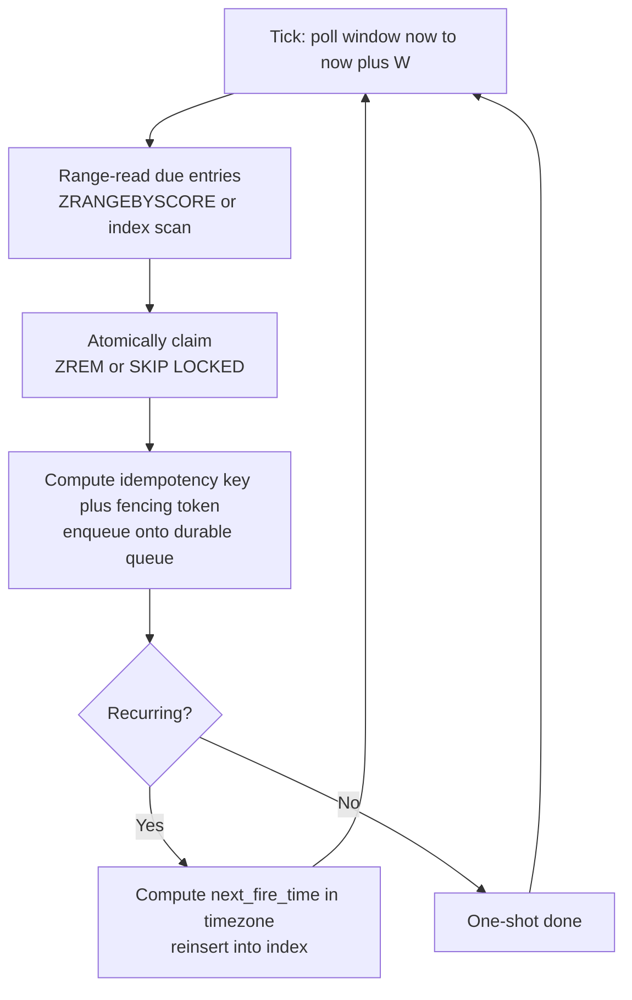
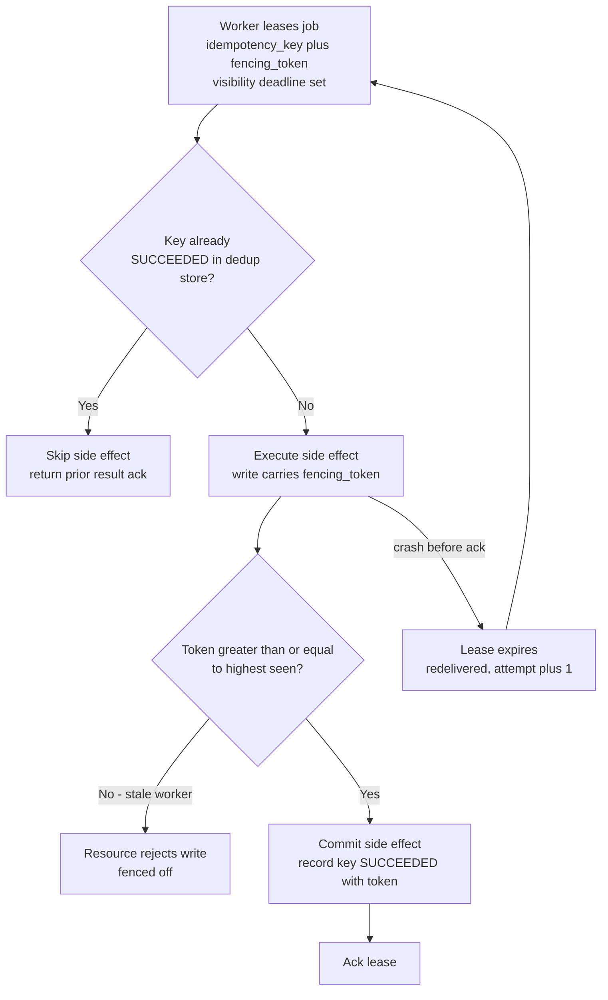
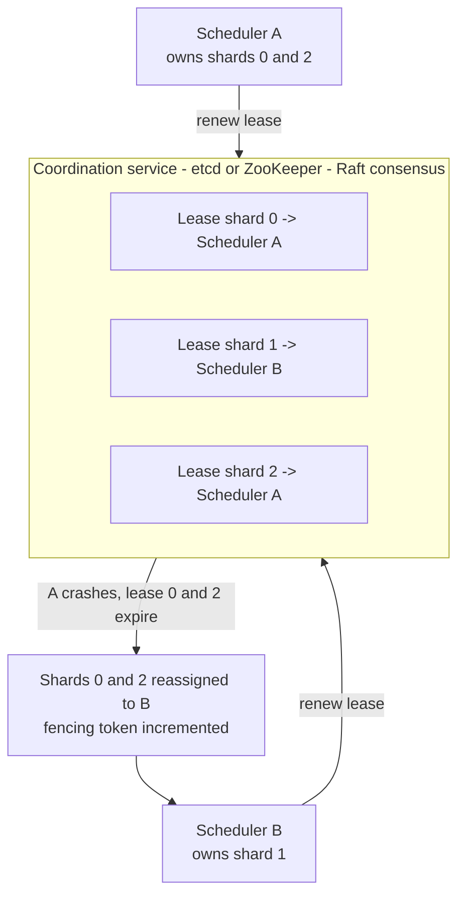
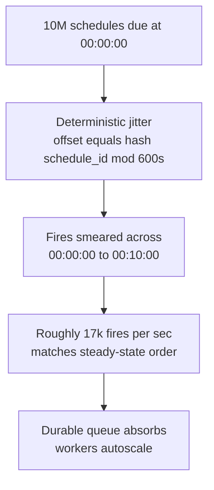
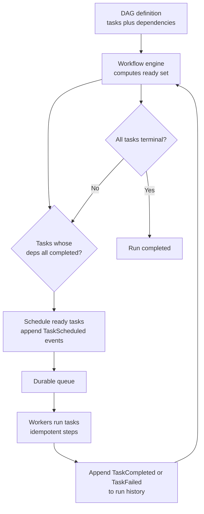
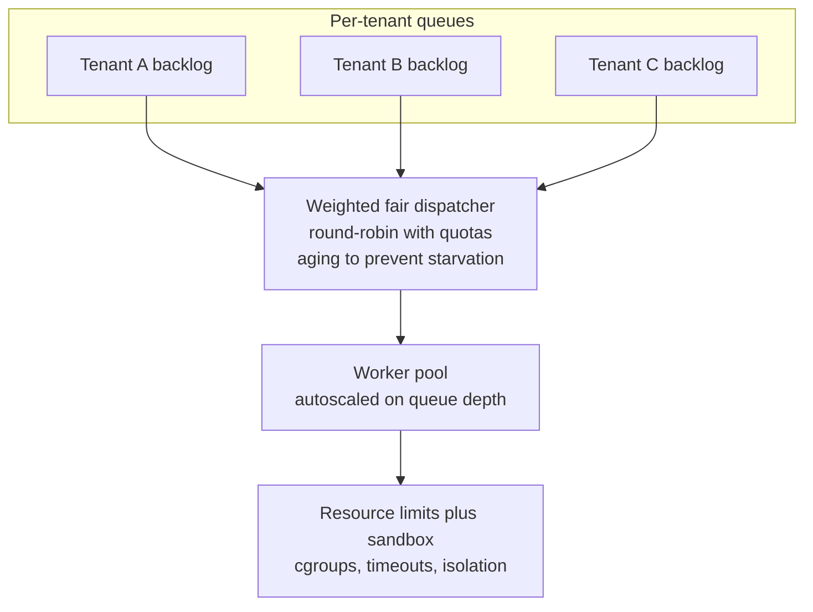

# Module 35 — Design a Distributed Job Scheduler (Cron-at-Scale + Workflow Engine)

> The definitive Staff-level reference for the system that *schedules and reliably executes millions of jobs* — cron entries, delayed tasks, and DAG workflows — across a fleet. This is the prompt behind Google Cron, Quartz, Airflow, Temporal/Cadence, AWS EventBridge Scheduler, Sidekiq, and every "run this later, reliably, exactly the right number of times" platform. It looks like a CRUD-over-a-queue app and it is *not*: the difficulty is concentrated in three places — **effectively-once execution** (at-least-once dispatch made safe with idempotency + fencing, never the myth of "exactly-once delivery"), **leader election / coordination** (so two schedulers don't both fire the same job), and **cron-at-scale thundering herd** (a million jobs all due at `00:00`). Get those three right and the rest is plumbing.

## What you'll master

By the end of this module you will hear "design a job scheduler / cron service / workflow engine" and immediately earmark the crux instead of drawing boxes: **(1) effectively-once execution** — you cannot promise exactly-once *delivery* over a network, so you promise *at-least-once dispatch plus idempotent, fenced execution*, which yields effectively-once side effects; **(2) coordination** — partition the schedule space across schedulers via consistent hashing, or run one leader per shard via a real consensus lease (etcd / ZooKeeper / Raft), and handle split-brain with fencing tokens, *never* "just replicate the scheduler to avoid a SPOF"; **(3) the due-time index** — the "what's due now" query must be a time-bucketed / sorted index (Redis ZSET by next-fire-time, or a DB index on `next_fire_time`), polled in small windows, never a full table scan. You will size it with a **correct BOTEC** — *jobs per second from schedule cardinality and fire frequency, not DAU-as-RPS* — and you'll defend the spread/jitter strategy that turns a midnight herd into a smooth curve.

This is the module that turns "I'd put jobs in a queue and have workers pull them" — which is the *answer to a different, easier question* — into "schedules live in a sharded due-time index, a per-shard leader elected by an etcd lease scans a small time window and enqueues due jobs with idempotency keys and fencing tokens, workers execute under a visibility-timeout lease with retry/DLQ, and DAG workflows are driven by a durable, event-sourced state machine so a crashed run resumes mid-flight instead of restarting." For the coordination primitives underneath, see [02 Distributed Systems](02-distributed-systems.md); for the queueing and at-least-once semantics, [04 Messaging](04-messaging-event-driven.md); for the workflow/DAG execution model, [23 Distributed Computation](23-distributed-computation.md); and for the failure discipline, [11 Reliability](11-reliability.md) and [28 Designing for Failure](28-designing-for-failure.md).

---

## Table of Contents

1. [In the Room — Delivering This at Staff Level](#1-in-the-room--delivering-this-at-staff-level)
2. [Problem framing](#2-problem-framing)
3. [Requirements — functional + non-functional](#3-requirements--functional--non-functional)
4. [Capacity estimation — the correct BOTEC](#4-capacity-estimation--the-correct-botec)
5. [API design](#5-api-design)
6. [Data model](#6-data-model)
7. [High-level architecture](#7-high-level-architecture)
8. [Deep dives](#8-deep-dives)
   - [8.1 The data model + due-time index](#81-the-data-model--due-time-index)
   - [8.2 Effectively-once execution](#82-effectively-once-execution)
   - [8.3 Leader election / coordination](#83-leader-election--coordination)
   - [8.4 Cron at scale — the thundering herd](#84-cron-at-scale--the-thundering-herd)
   - [8.5 DAG workflows + durable execution](#85-dag-workflows--durable-execution)
   - [8.6 Worker pool + multi-tenant fairness](#86-worker-pool--multi-tenant-fairness)
   - [8.7 Failure modes](#87-failure-modes)
9. [Scaling & bottlenecks](#9-scaling--bottlenecks)
10. [Trade-offs & failure modes](#10-trade-offs--failure-modes)
11. [What the interviewer is really testing + Staff insight](#11-what-the-interviewer-is-really-testing--staff-insight)
12. [Interview Cheat-Sheet](#12-interview-cheat-sheet)
13. [Common Interview Questions](#13-common-interview-questions)

---

## 1. In the Room — Delivering This at Staff Level

### 1.1 Earmark the crux in the first 60 seconds

The moment you hear "job scheduler," "cron at scale," or "workflow engine," say the three hard parts out loud. This is the move that separates a Staff answer from a queue-and-workers answer.

> **The crux is three things, and I'll spend my time here:** (1) **Effectively-once execution** — I cannot guarantee exactly-once *delivery* across a network, so I guarantee *at-least-once dispatch plus idempotent, fenced execution*; the side effect happens once even if the dispatch happens twice. (2) **Coordination** — I must stop two schedulers from both firing the same job, which means either partitioning the schedule space with consistent hashing or electing a leader per shard via a real consensus lease (etcd / ZooKeeper / Raft), and handling split-brain with fencing tokens. (3) **Cron at scale** — a million jobs due at midnight is a thundering herd; I spread and jitter fire times, and I have an explicit missed-fire / catch-up policy. Everything else is the "what's due now" index and a worker pool.

Naming effectively-once, coordination, and the herd *before* you architect anything is itself the Staff signal. It says you know this is a distributed-systems correctness problem, not a CRUD app.

### 1.2 Decide, don't enumerate — the load-bearing decisions

| Decision | Decide this | Because | Revisit if |
|---|---|---|---|
| Execution semantics | **At-least-once dispatch + idempotency key + fencing token = effectively-once** | Exactly-once *delivery* is impossible over a network; effectively-once side effects are achievable and correct | Never — this is the spine. Some best-effort jobs can relax to at-most-once |
| Coordination | **Partition schedule by consistent hashing; one leader per shard via etcd/ZooKeeper lease** | Avoids double-dispatch *and* scales horizontally; consensus gives a real, fenced lease — not a heuristic | A single small deployment can run one leader for everything |
| Due-time index | **Sharded sorted index by next-fire-time (Redis ZSET or DB index), polled in small windows** | "What's due now" must be a range query, never a full scan | Tiny scale tolerates a periodic full scan; don't design for it |
| Durable queue | **Persistent queue with visibility-timeout leases + retry + DLQ** (SQS / Kafka / Redis Streams) | Worker can crash mid-job; the lease auto-redelivers; poison jobs go to DLQ | — |
| Workflow state | **Durable, event-sourced state machine per run** (Temporal/Cadence model) | A DAG run must resume mid-flight after a crash, not restart; state is a fold over a history log | Simple fan-out with no dependencies needs only the queue |
| Clock & time | **Schedulers read a synced clock (NTP), tolerate skew, store fire times in UTC, compute cron in the job's timezone** | Skew + DST are correctness bugs that double-fire or skip | — |

### 1.3 Name-and-move-on vs. deep-dive

**Name-and-move-on (one sentence each):** the exact cron-expression grammar, the specific queue product (SQS vs Kafka vs RabbitMQ — name the semantics you need, not the vendor), the admin UI, the precise etcd API, RBAC/auth on the API. The metrics dashboard. The choice of language for the worker sandbox.

**Deep-dive (where this round is won):** the due-time index and the "what's due now" query (§8.1); effectively-once via idempotency + fencing + leases (§8.2); leader election / partitioning and split-brain (§8.3); the midnight thundering herd, jitter, and missed-fire policy (§8.4); DAG workflows and durable execution (§8.5); multi-tenant fairness and starvation (§8.6); the failure matrix (§8.7). Earmark these and spend your minutes here.

> **Staff-level insight:** The single biggest tell is whether you say "exactly-once delivery" (wrong, and a senior interviewer will pounce) or "**at-least-once dispatch made effectively-once by idempotency and fencing**" (right). The second tell is whether your coordination story is real — "leader election via an etcd/ZooKeeper/Raft lease with a fencing token" — or hand-waved as "I'll replicate the scheduler so there's no SPOF," which *creates* the double-dispatch bug instead of solving it. Say early: *"Two schedulers must never both fire the same job; I solve that with consensus-based ownership and fencing, and I make every execution idempotent so even a double-fire is harmless."*

---

## 2. Problem framing

A **distributed job scheduler** lets users register work to run **later** and **reliably**, then executes it across a worker fleet. Three workload shapes share one engine:

- **Cron / recurring jobs** — "run this every day at 02:00 in `America/New_York`," "every 5 minutes." Defined by a recurrence rule; the scheduler computes each **next fire time**.
- **Delayed / one-shot tasks** — "send this reminder in 30 minutes," "retry this payment at `T+1h`." A single future execution at a target timestamp.
- **DAG workflows** — a graph of dependent tasks: "extract → transform → load, then fan out to 50 partitions, then fan in to a report." Tasks have dependencies, fan-out/fan-in, and partial-failure/resume requirements.

What makes this *hard* and not a queue-with-a-timer:

- **Reliability is the product.** A skipped billing run loses revenue; a double-fired payout is a financial loss. The number-of-times a job runs is a correctness property, not a nice-to-have.
- **The "what's due now" query is hot and constant.** Millions of schedules, polled every second, must answer "which fire now?" without scanning everything.
- **Coordination is mandatory.** The instant you run more than one scheduler (and you must, for HA), you risk two of them firing the same job. Preventing that *correctly* requires consensus, not replication.
- **Time is adversarial.** Clocks skew, NTP steps, DST shifts an hour, a scheduler is down across a fire time (missed fire), and "what should have run while we were down?" is a policy decision with revenue consequences.
- **Workflows carry state.** A DAG run is a long-lived stateful process; a crash mid-run must *resume*, not restart, or you re-run already-completed (possibly non-idempotent) steps.

Scope for the interview: design the scheduling core, the dispatch/coordination layer, the durable queue, the worker pool, and the workflow engine. Out of scope unless asked: the job-authoring UI, fine-grained RBAC, billing/metering of customer jobs, the specific business logic inside jobs.

---

## 3. Requirements — functional + non-functional

### 3.1 Functional

- **Register / update / delete a schedule** — cron expression, fixed-rate, or one-shot at a timestamp, with a timezone and a target (queue, HTTP endpoint, function, or workflow).
- **Compute next fire time** — from the recurrence rule + timezone (DST-aware).
- **Dispatch due jobs** — at (or shortly after) the fire time, enqueue an execution.
- **Execute reliably** — run the job on a worker; **retry** on failure with backoff; route exhausted jobs to a **dead-letter queue (DLQ)**.
- **Idempotent execution** — the same logical fire must not produce duplicate side effects, even under retry or double-dispatch.
- **Missed-fire / catch-up policy** — define what happens when the scheduler was down across a fire time (run-once-now, run-all-missed, or skip).
- **DAG workflows** — define task dependencies; execute in topological order; fan-out / fan-in; **resume / backfill** a partially-failed run.
- **Observability** — per-job execution history, status, last/next fire time, latency, success/failure.
- **Multi-tenancy** — per-tenant isolation, quotas, and fairness.

### 3.2 Non-functional

| Requirement | Target | Why it drives the design |
|---|---|---|
| **Reliability of execution count** | Effectively-once (no missed fires; no duplicate side effects) | Idempotency + fencing + durable leases; missed-fire policy |
| **Timeliness** | Dispatch within a few seconds of due time (p99 a small bounded lag) | Small polling windows over a sorted due-time index |
| **Durability** | A registered schedule and an in-flight run survive any node crash | Persist schedules + workflow history; durable queue |
| **Availability** | Scheduler tier is HA; no single scheduler is a SPOF | Consensus leader per shard, fast failover |
| **Scale** | Tens of millions of schedules; hundreds of thousands of fires/sec at peak | Sharded due-time index; partitioned schedulers |
| **Coordination correctness** | No two schedulers fire the same job | etcd/ZooKeeper/Raft lease + fencing token |
| **Fairness** | No tenant starves another; bounded blast radius per tenant | Per-tenant queues, weighted fair dispatch, quotas |
| **Catch-up correctness** | Deterministic, configurable behavior across downtime | Explicit missed-fire policy + bounded catch-up window |

The tension to state explicitly: **timeliness vs. coordination overhead vs. correctness.** You want sub-second dispatch, but every safety mechanism (lease acquisition, idempotency check, fencing) adds latency, and the herd at midnight fights timeliness. The resolution — small poll windows, jitter, and *idempotency so an occasional double-fire is harmless* — is worth saying out loud.

---

## 4. Capacity estimation — the correct BOTEC

The trap that [30 Capacity Estimation](30-capacity-estimation.md) drills applies hard here: **do not turn "users" into RPS.** A scheduler's load is **not** driven by DAU. It is driven by *how many schedules exist* and *how often each fires*. Derive fires-per-second from **schedule cardinality × fire frequency**, then size the index, the queue, and the worker pool from that.

### 4.1 Fire rate from schedule cardinality

- Say the platform holds **N = 50,000,000 active schedules** (cron entries + standing delayed tasks).
- Average fire frequency varies wildly, so split it. Suppose the *average* schedule fires **once per hour**:
  - Average fires/sec ≈ 50,000,000 / 3,600 ≈ **~14,000 fires/sec** steady state.
- But fires are **not uniform** — that's the whole point of this design. A large fraction are aligned to human-friendly boundaries (top of the hour, midnight, `*/5`).
  - If, say, **20%** of schedules (10M) are daily-at-midnight, then at `00:00` you have **10,000,000 fires in one second** if you do nothing — a **~700× spike** over the average. This single number is *why* the thundering herd is the crux, not an afterthought (§8.4).

### 4.2 The herd, and what spreading buys you

- Naive peak: **10M fires/sec** at midnight is impossible to dispatch and would crater any queue or worker fleet.
- **Spread / jitter** the same 10M fires over, say, a **10-minute window** (600 s) → ~**16,700 fires/sec** — back in the same order of magnitude as steady state. Spreading is what makes the system feasible; say the math out loud.
- Design the *queue and worker fleet* for the **post-spreading peak** (tens of thousands/sec), not the raw herd — and design the *due-time index* to answer the "what's due in the next second" range query cheaply regardless.

### 4.3 Index + storage sizing

- **Due-time index:** a sorted structure keyed by `next_fire_time`. To answer "what's due in `[now, now+1s)`" you do a **range scan of one second's worth of entries** — at ~16,700/sec that's a few tens of thousands of entries per poll, not 50M. Sharded across, say, **64 partitions**, each partition answers ~260 due entries/sec. Trivial.
- **Schedule storage:** 50M schedules × ~1 KB (rule, timezone, target, metadata, next/last fire) ≈ **~50 GB** — a sharded database, not exotic.
- **Workflow history (event-sourced):** each DAG run is a log of events (task scheduled / started / completed / failed). A run with 100 tasks × ~10 events × ~200 bytes ≈ **~200 KB/run**; at 100,000 runs/day that's **~20 GB/day** of history, retained per policy and snapshotted.
- **Queue throughput:** post-spreading peak ~tens of thousands of dispatches/sec × a small message (~500 bytes) ≈ low tens of **MB/sec** — comfortable for Kafka/SQS/Redis Streams.

### 4.4 Worker fleet sizing

- If a job runs for **~200 ms** average and peak dispatch is **~17,000/sec**, concurrent in-flight jobs ≈ 17,000 × 0.2 = **~3,400 concurrent executions**. At, say, 50 concurrent jobs per worker → **~70 workers** at peak, autoscaled. Long-running jobs (minutes) change this dramatically — size from *concurrency = rate × duration* (Little's Law), and say so.

> **The BOTEC punchline to say out loud:** *"Load here is schedule cardinality times fire frequency, not DAU — ~50M schedules at one fire/hour is ~14k fires/sec average, which is fine. The scary number is alignment: 20% of schedules at midnight is 10M fires in one second, a 700× spike. Spreading that herd over a 10-minute jittered window brings it back to ~17k/sec, and I size the queue and ~70-worker fleet for that, using concurrency = rate × duration. The due-time index only ever range-scans one second's worth of entries, so it never touches the full 50M.'"*

---

## 5. API design

### 5.1 Schedule management

```
POST   /v1/schedules
  { name, schedule_type, cron_expr, timezone, start_at, end_at,
    target, payload, retry_policy, idempotency_policy, misfire_policy }
  -> { schedule_id, next_fire_time }

GET    /v1/schedules/{id}        -> schedule + last_fire + next_fire + status
PUT    /v1/schedules/{id}        -> update rule/target/policy (recompute next_fire_time)
DELETE /v1/schedules/{id}        -> deactivate

POST   /v1/schedules/{id}/pause
POST   /v1/schedules/{id}/resume
POST   /v1/schedules/{id}/trigger   -> fire once now, out of band
```

- `schedule_type` ∈ `CRON | RATE | ONE_SHOT`.
- `target` ∈ `{ type: QUEUE | HTTP | FUNCTION | WORKFLOW, ref, headers }`.
- `retry_policy` = `{ max_attempts, backoff: EXPONENTIAL, base_ms, max_ms, jitter: true }`.
- `misfire_policy` ∈ `RUN_ONCE_NOW | RUN_ALL_MISSED | SKIP` (§8.4).
- The **client may supply an idempotency key** on `trigger`; for scheduled fires the system derives one as `hash(schedule_id, fire_time)` (§8.2).

### 5.2 Workflow (DAG) management

```
POST /v1/workflows                 -> register a DAG definition (tasks + dependencies)
POST /v1/workflows/{id}/runs       -> start a run -> { run_id }
GET  /v1/runs/{run_id}             -> run status, per-task state, DAG progress
POST /v1/runs/{run_id}/resume      -> resume a failed run from last good checkpoint
POST /v1/runs/{run_id}/backfill    -> re-run a date range / failed branch
POST /v1/runs/{run_id}/cancel
```

### 5.3 Worker-facing dispatch contract

Workers receive a **lease**, not a fire-and-forget message:

```
LEASE   { execution_id, schedule_id, fire_time, payload,
          idempotency_key, fencing_token, visibility_deadline }
ACK     { execution_id, status: SUCCEEDED | FAILED, output }
HEARTBEAT { execution_id }      -> extend visibility_deadline for a long job
```

- The **`fencing_token`** is a monotonically increasing number (§8.3); the side-effecting resource or the dedup store rejects any write carrying a token lower than the highest it has seen — this is what makes a *stale* worker harmless.
- A worker must **heartbeat** to extend the **visibility deadline** (visibility-timeout lease); if it dies, the lease expires and the job is redelivered (§8.2).

---

## 6. Data model

### 6.1 Schedules + the due-time index

The authoritative schedule record lives in a sharded relational/KV store; the **due-time index** is a *derived, hot* structure optimized for the "what's due now" range query.



- `next_fire_time_utc` is the **index key** — stored in UTC, computed in the schedule's `timezone` (DST-aware, §8.4).
- `shard_id` is the consistent-hash bucket assigned to a scheduler owner (§8.3).
- `idempotency_key` on `EXECUTION` = `hash(schedule_id, fire_time)` so the *same fire* always maps to the *same key* across retries and double-dispatches (§8.2).
- `RUN_EVENT` is the **event-sourced history** of a workflow run — state is a fold over these events, which is what makes resume possible (§8.5).

### 6.2 The due-time index, physically

Two common realizations — name both, pick one, justify:

| Index | "What's due now" query | Pros | Cons |
|---|---|---|---|
| **Redis sorted set (ZSET)** per shard, score = `next_fire_time_utc` | `ZRANGEBYSCORE shard now-epsilon now` then `ZREM` claimed entries | O(log n) range, very fast, natural for tight poll loops | In-memory; needs durability (AOF/replica) and re-hydration on restart |
| **DB index** on `(shard_id, next_fire_time_utc)` | `SELECT ... WHERE shard_id=? AND next_fire_time<=now AND status='PENDING' ... FOR UPDATE SKIP LOCKED LIMIT k` | Durable, transactional, `SKIP LOCKED` prevents two pollers grabbing the same row | Higher per-poll cost; index hot-spotting at aligned times |

The key property either way: the poller reads **only the small set of entries due in this window**, claims them atomically (ZREM / `SKIP LOCKED`), enqueues them, and advances. **Never a full scan of all schedules.** This is the §8.1 deep dive.

### 6.3 What is NOT in this model

No "scan every schedule every tick." No storing the *current* workflow state as a mutable blob you overwrite (you'd lose the ability to resume deterministically) — you store the **event history** and fold it. No "exactly-once delivery flag." The dedup/lease store and the fencing tokens are first-class, not afterthoughts.

---

## 7. High-level architecture



The dataflow, narrated: the **API tier** writes schedules to a sharded store and inserts each into the **due-time index** keyed by `next_fire_time`. The **coordinator** (etcd / ZooKeeper) hands each scheduler worker a **lease over a set of shards**, so exactly one scheduler owns each shard. That owning **scheduler** polls *only the entries due in the next small window*, claims them atomically, computes the **idempotency key** and **fencing token**, and enqueues each as a job onto the **durable queue** — then recomputes and rewrites `next_fire_time` for recurring schedules. **Workers** pull jobs under a **visibility-timeout lease**, check the **dedup store** (skip if this idempotency key already succeeded), execute against the target carrying the **fencing token**, and ack. Failures retry with backoff; exhausted jobs land in the **DLQ**. **Workflow** targets are driven by the **workflow engine**, whose state is an **event-sourced run history** so a crash resumes mid-DAG.

---

## 8. Deep dives

### 8.1 The data model + due-time index

#### The query that defines the system

The hot path is one question asked continuously: **"which schedules are due right now?"** Everything depends on answering it cheaply against tens of millions of schedules. The wrong answer — scan the whole table each tick comparing `next_fire_time <= now` — is O(N) per poll and dies at scale. The right answer is a **sorted index keyed by `next_fire_time`**, so "what's due now" is a **range query**, O(log N + k) where k is the small number actually due.

#### Time-bucketing / sharding the index

Shard the index by `shard_id = hash(schedule_id) mod S`. Each shard is an independent sorted structure (a Redis ZSET, or a DB index partition). The owning scheduler for a shard runs a tight loop:



- **Atomic claim** is essential: `ZREM` (Redis) or `SELECT ... FOR UPDATE SKIP LOCKED` (SQL) ensures a due entry is handed to exactly one poll iteration even if the shard briefly has two contenders during a leadership handoff (§8.3). Claim-then-enqueue, not read-then-maybe-enqueue.
- **Re-insert for recurrence:** after firing a cron job, immediately compute the *next* `next_fire_time` (in the job's timezone, DST-aware) and write it back into the index. The index is self-perpetuating.

#### Hierarchical timing wheels (the alternative)

For very large numbers of short-horizon timers (the "delay this 30s" case), a **hierarchical timing wheel** (the Kafka/Netty timer design) gives O(1) insert and expiry by bucketing timers into wheels of increasing granularity (seconds → minutes → hours), cascading as time advances. Name it as the right structure when most jobs are *short delays at high churn*; the sorted-index/ZSET approach is better when jobs are sparse over a long horizon and you want durability and queryability. Knowing *both* and when each wins is the depth signal.

> **Staff-level insight:** *"The whole system pivots on one query — 'what's due now' — and the answer is a sorted index keyed by next-fire-time, sharded, range-scanned for just the current window and claimed atomically, never a full scan of 50M schedules. After firing a recurring job I recompute its next fire time in its timezone and reinsert, so the index perpetuates itself. For high-churn short delays I'd reach for a hierarchical timing wheel instead — O(1) insert and expiry. Picking the index structure from the access pattern is the move.'"*

---

### 8.2 Effectively-once execution

#### Say the right words: there is no exactly-once *delivery*

The first sentence here decides the round. **You cannot guarantee exactly-once delivery over a network** — the dispatcher can crash after enqueuing but before recording it, a worker can finish a job and die before acking, a lease can expire and redeliver. What you *can* guarantee is **at-least-once dispatch + idempotent, fenced execution = effectively-once side effects**: the job may be *delivered* more than once, but its *observable effect* happens exactly once.

#### The three mechanisms, stacked

1. **Idempotency key** — every fire has a stable key `hash(schedule_id, fire_time)`. Before performing side effects, the worker checks a **dedup store**: if this key already SUCCEEDED, it returns the prior result and does nothing. The *target* should also accept the key (e.g. an idempotent `POST` with an `Idempotency-Key` header) so the downstream itself dedups. Same fire → same key → at most one effect.
2. **Fencing token** — a monotonically increasing number issued with the lease (§8.3). The side-effecting resource (or the dedup store) records the highest token it has accepted and **rejects any write with a lower token**. This neutralizes the classic distributed-systems hazard: a slow/paused worker that wakes up holding an *expired* lease and tries to write; its token is now stale, so the write is fenced off. (This is the Martin Kleppmann fencing-token pattern; cite the mechanism, not the name.)
3. **Visibility-timeout lease + retry + DLQ** — the queue hands a job to a worker with a **visibility deadline**; the job is invisible to others until then. The worker **heartbeats** to extend it for long jobs. If the worker dies, the lease lapses and the job becomes visible again → **redelivered** (this is the at-least-once part). Each redelivery increments `attempt`; on `max_attempts` the job goes to the **DLQ** for inspection rather than looping forever.



#### Why this is correct, not hopeful

- **Double-dispatch** (two schedulers fired the same job during a handoff) → both produce the *same* idempotency key → the dedup store admits the first, the second is a no-op. Harmless.
- **Worker crash mid-job** → lease expires → redelivered → if the side effect already committed, the key is SUCCEEDED and the retry is a no-op; if it didn't commit, the retry completes it. Exactly-one effect either way.
- **Zombie worker** (paused, then resumes with an expired lease) → its fencing token is now lower than the one the live owner holds → its write is fenced. No corruption.

> **Staff-level insight:** The line that wins: *"I never claim exactly-once delivery — that's impossible over a network. I claim effectively-once: at-least-once dispatch, made safe by a stable idempotency key so a double-fire is a no-op, a fencing token so a zombie worker's late write is rejected, and a visibility-timeout lease with retry and DLQ so a crashed worker's job is redelivered, not lost. The side effect happens once; the *delivery* might not, and that's fine.'"* Naming idempotency *and* fencing *and* the lease — three distinct mechanisms for three distinct failure modes — is what separates a Staff answer from "I'll just use SQS."

---

### 8.3 Leader election / coordination

#### The problem: two schedulers, one job

The instant you run more than one scheduler for HA, you must prevent **double-dispatch** — two schedulers both reading the same due entry and both firing it. The *wrong* answer, and a common one, is "I'll replicate the scheduler so there's no single point of failure." Replication without coordination *creates* the bug: now you have two active schedulers racing on the same index. Idempotency (§8.2) makes double-fire *harmless*, but you still want to *prevent* it for efficiency and to avoid wasted downstream load — and prevention requires **real coordination**, which means **consensus**, not heuristics.

#### Two correct designs (often combined)

**A. Partition the schedule space (consistent hashing).** Map each schedule to a shard via `hash(schedule_id) mod S` (or a hash ring). Assign shards to scheduler instances so **exactly one scheduler owns each shard**. A scheduler only polls *its* shards, so no two schedulers ever look at the same due entries. Consistent hashing keeps reassignment minimal when a scheduler joins/leaves. This scales horizontally and is the primary mechanism.

**B. A consensus lease per shard (etcd / ZooKeeper / Raft).** Ownership of a shard is a **lease** held in a strongly-consistent coordination service: a scheduler `PUT`s a key with a TTL (etcd lease, ZooKeeper ephemeral node) to claim a shard, and *renews* it. If it dies, the lease **expires** and another scheduler claims the shard. This is real leader election backed by consensus — etcd/ZK provide the linearizable, fault-tolerant store that makes "exactly one owner" a guarantee, not a hope. Pair the lease with a **fencing token** (etcd's `mod_revision` / ZK's `zxid` is monotonic) so a scheduler that *thinks* it still owns a shard but actually lost the lease cannot do damage — its stale token is fenced downstream (§8.2).



#### Split-brain handling

Split-brain = a partitioned scheduler *believes* it still owns a shard while the cluster has reassigned it. The defenses, layered:

- **The lease must expire from the coordinator's side**, and the holder must *stop acting* once it cannot renew. A scheduler that can't reach etcd/ZK within the lease TTL must **self-fence** (stop dispatching) — it cannot assume it still owns anything.
- **Fencing tokens** make the residual race harmless: even if the old owner dispatches one last time after losing the lease, its token is now stale and the dedup/target rejects its write.
- **Idempotency** (§8.2) is the final backstop: any double-fire that slips through is a no-op.

This is the classic "**lease + fence**" pattern: the lease gives you *mostly-one* owner cheaply; the fencing token makes the rare overlap *correct*. Consensus (Raft via etcd/ZK) is what makes the lease itself trustworthy — see [02 Distributed Systems](02-distributed-systems.md) for why you need a consensus service and can't roll leader election with timeouts and hope.

> **Staff-level insight:** *"Coordination is consensus, not replication. I partition the schedule space by consistent hashing so each shard has one owner, and I back ownership with an etcd/ZooKeeper lease — real leader election on a Raft-replicated store. Split-brain is handled by three layers: a partitioned scheduler self-fences when it can't renew, a fencing token makes any residual double-dispatch a rejected stale write, and idempotency makes anything that still slips through a no-op. 'Just replicate the scheduler' is the *wrong* answer — it manufactures the double-fire bug instead of preventing it.'"*

---

### 8.4 Cron at scale — the thundering herd

#### The midnight problem

Humans schedule on round numbers. `0 0 * * *` (midnight), `0 * * * *` (top of hour), `*/5` (every five minutes) — so fire times **cluster**. From the BOTEC (§4): 10M schedules at midnight = **10M fires in one second** if you do nothing. That herd would overwhelm the queue, the dedup store, the workers, and any downstream the jobs call (a self-inflicted DDoS on your own services).

#### Spreading + jitter

The fix is to **spread the herd over a window** and **add jitter**:

- **Deterministic jitter:** offset each schedule's fire time by `hash(schedule_id) mod window` seconds. A `0 0 * * *` job fires at `00:00:00 + (hash % 600)s`, smearing 10M fires across a 10-minute window → ~17k/sec (back to steady-state order of magnitude). Jitter is *deterministic per schedule* so it's stable across restarts and the same job doesn't hop around.
- **Honor user intent where it matters:** for jobs that *must* run exactly at midnight (regulatory cutoffs), don't jitter — let those be the small minority and provision for them; jitter the vast "approximately daily" majority.
- **Backpressure:** the dispatcher respects queue depth and downstream rate limits; if the post-spreading rate still exceeds capacity, it sheds into the next window rather than melting the fleet.



#### Missed-fire / catch-up policy

If a scheduler (or the shard's owner) was **down across a fire time**, what happens when it recovers? This is a *policy*, and naming the options is the depth signal:

| Policy | Behavior | Use when |
|---|---|---|
| **RUN_ONCE_NOW** | Fire once immediately, ignore how many fires were missed | Idempotent periodic refreshes — "rebuild the cache"; you only need the latest |
| **RUN_ALL_MISSED** | Replay every missed fire (catch up) | Each occurrence has independent meaning — "generate the daily report for each missed day" |
| **SKIP** | Skip missed fires entirely, resume at the next scheduled time | Time-sensitive jobs where a late run is worse than no run — "send the 9am digest"; don't send 3 stale digests at noon |

Bound the catch-up with a **window** ("catch up at most the last 24h") so a long outage doesn't unleash a delayed herd. The missed-fire policy is per-schedule and explicit; defaulting silently is a Staff anti-pattern.

#### Clock skew, timezone, DST

- **Clock skew:** schedulers sync via **NTP**; tolerate small skew by treating fire time as "due within `[t, t+ε]`." Never assume two machines agree on the millisecond. A scheduler whose clock is wildly off must detect it (compare with the coordinator) and self-fence rather than fire everything early or late.
- **Timezone:** store fire times in **UTC** in the index, but **compute cron in the schedule's own timezone**. "2am daily in `America/New_York`" is a different UTC instant in summer vs. winter.
- **DST correctness:** the genuinely tricky case. On a **spring-forward** day, `02:30` *doesn't exist* — decide a rule (skip, or run at `03:30`). On a **fall-back** day, `01:30` *happens twice* — decide whether the job fires once or twice. Use a timezone library (IANA tz database) and pick an explicit policy; "I'd use a proper tz library and define the spring-forward/fall-back behavior" is exactly what the interviewer wants to hear.

> **Staff-level insight:** *"Cron clusters on human round numbers, so 10M jobs hit midnight at once — a self-inflicted DDoS. I smear them with deterministic per-schedule jitter over a window, which is *the* number that makes the system feasible (700x spike down to steady-state). Then I name an explicit missed-fire policy — run-once, run-all, or skip — bounded by a catch-up window, and I get time right: UTC in the index, cron computed in the job's timezone, and an explicit spring-forward/fall-back rule using the IANA tz database. Skew is handled by treating 'due' as a small window and self-fencing a wildly-skewed node.'"*

---

### 8.5 DAG workflows + durable execution

#### Why a workflow is not just fan-out

A **DAG workflow** is a graph of tasks with **dependencies**: a task runs only after its upstreams complete. This adds requirements a flat queue can't meet: **topological execution**, **fan-out / fan-in**, and — the hard one — **resume after partial failure** without re-running completed (possibly non-idempotent) steps. A naive "re-run the whole DAG on failure" double-executes everything that already succeeded.

#### Durable, event-sourced execution (the Temporal/Cadence model)

The right model is **durable execution**: the run's state is **not** a mutable blob — it's a **fold over an append-only event history** (`TaskScheduled`, `TaskStarted`, `TaskCompleted`, `TaskFailed`, …). State is *derived* by replaying the history. This is event sourcing applied to workflow control flow, and it's exactly how Temporal/Cadence and (more loosely) Airflow's metadata DB work.



Why event-sourcing buys resume for free:

- **Resume after crash** = reload the run, **replay its history** to reconstruct exactly which tasks completed, and continue from the ready set — completed tasks are *not* re-run because the history says they're done.
- **Determinism requirement:** the workflow's control-flow code must be **deterministic** (its decisions are a function of history), so replay reaches the same point. Side-effecting work lives in **activities/tasks** (the worker steps), which are retried independently and made **idempotent**. This separation — deterministic orchestration vs. idempotent activities — is the core Temporal insight; state it.

#### Fan-out / fan-in, partial failure, backfill

- **Fan-out:** a task spawns N parallel children (e.g. one per partition); the engine schedules all whose deps are met.
- **Fan-in:** a downstream task waits until *all* fan-out children reach a terminal state before becoming ready.
- **Partial failure + resume:** if 3 of 50 fan-out tasks fail, only those 3 retry (with backoff); the 47 successes are recorded in history and never re-run. The run **resumes** rather than restarts.
- **Backfill:** re-run a date range or a specific failed branch — supported because each task instance is keyed by `(run_id, task_name, partition)` and its idempotency key prevents duplicate effects on re-run.

#### Compare the engines (name and move on)

| System | Model | Sweet spot |
|---|---|---|
| **Airflow** | Scheduler + metadata DB drives a DAG of operators; pull-based; schedule-centric | Data-engineering ETL pipelines, time-partitioned batch |
| **Temporal / Cadence** | Durable execution; event-sourced workflow history; deterministic orchestration + idempotent activities; replay-based resume | Long-running, stateful, code-as-workflow business processes |
| **Step Functions / Argo** | Declarative state-machine / k8s-native DAG | Managed/cloud-native orchestration |

Default to the **Temporal/durable-execution** model when the interview emphasizes *long-running, resumable, stateful* workflows; default to **Airflow's** model when it emphasizes *scheduled data pipelines*. Knowing which to reach for is the judgment being tested. See [23 Distributed Computation](23-distributed-computation.md) for the DAG-execution and fan-out/fan-in mechanics.

> **Staff-level insight:** *"A DAG isn't fan-out — it's stateful orchestration, and the hard requirement is resume-after-partial-failure without re-running completed steps. I model the run as an event-sourced history and derive state by folding it, so recovery is 'replay the history to the ready set and continue.' That demands a clean split: deterministic orchestration code whose decisions are a function of history, and idempotent activities that do the side effects and retry independently — the Temporal model. Backfill and partial retry fall out because every task instance has a stable idempotency key.'"*

---

### 8.6 Worker pool + multi-tenant fairness

#### The fairness problem

A single shared worker pool serving many tenants has a starvation hazard: one tenant fires a million jobs and **monopolizes** the workers, starving everyone else. Fairness is a first-class design concern, not an afterthought.

- **Per-tenant queues + weighted fair dispatch:** rather than one global FIFO, maintain per-tenant queues and dispatch with **weighted fair queuing** (round-robin or weighted by tenant tier), so no tenant's backlog blocks others. A heavy tenant drains *its* share, not the whole fleet.
- **Quotas + rate limits:** cap concurrent executions and dispatch rate per tenant. Excess is queued or shed, bounding one tenant's blast radius.
- **Priority queues:** high-priority jobs (a paying customer's real-time task) jump ahead of low-priority bulk work — but with **anti-starvation** (aging: a long-waiting low-priority job's effective priority rises) so background work isn't starved forever.



#### Resource limits + sandboxing untrusted jobs

If jobs run arbitrary/untrusted code (a platform that runs *customers'* functions), each execution needs **isolation**: run in a sandbox (container/cgroups, gVisor/microVM, or a serverless isolate), enforce **CPU/memory/time limits**, and kill runaways. A job that hangs or forks must not take down the worker or its neighbors. Name the isolation primitive appropriate to the trust level.

#### Autoscaling

Scale the worker fleet on **queue depth and dispatch rate**, not CPU alone — queue depth is the leading indicator of backlog. Recall the sizing rule: **concurrency = arrival rate × job duration** (Little's Law). Long-running jobs need far more concurrency than the dispatch rate suggests; scale on in-flight count, with headroom for the post-jitter peak.

> **Staff-level insight:** *"A shared worker pool starves tenants, so fairness is first-class: per-tenant queues with weighted fair dispatch and quotas bound each tenant's blast radius, priority queues with aging keep urgent work ahead without starving background work, and untrusted jobs run sandboxed with hard resource limits. I autoscale on queue depth — the leading indicator — and size concurrency as rate times duration, not raw dispatch rate.'"*

---

### 8.7 Failure modes

Walk the failure matrix explicitly — this is where the interviewer probes whether your effectively-once story actually holds. For each, the mechanism that saves you:

| Failure | What goes wrong | The mechanism that saves you |
|---|---|---|
| **Scheduler crashes mid-dispatch** | It claimed a due entry but died before enqueuing — job lost? | Claim is atomic *and* durable (ZREM with persistence / `SKIP LOCKED` in a txn); on lease expiry the shard reassigns and the entry is re-evaluated. At-least-once dispatch means re-fire, made safe by idempotency |
| **Two schedulers fire the same job** | Double-dispatch during a leadership handoff | Same `hash(schedule_id, fire_time)` idempotency key → dedup store admits one, second is a no-op; fencing token rejects the stale owner |
| **Worker crashes mid-job** | Side effect maybe half-done; job not acked | Visibility-timeout lease expires → redelivered; idempotency key makes the retry a no-op if the effect committed, completes it if not |
| **Zombie / paused worker resumes** | Stale worker writes after its lease expired | Fencing token is now lower than the live owner's → write rejected. The reason fencing exists |
| **Lost job** | A fire is silently dropped | The due-time index entry is only removed on *successful claim+enqueue*; a crash before that leaves it to be re-evaluated. Durable index, not in-memory-only |
| **Poison job** | A job fails forever, looping and burning capacity | Bounded `max_attempts` with backoff → route to **DLQ** for human inspection; never infinite retry |
| **Clock skew / NTP step** | Jobs fire early/late or twice | Treat "due" as a small window; self-fence a wildly-skewed node; UTC storage + tz-aware compute |
| **Scheduler down across a fire time** | Missed fires | Explicit **missed-fire policy** (run-once / run-all / skip), bounded catch-up window |
| **Coordinator (etcd/ZK) outage** | No new leases can be granted | Existing leaseholders keep serving until TTL; if the coordinator is down past TTL, schedulers self-fence (stop) rather than risk uncoordinated firing — **prefer late jobs over double-fired jobs** |
| **Downstream target overloaded** | Jobs hammer a struggling service | Backpressure + rate limit + the jitter window; retries use exponential backoff with jitter to avoid retry storms |

The throughline: **at-least-once is the floor (nothing is silently lost), idempotency + fencing is the ceiling (nothing produces a duplicate effect), and self-fencing on coordination loss is the safety bias (prefer a late job to a double-fired one).** See [28 Designing for Failure](28-designing-for-failure.md) for the lease/fence discipline and [11 Reliability](11-reliability.md) for the halt-vs-degrade call.

> **Staff-level insight:** *"I walk the failure matrix and show the same three mechanisms cover everything: at-least-once so nothing is lost, idempotency-plus-fencing so nothing double-effects, and self-fencing when coordination is lost so the bias is 'late, not duplicated.' The one judgment call to state out loud: if etcd is down past the lease TTL, schedulers stop rather than fire uncoordinated — for most jobs a few minutes late beats a double payout.'"*

---

## 9. Scaling & bottlenecks

| Bottleneck | Wrong instinct | Right move |
|---|---|---|
| "What's due now" query | Scan all schedules each tick | **Sorted due-time index**, sharded, range-scan only the current window, atomic claim |
| Scheduler tier as SPOF | Replicate the scheduler (creates double-fire) | **Partition by consistent hashing + consensus lease per shard**; one owner each |
| Midnight herd | Provision for the raw 10M/sec spike | **Deterministic jitter** smears it to steady-state; size for post-jitter peak |
| Dedup/lease store hot | Single node | Shard the dedup store by idempotency key; it's a KV lookup, partitions trivially |
| Queue throughput | One partition | **Partition the queue** (by tenant/shard); per-tenant fair dispatch |
| Worker fleet | Scale on CPU | **Autoscale on queue depth + in-flight count**; concurrency = rate × duration |
| Workflow history growth | Keep full history forever | **Snapshot** the run state periodically; replay only the tail; archive/expire old runs |
| Coordinator load | Route every dispatch through etcd | etcd holds only **shard leases** (coarse), never per-job state; the hot path never hits it |

The clean mental model: **everything scales horizontally — index shards, scheduler owners, queue partitions, dedup partitions, workers — coordinated by a small consensus service that holds only coarse shard ownership, never per-job state.** The coordinator is deliberately *out* of the hot path; it grants leases, and the leaseholders do the high-throughput work locally.

---

## 10. Trade-offs & failure modes

### 10.1 Key trade-offs

| Trade-off | The tension | Resolution |
|---|---|---|
| **Effectively-once vs. simplicity** | True exactly-once is impossible; naive at-least-once double-effects | At-least-once dispatch + idempotency + fencing = effectively-once; the cost is a dedup store and stable keys |
| **Timeliness vs. herd safety** | Sub-second dispatch fights the midnight spike | Jitter the majority; reserve exact timing for the few jobs that need it |
| **Coordination correctness vs. latency** | Consensus leases add overhead | Leases are coarse (per-shard) and renewed in the background, off the per-job path |
| **Prevent double-fire vs. tolerate it** | Perfect prevention needs heavy coordination | Prevent *mostly* (lease) + tolerate the rest (idempotency); don't over-engineer prevention when effects are idempotent |
| **Resume vs. restart workflows** | Restart is simple but re-runs work | Event-sourced history enables resume; cost is durable history + deterministic orchestration |
| **Availability vs. correctness on coordinator loss** | Keep firing (risk double) vs. stop (risk late) | **Self-fence**: prefer late jobs to double-fired jobs for most workloads |

### 10.2 Failure modes (summary)

The full matrix is §8.7. The headline failure modes and their saviors: **scheduler crash mid-dispatch** → atomic durable claim + reassignment; **double-dispatch** → idempotency key + fencing; **worker crash mid-job** → visibility lease + redelivery + idempotent retry; **zombie worker** → fencing token; **poison job** → bounded retry + DLQ; **missed fires** → explicit catch-up policy; **coordinator outage** → leaseholders serve to TTL, then self-fence. The bias throughout: **never silently lose a job, never double its effect, and when in doubt about coordination, be late rather than duplicate.**

---

## 11. What the interviewer is really testing + Staff insight

This prompt is a filter for distributed-systems *correctness* judgment. It checks whether you reach for the real primitives or hand-wave:

| The reflex they're testing against | What they want to hear |
|---|---|
| "Exactly-once delivery" | "Impossible over a network — at-least-once dispatch + idempotency + fencing = **effectively-once** side effects" |
| "Replicate the scheduler so there's no SPOF" | "That *creates* double-fire — I partition by consistent hashing and elect a leader per shard via an etcd/ZooKeeper/Raft lease, with fencing tokens for split-brain" |
| "Scan the table for due jobs" | "Sorted due-time index, sharded, range-scan only the current window, claim atomically" |
| "Just put it on a queue" | "A queue is the *dispatch* layer; the hard parts are the due-time index, coordination, and effectively-once execution" |
| "Re-run the DAG on failure" | "Event-sourced run history → resume from the ready set; completed tasks aren't re-run; deterministic orchestration + idempotent activities" |
| DAU-as-RPS sizing | "Load is schedule cardinality × fire frequency, and the real problem is *alignment* — the midnight herd" |

They're probing four competencies: **(1) effectively-once reasoning** — do you know exactly-once delivery is a myth and how to get effectively-once side effects; **(2) coordination judgment** — consensus leases + fencing, not replication; **(3) the due-time index** — the "what's due now" query as a range scan, not a table scan; **(4) durable workflow execution** — event-sourced resume, not restart.

> **The Staff insight that ties it together:** *"A job scheduler looks like a queue with a timer and is actually a distributed-systems correctness problem. Three decisions carry the whole design: make execution **effectively-once** (at-least-once dispatch + idempotency + fencing), make coordination **real** (consistent-hash partitioning + consensus leases + fencing for split-brain, never bare replication), and make the **due-time index** a sorted, sharded, window-scanned structure so 'what's due now' is never a full scan. Layer on deterministic jitter for the midnight herd, an explicit missed-fire policy, and event-sourced workflows for resume — and bias every ambiguous failure toward 'late, not duplicated.' The interview is won by saying 'effectively-once, not exactly-once' and 'consensus, not replication' in the first two minutes.'"*

---

## 12. Interview Cheat-Sheet

**Recognize:** "job scheduler / cron at scale / workflow engine / delayed tasks / DAG" → this module. Earmark the crux: **effectively-once execution + coordination + the midnight thundering herd**.

**Execution semantics:** there is **no exactly-once delivery** over a network. Say **at-least-once dispatch + idempotency key + fencing token + visibility-timeout lease/retry/DLQ = effectively-once side effects.** Idempotency key = `hash(schedule_id, fire_time)`.

**Coordination:** **partition by consistent hashing** (one owner per shard) + **leader election via etcd/ZooKeeper/Raft lease** + **fencing token** for split-brain. **Never** "replicate the scheduler to avoid a SPOF" — that creates double-fire. Self-fence when you can't renew the lease.

**Due-time index:** sorted structure keyed by `next_fire_time` (Redis **ZSET** or DB index), **sharded**, **range-scan only the current window**, claim atomically (`ZREM` / `SKIP LOCKED`), recompute next fire time and reinsert. **Never a full scan.** Hierarchical timing wheel for high-churn short delays.

**Cron herd:** millions due at midnight = self-DDoS. **Deterministic jitter** (`offset = hash(schedule_id) % window`) smears it to steady-state. **Missed-fire policy:** RUN_ONCE_NOW / RUN_ALL_MISSED / SKIP, bounded catch-up window. **Time:** UTC in index, cron in job's timezone, explicit **DST** spring-forward/fall-back rule (IANA tz).

**Workflows:** **event-sourced run history**; state = fold over events; **resume** from the ready set, don't restart. **Deterministic orchestration + idempotent activities** (Temporal model). Fan-out/fan-in; partial retry; backfill. Airflow for data pipelines, Temporal for long-running stateful processes.

**Fairness:** **per-tenant queues + weighted fair dispatch + quotas**; priority queues with **aging** (anti-starvation); sandbox + resource limits for untrusted jobs; autoscale on **queue depth**; concurrency = **rate × duration**.

**Failure bias:** never silently lose a job (at-least-once), never double its effect (idempotency + fencing), and when coordination is lost, **be late, not duplicated** (self-fence).

**BOTEC:** load = **schedule cardinality × fire frequency**, NOT DAU. 50M schedules @ 1/hr ≈ 14k/sec avg; **midnight alignment = 10M/sec spike (700×)**; jitter → ~17k/sec; index range-scans one second's entries only.

**The signature line:** *"Effectively-once, not exactly-once. Consensus, not replication. A sorted due-time index, not a table scan. Jitter the herd, name the missed-fire policy, and event-source the workflows so they resume."*

---

## 13. Common Interview Questions

**1. How do you guarantee a job runs exactly once?**
I don't promise exactly-once *delivery* — that's impossible over a network (the dispatcher or worker can crash after acting but before recording). I promise **effectively-once**: at-least-once dispatch, plus a stable **idempotency key** (`hash(schedule_id, fire_time)`) checked against a dedup store so a duplicate fire is a no-op, plus a **fencing token** so a zombie worker's late write is rejected, plus a **visibility-timeout lease with retry and DLQ** so a crashed worker's job is redelivered rather than lost. The *side effect* happens once even though the *delivery* might happen more than once.

**2. You have multiple schedulers for HA — how do you stop two of them firing the same job?**
Coordination, not replication. I **partition the schedule space by consistent hashing** so each shard has exactly one owner, and I back ownership with a **lease in a consensus store (etcd / ZooKeeper / Raft)** — real leader election. If an owner dies, its lease expires and another claims the shard. Split-brain is handled by **fencing tokens** (a partitioned owner's stale token is rejected downstream) and **self-fencing** (an owner that can't renew stops dispatching). And idempotency makes any double-fire that still slips through a no-op. "Just replicate the scheduler" is wrong — it manufactures the double-fire bug.

**3. With 50 million schedules, how do you find which are due right now without scanning everything?**
A **sorted due-time index keyed by `next_fire_time`**, sharded — a Redis ZSET (`ZRANGEBYSCORE`) or a DB index with `SELECT ... WHERE next_fire_time<=now ... FOR UPDATE SKIP LOCKED`. Each poll **range-scans only the entries due in the current small window** (a second's worth — tens of thousands, not 50M), claims them atomically, enqueues, and for recurring jobs recomputes the next fire time and reinserts. It's O(log N + k), never a full scan. For high-churn short delays I'd use a hierarchical timing wheel instead.

**4. A million cron jobs are all set to run at midnight. What happens?**
Without mitigation, a self-inflicted DDoS — 10M fires in one second overwhelms the queue, workers, and downstreams. I apply **deterministic jitter**: offset each schedule by `hash(schedule_id) % window` seconds, smearing the herd over (say) 10 minutes → back to ~17k/sec, the steady-state order of magnitude. Jobs that *must* run exactly at midnight (regulatory cutoffs) are the small un-jittered minority I provision for explicitly. I size the queue and worker fleet for the post-jitter peak, with backpressure to shed into the next window if needed.

**5. The scheduler was down from 11:55pm to 12:30am. What about the midnight jobs?**
That's the **missed-fire policy**, and it's per-schedule and explicit: **RUN_ONCE_NOW** (fire once on recovery — for idempotent refreshes where only the latest matters), **RUN_ALL_MISSED** (replay each missed occurrence — for jobs where every run has independent meaning, like per-day reports), or **SKIP** (ignore the missed window — for time-sensitive jobs where a stale late run is worse than none). I bound catch-up with a window so a long outage doesn't unleash a delayed herd.

**6. A worker picks up a job, starts it, then crashes. What happens?**
The job was leased with a **visibility timeout**; when the worker stops heartbeating, the lease **expires and the job is redelivered** to another worker (at-least-once). The **idempotency key** makes this safe: if the side effect already committed, the retry sees the key SUCCEEDED and is a no-op; if it didn't, the retry completes it. Exactly one effect either way. After `max_attempts` with backoff, a persistently failing job goes to the **DLQ** instead of looping forever.

**7. What's a fencing token and why do you need it on top of idempotency?**
A **fencing token** is a monotonically increasing number issued with each lease (e.g. etcd's revision). The side-effecting resource records the highest token it has accepted and **rejects any write with a lower one**. It solves a case idempotency alone doesn't cleanly cover: a worker that **paused** (GC, network partition) past its lease expiry, then resumes and tries to write — its lease was reassigned, its token is now stale, so the write is fenced off. Idempotency dedupes the *same logical fire*; fencing rejects a *stale owner's* write. You want both.

**8. How do DAG workflows resume after a partial failure instead of re-running everything?**
The run's state is **event-sourced** — an append-only history of `TaskScheduled / Completed / Failed` events — and the current state is a **fold over that history**, not a mutable blob. On crash, I **replay the history** to reconstruct exactly which tasks completed and continue from the **ready set**; completed tasks aren't re-run. This requires the **orchestration code to be deterministic** (decisions are a function of history) while the side-effecting **activities are idempotent and retried independently** — the Temporal/Cadence model. Only the failed fan-out branches retry; the successes are recorded and skipped, and backfill re-runs a specific range safely via stable per-task idempotency keys.

**9. How do you keep one noisy tenant from starving everyone else?**
Fairness is first-class: **per-tenant queues with weighted fair dispatch** (round-robin or tier-weighted) so one tenant's million-job backlog drains only *its* share, plus **per-tenant quotas and rate limits** to bound blast radius. **Priority queues** let urgent jobs jump ahead, with **aging** so background work isn't starved forever. Untrusted jobs run **sandboxed with hard CPU/memory/time limits**. I autoscale workers on **queue depth** (the leading indicator) and size concurrency as **rate × duration**, not raw dispatch rate.

**10. What if etcd (your coordination service) goes down?**
Existing **leaseholders keep serving until their lease TTL expires** — the coordinator isn't in the per-job hot path, it only grants coarse shard leases. If etcd stays down past the TTL and a scheduler can't renew, it **self-fences and stops dispatching** rather than fire uncoordinated. The bias is deliberate: for most workloads, **a few minutes late is better than a double-fired job** (a duplicate payout or billing run). When the coordinator recovers, leases are re-granted and dispatch resumes, with the missed-fire policy handling the gap.

---

> **Cross-links:** [02 Distributed Systems](02-distributed-systems.md) (consensus, leader election, leases, consistent hashing, fencing tokens) · [04 Messaging](04-messaging-event-driven.md) (durable queues, at-least-once, visibility timeouts, DLQ, event sourcing) · [11 Reliability](11-reliability.md) (halt-vs-degrade on coordinator loss, the durability bias) · [23 Distributed Computation](23-distributed-computation.md) (DAG execution, topological order, fan-out/fan-in, durable workflow state) · [28 Designing for Failure](28-designing-for-failure.md) (lease + fence discipline, the failure matrix, self-fencing) · [30 Capacity Estimation](30-capacity-estimation.md) (schedule-cardinality × fire-frequency BOTEC, not DAU-as-RPS; the midnight-herd spike).
