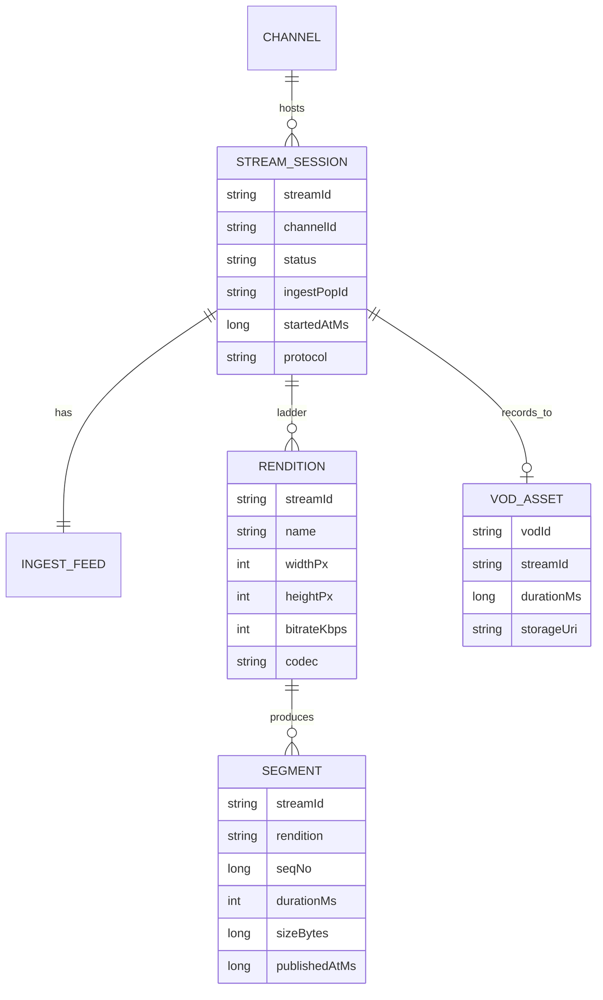
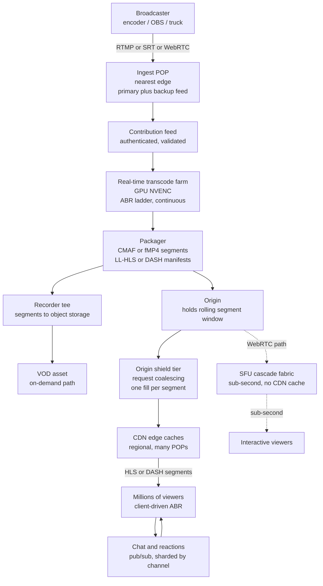
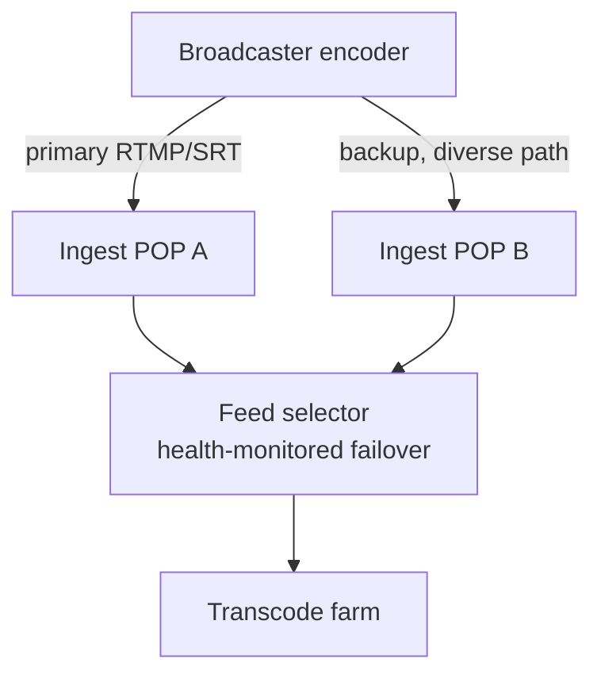
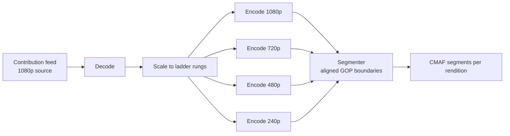
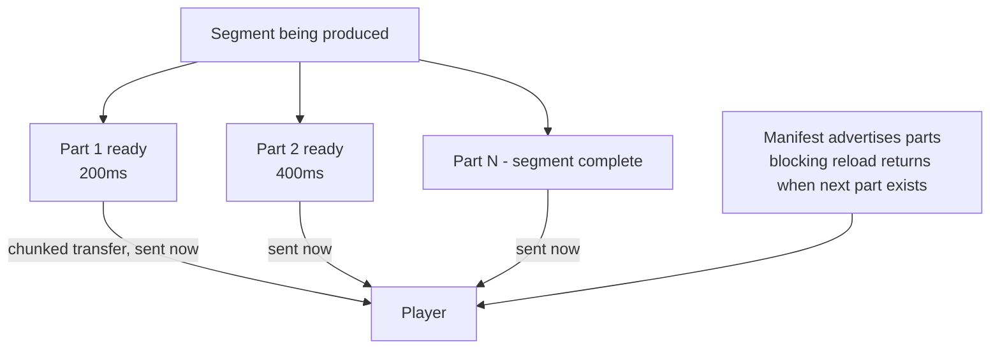
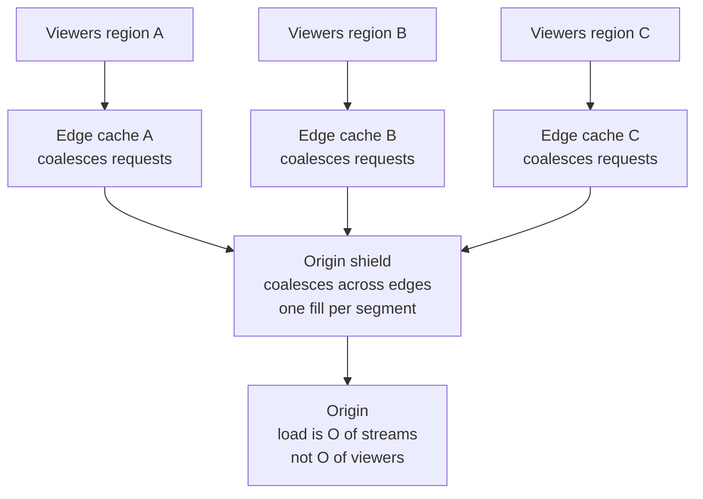
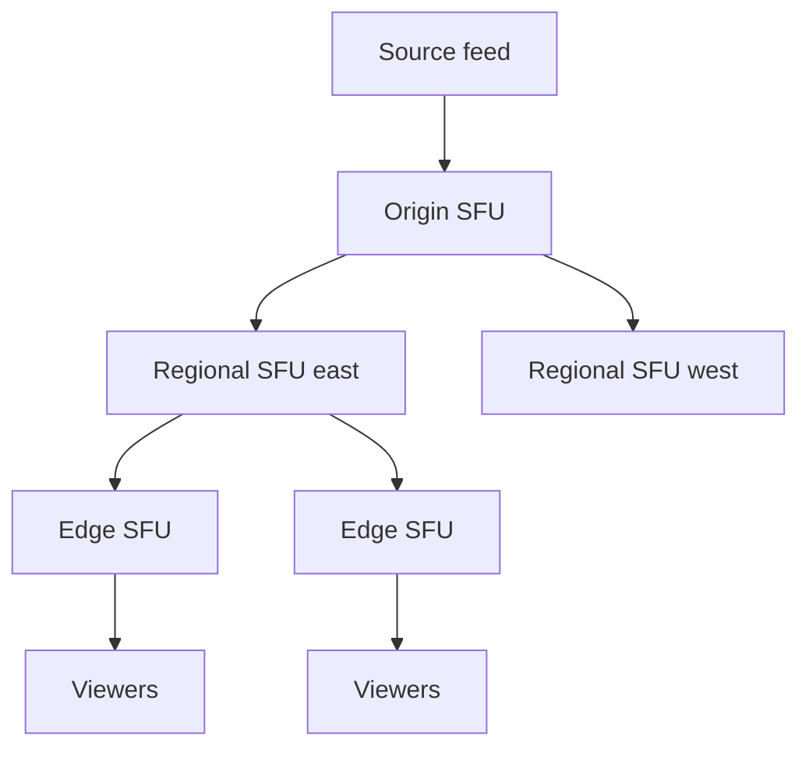
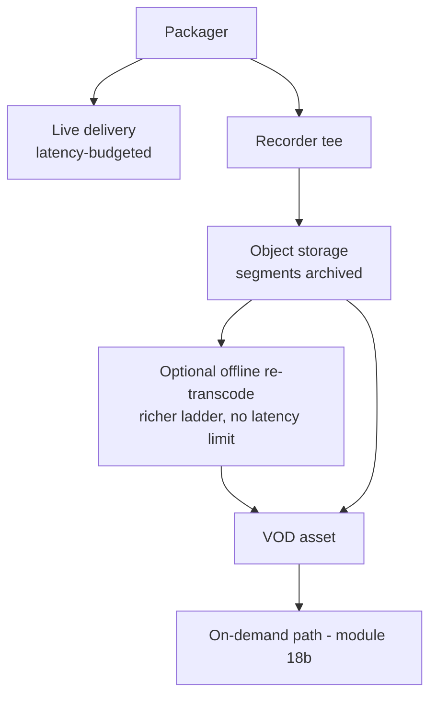

# Module 36 — Design Live Video Streaming at Scale

> The definitive Staff-level reference for **live** video — Twitch, YouTube Live, a Super Bowl or cricket-final stream watched by *tens of millions concurrently*. This is the **real-time counterpart to VOD** (Netflix/YouTube on-demand live in [18b Media designs](18b-design-media-productivity.md)). VOD and live share a vocabulary — transcode, ABR, HLS/DASH, CDN — but invert one axis: in VOD the content already exists and the whole pipeline can be *slow* (a 4K upload may take minutes to transcode before anyone watches); in live, the content is being *created right now*, the entire **ingest → transcode → package → distribute** pipeline runs in real time, and the product is defined by a **latency budget measured in seconds**. That single inversion — *a real-time pipeline you cannot pre-bake* — plus **fanning one source out to millions of simultaneous viewers** is what this prompt is testing.

## What you'll master

By the end of this module you will hear "design Twitch / YouTube Live / a live sports stream for millions" and immediately earmark the three things that win the room: **the real-time pipeline** (a broadcaster's single contribution feed must be ingested, transcoded into an ABR ladder, and packaged into segments *continuously, live*, with every stage adding to a latency budget you must defend), **the latency-vs-scale-vs-compatibility trade-off** (interactive sub-second over WebRTC, low-latency ~2–5s over LL-HLS, or rock-solid ~10–30s over standard HLS — and *why you can't have all three*), and **fan-out to millions** (one source feeding tens of millions of viewers, which is a CDN edge-caching problem for HLS/DASH but an *SFU/cascade* problem for WebRTC because WebRTC does not CDN-cache). You'll size it with a *correct* BOTEC — **concurrent viewers, ingest streams, and egress bandwidth**, never DAU-as-RPS — and you'll know the punchline that frames the whole design: for a stream of this size, **egress bandwidth is the dominant cost and the thundering-herd on each new segment is the dominant scaling hazard**, not storage.

This module is deliberately structured to *contrast with VOD at every step*. Where VOD says "transcode offline, store every rendition forever, pre-position popular titles," live says "transcode in real time, cache each segment only for its few-second lifetime, and there is no pre-positioning because the content doesn't exist yet." Hold that contrast in your head and you can derive the rest. For the chat/reactions/interactivity layer see [09 Real-Time](09-realtime-systems.md); for the blob/segment store and origin see [08 Storage](08-storage.md); for edge routing and request coalescing see [05 Load Balancing](05-load-balancing.md); for the viewer/ingest/egress math see [30 Capacity Estimation](30-capacity-estimation.md).

---

## Table of Contents

1. [In the Room — Delivering This at Staff Level](#1-in-the-room--delivering-this-at-staff-level)
2. [Problem framing](#2-problem-framing)
3. [Requirements — functional + non-functional](#3-requirements--functional--non-functional)
4. [Capacity estimation — the correct BOTEC](#4-capacity-estimation--the-correct-botec)
5. [API + protocols](#5-api--protocols)
6. [Data model](#6-data-model)
7. [High-level architecture](#7-high-level-architecture)
8. [Deep dives](#8-deep-dives)
   - [8.1 Ingest — the contribution feed](#81-ingest--the-contribution-feed)
   - [8.2 Real-time transcoding pipeline](#82-real-time-transcoding-pipeline)
   - [8.3 Packaging + low-latency delivery](#83-packaging--low-latency-delivery)
   - [8.4 Distribution / fan-out to millions](#84-distribution--fan-out-to-millions)
   - [8.5 Adaptive bitrate on the client](#85-adaptive-bitrate-on-the-client)
   - [8.6 Interactivity — chat, reactions, sync, DVR](#86-interactivity--chat-reactions-sync-dvr)
   - [8.7 Scale + failure + live-to-VOD](#87-scale--failure--live-to-vod)
9. [Scaling & bottlenecks](#9-scaling--bottlenecks)
10. [Trade-offs & failure modes](#10-trade-offs--failure-modes)
11. [What the interviewer is really testing + Staff insight](#11-what-the-interviewer-is-really-testing--staff-insight)
12. [Interview Cheat-Sheet](#12-interview-cheat-sheet)
13. [Common Interview Questions](#13-common-interview-questions)

---

## 1. In the Room — Delivering This at Staff Level

### 1.1 Earmark the crux in the first 60 seconds

The instant you hear "live streaming," name the three hard parts and the one inversion that separates this from VOD. Everything else is supporting cast.

> **The crux is three things, and I'll spend my time here:** (1) **The real-time pipeline** — unlike VOD I can't pre-bake anything; a single broadcaster contribution feed has to be ingested, transcoded into a full ABR ladder, and segment-packaged *live and continuously*, and every stage spends part of a latency budget I'll defend out loud. (2) **The latency-vs-scale-vs-compatibility trade-off** — I'll pick a delivery protocol (LL-HLS for ~2–5s glass-to-glass at CDN scale, WebRTC only if I genuinely need sub-second interactivity) and justify it, because you cannot get sub-second latency, CDN-scale fan-out, and universal device compatibility all at once. (3) **Fan-out to millions** — one source to tens of millions of concurrent viewers is an edge-caching + origin-shielding + request-coalescing problem for HLS/DASH, but an SFU/cascade problem for WebRTC because WebRTC traffic does not CDN-cache. Get those three right and the design is right.

Naming the *pipeline*, the *latency/scale trade-off*, and *fan-out* — and explicitly contrasting with VOD — before drawing a box is the strongest Staff signal in this question.

### 1.2 Decide, don't enumerate — the load-bearing decisions

| Decision | Decide this | Because | Revisit if |
|---|---|---|---|
| Ingest protocol | **RTMP for compatibility, SRT/RTMP-over-QUIC for lossy networks, WebRTC for sub-second contribution** | RTMP is universally supported by encoders; SRT survives packet loss on the contribution link; WebRTC when the *broadcaster* needs sub-second (a co-host, an auction caller) | A flagship event over a flaky uplink → SRT; a two-way interactive show → WebRTC ingest |
| Transcode | **Real-time ABR-ladder transcode on a GPU farm, segment-by-segment** | Live means the transcoder runs at ≥1× wall-clock forever; GPUs (NVENC) give density and bounded latency | Single-rendition pass-through if the source is already a fixed ladder |
| Container/segments | **CMAF / fMP4 with short (1–2s) segments + chunked parts (LL-HLS/LL-DASH)** | One CMAF set serves both HLS and DASH; short chunked segments are what *enable* low latency | Legacy clients needing classic TS segments |
| Default delivery | **Low-Latency HLS (LL-HLS) over a multi-tier CDN** | ~2–5s glass-to-glass, CDN-cacheable, near-universal device support — the right default for "millions watching" | Sub-second *interactive* requirement → WebRTC via SFU/cascade (gives up CDN caching) |
| Fan-out | **Multi-tier CDN: edge caches segments, origin-shield tier coalesces, origin transcodes once** | Live segments are short-lived but *highly* cacheable for their lifetime; one origin fill serves an entire region | WebRTC path: replace CDN with an SFU cascade/fabric |
| Recording | **Tee the ingest/packaged segments to object storage → live-to-VOD asset** | The live stream is also archived; reuse the VOD delivery path after the event | Ephemeral/no-DVR streams skip it |

### 1.3 Name-and-move-on vs. deep-dive

**Name-and-move-on (one sentence each):** auth/login, the channel/creator metadata CRUD (standard read-heavy web stack behind a cache), billing/subscriptions, the recommendation feed, the exact RTMP handshake bytes, the precise CMAF box structure, DRM key-exchange specifics. Know they exist; don't recite them.

**Deep-dive (where this round is won):** redundant ingest and the contribution feed (§8.1); the real-time ABR transcode and the latency it adds (§8.2); LL-HLS vs WebRTC vs standard HLS and the trade-off table (§8.3); CDN fan-out, origin shielding, the per-segment thundering herd and request coalescing, and why WebRTC needs an SFU (§8.4); client ABR and startup latency (§8.5); chat/sync interactivity (§8.6); failure modes and live-to-VOD (§8.7).

> **Staff-level insight:** The single biggest tell is whether you treat live as "VOD but faster" (wrong) or as a *real-time pipeline with a latency budget* (right). Say early: *"Every box in this pipeline costs me milliseconds-to-seconds of glass-to-glass latency, and unlike VOD I can't hide any of it behind pre-processing. So I'm going to track a latency budget — ingest, transcode, segment duration, CDN hops, client buffer — and pick a protocol whose budget matches the product. And because each segment is requested by millions at once the instant it's published, my scaling hazard is a thundering herd I defeat with origin shielding and request coalescing, not raw origin capacity."*

---

## 2. Problem framing

**Live video streaming** takes a *single* source feed produced in real time by a **broadcaster** (a streamer's PC + encoder, a stadium's production truck, a phone going live) and delivers it to a **large, simultaneous audience** with the smallest practical delay. The unit of work is a continuous feed, not a finished file.

The core mental model is a **one-to-many real-time pipeline** with five stages, each adding latency:

```
Broadcaster → INGEST → TRANSCODE (ABR ladder) → PACKAGE (segments) → DISTRIBUTE (CDN/SFU) → millions of viewers
```

What makes this *hard* and distinct from VOD:

- **You cannot pre-process.** VOD's write pipeline can take minutes (transcode a 3-hour upload into 15 renditions, store them, pre-position popular titles at the edge). Live has *no* such luxury — the transcoder must keep up with wall-clock *forever*, and the first segment must reach viewers seconds after it was filmed.
- **Latency is a product decision, not a constant.** "Glass-to-glass" (camera to viewer screen) ranges from ~10–30s (standard HLS) down to <1s (WebRTC). The right number depends on the use case: a movie premiere tolerates 20s; a live auction, a sports-betting feed, or a two-way show needs sub-second. The protocol *is* the latency choice.
- **Fan-out is extreme and synchronized.** Millions of viewers want the *same* live edge of the *same* stream at the *same* moment — they all request segment N within the same second it's published. That synchronization is what creates the thundering herd and is why naive origin capacity fails.
- **It's a continuous, unbounded stream, not a finite asset.** There's no "file size"; there's a *bitrate × duration × viewers* egress firehose that runs for the length of the event.

Scope for the interview: design the live ingest → transcode → package → distribute pipeline, the fan-out tier, and the interactivity (chat/sync) layer; record the live stream to a VOD asset. Out of scope unless asked: the creator-onboarding CRUD, recommendations, monetization/ads, content moderation ML (name it as a downstream consumer of the feed).

---

## 3. Requirements — functional + non-functional

### 3.1 Functional

- **Ingest a live contribution feed** from a broadcaster over RTMP / SRT / WebRTC, with **redundant ingest** (a backup feed) for flagship events.
- **Transcode in real time** into an **ABR ladder** — multiple resolution/bitrate renditions (e.g. 240p → 1080p/4K) — so every viewer's player can pick the rung their network supports.
- **Package** the renditions into segmented, CDN-friendly media (CMAF/fMP4) with a continuously updated **manifest/playlist**.
- **Distribute** to millions of concurrent viewers with **client-driven adaptive bitrate**.
- **Low startup latency** — time-to-first-frame when a viewer joins.
- **Interactivity** — live **chat**, **reactions**, and (for some products) **sub-second sync** for betting/auctions/Q&A.
- **DVR / rewind** — let viewers pause and seek back within the live window.
- **Record to VOD** — archive the live stream as an on-demand asset available after (or during) the broadcast.

### 3.2 Non-functional

| Requirement | Target | Why it drives the design |
|---|---|---|
| **Glass-to-glass latency** | Pick per product: **standard HLS ~10–30s**, **LL-HLS ~2–5s**, **WebRTC <1s** | The protocol choice *is* this number; it dictates fan-out architecture |
| **Startup latency** | Time-to-first-frame **< ~2s** | Drives short segments, a small start buffer, fast manifest delivery |
| **Concurrent viewers** | **Millions to tens of millions** on one event | Drives multi-tier CDN, origin shielding, request coalescing |
| **Egress throughput** | **Tens of Tbps** at a mega-event peak | The dominant cost center; drives CDN offload + codec efficiency |
| **Availability of the live edge** | No single broadcaster/transcoder failure kills the stream | Redundant ingest, hot-standby transcode, multi-CDN |
| **ABR smoothness** | Few rebuffers; smooth quality switches | Client buffer management, a sane ladder, CMAF |
| **Scalability of fan-out** | Sub-linear origin load vs. viewer count | Edge caching + shielding makes origin load ≈ O(streams), not O(viewers) |
| **Chat scale** | Hundreds of thousands of messages/sec at peak | Pub/sub fan-out, sharded by channel (see [09 Real-Time](09-realtime-systems.md)) |

The tension to state explicitly — and the whole design hinges on it: **latency vs. scale vs. compatibility.** Lower latency means shorter segments / chunked transfer / WebRTC, which means *less* cacheable, *more* origin pressure, and *narrower* device support. You pick a point on that triangle per product; you do not get all three corners.

---

## 4. Capacity estimation — the correct BOTEC

The trap here is identical to the one [30 Capacity Estimation](30-capacity-estimation.md) drills: **do not turn DAU into RPS.** Live load is not "requests per second from a user count" — it's **(a) the number of concurrent *ingest* streams**, **(b) the number of concurrent *viewers*** and the *egress bandwidth* they pull, and **(c) the request rate against the edge for new segments.** Size those three.

### 4.1 The mega-event scenario

Take a marquee live sports final: **10 million concurrent viewers** at peak, one (logical) source stream, an event lasting ~3 hours.

### 4.2 Egress bandwidth — the headline number (and the dominant cost)

This is the number that frames everything.

- Viewers spread across the ABR ladder; assume an **average sustained bitrate of ~5 Mbps** (mix of 1080p and lower rungs).
- Peak egress ≈ **10,000,000 viewers × 5 Mbps = 50,000,000 Mbps = 50 Tbps.**
- That is *tens of terabits per second* leaving the CDN edge — for **one** event. This is the cost center and the reason the entire design is built around **CDN offload and codec efficiency** (every 30% bits saved by a better codec or per-title ladder saves ~30% of a 50 Tbps bill).
- Total bytes for the event ≈ 50 Tbps × 3 h × 3600 s ≈ **~67,500 Tb ≈ ~8.4 PB egressed**. Note the contrast with VOD: this is *transient egress*, not stored data.

> **Correctness guardrail (egress vs storage):** for a stream of this size, **egress dominates cost by orders of magnitude over storage.** You store the source + ABL renditions of the recording *once* (a few hundred GB to low TB for a 3-hour multi-rendition archive), but you egress *petabytes*. Optimizing bits-on-the-wire (codec, ladder, CDN offload) pays far more than optimizing storage. Say this out loud.

### 4.3 Ingest streams — small but critical

- A single event is **one logical ingest** (plus a **redundant backup** feed = 2 contribution streams). A *platform* like Twitch has **millions of channels** but only the *concurrently live* ones matter — say **~100k concurrent live streams** platform-wide at peak.
- Ingest bandwidth is tiny next to egress: 100k streams × ~6 Mbps source ≈ **~600 Gbps ingest** — three orders of magnitude below the 50 Tbps egress of a single mega-event's audience. The asymmetry (small ingest, huge egress) is the defining shape of live streaming. Name it.

### 4.4 Transcode compute — real-time, forever

- Each live stream is transcoded into a ladder of **~5–6 renditions**, in **real time** (≥1× wall-clock, continuously).
- A GPU (NVENC) can transcode several live ABR ladders concurrently. At ~100k concurrent streams × a ladder each, you need a **GPU farm of thousands of encoders** running continuously — and crucially, capacity must be *provisioned for peak concurrency*, because unlike VOD you can't queue the work for later.
- Contrast with VOD: VOD transcode is a **throughput** problem (a queue you can drain over minutes); live transcode is a **latency + always-on** problem (must keep pace with the clock, can never fall behind).

### 4.5 Segment request rate — the thundering-herd number

- With **2s segments**, every viewer fetches **~1 segment / 2s per rendition** ≈ **0.5 req/s/viewer** for media (plus periodic manifest refreshes).
- 10M viewers × 0.5 ≈ **5M segment requests/sec** at the edge — but they are **synchronized**: nearly all of them ask for segment N in the *same* ~2-second window it becomes available. That synchronized burst is the **thundering herd**; the design defeats it with **edge caching + origin shielding + request coalescing** so the *origin* sees ~1 request per segment per shield, not 5M.

> **The BOTEC punchline to say out loud:** *"Load here is concurrent viewers and egress, not DAU-as-RPS. One mega-event is ~10M concurrent viewers pulling ~5 Mbps each ≈ 50 Tbps of egress — that's the dominant cost, dwarfing storage, so the design optimizes bits-on-the-wire and offloads everything to the CDN. Ingest is tiny by comparison (one source plus a backup). The scary scaling number isn't raw QPS, it's that millions request the same new segment in the same 2-second window — a thundering herd I kill with origin shielding and request coalescing so the origin sees one fill per segment, not millions."*

---

## 5. API + protocols

Live streaming is **protocol-defined**, so the "API" is really the *contribution* protocols (broadcaster → platform) and the *delivery* protocols (platform → viewer), plus a thin control plane.

### 5.1 Contribution / ingest protocols (broadcaster → ingest POP)

| Protocol | Transport | Latency | When to use |
|---|---|---|---|
| **RTMP** | TCP | low (sub-second on the link) | Default — universally supported by OBS/hardware encoders; the de-facto ingest standard |
| **SRT** | UDP + ARQ | low, *loss-resilient* | Unreliable/long-haul contribution links (remote venue, cellular uplink) — recovers from packet loss without TCP head-of-line stalls |
| **WebRTC (WHIP)** | UDP/SRTP | **sub-second** | When the *broadcaster* needs interactive sub-second (co-hosting, auction caller, two-way) |
| **RTMP-over-QUIC / RIST** | UDP | low, resilient | Modern resilient contribution alternatives — name and move on |

### 5.2 Delivery protocols (platform → viewer) — the trade-off triangle

| Protocol | Glass-to-glass | CDN-cacheable? | Compatibility | Use it for |
|---|---|---|---|---|
| **Standard HLS / DASH** | **~10–30s** | Yes (segments, very cacheable) | Universal | Massive passive audiences where latency is fine |
| **LL-HLS / LL-DASH** | **~2–5s** | Yes (chunked parts, still cacheable) | Broad | **The default** for "millions watching" with low latency |
| **WebRTC** | **<1s (sub-second)** | **No** (per-peer, SRTP, not HTTP segments) | Browser/app, no plain CDN | True interactivity: betting, auctions, two-way, conferencing |

This table *is* the trade-off. HTTP-segment protocols (HLS/DASH/LL-HLS) ride the CDN and scale to tens of millions cheaply but pay seconds of latency. WebRTC gives sub-second but **cannot use a CDN** — it needs an SFU/cascade fabric (§8.4) and is far more expensive per viewer. Pick LL-HLS as the default; reach for WebRTC only when sub-second is a hard product requirement.

### 5.3 Control-plane REST (thin)

```
POST /v1/streams                  -> create a stream; returns ingest URL + stream key
POST /v1/streams/{id}/start       -> broadcaster goes live (ingest POP begins accepting)
GET  /v1/streams/{id}/playback    -> returns the playback manifest URL (per protocol)
GET  /hls/{id}/master.m3u8        -> master manifest (rendition list); served via CDN
GET  /hls/{id}/{rendition}.m3u8   -> media playlist (rolling list of recent segments)
GET  /cdn/{id}/{rendition}/seg_{n}.m4s  -> a media segment (served & cached at the edge)
POST /v1/streams/{id}/stop        -> end the live stream; finalize the VOD recording
```

The **master manifest** is requested once and is highly cacheable; the **media playlist** is a *rolling window* that updates every segment (so it's cached only for the segment duration); the **segments** are the bulk of the bytes and are cached for their short lifetime. Understanding these three different cache lifetimes is a depth signal (§8.4).

---

## 6. Data model

Live streaming is light on persistent relational state and heavy on *transient* media flowing through. The persisted entities are small; the segments are short-lived blobs.



- **STREAM_SESSION** is the live broadcast: which channel, status (`STARTING/LIVE/ENDED`), which ingest POP terminated it, the chosen delivery protocol.
- **RENDITION** rows describe the ABR ladder for this session (the rungs).
- **SEGMENT** is the *transient* unit: a 1–2s chunk per rendition, identified by a monotonic `seqNo`. Segments live in an **edge/origin cache for seconds** (their playback-window lifetime) and are optionally **teed to object storage** for the VOD recording. The *live media playlist* is just the rolling list of the most recent segments' `seqNo`s.
- **VOD_ASSET** is what the live stream becomes after recording — it flows into the on-demand path in [18b Media designs](18b-design-media-productivity.md).

### What is NOT in this model

There is **no giant table of every segment forever** and **no per-viewer state in the hot media path** — viewers are anonymous to the segment cache; the CDN serves the same bytes to everyone. Session/auth/entitlement is checked at manifest issuance (a signed/tokenized URL), *not* on every segment. The relational store holds channel/session metadata; the heavy data is media-in-flight (cache) plus the VOD archive (object store, see [08 Storage](08-storage.md)).

---

## 7. High-level architecture



The dataflow, narrated: a **broadcaster** pushes a single **contribution feed** (RTMP/SRT/WebRTC) to the **nearest ingest POP**, which authenticates it and accepts a **redundant backup** feed in parallel. The **real-time transcode farm** (GPU) continuously produces the **ABR ladder**; the **packager** cuts CMAF/fMP4 segments and updates the rolling manifests. Packaged segments land at the **origin** (a short rolling window) *and* are **teed to object storage** to become the **VOD recording**. For the dominant HTTP path, the **origin-shield tier coalesces** the synchronized burst of requests for each new segment into a single origin fill, then **CDN edge caches** fan that one segment out to millions. For a sub-second interactive product, the WebRTC path replaces the CDN with an **SFU cascade**. Orthogonal to media, the **chat/reactions** layer is a pub/sub system sharded by channel ([09 Real-Time](09-realtime-systems.md)).

Contrast with the VOD architecture in [18b](18b-design-media-productivity.md): VOD has a *slow write pipeline* (upload → queue → batch transcode → store all renditions forever) and a *fast read pipeline* meeting at object storage. Live collapses both into **one always-on real-time pipeline** where the "write" and "read" happen within seconds of each other and storage is mostly a side-tee for the recording.

---

## 8. Deep dives

### 8.1 Ingest — the contribution feed

#### The contribution link

The **contribution feed** is the single most precious link in the system: if it dies, *everyone's* stream dies, because there's exactly one source. The broadcaster's encoder pushes to the **nearest ingest POP** (an edge entry point) to minimize the first-mile latency and to land on infrastructure you control as early as possible.

- **RTMP over TCP** is the default — universally supported by OBS, hardware encoders, and mobile SDKs. Its weakness is TCP head-of-line blocking on a lossy uplink: one lost packet stalls the stream.
- **SRT** (or RIST / RTMP-over-QUIC) is the answer for **unreliable contribution links** — a stadium on cellular backhaul, a remote correspondent. SRT runs over UDP with its own selective retransmission (ARQ) and a configurable latency buffer, so it *recovers from packet loss without stalling*. Choose SRT when the uplink is the risk.
- **WebRTC (WHIP)** for the broadcaster only when the *contributor* needs sub-second (a live auctioneer whose calls must be near-instant, a two-way show).

#### Redundant ingest

For any event you can't afford to drop, run **two contribution feeds** (primary + backup), ideally over **diverse network paths** into **two ingest POPs**. The transcode tier consumes the healthy one and **fails over to the backup** if the primary's segments stop arriving or degrade — without restarting the downstream pipeline. This is the live analog of "no single point of failure," applied to the one link that has no natural replication.



> **Staff-level insight:** *"The contribution feed is the one link with no natural redundancy — there's a single source — so I make it redundant explicitly: primary plus backup over diverse paths into two ingest POPs, with a health-monitored selector that fails over without restarting the pipeline. And I choose the ingest protocol by the uplink: RTMP by default for encoder compatibility, SRT when the contribution network is lossy because TCP would head-of-line-stall, WebRTC only if the broadcaster themselves needs sub-second."*

---

### 8.2 Real-time transcoding pipeline

#### Why transcode live at all, and why it's hard

The broadcaster sends *one* rendition (say 1080p @ 6 Mbps). But viewers have wildly different networks, so you must produce an **ABR ladder** (e.g. 1080p/4Mbps, 720p/2.5Mbps, 480p/1.2Mbps, 360p/0.7Mbps, 240p/0.3Mbps) *live*, so each player can pick its rung. The hard part vs. VOD: this transcode **must keep pace with wall-clock, continuously, forever** — it cannot queue, fall behind, or be "eventually" done. Falling behind real-time means growing latency or dropped frames.

#### The pipeline and the latency it adds



- Every stage costs latency. The big contributors: the **encoder lookahead / GOP structure** (B-frames and rate-control lookahead buffer frames), the **segment duration** (you can't publish a segment until it's complete — a 2s segment inherently adds up to ~2s), and any **buffering** between stages. The Staff move is to *budget* this: e.g. ~200–500ms encode + 2s segment + CDN/client buffer.
- **Aligned GOP/segment boundaries across renditions** are mandatory: every rung must cut segments at the *same* timestamps (IDR-frame-aligned), so the client can switch rungs seamlessly at a segment boundary. Misaligned segments break ABR switching.

#### The GPU farm

Real-time transcode at scale runs on **GPUs (NVENC) or dedicated ASICs**, not general CPUs, for two reasons: **density** (one GPU encodes many ladders concurrently → far better cost per stream) and **bounded, predictable latency** (hardware encode is steadier than CPU under load). Capacity is **provisioned for peak concurrency** — you cannot defer live work, so headroom is a reliability requirement, not a cost optimization. Contrast with VOD, where transcode is a drainable queue on a cheaper CPU/ASIC farm.

> **Staff-level insight:** *"Live transcode is a real-time, always-on latency problem, not a throughput queue like VOD. It must hold ≥1× wall-clock forever, so I run it on a GPU/ASIC farm provisioned for peak concurrency. I cut segments at IDR-aligned GOP boundaries identical across every rung so the client can switch quality seamlessly, and I track the latency each stage adds — encoder lookahead plus segment duration are the two big ones — because that sum is most of my glass-to-glass budget."*

---

### 8.3 Packaging + low-latency delivery

#### Packaging once for everyone

The packager wraps the encoded renditions into **CMAF (fMP4) segments** and emits **manifests** (HLS `.m3u8` and/or DASH `.mpd`). The win of CMAF is **one set of segments serves both HLS and DASH** — you don't double your storage/cache by packaging twice. The **media playlist is a rolling window** of the most recent segments (live edge), updated each time a new segment publishes; older segments fall off (or stay in a DVR window, §8.6).

#### The latency-vs-scale-vs-compatibility trade-off — in detail

| Approach | Mechanism | Glass-to-glass | Scale (fan-out) | Compatibility | Cost |
|---|---|---|---|---|---|
| **Standard HLS/DASH** | Complete segments (4–6s), fetched after fully written | **~10–30s** | Excellent — fully CDN-cacheable | Universal | Low |
| **LL-HLS / LL-DASH** | Segments split into **partial chunks** delivered via **HTTP chunked transfer** before the full segment is done; manifest advertises parts; blocking playlist reload | **~2–5s** | Very good — still CDN-cacheable (with CDN LL support) | Broad (modern players) | Low–moderate |
| **WebRTC** | Per-peer SRTP media over UDP, no segments | **<1s** | Poor without an SFU; needs SFU **cascade** fabric | Browser/app only, no plain CDN | High per viewer |

The key insight: **lower latency comes from shrinking the unit of delivery** (full segment → partial chunk → per-frame WebRTC), and the smaller and more "live-edge" the unit, the *less* it caches and the *more* origin pressure and device-specific machinery it needs. **LL-HLS is the sweet spot** for "millions watching with low latency": it gets to ~2–5s by transmitting **partial segments** as they're produced (chunked transfer encoding + a "blocking playlist reload" so the client gets the next part the instant it exists) while remaining an HTTP-cacheable protocol that rides the CDN. Reserve **WebRTC** for genuinely interactive sub-second products, accepting that you trade away CDN caching.



> **Staff-level insight:** *"I default to LL-HLS over a CDN: ~2–5s glass-to-glass by sending partial segments via chunked transfer with blocking playlist reloads, while staying a cacheable HTTP protocol so it fans out to tens of millions cheaply. I only reach for WebRTC when sub-second interactivity is a hard requirement — and I say the cost out loud: WebRTC doesn't CDN-cache, so I'd need an SFU cascade and accept a much higher per-viewer cost. The latency-scale-compatibility triangle means I pick two corners; LL-HLS is the pragmatic choice for a mass live audience."*

---

### 8.4 Distribution / fan-out to millions

This is the heart of the scaling story and the sharpest contrast with VOD.

#### Live segments ARE cacheable — for their short lifetime

A common misconception is "live can't be cached because it's always new." Wrong: **each segment is immutable once published and is requested by millions in the same instant** — which makes it *extremely* cacheable for its brief lifetime. A 2s segment requested by 10M viewers needs to be fetched from origin **once per edge** and served from cache 10M times. The cache TTL is short (seconds), but the **cache hit ratio within that window is enormous**. This is why a CDN works beautifully for live HTTP delivery — *if* you handle the synchronized burst.

#### The thundering herd + request coalescing + origin shielding

The hazard: the instant segment N is published, *every* viewer's player asks for it within the same ~2s window. Naively, that's millions of near-simultaneous requests, and on a **cold** edge cache they would all **miss and stampede the origin** at once (the **thundering herd**). Defenses, layered:

1. **Multi-tier CDN** — viewers hit **regional edge caches** (thousands of POPs), not the origin. Most requests are served from edge cache.
2. **Request coalescing (cache locking)** — when a segment is *not yet* in an edge cache and N requests for it arrive together, the edge sends **exactly one** request upstream and **holds the other N−1** until the fill returns, then serves them all from the now-warm cache. One origin fill, not N.
3. **Origin shield tier** — a mid-tier between edges and origin that *also* coalesces, so the **many edges** collapse into **one** origin fetch per segment. With shielding, **origin load ≈ O(number of streams), not O(number of viewers)** — the single most important sentence in the fan-out story.



#### Multi-CDN

Mega-events typically use **multiple CDNs** simultaneously, with client steering (DNS / a steering service) splitting viewers across them for **capacity headroom** and **failover** — no single CDN has 50 Tbps of spare regional capacity, and one CDN degrading shouldn't black out the event.

#### Why WebRTC fan-out is fundamentally different (SFU / cascade)

WebRTC does **not** produce cacheable HTTP segments — it's per-peer encrypted UDP media. So you **cannot put it behind a CDN**. To fan out one source to many WebRTC viewers you need an **SFU (Selective Forwarding Unit)**: a media server that receives the one source stream and **forwards copies** to each connected viewer. One SFU has finite connection/bandwidth capacity (thousands of viewers), so for millions you build an **SFU cascade / tree**: the origin SFU feeds regional SFUs, which feed edge SFUs, which feed viewers — a hand-built fan-out fabric replacing what the CDN does for free in the HTTP path. This is *why WebRTC is reserved for when sub-second truly matters*: you're rebuilding the CDN's fan-out yourself, at much higher cost.



> **Staff-level insight:** *"The counterintuitive truth is live segments ARE highly cacheable — millions want the same immutable segment in the same 2-second window, so one origin fetch serves the whole region. My job is the synchronized burst: request coalescing at the edge plus an origin-shield tier means origin load scales with the number of streams, not the number of viewers — that's the line that wins fan-out. I run multi-CDN for headroom and failover. And I'm explicit that this only works for HTTP segments — WebRTC can't CDN-cache, so sub-second forces me into an SFU cascade where I hand-build the fan-out tree at far higher cost."*

---

### 8.5 Adaptive bitrate on the client

#### Client-driven, because only the endpoint knows the network

ABR switching is **client-side**: the player measures its **download throughput** and **buffer level** and picks the highest ladder rung it can sustain, switching at **segment boundaries** (which is why aligned GOPs from §8.2 matter). Server-side ABR exists but the default is client-driven — *only the endpoint sees the real-time network*, and it can react per-segment without a round trip to the server. State this as a decision: *client-driven ABR because only the player knows its instantaneous throughput; revisit toward server-side only for tight per-device control or DRM reasons.*

#### Buffer management and the live-latency tension

The player keeps a small **buffer** (a few segments) to ride out throughput dips without rebuffering. Here's the live-specific tension: **a bigger buffer = fewer rebuffers but more latency** (you're playing further behind the live edge), while **a smaller buffer = lower latency but more rebuffer risk.** VOD can buffer generously (latency doesn't matter on-demand); live must keep the buffer *small* to stay near the live edge, which makes it more rebuffer-prone — so a *good* ladder (a low rung that almost any network sustains) and *fast* ABR reaction matter more in live.

#### Startup latency (time-to-first-frame)

When a viewer joins, time-to-first-frame is driven by: fetching the manifest, fetching enough of a **low** initial rendition to start playing (start low, then ramp up), and filling the minimum start buffer. Levers: **short segments / partial segments** (LL-HLS lets you start mid-segment), **start at a low rung** then adapt up, and **CDN-cached manifest + segment** so the join is an edge hit. Target < ~2s.

> **Staff-level insight:** *"ABR is client-driven because only the player sees its real-time throughput; it switches rungs at aligned segment boundaries. The live-specific twist is the buffer trade-off: live must run a small buffer to stay near the live edge, which trades away rebuffer cushion — so I lean on a sane low rung and fast adaptation rather than a deep buffer. For startup I begin on a low rung from an edge-cached segment and ramp up, targeting under two seconds to first frame."*

---

### 8.6 Interactivity — chat, reactions, sync, DVR

Live is *social and interactive* in a way VOD isn't, and these run as **separate systems alongside the media pipeline**, not inside it.

#### Live chat + reactions

Chat is a **pub/sub fan-out** problem, **sharded by channel** — full treatment in [09 Real-Time](09-realtime-systems.md). At a mega-event, hundreds of thousands of messages/sec arrive and must fan out to millions of viewers. Key moves: persistent connections (WebSocket) with regional gateways, a per-channel pub/sub topic, **rate limiting and slow-mode**, and for ultra-high-volume channels **message sampling/conflation** (don't deliver every one of 500k msgs/sec to every viewer — sample, or summarize). Reactions (heart/emote bursts) are even higher volume and *lossy by design* — **aggregate and conflate** (send "1,200 hearts in the last second," not 1,200 individual events).

#### Synchronized low-latency for betting / auctions

For **live betting, auctions, or interactive game shows**, the *interaction* must be tightly synchronized to the *video* and sub-second — a bet placed must close before the outcome is visible. This is the case that **forces WebRTC** (or at least the tightest LL-HLS) on the video path, and it forces the interaction events onto the same low-latency real-time channel so the "betting window closes" signal and the video frame line up. The Staff point: **the latency requirement of the interaction dictates the video protocol**, not the other way around.

#### DVR / rewind

DVR lets a viewer **pause and seek back** within a sliding window of the live stream. Implementation: **keep a longer rolling window of recent segments available** (e.g. the last 2–4 hours) at the edge/origin, and let the player request older `seqNo`s — it's the *same* segments, just a wider retention window and a player that can seek. A "go live" button snaps back to the live edge. This naturally overlaps with the recording (§8.7): the DVR window and the VOD archive are the same segments at different retention tiers.

> **Staff-level insight:** *"Chat, reactions, and the video are separate systems — chat is per-channel pub/sub fan-out (its own scaling problem, see the real-time module), and at extreme volume I conflate reactions and sample chat rather than deliver every event. The sharp judgment call is interactive betting/auctions: there the interaction's sub-second sync requirement is what forces a sub-second video protocol like WebRTC — the interactivity drives the video architecture. DVR is just a wider retention window over the same segments, which is the same machinery as recording to VOD."*

---

### 8.7 Scale + failure + live-to-VOD

#### Failure modes specific to live

| Failure | Impact | Defense |
|---|---|---|
| **Broadcaster disconnect** | The single source drops → whole stream dead | **Redundant ingest** (primary+backup, §8.1); a "stream interrupted, reconnecting" slate; brief reconnection window before ending the session |
| **Transcoder failure** | A rendition (or the whole ladder) stops | **Hot-standby transcode** consuming the same ingest; the packager fails over; clients drop to a still-healthy rung; aligned segments make the switch seamless |
| **Origin / shield failure** | New segments can't be fetched | Redundant origin + shield; **multi-CDN** so a region can fail over; edges keep serving the cached window during a brief origin blip |
| **CDN region overload** | Rebuffering / failures in a region | Multi-CDN steering shifts viewers; ABR drops viewers to lower rungs to shed egress |
| **Thundering herd on a new segment** | Origin stampede | **Request coalescing + origin shield** (§8.4) — designed-in, not a failure response |
| **Chat overload** | Message delivery falls behind | Per-channel sharding, rate limiting, slow-mode, conflation/sampling |

The live-specific reliability mindset: **graceful degradation over hard failure.** When you can't deliver perfectly, you **lower quality** (drop ABR rungs to shed egress), **increase latency** (let buffers grow), or **show a slate** — but you keep *something* on screen. Black is the worst outcome.

#### Live-to-VOD (the recording)

The live stream is almost always **recorded to a VOD asset**. Implementation: **tee the packaged segments (or the source) to object storage** as they're produced ([08 Storage](08-storage.md)). After (or during) the event, those segments become an **on-demand asset** served by the VOD path in [18b Media designs](18b-design-media-productivity.md) — possibly re-transcoded into a richer ladder offline (now that latency doesn't matter), or served directly from the live renditions for instant replay. This is where live and VOD **merge**: the same content, first delivered live under a latency budget, then served on-demand under a storage/egress budget.



> **Staff-level insight:** *"The reliability stance is degrade, never go black: redundant ingest for the broadcaster, hot-standby transcode, multi-CDN — and when stressed I shed egress by dropping ABR rungs, grow buffers to add latency, or show a slate. And the live stream is also a VOD: I tee packaged segments to object storage as they're produced, so the broadcast becomes an instant-replay on-demand asset, optionally re-transcoded offline once the latency budget no longer applies. Live and VOD are the same content under two different cost models — latency for live, storage-and-egress for on-demand."*

---

## 9. Scaling & bottlenecks

| Bottleneck | Wrong instinct | Right move |
|---|---|---|
| Millions of viewers on one stream | Add origin capacity | **Edge cache + origin shield + request coalescing** so origin load is O(streams), not O(viewers); **multi-CDN** for headroom |
| The new-segment thundering herd | Hope the cache is warm | **Cache locking / request coalescing** at edge *and* shield — one fill per segment |
| Egress cost (50 Tbps) | Eat it | **CDN offload + codec efficiency (per-title ladder, AV1/HEVC)** — every 30% bits saved is 30% of a giant egress bill |
| Real-time transcode at peak | Queue it like VOD | **You can't queue live** — provision the **GPU farm for peak concurrency**; it must hold ≥1× wall-clock |
| Sub-second fan-out (WebRTC) | Put it on a CDN | **SFU cascade fabric** — WebRTC doesn't cache; hand-build the fan-out tree (and reserve it for when sub-second is mandatory) |
| The single contribution feed | Assume it won't drop | **Redundant ingest** over diverse paths with health-monitored failover |
| Chat at mega-event volume | One global chat bus | **Shard by channel**, rate-limit, **conflate/sample** at extreme volume ([09 Real-Time](09-realtime-systems.md)) |
| Manifest churn | Cache the media playlist forever | The rolling media playlist updates every segment — cache it only for the **segment duration**; the master manifest caches long |

The clean mental model: **almost everything scales horizontally and is absorbed by the CDN, *except* the single contribution feed (made redundant explicitly), the real-time transcode (provisioned for peak, can't be queued), and the WebRTC path (which gives up the CDN and needs a hand-built SFU cascade).** Origin load is kept ≈ O(streams) by shielding, which is the whole trick that lets one source reach tens of millions.

---

## 10. Trade-offs & failure modes

### 10.1 Key trade-offs

| Trade-off | The tension | Resolution |
|---|---|---|
| **Latency vs. scale vs. compatibility** | Sub-second, CDN-scale, and universal support can't all hold | Pick a point per product: **LL-HLS** (low latency + scale + broad support) by default; **WebRTC** only when sub-second is mandatory (sacrifices CDN scale & compatibility); **standard HLS** when latency truly doesn't matter |
| **Segment length: latency vs. overhead/cacheability** | Shorter segments = lower latency but more requests, more overhead, smaller cache units | **Short segments (1–2s) + LL-HLS partial chunks**; balance against per-request overhead |
| **Buffer: smoothness vs. latency** | Bigger client buffer = fewer rebuffers but further behind live | Live keeps the buffer **small**; lean on a good low rung + fast ABR instead |
| **Transcode cost vs. quality** | A richer ladder / better codec costs more compute | GPU/ASIC density + per-title ladders; AV1/HEVC where decode support exists (saves egress, the bigger bill) |
| **Egress vs. everything** | 50 Tbps egress dominates cost | **CDN offload + codec efficiency** beat any storage optimization by orders of magnitude |
| **WebRTC interactivity vs. cost/scale** | Sub-second is great but doesn't cache | Reserve WebRTC for genuine interactivity; pay for the SFU cascade only there |

### 10.2 Failure modes

- **Broadcaster disconnect** → redundant ingest failover; reconnection window; slate rather than ending instantly.
- **Transcoder failure** → hot-standby transcode on the same ingest; clients fall to a healthy rung; aligned segments make it seamless.
- **Origin / shield blip** → edges keep serving the cached rolling window; redundant origin + multi-CDN absorb it.
- **CDN region overload** → multi-CDN steering + ABR rung-dropping to shed egress.
- **Thundering herd** → request coalescing + origin shielding (designed in).
- **Network degradation for a viewer** → client ABR drops to a lower rung; small buffer rides short dips.
- **Total inability to deliver** → **degrade, don't go black**: lower quality, grow latency, or show a slate.

See [05 Load Balancing](05-load-balancing.md) for edge routing / coalescing, [08 Storage](08-storage.md) for the origin/recording store, and [09 Real-Time](09-realtime-systems.md) for the chat/sync fan-out failure modes.

---

## 11. What the interviewer is really testing + Staff insight

This prompt checks whether you can reason about a **real-time pipeline under a latency budget at massive fan-out** — and whether you understand precisely how live *differs* from VOD rather than reflexively reusing the VOD answer.

| The reflex they're testing against | What they want to hear |
|---|---|
| "It's YouTube, transcode offline and store renditions" | "Live can't pre-bake — real-time transcode on a GPU farm, provisioned for peak, must hold wall-clock" |
| "Live can't be cached, it's always new" | "Each segment is immutable and requested by millions in the same window — highly cacheable for its lifetime; one origin fill per segment per shield" |
| "Add origin servers for more viewers" | "Origin load is O(streams) not O(viewers) via edge caching + shielding + request coalescing" |
| "Just use WebRTC for low latency" | "WebRTC doesn't CDN-cache — sub-second forces an SFU cascade at high cost; LL-HLS is the default sweet spot" |
| "DAU × actions = RPS" | "Concurrent viewers and egress (tens of Tbps) are the load; the herd on each new segment is the scaling hazard" |
| "Optimize storage" | "Egress dominates cost by orders of magnitude — optimize bits-on-the-wire and CDN offload" |

They're probing four competencies: **(1) the real-time pipeline** — can you reason about a continuous, can't-fall-behind ingest→transcode→package flow and *budget its latency*; **(2) the latency-scale-compatibility trade-off** — can you choose a delivery protocol from requirements and defend it; **(3) fan-out at scale** — edge caching, origin shielding, request coalescing, thundering herd, multi-CDN, and why WebRTC needs an SFU; **(4) correct sizing** — concurrent viewers and egress, not DAU-as-RPS, with egress as the dominant cost.

> **The Staff insight that ties it together:** *"Live streaming is VOD with the time axis inverted: the content is created in real time, so nothing can be pre-baked, every pipeline stage spends part of a glass-to-glass latency budget I must defend, and the protocol I pick — WebRTC, LL-HLS, or standard HLS — is the latency decision. The scary scale isn't QPS; it's tens of millions of viewers pulling tens of Tbps of egress and all demanding the same new segment in the same two-second window. I beat that with the one idea that makes the whole thing work: edge caching plus origin shielding plus request coalescing, so origin load scales with the number of streams, not the number of viewers — and that single property is why one source can reach the whole planet."*

---

## 12. Interview Cheat-Sheet

**Recognize:** "Twitch / YouTube Live / live sports for millions" → this module. Earmark the crux: **real-time pipeline + latency-vs-scale-vs-compatibility + fan-out to millions.** Contrast explicitly with VOD ([18b](18b-design-media-productivity.md)).

**The pipeline:** Broadcaster → **Ingest** → **real-time transcode (ABR ladder, GPU)** → **package (CMAF segments)** → **distribute (CDN or SFU)** → viewers. Every stage costs latency; you can't pre-bake.

**Ingest:** **RTMP** default (encoder compat), **SRT** for lossy uplinks (UDP+ARQ, no TCP head-of-line stall), **WebRTC** for sub-second contribution. **Redundant ingest** = primary+backup over diverse paths with failover (the one link with no natural redundancy).

**Transcode:** real-time, **must hold ≥1× wall-clock forever** (not a queue like VOD); **GPU/ASIC farm provisioned for peak**; **IDR-aligned GOP/segment boundaries** across all rungs so ABR can switch seamlessly. Encoder lookahead + segment duration are the big latency costs.

**Delivery protocols (the triangle):** **Standard HLS/DASH ~10–30s** (universal, fully cacheable); **LL-HLS ~2–5s** (partial segments via chunked transfer + blocking playlist reload, still CDN-cacheable — **the default**); **WebRTC <1s** (per-peer, **not cacheable**, needs SFU). You pick two corners of latency/scale/compatibility, not three.

**Fan-out:** Live segments **ARE cacheable** (immutable, millions want the same one in the same window). Beat the **thundering herd** on each new segment with **request coalescing (cache locking) + origin shield tier** → **origin load = O(streams), not O(viewers)**. **Multi-CDN** for headroom/failover. **WebRTC needs an SFU cascade** because it doesn't CDN-cache.

**ABR:** **client-driven** (only the endpoint knows its throughput), switches at segment boundaries. Live keeps a **small buffer** (stay near live edge) → trades rebuffer cushion → lean on a good low rung. Startup < ~2s: start low rung from edge-cached segment, ramp up.

**Interactivity:** chat = **per-channel pub/sub fan-out** ([09 Real-Time](09-realtime-systems.md)); **conflate reactions, sample chat** at extreme volume. **Betting/auctions: the interaction's sub-second sync forces the video protocol** (WebRTC). **DVR = wider retention window over the same segments.**

**BOTEC:** load = **concurrent viewers + egress**, NOT DAU-as-RPS. 10M viewers × ~5 Mbps ≈ **50 Tbps egress** = the dominant cost (storage is trivial by comparison; optimize bits-on-the-wire). Ingest is tiny (one source + backup). Segment-request rate is **synchronized** → herd.

**Failure:** **degrade, never go black** — drop ABR rungs (shed egress), grow buffers (add latency), or show a slate. Redundant ingest, hot-standby transcode, multi-CDN.

**Live-to-VOD:** **tee segments to object storage** → on-demand asset (optionally re-transcoded offline). Live and VOD are the same content under two cost models.

**The signature line:** *"Live is VOD with the time axis inverted — nothing pre-baked, every stage on a latency budget, and origin load kept O(streams) not O(viewers) via edge caching + shielding + request coalescing. That's how one source reaches tens of millions."*

---

## 13. Common Interview Questions

**1. How is live streaming different from VOD — why can't you just use the YouTube design?**
VOD's pipeline can be slow: upload, queue, batch-transcode into every rendition over minutes, store them forever, pre-position popular titles. Live inverts the time axis — the content is created in real time, so **nothing can be pre-baked**: the transcoder must hold wall-clock continuously, the first segment must reach viewers seconds after filming, and there's no pre-positioning because the content doesn't exist yet. The product is defined by a **glass-to-glass latency budget** (seconds), and the protocol choice *is* that budget. VOD optimizes a slow-write/fast-read split meeting at storage; live is one always-on real-time pipeline.

**2. Walk me through the latency-vs-scale-vs-compatibility trade-off and what you'd pick.**
Three options. **Standard HLS/DASH**: ~10–30s, fully CDN-cacheable, universal — for passive massive audiences. **LL-HLS**: ~2–5s by sending partial segments via chunked transfer with blocking playlist reloads, still CDN-cacheable and broadly supported — the **default** for millions watching with low latency. **WebRTC**: sub-second but per-peer, **not CDN-cacheable**, needs an SFU. You can't have sub-second, CDN-scale, and universal compatibility at once — lower latency means a smaller delivery unit that caches less and needs more device-specific machinery. I default to **LL-HLS** and reach for WebRTC only when sub-second interactivity is a hard requirement.

**3. How do you serve one stream to 10 million concurrent viewers without melting the origin?**
The key realization: **live segments are highly cacheable** — each is immutable and requested by millions in the same ~2-second window. I put a **multi-tier CDN** in front: regional edge caches serve most requests; **request coalescing (cache locking)** means when a segment isn't yet cached and N requests arrive together, the edge makes **one** upstream fetch and serves the rest from cache; an **origin-shield tier** coalesces across all edges. Net: **origin load = O(number of streams), not O(viewers)** — one fill per segment per shield. Plus **multi-CDN** for headroom and failover. That O(streams) property is the whole trick.

**4. What's the thundering herd here and how do you handle it?**
The instant segment N publishes, *every* viewer's player requests it within the same ~2s window — a synchronized burst that, on a cold cache, would stampede the origin. I defeat it with **request coalescing at the edge and origin shield** (collapse simultaneous misses into one upstream fill) and short-TTL caching of the immutable segment. It's designed in, not a failure response.

**5. Why can't WebRTC just go behind a CDN like HLS?**
Because WebRTC isn't HTTP segments — it's per-peer encrypted UDP media (SRTP), so there's nothing cacheable to fan out. To reach many viewers you need an **SFU (Selective Forwarding Unit)** that receives the source and forwards copies to each peer, and since one SFU's capacity is finite, you build an **SFU cascade/tree** (origin SFU → regional → edge → viewers) — hand-building the fan-out the CDN gives you for free in the HTTP path. That's why WebRTC is far more expensive per viewer and reserved for genuine sub-second interactivity.

**6. Size the system — what are the real numbers?**
Load is **concurrent viewers and egress**, not DAU-as-RPS. 10M concurrent × ~5 Mbps average ≈ **50 Tbps egress** for one event — that's the dominant cost, dwarfing storage, so I optimize bits-on-the-wire (codec efficiency, per-title ladder, CDN offload). **Ingest is tiny** — one source plus a backup, ~12 Mbps. Transcode is a **GPU farm provisioned for peak concurrency** (can't queue live work). Segment requests are ~5M/sec but **synchronized**, which is the herd, not raw QPS — handled by shielding.

**7. How does the ABR ladder get produced live, and what's the latency cost?**
The broadcaster sends one rendition; a **real-time GPU transcode farm** produces the full ladder (e.g. 1080p down to 240p) continuously, **cutting segments at IDR-aligned GOP boundaries identical across every rung** so the client can switch quality seamlessly. The big latency contributors are **encoder lookahead** (B-frames/rate-control buffer) and **segment duration** (you can't publish a segment until it's complete — a 2s segment adds up to 2s). I budget those explicitly; they're most of my glass-to-glass time. And it must hold ≥1× wall-clock forever — falling behind grows latency or drops frames.

**8. The broadcaster's feed drops mid-event. What happens?**
The contribution feed is the one link with no natural redundancy, so I make it redundant explicitly: **primary + backup feeds over diverse network paths into two ingest POPs**, with a health-monitored selector that fails over **without restarting the downstream pipeline**. If both genuinely drop, I show a "reconnecting" **slate** and hold a reconnection window before ending the session — degrade, never instantly go black.

**9. How do you keep latency low for live betting where the bet must close before the outcome is shown?**
This is the case where the **interaction's sub-second sync requirement dictates the video protocol** — I'd use **WebRTC** (or the tightest LL-HLS) so video is sub-second, and put the betting-window-close signal on the **same low-latency real-time channel** so it lines up with the frame. The interactivity drives the architecture here, not the other way around — I accept the SFU-cascade cost because correctness (bet closes before reveal) demands it.

**10. Do you record the live stream, and how does it become a VOD?**
Yes — I **tee the packaged segments (or source) to object storage** as they're produced. Those segments become an **on-demand asset** served by the VOD path: I can serve the live renditions directly for instant replay, or **re-transcode offline into a richer ladder** now that the latency budget no longer applies. DVR/rewind is the same mechanism with a wider retention window. Live and VOD end up being the same content under two cost models — latency for live, storage-and-egress for on-demand.

---

> **Cross-links:** [18b Media designs](18b-design-media-productivity.md) (VOD — the on-demand counterpart this module contrasts with; the live recording flows into its delivery path) · [09 Real-Time](09-realtime-systems.md) (live chat, reactions, and synchronized interactivity as pub/sub fan-out) · [08 Storage](08-storage.md) (origin segment store, object storage for the live-to-VOD recording) · [05 Load Balancing](05-load-balancing.md) (edge routing, request coalescing, origin shielding, multi-CDN steering) · [30 Capacity Estimation](30-capacity-estimation.md) (concurrent-viewer + egress BOTEC, not DAU-as-RPS; egress dominates storage; the synchronized-segment herd).
