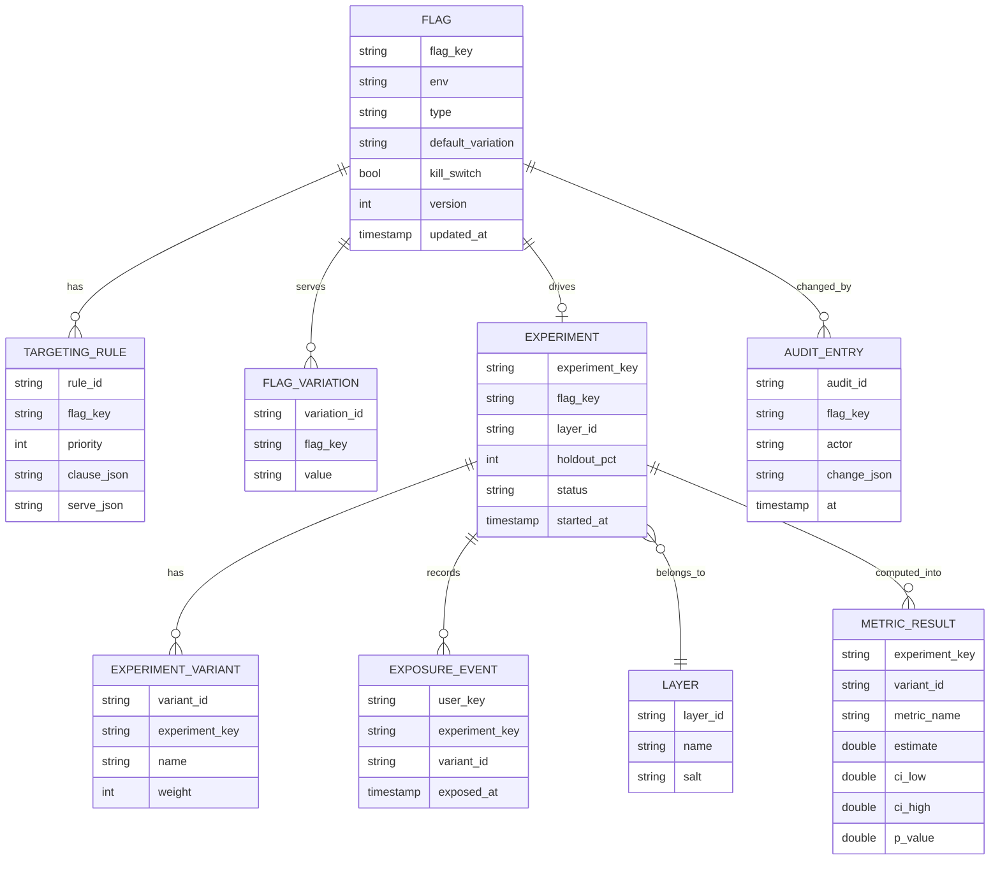
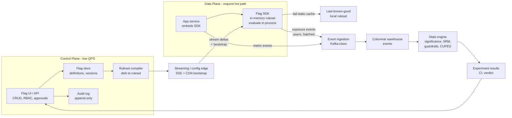
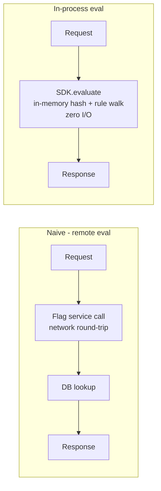
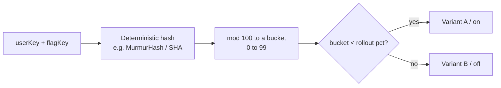
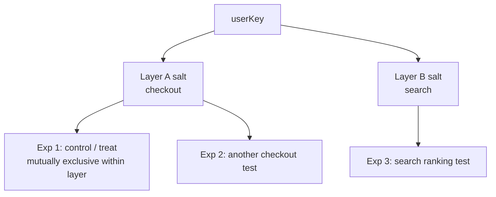
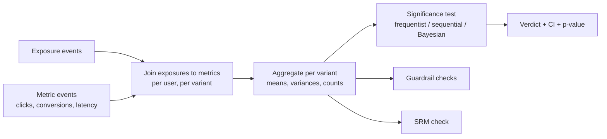
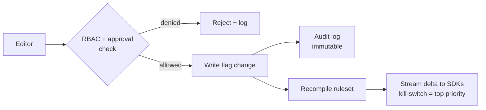

# Module 37 — Design a Feature Flag & A/B Testing / Experimentation Platform

> The definitive feature-flag + experimentation reference for Staff / Principal / Senior-EM system-design interviews — sub-millisecond in-process flag evaluation, deterministic sticky bucketing, and a statistics engine that decides whether an experiment actually moved the metric.

## What you'll master

Almost every candidate describes feature flags as "a boolean in a config table the app reads." Staff candidates design the **system that evaluates flags in the request hot path in well under a millisecond, never breaks the app when the flag service is down, assigns users to experiment variants deterministically and consistently, and then runs the statistics that tell you whether the change worked.** LaunchDarkly, Optimizely, Split, and Statsig exist because each of those three sub-problems — hot-path evaluation, consistent bucketing, and the stats engine — is genuinely hard at scale. By the end you will be able to:

- Run a feature-flag / experimentation design end-to-end with the **10-part structure** and a **correct BOTEC** (flag-evals/sec, ruleset distribution bandwidth, experiment event volume — never DAU-as-RPS).
- Make flag evaluation **in-process at the edge / in the SDK** — the SDK pulls the ruleset and evaluates locally, so there is **zero network in the hot path** and the flag service being down can never break the application (**fail-static** to last-known-good).
- Design **deterministic, sticky bucketing** — `hash(userId + flagKey)` → bucket so a user always gets the same variant across requests, devices, and time, enabling correct percentage rollouts and clean experiments.
- Build the **experiment-assignment** layer — randomized hash-based assignment, holdouts, layers / mutually-exclusive experiments, and **sample-ratio-mismatch (SRM)** detection that catches a broken experiment before you trust its result.
- Design the **statistics engine** — event collection, metric computation, **frequentist vs sequential vs Bayesian** significance, **guardrail metrics**, **CUPED** variance reduction, the **peeking problem**, and minimum-detectable-effect / sample-size math.
- Build the **control plane** — flag CRUD, environments, audit log, approvals, RBAC, and the **kill-switch** that turns a flag off globally in seconds.
- Defend the **failure modes** — config service down (fail-static), bad rollout (kill-switch), assignment inconsistency, and metric-pipeline lag.

Cross-references: [03 Caching](03-caching.md) · [12 Observability](12-observability.md) · [33 Code Deployment](33-design-deployment-system.md) · [16 Data Processing](16-data-processing.md) · [13 Security](13-security.md)

---

## Table of Contents

1. [In the Room — Delivering This at Staff Level](#in-the-room--delivering-this-at-staff-level)
2. [Problem Framing](#1-problem-framing)
3. [Requirements — Functional + Non-Functional](#2-requirements--functional--non-functional)
4. [Capacity Estimation (Correct BOTEC)](#3-capacity-estimation-correct-botec)
5. [API / SDK Design](#4-api--sdk-design)
6. [Data Model](#5-data-model)
7. [High-Level Architecture](#6-high-level-architecture)
8. [Deep Dives](#7-deep-dives)
   - [7.1 Low-Latency Flag Evaluation (the crux)](#71-low-latency-flag-evaluation-the-crux)
   - [7.2 Targeting + Consistent Bucketing](#72-targeting--consistent-bucketing)
   - [7.3 Experiment Assignment](#73-experiment-assignment)
   - [7.4 The Statistics / Metrics Engine](#74-the-statistics--metrics-engine)
   - [7.5 The Control Plane](#75-the-control-plane)
   - [7.6 Scale — Evals, Ruleset Distribution, Event Ingestion](#76-scale--evals-ruleset-distribution-event-ingestion)
   - [7.7 Failure Modes](#77-failure-modes)
9. [Scaling & Bottlenecks](#8-scaling--bottlenecks)
10. [Trade-offs & Failure Modes](#9-trade-offs--failure-modes)
11. [What the Interviewer Is Really Testing](#10-what-the-interviewer-is-really-testing--staff-insight)
12. [Interview Cheat-Sheet](#interview-cheat-sheet)
13. [Common Interview Questions](#common-interview-questions)

---

## In the Room — Delivering This at Staff Level

A junior answers this as **a config lookup**: "the app calls a flag service, which reads a row from a database, and returns true or false." That answer fails on the two things that actually matter. First, **it puts a network call in the request hot path** — now every flag check adds a round-trip and a dependency that, when it's slow or down, makes your whole application slow or down. Second, **it stops at the boolean** and never reaches the part that makes this a *platform*: deterministic bucketing and the statistics that decide whether the experiment worked. The hard part of a feature-flag and experimentation system is not *storing a flag* — any database does that. The hard part is **evaluating flags at millions/sec with zero hot-path latency and zero ability to break the app, assigning users to variants consistently forever, and computing trustworthy statistical results.**

Earmark the crux early and out loud. The moment scale is established, say:

> "The interesting part here isn't the flag CRUD — it's three things, and I'll spend my time there: **flag evaluation has to be in-process and sub-millisecond, with zero network in the hot path and fail-static so the flag service being down never breaks the app; bucketing has to be deterministic and sticky so a user always gets the same variant; and the experiment stats engine has to decide significance correctly — handling peeking, guardrails, and sample-ratio mismatch.** Flag CRUD, environments, and audit I'll design correctly but quickly."

That framing is the Staff signal. It says you know where the risk and the depth live. Three decisive framings to plant:

- **"Evaluation is local, not remote."** The SDK pulls the ruleset and evaluates flags **in-process** — zero network calls per flag check. The control plane streams config updates; it is never in the request path. This is the single most important architectural decision and it's the opposite of the naive "call the flag service" answer.
- **"It must fail static, never fail closed-and-break."** If the flag service is unreachable, the SDK serves the **last-known-good ruleset from local cache** (and a hardcoded default if it has nothing). A flag system that can take down the app it's embedded in is worse than no flag system at all.
- **"An experiment is a statistical claim, and most teams get the statistics wrong."** Sticky deterministic bucketing, sample-ratio-mismatch detection, the peeking problem, and guardrail metrics are where a Staff candidate separates — because shipping a "win" that was actually noise is the failure mode that costs companies real money.

> **Staff-level insight:** The interviewer is testing whether you understand that a flag SDK is **embedded inside every one of your services in the request path** — so its availability and latency requirements are *stricter than the flag service's own*, which is why evaluation must be local and fail-static. And they're testing whether you treat an experiment as a *statistical instrument* (deterministic assignment, SRM, peeking, variance reduction) rather than "ship to 50%, eyeball the dashboard." Candidates who only draw "app → flag service → DB" are designing a config store, not an experimentation platform.

---

## 1. Problem Framing

**What we're building.** A platform with two tightly-coupled halves: **(1) feature flagging** — dynamically control which code paths / variants a given user sees, decoupled from deployment, with instant rollout and kill-switch; and **(2) experimentation (A/B testing)** — randomly assign users to variants, collect metrics, and run the statistics that determine whether a variant caused a measurable change.

**Scope it explicitly** (say this out loud to bound the problem):

- **In scope:** flag definition + targeting rules → ruleset distribution to SDKs → in-process evaluation → exposure/event logging → experiment assignment → metric pipeline → statistical analysis → flag CRUD / control plane / kill-switch / audit.
- **Adjacent, name and defer:** the general analytics/event warehouse (we *produce* exposure + metric events into it, [16 Data Processing](16-data-processing.md)); the data-science notebook / dashboards layer (consumes our results); the deployment system that ships the code behind a flag ([33 Code Deployment](33-design-deployment-system.md) — flags and deploys are complementary: deploy ships code dark, flag turns it on).
- **Two flag types to distinguish:** **server-side** (SDK in your backend services — the high-QPS, in-process case) and **client-side** (browser / mobile — where you can't ship the full ruleset for security and size reasons, so evaluation is either server-evaluated or a scoped ruleset is pushed). I'll design for the server-side high-scale case and note where client-side differs.

**The core tension to name:** **decouple release from deploy, and do it without adding latency or a failure dependency to the request path.** Engineers want to flip behavior instantly without redeploying; the app cannot afford a network call or an outage on every flag check. The whole design resolves that tension by **moving evaluation into the process** and making the control plane a *background* config-sync, never a hot-path dependency.

**Who's the user?** Three personas: the **developer** (wants "wrap this code in a flag, evaluate it instantly with no latency, and never have the flag system break my service"), the **product manager / data scientist** (wants "run an experiment, target a segment, and tell me with statistical confidence whether it worked — and stop me from fooling myself"), and the **on-call / release engineer** (wants "a kill-switch that turns a bad feature off everywhere in seconds, plus an audit trail of who changed what").

---

## 2. Requirements — Functional + Non-Functional

### Functional

| # | Requirement |
|---|---|
| F1 | **Define a flag** — boolean, multivariate (multiple variants), or a numeric/JSON value, with default and variations. |
| F2 | **Target** — serve a variant based on user attributes, segments, and **percentage rollouts** (e.g., 10% of users in `country=DE`). |
| F3 | **Evaluate** — given a user context + flag key, return the correct variant **in-process, sub-millisecond**, deterministically and stickily. |
| F4 | **Instant rollout / kill-switch** — change targeting (including turn a flag fully off) and have it take effect across the fleet within seconds, no redeploy. |
| F5 | **Run an experiment** — randomly assign users to variants, with holdouts and mutually-exclusive layers, and **log an exposure event** when a user is assigned. |
| F6 | **Collect metrics + analyze** — ingest metric events, compute per-variant metrics, run **statistical significance**, guardrails, and SRM checks; report a verdict + confidence interval. |
| F7 | **Environments** — dev / staging / prod isolation; a flag's targeting differs per environment. |
| F8 | **Control plane** — flag CRUD, audit log, approvals, RBAC, change history. |

### Non-Functional

| Property | Target / stance |
|---|---|
| **Eval latency (the #1 NFR)** | Flag evaluation is **in-process, < 1 ms** (effectively a hash + rule walk in local memory). **Zero network in the hot path.** |
| **Fail-static availability** | The flag SDK **must not fail closed in a way that breaks the app.** If the control plane is unreachable, evaluate against the **last-known-good ruleset**; if none, return the code-supplied default. The app's availability must not depend on the flag service being up. |
| **Bucketing determinism** | A given user gets the **same variant** for a flag across requests, servers, restarts, and time (sticky) — without coordination, purely from a deterministic hash. |
| **Config propagation latency** | A flag change reaches all SDKs in **seconds** (streaming), so kill-switch is fast. |
| **Statistical correctness** | Results must be trustworthy: correct significance testing, SRM detection, guardrails, no naive peeking. A false "win" is the headline failure. |
| **Scale** | **Millions of evals/sec** (in-process, so this is cheap); ruleset distribution to hundreds of thousands of SDK instances; billions of exposure/metric events/day. |
| **Auditability / governance** | Every flag change is in an immutable audit log; prod changes can require approval (RBAC). |
| **Multi-environment isolation** | A dev flag flip cannot affect prod; environments are first-class and isolated. |

> **Decisive framing:** Lead with **eval latency + fail-static** as the dominant NFRs. "Throughput of flag evals is huge but cheap because evaluation is in-process; the binding constraints are *hot-path latency* (so evaluation must be local, not a network call) and *fail-static availability* (so the flag system embedded in every service can never be the thing that takes the service down). I optimize the whole design around those two, and treat the control-plane CRUD as low-QPS plumbing."

---

## 3. Capacity Estimation (Correct BOTEC)

The classic trap: take DAU and call it RPS. **DAU is not the eval rate — and even if it were, evals are in-process so the relevant question isn't "can a service handle the QPS" but "how much memory and propagation bandwidth does the ruleset cost."** Size it on the right quantities: flag-evaluations/sec (to justify in-process), ruleset size + distribution bandwidth, and experiment event volume.

**Assumptions (state, then round):**

- Say **100M DAU**, ~**5,000 req/s × N** in aggregate across the fleet — but the number that matters is **flag evals**, not requests. Each request might check **10–50 flags** (every feature gate, every experiment the user could be in). So:
- If aggregate request rate across the fleet is ~**1M req/s** at peak, and each request evaluates ~**20 flags**, that's **~20M flag evals/sec.** Say this number out loud, then immediately make the decisive point: **"20M evals/sec is a non-starter as remote calls — it would dwarf the app's own traffic and add a round-trip to every flag check. But as *in-process* evaluations (a hash + a rule walk over an in-memory ruleset), 20M/sec across the fleet is essentially free — it's CPU-local. That single fact is why evaluation must be local, and it's the whole architecture."**
- The control plane itself handles only **flag CRUD + ruleset fetches**: maybe a few thousand flags, edited a few hundred times a day → **~tiny write QPS**. SDKs fetch/stream the ruleset, but that's **O(SDK instances), not O(evals)** — see below. The control plane is *not* throughput-bound on evals; it never sees an eval.

**Ruleset size + distribution (the number that shapes config sync):**

- Say **5,000 flags**, each with targeting rules averaging a few KB → ruleset **~5–20 MB** per environment (compressible). This is small enough to **hold entirely in each SDK's memory** — which is what makes in-process evaluation possible.
- Distribute it to **~100,000 SDK instances** (every service replica embeds an SDK). Pushing a full 10 MB ruleset to 100k instances on every change = **1 TB per full push** — wasteful. So: SDKs **stream deltas** (only the changed flag), and bootstrap from a CDN/cache, not a re-fetch of everything. A flag change is a **few KB delta × 100k instances = a few hundred MB** — trivial, and propagates in seconds. (Cross-link [03 Caching](03-caching.md) for the edge/CDN tier.)

**Experiment event volume (the number that shapes the metric pipeline):**

- **Exposure events:** one per user-per-experiment assignment that's actually evaluated. With 100M DAU in, say, 50 experiments each → on the order of **billions of exposure events/day.**
- **Metric events:** clicks, conversions, latency samples, errors — the business events you measure. Easily **tens of billions/day** across all metrics.
- ~10B events/day ÷ ~10⁵ s/day ≈ **~100k events/sec average**, with peaks several× that. This is a **stream-ingestion + batch-aggregation** problem ([16 Data Processing](16-data-processing.md)) — Kafka-class ingest → warehouse/columnar store → scheduled stats jobs. It is the *real* data-scale of the system, distinct from the (cheap, in-process) eval rate.

> **The closing move (per [30 Capacity Estimation](30-capacity-estimation.md)):** "So the meaningful numbers are: **~20M evals/sec, which is free *only because it's in-process* — that's the architecture-deciding number; ~10 MB ruleset, small enough to hold in every SDK's memory and stream as KB deltas; and ~10B+ events/day, which is the actual big-data problem and lives in the metric pipeline, not the request path.** Notice eval rate and event rate are *different systems* with different scaling stories — conflating them is the mistake."

---

## 4. API / SDK Design

Two distinct surfaces: the **SDK** (in-process, hot path, the thing every service embeds) and the **control-plane API** (CRUD, low QPS). The SDK surface is the more important one to get right because it encodes the in-process / fail-static stance.

**The SDK — evaluation is a local function call, not a network call**

```
// Initialize once at process start: SDK fetches the ruleset
// and opens a streaming connection for updates.
client = FeatureClient.init(sdkKey, {
  bootstrap: localCacheOrCDN,     // start from last-known-good, never block
  streaming: true                 // SSE/websocket for live updates
})

// Hot path: pure in-memory evaluation. No I/O. Sub-millisecond.
variant = client.evaluate("new-checkout-flow", userContext, default=false)
//   userContext = { key: "user_123", country: "DE", plan: "pro", ... }
//   returns the variant AND fires an exposure event asynchronously
```

Key properties to call out:

- **`evaluate()` does zero network I/O.** It hashes the user key, walks the in-memory rules for that flag, returns the variant. The `default` argument is the **fail-static fallback baked into the call site** — if the SDK has no ruleset at all, it returns `default` and the app keeps working.
- **Exposure logging is fire-and-forget + batched.** Evaluating a flag emits an exposure event ("user_123 saw variant B of exp X at time T") into a local buffer flushed asynchronously. **It must never block the hot path** and must never throw into the caller. Losing an exposure event degrades stats slightly; blocking the request is unacceptable.
- **Bootstrap is non-blocking.** On init, the SDK serves from a local/CDN-cached ruleset immediately and updates in the background. A cold start with no cache returns `default`s — it never blocks the app waiting on the network.

**Streaming config update (control plane → SDK)**

```
GET /sdk/v1/stream?env=prod&sdkKey=...        // SSE / long-lived connection
<- event: put    { flag: "new-checkout-flow", ruleset_delta: {...} }
<- event: patch  { flag: "...", change: {...} }
<- event: ping                                 // heartbeat
// Fallback if streaming unavailable: poll GET /sdk/v1/ruleset?since=<etag>
```

**Control-plane API (CRUD — low QPS, declarative, audited)**

```
POST /v1/flags
{ "key": "new-checkout-flow", "env": "prod", "type": "boolean",
  "variations": [true, false], "default": false,
  "targeting": {
     "rules": [ { "if": { "attr": "plan", "op": "in", "vals": ["pro"] },
                 "serve": { "rollout": { "true": 20, "false": 80 } } } ],
     "fallthrough": { "serve": false } },
  "kill_switch": false }

PATCH /v1/flags/{key}        // change targeting; takes effect in seconds via stream
POST  /v1/flags/{key}/kill   // instant flag-off; highest-priority change

POST /v1/experiments
{ "key": "checkout-exp-1", "flag": "new-checkout-flow",
  "layer": "checkout-layer",            // mutual exclusion (see §7.3)
  "variants": [ {"name":"control","weight":50}, {"name":"treatment","weight":50} ],
  "holdout_pct": 5,
  "metrics": { "primary": ["conversion_rate"],
               "guardrails": ["page_latency_p99","error_rate"] } }

GET /v1/experiments/{key}/results
<- { "verdict": "SIGNIFICANT", "primary": { "lift": 0.034, "ci": [0.011, 0.057],
       "p_value": 0.002, "method": "sequential" },
     "guardrails": { "page_latency_p99": "OK", "error_rate": "OK" },
     "srm": { "expected": [0.5,0.5], "observed": [0.501,0.499], "status": "PASS" } }
```

> **Staff note:** the single most important API decision is that **`evaluate()` is a local, non-blocking, never-throwing function** — the SDK contract *is* the fail-static guarantee. The control plane is declarative CRUD with an audit log and a dedicated **kill** verb that's treated as the highest-priority, fastest-propagating change. Notice the results endpoint returns a **confidence interval and an SRM status**, not just a boolean "winner" — exposing the statistics is what makes it an experimentation platform rather than a flag store.

---

## 5. Data Model

Separate the **flag/experiment definitions** (control plane, mutable, audited, low-volume) from the **exposure + metric events** (data plane, append-only, enormous). They live in different stores with different scaling stories.



Key modeling decisions:

- **The flag definition is the source of truth that gets compiled into the ruleset** the SDK holds in memory. `version` is monotonic — SDKs reconcile to the highest version they've seen (same generation pattern as a desired-state store).
- **`TARGETING_RULE` is ordered by `priority`** and is a list of (clause → serve) entries; the SDK walks them top-down, first match wins, then `fallthrough`. `serve` can be a fixed variation *or* a percentage rollout (which triggers the bucketing hash, §7.2).
- **`LAYER` carries a `salt`** — experiments in the same layer are mutually exclusive (a user is in at most one of them), achieved by bucketing within the layer's hash space (§7.3). The salt makes re-randomization between layers independent.
- **`EXPOSURE_EVENT` and `METRIC_RESULT` are NOT in the transactional store.** Exposures are append-only at billions/day → they live in the **event/stream pipeline → columnar warehouse** ([16 Data Processing](16-data-processing.md)). `METRIC_RESULT` is the *output* of the scheduled stats jobs, small and queryable.
- **`AUDIT_ENTRY`** is append-only and immutable — every flag/experiment change (who, what, when, before/after). Governance + forensics for "who turned this flag on at 3am."

---

## 6. High-Level Architecture



**Read it as two planes.** The **control plane** (flag UI, store, compiler, audit) is where humans define flags and experiments; it's low-QPS and never touches a request. The **data plane** (app service + embedded SDK) is where evaluation happens — **in-process, in the request path, zero network calls.** The only link between them is the **streaming config edge** that pushes compiled ruleset deltas to the SDKs in the background, plus the **event pipeline** that carries exposures and metrics the *other* way, into the stats engine.

**The SDK is the heart of the data plane.** It holds the compiled ruleset in memory, evaluates flags as a local function, caches the last-known-good ruleset to disk for fail-static restart, and emits exposure/metric events asynchronously. The control plane being down means SDKs stop getting *new* config — they keep evaluating against the cached ruleset, and the app keeps serving. This is the same **static-stability** discipline as the deployment control plane ([33](33-design-deployment-system.md)): the thing that changes behavior is never in the path of behavior already running.

---

## 7. Deep Dives

### 7.1 Low-Latency Flag Evaluation (the crux)

This is the highest-signal section and the one that separates a config store from a flag platform. The naive design — **app → flag service → database → response** — fails on both NFRs: it adds a network round-trip (often more than the rest of the request) to *every flag check*, and it makes the flag service a hard dependency that, when slow or down, slows or breaks every service that checks a flag. With 20M evals/sec, it's also absurd to serve remotely.

**The decision: push the ruleset to the SDK and evaluate in-process.** The SDK fetches the full compiled ruleset for its environment **once at startup**, holds it in memory, and **evaluates flags as a pure local function** — hash the user key, walk the in-memory rules, return the variant. **Zero network calls per evaluation.** The flag check is now a few microseconds of CPU, not a millisecond+ of network.



**Streaming config update — how the in-memory ruleset stays fresh.** The control plane compiles flag definitions into a ruleset and **streams deltas** to SDKs over a long-lived connection (SSE / websocket). When a flag changes, the changed flag's rules are pushed; the SDK patches its in-memory copy. Propagation is **seconds**, which is what makes kill-switch fast. If streaming is unavailable, the SDK **falls back to polling** (`GET /ruleset?since=<etag>`) on an interval — slower propagation, but still correct.

**Fail-static — the non-negotiable availability property.** Evaluation has a strict fallback ladder, and the key word is **static** (serve the last good answer), never *closed* (block / error):

1. **Live ruleset** (streaming connection healthy) → evaluate normally.
2. **Streaming down** → keep evaluating against the **last-known-good in-memory ruleset**; reconnect/poll in the background. Stale config is fine; the app is unaffected.
3. **SDK restarts, control plane unreachable** → bootstrap from the **on-disk cached ruleset** (or a CDN-hosted snapshot). Cross-link [03 Caching](03-caching.md): the CDN snapshot is the bootstrap cache.
4. **Nothing cached at all** (cold process, no network) → return the **code-supplied `default`** at each call site.

At no point does a flag check block on the network or throw into the application. **"The flag system being down can never break the app it's embedded in"** is the whole point — say it explicitly. A flag SDK that fails closed is a self-inflicted outage waiting to happen.

**Bootstrap without blocking startup.** A service starting up must not hang waiting for the ruleset. The SDK initializes from the local/CDN cache **synchronously and instantly**, serves immediately (possibly slightly stale or default), and reconciles to live config in the background. Blocking app startup on the flag service would re-introduce the exact dependency we removed.

**Client-side caveat.** For browser/mobile SDKs you **can't ship the full ruleset** (it leaks targeting logic and is too big), so client-side evaluation either (a) evaluates a **scoped, pre-computed set of flag values for that one user** fetched once, or (b) is server-evaluated. Mention this as the one place the in-process model bends, for security ([13 Security](13-security.md)) and payload reasons.

> **Staff-level insight:** The decisive sentence is **"flag evaluation is an in-process function call against a ruleset the SDK holds in memory — zero network in the hot path — kept fresh by a background config stream and fail-static to the last-known-good ruleset, so the control plane is never in the request path and its outage degrades to stale config, never to a broken app."** That single design choice satisfies both the sub-millisecond latency NFR and the fail-static availability NFR at once, and it's the opposite of the "call the flag service" answer most candidates give.

---

### 7.2 Targeting + Consistent Bucketing

Evaluation in-process is only useful if the *rules* are right and the *bucketing* is consistent. This section is where percentage rollouts and sticky assignment live, and it's a frequent depth probe.

**The rule engine.** A flag's targeting is an **ordered list of rules**, each a clause (predicate over user attributes/segments) → serve directive. The SDK walks them top-down, **first match wins**, falling through to a default. Building blocks:

- **Attribute clauses:** `country in [DE, FR]`, `plan == pro`, `app_version >= 3.2`, `email endsWith @corp.com`.
- **Segments:** named, reusable user sets (`beta-testers`, `internal-employees`) referenced by many flags — define once, target everywhere.
- **Percentage rollouts:** "serve `true` to 10% of matching users" — this is where bucketing comes in.

**Deterministic, sticky bucketing — the core mechanism.** A percentage rollout must give the **same user the same answer every time**, with **no coordination and no stored per-user state.** The trick is a **deterministic hash**:

```
bucket = hash(flagKey_or_salt + ":" + userKey) mod 100        // 0..99
serve "true" if bucket < rolloutPct, else "false"
```



Why this is correct and powerful:

- **Sticky / consistent:** the hash is a pure function of `(userKey, flagKey)`, so the same user always lands in the same bucket → **same variant across requests, servers, restarts, and time.** No database lookup, no coordination — every SDK computes the same answer independently. This is what makes in-process evaluation viable for rollouts.
- **Gradual rollout that doesn't reshuffle:** include the **flag key (or a stable salt) in the hash**, and the *bucket assignment* is stable while you raise the percentage. Going 10% → 20% means the users in buckets 10–19 newly turn on, **but the original 0–9 stay on** — you never flip a user off who was already on. Reshuffling on every percentage change would be a terrible user experience (feature flickers) and would ruin experiment integrity.
- **Per-flag independence:** because the flag key is in the hash, a user in the "on 10%" of flag A is *independently* bucketed for flag B — you don't accidentally correlate rollouts.

**Mutual exclusion via salts.** When two experiments must not overlap (a user in at most one), bucket them within a **shared layer salt** so their bucket ranges are carved out of the *same* hash space and don't intersect (detailed in §7.3). Different salts → independent randomization; same salt with partitioned ranges → mutual exclusion.

**Targeting precedence — get this order right:**

1. **Kill-switch / flag off** → everyone gets the default off variant (highest priority, instant).
2. **Individual targeting / overrides** (specific user keys, e.g., "always on for this QA account").
3. **Rule matches** (attribute/segment clauses), in priority order.
4. **Percentage rollout** within a matched rule (the bucketing hash).
5. **Fallthrough default.**

> **Staff move:** "Percentage rollouts and experiment assignment both rest on **deterministic hashing of `userKey + flagKey/salt` into a bucket** — pure function, no coordination, so every SDK independently computes the same sticky answer. Putting the flag key in the hash gives me two things: a user's bucket is stable as I ramp the rollout (so raising 10% → 20% never flips an already-on user off), and rollouts across flags are independent. That determinism is what makes both in-process evaluation *and* clean experiments possible — they're the same primitive."

---

### 7.3 Experiment Assignment

An experiment is a percentage rollout with statistics attached, but the assignment layer has its own hard parts: randomization, holdouts, mutual exclusion via layers, and detecting when assignment itself is broken (SRM).

**Randomized, hash-based assignment.** Assigning a user to a variant is the same deterministic bucketing as §7.2 — `hash(experimentSalt + userKey) mod 100`, with bucket ranges allocated to variants by weight (0–49 = control, 50–99 = treatment for a 50/50 split). It's **deterministic so it's sticky** (a user stays in their variant for the experiment's life — essential, because a user flipping between control and treatment pollutes both arms) but **randomized across users** because a good hash distributes users uniformly and independently of any user property.

**Exposure logging is what makes it measurable.** Assignment alone isn't enough — you log an **exposure event** ("user X was assigned variant V of experiment E at time T") the first time the user actually *encounters* the experiment. Analysis is done only over **exposed users**, not all assigned users — measuring users who never hit the code path adds noise and dilutes the effect. Exposure must fire from `evaluate()`, asynchronously, exactly where the variant is used.

**Holdouts.** Reserve a small global slice of users (say 5%) who are **held out of all experiments** (or out of a set of related ones) — they see the baseline. Holdouts measure the **aggregate, long-term impact of everything you shipped**: comparing the holdout to everyone else tells you whether the sum of a quarter's "wins" actually moved the top-line metric (it often moves less than the sum of individually-claimed lifts — the "innovation tax" reality check).

**Layers / mutually-exclusive experiments — avoiding interaction effects.** If two experiments both change the checkout button, a user in both can't be cleanly attributed — their interaction confounds both results. **Layers** solve this:



- Experiments in the **same layer share a salt and partition the bucket space** → a user falls into exactly **one** experiment in that layer (mutual exclusion). Two checkout experiments in the checkout layer never overlap on the same user.
- **Different layers use different salts** → assignment is **independent** across layers, so a user can be in one checkout experiment *and* one search experiment simultaneously, and they're statistically orthogonal. This lets you run many experiments concurrently without interaction effects, as long as conflicting ones share a layer. (This is the Optimizely/Google "layers" / "universes" model.)

**Sample Ratio Mismatch (SRM) — the integrity check that catches a broken experiment.** If you assigned 50/50 but observe 52/48 in the data, **something is wrong with the experiment itself** — and you must **not trust its results.** Run a chi-square test on observed vs expected variant counts; a significant deviation (SRM) means a bug: maybe one variant crashes and drops users before exposure, a redirect loses traffic, a bot filter is asymmetric, or assignment is leaking. **SRM is a hard gate: if SRM fails, the result is invalid regardless of how significant the lift looks.** Naming SRM detection is a strong Staff signal — it's the single most common way experiment results are silently wrong, and most candidates have never heard of it.

> **Staff move:** "Assignment is the same deterministic hash as rollouts — sticky per user, random across users — plus three things that make experiments *trustworthy*: **holdouts** to measure the real aggregate impact of everything we shipped, **layers** (shared salt = mutual exclusion within a layer, different salt = independence across layers) so concurrent experiments don't confound each other, and **SRM detection** — a chi-square on observed vs expected split that hard-gates the result, because a 50/50 design landing at 52/48 means the experiment is broken and its 'win' is an artifact."

---

### 7.4 The Statistics / Metrics Engine

This is the half of the system most candidates skip entirely, and going deep here is what marks Principal/EM-level depth. The job: turn billions of exposure + metric events into a **trustworthy verdict** — did variant B *cause* a change in the metric, and how confident are we?

**The pipeline.**



Exposures and metric events stream into the warehouse ([16 Data Processing](16-data-processing.md)); a scheduled job **joins each exposed user to their metric outcomes**, aggregates per variant (mean, variance, count), and runs the tests.

**Significance testing — three approaches, know the trade-offs:**

- **Frequentist (two-sample t-test / z-test on the metric):** the classic A/B test. Compute the difference in means, the standard error, a **p-value** and a **confidence interval**. Reject the null (no effect) if p < α (typically 0.05). Simple and standard — but it assumes you decide the sample size **up front** and look **once**, which collides with how product teams actually behave (they peek daily).
- **The peeking problem (must name).** If you run a t-test and **check it repeatedly as data accumulates, stopping the moment p < 0.05**, your true false-positive rate balloons far above 5% — you'll declare ~3–5× more false "wins" than you think. This is **the** most common way experiment results are wrong. The fix is to **not** use a fixed-horizon test for continuous monitoring.
- **Sequential testing (always-valid p-values / mSPRT):** designed so you **can** look as often as you like and stop early without inflating the error rate. The p-value/CI is valid at every peek. This is what modern platforms (Statsig, Optimizely's "Stats Engine") use precisely because it matches real peeking behavior. The trade-off: slightly less powerful at any fixed sample size, in exchange for valid continuous monitoring.
- **Bayesian:** report the **posterior probability that B beats A** and the expected loss, rather than a p-value. Intuitive for stakeholders ("87% chance treatment is better") and naturally supports continuous monitoring, but requires a prior and is a different mental model. A reasonable choice; the key is *consistency* in how you stop.

**State the rule out loud:** "I'd default to a **sequential / always-valid** method so PMs can peek and stop early without inflating false positives — because the peeking problem is the dominant real-world failure of A/B testing, not the formula of the t-test."

**Guardrail metrics.** Beyond the primary metric you're trying to move, define **guardrails** you must *not* harm — page latency p99, error rate, crash rate, revenue, unsubscribe rate. The engine checks guardrails **alongside** the primary metric: a treatment that lifts conversion 3% but raises p99 latency 200ms or error rate measurably is a **fail**, not a win. Guardrails are how you avoid shipping a local optimum that damages the system. Cross-link [12 Observability](12-observability.md) — guardrails are often your golden signals.

**CUPED — variance reduction (mention with substance).** **CUPED** (Controlled-experiment Using Pre-Existing Data) reduces the variance of your metric by **regressing out each user's pre-experiment behavior.** If a user converted a lot *before* the experiment, they'll likely convert a lot during it regardless of variant — so subtracting that predictable component removes noise that has nothing to do with the treatment. The payoff: **the same statistical power with substantially fewer users / less time** (often 30–50% variance reduction), so experiments conclude faster. Naming CUPED signals you know how real platforms make experiments efficient, not just correct.

**Minimum Detectable Effect (MDE) + sample size.** Before running, compute the **sample size** needed to detect the smallest effect worth caring about (the MDE) at your chosen power (usually 80%) and significance (0.05). This is a function of baseline metric variance, the MDE, power, and α. The point to make: **"you must size the experiment first — running until it 'looks significant' is the peeking trap. If the MDE needs 2M users and you have 50k/day, that's a 40-day experiment; if that's too long, either accept a larger detectable effect or use CUPED to cut the required sample."** This connects the stats back to the BOTEC.

> **Staff-level insight:** The winning frame: **"An experiment is a statistical instrument, and the failure mode isn't computing a t-test wrong — it's the peeking problem (repeatedly checking and stopping at p<0.05 inflates false positives 3–5×), so I default to sequential/always-valid testing; SRM detection to invalidate broken experiments; guardrail metrics so a 'win' that harms latency or errors is a loss; and CUPED to get the same power with fewer users. The math is the easy part — the judgment is in not fooling yourself."** That paragraph is the difference between "I know what an A/B test is" and "I've run experiments that mattered."

---

### 7.5 The Control Plane

The operational backbone — lower-stakes than the eval path but the part the PM/SRE personas live in, and where governance and the kill-switch matter.

**Flag CRUD + environments.** Flags are defined per **environment** (dev / staging / prod), each with independent targeting — the *same flag key* can be 100% on in dev and a 5% rollout in prod. Environment isolation is first-class: a dev change physically cannot propagate to prod SDKs (separate streams, separate compiled rulesets, separate SDK keys).

**Kill-switch — instant flag-off.** The headline operational feature: a single action that **turns a flag fully off across the entire fleet in seconds**, no deploy. It's the **highest-priority change** and propagates over the same streaming path as the fastest possible push. The whole value proposition of flags is that when a feature misbehaves in prod, you kill it *faster than you could roll back a deploy* — flags and deploys are complementary safety tools ([33](33-design-deployment-system.md)): deploy ships the code dark, flag controls exposure, kill-switch is the instant off.

**Audit log.** Every change — who flipped what, when, from what to what — is in an **immutable append-only audit log.** This is non-negotiable for governance ("a flag changed and prod broke at 2am — who and what?") and is the forensic record. It pairs with **change history** so any flag's state can be reconstructed at any point in time.

**Approvals + RBAC.** Production flag changes can require **approval** (a second reviewer) and are gated by **RBAC**: who can edit which flags in which environment. A junior can flip dev flags freely; changing a prod kill-switch or a billing-related flag requires elevated permission and/or approval. Cross-link [13 Security](13-security.md) — flags control code paths, so flag-change authz is a real attack surface (flip a flag to expose an unfinished admin endpoint).



> **Staff move:** "The control plane's three load-bearing features are **environment isolation** (a flag's targeting is per-env, dev can't touch prod), the **kill-switch** (instant fleet-wide off, faster than a rollback — the core safety value of flags), and **governance** (immutable audit log + RBAC + approvals on prod changes, because a flag change is a production change and flipping the wrong flag can expose unfinished or unsafe behavior)."

---

### 7.6 Scale — Evals, Ruleset Distribution, Event Ingestion

Three independent scaling axes, each with a different answer — the key insight is that **they don't scale together.**

**Evals: millions/sec, handled for free at the edge.** Because evaluation is **in-process**, the eval rate (20M/sec from the BOTEC) costs **nothing centrally** — it's CPU-local in each service, scaling automatically with the app's own fleet. There is no central eval service to scale. This is the payoff of the in-process decision: the highest-frequency operation in the system has **zero central scaling cost.** Say this explicitly — it's counterintuitive and correct.

**Ruleset distribution: O(SDK instances), not O(evals).** The control plane must get the ruleset to ~100k SDK instances and keep them fresh. This is the actual distribution problem:

- **Bootstrap from a CDN / cache tier** ([03 Caching](03-caching.md)) — the compiled ruleset snapshot is served from edge caches, so 100k cold-starting SDKs don't stampede the control plane (no thundering herd on a deploy that restarts the fleet).
- **Stream deltas, not full rulesets** — a flag change is a few-KB delta pushed over the live connection, not a 10MB re-fetch. A change costs ~(KB × 100k instances) = a few hundred MB fleet-wide, propagating in seconds.
- **A fan-out tier of streaming relays** holds the 100k long-lived connections (a connection-management problem, [09 Realtime](09-realtime-systems.md)-flavored) and broadcasts deltas — the control-plane database is never hit by SDKs directly.

**Event ingestion: the real big-data pipeline.** Exposure + metric events at ~10B+/day (~100k+/sec) are the genuine data-scale problem and live entirely in the **analytics pipeline** ([16 Data Processing](16-data-processing.md)):

- **Ingest:** Kafka-class durable log; SDKs batch exposures and ship them; producers are decoupled from consumers.
- **Store:** columnar warehouse / data lake (partitioned by experiment + day).
- **Compute:** scheduled (and increasingly streaming) jobs do the join + aggregate + significance test, writing small `METRIC_RESULT` rows.
- This pipeline is **asynchronous and tolerant of lag** — results updating minutes-to-hours late is fine; it is *not* in any request path.

> **Staff move:** "Three independent scaling axes: **evals are free** because they're in-process (no central service scales with eval rate — the whole point of the architecture); **ruleset distribution scales with SDK *instances*, not evals**, solved with CDN bootstrap + KB delta streaming over a fan-out relay tier; and **event ingestion is the actual big-data system** — Kafka → columnar warehouse → batch/stream stats jobs, fully async and lag-tolerant. The trap is conflating the cheap in-process eval rate with the heavy event rate — they're different systems."

---

### 7.7 Failure Modes

Apply detect → defend → recover ([28 Designing for Failure](28-designing-for-failure.md)). The defining property of this system is that **its most embedded component (the SDK) is in every service's request path**, so its failure behavior is paramount.

**Config service / control plane down → fail-static.** SDKs keep evaluating against the **last-known-good in-memory (and on-disk) ruleset**; they reconnect in the background. Only *new* flag changes stall; **serving is completely unaffected.** This is the single most important failure behavior and the whole reason evaluation is local. A flag system that fails closed (errors or blocks when the control plane is down) would take down every service that checks a flag — a catastrophic self-inflicted outage. **Test it: kill the control plane in a staging fleet and verify the app keeps serving.**

**Bad flag rollout / bad feature → kill-switch.** A flag turns on a broken feature for 10% of users. **Detect** via guardrail metrics / SLO burn ([12 Observability](12-observability.md)) — error rate or latency on the treatment arm spikes. **Defend/recover** with the **kill-switch**: one action, propagates in seconds, feature off for everyone — faster than rolling back a deploy. This is why flags exist; the kill-switch is the recovery primitive.

**Assignment inconsistency → deterministic hashing + version pinning.** A user seeing different variants on different requests pollutes the experiment and breaks UX. Causes: hash salt changed mid-experiment, or SDKs running different ruleset versions assign differently during a config rollout. **Defend:** never change an experiment's salt mid-flight; make bucketing depend only on stable `(userKey, salt)`; and **pin the assignment** so a brief window of mixed SDK versions still produces the same bucket (the hash is version-independent by construction). SRM detection (§7.3) catches it if it slips through.

**Metric pipeline lag / loss → async tolerance + SRM/quality gates.** Exposure or metric events arrive late or are dropped (ingestion backpressure, consumer lag). **Defend:** the stats pipeline is **async and idempotent** — late events get reprocessed; results are *eventually* correct, never required in real time. **Detect** distortions via SRM (asymmetric event loss shows up as a sample-ratio mismatch) and data-quality checks before publishing a verdict. A result is only as trustworthy as the completeness of its event stream — gate on that.

**Exposure logging overload → it must never back-pressure the hot path.** If the event buffer fills (ingestion slow), the SDK **drops exposures rather than blocking the request.** Degraded stats are acceptable; a blocked user request is not. The hot path's health always wins over telemetry completeness.

> **Staff-level insight:** "The failure modes all reduce to one principle: **the flag system is embedded in the request path, so it must degrade by going *static and async*, never by blocking or erroring into the app.** Control plane down → serve last-known-good (fail-static). Bad feature → kill-switch (faster than a deploy rollback). Event pipeline overloaded → drop telemetry, never block the request. Assignment drift → deterministic version-independent hashing, with SRM as the backstop. The flag system's prime directive is that it can never be the cause of an outage in the app it lives inside."

---

## 8. Scaling & Bottlenecks

| Bottleneck | Symptom | Fix |
|---|---|---|
| **Remote eval in the hot path** | Latency added to every flag check; flag service becomes a hard dependency | **In-process SDK evaluation** (§7.1) — zero network in hot path; eval cost is CPU-local and free |
| **Cold-start ruleset stampede** | 100k SDKs restart on a deploy and hammer the control plane | **CDN/cache bootstrap** ([03](03-caching.md)); non-blocking init from local cache |
| **Full-ruleset pushes** | 10MB × 100k = 1TB per change, slow propagation | **Stream KB-sized deltas**, not full rulesets; fan-out relay tier |
| **Streaming connection fan-out** | 100k long-lived connections overwhelm the edge | Dedicated **relay/fan-out tier** ([09](09-realtime-systems.md)); poll fallback when streaming saturated |
| **Event ingestion volume** | 10B+ events/day; warehouse write pressure | **Kafka-class ingest → columnar warehouse**; batch + stream stats jobs; fully async ([16](16-data-processing.md)) |
| **Stats job cost** | Recomputing all experiments is expensive | Incremental aggregation; CUPED to need less data; schedule, don't recompute on every event |
| **Exposure buffer overflow** | Telemetry slow, hot path at risk | **Drop exposures, never block** the request; bounded buffer |
| **Bucketing skew / collisions** | Uneven variant split, false SRM | Use a strong, well-distributed hash (Murmur/SHA); per-experiment salt |

The headline: **the highest-frequency operation (evals at 20M/sec) has zero central scaling cost because it's in-process** — the system's scaling problems are the *config-distribution* fan-out (O(SDK instances)) and the *event pipeline* (O(events)), which are separate, asynchronous, and out of the request path. Don't over-engineer for eval throughput; it solved itself the moment you chose local evaluation.

---

## 9. Trade-offs & Failure Modes

**Trade-offs to volunteer:**

- **In-process eval (fast, fail-static) vs config staleness.** Local evaluation means a flag change takes *seconds* to propagate, not instant — and during a control-plane outage, config is frozen. That's the right trade: stale config is harmless; a network call per eval and a hard dependency are not.
- **Streaming (seconds, complex) vs polling (simpler, slower).** Stream for fast kill-switch propagation; fall back to polling for resilience. Most systems do both.
- **Frequentist (simple, familiar) vs sequential (peek-safe, less power per N) vs Bayesian (intuitive, needs a prior).** Default sequential/always-valid because real teams peek; the peeking problem is the dominant failure.
- **Client-side ruleset (fast, leaks logic) vs server-evaluated (secure, adds a call).** For browser/mobile, ship *pre-computed per-user values* or evaluate server-side — don't ship the full targeting ruleset to an untrusted client ([13](13-security.md)).
- **More concurrent experiments (velocity) vs interaction effects.** Layers buy concurrency safely (mutual exclusion within a layer, independence across) — but more layers = more salt management; it's a complexity-for-velocity trade.

**Failure modes (detect → defend → recover):**

| Failure | Defense |
|---|---|
| **Control plane / config service down** | **Fail-static** — SDKs evaluate last-known-good ruleset; serving unaffected; only new changes pause (§7.1, §7.7) |
| **Bad feature shipped behind a flag** | **Kill-switch** — instant fleet-wide off, faster than deploy rollback; guardrail metrics detect it (§7.5) |
| **Experiment result is a false "win"** | Sequential/always-valid testing (no peeking inflation); **SRM** invalidates broken experiments; guardrails catch harmful wins (§7.4) |
| **User sees inconsistent variants** | Deterministic, version-independent hashing on `(userKey, salt)`; never change salt mid-experiment; SRM backstop (§7.7) |
| **Metric pipeline lag / event loss** | Async + idempotent pipeline; eventually correct; SRM + data-quality gates before publishing a verdict (§7.7) |
| **Cold-start stampede on the control plane** | CDN bootstrap + non-blocking init; SDKs never block app startup (§7.1) |
| **Exposure logging overloads the hot path** | Bounded buffer; **drop telemetry, never block the request** (§7.7) |
| **Unauthorized flag change exposes unsafe code** | RBAC + approvals on prod flags; immutable audit log ([13](13-security.md), §7.5) |

---

## 10. What the Interviewer Is Really Testing + Staff Insight

**What they're actually probing:**

- Do you put flag evaluation **in-process** and out of the request path, or do you naively "call the flag service"? (The single biggest tell.)
- Do you make the system **fail-static** so the flag SDK embedded in every service can never break the app?
- Do you understand **deterministic, sticky bucketing** (`hash(userKey + flagKey)`) and why it must be coordination-free?
- Can you go deep on the **statistics** — peeking, SRM, guardrails, CUPED, sample size — or do you stop at "ship to 50% and check the dashboard"?
- Do you separate the **cheap in-process eval rate** from the **heavy async event pipeline** in your scaling story (no DAU-as-RPS)?
- Do you treat the flag system as a **dangerous component embedded everywhere** and design its failure behavior accordingly?

**The three highest-signal moves, ranked:**

1. **In-process, fail-static evaluation** — "the SDK holds the ruleset in memory and evaluates locally; zero network in the hot path; fail-static to last-known-good so the control plane is never a request-path dependency." (The crux.)
2. **Deterministic sticky bucketing** — "`hash(userKey + flagKey/salt) mod 100` gives sticky, coordination-free assignment that powers both rollouts and experiments; flag key in the hash keeps buckets stable as I ramp."
3. **The statistics engine done right** — "sequential testing for the peeking problem, SRM to invalidate broken experiments, guardrails so a harmful win is a loss, CUPED to conclude faster."

> **Staff-level insight:** The candidate who designs this system and *never moves evaluation in-process, never says fail-static, never names deterministic bucketing or the peeking problem and SRM* is designing a config store, not an experimentation platform. The Staff candidate frames the whole thing as **"a flag SDK lives in the request path of every service, so evaluation must be in-process and fail-static — the control plane can never break the app — and an experiment is a statistical instrument whose real failure mode is fooling yourself (peeking, no SRM, no guardrails), not getting the t-test formula wrong."** That framing — request-path safety on one side, statistical rigor on the other — is the difference between Senior and Staff/Principal.

---

## Interview Cheat-Sheet

| Concept | One-liner |
|---|---|
| **The crux** | In-process sub-ms eval + deterministic sticky bucketing + a correct stats engine. CRUD is plumbing. |
| **Real problem** | Decouple release from deploy *without* adding latency or a failure dependency to the request path. |
| **BOTEC** | No DAU-as-RPS. ~20M evals/sec (free, in-process); ~10MB ruleset (in SDK memory); ~10B+ events/day (the real big-data part). |
| **Eval is local** | SDK holds the ruleset in memory, evaluates as a function — **zero network in the hot path.** |
| **Fail-static** | Control plane down → serve last-known-good ruleset → then code default. Never fail-closed-and-break the app. |
| **Streaming config** | SSE/websocket pushes KB deltas; seconds to propagate; poll as fallback. Kill-switch rides this. |
| **Non-blocking bootstrap** | Init from local/CDN cache instantly; reconcile in background. Never block app startup on the flag service. |
| **Deterministic bucketing** | `hash(userKey + flagKey/salt) mod 100` → bucket. Sticky, coordination-free, every SDK agrees. |
| **Stable ramp** | Flag key in the hash → buckets stable as you raise %; 10%→20% never flips an already-on user off. |
| **Assignment** | Same hash, randomized across users, sticky per user. Log an **exposure event** on first encounter. |
| **Holdouts** | A global slice held out of experiments — measures real aggregate impact of everything shipped. |
| **Layers** | Same salt = mutual exclusion within a layer; different salt = independence across layers. Avoids interaction effects. |
| **SRM** | 50/50 design landing at 52/48 = broken experiment. Chi-square gate; invalidates the result. |
| **Peeking problem** | Repeatedly checking and stopping at p<0.05 inflates false positives 3–5×. Use sequential / always-valid tests. |
| **Significance** | Frequentist (peek-once) vs **sequential** (peek-safe, default) vs Bayesian (intuitive). |
| **Guardrails** | A win that harms latency p99 / errors / revenue is a **loss**, not a win. |
| **CUPED** | Regress out pre-experiment behavior → same power with ~30–50% fewer users / less time. |
| **MDE / sample size** | Size the experiment first. Running "until it looks significant" is the peeking trap. |
| **Kill-switch** | Instant fleet-wide flag-off in seconds — faster than a deploy rollback. The core safety value. |
| **Governance** | Per-env isolation, immutable audit log, RBAC + approvals on prod flags. |
| **Scaling axes** | Evals (free, in-process) ≠ ruleset distribution (O(instances), CDN + deltas) ≠ events (O(events), async pipeline). |
| **Prime directive** | The flag system embedded in every service can never be the cause of an outage in that service. |

---

## Common Interview Questions

**Q1. Where do you evaluate a flag, and why not in a central flag service?**
In-process, in the SDK — never a central service. A flag check happens in the request hot path, often 10–50 times per request, ~20M/sec across the fleet. A remote call would add a network round-trip to *every* check and, worse, make the flag service a hard dependency that slows or breaks every service when it's degraded. So the SDK fetches the **compiled ruleset for its environment once at startup, holds it in memory, and evaluates flags as a pure local function** — hash the user key, walk the in-memory rules, return the variant, zero I/O. The control plane keeps the in-memory ruleset fresh by **streaming KB-sized deltas** in the background (SSE/websocket, poll fallback), so it's never in the request path. This makes evaluation sub-millisecond *and* removes the flag service from the app's availability dependency chain — the two NFRs that actually matter, solved by one decision.

**Q2. The flag control plane goes completely down. What happens to the app?**
Nothing user-visible — that's the **fail-static** guarantee, and it's the whole point. SDKs keep evaluating against the **last-known-good ruleset they hold in memory** (and cached on disk for restarts); they just stop receiving new config and reconnect in the background. If an SDK cold-starts with no cache and no network, each `evaluate()` returns the **code-supplied default** baked into the call site. At no point does a flag check block on the network or throw into the app. A flag system that *failed closed* — erroring or blocking when the control plane is down — would take down every service that checks a flag, which is a catastrophic self-inflicted outage. The flag system's prime directive is that it can never be the cause of an outage in the app it's embedded in. I'd verify this by killing the control plane in staging and confirming the app keeps serving on stale config.

**Q3. How do you do a 10% rollout so a user always gets the same variant?**
Deterministic hashing, no stored state, no coordination: `bucket = hash(flagKey + ":" + userKey) mod 100`, serve "on" if `bucket < 10`. Because it's a **pure function of `(userKey, flagKey)`**, the same user always lands in the same bucket → the same variant across requests, servers, restarts, and time. Every SDK computes the identical answer independently — no database lookup, which is what makes in-process evaluation viable. Putting the **flag key in the hash** gives two more properties: a user's bucket is **stable as I ramp** (10%→20% turns on buckets 10–19 while 0–9 stay on, so I never flip an already-on user off — flicker would ruin UX and experiments), and rollouts across different flags are **independent** (a user in flag A's 10% is uncorrelated with flag B's). That same hash, with bucket ranges allocated by weight, is exactly how experiment assignment works.

**Q4. Do the capacity estimation — and don't just call DAU the RPS.**
Right, DAU isn't the eval rate, and even the eval rate isn't a central QPS. Say 100M DAU, ~1M req/s aggregate at peak, each request checking ~20 flags → **~20M flag evals/sec**. The decisive point: that's a non-starter as remote calls but **essentially free as in-process evaluations** (a hash + rule walk per check, CPU-local) — which is *why* eval is in-process and there's no central eval service to scale. Second number: ~5,000 flags → a **~10MB ruleset**, small enough to hold in every SDK's memory and stream as KB deltas (a flag change is ~KB × 100k instances = a few hundred MB fleet-wide, propagating in seconds). Third number: ~10B+ exposure + metric events/day (~100k+/sec) — that's the **actual big-data problem**, living in an async Kafka → warehouse → stats pipeline, not the request path. The trap is conflating the cheap in-process eval rate with the heavy event rate; they're different systems.

**Q5. Walk me through the statistics. How do you avoid shipping a false "win"?**
The math (a two-sample t-test on the metric, giving a lift, p-value, and confidence interval) is the easy part — the failure mode is fooling yourself, in four ways. **(1) Peeking:** repeatedly checking and stopping the moment p<0.05 inflates the false-positive rate 3–5×, so I default to **sequential / always-valid testing** (mSPRT-style) where the p-value is valid at every peek — because real PMs peek daily. **(2) Sample-ratio mismatch:** a 50/50 design landing at 52/48 means the experiment is *broken* (a variant crashes pre-exposure, a redirect drops traffic), so I run a chi-square SRM check that **hard-gates the result** regardless of how good the lift looks. **(3) Guardrails:** a treatment that lifts conversion 3% but raises p99 latency or error rate is a **loss**, not a win. **(4) Sizing:** compute the required sample size for my MDE up front (running "until significant" is the peeking trap), and use **CUPED** — regressing out pre-experiment behavior — to get the same power with 30–50% fewer users. An experiment is a statistical instrument; the rigor is in not deceiving yourself.

**Q6. What's a sample-ratio mismatch and why does it matter so much?**
SRM is when the *observed* allocation between variants significantly deviates from the *designed* allocation — you assigned 50/50 but the data shows 52/48. It matters because it's a signal that **something about the experiment is broken**, which means **its results are invalid no matter how significant the lift appears.** Common causes: one variant crashes or errors before the exposure event fires (so those users silently drop out), an asymmetric redirect or bot filter, or assignment leaking across variants. I detect it with a **chi-square test on observed vs expected variant counts**, and treat a failing SRM as a **hard gate** — the result doesn't get published or trusted until the cause is found and fixed. SRM is the single most common way experiment results are quietly wrong, and most people have never checked for it — which is exactly why naming it signals you've actually run experiments that mattered.

**Q7. How do you run many experiments at once without them interfering?**
**Layers** (a.k.a. universes). Experiments that could conflict — say two that both change the checkout button — go in the **same layer**, where they **share a salt and partition the bucket space** so a user falls into **at most one** of them (mutual exclusion). Experiments in **different layers use different salts**, so assignment across layers is **statistically independent** — a user can be in one checkout experiment and one search experiment simultaneously with no interaction effect. This lets me run dozens of experiments concurrently for velocity, while guaranteeing that anything which *would* confound is mutually exclusive. I'd also reserve a **holdout** — a small global slice excluded from experiments — to measure the real aggregate impact of everything shipped, which is usually less than the sum of individually-claimed lifts.

**Q8. How does a feature flag system relate to your deployment system?**
They're complementary safety tools that decouple two things people conflate: *deploying code* and *releasing a feature*. The **deployment system** ([33](33-design-deployment-system.md)) safely ships code to the fleet — I deploy the new feature **dark** (behind a flag, off). The **flag system** then controls *exposure* independently: turn it on for 1%, watch guardrails, ramp to 100% — all with no redeploy. And the **kill-switch** is the recovery primitive: if the feature misbehaves, flipping the flag off propagates in seconds, **faster than rolling back a deploy** (which has to re-distribute and re-converge the fleet). So deploy handles "is the code on the box safely," flag handles "is the behavior on for users," and together they let you ship continuously while keeping release risk tiny and instantly reversible. Both share the **static-stability** discipline — the control plane that changes behavior is never in the path of behavior already running.

**Q9. Browser and mobile clients — does the in-process model still work?**
Mostly no, and it's worth calling out as the one place the model bends. You **can't ship the full targeting ruleset to an untrusted client**: it leaks your targeting logic and segment definitions (a security and competitive concern, [13](13-security.md)) and it's too large to push to every device. So client-side does one of two things: **(a) server-evaluates a scoped, pre-computed set of flag values for that one specific user**, fetched once on session start (the client just reads cached values — still no per-check network call, still fail-static to the last fetched values), or **(b) evaluates server-side** behind your own API. Either way I keep the fail-static property — the client serves the last known values if the network is down — and I keep secrets and full rulesets server-side. The high-QPS server-side case is the pure in-process model; client-side trades a bit of that for security and payload size.

**Q10. The interviewer says "make this production-safe" with 10 minutes left. What do you say?**
Lead with the crux: **"Three things — evaluate locally, fail static, and don't fool yourself statistically."** Concretely: **(1) in-process SDK evaluation** so flag checks are sub-millisecond with zero network in the hot path, kept fresh by a background config stream; **(2) fail-static** — control plane down means serve the last-known-good ruleset, then the code default, so the flag system can never break the app it's embedded in; **(3) deterministic sticky bucketing** (`hash(userKey + flagKey)`) so rollouts and experiments are consistent and coordination-free; **(4) a kill-switch** that turns a bad feature off fleet-wide in seconds, faster than a deploy rollback, with guardrail metrics to detect when to pull it; and **(5) statistical rigor** — sequential testing for the peeking problem, SRM to invalidate broken experiments, guardrails so a harmful "win" is a loss. Then I'd name the residual risk — "the biggest one is trusting a result that has an undetected SRM or wasn't powered for its MDE" — and the one trade-off: local eval means config propagates in seconds, not instantly, which is exactly the right price for never adding a request-path dependency.

---

*Related modules:* [03 Caching](03-caching.md) · [12 Observability](12-observability.md) · [33 Code Deployment](33-design-deployment-system.md) · [16 Data Processing](16-data-processing.md) · [13 Security](13-security.md)
