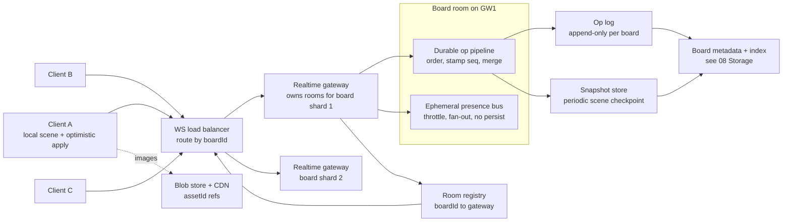

# Module 38 — Design a Collaborative Realtime Whiteboard / Canvas

> The definitive Staff-level reference for the multiplayer infinite-canvas design — Figma / Miro / Excalidraw / tldraw style — where many people simultaneously drag, draw, and edit shapes on a shared 2D surface and every client converges to the identical scene. This is the **spatial cousin** of the Google Docs problem ([18b §5](18b-design-media-productivity.md)): same "concurrent editors converging in real time" core, but the data is a **2D scene graph of objects**, not a linear string — so the concurrency model, the transport, and the *viewport/spatial scaling* are all different, and that difference is exactly what's being tested.

## What you'll master

By the end of this module you will hear "design a collaborative whiteboard / Figma / Miro" and immediately earmark the three things that win the room: **conflict-free multiplayer sync of canvas objects** (a map of objects merged with per-property last-writer-wins so two users editing different properties of the same shape *both* win, with the Strong-Eventual-Consistency guarantee that all replicas that have seen the same ops are byte-identical), **presence and live cursors** (the high-frequency, ephemeral, throwaway channel that is *separate* from the durable object stream), and **the spatial / viewport problem** (an infinite canvas where you only sync and render what's on screen, backed by spatial indexing so a board with 100k objects stays interactive).

You'll get the concurrency model *right and precise*: the whiteboard scene is a **map CRDT keyed by object id, with last-writer-wins per property**, which is what Figma actually does — and Figma is **server-authoritative** (a central server assigns the ordering / breaks LWW ties), **not** a peer-to-peer CRDT. Local-first tools (Excalidraw, anything on **Yjs/Automerge**) use a true P2P-capable CRDT instead. Knowing *which topology picks which model and why* is the Staff signal — exactly mirroring the OT-vs-CRDT topology argument in the Docs module. You'll size it with a **correct BOTEC** (concurrent editors *per board*, ops/sec, cursor-update fan-out — never DAU-as-RPS), design the WebSocket room/gateway tier ([09 Real-Time](09-realtime-systems.md)), handle reconnect-and-resync, fractional indexing for z-order, snapshots + op-log persistence, and the hard scaling failure modes (a single hot board, fan-out, gateway sharding by board).

Cross-references: [09 Real-Time Systems](09-realtime-systems.md) · [02 Distributed Systems](02-distributed-systems.md) · [18b Media/Productivity designs](18b-design-media-productivity.md) · [08 Storage](08-storage.md)

---

## Table of Contents

1. [In the Room — Delivering This at Staff Level](#1-in-the-room--delivering-this-at-staff-level)
2. [Problem framing](#2-problem-framing)
3. [Requirements — functional + non-functional](#3-requirements--functional--non-functional)
4. [Capacity estimation — the correct BOTEC](#4-capacity-estimation--the-correct-botec)
5. [API design](#5-api-design)
6. [Data model — the scene graph](#6-data-model--the-scene-graph)
7. [High-level architecture](#7-high-level-architecture)
8. [Deep dives](#8-deep-dives)
   - [8.1 The data model — scene graph + per-object granularity](#81-the-data-model--scene-graph--per-object-granularity)
   - [8.2 Conflict-free multiplayer sync](#82-conflict-free-multiplayer-sync)
   - [8.3 The realtime transport — rooms, gateway, resync](#83-the-realtime-transport--rooms-gateway-resync)
   - [8.4 Presence & cursors](#84-presence--cursors)
   - [8.5 Spatial / viewport scaling](#85-spatial--viewport-scaling)
   - [8.6 Persistence & history](#86-persistence--history)
   - [8.7 Scale + failure modes](#87-scale--failure-modes)
9. [Scaling & bottlenecks](#9-scaling--bottlenecks)
10. [Trade-offs & failure modes](#10-trade-offs--failure-modes)
11. [What the interviewer is really testing + Staff insight](#11-what-the-interviewer-is-really-testing--staff-insight)
12. [Interview Cheat-Sheet](#interview-cheat-sheet)
13. [Common Interview Questions](#common-interview-questions)

---

## 1. In the Room — Delivering This at Staff Level

### 1.1 Earmark the crux in the first 60 seconds

The instant you hear "collaborative whiteboard," "Figma," "Miro," or "multiplayer canvas," name the three hard parts out loud so the interviewer knows you know where the difficulty lives. Everything else is plumbing.

> **The crux is three things, and I'll spend my minutes here:** (1) **Conflict-free multiplayer sync of canvas objects** — the document is a *map of objects*, I merge it with **per-property last-writer-wins** so two people editing the same shape's color and position both keep their change, and the guarantee I'm buying is **Strong Eventual Consistency**: every client that has received the same set of ops is byte-for-byte identical, no central locking required. (2) **Presence and live cursors** — a *separate, ephemeral, high-frequency* channel from the durable ops; I throttle and interpolate cursors and I never persist them. (3) **The spatial / viewport problem** — the canvas is infinite, so I only sync and render what's in the viewport, backed by a spatial index, so a 100k-object board stays at 60 fps. Get those three right and the design is right.

Naming sync-model, presence, and spatial scaling as the crux — *before* drawing anything — is itself a Staff signal. It says you recognize this is a **2D convergence + realtime + spatial** problem, not a CRUD app with WebSockets bolted on.

### 1.2 Decide, don't enumerate — the load-bearing decisions

| Decision | Decide this | Because | Revisit if |
|---|---|---|---|
| Concurrency model | **Map CRDT keyed by object id, last-writer-wins per property** | Per-property LWW lets two users edit different properties of the same shape and both win; gives Strong Eventual Consistency with no per-object lock | Need rich-text *inside* a shape → embed a sequence CRDT for that text run only |
| Topology / authority | **Server-authoritative central ordering (Figma model)**, *not* P2P | A central server breaks LWW ties with a single authoritative clock/sequence, keeps the merge trivially convergent, and is the natural home for auth + persistence | Product is **local-first / offline-first** → use a P2P-capable CRDT (Yjs/Automerge), e.g. Excalidraw |
| Transport | **WebSocket gateway, one logical room per board** | Bi-directional, low-latency op broadcast; rooms map cleanly to boards ([09](09-realtime-systems.md)) | — |
| Presence channel | **Separate ephemeral channel, throttled, never persisted** | Cursor spam (60/s/user) must not touch the durable op log or storage | — |
| z-order / lists | **Fractional indexing** (a fraction between neighbors) | Reorder/insert with one property write, no renumbering, conflict-free | Heavy concurrent reordering of the *same* gap → add a jitter/tiebreak to avoid interleaving |
| Spatial scale | **Only sync/render the viewport; spatial index (quadtree / tiling) for huge boards** | A board can have 100k+ objects; rendering/syncing all of them kills the client | Small boards: skip it, name it, move on |
| Persistence | **Periodic snapshot + op log; load snapshot then tail** | Bounds reconnect/resync cost; op log gives history/versioning | — |

### 1.3 Name-and-move-on vs. deep-dive

**Name-and-move-on (one sentence each):** the exact wire encoding (protobuf/flatbuffer/binary), the precise WebSocket framing, the rendering engine (Canvas2D vs WebGL vs the GPU tessellation), the auth/permissions model (standard ACL on the board), the comments/notifications features, the export-to-PNG/SVG pipeline. These are real but commodity — design them correctly and quickly.

**Deep-dive (where this round is won):** the scene-graph data model and *why per-object granularity matters* (§8.1); the per-property-LWW map CRDT, the SEC guarantee, fractional indexing's interleaving caveat, and the **server-authoritative vs P2P** choice (§8.2); the room/gateway transport and reconnect-resync (§8.3); presence as a separate ephemeral channel (§8.4); viewport/spatial scaling (§8.5); snapshots, op log, and the genuinely-hard *per-user undo in a shared doc* (§8.6). Earmark these.

> **Staff-level insight:** The single biggest tell here is whether you describe the convergence model *correctly*. The two failure modes that mark a candidate down are (a) saying "I'll use OT like Google Docs" — OT is for *linear text*; a 2D object map merges far more simply with per-property LWW, and reaching for OT shows you pattern-matched on "collaborative" without thinking about the *data shape* — and (b) hand-waving "it's a CRDT so it's peer-to-peer and magic." **Figma is server-authoritative**: a central server imposes ordering and breaks ties; the per-property LWW map is *like* a CRDT in that concurrent edits to different properties commute, but the convergence is anchored by central ordering, **not** by a leaderless P2P gossip. Say it precisely: *"map CRDT, per-property LWW, Strong Eventual Consistency, server-authoritative ordering — Figma's model — and I'd only go full P2P CRDT (Yjs) if the product is local-first/offline."* That sentence is Senior-vs-Staff.

---

## 2. Problem framing

A **collaborative whiteboard** lets multiple users edit a shared, **infinite 2D canvas** at the same time. Each user can create, move, resize, restyle, group, and delete **objects** — rectangles, ellipses, freehand strokes, text boxes, sticky notes, connectors/arrows, embedded images. Every user sees others' edits within ~50–150 ms, sees others' **live cursors and selections** moving in real time, and — despite concurrent, conflicting edits — **every client converges to the identical scene**.

The document is fundamentally a **scene graph**: a collection of objects, each with an id, a type, a set of properties (position, size, rotation, color, text, …), and a **z-order** (stacking order). The "document" is therefore a *map of objects*, not a string — and that single fact drives the entire design.

What makes this *hard* and not a CRUD app:

- **Convergence under concurrency is the product.** If Alice drags a shape while Bob recolors the same shape, both edits must survive and every client must agree on the result. There is no "the database is the truth" pause; clients edit optimistically at 60 fps and reconcile continuously.
- **It is spatial, not linear.** Google Docs is a 1-D sequence where the hard problem is *insertion ordering within a string* (OT/CRDT for text). A whiteboard is a 2-D map of independent objects where the hard problem is *per-object/per-property merge* plus *which objects are even on screen*. Different data shape ⇒ different concurrency model.
- **Presence is a firehose.** Live cursors update tens of times per second per user. That traffic dwarfs the actual document-edit traffic and must be handled on a separate, ephemeral, lossy-tolerant path — never persisted, never blocking the durable ops.
- **The canvas is unbounded.** A real Miro board has tens of thousands of objects across a vast coordinate space. You cannot send the whole board to every client or render it all; you must sync and draw **only the viewport**.

**Contrast with [18b §5 Google Docs](18b-design-media-productivity.md):** Docs uses **Operational Transformation** because the data is a *linear text sequence* and the hard case is transforming concurrent character insertions against each other. A whiteboard's data is a *map of spatially-positioned objects*; concurrent edits usually touch *different objects* (trivially commute) or *different properties of the same object* (per-property LWW), so the merge is far simpler than text OT — **and reaching for text OT here is a mis-pattern-match.** The shared lesson: *the consistency algorithm follows the data model.*

Scope for the interview: the realtime collaboration engine (sync, presence, transport, persistence) and the spatial/viewport machinery. Out of scope unless asked: the rendering engine internals, permissions/sharing UI, comments, export, and the design-tooling features (components, auto-layout) that sit *on top of* the object model.

---

## 3. Requirements — functional + non-functional

### 3.1 Functional

- **Edit objects** — create / move / resize / rotate / restyle / delete shapes, text, strokes, connectors, images; group/ungroup.
- **Real-time multiplayer** — every editor in a board sees others' object edits within ~100 ms; all clients converge to the identical scene.
- **Presence** — live cursors, current selection, and a "who's here" roster, updated in real time.
- **Infinite canvas + viewport** — pan/zoom over an unbounded coordinate space; only the visible region need be loaded/rendered.
- **Reconnect & resync** — a client that drops and reconnects rejoins seamlessly with the current scene (snapshot + missed ops).
- **Persistence & history** — boards are durable; support version history and **undo/redo** (per-user, in a shared doc).
- **Large assets** — embed images/files; handle them via a blob store, not the op stream.
- **Offline (optional)** — depending on product, edit while disconnected and merge on reconnect (this flips the topology decision; see §8.2).

### 3.2 Non-functional

| Requirement | Target | Why it drives the design |
|---|---|---|
| **Edit latency** | p50 < ~100 ms editor-to-editor; local edit is instant (optimistic) | Forces optimistic local apply + async broadcast; no server round-trip in the edit path |
| **Cursor latency** | ~30–60 Hz updates, interpolated; loss-tolerant | Forces a *separate ephemeral channel*, throttled, never persisted |
| **Convergence** | **Strong Eventual Consistency** — all clients with the same op set are byte-identical | Per-property LWW map CRDT + central ordering |
| **Concurrent editors / board** | Smooth at tens of editors; degrade gracefully into the low hundreds on a hot board | Drives fan-out math + per-board gateway colocation |
| **Board size** | Tens of thousands of objects, interactive | Forces viewport-only sync + spatial indexing |
| **Durability** | No acknowledged edit lost | Op log + periodic snapshot, persisted before/at ack |
| **Availability** | Board stays editable; reconnect is seamless | Sticky board→gateway routing, snapshot+op resync |
| **Asset handling** | Images up to tens of MB | Blob store + CDN, referenced by id from the scene graph |

The tension to state out loud: **local responsiveness vs. global convergence.** The user must see their own edit at 60 fps with zero perceptible lag, which means **apply locally first, broadcast asynchronously, and reconcile** — you can never put a server round-trip in the edit path. That optimistic-local model is exactly *why* you need a conflict-free merge: by the time a remote op arrives, the local state has already moved on, and the merge must reconcile them deterministically. Saying that sentence frames the whole design.

---

## 4. Capacity estimation — the correct BOTEC

The trap, as always ([30 Capacity Estimation](30-capacity-estimation.md)), is **don't turn DAU into RPS**. A whiteboard's realtime load is **not** "DAU × some factor." It is driven by **concurrent editors per board** and **per-editor op + cursor rates** — and critically, the load is *partitioned per board*: a board with 8 editors is its own little fan-out problem, mostly independent of every other board.

### 4.1 The right load unit — per board

- Suppose the product has **20M DAU**, but at any instant maybe **1M concurrent connected users**, spread across **~200k active boards** → **~5 concurrent editors per active board** on average, with a long tail of "hot" boards (a workshop, a class) at **50–200 editors**.
- **DAU is irrelevant to the realtime tier's hot path.** What matters is *concurrent editors per board* and the *fan-out within a board*. Stating that explicitly is the BOTEC signal.

### 4.2 Op rate (durable edits)

- An *active* editor (mid-drag, drawing) emits maybe **5–20 ops/sec**; a typing/idle editor far less. Call it **~10 ops/sec/active editor**.
- A 5-editor board with 2 active draggers → **~20 durable ops/sec/board**. Fan-out: each op is broadcast to the other ~4 editors → **~80 op-deliveries/sec/board** — tiny. Even a 100-editor hot board with 20 active draggers is **~200 ops/sec in × ~20k deliveries/sec out** — the *fan-out* is the cost, not the ingest.
- System-wide durable ops: 1M concurrent users × (fraction active, say 20%) × 10 ops/s ≈ **~2M durable ops/sec** ingested globally — but **sharded per board**, so no single node sees that; a gateway handles its slice of boards.

### 4.3 Cursor rate (ephemeral — the real firehose)

- Live cursors update at **~30–60 Hz** while a user moves the mouse. Even throttled to **~20 updates/sec/user**, that's **2× the op rate** *per user* and far more *aggregate* because *every* connected user moves a cursor, not just active editors.
- 1M concurrent users × 20 cursor-updates/s = **~20M cursor messages/sec** ingested, and *each* fans out to everyone else *in the same board*. On a 100-editor hot board: 100 × 20 = 2,000 cursor msgs/sec in, fanning out to ~99 others each → **~200k cursor deliveries/sec on one board.**
- **This is why cursors get their own channel:** they are ~10× the message volume of durable edits, are loss-tolerant (drop a frame, interpolate), and must *never* touch the op log, disk, or the durable broadcast path. Sizing this separately is the BOTEC move that shows you understand the system.

### 4.4 Storage

- A board's scene graph is small — say **5k objects × ~500 bytes = ~2.5 MB** of structured object data, plus the op log. Even tens of millions of boards is a modest object-store + metadata-DB footprint.
- **Images/assets dominate bytes** and go to a **blob store + CDN** ([08 Storage](08-storage.md)), referenced by id from the scene graph — never inlined into ops.

**The close:** "The realtime load is *per-board fan-out*, not DAU-as-RPS. Durable edits are cheap (~tens of ops/sec/board); the **firehose is cursor presence** (~10× edits, loss-tolerant), which is exactly why it gets a separate ephemeral channel. I shard the gateway *by board* so each node owns a bounded set of rooms."

---

## 5. API design

Two surfaces: a thin **HTTP/REST** surface for board lifecycle and snapshot bootstrap, and the **WebSocket** surface that carries the realtime ops and presence. The realtime messages are the interesting part.

```
# --- HTTP (lifecycle + bootstrap) ---
POST   /v1/boards                      -> create board {id}
GET    /v1/boards/{id}                 -> metadata + ACL
GET    /v1/boards/{id}/snapshot        -> latest scene snapshot {version, objects}
GET    /v1/boards/{id}/ops?since=V     -> ops after version V (resync / history)
POST   /v1/assets                      -> presigned upload URL for an image/file (blob store)
GET    /v1/boards/{id}/versions        -> version history checkpoints

# --- WebSocket (realtime), after connecting to the board's room ---
# client -> server
JOIN     {boardId, sinceVersion}        # join room; server replies SYNC
OP       {opId, objectId, mutation}     # a durable scene edit (create/update/delete)
PRESENCE {cursor:{x,y}, selection:[id]} # ephemeral; throttled; not persisted
VIEWPORT {bounds:{x,y,w,h}, zoom}       # tell server my visible region (viewport sync)

# server -> client
SYNC     {version, snapshot|ops}        # bootstrap or missed-ops on join/reconnect
OP       {opId, objectId, mutation, seq}# a peer's durable edit, with authoritative seq
PRESENCE {userId, cursor, selection}    # a peer's ephemeral presence
ROSTER   {users:[...]}                  # who's-here changes
ACK      {opId, seq}                    # server accepted + ordered your op
```

Design notes that earn points:

- **Ops are mutations, not full objects.** An `OP` carries `{objectId, propertyDeltas}` (e.g. `{x:120, y:80}` or `{fill:"#f00"}`), so per-property merge is natural and messages stay tiny. Sending the whole object would *clobber* concurrent property edits — the anti-pattern.
- **The server stamps an authoritative `seq`** on every durable op (server-authoritative ordering, §8.2). That `seq` is the LWW tiebreaker and the resync cursor.
- **`PRESENCE` and `VIEWPORT` are a different message class** — ephemeral, throttled, never written to the op log. Keeping them off the durable API is deliberate.
- **`since` / `sinceVersion` everywhere** so reconnect is "give me what I missed," not "resend everything."
- **Assets never go over the WebSocket.** Upload to the blob store, get an id, put the id in the scene graph; the op just references it.

---

## 6. Data model — the scene graph

The document is a **map of objects** — `{objectId -> object}` — *not* a tree-deep nested blob and *not* a string. Each object is a flat-ish bag of properties plus a z-order key. This map-of-objects shape is what makes per-object, per-property concurrency natural.

```mermaid
classDiagram
  class Board {
    boardId
    version
    map_of_objects
  }
  class SceneObject {
    objectId
    type
    parentId
    zIndex_fractional
    properties
    lastWriterSeq
  }
  class RectProps {
    x  y  w  h
    rotation
    fill  stroke
  }
  class TextProps {
    x  y
    text_or_textCRDT
    fontSize
  }
  class ImageProps {
    x  y  w  h
    assetId_blobRef
  }
  Board "1" --> "many" SceneObject : map keyed by objectId
  SceneObject --> RectProps : type rect
  SceneObject --> TextProps : type text
  SceneObject --> ImageProps : type image
```



Key modeling decisions:

- **The board is a map keyed by `objectId`.** Concurrent edits to *different* objects touch *different map keys* and trivially commute. This is the foundational reason per-object granularity matters (§8.1).
- **Each object's properties are merged per-property** (§8.2). `x/y` (position), `w/h` (size), `fill`, `stroke`, `rotation`, `text` are independent LWW registers. Two users editing `fill` and `x` of the same object both win.
- **z-order is a `zIndex` stored as a fraction** (fractional indexing, §8.2), so inserting/reordering is a single property write between two neighbors — no global renumber, conflict-free.
- **Grouping via `parentId`**, not a deep tree of arrays. A group is just an object; children reference it. This keeps the model a flat map (cheap merge) instead of a nested structure (expensive structural merge).
- **Rich text *inside* a text box** is the *one* place a linear sequence CRDT belongs — embed a small text CRDT for that text run only, scoped to that object. The *board* is a map; only the *text content of a text object* is a sequence. Knowing where to draw that boundary is a Staff detail.
- **Images/assets are references** (`assetId`) to a blob store, never bytes in the model.
- **`lastWriterSeq` per property** records the authoritative server `seq` that last set it — the LWW tiebreaker.

---

## 7. High-level architecture



**Read it as two streams sharing a room.** Within a board's **room** (hosted on the gateway that owns that board's shard), there are two distinct pipelines: the **durable op pipeline** (orders ops, stamps an authoritative `seq`, merges into the canonical scene, appends to the op log, periodically snapshots) and the **ephemeral presence bus** (throttles and fans out cursors/selection, persists *nothing*). Keeping these separate in the diagram is the whole point.

**Route by `boardId`, colocate a board on one gateway.** The load balancer hashes `boardId` to a gateway so *all editors of a board land on the same node*, which owns the room and the authoritative ordering — that's what makes "server-authoritative central ordering" cheap (no cross-node consensus per op). The **room registry** (boardId → gateway) makes this lookup-able and survives gateway failover ([09 Real-Time](09-realtime-systems.md), [02 Distributed Systems](02-distributed-systems.md)).

**Clients apply optimistically and reconcile.** A client applies its own edit instantly to its local scene, sends the `OP`, and reconciles when the server's authoritative `seq`-stamped op (its own and peers') comes back. No server round-trip sits in the edit path.

---

## 8. Deep dives

### 8.1 The data model — scene graph + per-object granularity

The scene is a **map** `{objectId -> object}`, each object a set of properties plus a fractional z-index. Why this specific shape matters for concurrency:

- **Per-object granularity isolates conflicts.** Two users dragging two *different* shapes write two *different* map keys → no conflict, ever. If the document were one coarse blob (e.g. a single JSON document merged whole), every edit would conflict with every other edit. **Granularity is the difference between "everything conflicts" and "almost nothing conflicts."** State this explicitly.
- **Per-property granularity isolates conflicts further.** Within one object, `position`, `size`, `fill`, `rotation`, `text` are *independent registers*. Alice moving a shape (`x,y`) and Bob recoloring it (`fill`) edit *different registers of the same object* → both survive. Coarser (whole-object LWW) would make one of them lose for no reason. This is exactly Figma's model.
- **Flat map beats deep tree.** Grouping via `parentId` references keeps the structure a flat map whose merge is "merge per key." A deeply nested tree would force structural merges (what happens when two users restructure the same subtree?) — far harder. Keep it flat; model hierarchy as references.
- **The one place for a sequence CRDT:** the *characters inside a text object*. That single text run is linear, so it gets a small embedded sequence CRDT (like the text problem in [18b §5](18b-design-media-productivity.md)); the board around it stays a map. Drawing that boundary correctly is a Staff signal — you neither force the whole board into a text algorithm nor ignore the genuinely-linear text content.

> **The framing:** *"The document is a map of objects, and conflicts are isolated at two levels — by object id and by property — so concurrent edits almost always touch disjoint keys and trivially commute. That granularity is the whole reason multiplayer feels conflict-free; coarse-grained documents would conflict on every edit."*

### 8.2 Conflict-free multiplayer sync

This is the crux. Be precise — this is where reviewers catch hand-waving.

**The model: a map CRDT, last-writer-wins per property.**

- The board is a **map CRDT** (a map of registers). Concurrent edits to different objects/properties **commute** — apply in any order, same result.
- Each property is a **last-writer-wins register**: when two writes to the *same* property race, the one with the higher authoritative `seq` (server-assigned) wins; the loser is discarded *for that property only*. Because properties are independent, **two users editing different properties of the same shape both win** — the canonical Figma behavior.
- **The guarantee is Strong Eventual Consistency (SEC).** SEC is a guarantee *within the eventual-consistency family* — not "stronger than eventual consistency." It says: **any two replicas that have received the same set of updates are in the identical state**, with no conflict-resolution rollback and no consensus required in the hot path. It does *not* give you linearizability or a global real-time order of *reads*; it gives you deterministic convergence of *state*. State it that precisely. (See [02 Distributed Systems](02-distributed-systems.md) for the consistency-model taxonomy.)

**Server-authoritative vs. P2P — the topology decision (get this right):**

- **Figma is server-authoritative.** A **central server** receives ops, assigns each a single authoritative `seq` (the ordering / LWW tiebreaker), merges into the canonical document, and broadcasts. It is **not** a peer-to-peer leaderless CRDT. The per-property-LWW map *behaves like* a CRDT (concurrent edits to different properties commute), but the ordering that breaks ties is **centralized**, which makes the model simple, keeps a single source of truth for persistence/auth, and avoids vector-clock/causal-history bookkeeping on every client. When you say "Figma," say **"server-authoritative, central ordering, LWW per property."**
- **Local-first / P2P tools use a true CRDT.** Excalidraw and anything built on **Yjs / Automerge** use a CRDT that converges **without** a central authority — designed for offline-first and peer-to-peer sync, carrying causal metadata so any two peers merge correctly with no server in the loop. This is the right choice **when the product must work offline or sync P2P**.
- **The decision rule (mirrors the OT-vs-CRDT topology argument in [18b §5](18b-design-media-productivity.md)):** *central coordinator available and online-first ⇒ server-authoritative LWW map (Figma); offline-first / P2P / no central serialization point ⇒ full CRDT (Yjs/Automerge).* **Topology dictates the choice.** Knowing *why* is the signal, not declaring one "better."

**z-order / ordering: fractional indexing + its caveat.**

- To order objects (and reorder within a list), store `zIndex` as a **fraction**. To put an object between neighbors at `0.25` and `0.50`, give it `0.375`. Insert/reorder is **one property write**, no renumbering, conflict-free, and it's a plain LWW register like any other.
- **The caveat — interleaving.** If two users concurrently insert into the **same gap** (both pick a fraction between the same two neighbors), their independently-chosen fractions can land in an order neither intended, or — for list-like ordering — concurrent inserts can **interleave** in a way that scrambles a user's intended run. Mitigate with a **per-actor tiebreak** appended to the fractional key (so equal fractions order deterministically by actor id) and/or small **jitter** so two clients rarely pick the identical fraction. Naming the interleaving caveat — not just "use fractional indexing" — is the Staff detail.

> **The framing:** *"Map CRDT, last-writer-wins per property, Strong Eventual Consistency — that's a guarantee within the eventual-consistency family: same ops in, byte-identical state out, no hot-path consensus. Figma realizes this **server-authoritatively** — a central server stamps an authoritative seq that breaks LWW ties — not P2P. I'd only go full P2P CRDT (Yjs) if the product is offline/local-first. z-order is fractional indexing, and I'd add an actor tiebreak to avoid the interleaving edge case."*

### 8.3 The realtime transport — rooms, gateway, resync

- **WebSocket gateway, one room per board.** A persistent bi-directional connection per client; the gateway groups connections into a **room per `boardId`**. A durable `OP` from one client is merged, `seq`-stamped, and **broadcast to all other connections in that room** ([09 Real-Time](09-realtime-systems.md)).
- **Route + colocate by board.** The LB hashes `boardId` so all editors of a board land on the **same gateway**, which owns that room and the authoritative ordering — no cross-node consensus per op. A **room/connection registry** (`boardId -> gateway`, plus the member connections) makes routing and failover possible; on gateway loss, the board's room is re-homed on another node and clients reconnect and resync.
- **Reconnect + state resync (the part candidates forget).** A client tracks the last `seq` it applied. On reconnect it sends `JOIN {sinceVersion}`. The server replies with **either the missed ops** (if the gap is small and still in the op log) **or a fresh snapshot + tail** (if the client is far behind or the log was compacted). This **snapshot + missed-ops** resync is what makes flaky-network reconnects seamless and bounds the catch-up cost — it's also why you keep periodic snapshots (§8.6).
- **Backpressure.** A hot board fanning out thousands of msgs/sec to a slow client needs per-connection buffering with drop/coalesce policy — *durable* ops must not be dropped (coalesce multiple updates to the same property instead), but presence frames can be.

### 8.4 Presence & cursors

- **Ephemeral, high-frequency, separate channel.** Cursors/selection update at ~30–60 Hz per user — *the firehose* (§4.3). They go on a **separate ephemeral path**: throttled on the client (coalesce to ~20 Hz), fanned out within the room, and **never written to the op log or storage.** If a cursor frame is dropped, who cares — the next one arrives in 50 ms.
- **Throttle + interpolate.** The client sends at most ~20 cursor updates/sec; receivers **interpolate** between received positions to render smooth 60 fps motion from sparse samples. This decouples render smoothness from network rate and slashes message volume.
- **Presence state is soft.** "Who's here," each user's color/name, current selection — kept in volatile per-room state, rebuilt on join, expired on disconnect/heartbeat-timeout. No durability, no recovery concern: presence that's slightly stale for 2 seconds after a crash is invisible to users.
- **Why separate matters:** mixing 20M cursor msgs/sec into the durable op pipeline would crush the op log and the persistence tier with throwaway data. The separation is a *correctness-of-scale* decision, not a micro-optimization — say so.

### 8.5 Spatial / viewport scaling

The canvas is **infinite**; a board can hold 100k+ objects. You cannot sync or render them all.

- **Viewport-only sync.** The client sends its `VIEWPORT {bounds, zoom}`; the server streams **only the objects intersecting the visible region** (plus a margin for smooth panning). Pan/zoom updates the viewport and lazily pulls in newly-visible objects. Off-screen objects aren't held hot on the client.
- **Spatial index for "what's in this rectangle."** To answer viewport queries cheaply on a huge board, index objects spatially — a **quadtree** (or grid/R-tree) over the coordinate space, or **tiling** the canvas into fixed cells and indexing objects by tile. A viewport query becomes "fetch the tiles/quadtree-nodes the viewport overlaps," which is O(visible), not O(board). (Conceptually adjacent to [29 Geospatial](29-geospatial-systems.md)'s spatial indexing, applied to a design canvas instead of a map.)
- **Lazy-load + level-of-detail (LOD).** Stream off-screen objects only when they approach the viewport. When zoomed far out, render **simplified proxies** (a colored box instead of a full vector tessellation; cluster dense regions) — LOD keeps frame rate up when 50k objects are nominally on screen. At extreme zoom-out you render a downsampled tile image, not 50k live objects.
- **Server can scope fan-out by region too.** On a giant board, an edit in one corner need not be pushed *live* to a user looking at the opposite corner; deliver it lazily when they pan there (durably logged regardless). This caps fan-out on huge boards. (Most boards are small enough that you broadcast to the whole room; viewport-scoped fan-out is the scale answer for the extreme tail.)

> **The framing:** *"Infinite canvas means viewport-only: I index objects in a quadtree/tiling, the client sends its viewport, and I stream only intersecting objects with level-of-detail when zoomed out. A 100k-object board stays interactive because the client only ever touches the ~hundreds of objects on screen."*

### 8.6 Persistence & history

- **Snapshot + op log.** The board's authoritative state is the **op log** (append-only, per board) folded into the scene graph. Periodically (every N ops or T seconds) write a **snapshot** of the materialized scene. Load = latest snapshot + tail the ops after it; this bounds both startup and reconnect-resync cost (§8.3). ([08 Storage](08-storage.md): snapshot in object store, op log in an append-friendly store, index in metadata DB.)
- **Versioning.** Named version checkpoints are just labeled snapshots; "restore to version" loads that snapshot and forks/branches the op stream from there.
- **Undo/redo — genuinely hard in a shared doc.** Naive global undo ("undo the last op") is wrong: it would undo *someone else's* edit. You want **per-user undo** — each user undoes *their own* last action, even though everyone shares one document. Implement it as an **inverse op**: undo doesn't pop the global log, it *appends a new op* that inverts the user's own last action, applied through the same LWW merge as any edit. The hard cases: if a *peer* modified the same object after your edit, your "undo" should not clobber their newer change (LWW handles this — your inverse op only wins where it has the latest `seq`); and your undo stack must track *your* ops by id, not log position. Naming "per-user undo via inverse ops, and why it's hard in a shared doc" is a strong Staff signal.
- **Large boards / compaction.** The op log grows unbounded; compact it behind each snapshot (drop ops older than the latest snapshot you keep for history). Keep enough recent ops to serve reconnect-resync without a full snapshot fetch.
- **Large assets.** Images/files live in the **blob store + CDN** referenced by `assetId`; the scene graph and op log only carry the reference, keeping ops tiny and the log cheap to replay.

### 8.7 Scale + failure modes

- **The hot board (single-board fan-out).** A workshop with 200 editors is a single-room fan-out problem: 200 connections, ~tens of thousands of msg-deliveries/sec, all on one gateway (because the board is colocated). Mitigations: coalesce per-property updates (only the latest position matters), viewport-scoped fan-out (§8.5), presence on the cheap ephemeral path (§8.4), and — at the extreme — a **fan-out fabric** within the gateway (sub-rooms / a broadcast tree) so one node isn't doing N² delivery in a tight loop. State the N² fan-out risk explicitly.
- **Gateway sharding by board.** Boards are independent, so shard gateways **by `boardId`** (consistent hashing). This scales horizontally — more boards just means more gateways — and keeps each board's authoritative ordering on one node. The room registry tracks the mapping for routing and failover.
- **Gateway failure.** When a gateway dies, its boards' rooms must be re-homed: clients reconnect (LB re-routes via the registry to a new node), the new node loads snapshot + tail from durable storage, and clients **resync via `sinceVersion`**. Because durable ops were persisted to the log, no acknowledged edit is lost; only volatile presence is rebuilt.
- **Conflict on reconnect.** A client that edited while disconnected (or whose ops were in flight during a failover) replays its buffered ops on reconnect; the server `seq`-stamps them *now*, and **LWW resolves them against whatever happened meanwhile** — older offline edits may lose to newer peer edits on the same property, which is the correct, convergent outcome. (For a strictly offline-first product, this is where the full CRDT model earns its keep — §8.2.)
- **Large-asset handling.** Big images never traverse the op stream or the gateway; clients upload to the blob store (presigned URL), get an `assetId`, and the op carries only the reference. The blob store + CDN absorbs the bytes ([08 Storage](08-storage.md)).

---

## 9. Scaling & bottlenecks

| Bottleneck | Symptom | Resolution |
|---|---|---|
| **Cursor/presence firehose** | Op pipeline + storage overwhelmed by throwaway data | Separate ephemeral channel; throttle to ~20 Hz; interpolate; never persist (§8.4) |
| **Single hot board fan-out** | One gateway saturated on N editors; N² delivery | Coalesce per-property; viewport-scoped fan-out; broadcast tree / sub-rooms; cap editors (§8.7) |
| **Whole-board sync on join** | Slow load / OOM on 100k-object boards | Viewport-only sync + spatial index + LOD; lazy-load off-screen (§8.5) |
| **Op log growth** | Reconnect resync slow; storage bloat | Periodic snapshots + log compaction behind snapshots (§8.6) |
| **Cross-board scaling** | Realtime tier won't scale up | Shard gateways by `boardId` (consistent hashing); boards are independent (§8.7) |
| **Edit-path latency** | Laggy local interaction | Optimistic local apply; never put a server round-trip in the edit path (§3.2) |
| **Asset bytes in ops** | Op log bloated, broadcast slow | Blob store + CDN, reference by `assetId` only (§8.6) |

---

## 10. Trade-offs & failure modes

- **Server-authoritative vs. P2P CRDT.** Server-authoritative (Figma) buys simple central ordering, one source of truth, easy auth/persistence — at the cost of requiring an online central server (no true offline-first). P2P CRDT (Yjs) buys offline + peer sync — at the cost of causal-metadata overhead and a more complex merge. **Topology decides** (§8.2).
- **Per-property LWW means a loser is silently discarded.** When two users write the *same* property concurrently, one value vanishes (highest `seq` wins). That's correct and convergent, but it's "last writer wins," not "merge both" — acceptable for position/color (you can't be in two places), and the reason you keep granularity per-property so it rarely bites.
- **Optimistic local apply means transient divergence.** Your screen briefly shows a state the server hasn't confirmed; if your op loses an LWW race, your shape "jumps back." Convergence is guaranteed (SEC), but the *path* there can flicker — name it.
- **SEC is not strong consistency.** No global real-time read order, no linearizability. Fine for a whiteboard (there's no "correct" instantaneous global truth a user can observe), wrong for anything needing invariants across objects (e.g. "total must equal sum") — don't oversell the guarantee.
- **Fractional-index interleaving.** Concurrent inserts into the same gap can land unexpectedly; mitigate with actor tiebreak/jitter (§8.2).
- **Hot-board ceiling.** A single board has a real editor ceiling because it's colocated for ordering; past it you degrade (coalesce, viewport-scope) or cap. Don't pretend one board scales infinitely.
- **Per-user undo edge cases.** Undo as inverse-op interacts with peers' later edits via LWW; a naive "pop the log" undo corrupts other users' work (§8.6).

---

## 11. What the interviewer is really testing + Staff insight

**What they're actually probing:**

- Do you pick the **right concurrency model for the *data shape*** — a per-property-LWW **map** for a 2D object canvas — rather than reflexively saying "OT, like Google Docs" (a text algorithm misapplied)?
- Can you state the convergence guarantee **precisely** — **Strong Eventual Consistency**, a guarantee *within* the eventual-consistency family, server-authoritative ordering — without hand-waving "it's a CRDT so it's magic / P2P"?
- Do you separate the **ephemeral presence firehose** from the **durable op stream** — and size them separately?
- Do you handle the **spatial / infinite-canvas** problem (viewport-only sync, spatial index, LOD) rather than assuming the whole board fits?
- Can you do a **correct BOTEC** — concurrent editors *per board* and per-board fan-out, **not DAU-as-RPS**?

**The three highest-signal moves, ranked:**

1. **Name the convergence model correctly:** *"map CRDT, per-property LWW, Strong Eventual Consistency, server-authoritative central ordering — Figma's model, not P2P."* Add the P2P-CRDT (Yjs) alternative gated on offline/local-first.
2. **Separate presence from ops:** *"cursors are ~10× the volume, loss-tolerant, throttled and interpolated, on their own ephemeral channel, never persisted."*
3. **Solve the spatial problem:** *"infinite canvas ⇒ viewport-only sync over a quadtree/tiling with level-of-detail, so a 100k-object board stays interactive."*

> **Staff-level insight:** The candidate who says "collaborative editing → operational transformation, like Google Docs" has pattern-matched on the word *collaborative* and missed that **the data is a 2D object map, not a string** — and a map merges far more simply (per-property LWW) than text. The Staff candidate frames it as: **"This is the *spatial* sibling of the Docs problem. The data is a map of objects, so I merge it with per-property last-writer-wins for Strong Eventual Consistency; I make it server-authoritative for central ordering like Figma, and only reach for a full P2P CRDT (Yjs) if the product is offline-first. Then I split the cheap durable ops from the firehose of ephemeral cursors, and I make the infinite canvas tractable with viewport-only sync over a spatial index."** Saying *that* — and getting SEC, server-authority, and the topology rule right — is the difference between Senior and Staff. (Mirror of the topology argument in [18b §5](18b-design-media-productivity.md): *the consistency algorithm follows the data model.*)

---

## Interview Cheat-Sheet

| Concept | One-liner |
|---|---|
| **The crux** | Conflict-free object sync + presence/cursors + spatial/viewport scaling. Everything else is plumbing. |
| **Data shape** | A **map of objects** (scene graph), not a string. Drives the whole concurrency model. |
| **Not OT** | OT is for *linear text*. A 2D object map merges with **per-property LWW** — far simpler. Don't mis-pattern-match. |
| **Concurrency model** | **Map CRDT, last-writer-wins per property.** Two users editing different props of the same shape both win. |
| **The guarantee** | **Strong Eventual Consistency** — *within* the eventual-consistency family. Same ops in ⇒ byte-identical state. Not "stronger than EC," not linearizable. |
| **Figma = server-authoritative** | Central server stamps an authoritative `seq` that breaks LWW ties. **NOT P2P.** |
| **P2P alternative** | Yjs/Automerge (Excalidraw) — full CRDT, **only if offline-first / local-first / P2P.** Topology decides. |
| **z-order** | **Fractional indexing** — insert a fraction between neighbors, one write, conflict-free. Caveat: **interleaving** on same-gap inserts → add actor tiebreak/jitter. |
| **Transport** | WebSocket gateway, **one room per board**, route + colocate by `boardId`, room registry for routing/failover. |
| **Reconnect** | `sinceVersion` ⇒ **snapshot + missed ops**. Bounded catch-up; never resend the whole board. |
| **Presence** | **Separate ephemeral channel.** ~10× op volume, loss-tolerant, throttle ~20 Hz, **interpolate**, never persist. |
| **Infinite canvas** | **Viewport-only sync** over a **quadtree/tiling** spatial index + **level-of-detail**. 100k objects stay interactive. |
| **Persistence** | **Snapshot + append-only op log** per board; compact behind snapshots; versions = labeled snapshots. |
| **Undo** | **Per-user undo via inverse ops** through the same LWW merge — hard in a shared doc; never "pop the global log." |
| **Assets** | Images → **blob store + CDN**, referenced by `assetId`. Never in the op stream. |
| **BOTEC** | **Concurrent editors *per board*** + per-board fan-out. **NOT DAU-as-RPS.** Cursors are the firehose. |
| **Edit latency** | **Optimistic local apply**, async broadcast. Never a server round-trip in the edit path. |
| **Scaling** | Shard gateways **by board**; hot-board N² fan-out → coalesce + viewport-scope + broadcast tree. |

---

## Common Interview Questions

**Q1. Would you use Operational Transformation here, like Google Docs?**
No — and naming *why* is the point. OT is built for a **linear text sequence**, where the hard problem is transforming concurrent character insertions/deletions against each other to preserve intention. A whiteboard's data is a **2D map of objects**, where concurrent edits almost always touch *different objects* (different map keys → trivially commute) or *different properties of the same object* (independent registers → both win). That structure merges far more simply with a **map CRDT using last-writer-wins per property** than with text OT — and reaching for OT here shows pattern-matching on the word "collaborative" without thinking about the *data shape*. The only place a sequence algorithm belongs is the *characters inside a single text box*, which I'd handle with a small embedded text CRDT scoped to that object. The lesson is the same as the Docs module: *the consistency algorithm follows the data model.*

**Q2. Walk me through the concurrency model precisely. What's the guarantee?**
The board is a **map CRDT keyed by object id**, and each object's properties (`x/y`, `w/h`, `fill`, `rotation`, …) are **independent last-writer-wins registers**. Concurrent edits to different objects or different properties *commute* — apply in any order, identical result — so two users editing the same shape's position and color both keep their change. When two writes hit the *same* property, the one with the higher **server-assigned `seq`** wins; the loser is discarded for that property only. The guarantee is **Strong Eventual Consistency**: any two replicas that have received the same set of ops are in **byte-identical** state, with no hot-path consensus and no rollback. I'd be careful with the wording — SEC is a guarantee *within the eventual-consistency family*, not "stronger than eventual consistency," and it is **not** linearizability: there's no global real-time read order, which is fine because there's no instantaneous global truth a whiteboard user can observe.

**Q3. Is this peer-to-peer? Is Figma a P2P CRDT?**
No — **Figma is server-authoritative.** A central server receives every op, assigns it a single authoritative `seq` that imposes the ordering and breaks LWW ties, merges it into the canonical document, and broadcasts to the room. The per-property-LWW map *behaves like* a CRDT in that concurrent edits to different properties commute, but the tie-breaking order is **centralized**, which keeps the merge trivial, gives one source of truth for persistence and auth, and avoids vector-clock bookkeeping on every client. A **true P2P CRDT** (Yjs, Automerge — what Excalidraw uses) converges *without* a central authority and is the right choice **when the product must work offline or sync peer-to-peer**. So: *central coordinator + online-first ⇒ server-authoritative LWW map (Figma); offline-first / P2P ⇒ full CRDT (Yjs).* Topology dictates the choice — the same argument as OT-vs-CRDT in the Docs module.

**Q4. Do the capacity estimation. Don't give me DAU-as-RPS.**
Right — the load unit is **concurrent editors per board** and **per-board fan-out**, not DAU. Say 20M DAU but ~1M concurrent connected users across ~200k active boards → **~5 editors/board** average, with a hot tail at 50–200. Durable edits are cheap: an active editor emits ~10 ops/sec, so a 5-editor board is ~20 ops/sec in, ~80 deliveries/sec out — trivial; even a 100-editor board is ~200 in / ~20k out, and the *fan-out* is the cost, not ingest. The **firehose is cursor presence**: ~20 updates/sec/user × *every* connected user (not just editors) ≈ **~20M cursor msgs/sec aggregate**, each fanning out within its board. That's ~10× the durable-edit volume and loss-tolerant — which is exactly *why* cursors get a separate ephemeral channel that never touches the op log. Storage is modest (a board is ~MBs of structured objects); image bytes dominate and go to a blob store. The close: *per-board fan-out, not DAU-as-RPS; cursors are the firehose; shard gateways by board.*

**Q5. How do cursors and presence work, and why separate them?**
Live cursors update at 30–60 Hz per user — the highest-volume traffic in the system (~10× durable edits) and entirely throwaway. So they ride a **separate ephemeral channel**: the client throttles to ~20 updates/sec, the server fans them out within the room, and **nothing is persisted** — no op log, no disk. Receivers **interpolate** between sparse samples to render smooth 60 fps motion, decoupling render smoothness from network rate. Presence state ("who's here," selection, user color) is volatile per-room data, rebuilt on join and expired on disconnect. Separating this from durable ops isn't a micro-optimization — it's a *correctness-of-scale* decision: piping 20M throwaway msgs/sec through the durable pipeline would crush the op log and persistence tier with data nobody needs after 50 ms.

**Q6. The canvas is infinite with 100k objects. How do you keep it interactive?**
**Viewport-only sync.** The client reports its `VIEWPORT {bounds, zoom}`; the server streams only the objects intersecting the visible region (plus a panning margin). To answer "what's in this rectangle" cheaply on a huge board, I index objects spatially — a **quadtree** or **tiling** of the coordinate space — so a viewport query is O(visible), not O(board). Off-screen objects lazy-load as they approach the viewport. When zoomed far out, **level-of-detail** kicks in: render simplified proxies (a box instead of full vector tessellation), cluster dense regions, or show a downsampled tile image instead of 50k live objects. On extreme boards I can even scope fan-out by region — an edit in one corner is delivered lazily to a user looking at the opposite corner (still durably logged). Net: the client only ever touches the hundreds of objects on screen, so frame rate holds regardless of total board size.

**Q7. A user drops their network and reconnects. What happens?**
The client tracks the last `seq` it applied. On reconnect it re-establishes the WebSocket, the LB routes it (via the room registry) back to the gateway owning that board, and it sends `JOIN {sinceVersion}`. The server replies with **either the missed ops** (if the gap is small and still in the op log) **or a fresh snapshot + the tail** (if it's far behind or the log was compacted) — that's the **snapshot + missed-ops** resync, which is exactly why I keep periodic snapshots. Any ops the client buffered while offline are replayed; the server `seq`-stamps them *now*, and **LWW resolves them against whatever happened meanwhile** — an older offline edit may lose to a newer peer edit on the same property, which is the correct convergent outcome. Because durable ops were persisted, no acknowledged edit is lost; only volatile presence is rebuilt. (If the product must be truly offline-first, this is exactly where a full P2P CRDT earns its keep over server-authoritative LWW.)

**Q8. How do undo/redo work in a shared document?**
Carefully — global undo is wrong, because "undo the last op" would undo *someone else's* edit. I want **per-user undo**: each user undoes *their own* last action. I implement undo not by popping the global log but by **appending a new inverse op** that reverses the user's own last action, applied through the same LWW merge as any edit. Each user keeps an undo stack of *their* op ids (not log positions). The subtle case: if a peer modified the same object *after* my edit, my undo must not clobber their newer change — and it won't, because my inverse op only wins where it carries the latest `seq`; where the peer's edit is newer, it stays. Naming that "per-user undo via inverse ops, and why it's hard" is the signal; a candidate who says "just pop the op log" is corrupting other users' work.

**Q9. A single board has 200 simultaneous editors. What breaks and how do you handle it?**
A single hot board is a **single-room fan-out** problem, and because the board is colocated on one gateway for authoritative ordering, that one node absorbs the N² delivery: 200 connections, tens of thousands of msg-deliveries/sec. Mitigations, in order: put **presence on the cheap ephemeral path** so cursor spam doesn't hit durable broadcast; **coalesce per-property updates** (only the latest position of a dragged shape matters, drop intermediate frames to slow clients); **viewport-scope the fan-out** so edits only push live to users whose viewport overlaps; and at the extreme, a **broadcast tree / sub-rooms** inside the gateway so one node isn't doing a tight N² loop. There's a real per-board editor ceiling because ordering is centralized on one node — past it I degrade gracefully or cap editors; I wouldn't pretend a single board scales infinitely. *Across* boards it scales fine: shard gateways by `boardId`.

**Q10. The interviewer says "make this converge correctly" with 10 minutes left. What do you say?**
Lead with the crux: **"The document is a map of objects, so I merge it with per-property last-writer-wins, giving Strong Eventual Consistency — same ops in, byte-identical state out, no hot-path consensus."** Concretely: **(1)** ops are *property deltas* keyed by object id, so concurrent edits to different objects or properties commute and both survive; **(2)** I make it **server-authoritative** — a central server stamps an authoritative `seq` that orders ops and breaks LWW ties, Figma's model, *not* P2P — and I'd only switch to a full CRDT (Yjs) if the product is offline-first; **(3)** z-order is **fractional indexing** with an actor tiebreak to avoid the interleaving edge case; **(4)** clients apply **optimistically** and reconcile on the authoritative op, so the edit path never waits on the server; **(5)** reconnect is **snapshot + missed-ops** via `sinceVersion`. Then I'd name the residual: per-property LWW silently discards a losing same-property write (correct, but it's LWW not merge), and the optimistic path can briefly flicker before converging. Don't enumerate features — lead with *map CRDT + per-property LWW + SEC + server-authoritative*, the four words that prove you got the model right.

---

*Related modules:* [09 Real-Time Systems](09-realtime-systems.md) · [02 Distributed Systems](02-distributed-systems.md) · [18b Media/Productivity designs](18b-design-media-productivity.md) · [08 Storage](08-storage.md)
