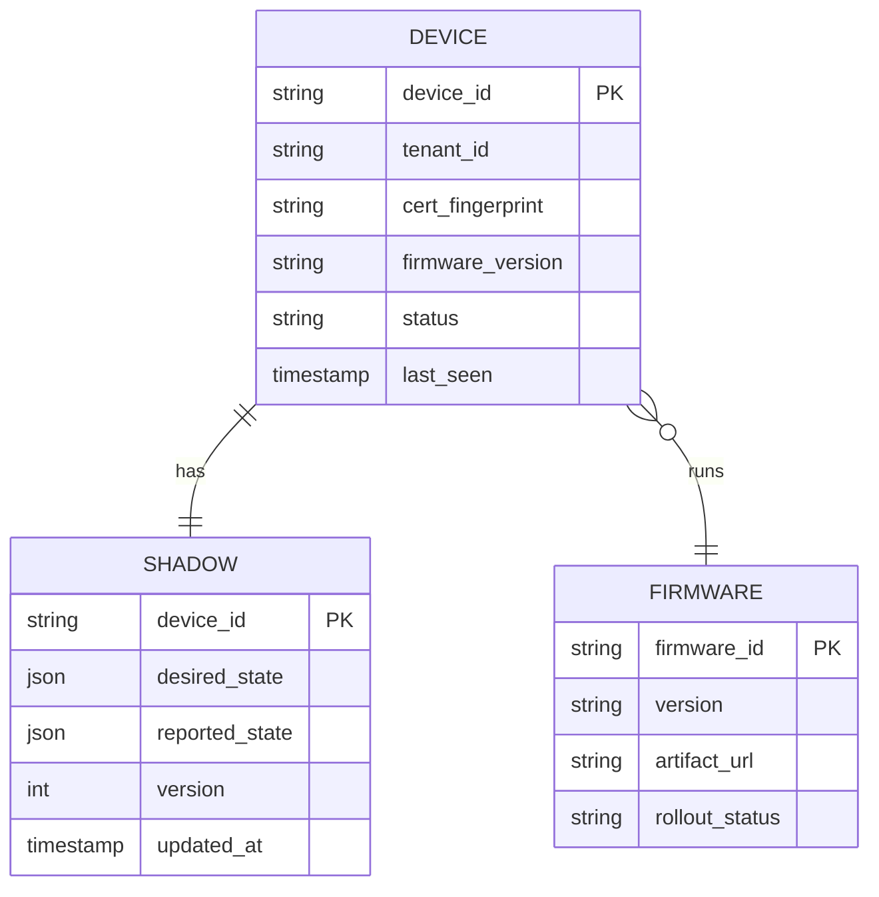
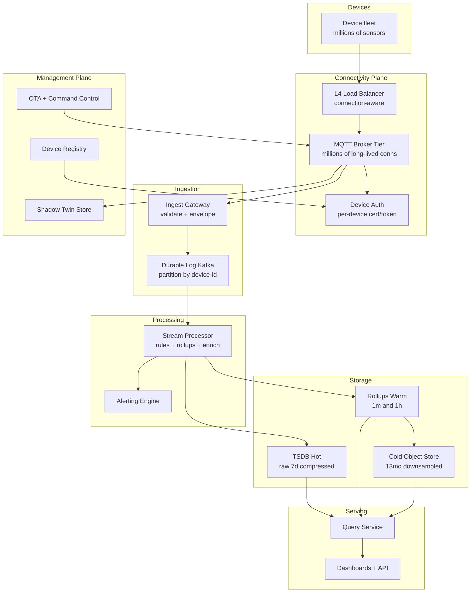

# 39 · Design IoT / Telemetry Ingestion at Scale

> Millions of devices streaming sensor data into a pipeline that ingests, processes, stores as time-series, and serves it back — plus the connectivity and management plane that keeps the fleet alive.

**What you'll master:** how to size a *write-firehose* correctly (devices ÷ report-interval, never DAU-as-RPS), how to hold millions of long-lived device connections, how a time-series store survives cardinality explosion, and how to reason about the connectivity / management plane that most candidates forget exists. By the end you can walk into a Staff/Principal room and earmark the three things that actually matter, then go deep on each on demand.

---

## Table of Contents

- [In the Room — Delivering This at Staff Level](#in-the-room--delivering-this-at-staff-level)
- [1. Problem Framing](#1-problem-framing)
- [2. Functional & Non-Functional Requirements](#2-functional--non-functional-requirements)
- [3. Capacity Estimation (BOTEC)](#3-capacity-estimation-botec)
- [4. API & Protocols](#4-api--protocols)
- [5. Data Model](#5-data-model)
- [6. High-Level Architecture](#6-high-level-architecture)
- [7. Deep Dives](#7-deep-dives)
  - [7.1 Device Connectivity at Scale](#71-device-connectivity-at-scale)
  - [7.2 The Ingestion Firehose](#72-the-ingestion-firehose)
  - [7.3 Stream Processing](#73-stream-processing)
  - [7.4 Time-Series Storage](#74-time-series-storage)
  - [7.5 Serving & Query](#75-serving--query)
  - [7.6 Device Management](#76-device-management)
  - [7.7 Scale & Failure](#77-scale--failure)
- [8. Scaling the System](#8-scaling-the-system)
- [9. Trade-offs & Failure Modes](#9-trade-offs--failure-modes)
- [10. What's Being Tested + Staff Insight](#10-whats-being-tested--staff-insight)
- [Interview Cheat-Sheet](#interview-cheat-sheet)
- [Common Interview Questions](#common-interview-questions)

---

## In the Room — Delivering This at Staff Level

The moment this prompt lands, most candidates start drawing API gateways and REST endpoints. That's a junior reflex. IoT is not a request/response system — it is a **write-firehose with a connectivity plane bolted to the front and a query plane bolted to the back**. Say that out loud in the first ninety seconds and you've already separated yourself.

Earmark the three cruxes immediately, then let the interviewer steer:

1. **The ingestion firehose.** Millions of devices each emit a tiny message on an interval. The aggregate is a sustained, ordered, append-only write stream that dwarfs anything you'd see in a typical web app. The hard part is absorbing it without losing data and without back-pressure rippling back to devices that have no buffer.

2. **Time-series storage & cardinality.** Storing the raw samples is cheap if you compress them (Gorilla-style, ~1-2 bytes/sample). What kills you is **cardinality** — the number of distinct time-series, which is the product of every tag/label combination. Get this wrong and your index, not your data, blows up the cluster.

3. **Device connectivity at scale.** Holding millions of *long-lived* MQTT/TLS connections is a C10M problem (cross-link [09 Real-Time](09-realtime-systems.md)). The broker tier, per-device auth, keep-alives, and the thundering herd on reconnect are where the real failure modes live.

Decisive framing to open with: *"I'll treat this as three loosely-coupled planes — connectivity, ingestion/processing, and storage/serving — joined by a durable log. The log is the shock absorber: it decouples device-facing back-pressure from storage throughput. Let me size the firehose first, because the write rate dictates every downstream decision."* Then compute the write QPS correctly (next section) — that single correct number is worth more than three diagrams.

What I will **not** do: promise exactly-once delivery, treat DAU as RPS, or hand-wave storage as "just put it in a database." Those three mistakes are the ones interviewers are explicitly listening for.

---

## 1. Problem Framing

We're building the backend for a fleet of physical devices — think smart meters, industrial sensors, connected vehicles, agricultural soil probes, or wearables. Each device periodically reports telemetry (temperature, voltage, GPS, vibration, battery, etc.) and occasionally receives commands (firmware update, config change, actuation).

Three distinct planes, each with its own scaling characteristics:

- **Connectivity plane** — keeps devices attached, authenticated, and reachable. Long-lived connections, downlink command delivery, last-will/keep-alive.
- **Data plane (ingestion → processing → storage)** — the firehose. Append-heavy, read-light-but-spiky, latency-tolerant on the write path but durability-critical.
- **Management plane** — registry, provisioning, OTA firmware, device shadow/twin, command-and-control. Low volume, high consistency requirements.

Key framing questions to ask the interviewer (state your assumptions if they defer):

- How many devices, and what's the report interval? (This is the BOTEC input — get the number.)
- Message size and schema stability? Fixed sensors or arbitrary tags?
- Are devices always-on (mains-powered) or intermittent (battery, cellular, flush-on-wake)?
- Retention: days of raw + years of rollups? Or full-fidelity forever (usually no)?
- Do we need real-time alerting (threshold/anomaly) or just dashboards?
- Is downlink (cloud→device control) in scope, or telemetry-only?

I'll assume: **10M devices**, **1 message / 10s** average, **~200 bytes** payload, **mixed connectivity** (most always-on, a meaningful minority flush-on-reconnect), retention of **7 days hot raw + 13 months downsampled**, and **real-time threshold alerts + dashboards + downlink commands** in scope. Generous but realistic for a Staff prompt.

---

## 2. Functional & Non-Functional Requirements

### Functional (FR)

- **FR1** — Devices connect, authenticate (per-device credential), and publish telemetry.
- **FR2** — Ingest at-least-once with idempotent dedup; preserve per-device ordering.
- **FR3** — Real-time stream processing: threshold/anomaly alerts, downsampling/rollups, enrichment.
- **FR4** — Persist raw samples (hot) and rollups (warm/cold) in a time-series store.
- **FR5** — Serve queries: recent per-device, historical ranges, fleet-wide aggregates, dashboards.
- **FR6** — Downlink command-and-control (cloud → device) with delivery acknowledgement.
- **FR7** — Device management: registry, provisioning, OTA firmware, device shadow/twin state.

### Non-Functional (NFR)

- **NFR1 — Durability.** No silent data loss once acked. Durable log before any processing.
- **NFR2 — Ingest throughput.** Sustain the firehose (sized below) plus burst headroom for offline-then-flush herds.
- **NFR3 — Write latency tolerance.** Telemetry write path can tolerate seconds of buffering; it is throughput-bound, not latency-bound. Alerting path must be near-real-time (single-digit seconds end-to-end).
- **NFR4 — Connection scale.** Millions of concurrent long-lived connections, elastic on reconnect storms.
- **NFR5 — Query performance.** Recent-data fast path < 100ms; historical/aggregate queries seconds, served from rollups.
- **NFR6 — Availability.** Connectivity and ingest are the most availability-sensitive; a device that can't connect or whose data is dropped is a hard failure. Multi-AZ minimum, multi-region for the connectivity edge.
- **NFR7 — Cost.** Storage cost is dominated by retention × cardinality × sample rate. Compression and rollups are first-class, not afterthoughts.

**Delivery semantics — say this explicitly:** we provide **at-least-once delivery with idempotent dedup**, which yields *effective* exactly-once *processing*. True exactly-once *delivery* over lossy networks to constrained devices is a fiction; don't promise it.

---

## 3. Capacity Estimation (BOTEC)

This is the section that separates Staff candidates. **Do not use DAU-as-RPS.** Devices are not users hitting an API; they emit on a fixed cadence. The write rate is purely mechanical:

```
Write QPS = number_of_devices / report_interval_seconds
```

### Steady-state write firehose

```
Devices            = 10,000,000
Report interval    = 10 s
Ingest write QPS   = 10,000,000 / 10  = 1,000,000 writes/sec  (1M msg/s)
```

One million messages per second, sustained, forever. That is the design center of gravity.

### Bandwidth

```
Payload            ≈ 200 bytes (with envelope/overhead, call it ~300 B on the wire)
Ingress throughput = 1M msg/s × 300 B  ≈ 300 MB/s  ≈ 2.4 Gbps sustained
```

Trivial in raw bytes — the challenge is *message count* and *connection count*, not bandwidth.

### Raw storage per day (before compression)

```
Samples/day        = 1M/s × 86,400 s   ≈ 86.4 billion samples/day
Naive @ 16 B/sample (ts+value+overhead) ≈ 1.4 TB/day
Gorilla-compressed @ ~1.5 B/sample      ≈ 130 GB/day   ← ~10x win
7-day hot raw                            ≈ ~0.9 TB compressed
```

The delta-of-delta + XOR compression (deep dive 7.4) is what makes raw retention affordable. *Quote the ~1-2 bytes/sample figure — it signals you know real TSDB internals.*

### Cardinality (the number that actually matters)

```
Active time-series = devices × metrics_per_device × tag_combinations
Example: 10M devices × 10 metrics                = 100M series
Add a tag with 5 values (e.g. firmware version)  = up to 500M series (multiplicative!)
```

Cardinality is the index size and the memory pressure. **Never put a high-cardinality value (device-id is already huge; raw GPS, request-id, timestamps) into a tag/label.** Device-id is the unavoidable big dimension; everything else should be low-cardinality. Call this out — it's the most common production IoT outage cause.

### Connections

```
Concurrent connections ≈ #devices online ≈ up to 10M long-lived TLS sockets
At ~100K–250K connections/broker node (tuned)  → ~40–100 broker nodes
```

### Burst / flush headroom

Flush-on-reconnect devices can deliver hours of buffered data in seconds. Size the **log + ingest tier for 3–5× steady-state peak** (3–5M msg/s burst), and rely on the durable log to absorb it so storage never sees the spike directly.

Cross-link [30 Capacity Estimation](30-capacity-estimation.md) for the BOTEC discipline.

---

## 4. API & Protocols

Protocol choice is a real decision here — pick deliberately and justify.

| Protocol | Model | Pros | Cons | Use when |
|---|---|---|---|---|
| **MQTT** | pub/sub over TCP | Lightweight, long-lived, QoS levels, last-will, retained msgs, downlink-native | Needs broker tier, stateful connections | Default for constrained, always-on, bidirectional fleets |
| **HTTP(S)** | request/response | Universal, stateless, easy auth/proxy | Per-message TLS handshake cost, no native downlink, chatty | Batch upload, intermittent devices, simple telemetry |
| **CoAP** | REST over UDP (DTLS) | Tiny, low-power, multicast | UDP reliability concerns, less tooling | Extremely constrained / low-power sensors |

**Default to MQTT** for an always-on bidirectional fleet; offer HTTP batch ingest as a fallback for intermittent devices. State this and move on.

### MQTT essentials (know these cold)

- **QoS 0** — at-most-once, fire-and-forget. Cheapest; acceptable for high-frequency, individually-disposable samples.
- **QoS 1** — at-least-once. Broker re-delivers until PUBACK. **This is the default for telemetry** — pair it with idempotent dedup downstream.
- **QoS 2** — exactly-once via 4-way handshake. Expensive, rarely worth it; reserve for critical commands, not telemetry.
- **Retained messages** — broker keeps the last message on a topic; new subscribers get current state immediately (good for shadow/config topics).
- **Last-Will & Testament (LWT)** — broker publishes a pre-registered message if a device drops ungracefully → fleet liveness signal.
- **Keep-alive** — periodic PINGREQ; broker declares dead after 1.5× keep-alive. Tune to balance liveness detection vs battery/bandwidth.

### Topic structure

```
telemetry/{tenant}/{device_id}/{metric}      ← device publishes (uplink)
command/{tenant}/{device_id}                  ← device subscribes (downlink)
shadow/{tenant}/{device_id}/state             ← retained twin state
```

### Ingest envelope (logical schema)

```
{
  device_id, ts_device, ts_received,
  seq,                       // monotonic per-device, drives dedup + ordering
  metric, value, unit,
  tags: { firmware, region } // LOW cardinality only
}
```

`seq` (or a `(device_id, ts_device)` pair) is the **idempotency key** for dedup. `ts_device` vs `ts_received` matters because device clocks skew (deep dive 7.7).

---

## 5. Data Model

Three stores for three planes — don't force one database to do everything.

### Time-series store (data plane)

```
series_key  = hash(device_id, metric, sorted(tags))   // the cardinality unit
sample      = (timestamp, value)                        // compressed columnar block
```

Partition by **time window × device-id shard**. Time partitioning enables cheap retention drops (TTL whole partitions) and time-range pruning; device sharding spreads the write load.

### Device registry & shadow (management plane) — relational/document



The **shadow/twin** holds `desired` vs `reported` state. The cloud writes `desired`; the device reconciles when next online and writes `reported`. This decouples control from connectivity — you can "set" a device that's currently offline.

### Durable log (the joint)

Kafka topic(s), **partitioned by device-id** so all of a device's messages land on one partition → per-device ordering for free, and dedup state is partition-local.

---

## 6. High-Level Architecture



Read it as three planes joined by the log. The **log is the shock absorber**: devices and brokers can push hard, and storage consumes at its own pace. The management plane sits to the side, talking to the broker for downlink and to auth for provisioning.

---

## 7. Deep Dives

### 7.1 Device Connectivity at Scale

This is a **C10M** problem — millions of concurrent, mostly-idle, long-lived connections (cross-link [09 Real-Time](09-realtime-systems.md), which covers connection-server fan-out and the same kernel-tuning territory).

**Broker tier.** A horizontally-scaled fleet of MQTT brokers (EMQX, HiveMQ, VerneMQ, or a managed broker). Each node tuned for **100K–250K connections** via raised file-descriptor limits, epoll/kqueue event loops, and tuned TCP buffers. The connections are cheap when idle — the cost is memory per socket and the message fan rate, not CPU per connection.

**Load balancing.** L4 (connection-aware), not L7 — you can't re-balance a live TCP connection per request. New connections spread across brokers; existing ones stay pinned. A shared session/subscription store (or broker-cluster gossip) lets any broker route a downlink command to the device regardless of which node holds its socket.

**Auth.** Per-device identity is non-negotiable. **Mutual TLS with per-device X.509 certs** is the gold standard — each device has a unique cert; revocation kills a compromised device without touching the fleet. Lighter-weight: per-device tokens (JWT) with short TTL. Never a shared fleet credential — one leak compromises everything.

**Liveness.** Keep-alive PINGs + LWT give you fleet presence. Tune keep-alive against battery (longer = cheaper) vs detection latency (shorter = faster dead-device detection).

**Connection density math:** 10M devices ÷ 200K conn/node ≈ 50 broker nodes for steady state; provision for reconnect-storm headroom (see 7.7).

### 7.2 The Ingestion Firehose

Path: **broker → ingest gateway → durable log → consumers.**

**Why a log (Kafka/Pulsar).** It decouples the write firehose from downstream throughput, gives durable replay, and provides per-device ordering. Cross-link [04 Messaging](04-messaging-event-driven.md).

**Partition by device-id.** A device's messages always hash to the same partition → per-device order preserved, and dedup state stays partition-local (no cross-partition coordination). Pick partition count for the 1M+ msg/s rate with burst headroom (thousands of partitions across the cluster).

**At-least-once + idempotent dedup, NOT exactly-once.** MQTT QoS 1 and the log both re-deliver on failure. We embrace duplicates and make processing idempotent:

- Each message carries `(device_id, seq)` or `(device_id, ts_device)`.
- The stream processor keeps a **bounded per-device dedup window** (e.g. last N seqs, or a rolling Bloom/RocksDB key set keyed by partition). Drop already-seen keys.
- Because the partition pins all of a device's traffic to one consumer, dedup needs no distributed lock.

**Back-pressure.** When storage or processing lags, back-pressure must surface as **log lag (consumer falls behind), not dropped messages.** The log buffers; consumers catch up. The broker tier should *only* shed load (or down-QoS) as a last resort, because devices have little buffer.

**Bursty / flush-on-reconnect devices.** A device offline for hours flushes a backlog on reconnect. Two defenses: (1) the log absorbs the burst — that's its job; (2) batch flushes carry `ts_device`, so late data is handled by the processing windows (7.3), not rejected.

### 7.3 Stream Processing

Consumers of the log (Flink/Kafka Streams/Spark Structured Streaming — cross-link [16 Data Processing](16-data-processing.md)) do four jobs:

1. **Real-time rules / alerting.** Threshold checks (temp > X), rate-of-change, and anomaly detection (statistical/ML on a window). Fires to an alerting engine. This is the *latency-sensitive* path — keep it on a lean, low-lag consumer separate from the bulk storage writer.
2. **Downsampling / rollups at ingest.** Pre-compute 1-minute and 1-hour aggregates (min/max/avg/count/sum) as data flows in. Cheaper than query-time aggregation and the basis for warm/cold tiers.
3. **Enrichment.** Join device-id → registry metadata (tenant, location, model) so downstream stores/dashboards have context without re-querying.
4. **Windowed aggregation with late/out-of-order handling.** Because devices are flaky and clocks skew, use **event-time windows** (keyed on `ts_device`) with a **watermark + allowed lateness** (e.g. accept data up to N minutes late, update the rollup; beyond that, route to a late-data side output rather than corrupting closed windows). This is the correct framing for "what about offline devices that flush old data" — event-time + watermarks, not wall-clock windows.

### 7.4 Time-Series Storage

The heart of the system. Properties of a purpose-built TSDB (InfluxDB, TimescaleDB, Prometheus-style, or Cassandra/Bigtable as the underlying engine):

**Columnar layout.** Timestamps and values stored in separate, contiguous columns per series → excellent compression and scan locality.

**Compression — the Gorilla scheme** (Facebook's in-memory TSDB, now standard):
- **Timestamps: delta-of-delta.** Regular intervals (every 10s) compress to near-zero bits because the *delta of the delta* is 0 most of the time.
- **Values: XOR.** Consecutive float values are XOR'd; similar values share leading/trailing zero bits, encoded compactly.
- Net result: **~1.37 bytes/sample** in the original Gorilla paper, broadly ~1-2 bytes/sample in practice. This is the 10x storage win from the BOTEC.

**Cardinality is the real constraint.** A "time-series" = one unique `(metric, tag-set)`. The **inverted index** mapping tags → series is what consumes memory. Cardinality is *multiplicative* across tag dimensions:
- Device-id is the unavoidable large dimension (10M values).
- Every additional tag multiplies. A tag with 5 firmware versions can 5x your series count.
- **Rule:** never put unbounded or high-churn values (raw GPS, request-id, session-id, exact timestamps) into tags. Those go in the *value* or a separate event store, never the index.

**Partitioning.** By **time window** (e.g. 1-day or 2-hour chunks) × **device-id shard**. Time chunks make retention a metadata drop (TTL the whole chunk, no per-row deletes) and prune time-range queries; device sharding spreads writes.

**Retention tiers:**
- **Hot** — raw, compressed, ~7 days, fast storage (NVMe), serves recent dashboards & alerts.
- **Warm** — 1-minute/1-hour rollups, weeks-to-months, cheaper disk.
- **Cold** — heavily downsampled rollups in object storage (S3/GCS), 13+ months, queried rarely and slowly.

Raw data ages out; rollups persist. Almost no one needs second-resolution data from a year ago — and if they say they do, push back on cost.

**Engine choice:** managed TSDB (InfluxDB/Timescale) for moderate scale and rich query; **Cassandra or Bigtable** under a custom schema when you need to push past single-product TSDB limits at extreme cardinality/scale (wide rows keyed by `(device_id, time_bucket)`).

### 7.5 Serving & Query

Two query shapes, two paths:

- **Recent / per-device fast path.** "Last hour for device X." Hits the hot tier directly, indexed by `(device_id, time-range)`. Sub-100ms. This is what dashboards and the device detail view use.
- **Historical / fleet-aggregate path.** "Average temperature across all devices in region Y over 90 days." Served from **rollups**, never raw — you'd never scan 86B samples/day to answer this. Pre-aggregated warm/cold tiers make it tractable (seconds).

**Per-device vs fleet aggregates** are fundamentally different access patterns. Per-device = point lookup on a partition key. Fleet = scatter-gather across many series + pre-aggregation. Design the schema so per-device is a single-partition read and fleet queries hit rollups, not raw.

**Dashboards** poll the query service; **alerting** is push (from the stream processor, 7.3), not poll — don't make dashboards the alerting mechanism. Cross-link [12 Observability](12-observability.md): this is the same hot/warm/cold + rollup pattern that powers metrics backends.

### 7.6 Device Management

The plane candidates forget. Low volume, high consistency.

- **Registry** — source of truth for device identity, certs, tenant, model, firmware version, status, last-seen. Backs auth (7.1) and enrichment (7.3).
- **Provisioning** — onboarding flow that issues a per-device credential (cert/token) and registers the device. Just-in-time provisioning (device presents a bootstrap cert, gets its operational identity) scales to fleet-manufacturing.
- **OTA firmware updates** — staged, **canary'd rollouts** (1% → 10% → 100%), resumable downloads (devices on flaky cellular), signed artifacts (verify signature before flashing), and automatic rollback on failure. Cross-link your deployment/release thinking — this is blue/green for hardware, where "rollback" can mean a bricked device, so it's *more* conservative than software.
- **Command-and-control (downlink)** — cloud → device. Publish to the device's `command/{device_id}` topic; broker delivers (QoS 1/2 for critical commands). If the device is offline, the **shadow** holds desired state and the device reconciles on reconnect.
- **Shadow / twin** — `desired` vs `reported` JSON state with a version. Decouples control from connectivity. Set thermostat to 20° → write `desired`; offline device reconciles later → writes `reported`. The delta drives what command to send.

### 7.7 Scale & Failure

The failure modes that define Staff-level answers:

- **Thundering herd on reconnect.** A broker node dies, or a region blips — millions of devices reconnect simultaneously, hammering TLS handshakes and auth. **Mitigation:** mandatory **jittered randomized backoff** in device firmware (the single most important client-side defense), connection rate-limiting at the LB, and broker auto-scaling with headroom. Firmware backoff is non-negotiable; if the fleet doesn't have it, you cannot recover gracefully. Call this out explicitly.
- **Device clock skew.** Device clocks drift or are flat wrong. **Always carry both `ts_device` and `ts_received`.** Use `ts_received` for retention/ordering-of-arrival and `ts_device` for event-time windowing, with sanity bounds (reject timestamps absurdly far in past/future). Never trust device time blindly.
- **Duplicate / replayed messages.** From QoS 1 re-delivery, log re-delivery, or device retries. Handled by the idempotent dedup window (7.2). Replay attacks (malicious) are bounded by seq monotonicity + auth.
- **Ingestion lag / back-pressure.** Surfaces as growing consumer lag on the log. Alarm on lag, auto-scale consumers, and — critically — **never let back-pressure propagate to dropping device messages.** The log is the buffer; degrade gracefully by lagging, not losing.
- **Region outage.** Connectivity edge should be **multi-region** so devices fail over (DNS/anycast to nearest healthy region). The data plane can be active/active per-region with cross-region replication of the log, or active/passive with replication for the storage tier. Devices reconnecting to a new region = a controlled thundering herd → jittered backoff saves you again.
- **Cardinality blowup in production.** A firmware bug starts emitting a unique tag per message → series count explodes → index OOMs. **Mitigation:** cardinality limits/quotas per tenant, alerting on series-creation rate, and dropping/aggregating offending high-cardinality dimensions. This is the most common real-world IoT outage — name it.

---

## 8. Scaling the System

| Dimension | Scaling lever |
|---|---|
| **Connections** | Add broker nodes (100K–250K conn/node); L4 LB; shared session store for downlink routing |
| **Write QPS** | More Kafka partitions (keyed by device-id); more stream-processing consumers |
| **Storage** | Time × device partitioning; TTL whole chunks; tier hot→warm→cold; compression |
| **Cardinality** | Quotas per tenant; keep high-cardinality data out of tags; series-creation alarms |
| **Query** | Serve recent from hot, historical from rollups; cache fleet aggregates; read replicas |
| **Bursts** | Log absorbs; size partitions/consumers for 3–5× steady-state peak |
| **Geo** | Multi-region connectivity edge; per-region data planes + log replication |

Scaling order in the room: **connections → log/partitions → processing → storage tiers → query.** Each plane scales independently because the log decouples them — that's the whole point of the architecture.

---

## 9. Trade-offs & Failure Modes

| Decision | Trade-off |
|---|---|
| **MQTT vs HTTP** | MQTT: efficient, bidirectional, stateful broker tier to operate. HTTP: simple/stateless, no native downlink, handshake overhead. Choose MQTT for always-on bidirectional; HTTP for intermittent batch. |
| **QoS 1 + dedup vs QoS 2** | QoS 1 + idempotent dedup is cheaper and scales; QoS 2's 4-way handshake costs throughput. Reserve QoS 2 for critical commands. |
| **At-least-once vs "exactly-once"** | At-least-once + dedup = effective exactly-once *processing*. Promising exactly-once *delivery* over lossy links is wrong; say so. |
| **Raw retention vs rollups** | Raw is expensive even compressed; rollups are cheap and answer 95% of queries. Keep raw short, rollups long. |
| **Tags vs values** | Tags are queryable but multiply cardinality. High-cardinality data must live in values, not tags. |
| **Managed TSDB vs Cassandra/Bigtable** | Managed = rich query, fast to build, scale ceiling. Cassandra/Bigtable = unbounded scale, you own the schema and query logic. |
| **Per-region active/active vs active/passive** | Active/active: better latency & failover, harder consistency. Active/passive: simpler, slower failover. Connectivity edge wants multi-region regardless. |

**Top failure modes (lead with these):** thundering-herd reconnect (→ jittered firmware backoff), cardinality explosion (→ quotas + keep it out of tags), ingest back-pressure (→ log buffers, never drop), device clock skew (→ dual timestamps + event-time windows), duplicate delivery (→ idempotent dedup, not exactly-once).

---

## 10. What's Being Tested + Staff Insight

**What the interviewer is probing:**

- Do you compute the **write rate correctly** (devices ÷ interval), or do you fumble in with DAU-as-RPS? This single number is a fast filter.
- Do you understand that **cardinality**, not raw bytes, is the storage constraint?
- Do you know **at-least-once + dedup** and refuse to promise exactly-once delivery?
- Do you treat **connectivity at scale** as a real C10M problem with auth, keep-alive, and reconnect-storm handling — not a hand-wave?
- Do you remember the **management plane** (registry, OTA, shadow/twin, downlink) at all?

**Staff insight — the things that distinguish a Staff/Principal answer:**

1. **Frame it as three decoupled planes joined by a durable log.** The log is the architectural keystone; everything else scales independently because of it. Lead with this framing.
2. **The firehose number drives everything.** State "1M writes/sec sustained" early and let it dictate partition counts, broker counts, and storage strategy. Numbers earn trust.
3. **Cardinality is the production killer.** Bringing it up unprompted — and proposing quotas/keeping it out of tags — signals you've operated one of these, not just read about it.
4. **Jittered firmware backoff is a system-design decision, not a client detail.** The single most important defense against the thundering herd lives in firmware. Naming it shows you think about the *whole* system including the edge you don't control.
5. **Push back on retention.** When asked for "raw data forever," explain the cost and offer rollups. Staff engineers shape requirements, not just satisfy them.

---

## Interview Cheat-Sheet

- **Frame:** three planes — connectivity / ingestion+processing / storage+serving — joined by a durable log (the shock absorber).
- **BOTEC:** `write QPS = devices ÷ report_interval`. 10M ÷ 10s = **1M writes/sec**. NOT DAU-as-RPS.
- **Bandwidth** is trivial (~2.4 Gbps); **message count + connection count** are the challenge.
- **Storage:** Gorilla compression (delta-of-delta ts + XOR values) → **~1-2 B/sample**. **Cardinality** = devices × metrics × tags (multiplicative) is the real limit.
- **Connectivity:** MQTT QoS 1, per-device mTLS certs, keep-alive + LWT, ~200K conn/broker, L4 LB. C10M problem.
- **Delivery:** at-least-once + idempotent dedup (`device_id`+`seq`). Never "exactly-once delivery."
- **Processing:** event-time windows + watermarks for late/skewed data; rollups at ingest; push alerting.
- **Storage tiers:** hot raw 7d → warm rollups → cold downsampled object store. TTL whole time-chunks.
- **Management plane:** registry, provisioning, OTA (canary + signed + rollback), downlink commands, shadow/twin.
- **Failure modes:** thundering herd (jittered backoff), cardinality blowup (quotas), back-pressure (log buffers, never drop), clock skew (dual timestamps), duplicates (dedup).

---

## Common Interview Questions

**Q1. How many writes per second does this system handle, and how did you get that number?**
Devices ÷ report-interval. 10M devices at 1 msg/10s = 1M writes/sec sustained. It's mechanical, not user-driven — explicitly *not* DAU-as-RPS. That number then drives partition count, broker count, and storage strategy.

**Q2. How do you store time-series data efficiently, and what actually limits you?**
Columnar TSDB with Gorilla compression — delta-of-delta on timestamps, XOR on values — gets ~1-2 bytes/sample, a ~10x win. The real limit isn't bytes, it's **cardinality**: distinct `(metric, tag-set)` series, which is multiplicative across tags and drives the inverted-index memory. Keep high-cardinality values out of tags.

**Q3. Do you guarantee exactly-once delivery?**
No — that's not achievable over lossy links to constrained devices. We do **at-least-once with idempotent dedup** (key on `device_id`+`seq`, partition-local dedup window), which gives effective exactly-once *processing*. Anyone promising exactly-once *delivery* is hand-waving.

**Q4. How do you handle millions of long-lived device connections?**
It's a C10M problem. A horizontally-scaled MQTT broker tier (~100–250K conn/node), L4 connection-aware load balancing, per-device mTLS auth, keep-alive + LWT for liveness, and a shared session store so any broker can route downlink to any device. ~50 broker nodes for 10M devices plus reconnect headroom.

**Q5. A region goes down and millions of devices reconnect at once. What happens?**
The thundering herd. Defenses: **jittered randomized backoff in firmware** (most important — it's a design decision, not a client detail), connection rate-limiting at the LB, multi-region edge so devices fail over to the nearest healthy region, and broker auto-scaling with headroom. Without firmware backoff you cannot recover gracefully.

**Q6. Devices have bad clocks and some go offline then flush hours of old data. How do you process correctly?**
Carry both `ts_device` and `ts_received`. Use **event-time windowing keyed on `ts_device`** with a watermark + allowed-lateness in the stream processor; data within the lateness window updates rollups, data beyond it goes to a late-data side output rather than corrupting closed windows. Sanity-bound device timestamps to reject absurd values.

**Q7. How do you serve both "last hour for device X" and "90-day average across the fleet"?**
Two paths. Per-device recent = single-partition point read on the hot tier, sub-100ms. Fleet/historical = served from **pre-computed rollups** (warm/cold), never raw — you'd never scan billions of samples to aggregate. Schema makes per-device a single-partition read and pushes fleet queries to rollups.

**Q8. What's your retention strategy and why?**
Hot raw ~7 days (NVMe, compressed) for dashboards/alerts; warm 1m/1h rollups for weeks-to-months; cold downsampled rollups in object storage for 13+ months. TTL whole time-partitions (metadata drop, no per-row deletes). When asked for raw-forever, push back on cost and sell rollups.

**Q9. How does back-pressure work when storage falls behind?**
It surfaces as **consumer lag on the durable log**, not dropped device messages. The log is the buffer; we alarm on lag and auto-scale consumers to catch up. Devices have little buffer, so we never let back-pressure propagate to message loss — degrade by lagging, not losing.

**Q10. How do you push a command or firmware update to a device that's currently offline?**
The **shadow/twin**: cloud writes `desired` state; the offline device reconciles and writes `reported` when it reconnects. For firmware, OTA does staged canary rollouts (1%→10%→100%) with signed artifacts, resumable downloads, and automatic rollback — more conservative than software deploys because a bad flash can brick hardware.

---

*Related modules: [09 Real-Time Systems](09-realtime-systems.md) · [04 Messaging & Event-Driven](04-messaging-event-driven.md) · [16 Data Processing](16-data-processing.md) · [12 Observability](12-observability.md) · [30 Capacity Estimation](30-capacity-estimation.md)*
