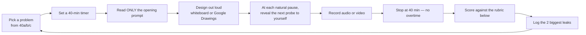

# 40 — Mock Interviews: How to Practice Until It's Reflex

> **Reading the course makes you *know* system design. This makes you *able to perform it.*** A Staff design round is a 40-minute live performance under an interviewer who keeps changing the constraints. You only get good at it by doing timed, spoken reps — then scoring yourself honestly.

This module is the **practice harness**. The interviewer-side question banks live in:
- **[40a — Chat, Social & Media](40a-mock-chat-media.md)** — WhatsApp, Slack, Instagram, Twitter, FB Feed, LinkedIn, YouTube, Netflix, Spotify, Zoom, Google Docs, Dropbox, Gmail, news aggregator, live comments, Strava, post search, Tinder
- **[40b — Marketplaces, Money & Infra Primitives](40b-mock-marketplace-infra.md)** — Uber, food delivery, booking, e-commerce, payments, ads, recommendations, URL shortener, rate limiter, notifications, distributed cache, API gateway, web crawler, metrics platform, Yelp, online auction, price tracker
- **[40c — Advanced & Google-Style](40c-mock-advanced-google.md)** — matching engine, migrations, deployment, real-time analytics, scheduler, live streaming, feature flags, whiteboard, IoT, online judge, online chess, ChatGPT-style chat, + the "build from scratch" primitive drills

Each entry gives the **opening prompt**, the **scope curveballs** to reveal only when asked, **the crux** that separates hire from no-hire, **8–10 escalating follow-up probes**, a **strong-vs-weak rubric**, and the **common traps**.

---

## How to run a solo mock (no partner needed)

**The rules that make it work:**
1. **Speak every thought aloud.** Silent design teaches you nothing about delivery. Record it (phone audio is enough).
2. **Use a real surface** — Google Drawings (Google's actual tool), Excalidraw, or paper. Not the playbook.
3. **Withhold the curveballs** until you'd naturally ask. Then force yourself to incorporate them — *especially* the mid-interview constraint change.
4. **Hard stop at 40 minutes.** Running over hides your real pacing problem.
5. **Score immediately, honestly.** Then re-read the matching playbook (18a–d / 31 / 33 / 34–39) only for the parts you fumbled.

> **The single most common failure:** spending 25 minutes on requirements + boxes and 5 minutes on the actual hard part. The crux deserves ~50–60% of the clock. If your recording shows otherwise, that's your #1 fix.

---

## The Staff scoring rubric

Score each 1 (junior) / 3 (senior) / 5 (staff) after every rep. Anything ≤3 is a leak to drill. This mirrors [Module 20](20-staff-execution.md) and [Module 26](26-google-sd-playbook.md).

| Dimension | 1 — Junior | 3 — Senior | 5 — Staff |
|-----------|-----------|-----------|-----------|
| **Requirements driving** | Waits to be told; boils the ocean | Gathers thoroughly | *Drives* — surfaces the one constraint that changes the design; declares non-goals |
| **Estimation** | Skips it, or DAU-as-RPS error | Does the math | Uses numbers to *rule complexity in/out* (read:write, peak, Little's Law, cache hit) |
| **Altitude** | Explains how a load balancer works | Mostly right level | Name-and-move-on for settled ground; deep-dives only the risk crux |
| **Decisiveness** | Lists options, defers ("it depends") | Picks with reasons | "X because Y; revisit if Z" — never ends on "it depends" |
| **Deep-dive depth** | Stays at boxes | Goes one level down | Builds the hard part from mechanism; 50–60% of time here |
| **Failure: detect & defend** | "We add redundancy" | Names failure modes | Proactively: detect (health/heartbeat) → defend (breaker/bulkhead/backpressure) → recover (failover/replay/reconcile) per component |
| **Trade-off articulation** | "This is better" | One upside/one downside | Quantified, with the trigger that flips the decision; reversibility (1-way vs 2-way door) |
| **Communication / collaboration** | Monologues or freezes | Clear | High-bandwidth; checks in ("sound right?"); incorporates hints; cites real experience |

**Read your score:** the leaks cluster in **Estimation, Altitude, and Decisiveness** for almost everyone. Drill those three first.

---

## A practice plan (depth over schedule — adapt freely)

| Block | Reps | Goal |
|-------|------|------|
| Warm-up | URL shortener, rate limiter, distributed cache (40b/40c) | Get the 10-step flow + BOTEC automatic on easy problems |
| Real-time / chat | WhatsApp, Slack, Zoom, collaborative whiteboard (40a/38) | Be *unimpeachable* on chat/real-time — a high-value, commonly-asked area |
| Consistency-critical | Payment, e-commerce inventory, booking, matching engine (40b/40c) | Nail strong consistency, idempotency, saga — where most candidates break |
| Fan-out & scale | Twitter, Instagram, News Feed, real-time analytics (40a/40c) | The celebrity/hot-key + fan-out-write-vs-read decision, cold |
| Google-flavored | Build-from-scratch drills + migration + deployment (40c) | Build primitives from mechanism; the "don't name a product" muscle |
| Full mocks | Random pick, timed, scored, ideally with a partner | Simulate the real loop; close the rubric gaps |

> **When are you ready?** When you can take a *random* problem cold, drive it for 40 minutes out loud, hit the crux, defend the trade-offs against escalating probes, and self-score ≥4 across the board — consistently, not once. Get there and the interview is just another rep.

---

*Pair this with [20 — Staff-Level Execution](20-staff-execution.md) (the delivery meta-skill) and [26 — Google SD Playbook](26-google-sd-playbook.md) (the Google rubric). Then go do reps.*
