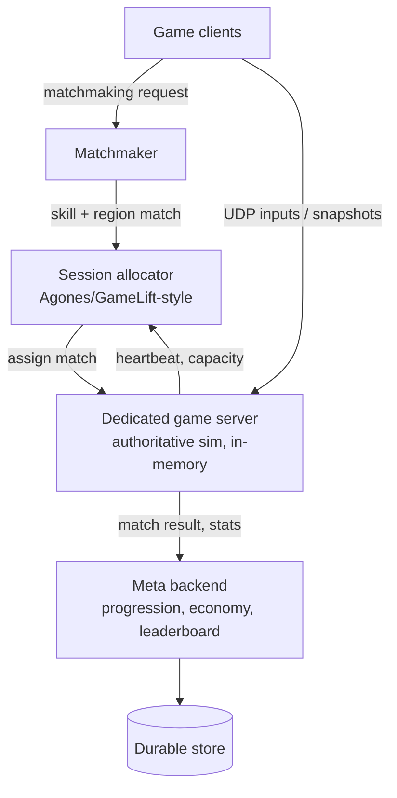
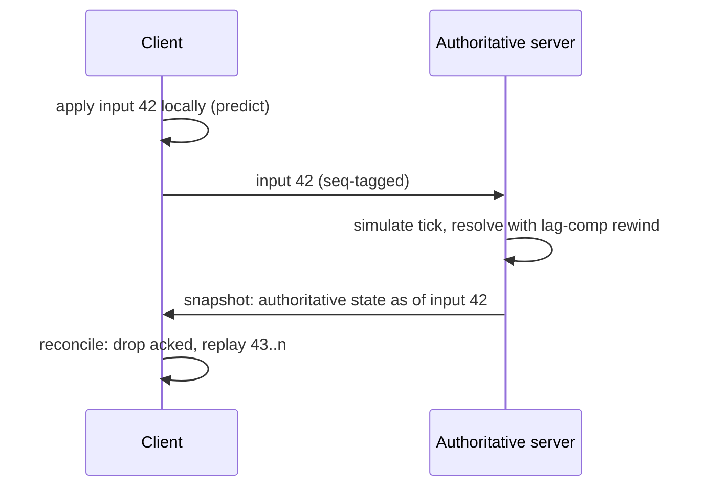
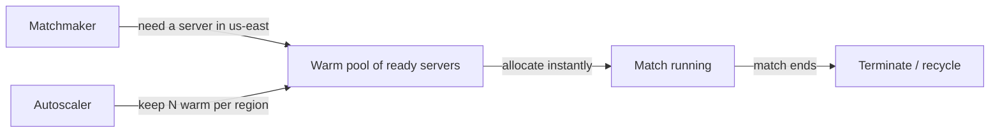

# 41 — Design a Multiplayer Game Backend

> **Prerequisites:** [09 — Real-Time Systems](09-realtime-systems.md) (transports, connection fleets), [28 — Designing for Failure](28-designing-for-failure.md), [30 — Capacity Estimation](30-capacity-estimation.md). Related: [DD-13 Realtime Updates](../Deep%20Dives/13-realtime-updates.md).
>
> **The prompt:** *"Design the backend for a real-time multiplayer game — say a 10-player competitive shooter/MOBA."* A recurring Meta/Snap/gaming-adjacent Staff prompt, and the archetype most system-design prep ignores because its crux — **authoritative simulation + latency-hiding netcode over UDP** — appears nowhere else.

## What you'll master

- The **fork question** that reframes the whole design: real-time authoritative-action vs turn-based vs MMO — they're three different systems, and you pick the hard one on purpose.
- The **server-authoritative tick loop** — why the server simulates and the client only sends *inputs*, and why that single decision is the foundation of both consistency and anti-cheat.
- The four netcode techniques that hide latency: **client-side prediction, server reconciliation, entity interpolation, lag compensation** — and the exact bug each one fixes.
- **State sync at scale:** delta snapshots + **interest management** (area-of-interest), and why UDP — never TCP — is the transport.
- **Matchmaking + the dedicated-server fleet:** skill/latency matching, and allocating stateful ephemeral game servers (Agones/GameLift-style) as a cost-vs-join-latency dial.
- The Staff & EM layer: tick-stability SLOs, and why a game-server fleet's *utilization* is the whole cost story.

## In the Room — the decisive move

Say this in the first two minutes:

> *"First I'll pin the genre, because it changes everything. Turn-based (chess, Words) is a request/response CRUD app with a queue — not interesting. MMO is a sharded persistent world — a zoning problem. The hard, interesting case is real-time competitive action: an **authoritative server** simulates the game at a fixed **tick**, clients send only their **inputs**, and the server broadcasts **snapshots** of world state. Everything hard flows from that: I have ~50–100 ms to hide, so I'll need client-side prediction and lag compensation; I can't trust the client, so the server is the single source of truth; and I'll run it over **UDP**, because a dropped packet should be skipped, not retransmitted. Let me design that."*

### Decisions to make decisively

| Decision | Choice | Because |
|---|---|---|
| Authority | **Server-authoritative** simulation | The client is an attacker; only the server's state counts. Foundation of anti-cheat |
| Transport | **UDP** + a thin custom reliability layer (QUIC/WebTransport for browser) | TCP head-of-line blocking retransmits stale state; real-time wants "drop and move on" |
| Client input | Send **inputs**, not positions | A client that sends "I am at X" is a teleport hack; a client that sends "I pressed forward" can be validated |
| Latency hiding | Prediction + reconciliation + interpolation + lag compensation | 50–100 ms RTT is unplayable without them |
| State sync | **Delta snapshots** + **interest management** | Full-world broadcast is O(players²) bandwidth; send only what's near you |
| Game servers | **Dedicated, one match per process, ephemeral, in-memory** | Match state is hot and transient; account state is a *separate* durable backend |
| Match vs meta state | Split them | Real-time match state ≠ durable progression/economy — different systems, different guarantees |

**Experience hook.** *"This is the same shape as our chat gateway fleet — stateful long-lived connections, region-pinned, drained on deploy — except the server also runs a physics loop and the correctness bar is 'was this headshot valid,' not 'did the message arrive.'"*

---

## 1. Requirements

**Functional.**
- Matchmaking: group N players into a match by skill and region; handle parties and queue.
- Real-time play: authoritative simulation, input handling, state broadcast, hit validation.
- Reconnection: a dropped player can rejoin an in-progress match within a grace window.
- Meta: persistent progression, inventory, leaderboards, match history (a *separate* backend).

**Non-functional.**
- **Tick rate 30–64 Hz** (simulation steps/second); **perceived latency < 100 ms**.
- **Cheat-resistant** — server-authoritative, never trust client state.
- Scale target: **1M concurrent players**, ~100k concurrent 10-player matches, global.
- Match-join time p95 **< 30 s** (queue + allocation).
- Tick stability: the server must hit its tick budget (e.g. 16 ms at 60 Hz) at p99 — a stalled tick is a stutter for everyone in the match.

**Explicit non-goals to name:** the graphics/engine client, deep economy/monetization, and the persistent-open-world (MMO) zoning problem — each a follow-up.

> **Staff-level insight:** the requirements trap is treating this like a CRUD backend with sockets. The moment you say "the server runs a fixed-timestep simulation and the network is a lossy input/snapshot channel," you've signaled you know this is a *simulation* problem, not a *request* problem. That reframing is most of the signal.

## 2. Back-of-envelope

| Quantity | Math | Result |
|---|---|---|
| Concurrent matches | 1M players ÷ 10 per match | **100k matches** |
| Snapshot size (10 players, delta + interest-managed) | ~1–3 KB | small |
| Per-player downstream | 2 KB × 30 Hz | **~60 KB/s = ~480 kbps** |
| Per-player upstream (inputs) | ~100 B × 30–60 Hz | **~5 KB/s** |
| Per-match server CPU | one tick loop, 10 entities | trivial CPU; **1 core runs several matches** |
| Game-server fleet | 100k matches ÷ ~4 matches/core ÷ ~32 cores/box | **~800 boxes**, region-distributed |
| Aggregate downstream bandwidth | 1M × 480 kbps | **~480 Gbps** egress |

Two things to say: the system is **bandwidth-bound, not CPU-bound** (a tick over 10 entities is cheap; pushing 30 snapshots/second to a million players is the cost), and **egress is the dominant bill** — which is why interest management and delta compression aren't optimizations, they're the design.

## 3. High-level design

Two planes, kept separate:
- **The real-time plane:** clients ↔ dedicated game servers over UDP. Game servers are **stateful, ephemeral, one match each**, holding authoritative state in memory. They are allocated per match and torn down when it ends.
- **The meta plane:** ordinary request/response services (matchmaking, progression, inventory, leaderboards) backed by durable transactional storage. Match *results* flow here on completion; nothing real-time does.

The separation is the key architectural statement: **match state is hot, transient, and in-memory; account state is durable and transactional — never conflate them.** A crash losing a match is recoverable UX (reconnect/refund); a crash losing someone's purchased inventory is not.

## 4. Deep dive A — the netcode (how latency is hidden)

The authoritative loop: every tick, the server applies all buffered client inputs, advances the simulation one fixed step, and broadcasts a snapshot. But a naive client that just renders incoming snapshots feels ~1 RTT laggy — unplayable. Four techniques fix it:

- **Client-side prediction.** The client applies *its own* input immediately (moves the local player now) instead of waiting for the server round-trip — so your own character feels instant. The client is predicting what the server will confirm.
- **Server reconciliation.** The server is still authoritative. The client tags each input with a sequence number; when the server snapshot arrives ("here's your authoritative position as of input #42"), the client discards predictions ≤ 42 and **replays** any unacknowledged inputs on top of the authoritative state. A misprediction (you hit a wall the client didn't know about) shows as a small correction/snap.
- **Entity interpolation.** *Other* players can't be predicted (you don't know their inputs). So the client renders them **slightly in the past** (~100 ms buffer) and interpolates between the last two snapshots — smooth motion at the cost of seeing others a bit delayed.
- **Lag compensation ("favor the shooter").** When you fire, the server **rewinds** the world to the state *you actually saw* (your render time = now − your latency − interpolation delay) and checks the hit against *that*. Otherwise a high-ping player could never hit a moving target. The controversial cost: you can be shot "after" you rounded a corner on your own screen — the classic tradeoff, and worth naming as a deliberate design choice, not a bug.

> **Staff-level insight:** the one-paragraph mastery statement is *"the server owns truth and simulates at a fixed tick; the client predicts its own actions for responsiveness and reconciles against the server's authority; it interpolates other entities from buffered snapshots because it can't predict them; and the server does lag compensation by rewinding to the shooter's view to validate hits. Prediction hides your latency, interpolation hides theirs, reconciliation keeps the server authoritative, lag comp makes aiming fair."* If you can say that, you've cleared the netcode bar most candidates never reach.

## 5. Deep dive B — state sync and interest management

Broadcasting the full world to every player is O(players²) bandwidth and a wallhack waiting to happen. Two moves:

- **Delta snapshots.** Send only what changed since the client's last **acknowledged** snapshot, not full state. The server keeps a small ring of recent snapshots per client and diffs against the last acked one (again UDP-friendly: if an ack is lost, fall back to a larger delta or a keyframe). Add **quantization/bit-packing** — positions don't need 32-bit floats; a few centimeters of precision is invisible.
- **Interest management (area-of-interest).** Only send a player the entities *relevant* to them — within view/range, in the same zone. For a 10-player arena this is minor; for a 100-player battle royale or an MMO it's the difference between viable and impossible. Grid/cell-based spatial partitioning ([Core 29 geospatial](29-geospatial-systems.md) ideas apply) buckets entities so "who's near me" is cheap.

**Interest management is also anti-cheat:** if the server never *sends* you the position of an enemy behind a wall, no client-side wallhack can reveal it. "Don't send what the player shouldn't see" is a security control disguised as a bandwidth optimization — say that.

## 6. Deep dive C — transport, matchmaking, and the fleet

**Transport — UDP, and why.** TCP guarantees ordered delivery, which means a lost packet **blocks everything behind it** (head-of-line blocking) while it retransmits — catastrophic when the retransmitted state is already stale. Games want the opposite: drop the old packet, use the newer one. So: raw **UDP** with a thin custom layer that marks a few messages reliable-ordered (chat, match-start) and leaves state snapshots unreliable. Browser games use **WebRTC data channels or WebTransport (over QUIC)** for the same unreliable-datagram semantics where raw UDP isn't available.

**Matchmaking.** Two axes in tension: **skill** (MMR via Elo/Glicko/TrueSkill — fair matches) and **latency** (region/ping — playable matches), plus **queue time** (players hate waiting). The matchmaker relaxes its skill band as wait time grows — a tunable fairness-vs-speed dial. Parties must be kept together; backfill replaces early quitters.

**The dedicated-server fleet.** Matches run on **dedicated game servers** — stateful, one match per process, allocated on demand and destroyed at match end (Agones on Kubernetes, or a managed fleet like GameLift). The core operational dial:

You keep a **pre-warmed pool** of ready servers per region so allocation is instant (cold-booting a server on join = a 30-second queue). Pool size is a **cost-vs-join-latency dial**: more warm servers = faster joins = more idle spend. This is the whole cost conversation.

## 7. Failure drills — volunteer these

| Failure | Blast radius | Design answer |
|---|---|---|
| Player disconnects | One player drops | Grace window + reconnect to same match (state is on the server); AI/bot takeover or backfill if they don't return |
| Game server crashes mid-match | One match (10 players) | Match lost — reconnect players to a fresh server from a periodic checkpoint, or accept the loss and refund/no-penalty. Account state untouched (separate plane) |
| Packet loss / high ping | One player degrades | Client interpolation buffer absorbs jitter; unreliable snapshots mean loss = a skipped frame, not a stall; adaptive send rate |
| Region outage | Players in that region | Matchmaker routes to the next-nearest region (higher ping, still playable); fleet is multi-region |
| Cheating client | Match integrity | Server-authoritative sim rejects impossible inputs; interest management blocks wallhacks; anomaly detection + replay review offline |
| DDoS on a game server IP | One match's server | Game servers behind an anti-DDoS edge / relay; don't expose raw origin IPs; rotate |
| Matchmaker overload | Join times spike | It's a queue — shed to "relaxed match quality" and scale stateless matchmaker workers; the fleet, not the matchmaker, is the hard scaling limit |

## 8. The Staff & EM layer

**SLOs that fit a game.**
- **Tick stability** (p99 tick within budget) — the real-time correctness SLO; a server that misses ticks stutters for everyone on it, so this is per-match, not aggregate.
- **Match-join time** p95 — the queue+allocation experience.
- **Disconnect/rejoin success rate** — the resilience SLO players actually feel.
- Note what's *absent*: raw request latency is meaningless here; the unit of health is the *match*.

**Cost — utilization is the entire story.** Game servers are **stateful compute you can't pack densely** (one match per process, ephemeral), so **fleet utilization** dominates the bill. The levers, each with an owner: warm-pool size per region (join latency vs idle cost), matches-per-core density (CPU headroom vs tick stability), spot/preemptible for non-competitive modes, scale-to-near-zero off-peak, and **egress** (the ~480 Gbps from §2 — interest management and delta compression are cost controls, not just perf). An EM makes warm-pool sizing a *measured* dial (join-time SLO vs $/idle-hour), not a guess.

**Ownership seams:** the real-time plane (game servers, netcode, fleet) and the meta plane (progression, economy, matchmaking services) are different teams with different on-call profiles — real-time is latency/tick-driven, meta is a normal transactional backend. Name the seam.

### Altitude — the same probes at three levels

| Probe | Senior says | Staff says | EM adds |
|---|---|---|---|
| "How do you hide latency?" | Client prediction | Prediction + reconciliation + interpolation + lag-comp, each fixing a specific bug | Playability SLO; the "favor the shooter" tradeoff is a product decision |
| "How do you stop cheating?" | Validate on server | Server-authoritative sim + interest management as anti-wallhack + anomaly detection | Trust-and-safety ownership; ban pipeline |
| "Scale it to 1M players" | Add servers | Bandwidth-bound math; interest management + deltas; warm-pool fleet | Utilization as the cost dial; region capacity planning |
| "Server crashes mid-match" | Reconnect | Checkpoint vs accept-loss; match plane ≠ account plane | Refund/penalty policy; who owns the incident |

## 9. Follow-ups they'll ask

1. **"Make it an MMO / seamless open world."** Now it's a **zoning/sharding** problem: partition the world into regions each owned by a server, hand entities off at boundaries (area-of-interest handoff), eventual consistency for distant areas. The single-authoritative-server model breaks; interest management becomes central.
2. **"100-player battle royale."** Interest management goes from optional to load-bearing (you cannot broadcast 100 players to 100 players); spatial partitioning + shrinking play area.
3. **"Turn-based instead."** Collapses to a CRUD backend + a queue + push notifications — say that and move on; the real-time machinery is unjustified.
4. **"Cross-platform / rollback netcode (fighting games)."** Deterministic lockstep simulation + rollback (GGPO-style) — a different netcode model where clients simulate deterministically and roll back on input mismatch; name it as the fighting-game alternative to client-prediction.
5. **"Voice chat."** Separate real-time media path (SFU, [Core 09](09-realtime-systems.md) WebRTC territory) — don't run it through the game tick.

## Interview Cheat-Sheet

**One-liner:** *"Authoritative server simulates at a fixed tick; clients send inputs, not state; snapshots go out over UDP; prediction/reconciliation/interpolation/lag-comp hide the latency; interest management + deltas keep bandwidth sane; dedicated ephemeral game servers run one match each from a warm pool."*

**The four netcode techniques (one line each):** prediction hides *your* latency · interpolation hides *theirs* · reconciliation keeps the server authoritative · lag compensation makes aiming fair (favor the shooter).

**Numbers:** tick 30–64 Hz · <100 ms perceived · ~480 kbps/player down · 1M players ≈ 100k matches ≈ ~800 boxes ≈ ~480 Gbps egress (bandwidth-bound, not CPU-bound).

**The close:** *"The design is two planes and one loop: a real-time plane of authoritative, in-memory, UDP game servers running a fixed-tick simulation with latency-hiding netcode, and a durable meta plane for accounts and progression — never conflated. Everything hard — fairness, anti-cheat, scale — comes from 'the server simulates, the client predicts, and you only send what a player should see.'"*
