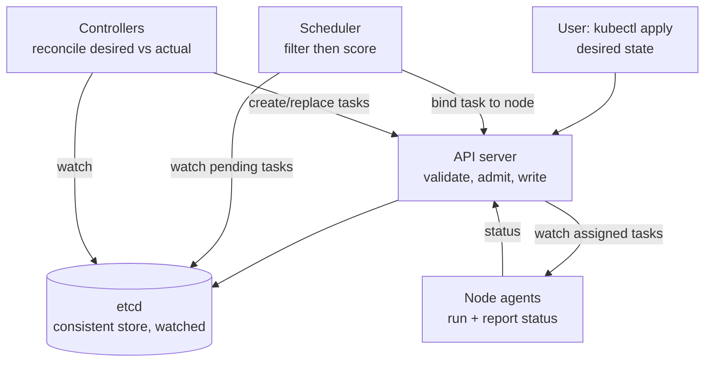
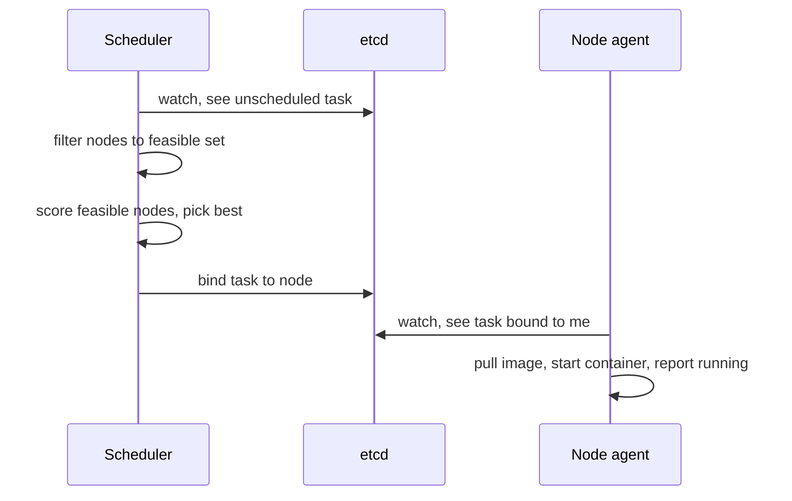

# 42 — Design a Cluster Scheduler (Kubernetes / Borg)

> **Prerequisites:** [22 — Google Papers §Borg](22-google-papers.md), [02 — Distributed Systems](02-distributed-systems.md) (consensus, etcd, leader election), [08 — ZooKeeper/etcd](../Deep%20Dives/08-zookeeper.md), [28 — Designing for Failure](28-designing-for-failure.md). Companion to [21 — Build From Scratch](21-build-from-scratch.md).
>
> **The prompt:** *"Design a system that schedules containers/tasks onto a fleet of machines — a Kubernetes or Borg."* A Google/Snowflake/infra-team staple, and a "build it, don't name it" round: they want the **scheduler**, **reconciliation loop**, and **bin-packing**, not "I'd use Kubernetes."

## What you'll master

- The **declarative + reconciliation** model — desired state in a consistent store, control loops that drive actual → desired — and why it's the reliability foundation, not a detail.
- The **scheduling algorithm** as two phases: **filter** (which nodes *can* run this) then **score** (which is *best*), and the **bin-pack vs spread** tension that scoring encodes.
- **Preemption** — how a high-priority task evicts lower-priority ones to fit.
- **etcd as the brain** — consistent, *watched*, and the thing that caps cluster size.
- The Staff & EM layer: **utilization is the cost**, multi-tenancy via quotas, and the autoscaling stack.

## In the Room — the decisive move

> *"A cluster scheduler is a control system, not a queue. The user declares desired state — 'I want 3 replicas of this container with these resources' — into a consistent store. A **scheduler** assigns each pending task to a node in two steps: filter to feasible nodes, then score them to pick the best (usually bin-packing to keep utilization high). **Controllers** run reconciliation loops that continuously compare desired vs actual and act to close the gap — that level-triggered loop is what makes the whole thing self-healing: a node dies, the controller just notices actual < desired and reschedules. The hard parts are the scheduling algorithm, preemption, and keeping the state store (etcd) consistent and fast enough, because that store is the cluster-size limit."*

### Decisions to make decisively

| Decision | Choice | Because |
|---|---|---|
| Control model | **Declarative desired state + reconciliation loops** | Level-triggered (compare-and-correct) is idempotent and self-healing; edge-triggered (react to events) loses events and can't recover |
| State store | **Consistent, watchable** (etcd — Raft) | The single source of truth; controllers *watch* it for changes. Its throughput caps cluster size |
| Scheduling | **Filter (predicates) → score (priorities) → bind** | Separate feasibility from optimization; makes the algorithm pluggable |
| Packing | **Bin-pack by default, spread for HA-critical** | Tight packing = fewer machines = cost; spread = resilience. It's a per-workload dial |
| Control plane | **Replicated API servers + etcd quorum + leader-elected scheduler** | HA without split-brain; only one scheduler acts at a time |
| Nodes | **Cattle, not pets** | A dead node is a reschedule event, not an incident |

**Experience hook.** *"The reconciliation model is the same instinct as an idempotent consumer — don't react to a delta, converge to a target. It's why 'kill a pod and it comes back' works without anyone writing failover code."*

---

## 1. Requirements

**Functional.**
- Accept **declarative workloads** (task/pod specs: image, resource requests, constraints, replica count).
- **Schedule** each task onto a node respecting resource and placement constraints.
- **Reconcile** continuously: maintain the declared replica count, reschedule on node failure.
- **Preempt** lower-priority tasks when a higher-priority one can't otherwise fit.
- Support **constraints**: node selectors/affinity, anti-affinity (spread replicas), taints/tolerations.

**Non-functional.**
- Scale: **~5,000 nodes, ~150k tasks** per cluster (Kubernetes' practical ceiling; Borg cells go larger). Beyond → multi-cluster.
- **Scheduling throughput**: hundreds of pods/sec.
- **High availability** of the control plane; **static stability** — if the control plane is down, *running* tasks keep running.
- High **utilization** — the entire economic point.

**Non-goals to name:** the container runtime itself (that's the kubelet/containerd layer), networking/service mesh, and persistent-storage orchestration — each a follow-up.

> **Staff-level insight:** the framing trap is treating scheduling as the whole problem. Scheduling is one component; the *architecture* is the declarative-store-plus-reconciliation-loops pattern. Lead with the control model, then dive into the scheduler — that ordering shows you see the system, not just the algorithm.

## 2. Back-of-envelope

| Quantity | Math | Result |
|---|---|---|
| Tasks | 5,000 nodes × ~30 tasks/node | **~150k tasks** |
| State size | 150k tasks × ~2 KB spec/status | **~300 MB** in etcd (fits in RAM; etcd likes ≤ ~8 GB) |
| Watch fan-out | every controller + kubelet watches relevant keys | thousands of watchers — **the etcd bottleneck** |
| Scheduling rate | churn: deploys, scale events, failures | **100s of binds/sec** at peak |
| Reschedule storm | a rack of 200 nodes dies → ~6k tasks to replace | scheduler must drain a burst without falling behind |

Two conclusions: the system is **coordination-bound, not compute-bound** — etcd's write throughput and watch fan-out cap cluster size, which is exactly why Kubernetes tops out ~5k nodes and huge fleets run *many* clusters; and the **reschedule burst** after a correlated failure is the load spike the scheduler must survive.

## 3. High-level design

The pieces, and why each exists:
- **API server** — the only writer to etcd; validates, applies admission policy, and is the *watch* hub. Stateless and horizontally scalable (put a load balancer in front).
- **etcd** — the consistent (Raft) source of truth. Everything else is stateless and reconstructs from it. Controllers and node agents **watch** it, so a change fans out as a push, not a poll.
- **Scheduler** — watches for *unscheduled* tasks, picks a node (§4), writes the binding. Leader-elected: one active at a time to avoid conflicting decisions.
- **Controllers** — the reconciliation loops (§5): ReplicaSet controller keeps N replicas alive, node controller reschedules tasks off dead nodes, etc.
- **Node agent (kubelet)** — watches for tasks bound to *its* node, runs them, reports status. The node is otherwise dumb.

The whole design is **one hub (etcd) + stateless watchers**. That's what makes it recoverable: kill any component and it rebuilds its view from etcd on restart.

## 4. Deep dive A — the scheduling algorithm

Scheduling one task is **filter → score → bind**:

- **Filter (predicates):** eliminate nodes that *cannot* run the task. Checks: does the node have enough allocatable CPU/memory for the task's **requests**? Does it satisfy node selectors / required affinity? Do the task's **tolerations** match the node's **taints**? Are required ports free? Anti-affinity satisfied (don't co-locate two replicas)? Output: the feasible set.
- **Score (priorities):** rank the feasible nodes. This is where **bin-pack vs spread** lives — score high for *most-utilized* node (pack tight, fewer machines) or *least-utilized* (spread load), plus preferred affinity, image locality (node already has the image → faster start), topology spread. Weighted sum → pick the top node.
- **Bind:** write `task → node` to etcd via the API server. The node's agent, watching, then actually starts it.

**Bin-packing is the core optimization and it's NP-hard** — so it's a heuristic (best-fit-style scoring), not an optimal solve. The tension to articulate: pack tightly and you run fewer, cheaper machines but lose failure headroom and risk noisy-neighbor contention; spread and you pay for idle capacity but survive node loss gracefully. **Requests vs limits** is the overcommit lever: schedule against *requests* (guaranteed) but let tasks burst to *limits*, betting not everyone peaks at once — higher utilization, at the risk of eviction under pressure.

> **Staff-level insight:** the say-verbatim is *"the scheduler filters to feasible nodes on hard constraints, then scores them on soft goals — and the dominant score is a bin-packing vs spreading choice that trades cost against resilience. It's NP-hard, so it's a greedy heuristic per task, not a global optimum; at Borg scale you also shard the scheduler or batch decisions to keep throughput up."*

## 5. Deep dive B — reconciliation, the reliability engine

This is the idea that separates a Staff answer from "it schedules things." Controllers don't react to *events* — they run a **level-triggered loop**: observe actual state, compare to desired, take corrective action, repeat.

- Desired: "3 replicas." Actual: the controller lists running replicas. If actual < desired (a node died, taking one), it creates a replacement — *no failover code, no event handler*, just convergence. If actual > desired (a scale-down), it deletes extras.
- **Why level-triggered, not edge-triggered:** an edge-triggered system reacts to "node died" events — miss the event (controller was restarting) and the task is gone forever. A level-triggered loop re-derives the truth every cycle, so a missed event just means it's caught on the next pass. **Idempotent and self-healing by construction.**
- Controllers are **many and single-purpose** (ReplicaSet, Deployment, Job, node lifecycle…), each owning one invariant. They compose: a Deployment controller manages ReplicaSets, which manage pods.

> **Staff-level insight:** *"The reconciliation loop is why Kubernetes 'just heals.' Nothing has failover logic — every controller continuously drives actual toward declared desired state, so a failure is just a temporary divergence the next loop corrects. Declarative + level-triggered is the whole reliability model; the scheduler is just the controller that assigns nodes."* This is the single highest-signal thing to say in this design.

## 6. Deep dive C — preemption, priority, and quotas

- **Priority classes:** every task has a priority. When a high-priority task can't be scheduled (no feasible node with room), the scheduler looks for a node where **evicting lower-priority tasks** would free enough space — it preempts them (graceful termination), the victims go back to pending, and the loop reschedules *them* elsewhere. Prevents a flood of low-priority batch work from starving critical services.
- **Quotas / multi-tenancy:** namespaces + **resource quotas** cap how much a team can request, so one tenant can't consume the cluster; **limit ranges** set per-task defaults. This is the day-one multi-tenancy control, same instinct as rate-limit quotas on a shared platform.
- **QoS tiers:** guaranteed (requests = limits, evicted last), burstable, best-effort (evicted first under node pressure) — the eviction order under memory pressure.

## 7. Failure drills — volunteer these

| Failure | Blast radius | Design answer |
|---|---|---|
| Node dies | Its tasks stop | Node controller marks it NotReady after a grace period; reconciliation reschedules its tasks elsewhere. Cattle, not pets |
| Scheduler crashes | *No new* scheduling | Running tasks unaffected (**static stability** — the data plane doesn't depend on the control plane); leader election promotes a standby scheduler |
| etcd loses quorum | Control plane read-only/stalls | Raft needs a majority; run 3 or 5 members across failure domains. Running tasks keep running (static stability again) — this is why the control-plane/data-plane split matters |
| API server overload | Scheduling + watches slow | Scale API servers horizontally (stateless); rate-limit and prioritize (API Priority and Fairness); watch caching |
| Reschedule storm (rack loss) | Thousands of tasks pending | Scheduler drains the burst; batch scheduling / scheduler sharding at Borg scale; pod-disruption budgets bound voluntary churn |
| Bad admission/config rollout | Cluster-wide | Admission webhooks fail-open vs fail-closed decision; staged rollout of control-plane config |
| Cluster hits ~5k-node ceiling | Coordination saturates | Don't scale one cluster past etcd's comfort — go **multi-cluster** with a federation/placement layer |

## 8. The Staff & EM layer

**Utilization is the entire cost story.** The reason cluster schedulers exist is to run more work on fewer machines — so **fleet utilization is the metric that maps directly to the bill**. The levers: bin-packing aggressiveness, overcommit ratio (requests vs limits), right-sizing requests (the #1 source of waste is padded requests reserving capacity nothing uses — VPA and usage-based recommendations fix it), and bin-packing bursty/batch work onto spare capacity of latency-critical fleets. An EM makes *requested vs used* a visible, charged-back number, because unpriced over-requesting is how clusters run at 30% utilization.

**The autoscaling stack (name the layers):** **HPA** scales replica count on load, **VPA** right-sizes per-task requests, **Cluster Autoscaler / Karpenter** adds/removes *nodes* when tasks can't fit or nodes sit idle. They compose — HPA adds pods, the node autoscaler adds machines to hold them.

**SLOs:** scheduling latency (pending → running p99), control-plane availability, and — the one that matters — **workload availability during control-plane disruption** (should be ~unaffected; if a scheduler outage takes down running services, your control/data-plane split is wrong).

### Altitude — the same probes at three levels

| Probe | Senior says | Staff says | EM adds |
|---|---|---|---|
| "How does it schedule?" | Finds a node with room | Filter → score; bin-pack vs spread; NP-hard heuristic; requests vs limits | Utilization → cost; right-sizing as the lever |
| "How does it self-heal?" | Restarts failed pods | Declarative + level-triggered reconciliation; no failover code, just convergence | Reliability model taught org-wide; fewer bespoke runbooks |
| "Control plane is down" | Everything breaks | Static stability — running tasks unaffected; leader election; etcd quorum | Verified by drills; control/data-plane ownership split |
| "Scale to 50k nodes" | Bigger etcd | etcd/watch is the ceiling → multi-cluster + placement layer | Cluster-of-clusters org strategy; capacity planning |

## 9. Follow-ups they'll ask

1. **"Scale past one cluster."** Multi-cluster with a placement/federation layer that schedules *workloads to clusters*, then each cluster schedules to nodes — a two-level scheduler (Borg cells + a higher placement service).
2. **"Custom scheduling logic."** Pluggable scheduler framework (scheduler plugins / a second scheduler) — or the Borg-style two-level model (Mesos/Omega) where frameworks make their own placement decisions against offered resources.
3. **"Gang scheduling"** (all-or-nothing for a distributed training job): the default one-task-at-a-time scheduler can deadlock; you need co-scheduling so N pods land together or none do.
4. **"Stateful workloads."** Tasks with persistent storage can't be freely rescheduled (data locality); StatefulSet-style stable identity + volume attach/detach orchestration.
5. **"How is this different from Borg?"** Borg is Google's internal ancestor: bigger cells, tighter integration, priority/quota-driven; Kubernetes is the open, declarative, extensible descendant. Omega added optimistic-concurrency shared-state scheduling to reduce head-of-line blocking between schedulers.

## Interview Cheat-Sheet

**One-liner:** *"A cluster scheduler is a control system: desired state in a consistent watched store (etcd), a scheduler that filters-then-scores nodes to place tasks, and reconciliation controllers that continuously drive actual toward desired — so failure is just a divergence the next loop corrects."*

**The mechanisms (one line each):**
- Declarative desired state + **level-triggered reconciliation** = self-healing with no failover code.
- Scheduling = **filter (feasible)** → **score (best, bin-pack vs spread)** → **bind**; NP-hard, so greedy.
- **Preemption** by priority frees room for critical tasks; **quotas** give multi-tenancy.
- **etcd** (Raft, watched) is the brain and the **cluster-size ceiling** (~5k nodes → multi-cluster).
- **Static stability:** control plane down ⇒ running tasks keep running.

**Numbers:** ~5k nodes / ~150k tasks per cluster · etcd ≤ ~8 GB, state ~hundreds of MB · 100s of binds/sec · beyond ~5k nodes → many clusters.

**The close:** *"The architecture is one consistent store plus stateless watchers, and the reliability comes not from failover logic but from declarative desired state driven by level-triggered control loops. The scheduler is just the loop that assigns nodes — filter, score, bind — and the whole system's scaling limit is how fast the store can be watched and written. Utilization is why it exists, so I'd design and measure for packing efficiency as the cost lever."*
