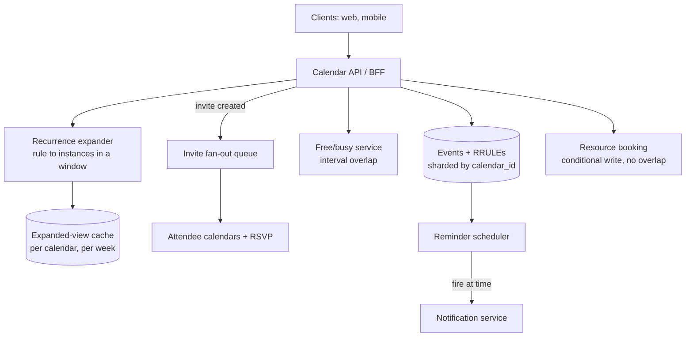

# 43 — Design a Calendar System (Google Calendar / Outlook)

> **Prerequisites:** [06 — Databases](06-databases.md), [04 — Messaging](04-messaging-event-driven.md) (invite fan-out), [35 — Scheduler](35-design-scheduler.md) (reminders), [DD-14 — Contention](../Deep%20Dives/14-pattern-contention.md) (resource booking). Related: [18b — Media & Productivity](18b-design-media-productivity.md).
>
> **The prompt:** *"Design a calendar — Google Calendar / Outlook."* Common at Microsoft/Atlassian/Rippling and as a mid-loop prompt everywhere. Looks like CRUD; the crux is **recurrence**, **free/busy availability**, **timezone correctness**, and **resource-booking contention** — four traps that separate a real answer from a to-do list.

## What you'll master

- Why you **store the recurrence rule, not the instances**, and expand on read — the single most important calendar decision.
- **Free/busy** as an interval-overlap problem, and the "find a time N people are all free" query.
- **Timezone + DST correctness** — the bug that dominates calendar systems, and how UTC-plus-original-timezone fixes it.
- **Invitations** as per-attendee fan-out with independent RSVP state, and cross-provider interop (iCalendar/iTIP).
- **Resource booking** (meeting rooms) as a genuine contention/conflict problem, distinct from personal double-booking.
- Read-heavy scaling, incremental sync, and the Staff/EM layer.

## In the Room — the decisive move

> *"A calendar looks like CRUD but four things make it hard. First, **recurrence**: 'every weekday forever' can't be stored as rows, so I store the **rule** (RFC 5545 RRULE) and **expand it on read** within the requested window, with exceptions stored as overrides. Second, **timezones**: I store UTC plus the event's original timezone, because a recurring 9 am meeting must stay 9 am *local* across DST — a pure-UTC store gets that wrong. Third, **invitations** fan out: each attendee gets their own event copy and independent RSVP, and cross-provider invites go over the email-based iTIP protocol. Fourth, **rooms**: personal calendars allow overlap, but a meeting *room* can't be double-booked — that's a real contention problem needing a conditional write. It's read-heavy, so I expand-and-cache per view window."*

### Decisions to make decisively

| Decision | Choice | Because |
|---|---|---|
| Recurrence storage | **Store the RRULE, expand on read** | Materializing infinite/unbounded instances is impossible; the rule is tiny and exact |
| Recurrence exceptions | **Override records** (this-instance moved/cancelled) keyed by original start | One moved instance shouldn't rewrite the series |
| Time representation | **UTC + original IANA timezone** (not just UTC) | Recurrence and DST must resolve in *local* time; UTC-only silently shifts recurring events |
| Invitations | **Per-attendee copy + independent RSVP**; iTIP for cross-provider | Each person owns their view; the organizer doesn't control attendees' calendars |
| Rooms/resources | **Conditional write / reservation** (no overlap) | A room is a contended resource, unlike a person's overlapping calendar |
| Read path | **Expand + cache per view window** | Read-heavy; everyone polls "this week" constantly |
| Sync | **Incremental via sync token** (changes-since) | Clients (esp. mobile) sync deltas, not the whole calendar |

**Experience hook.** *"Recurrence-expansion-on-read is the same instinct as typeahead's build-vs-serve split — do the cheap thing at write (store the rule), do the bounded thing at read (expand the window), and never materialize the unbounded set."*

---

## 1. Requirements

**Functional.**
- Create/edit/delete events; single and **recurring** (RRULE) with **per-instance exceptions**.
- **Invite attendees**; each RSVPs (yes/no/maybe) independently; organizer sees responses.
- **Free/busy**: show an attendee's busy blocks; "find a time everyone's free."
- **Book resources** (rooms) without double-booking.
- **Reminders/notifications** at configured lead times.
- **Sync** across a user's devices, incrementally; support offline edits.

**Non-functional.**
- Scale: **500M users**, ~dozens of events/user, **read:write ≈ 100:1** (constant calendar-checking).
- **Timezone/DST correctness** — a correctness SLO, not best-effort (a wrong meeting time is a failed product).
- View latency low (calendar open < 200 ms); reminders fire on time.

**Non-goals to name:** the video-conferencing link itself (that's a [Zoom-style](18b-design-media-productivity.md) system), rich scheduling-AI, and full groupware (mail) — follow-ups.

> **Staff-level insight:** the trap is spending your time on the events CRUD schema. Spend it on the four hard problems — say "the schema is easy; the hard parts are recurrence expansion, timezone correctness, availability queries, and room contention" and go straight there.

## 2. Back-of-envelope

| Quantity | Math | Result |
|---|---|---|
| Events stored | 500M users × ~500 events | **~250B event rows** (+ rules, tiny) |
| Storage | 250B × ~1 KB | **~250 TB** — sharded, ordinary |
| Read QPS | 500M × ~10 calendar opens/day ÷ 100k s | **~50k reads/s** avg, multiples at peak |
| Write QPS | read:write 100:1 | **~500 writes/s** — writes are cheap |
| Recurrence expansion | per view: expand rules overlapping the window | CPU on read, **cache the expanded window** |
| Reminders | events with reminders × fire time | a scheduled-delivery queue ([Core 35](35-design-scheduler.md)) |

Two conclusions: it's **read-heavy and storage-modest** — the design is about serving reads fast (expand-and-cache), not write scale; and **recurrence expansion is the per-read cost** you cache away, keyed by (calendar, week).

## 3. High-level design

- **Events store** — sharded by `calendar_id` (or `user_id`); a recurring event is one row + its RRULE; exceptions are override rows referencing the series and original-start.
- **Recurrence expander** — given a query window, expands overlapping rules into concrete instances, applies overrides, returns the merged list. Its output is **cached per (calendar, window)** and invalidated on edits to that calendar.
- **Free/busy service** — turns a user's events in a window into busy intervals; the "find a slot" query intersects many users' free intervals.
- **Invite fan-out** — creating an event with attendees enqueues a fan-out: write the event into each attendee's calendar view with `RSVP=needsAction`. Async, at-least-once, idempotent (dedupe on event-id + attendee).
- **Resource booking** — rooms go through a path that enforces *no overlap* via a conditional write (§6).
- **Reminders** — a scheduled-delivery system (this is [Core 35](35-design-scheduler.md)): reminders enqueue at fire-time and hit the notification service.

## 4. Deep dive A — recurrence (the calendar crux)

**Store the rule, not the instances.** An event `RRULE:FREQ=WEEKLY;BYDAY=TU;UNTIL=…` (or no end) is one row. Materializing every Tuesday forever is impossible and useless. So:

- **Expand on read within the query window.** "Show me this week" → find all rules whose span overlaps this week → generate the concrete instances in-window → merge with single events → sort. Bounded work per view.
- **Exceptions are overrides, not rewrites.** Moving *this* Tuesday's instance to Wednesday, or cancelling one occurrence, writes an **override record** keyed by `(series_id, original_start)`. Expansion generates the series, then patches in overrides (move) and removes cancellations. "Delete this event" vs "delete this and all following" vs "delete the whole series" are three distinct operations — the middle one splits the series (set `UNTIL` on the original, create a new rule going forward).
- **The edit-scope UX is a real design point:** every recurring edit must ask "this event / this and following / all events," and each maps to a different data operation. Name this — it's where the model meets the product.

> **Staff-level insight:** *"I never materialize recurring instances — I store the RRULE and expand it lazily inside the requested window, applying override records for moved/cancelled occurrences, and I cache the expanded window per calendar. 'This and following' edits split the series by capping the old rule's UNTIL and starting a new one. That keeps an infinite recurrence as a single tiny row."*

## 5. Deep dive B — timezones and DST (the dominant bug)

The failure everyone hits: store a recurring 9 am meeting purely as UTC, and when DST shifts, it drifts to 8 am or 10 am local. The fix:

- **Store the event's start in its original IANA timezone** (e.g. `America/New_York`), not just a UTC instant. Recurrence rules expand in **local wall-clock time**, then convert each generated instance to UTC using the timezone's offset *at that instance's date* — so a "9 am daily" meeting stays 9 am local on both sides of a DST transition, even though its UTC time changes.
- **All-day events are timezone-less** (a date, not an instant) — a birthday is the same calendar day everywhere; don't convert them.
- **Free/busy and reminders resolve to UTC instants** for comparison and firing, but the *authoritative* recurring definition is local-time + zone.
- The gnarly edge cases to name: the DST "spring forward" gap (2:30 am doesn't exist on that day) and "fall back" overlap (2:30 am happens twice) — a mature answer acknowledges the calendar library resolves these by policy.

> **Staff-level insight:** *"Timezone correctness is a correctness SLO here, not a nicety — a recurring meeting must be defined in local wall-clock time plus an IANA zone and expanded in local time, then converted to UTC per-instance, so DST shifts the UTC moment but never the local time the user expects. UTC-only storage is the classic bug."*

## 6. Deep dive C — availability, invitations, and resource contention

- **Free/busy = interval overlap.** A user's busy set is their expanded events as `[start, end)` intervals. "Is Alice free 2–3 pm?" is an overlap check; "find a 30-min slot when all five are free" is the **intersection of the complement** of each attendee's busy intervals within the search window — a sweep over merged intervals. Expose only busy/free (not event details) for privacy across organizations.
- **Invitations fan out; RSVP is per-attendee.** The organizer's create writes the canonical event and enqueues a fan-out that places a copy in each attendee's calendar with independent RSVP state. Responses flow back to aggregate on the organizer's view. Across providers (Google ↔ Outlook), this rides the **iTIP/iMIP** standard — invitations as structured emails — because you don't control the other provider's store.
- **Resource booking is genuine contention.** A person's calendar *allows* overlap (double-booking is a UX warning, not an error). A **meeting room cannot be double-booked** — two organizers grabbing 2 pm must not both succeed. That's [contention](../Deep%20Dives/14-pattern-contention.md): a conditional write / unique constraint on `(room_id, overlapping-interval)` so exactly one wins, the other gets a conflict. Model the room as a resource whose booking is serialized, not as just another attendee.

## 7. Failure drills — volunteer these

| Failure | Blast radius | Design answer |
|---|---|---|
| Two organizers book the same room at once | Double-booking | Conditional write / interval-exclusion constraint — one wins, the other retries a different slot |
| Invite fan-out partially fails | Some attendees miss it | At-least-once queue + idempotent per-attendee write; reconcile against the canonical event |
| DST transition | Recurring events drift | Local-time + IANA zone storage (§5); expansion converts per-instance — correct by construction |
| Recurrence with no end + huge window query | Expansion blows up | Cap the expansion window; never expand unbounded; paginate long ranges |
| Stale expanded-view cache after an edit | User sees old instances | Invalidate the (calendar, window) cache keys on any write to that calendar |
| Cross-provider RSVP lost | Organizer sees wrong status | iTIP is email-reliable-ish; reconcile and allow manual status; treat external RSVP as eventually consistent |
| Reminder fires late | Missed meeting alert | The reminder scheduler ([Core 35](35-design-scheduler.md)) owns exactly-once-ish fire; monitor fire-time lag |

## 8. The Staff & EM layer

- **Correctness is the SLO that matters.** Unlike most systems where latency dominates, here a **wrong time is a product failure** — a recurring meeting on the wrong DST side, a room double-booked, a missed reminder. So the headline SLOs are timezone/recurrence correctness (guarded by a heavy test matrix across zones and DST boundaries) and reminder fire-time accuracy, alongside read latency.
- **Read-path cost.** The bill is serving reads; expanded-view caching per (calendar, week) with edit-driven invalidation is the lever. Over-caching hurts freshness on shared calendars; under-caching re-expands rules constantly.
- **Interop is an org commitment.** Supporting external calendars (iTIP/iMIP, CalDAV) is a real, ongoing surface — an EM scopes whether cross-provider is in-scope, because it roughly doubles the invitation complexity.

### Altitude — the same probes at three levels

| Probe | Senior says | Staff says | EM adds |
|---|---|---|---|
| "How do you store recurring events?" | A recurrence table | Store the RRULE, expand on read, overrides for exceptions, split on 'this-and-following' | Recurrence correctness as a tested invariant |
| "9 am meeting after DST?" | Store UTC | Local time + IANA zone, expand local, convert per-instance | Timezone correctness as an SLO with a test matrix |
| "Find a time for 5 people" | Check each calendar | Interval intersection over free sets in a window; busy-only for privacy | Cross-org privacy + interop scope |
| "Two people book one room" | Last write wins | Rooms are contended resources → conditional write, no overlap | Which conflicts are UX vs hard errors |

## 9. Follow-ups they'll ask

1. **"Scheduling assistant / suggest times."** The free/busy intersection plus ranking (working hours, fewest conflicts, timezone fairness across attendees).
2. **"Shared/team calendars & permissions."** ACLs per calendar (owner/writer/reader/free-busy-only); a user's view merges many calendars.
3. **"Offline mobile edits."** Local store + incremental sync tokens + conflict resolution on reconnect (last-writer-wins per field, or merge) — the [mobile sync](../Mobile%20System%20Design/04-data-caching-sync.md) pattern.
4. **"Notifications at massive scale."** The reminder system is [Core 35](35-design-scheduler.md) — a time-ordered fire queue; dedupe and fire-once.
5. **"CalDAV / external sync."** Standards-based sync surface; treat external state as eventually consistent and reconcile.

## Interview Cheat-Sheet

**One-liner:** *"Store the recurrence rule, not the instances, and expand on read within the window; represent time as local + IANA zone so DST shifts UTC but not the user's wall-clock; fan invitations out per-attendee with independent RSVP; and treat rooms as contended resources that can't be double-booked."*

**The four hard problems (one line each):** recurrence = store RRULE + expand + override records · timezone = local + IANA zone, expand local then convert · availability = interval-overlap / intersection of free sets · rooms = conditional write, no overlap (personal calendars allow overlap; rooms don't).

**Numbers:** read:write ≈ 100:1 · ~250 TB events · reads are the cost, writes are cheap · expansion cached per (calendar, week).

**The close:** *"The schema is trivial; the design is four correctness problems — recurrence (rule not instances), timezones (local+zone, not UTC-only), availability (interval math), and resource contention (rooms need serialization). It's read-heavy, so I expand-and-cache per view window, and I treat timezone/recurrence correctness as an SLO, because in a calendar a wrong time is a failed product, not a slow one."*
